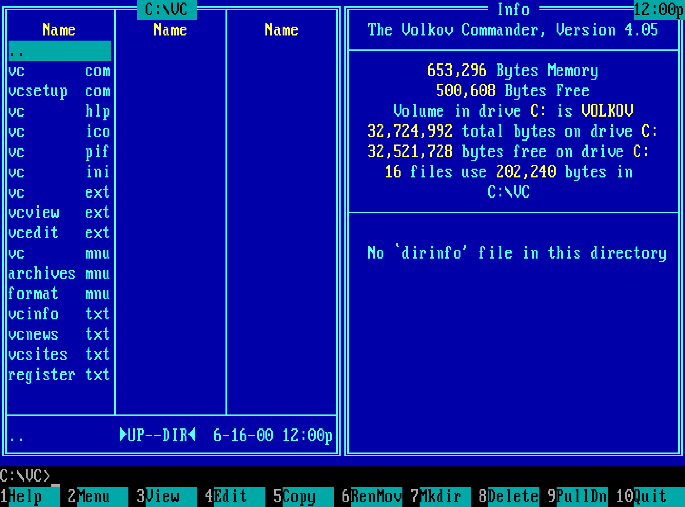

# Vibe Commander

<p align="center">
  
</p>
<p align="center">
  <em>Volkov Commander 4.05, as it starts up on the day of its release, 16 June 2000.<br>
  The original binary running under FreeDOS, captured by the harness in this repository.</em>
</p>

A faithful recreation of
[Volkov Commander](https://en.wikipedia.org/wiki/Volkov_Commander) 4.05, the
DOS file manager written by Vsevolod V. Volkov, carried from its original
assembly source to a port for modern operating systems.

The project is also an experiment in how far an AI coding agent can take such
a recreation on its own. The engineering work is done by Claude; a human sets
the direction and reviews the results.

## Approach

Fidelity is judged against the original program, at two levels:

- **Bytes.** The binaries Volkov shipped in 2000 are the reference: what is
  built here must match them byte for byte. His own toolchain, Borland's
  TASM and TLINK, is commercial software that this project does not fetch
  or run; matching his output with a free assembler shows that nothing was
  lost by replacing it.
- **Behaviour.** Volkov Commander draws everything on an 80x25 text screen,
  so what it shows can be compared exactly: every character and colour
  attribute, the cursor, and the files it leaves on disk. The original is
  run under DOS in an emulator and fed keystrokes, and what it does is
  recorded; a candidate fed the same keystrokes has to do the same. This is
  the test that will carry over to the port.

The byte comparison has one complication. The binaries Volkov shipped were
shareware, and contain registration code, tables and strings that the source
he later published leaves out. That material is his and is not reproduced
here. Instead, the source can be assembled with room reserved for it: the
same number of bytes in the same places, filled with NOPs and zeros. Every
other byte then sits at the address it has in the original, and must be
identical to it. The reserved room is 109 of 65,090 bytes in `VC.COM` and
691 of 24,278 in `VCSETUP.COM`, in five places each.

The planned stages:

1. Build the original source with free tools, byte for byte.
2. Translate the program from assembly to C, still for DOS, a few routines
   at a time. The translated routines are linked into the assembly program
   in place of the ones they replace, so that at every step there is one
   working program to hold against the original. Bytes no longer match from
   here on; behaviour has to, bugs included, with every intended deviation
   listed explicitly.
3. Give the C program a layer for what it asks of the operating system, and
   put modern operating systems under it next to DOS.

Where it stands: the first stage is done. Outside the reserved room, both
programs come out identical to the originals. The second stage has begun:
the program builds as `VC.EXE` from assembly and C together, and the first
routines run as C: those that write numbers, sizes, dates and times, those
that write lines of text with their markup, those that copy, trim and
shorten texts, paths and file names, those that look up colours and put
characters and colours into the copy of the screen that the program draws
in, those that read and write hex digits and numbers and hold a file name
against a mask, those that filter and sort the list of files of a panel and
find a file in it, those that say where the panels are and where in them
the cursor is, those that draw a panel of files: its frame, its path, its
files, its status line and the cursor, those that draw what a panel
shows instead of files: the tree of directories, with the cursor on the
current directory, and the Info, and those that read from the disk what a
panel shows: the files of a directory with its extension file and the
sizes of its directories, and for the Info the sizes of the disk, its
label and the text of dirinfo. The viewer is C: opening a file, for the
editor too, finding the lines, keeping a part of a large file in the
memory, writing the screen, its keys and the mouse, looking for a text,
and the way back to the panels; its texts, boxes and dialogs are
constants of C, in `port/view_t.c`. The editor is C as a whole: the text in
the memory with the buffer of the line that the cursor is in, the screen
brought up to where the cursor is, as text or in hex, with its status
line, what every key does, the search, and saving the file, with its
texts, boxes and dialogs constants of C in `port/edit_t.c`. The commands
that start the two are C as well, by themselves or by a program that an
extension file names, which is run with the viewer's memory given up
for it. The keys of the
panels are C: those that move the cursor by lines, columns and pages,
select files one by one and by a mask, switch the panels off and on,
swap them, make them of another kind and read them again, Tab,
Enter, which runs a file or a command, the keys that change the
directory, those that go to the command before and after, and F10. The
loop that takes a key
and goes to its command is C, with what the mouse does at the panels,
and so are what it does on the way: drawing the two panels and reading
what they show when that has changed, the box that asks for another
drive when a disk cannot be read, the box of DOS's critical error, which
names the drive or the device and asks whether to try again, and saving
the setup when it has
changed; and leaving the program. The texts and boxes of those two, the
program's title and the button Ok are constants of C, in
`port/main_t.c`. What the program does once it has
been started, and again whenever a command has run, is C: reading the
setup file and the main extension file, or taking the defaults, the
banner, asking DOS for the memory of its data and making the data of
what was kept, and finding out what the display, DOS and the
environment are like. Where DOS enters the program is C too: the check
sum of the file, the second copy that brings the program back after a
command, the block of memory made of the part that goes while a command
runs, and the relocations of that part. What runs a
command with most of the program out of the memory and loads it again,
to which Enter hands over, is C, and is the outermost loop of the
program now: it calls the rest of the program, which comes back to it
with commands to run or to leave. So is the
program's watch on DOS: the interrupts of DOS that it takes to note every program that is
run and every one that stays in the memory, the records it keeps of
those, by which the map of the memory lists them and releases them, and
its answer to a program that asks for its data, as its setup program
does. The help is C as a
whole: reading its file, showing the index
and the pages in their window, and taking the keys and the mouse there;
its file of the assembly is the first that is gone, with its texts, its
box and its buttons constants of C.
So is the tree of directories away from its panel: reading it from the
disk, keeping it in its file there, and the box in which a directory is
chosen from it; its title, the name of its file and the boxes shown
while it is read and saved are constants of C, in `port/treebox_t.c`.
The file search is C as a whole: the command with its
dialog, the drives it searches and Go to, and the search itself, by name
and by contents through a directory and those below it, with its list
and the keys taken while it runs; its dialog, its buttons and their
colours are constants of C, in `port/find_t.c`. Deleting a file or a directory with
what is in it, copying, renaming and moving one, and setting attributes,
a date and a time, are C, and so is what goes through the files of a
directory for these, the sizes of directories and the file search, and
through the files that a mask names. The commands of these are C from
the key on: Copy and Rename with what they offer as the target, their
dialogs, the tree to choose the target from, and the renaming of a
directory of a tree panel, and those that make a directory, delete, set
attributes and change the volume label; the texts, boxes and dialogs of
copying and renaming are constants of C, in `port/copy_t.c`, and those of
making a directory, deleting, the attributes and the volume label in
`port/dirfunc_t.c`. The map of the memory is C as
well: the blocks of DOS, whose they are and which vectors point into
them, its window, and programs that have stayed in the memory released;
the buttons of the window are constants of C, in `port/memory_t.c`.
Going through the selected files
of a panel is C too. At the panels the user menu is C, with what makes
the commands of a line of a menu or of an extension file and writes the
list of the selected files for them, and so are the command line, with
Esc and the names of the selected files and the paths of the panels put
into it, the history of commands in its box, the speed search, and the
box that asks for the drive of a panel; what these have of texts, boxes
and dialogs, the mask to select by, the question before leaving and the
user menu's, are constants of C, in `port/keys_t.c`. The dialogs are C: a box with its lines of text, the fields of a
dialog, a line to type
into, a group to choose from, a box to tick and a line of buttons, with
the keys and the mouse that each takes, and what the fields hold handed
back at the end. Waiting for a key is C, with the clock that it keeps on
the screen, the tap on Alt and the keys that the mouse clicks on the key
bar, and so are what a key does to a line that is typed into, the speed
search, the key bar, the menu bar, the command line with its prompt, and
finding what an extension file says for a file. The screen blanker is
C, with the word to DOS that the program is idle; what the blanker draws
is on no screen of a scenario (see `TODO.md`). What all of these rest on
is C too: putting a window of
the program's copy of the screen on the display, keeping what a box
covers and putting it back, the frame of a box with its shadow and the
box growing, the cursor, the mouse with its pointer and the second click,
the keys that wait, the bell, capitals, every call of DOS with the error
that it may end in, opening a file, asking DOS for the current directory,
and asking the user for the disk of a drive that shares the floppy drive
with another. Saving the setup is C, and so is the jump from a key to its
command, which was a table in the assembly. Of the three files of shared
routines one is gone, and nothing is left of the others but what passes
the rest of the assembly on to the C: the names of the menus in the
menu bar are constants of C, in `port/bars_t.c`, and the names of the
files that the program reads and the dialog that asks for a disk in
`port/system_t.c`.
The pull-down menus of the menu bar are C as well: the five menus with
their ticks and the items that cannot be chosen as things are, and the
keys and the mouse that the bar takes until an item is chosen. So are
the commands that the items stand for, in the same file of the source:
the kind of a panel, its order and its filter, a panel switched off and
on, the tree in a box to go to a directory, the sizes of directories,
the screen with as many lines as an EGA or a VGA has, two directories
compared, the configuration and the advanced options, the menu file and
the extension files opened in the editor, the switches of the Options
menu, and the setup saved; their texts, boxes and dialogs are constants
of C, in `port/commands_t.c`.

## Layout

| Path | Contents |
|---|---|
| `src/` | The Volkov Commander 4.05 source, adapted to assemble with JWasm |
| `port/` | The program on its way to C: `port/*.c` is what has been translated, with the tables of a file in the one next to it whose name ends in `_t`, and `port/asm/` what is still assembly |
| `tools/` | `mkexe.c` makes the port's `VC.EXE` out of what the linker produces; `routines.py` lists the routines that are still assembly; `flagscan.py` examines the callers of a routine before it is translated |
| `CMakeLists.txt` | Builds the assembler and the programs, and registers the tests |
| `harness/` | Compares a build with the original: byte for byte, and by running it under FreeDOS in QEMU against what the original did there, recorded in `harness/goldens/` |
| `docs/` | Pictures for this README |

## Building

Needs CMake 3.24 or later, a C compiler and `git`.

```sh
cmake -B build
cmake --build build
```

This fetches [JWasm](https://github.com/Baron-von-Riedesel/JWasm), a free
MASM-compatible assembler, at a pinned commit, builds it, and assembles
`src/` into `build/VC.COM` and `build/VCSETUP.COM`. It also assembles a
second copy of both into `build/shareware-layout/`, with the room reserved
that the byte comparison needs, and `VC` there once more as an object
file, for its relocations; only the tests use those.

It then builds the port, `build/port/VC.EXE`, which is what the tests
run. What the compiler made of each C file is written out as a listing,
`build/port/*.lst`, and the assembler's listing is `build/port/VC.LST`. For this it fetches a pinned
snapshot of [Open Watcom](https://github.com/open-watcom/open-watcom-v2), a
download of 150 MB. Open Watcom provides tools for Linux and macOS on x86-64
and ARM and for Windows on x86-64; the build has been run on Linux x86-64
only.

### Changes to the source

Everything changed since the source was imported can be listed with
`git diff $(git rev-list --max-parents=0 HEAD) -- src`. There are three
kinds of change.

**Syntax.** The original source is written for TASM; these changes make
JWasm accept it:

- The `JUMPS` directive is gone: JWasm lengthens out-of-range conditional
  jumps by itself. One `LOOP` that is out of range is spelled out as a jump
  over a jump.
- Structure fields are global names and labels inside procedures are global,
  as in TASM (`OPTION OLDSTRUCTS`, `OPTION NOSCOPED`).
- `LABEL` inside a `STRUC` became a zero-length field or, where the structure
  has initialised instances, an alias defined after it.
- Structure instances are written `<>` instead of `?`.
- Procedure headers use MASM's spelling for the language, `USES` and `LOCAL`.
- Code and code labels that sit in a data segment are preceded by
  `ASSUME CS:DGROUP`, an indirect `JMP` states its operand size, and
  `VcVers` is a text equate.
- `VCSETUP.ASM` declares its segments up front so that uninitialised data
  comes last and takes no space in the file.

**Encodings.** Where JWasm and TASM encode the same instruction
differently, the source now says which encoding to use, so that the output
matches the shipped binaries:

- Arithmetic on `AX` with a small constant carries `WORD PTR`, which selects
  the accumulator form of the opcode.
- A handful of jumps that TASM left in their long form are written that way
  explicitly, as `JMP NEAR PTR` or as a conditional jump over a jump.
- Two `LEA reg,address` are written as the `MOV` TASM turned them into, and
  one displacement is written so that it fits a byte.
- The byte-sized locals of `Input0` are declared two bytes long, because
  TASM gives each a whole word of stack.

**Layout.** `VCLAYOUT.INC` defines two macros, `ShwCode` and `ShwData`,
which are placed wherever the shipped binaries have something this source
does not. Each names a number of bytes. Normally they generate nothing.
When `SHAREWARE_LAYOUT` is defined they generate that many NOPs or zeros, so
that what follows lands where it does in the shipped binaries. The filler is
harmless: the program laid out this way still runs.

## The port

`port/` starts as a copy of the assembly in `src/` and ends as a C program.
In between it is both. A routine that has been translated is deleted from
`port/asm/` and leaves a few instructions behind that pass its callers on
to the C function; `git diff --no-index src port/asm` shows what is gone.
The C code keeps the names the routines and their data have in the
assembly, so that either can be found from the other. Where C code needs a
routine that is still assembly, the assembly gets an entry for it that C
can call. The two routines that the compiler calls to multiply and to
divide numbers of 32 bits, which a C library would bring, are C too,
`port/arith.c`: the program has no C library.

DOS, the BIOS and the mouse driver are called by software interrupts,
which C cannot express. The C code calls them in one file, `port/dos.c`,
and nowhere else: twelve small functions, each a line of C around the
instruction, which is inline assembly there, with the registers as its
arguments; one has three such instructions that may not be parted. Four more are there for a port of the machine and its
interrupt flag, for which the compiler has functions of its own, and for
DOS's routine that makes capitals. Everything else is plain C that calls
these, and reads the BIOS's data and the memory of the display through
pointers. That file is where the program will meet another operating
system; until the translation is done it hides nothing of DOS. The
assembly that is left calls interrupts itself; nothing in it does so for
C code.

The part of the program that stays in the memory while a command runs is
C in `port/resident.c`, as far as it is translated. The rest of the
program is not in the memory then, `port/dos.c` with it, so the build
compiles that file a second time, into that part: one source, two copies
of its code. `port/resident.c` has the only other inline assembly of the
port, four instructions where an interrupt arrives that the program has
taken, INT 21h and INT 27h: they make room on the stack for a second
return address, and an interrupt function of the compiler's takes over,
which saves the registers and finds the program's data. Such a function
has to go on in the handler that had the interrupt before, with the
stack as the interrupt left it, and C cannot change how deep the stack is
that it returns on: so it writes that handler's address into the room,
and returns there. The same four stand where DOS goes on when it has
ended the program by itself. In front of the four of INT 21h stand
thirteen more: every call of DOS that any program makes comes there
while the program is in the memory, and those that it does not deal
with, nearly all, are told from the others and passed on before
anything is pushed, by six comparisons, their jumps, and a far jump to
the handler before. So the program takes nothing of the stack of whoever
calls DOS, which may be short, and DOS is entered with the flags of
those comparisons, as in the original; compiled code saves registers
before it compares and promises nothing of the flags. And nine
instructions are the interrupt by which the COMMAND.COM in the memory
runs a command, INT 2Eh: it comes back with no stack and no data
segment, so both are set there, from the code segment, before any
compiled instruction runs, and the program goes on in a function of its
own on an empty stack. `port/main.c` has one instruction: where DOS
calls the program for a critical error, DS is loaded with the segment
of the main data, which is known only when the program runs.

The halves are linked into one program, `VC.EXE`, which is not built the
way a C program usually is. It still loads and starts like the `.COM` file
it was, keeps its data where the assembly put it, and gives up and reloads
most of itself at run time, compiled code included. `port/vc.h` describes
what that asks of the C code, and `tools/mkexe.c` how the file is made.
The code that begins the program and reloads it after a command had to
change for this: it measures in paragraphs and relocates what it has
loaded.

The file is the program as it lies in the memory. First comes the part
that stays there while a command runs: what is left of its assembly, its
compiled code, and its data with the stack at the end, which are nothing
but room in the file. Then, a
paragraph further on, the part that goes while a command runs. The
original has that part where the data of the first will be and moves it
up as it starts, over itself; the port is loaded with it in place, on its
own stack from the first instruction, and has only to make a block of
memory of it. That costs 6,384 bytes of the file, and it is what lets
compiled code stand in the first part at all: the assembler cannot lay
data over code that the compiler has yet to make. It also leaves the
code that begins the program in the memory, where the original lays its
data over that code.

Every step is checked by the `port` test below, and nothing else decides
whether a translation is right. The routines translated so far are listed
in `harness/ported.py`.

The program's texts and tables are checked by themselves, by the `data`
test: a table that no screen shows can be wrong in every scenario and
pass. The boxes and dialogs name their texts, their buttons and one
another by address, words that are offsets in the one segment the
assembly has them in. In C they are constants written with the names of
what they name, in files that hold nothing else (`port/help_t.c`, with
`port/tables.h` for how they are written): the compiler puts them into
the same group as the assembly's, so the two can name each other's while
both exist. They are apart from the code because the code has its data
segment on memory that the program asks DOS for, and would read a
constant that it names there. The test holds each against the original
by its name: the bytes, and for a word that holds an address the thing
that it names, which the original's source, assembled once more as an
object file, tells by its relocations.

The tests run the program that is shipped, as they run the original: a
driver in the machine takes either through the scenarios (see [When a step
is finished](#when-a-step-is-finished)). The driver also writes the
program's stack out whenever a step ends, and the `port` test reports for
every scenario how much of it the program never used.

The stack is where the port departs from the original in what it takes of
the memory. The original has 256 bytes of it. Compiled code uses more
stack than the assembly it replaces, and a stack used beyond its bottom
would overwrite data without a trace on the screen, so the port has 4,096
bytes, of which the scenarios use some 200. The stack is the end of the
part of the program that stays in memory while a command runs: that part
is 19,712 bytes where it was 12,704, and a command has 7,008 bytes less
than the original leaves it: 3,840 for the stack, and the rest because
compiled code is longer than the assembly it replaces, and because the
code that starts the program stays.

## Testing

Needs `python3`, `qemu-system-i386` and `mtools`, in addition to the above.

```sh
ctest --test-dir build --output-on-failure
```

| Test | What it checks |
|---|---|
| `bytes-match-original` | `VC.COM` and `VCSETUP.COM` from `build/shareware-layout/` are as long as the originals, hold only filler in the reserved room, and are identical to the originals everywhere else |
| `data` | Every text, box, dialog and table of the port that has the name of one of the original holds the original's bytes; a word that holds an address has that of what the original names there. No machine is run for it |
| `port` | The port does what the original did in every scenario: the same screen after every step, the same files on its disks. Every instruction of the assembly that has been translated ran in the original on the way, and every C function that replaces it ran in the port. The port is not more than three times the size of the original, and leaves at least half of its stack untouched in every scenario. And the comparison itself: with one cell of a screen changed, or one entry gone from a disk, it must report a difference |

### Scenarios and goldens

A scenario is a list of key presses, written down in `harness/scenarios.py`.
The original was taken through each one once, and what it showed after the
start and after every step, and what it left on its disks, is kept in
`harness/goldens/` as text. A build is right if it does the same. The
goldens are derived, never edited:

```sh
python3 harness/goldens.py derive [SCENARIO...]
```

Where a build is meant to differ from the original, `harness/deviations.py`
says how, and the golden is derived with that difference in it, so that it
holds exactly what a build should show. There are two such places. The
banner names the edition, and the published source is of another edition
than the binaries shipped in 2000: that holds for as much of the name as
shows, its beginning next to a panel on the right or its end next to one
on the left. And the program names its own file when
it cannot load it again after a command: the original is `VC.COM`, the port
`VC.EXE`.

Some numbers on the screen are not compared at all: the bytes that the
editor says it has free, the memory that the Info panel says is free, and
what `mem`, run as a command, says is in use and free. All follow the
size of the program, the last two the size of the part that stays in
memory while a command runs, or the Info's that of all of it when Memory
allocation is switched off. The port is larger than the original and has
less, by more with every routine translated, and the numbers are not
worth an expectation that follows the size of the build. Both screens
have `#` in their place when a build is held against a golden, so a
golden that was derived with a number still in it need not be derived
again.

Two more deviations show on no screen, and are listed in the same file.
When the original tries again to load itself after a command, it stores a
word through a segment register that is left on the DOS environment, and
the word lands in other data of its own. The port stores it where it
belongs. And of two codes in the markup of its texts, one for a colour and
one for a character, the original's routine that writes a line has each
for the other, unlike the routine that measures it and unlike Norton
Guides, where the markup comes from. The port has them agree. No text
uses either code.

`python3 harness/compare.py FILE [SCENARIO...]` takes any
`VC.COM` or `VC.EXE` through scenarios and reports where it departs from
the goldens. It needs the listing that the build writes next to the file. No test runs the programs assembled from `src/`, which the
byte comparison answers for; this is how to run them. The copy with the
reserved room has no edition name in its banner, and differs from the
goldens wherever the banner shows.

`python3 harness/show.py STEP...` prints the screens that the original
shows after each of some steps, or with `--program` those of a build. It
is how to find out what keys do before writing them into a scenario. With
`--changes` it prints of each screen only the rows that differ from the
one before, which is most of what there is to see; rows that are again as
they were after an earlier step, as when a dialog closes, it names in a
line. A step that the program does not get through ends the run after
five minutes, as in a test, or after `--limit SECONDS`, with the screen
it stopped on.

`python3 harness/reach.py ROUTINE...` says of each routine of the original
how many of its instructions some scenario has run and which are left, by
their addresses, in a line; with `--list` it prints those that are left as
the listing has them. With `--steps` it says which of them some steps
would reach, and takes `--limit` like `show.py`.

`python3 harness/notice.py FILE OLD NEW` makes one change to a copy of the
port, builds it, and says which scenario notices, or that none does. That
an instruction ran in the original does not mean that a screen shows what
it is for; this is how to find out, for a branch whose effect cannot be
pointed to in a golden.

`python3 harness/arithcheck.py build/port` holds the two routines of
`port/arith.c` against Python's arithmetic: it runs them, as the bytes
that the compiler made of them, on a model of the processor, with as
many pairs of numbers as it is told. No scenario would show a product
or a quotient that is wrong for some numbers only.

### The machines

DOS is booted once for each country that scenarios need, the United States
and Russia, and the machine is saved as it is about to start the program.
Every scenario then gets a machine of its own in that state, which takes a
tenth of a second: the program under test on drive `D:` with the original's
help and configuration files, started in `C:\WORK`, on disks that no other
scenario has touched, and on a third disk, one without a file system, the
script of the scenario. Keeping the program off the drive it displays stops
its file size from appearing on screen as free space. A scenario that wants
the program set up differently does that itself, through the menus. When a
build is tested, up to four scenarios run side by side.

The hard disks are SD cards, each in a controller of its own, which the
BIOS serves like any hard disk; DOS and the program know a disk only
through the BIOS. QEMU reads a sector of an SD card, as of a diskette,
while the machine executes the instruction that asks for it. A disk on
its IDE controller it reads in the background, and the BIOS asks in a
loop whether the sector is there yet: how often, depends on how busy the
computer is, and that made a machine's time of day differ from one run
to the next (see below). QEMU does not keep all of such a controller in
a saved state, so the harness notes where the BIOS has put each one and
tells the machine that goes on from the state, through the ports that
the BIOS used.

Where DOS loads the program is chosen: the driver of the tests keeps some
memory more than it needs, so that the original's stack ends where a page
of the machine's memory ends. QEMU has to look at every write to a page
with code in it that it has run, and the program has its code right
behind its stack: a push is many times slower there than elsewhere, which
is a third of the time of a scenario with dialogs or more. The port has
its texts behind its stack, more than a page of them, and does not
depend on where it is loaded.
`python3 harness/place.py` says where the stacks of the original and of
the port end on each bench.

Both machines have a mouse: the PS/2 mouse of QEMU's PC, and FreeDOS's
driver for it, CuteMouse, which the boot floppy lacks and the harness adds.
The program finds the driver and shows the pointer, a cell of the screen
with its colours exchanged, in the middle of every screen until a
scenario moves it. A step moves the mouse and presses its buttons by the
cell it goes to: "Click@3,5", "RightClick@3,6", "MiddleClick@3,7",
"Move@40,12"; a button held while the pointer moves is "Click@3,5>3,2".
CuteMouse takes a PS/2 mouse for one of two buttons until it is told of
the third, so the bench loads it with its option for that, /3.

The Russian machine also has a Russian keyboard: the keyboard driver of
FreeDOS with its Russian layout, which the boot floppy lacks and the
harness adds. It types Latin letters until Alt and the right Shift select
its Cyrillic ones, and a scenario can then type Russian text. The driver
takes 40 KB, so this machine shows less memory free than the other. The
other machine has the keyboard a PC has by itself, and no way to type a
letter beyond ASCII: Alt with the numeric keypad types nothing there.

The program is set up as its distribution sets it up, with one exception:
the clock in the corner of the screen is off. It would put the time of day
on every screen, and the machine's time is counted in the instructions it
executes (see below), of which the port takes more than the original to
get through a scenario. No setup file
is prepared for this. Whenever the harness sets up its machines, the
original is started once, made to switch the clock off in its Options menu
and to save its setup, and the `VC.INI` it writes is what every scenario
starts from. One scenario, `clock`, switches the clock on again.

### When a step is finished

The screen has to be read when the program has done all that a key makes
it do, and not before; and a key has to come when the program is ready for
it. Neither is decided from outside the machine. DOS loads a small
resident program before Volkov Commander, the driver of the tests
(`harness/DRIVER.ASM`, with `harness/driver.py` for the host's side), and
that takes the program through the steps of the scenario's script.

The driver stands in for nothing. A key is the scan codes that the
keyboard would send, handed to the keyboard controller with the command
it has for that, so the BIOS, and on the Russian machine the keyboard
driver of DOS, make of them what they make of a keyboard's: the key in the
BIOS's buffer, and Shift, Ctrl and Alt in its flags. Every request the
program makes for a key is answered by the BIOS as always. The mouse is
fed the same way: its packets, the buttons and how far it has moved, go
to the controller's auxiliary port, the BIOS hands them to the mouse
driver, and the mouse driver moves the pointer and answers the program.
A mouse does not say where it is, so a step takes the pointer to the top
left corner first and from there to its cell, in movements too small for
the driver to speed them up.

The driver only watches three interrupts on their way to their owners:
the one by which a program says that it is idle, which Volkov Commander
calls every time it has gone round waiting for a key; the BIOS's
keyboard interrupt, for a program that waits inside the BIOS; and the
mouse driver's, where the program asks which buttons are down. A button
of the mouse comes up when the program has asked that so many times: a
program that waits for it to come up is not idle, and asks nothing else.

When the program is idle and the BIOS's buffer is empty, it has taken
every key so far, and the driver hands over the next: so no key is ever
found waiting by a program that looks for keys while it works. Shift, Ctrl
and Alt go down and come up one at a time, with a round of the program
between. Where a scenario wants the program to find a key while it works,
as `find` does of a search, the key is written as one name with the key
that starts the work, "Enter+Home": the two go into the buffer together.
A step may also let time pass with nothing pressed, "Wait*18" for 18
ticks of the machine's timer, a second: the driver hands the program
nothing more until the BIOS's count of ticks has gone up by so many, and
the program does meanwhile what it does by itself, as after a minute
without a key, when it blanks the screen.
A step is finished when the program has gone round twice with no key left
and nothing that it will do by itself after a while, which the driver
reads in the program's own data: a time of day, which it believes for two
seconds, since the program's data holds no time that means anything
until the main loop has run. The driver then writes the screen, with
the cursor, to a port that QEMU keeps in a file, and goes on with the
next step; after the last it resets the machine, which ends QEMU. The
host starts the machine and reads the file and the disks afterwards.

The original and the port are driven alike, and neither is changed for it.
What the driver has to know of a program, its name and where two of its
variables are, it is told in the script, which takes that from the
listing of the program's assembly. It knows the program's call of the
idle interrupt from DOS's by where the call comes from: the memory of the
program that DOS has as the current one, and that has that name. None of this is measured
in time, and a busy computer makes a run slower, not different.

Where time is what the program goes by, it is the machine's, and the
machine's clock is counted in the instructions that the machine executes,
256 nanoseconds for each (QEMU's `-icount`): the timer's ticks, the time
of day and the waits of the program come when the machine has done so
much, not when the computer has had so long. Nothing of the computer's
time gets into it. Where the machine is halted, as the BIOS halts it
while a program waits there for a key, its clock goes straight on to the
next tick of the timer (`sleep=off`). Nothing in the machine waits for
the computer: its disks answer within the instruction that asks. And the
state that every scenario starts from is saved where the machine stops
itself, which the driver has it do, by the port QEMU has for that, when
it is loaded and finds no script. So every scenario begins at the same
instruction and the same time of day, and gets to each of its steps at
the same hundredth of a second, in every run and on a computer however
busy. The program's first screen comes some ten seconds past noon. A
scenario that shows the time of day still has to do so early, within the
machine's first minute: the port and the original do not execute the
same number of instructions, and their clocks drift apart by that.

With the clock on, when a golden is derived, the driver looks at the
screen every time the program comes round, for more than a second of the
BIOS's timer ticks, and writes out both states of what blinks.

Nothing waits without a limit. A program that hangs fails its scenario
when the driver has written nothing for five minutes, with the screen it
got stuck on, and one that resets its machine fails at once. Nothing
keeps runs of the harness apart: several checkouts may run their machines
on one computer at once, and each only gets slower.

### What ran

Which code ran is taken from QEMU's log of the code it translates, which
`harness/coverage.py` matches against the program file. For the original
it is recorded with the goldens, and mapped to source lines through the
listing of the build in `build/shareware-layout/`, which has every
instruction at the address it has in the original. The port's code is not
in the memory quite as it is in its file: the program adds the segment it
is loaded at to the words that its relocation table names, and the file
is held against the log with those words as the program has them where
it is.

The reserved room is listed in `harness/bytecheck.py`, with the offset and
length of each piece and a note of what the original has there.

## Running the original

Needs `python3`, `qemu-system-i386` and `mtools`.

```sh
python3 harness/screenshot.py
```

This downloads the Volkov Commander 4.05 shareware distribution and FreeDOS,
builds a boot floppy and a hard disk with the distribution unpacked in
`C:\VC`, boots the machine in QEMU, starts `VC` and waits for the screen to
stand still. It then writes to `out/`:

| File | Contents |
|---|---|
| `screen.png` | The display as the video card renders it |
| `screen.bin` | The text screen from video memory: 4000 bytes, a character and a colour attribute for each of the 80x25 cells |
| `screen.txt` | The characters of `screen.bin` as UTF-8 text |
| `screen.json` | Video mode, cursor position and shape, and which cells blink |

The run is repeatable: the PC's clock starts at noon on 16 June 2000 on every
boot and every file on its disks has a fixed date, so two runs give identical
files. The picture at the top is `screen.png` from
`python3 harness/screenshot.py --scale 3x4`, which enlarges the 720x400
display to roughly the 4:3 shape it had on a monitor.

## Using the port by hand

Needs the project built, and a terminal of 80 columns by 25 lines at least.

```sh
python3 harness/play.py
```

This starts the port, `build/port/VC.EXE`, on the machine of the tests, with
its screen in the terminal and the terminal's keyboard: FreeDOS from its
floppy, the bench's files on `C:` and the program on `D:`. `--original` runs
the original there, `--country ru` uses the Russian bench, and
`--display gtk` opens a window where there is a desktop. F10 leaves the
program, and the machine then switches itself off. The disks are made anew
every time, so nothing done there is kept.

## Origins

### The source

`src/` holds the contents of the 4.05 source archive published by the author:

- URL: <https://vc.vvv.kyiv.ua/download/src/vc405.zip>
- SHA-256: `c4ede94b833ea81da24483231de157bd64b67cf1ec66a77be383490046889c3e`

The first commit of this repository contains the 19 files of that archive
exactly as extracted. They are CP866 text with CRLF line endings, and git is
configured not to convert them.

The source builds two programs, `VC.COM` and `VCSETUP.COM`. It is a freeware
variant of 4.05: unlike the shareware binaries distributed in 2000, it has no
registration code.

### What the harness downloads

These are fetched into `downloads/` when first needed, checked against the
SHA-256 sums pinned in `harness/deps.py`, and never stored in the repository:

| What | From |
|---|---|
| Volkov Commander 4.05 shareware distribution | The author's site, <https://vc.vvv.kyiv.ua/download/vc405sw.zip> |
| FreeDOS 1.4 Floppy Edition, for its boot floppy | The FreeDOS project's download host, <https://download.freedos.org/1.4/FD14-FloppyEdition.zip> |
| FreeDOS 1.4 Lite USB image, for the keyboard driver and its layouts, which are among its packages | <https://download.freedos.org/1.4/FD14-LiteUSB.zip> |

### What the build downloads

CMake fetches these into the build directory, as pinned in
`CMakeLists.txt`:

| What | From |
|---|---|
| JWasm 2.20, as source at a pinned commit | <https://github.com/Baron-von-Riedesel/JWasm> |
| Open Watcom 2.0, the snapshot of 1 October 2026 with tools ready to run, pinned by SHA-256 | <https://github.com/open-watcom/open-watcom-v2/releases/tag/2026-10-01-Build> |

Both are open source under the Sybase Open Watcom Public License, which is
about the tools' own code. None of that code ends up in the programs built
here: the port is linked without Open Watcom's libraries.

## Licence

This project is released under the 3-clause BSD licence in `LICENSE`. That
covers everything written for it, including changes made to the files in
`src/`.

Volkov Commander is Copyright 1991-2000 Vsevolod V. Volkov and was released
by its author under the 2-clause BSD licence in `src/LICENSE.TXT`, which
continues to apply to his code.

The shareware distribution of Volkov Commander is proprietary and is not
part of this repository. The picture at the top shows it running.
