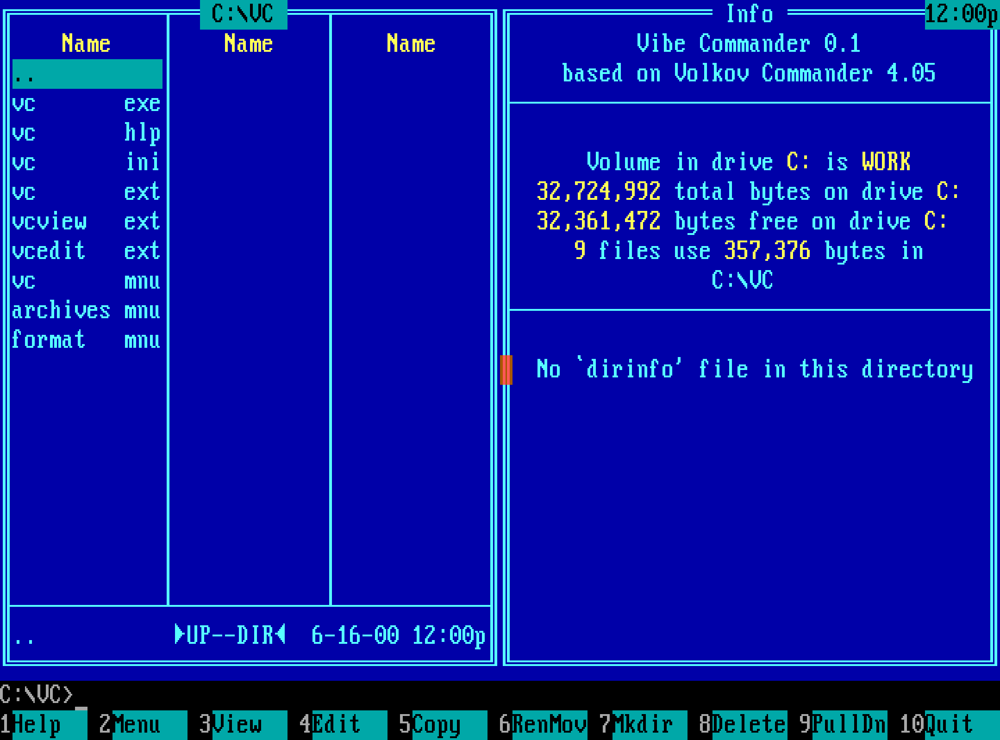

# Vibe Commander

<!-- The session is docs/vibe-commander-session.svg, made by
     python3 harness/session.py
     with the project built: see "The pictures". -->
<p align="center">
  
</p>
<p align="center">
  <em>Vibe Commander 0.1 running in a terminal on Linux, recorded from the program's own screens.</em>
</p>

Vibe Commander is a faithful recreation of
[Volkov Commander](https://en.wikipedia.org/wiki/Volkov_Commander) 4.05,
the DOS file manager written by Vsevolod V. Volkov. It starts from the
author's published assembly source, carries it to C, and from DOS to
modern systems. It runs on DOS, on Linux in a terminal, and as a web
page.

The project is also an experiment in how far an AI coding agent can take
such a recreation on its own. The engineering work is done by Claude. A
human sets the direction and reviews the results.

## What it is

The source is three trees, and they tell a story in that order.

- **`src/asm/`, the assembly.** Volkov Commander 4.05 as its author
  published it, changed only as far as building it with free tools
  takes. Built here, it matches the binaries he shipped byte for byte.
- **`src/c/`, the C translation.** The same program translated to C for
  DOS. It behaves as the original does, bugs included, and every test
  scenario holds it to the original. It is finished and frozen.
- **`src/portable_c/`, the portable C.** It began as a copy of `src/c/`
  and is where the work goes on. It calls itself Vibe Commander 0.1,
  "based on Volkov Commander 4.05". It still asks the system what it
  asked DOS and the BIOS, through one header, `sys.h`, and each platform
  answers as DOS would.

Fidelity is judged against the original program. Volkov Commander draws
everything on an 80x25 text screen, so what it shows can be compared
exactly: every character and colour, the cursor, and the files it leaves
on disk. The original was run under DOS in an emulator and fed
keystrokes, and what it did was recorded. A build fed the same
keystrokes has to do the same. Where the portable C is meant to behave
otherwise, the difference is declared in
[`src/portable_c/DEVIATIONS.md`](src/portable_c/DEVIATIONS.md).

## Platforms

| Platform | What it is |
|---|---|
| DOS | `VC.EXE`, a 32-bit program started by the DOS/32A extender, with all of the machine's memory for its panels and editor |
| Linux | `vc`, a 64-bit program built with clang that runs in any terminal, with no library. Drives R: (the root) and H: (the home directory); long names get DOS aliases such as `LONGNA~1`; commands run through `$SHELL` |
| Web | One HTML page, built to WebAssembly by Emscripten. The screen is text in a `<pre>`. It is served by its own small Node server, or by any static host, and works on a phone |

## Repository layout

| Path | Contents |
|---|---|
| `src/asm/` | The original assembly source, adapted to assemble with JWasm |
| `src/c/` | The C translation: one C file per part of the program, with its tables in the matching `_t.c` file |
| `src/portable_c/` | The portable C. `sys.h` is what it asks of the system. Files ending in `_dos.c` answer it for DOS, `_posix.c` for Linux, `sys_web.c` and `web/` for the web page. Every other file is common. Files starting with `st` are the original's setup program |
| `harness/` | The test harness: scenarios, recorded goldens, the test bench in QEMU, and the checks |
| `tools/` | Build helpers: `mkexe.c` lays out the C translation's `VC.EXE`, `stub.c` silences the extender's banner, `figures.py` and `calls.py` measure the portable C |
| `docs/` | Reference documentation and the pictures |

## Building

You need CMake 3.24 or later, a C compiler and `git`. Clang is optional:
with it, the build also makes the program for Linux.

```sh
cmake -B build
cmake --build build
```

The build fetches its own tools, pinned (see [Downloads](#downloads)).
It makes:

| Output | What it is |
|---|---|
| `build/VC.COM`, `build/VCSETUP.COM` | The original, assembled by JWasm |
| `build/c/VC.EXE` | The C translation, compiled by Open Watcom for 16-bit DOS |
| `build/portable_c/VC.EXE` | The portable C for DOS, compiled by Open Watcom's 32-bit compiler with DOS/32A in front |
| `build/portable_c/debug/VC.EXE` | The same, unoptimised, with source lines in its listings, for finding faults |
| `build/portable_c/posix/vc` | The program for Linux, with the usual hardening (needs clang) |
| `build/portable_c/posix-asan/vc` | The same with the address, undefined-behaviour, integer and implicit-conversion sanitizers; the tests run this one |

Two CMake options choose the large downloads:

- `-DVC_WEB=ON` fetches Emscripten (300 MB, 1.5 GB unpacked) and builds
  the web page, `build/portable_c/web/vc.html`, and the static site,
  `build/portable_c/web/static/`. Node is then required.
- `-DVC_DOS=OFF` leaves out Open Watcom and everything for DOS. What is
  left is the original assembled, the programs for Linux and the web,
  and their tests.

A second build directory can reuse the first one's Emscripten with
`-DFETCHCONTENT_SOURCE_DIR_EMSCRIPTEN=<first>/_deps/emscripten-src`.

The memory sanitizer cannot be combined with the others, so its build
is made only on request:
`cmake --build build --target portable_c-posix-msan`.

## Running

### On DOS

The DOS programs run on the test bench: FreeDOS in QEMU, with the
bench's files on `C:` and the program on `D:`. This needs `python3`,
`qemu-system-i386` and `mtools`, and a terminal of at least 80x25.

```sh
python3 harness/play.py                 # the portable C
python3 harness/play.py --tree c        # the C translation
python3 harness/play.py --original      # Volkov Commander 4.05 itself
```

`--country ru` uses the Russian bench, and `--display gtk` opens a
window. F10 leaves the program and the machine switches itself off. The
disks are made anew every time, so nothing is kept.

<p align="center">
  
</p>
<p align="center">
  <em>The portable C under FreeDOS, on a PC whose clock reads 16 June 2000, the day Volkov Commander 4.05 was released.</em>
</p>

`python3 harness/screenshot.py` boots the original from its shareware
distribution and saves its screen to `out/`, as a PNG, as text and as
the raw 4,000 bytes of video memory. With `--program FILE` it runs a
build instead, through the keys that follow. Two runs give identical
files.

### On Linux

In a terminal of at least 80 columns by 25 rows:

```sh
cd ~ && /path/to/checkout/build/portable_c/posix/vc
```

The program uses the terminal's alternate screen and gives it back when
F10 leaves. It keeps its setup in `~/.config/vc/vc.ini`
(`$XDG_CONFIG_HOME/vc` where that is set). The help and the menu files
are the original's and are not shipped: to have F1 and F2, copy
`VC.HLP`, `VC.MNU`, `VC.EXT` and the other files of the shareware
distribution into `~/.config/vc`. `python3 harness/deps.py` downloads
the distribution to `downloads/vc405sw.zip`. Ctrl-O shows the output of
the last command. [docs/linux.md](docs/linux.md) has the details.

### As a web page

With `-DVC_WEB=ON`:

```sh
cmake --build build --target portable_c-web-serve
```

This builds the page and serves it on `http://127.0.0.1:8437/` with one
drive, C:, labelled VC, which holds C:\VC, the program's own files; the
page starts there. Bring files in with Upload, or by dragging them onto
the page. Changes are written to the server's directory. The server can
also be run by hand:

```sh
node src/portable_c/web/server.mjs --port 8437 \
    --page build/portable_c/web/vc.html \
    --drive-c DIR
```

The server listens on 127.0.0.1 only. To reach it from a phone, put an
HTTPS reverse proxy in front of it, for example
`tailscale serve --bg 8437`. Anyone who can reach the page can write to
its drive, so the proxy is the access control.

The static site, `build/portable_c/web/static/`, needs no server: any
static host serves it, and the page keeps the user's changes in the
browser. To try it locally:
`python3 -m http.server -d build/portable_c/web/static 8438`. The
workflow `.github/workflows/pages.yml` publishes it to GitHub Pages. It
runs only by hand, and only once the repository variable `VC_PAGES` is
`publish` and Pages is switched on.

The page cannot run commands, since a browser has no shell.
[docs/web.md](docs/web.md) has the details, including the phone's key
row and the keys a browser keeps for itself.

## Testing

The tests need `python3`, `qemu-system-i386` and `mtools`. Some need
more and are skipped without it: `gcc` for `portable_c-host`, `clang`
for the source checks and the programs for Linux, `clang-tidy` version
23 for `portable_c-tidy`, `node` for the web, and `chromium` on the path
for `portable_c-web-browser`.

```sh
ctest --test-dir build --output-on-failure      # everything
ctest --test-dir build -LE machine -j4          # the fast tests, a minute or two
ctest --test-dir build -R portable_c -j4        # what a change to the portable C needs
```

The labels are `portable_c`, `frozen` (the assembly and the C
translation), `harness`, and `machine` for the tests that start a
machine or take a program through every scenario. Those take several
minutes each.

The heart of the testing is the scenarios. A scenario, in
`harness/scenarios.py`, is a list of key presses and mouse moves. The
original was taken through each one under FreeDOS in QEMU, and what it
showed after every step, and the files it left, are kept in
`harness/goldens/`. A build passes a scenario when it does the same,
cell for cell. The goldens are derived by
`python3 harness/goldens.py derive` and never edited by hand. Where the
portable C is declared to differ, a patch in
`harness/goldens/portable_c/` or a rule in `harness/deviations.py` says
how. [docs/testing.md](docs/testing.md) explains the bench, the driver
in the machine, and how coverage is measured.

| Test | What it checks |
|---|---|
| `asm-bytes` | The assembled original is identical to the shipped binaries, apart from the room reserved for the shareware's own code |
| `c-data` | Every text, box, dialog and table of the C translation holds the original's bytes |
| `c-arith` | The C translation's routines for 32-bit multiplication and division, against Python |
| `c-scenarios` | The C translation through every scenario, and every translated instruction run by some scenario |
| `portable_c-data` | `c-data` for the portable C, with declared differences |
| `portable_c-scenarios` | The portable C for DOS through every scenario, against the goldens with declared differences |
| `portable_c-layout`, `portable_c-debug-layout` | The two DOS programs as the linker laid them out |
| `portable_c-host` | The source as gcc reads it for a 64-bit machine, counted against a record |
| `portable_c-int16` | Arithmetic that counts on a 16-bit `int`, each place with its reason |
| `portable_c-words` | How often each word for a place in memory is used, against a record |
| `portable_c-width` | The width and sign of every 8- and 16-bit number, with clang's conversion warnings |
| `portable_c-cut` | A narrowing cast that Open Watcom loses, nowhere in the source |
| `portable_c-tidy` | The common code and the Linux files, with clang's warnings and clang-tidy |
| `portable_c-posix-unit` | What the Linux build emulates of DOS: names, aliases, code page, drives |
| `portable_c-terminal` | What the Linux program draws in a pseudo-terminal, replayed through pyte |
| `portable_c-posix-scenarios` | The Linux program through the scenarios, with masks for what is the host's |
| `portable_c-cap` | The cap on the memory of the program's blocks on each platform |
| `portable_c-web-probe` | Every file of the web build compiles for WebAssembly |
| `portable_c-web-scenarios` | The web program under Node through the scenarios |
| `portable_c-web-page` | The page's scripts in Node, against its server and as a static site |
| `portable_c-web-browser` | The page in headless Chromium, on a desktop and as an iPhone |
| `portable_c-web-render` | The page's drawing, keys and mouse modules in Node |
| `portable_c-web-server` | The web server's API and its refusal of every path outside its drives |
| `harness-le` | The harness's reader of 32-bit DOS programs |

The web tests other than `portable_c-web-render` and
`portable_c-web-server` need `-DVC_WEB=ON`.

## The pictures

The animation at the top is made by `python3 harness/session.py`, with
the project built with `-DVC_WEB=ON` for the font. It runs the Linux
program in a pseudo-terminal through a fixed list of keys and draws each
screen as a frame of an SVG that animates by CSS alone. Two runs give
the same file.

The DOS screenshot is made by

```sh
python3 harness/screenshot.py --scale 3x4 --program build/portable_c/VC.EXE \
    --home C "F9 o l" Ctrl+l Wait*9
```

## Further reading

| Document | What it holds |
|---|---|
| [docs/translation.md](docs/translation.md) | How the assembly is built byte for byte, and how the C translation is made and laid out |
| [docs/portable-c.md](docs/portable-c.md) | The portable C for DOS: its layout, the system interface `sys.h`, the extender, and its figures |
| [docs/linux.md](docs/linux.md) | The program for Linux: what it emulates and how it is tested |
| [docs/web.md](docs/web.md) | The web page: its drives, its server, the phone, and its tests |
| [docs/testing.md](docs/testing.md) | The scenarios, the goldens, the bench and the driver |
| [src/portable_c/DEVIATIONS.md](src/portable_c/DEVIATIONS.md) | Every place where the portable C behaves otherwise than the original, and why |
| [CLAUDE.md](CLAUDE.md) | The rules the work follows, and the decisions behind them |
| [TODO.md](TODO.md) | What is left to do |
| [DIARY.md](DIARY.md) | How the work got here, day by day |

CLAUDE.md, TODO.md and DIARY.md are the working notes of the AI-driven
process by which the project is made, kept as they were written.

## Downloads

Nothing third-party is stored in the repository. The harness fetches
these into `downloads/` when first needed, checked against SHA-256 sums
in `harness/deps.py`:

| What | From |
|---|---|
| Volkov Commander 4.05 shareware distribution | The author's site, <https://vc.vvv.kyiv.ua/download/vc405sw.zip> |
| FreeDOS 1.4 Floppy Edition, for the boot floppy | <https://download.freedos.org/1.4/FD14-FloppyEdition.zip> |
| FreeDOS 1.4 Lite USB image, for the keyboard driver and its layouts | <https://download.freedos.org/1.4/FD14-LiteUSB.zip> |
| pyte 0.8.2, a terminal emulator in Python (LGPL 3), for `portable_c-terminal` | The Python Package Index, <https://pypi.org/project/pyte/0.8.2/> |

CMake fetches these into the build directory, pinned in
`CMakeLists.txt`:

| What | From |
|---|---|
| JWasm 2.20, as source at a pinned commit | <https://github.com/Baron-von-Riedesel/JWasm> |
| Open Watcom 2.0, the snapshot of 1 October 2026, pinned by SHA-256 (150 MB) | <https://github.com/open-watcom/open-watcom-v2/releases/tag/2026-10-01-Build> |
| Emscripten 6.0.12 with its LLVM and Binaryen, pinned by SHA-256, only with `-DVC_WEB=ON` | <https://storage.googleapis.com/webassembly/emscripten-releases-builds/linux/6e9f6885cb17a3d6c8fd488a5cff730f50aba61d/wasm-binaries.tar.xz> |
| The Ultimate Oldschool PC Font Pack 2.2 by VileR, pinned by SHA-256, only with `-DVC_WEB=ON` | <https://int10h.org/oldschool-pc-fonts/download/oldschool_pc_font_pack_v2.2_web.zip> |

The original source in `src/asm/` is the author's 4.05 source archive,
<https://vc.vvv.kyiv.ua/download/src/vc405.zip> (SHA-256
`c4ede94b833ea81da24483231de157bd64b67cf1ec66a77be383490046889c3e`).
The first commit holds its 19 files exactly as extracted: CP866 text
with CRLF line endings, which git is configured not to convert. It is a
freeware variant of 4.05 and lacks the shareware's registration code.

## Licences and credits

This project is released under the 3-clause BSD licence in
[`LICENSE`](LICENSE). That covers everything written for it, including
the changes to the files in `src/asm/`.

| Work | Copyright | Licence | Text |
|---|---|---|---|
| Volkov Commander 4.05 | 1991-2000 Vsevolod V. Volkov | 2-clause BSD | [`src/asm/LICENSE.TXT`](src/asm/LICENSE.TXT) |
| DOS/32A, the DOS extender linked into the DOS programs of the portable C | 1996-2006 Narech K. | its own licence | [`LICENSE.DOS32A`](LICENSE.DOS32A) |
| Emscripten 6.0.12, whose runtime is in the web page | 2010-2014 the Emscripten authors | MIT and University of Illinois/NCSA | [`LICENSE.EMSCRIPTEN`](LICENSE.EMSCRIPTEN) |
| musl, the C library in the web page's WebAssembly | 2005-2020 Rich Felker, et al. | MIT | [`LICENSE.MUSL`](LICENSE.MUSL) |
| Web437 IBM VGA 8x16 from the Ultimate Oldschool PC Font Pack, used unchanged in the web page and the animation | 2016-2020 VileR | CC BY-SA 4.0 | [`LICENSE.FONT`](LICENSE.FONT) |

**This product uses DOS/32 Advanced DOS Extender technology.**

The extender's stub comes with the Open Watcom download and is linked
into `build/portable_c/VC.EXE` and `debug/VC.EXE` at build time. It is
not stored in the repository. Its licence text is kept here because a
program built with it has to carry it. The web page's "Licences" dialog
shows every licence above except DOS/32A's, since the page does not
carry the extender. What the page may have of LLVM's runtime is under
Apache-2.0 with the LLVM exception, which asks nothing of a compiled
program.

The goldens in `harness/goldens/` are recordings of the original
program's screens, which include its help text, Copyright © Vsevolod V.
Volkov. They are kept as test data.

JWasm and Open Watcom are open source under the Sybase Open Watcom
Public License. None of their code ends up in the programs built here:
the C trees are linked without Open Watcom's libraries.

The shareware distribution of Volkov Commander is proprietary and is not
part of this repository. The DOS screenshot shows the portable C in its
directory, with the shareware's files beside it. The animation has none
of them, only a few files written for it, `harness/session_files`.
