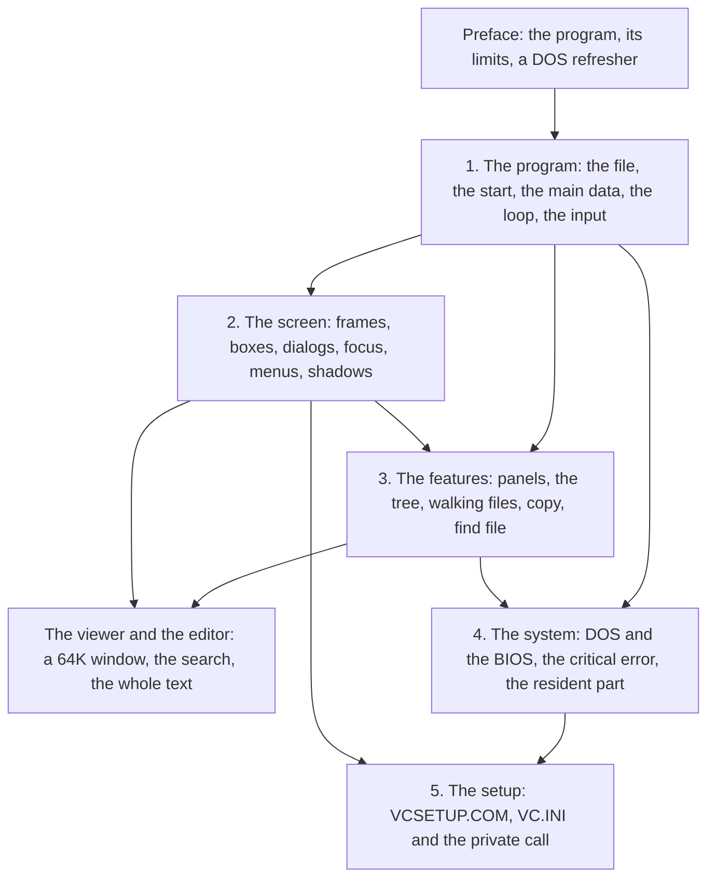

# Preface

## What Volkov Commander was

Volkov Commander is a file manager for DOS by Vsevolod V. Volkov, in
the manner of the Norton Commander: two panels of files side by side,
a command line under them, a row of function keys at the bottom, and a
menu bar that drops down from the top. Its banner says "Copyright (C)
1991-2000"; this book is about version 4.05, from 2000. Volkov distributed it
as shareware, and published its source, in assembly, as the freeware
edition of 4.05.

What it does is a long list for any program of its day. Two panels,
each a list of files in brief or full form, a tree of the disk, or an
information panel, filtered by a mask and sorted five ways. Copy, move
and rename, of files and of whole directories, a file split across
diskettes when one fills up. Delete, attributes, dates and times. A
viewer for files of any size, in text or hex, with a search; an editor
that undoes the changes to a line; a search for files across every
drive, inside them too. A user menu and extension files with macros, a
history of commands, the mouse everywhere, a clock, a screen saver, a
help of 62 pages, a manager for the resident programs that the user
starts, and a map of the memory. And a separate setup program, with an
editor for three palettes of forty colours.

All of it is in one file of **65,090 bytes**, `VC.COM`. The setup
program, `VCSETUP.COM`, is 24,278 bytes more; the help, `VC.HLP`,
68,836 bytes, is read from the disk a page at a time; the settings,
`VC.INI`, are 511 bytes. And while the user's own command runs, the
commander keeps **12,690 bytes** of itself in memory.

## The constraints

The program is written for the 8086 in real mode, and for DOS 3.20 or
later. Five limits shape everything in it.

- **A `.COM` file is one segment.** DOS loads it at offset 100h of a
  single 64K segment, behind 256 bytes of its own, so the code, the
  tables and the texts together can have at most 65,280 bytes. `VC.COM`
  ends 190 bytes short of that.
- **Its data cannot be in the file.** The program's state, the *main
  data*, is a structure of **62,603 bytes**, and each of the two panels
  is at least 6,754 more. None of it is in `VC.COM`: it is laid over
  memory that DOS hands out when the program starts, and the program
  will not start with less than 84,144 bytes for it.
- **The machine has 640 KB, and the user wants them.** A file manager
  that runs other programs must get out of their way. With Memory
  allocation in its small mode, as distributed, the commander gives back
  its data and its code and keeps the 12,690 bytes; with it off, the
  code stays too, 76,050 bytes in all.
- **The stack is 256 bytes.** The program sets up its own stack before
  anything else, and every routine lives within it.
- **An offset is 16 bits.** A panel's list of files ends inside its
  64K segment, so a panel holds at most 2,703 files; the tree holds 767
  directories; the viewer looks at a file through a window of 64K.

## The question

How did Volkov fit so much into so little? Not by one trick but by a
habit, applied everywhere: a buffer that is idle is borrowed rather
than a new one added; a table is read by one routine instead of code
written for each case; whatever DOS already does, DOS is made to do;
and code is shared by falling into it and jumping into it, not only by
calling it. This book follows that habit through the source, a routine
at a time, with the bytes that each choice costs or saves.

## A DOS refresher

The chapters take a few facts about real-mode DOS for granted. They are
all here.

**Segments and paragraphs.** The 8086 makes a 20-bit address of two
16-bit registers, `segment * 16 + offset`. A *paragraph* is 16 bytes,
so two segments one paragraph apart overlap in all but 16 bytes. Four
segment registers say where the code is (CS), the data (DS and ES) and
the stack (SS), and an instruction reaches only what those point at,
64K each, without loading one of them first. A program that keeps
every pointer as an offset within one segment never loads a segment
register to follow one.

**A `.COM` file.** DOS loads it at offset 100h of a segment, with CS,
DS, ES and SS all on that segment, SP at its top, FFFEh, and a word of
0 pushed there, so that a near `RET` from the first level goes to
offset 0, where the PSP begins with `INT 20h`, "end the program". There
is no header and no relocation: the file is the bytes. The program gets
the largest free block of memory, which in practice is all of it.

**The PSP.** The Program Segment Prefix is DOS's 256 bytes in front of
the program. Volkov Commander uses these fields:

```
PSP:0000  CD 20       INT 20h, the old way to end
    0002  word        the segment where the program's memory ends
    000A  dword       where DOS goes on when the program ends (INT 22h)
    000E  dword       DOS's Ctrl-C handler for this program (INT 23h)
    0012  dword       DOS's critical error handler (INT 24h)
    002C  word        segment of the environment
    005C  16 bytes    FCB 1, parsed from the command tail
    006C  16 bytes    FCB 2
    0080  byte        length of the command tail
    0081  127 bytes   the command tail, ended by a CR
```

When a program ends, DOS puts INT 22h, 23h and 24h back from the PSP's
copies.

**Memory.** DOS hands out memory in paragraphs and names each block by
its segment: INT 21h function 48h asks for a block of BX paragraphs,
49h gives one back, 4Ah makes one longer or shorter. Asked for FFFFh
paragraphs, which no machine has, 48h fails and says in BX how much
the largest block holds: that is how a program learns what there is.
Each block has a 16-byte header in the paragraph in front of it, the
*memory control block* or MCB: `'M'`, or `'Z'` for the last block, at
byte 0, the owner's PSP at byte 1, the length in paragraphs at byte 3.
Nothing stops a program from writing one.

**Interrupts as an API.** The first kilobyte of memory is 256 far
pointers, the interrupt vectors. `INT 21h` is DOS, with the function
number in AH; `INT 10h` is the video BIOS, `INT 16h` the keyboard,
`INT 33h` the mouse driver. DOS reports failure with the carry flag
and an error number in AX. A program may read who has a vector (AH
35h) and point it at its own code (AH 25h).

**The screen and the keyboard.** A colour adapter shows the 80 x 25
characters of its text screen from `B800:0000`, a monochrome one from
`B000:0000`: two bytes a cell, the character and then its colour, 80
cells a row, so that writing a word there puts a character on the
screen with no call at all. The BIOS keeps its own data at segment
40h: the offset of the page shown at `0040:004Eh`, the count of timer
ticks, 18.2 a second, at `0040:006Ch`. A key comes from the BIOS as
one word, the scan code in the high byte and the character in the low
byte: 4800h is Up, 1C0Dh is Enter.

## How to read this book

The book is about the original program, Volkov's assembly in
`src/asm/`. Each chapter can be read alone, but they build on one another:



[Chapter 1](01-the-program.md) is the skeleton: how the source is put
together, what is in the file, how the program cuts up memory, the main
data and the panels, the main loop and the input.
[Chapter 2](02-the-screen.md) is the text-mode toolkit on top of it: the
frames, the boxes and dialogs described as tables, focus, menus, the
key bar, shadows and what a box saves of what it covers.
[Chapter 3](03-the-features.md)
is what the program does with files on that skeleton, and
[the viewer and the editor](viewer-and-editor.md) are F3 and F4, which
have a chapter of their own.
[Chapter 4](04-the-system.md) is the conversation with DOS and the PC,
and the part of the program that stays in memory while a command runs.
[Chapter 5](05-the-setup.md) is the second program, and the file and
the private call that join the two.

Each topic is explained in one place, and the other chapters link to
it; each chapter ends with what to read next, in the source and in the
book. The [contents](README.md) list every section.

**The excerpts.** Code is quoted from `src/asm/` with Volkov's labels,
instructions and comments. A comment that starts with `;;` is the
book's and one with a single `;` is Volkov's. Volkov's
names are a numbering, not words, and chapter 1 explains them. Where
his comments disagree with his code, the book says so, and the code is
what runs. The source files are CP866 text, the code page of Russian
DOS: `iconv -f cp866` makes them readable on a modern system.

**The figures.** Sizes and offsets come from the assembler's listing of
the source, built to the layout of the binary that Volkov shipped: the
published source reserves room for what only the shareware edition had,
so that every byte lands where it is in the shipped `VC.COM`, and the
figures are the shipped file's (chapter 1 explains how). Numbers in hex
end in `h`, as in the source. Offsets in the program count from the
start of the PSP, so the first byte of the file is at 100h.

**The screens** are the shipped program's own, recorded as it ran,
drawn in the VGA font at twice their size.

The figures that recur:

| What | Bytes |
|---|---:|
| `VC.COM`, the commander | 65,090 |
| `VCSETUP.COM`, the setup program | 24,278 |
| `VC.HLP`, the help | 68,836 |
| `VC.INI`, the settings | 511 |
| what stays in memory while a command runs, in the small mode of Memory allocation, the default | 12,690 |
| what stays with Memory allocation off | 76,050 |
| the main data, `MainDat` | 62,603 |
| a panel, `WCBdef`, at the least | 6,754 |
| the transient part: code, tables and texts | 63,323 |
| the stack | 256 |
