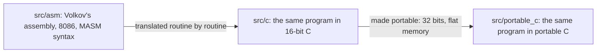
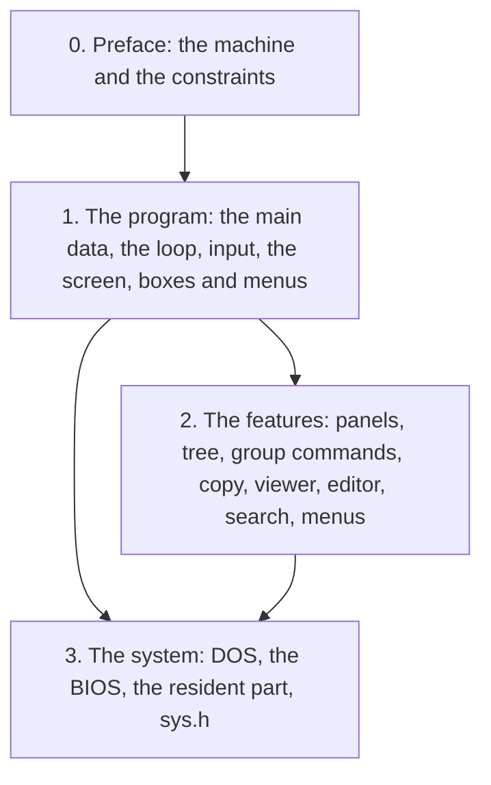

# Preface: a commander in 64 kilobytes

*Volkov Commander 4.05, as it starts on a PC with DOS: two panels of
files, the command line, the key bar.*

## The program

Volkov Commander is a file manager for DOS. Vsevolod V. Volkov had the
idea on 15 May 1991, began it the next day, and dated his last version,
4.05, 16 June 2000; the head of `src/asm/VC.ASM` still says so. It is a
clone of the Norton Commander, the program that taught a generation of
PC users to manage files in two blue panels: Tab moves between them, F5
copies from one to the other, F3 views, F4 edits, F8 deletes, F9 opens a
menu bar, and the bottom row of the screen says which function key does
what. Under the panels a DOS command line is always there, so the
commander is also a shell.

What made Volkov's program famous was its size, and its speed on the
slow machines of the day. Volkov Commander 4.05 is one file of **65,090 bytes**, `VC.COM`, and holds two
panels of files with five orders and a filter, a tree of the disk, a
viewer with hex and search, an editor, copy, move and delete through
whole trees of directories, a file search on all drives that also looks
inside files, a user menu and extension files with macros, a history of
commands, a clock, a screen blanker with a starry sky, mouse support,
and a menu bar with dialogs for all of it. Its setup is a second file of
24,278 bytes, `VCSETUP.COM`. It was written entirely in 8086 assembly,
33,836 lines of it in sixteen files, 27,190 of them for `VC.COM`, which
Volkov published.

This book is about how that fits.

## The machine it was written for

A reader who knows a modern toolchain needs five facts about the PC and
DOS to read the rest.

**Memory is addressed by segment and offset.** The 8086 has 16-bit
registers and a 20-bit address bus. An address is a segment, which the
processor multiplies by 16, plus an offset: `B800:0000` is byte
`B8000h`. One segment register reaches 64 KB, and a program that wants
more has to load another segment into DS or ES and keep track of which
is which. DOS gives a program at most the 640 KB below `A0000h`, less
what DOS itself and the resident programs loaded before it take: on a
typical machine of 1995, some 550 to 600 KB.

**A .COM file is one segment.** DOS loads it at offset 100h of a segment
and points CS, DS, ES and SS all at that segment. The 256 bytes in
front, offsets 0 to FFh, are the PSP, the Program Segment Prefix: DOS
puts there the command line the program was started with (at 80h), the
segment of its environment strings (at 2Ch), and the addresses DOS goes
back to when the program ends (at 0Ah). Code, constants, variables and
the stack all share the one 64K segment, so a .COM file can be no more
than 64K less the PSP, 65,280 bytes. `VC.COM` is 190 bytes short of
that.

**DOS is called through INT 21h.** The program puts a function number in
AH and its arguments in other registers, executes `INT 21h`, and finds
the answer in AX with the carry flag set on an error: 3Dh opens a file,
3Fh reads, 4Eh finds the first file of a pattern, 4Bh runs another
program. The BIOS has its own interrupts, INT 10h for the screen and
INT 16h for the keyboard, and the mouse driver has INT 33h.

**The screen is memory.** In text mode the display shows a page of
memory at `B800:0000`: 80 by 25 cells of two bytes, a character of code
page 437 and an attribute byte, four bits of foreground colour and three
of background with a blink bit on top. A `MOV` into that memory is on the
screen at once. Everything a commander draws, boxes, shadows, menus, is
bytes written there.

**A program can stay behind.** A TSR, "terminate and stay resident",
ends with a DOS call that keeps part of its memory, and can hook
interrupts so that it runs again later. DOS itself offers the reverse:
a program can give back memory it does not need while it runs another
program.

## The constraints that shaped it

Each of those facts is a constraint on the commander, and the code is
an answer to each.

- **64 KB of code and constants.** Every routine of the program and
  every text, box, dialog, menu and key table has to fit one segment
  with the PSP and the stack. So texts are written in a markup that a
  single routine draws, dialogs are tables of 10- and 11-byte records
  that one routine runs, commands share tails of code by jumping into
  each other, and a routine is called with its arguments in whatever
  registers the caller already has them in.
- **64 KB of data.** All of the program's state, its buffers and its
  copy of the screen, is one block of **62,603 bytes** that it asks DOS
  for, `struct MainDat`, addressed by DS. Buffers that two features never
  need at the same time are one buffer, and structures are laid over
  buffers.
- **256 bytes of stack** (`LenStk EQU 100h`). Nothing large can be a
  local variable, recursion is out, and the program is shaped so that a
  DOS call that needs stack, as the capitals of a mask do, is made when
  little else is on it.
- **Directories of any size.** A directory can have thousands of
  files, 24 bytes each in a panel. Each panel is a segment of its own,
  6,754 bytes for its first 256 files and at most 64K, 2,703 files,
  carved out of what DOS has left and moved, with the other panel, when
  a directory grows.
- **A command needs the memory.** When the user runs a program from the
  command line, that program wants the 640K too. So the commander gives
  back almost all of itself, keeps 12,690 bytes that run the command,
  and afterwards loads itself again by running its own file as a child
  program.

The chapters show each of these in the code, with the size of each
thing.

## The three versions of the source

The source of this program exists in three forms, and the book uses two
of them.

- `src/asm/` is Volkov's assembly as he published it. It is the
  original, and where a trick only shows in the instructions, the book
  quotes it.
- `src/c/` is a translation of it into 16-bit C, routine for routine,
  data for data, with the same memory layout, the resident part
  included.
- `src/portable_c/` is the same program in portable C: 32-bit, with one
  flat memory and pointers where the original had segments, and with
  the system's services behind one header, `sys.h`.

The code shown in this book is the **portable C**, because modern C is
easier to read than forty-year-old assembly. It is a faithful rendering:
the routines keep Volkov's labels as their names (`F11_00` is Ctrl-O,
`DialBox` draws a box, `Init50` draws the panels), the main data keeps
his layout byte for byte, and a comment such as `/* Func41 */` marks
where a label of the assembly stood. Where the flat memory of the
portable C hides the original's design, segments of 64K, places kept as
16-bit offsets, the part that stays resident, the book describes the
original and shows the assembly or the 16-bit C.

## How to read this book

- [Chapter 1, the program](01-the-program.md), is the skeleton: the
  one block of data, how the program starts and gives itself back for a
  command, the main loop that is not a routine, keys as BIOS words, the
  screen buffer, and the tables of boxes, dialogs and menus. Read it
  first.
- [Chapter 2, the features](02-the-features.md), is what the skeleton
  carries: panels and their lists, sorting and the filter, the tree as a
  flat list, one routine for every command that goes through files, the
  copy that splits a file over diskettes, the viewer's 64K window, the
  editor's one line apart, the file search, the user menu and Enter.
- [Chapter 3, the system](03-the-system.md), is the layer under both:
  how the original talks to DOS, the BIOS and the mouse driver, the
  critical error, the resident part that runs a command and loads the
  rest again, and how the portable C asks the same of DOS through one
  header from 32-bit protected mode.

Each chapter ends with the files to read next. Names in `code` are the
program's own: a routine, a field of the main data, a constant, a file.
Numbers in hex are written as the assembly writes them, `F48Bh`, or as C
does, `0xF48B`; sizes are in bytes unless they say otherwise.
