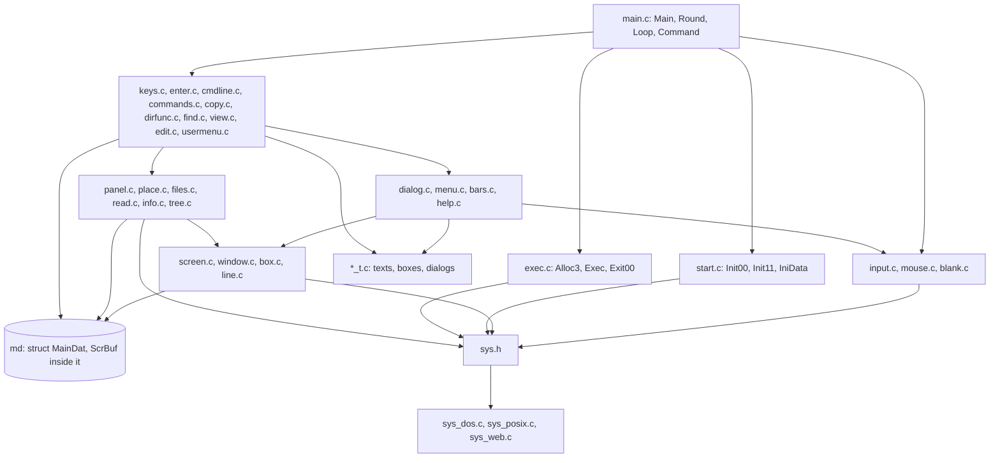
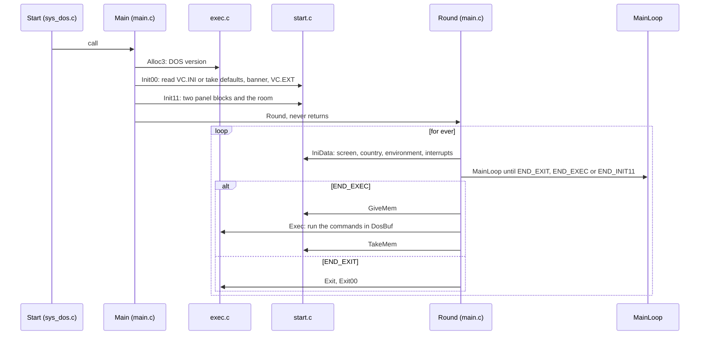
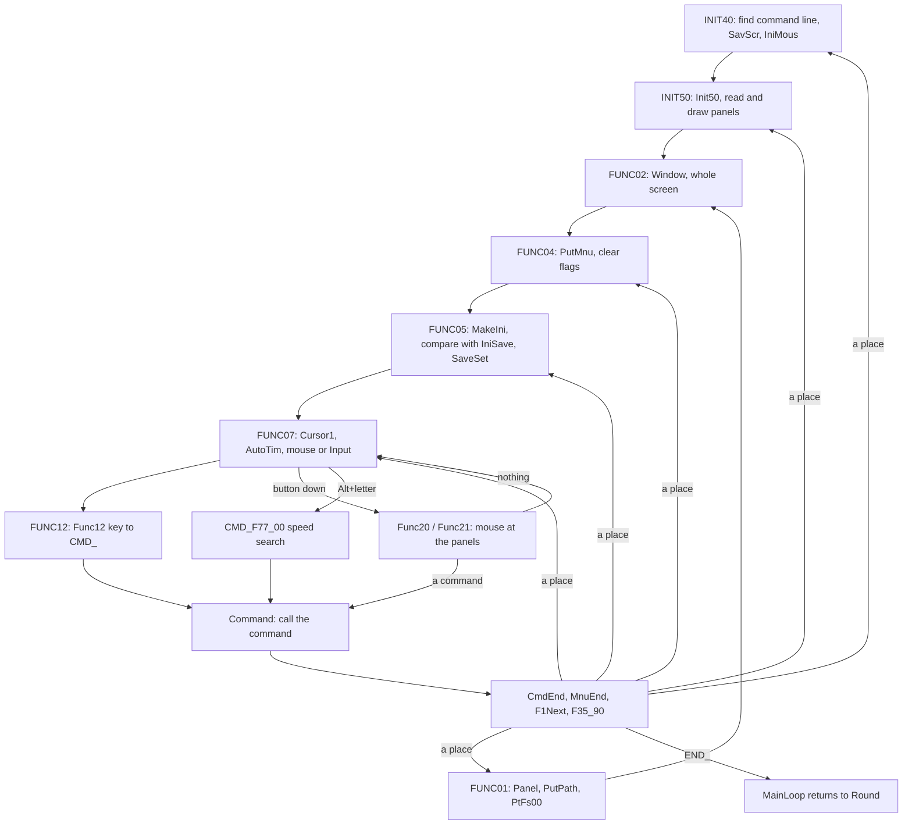
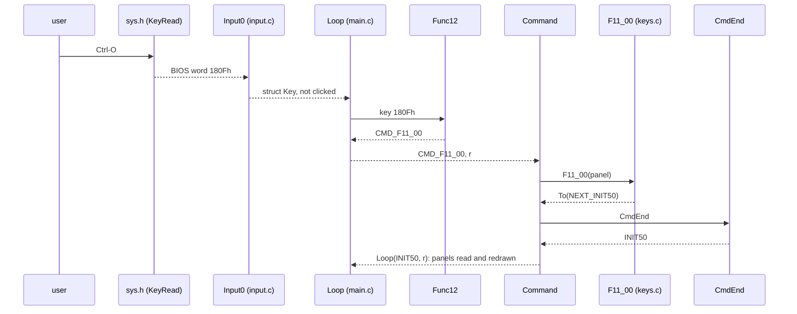
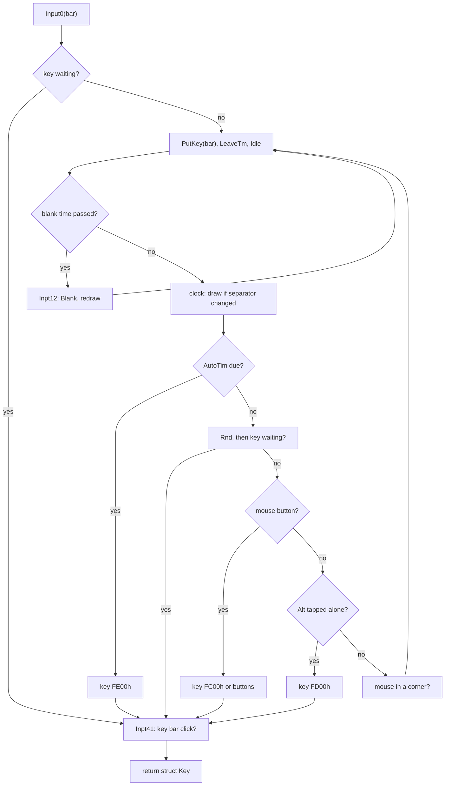
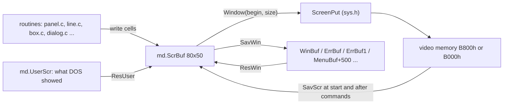
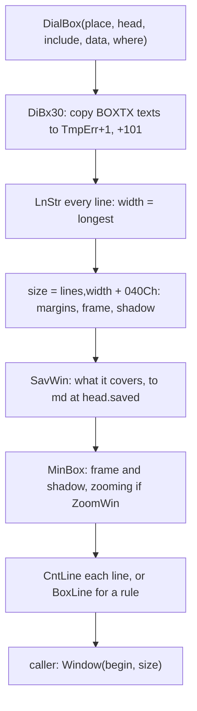

# 1. The program: its data, its loop, its screens

Volkov Commander 4.05 is 65,090 bytes of 8086 code and tables in one
`.COM` file. While it waits for a key it holds that file, a block of
62,603 bytes of data, two panels and a buffer for the viewer, and while a
DOS command runs it keeps 12,690 bytes of itself and gives the rest
back. Its shape follows from that:

- one block of global data, `struct MainDat md`, laid out byte by byte,
  in which every buffer has one place and most have several users;
- one segment per file panel, `struct WCBdef`, reached through DS;
- tables of boxes and dialogs, records of 10 and 11 bytes that name each
  other by 16-bit offset, run by one routine;
- a main loop that is not a routine, entered at several labels, and
  commands that are jumps rather than calls.

This chapter covers that skeleton: the parts of the file, the start,
the swap around a command, the data, the loop, the input, the screen
and what is drawn on it. The code shown is the portable C,
`src/portable_c/`, the same program in readable form (see the
[preface](00-preface.md#the-three-versions-of-the-source)); the
assembly of `src/asm/` is quoted where the trick only shows there. The
calls of DOS and the BIOS underneath are [chapter 3](03-the-system.md).

## The parts of `VC.COM`

The file is one segment, and the assembler's listing says what is in
it:

| Part | Offsets | Bytes |
|---|---|---|
| The PSP, DOS's, not in the file | 0000h-00FFh | 256 |
| The resident part: `Exec`, the INT 21h hook, the program's end | 0100h-06E7h | 1,511 |
| The loader, `Alloc0`, run once | 06E7h-07E7h | 256 |
| The transient part's code, `Init00` on | 07E7h-CC1Ah | 50,227 |
| Tables: colours, defaults, `FncTab`, dialogs (`_DATA`) | | 6,214 |
| Texts (`CONST`) | | 6,882 |
| End of the file, `Last` | FF42h | 65,090 in all |

Code is four fifths of it. By source file, the main loop and the start
are 3,656 bytes, the commands of the keys (`VCFUNC.INC`) 5,244, the
editor 6,062, the viewer 4,853, the copy 3,902, the file search 2,489,
the help 1,403, and the shared routines of `VCSUB1` to `VCSUB3.INC`
14,639. The largest single procedure is the copy engine, `C00_00`, at
2,684 bytes; `Dialog`, which runs every dialog of the program, is 1,006.
The listing has 305 procedures and 2,486 labels: almost half of the code
lies between procedures, as labels that other code jumps to.

The resident part has 10,923 bytes of buffers behind its code, from
06E7h to 3192h: a copy of the interrupt table, the saved setup and the
saved panels, and the stack. None of it is in the file. The source says
`ORG LastRes` and assembles the loader and the start of the transient
code over those buffers, so the bytes that hold the start-up code on
disk become the resident part's data once the program runs.

## The source tree

The 27,190 lines of Volkov's assembly for `VC.COM` are `VC.ASM`, which
holds the data's layout, the start, the main loop and the resident
part, and eleven include files: `VCFUNC.INC` for the commands of the
keys, `VCMENU.INC`, `VCF1.INC`, `VCCOPY.INC`, `VCVIEW.INC`,
`VCEDIT.INC`, `VCHELP.INC`, `VCMEM.INC` and `VCFIND.INC` for the
features, and `VCSUB1.INC` to `VCSUB3.INC` for the shared routines.

The portable C, `src/portable_c/`, is some 33,000 lines of program in
C files named for what they do, and the system layer beside them.

There are three kinds of file:

- **Code**, `name.c`: routines translated from one or two of the
  assembly's include files. Every file's head comment says which,
  "Translated from VCSUB2.INC".
- **Tables**, `name_t.c`: the texts, boxes, dialogs and buttons that
  `name.c` uses, as constants and nothing else, byte for byte the
  original's `DB` lines. In the assembly they sit in a `.CONST` block
  of the same include file as the code that uses them.
- **The platform**, `sys_*.c`, `*_posix.c`, `stack_dos.c`: what is asked
  of the system, behind `sys.h`.

By role:

| Role | Files |
|---|---|
| What everything shares | `vc.h` (structures, prototypes, the commands), `tables.h` (how boxes and dialogs are written), `compiler.h` |
| Start, loop, leaving | `main.c`, `main_t.c`, `start.c`, `exec.c`, `setup.c` |
| The screen buffer and its primitives | `screen.c`, `window.c`, `box.c`, `line.c` |
| Text and numbers | `string.c`, `format.c`, `digits.c`, `mask.c`, `misc.c` |
| Keys, mouse, idling | `input.c`, `mouse.c`, `blank.c`, `system.c`, `system_t.c` |
| Bars, menus, dialogs | `bars.c`, `bars_t.c`, `menu.c`, `dialog.c`, `commands.c`, `commands_t.c` |
| The panels | `panel.c`, `place.c`, `files.c`, `read.c`, `info.c`, `tree.c`, `treebox.c`, `treebox_t.c`, `drive.c` |
| Commands of the panels | `keys.c`, `keys_t.c`, `enter.c`, `cmdline.c`, `usermenu.c`, `extfile.c` |
| Commands on files | `copy.c`, `copy_t.c`, `dirfunc.c`, `dirfunc_t.c`, `find.c`, `find_t.c` |
| Viewer and editor | `view.c`, `view_t.c`, `edit.c`, `edit_t.c` |
| Help | `help.c`, `help_t.c`, `help/vc-help.txt` |
| The setup, folded in | `stmain.c`, `stmain_t.c`, `stopts.c`, `stopts_t.c`, `stcolor.c`, `stcolor_t.c`, `sthelp.c`, `sthelp_t.c` |
| The system | `sys.h`, with `sys_dos.c` and `stack_dos.c` for DOS, and the files of the other systems ([chapter 3](03-the-system.md)) |

The dependencies are simple, because almost everything goes through
two shared things: the main data and the screen buffer.



Names come from the assembly. A routine keeps its label: `F11_00` is
what Ctrl-O does, `Init50` draws the panels, `Func12` maps a key to its
command, `DialBox` draws a box. Data keeps its name too: `DosBuf`,
`TmpBuf`, `WinPath`. A comment marks the labels of the original that a
function passes through, `/* Func41 */`, so that a reader can hold the C
against `src/asm/` line by line. A thing that has stopped being what its
old name says gets a new name, with the old one in a comment beside it:
`CurrentPanel` was `WCBcrn`, `Room` was `ViewSeg`.

## How the program starts

DOS loads `VC.COM` at offset 100h of a block that holds all of free
memory, with CS, DS, ES and SS on it, and jumps to 100h, which jumps to
`Alloc0`. The loader adds up all 65,090 bytes of the file into a
16-bit checksum, `ChkFile`, and splits the program in two ([chapter
3](03-the-system.md#splitting-the-block-alloc0) has it step by step):

```
  as DOS loaded it               as it runs
  +------------------+ PSP       +------------------+ PSP, SS
  | PSP 256          |           | PSP 256          |
  | resident 1,511   |           | resident 1,511   |
  | loader + Init00..|  ------>  | buffers 10,923   | stack at the top, 256
  |   transient      |           +------------------+ 794 paragraphs
  |   63,323         |           | transient 63,344 | CS = RunPar
  +------------------+           +------------------+ 3,959 paragraphs
  | free memory      |           | main data 62,603 | DS = ES = SecDat
                                 | left panel 6,754 |
                                 | right panel 6,754|
                                 | the rest: viewer,|
                                 |  editor, copy    |
```

The transient part, from `Init00` to the end, is copied upward with
`STD; REP MOVSB` into a block of its own just above the resident part:
the loader makes that block by writing a memory control block of DOS's
into the middle of its own, by hand. Being a `.COM`, the code needs no relocation:
`RunPar`, the transient's segment, is the block's segment less 7Eh, so
that every label keeps its offset. From then on CS is the transient
part, DS and ES the main data, and SS the PSP's segment, where the
256-byte stack sits at `VcStack`, 3192h.

The C makes the same steps a call each. Every system enters it in its
own place, `Start` of `sys_dos.c` under DOS/32A ([chapter
3](03-the-system.md)), and ends up in `Main` of `main.c`.

`Main` never returns:

```c
void Main(void)
{
    struct Answer memory;

    Alloc3();
    Init00();
    memory = Init11();
    if (memory.failed)                  /* AlocEr */
        AlocEr(memory.value);
    Round();
}
```



The three `Init` steps are the original's start, cut into functions.
What each one does:

- **`Init00`** looks for `VC.INI` in the program's directory, or in the
  one that the `VC=` variable names. It reads at most `INI_LEN + 1 =
  512` bytes into `MenuBuf`. The file counts only if it is exactly
  `INI_LEN = 511` bytes long, starts with `VVV` and ends with the right
  16-bit sum of the bytes before it. Then the first 330 bytes of the
  main data, `CmnIni`, are copied from it, and the two panels' 88 bytes
  each, `WCBini`, stay in `MenuBuf` until `Init11`. Otherwise
  `Init00` takes the defaults: the colour table `Palets`, both panels on
  the current directory, and the left panel switched off. Then it prints
  the banner through DOS, "The Volkov Commander, Version 4.05" and the
  copyright line, with INT 21h AH 09h, which writes a text up to a `$`. It reads `VC.EXT`, the main extension
  file, into `ExtMain` and ends it with 1Ah, the way DOS text files end.
  It also sets the masks and notes Ctrl-C (`SetBrk`).
- **`Init11`** asks the system for two blocks of `PANEL_LEAST` bytes
  each, 32 + 65,536, one per panel. It copies the 88 bytes of each
  panel out of `MenuBuf` and sets the panel's places to an empty list.
  Then it takes the room, `TakeRoom`: all the rest of the memory, for
  the viewer, the editor and the copy buffer.
- **`IniData`** runs once now and again after every command, because a
  command may have left anything behind: another video mode, another
  country, another code page. It takes the critical-error and
  Ctrl-Break interrupts (`HookVct`). If the screen is not 80-column text
  it asks for Enter and sets the mode back. It reads the country and
  builds `LowTab`, a table of lower case for bytes 80h to FFh, by asking
  DOS for the capital of each one. It finds `COMSPEC=`, `VC=` and
  `TEMP=` in the environment. It counts the screen's rows, 25 or what an
  EGA or VGA reports, at most `MaxLins = 50`. Finally it finds DOS's
  text colour: it has DOS write a space and reads back the colour of
  that cell.

`Init11` takes all the memory there is. It asks DOS for FFFFh
paragraphs, which fails with the size of the largest block, and asks
again for that. Then it carves the block by paragraph arithmetic: 3,913
paragraphs for the main data, 423 for each panel (`WCBdef`, 6,754 bytes:
a 610-byte header and 256 entries of 24), and the rest, at least 500
paragraphs, 8,000 bytes, for the viewer. `WCB1seg` is the block plus
3,913, `WCB2seg` 423 further, `ViewSeg` 423 further again. The program
needs 5,259 paragraphs, 84,144 bytes, besides its code; with less it
says so and ends.

## A command runs in the commander's memory

A program run from the command line wants the 640K too, so the
commander makes room for it by giving back nearly everything, and
[chapter 3](03-the-system.md#the-resident-part-12-kb-that-stay) has
it step by step. In outline:

1. `F21_31` copies the first 2,733 bytes of the main data, the setup,
   the history and the commands to run, into `ComnIni` of the resident
   part, and `F21_40` packs each panel into 3,422 bytes there: 94 bytes
   of its header and, for at most 256 files, 13 bytes each, the name
   and the attributes.
2. The main data, with both panels and the viewer's room in it, goes
   back to DOS, and with Memory allocation on, as the program is
   distributed, the transient part goes too. What is left of the
   commander is **12,690 bytes**, 794 paragraphs, PSP and stack
   included.
3. The resident `Exec` runs each command of `DosBuf`.
4. To get its 63,344 bytes of code and tables back, the commander does
   not open its file and read it: it **runs itself** as a child, with
   `VVV` in the command tail, and the child copies its own transient
   part into the parent's block and hands back a checksum ([chapter
   3](03-the-system.md#coming-back-running-vccom-as-its-own-loader)).
5. The transient part takes its main data anew, copies `ComnIni` back,
   and expands each saved panel into full 24-byte entries with
   `Expand`, 46 bytes of code, before it reads the directories again.

In the C translation of `src/c/` this is `Stay` and `Exec` of
`resident.c`; the portable C stays in memory whole, a 32-bit program
under a DOS extender having another way to run a command ([chapter
3](03-the-system.md)), so only the viewer's room is given back
(`GiveMem`, `TakeMem`) and the loop goes back to `IniData`.

## The main data

### One structure, at offset 0

The original asks DOS for one block of memory, points DS at it and
keeps all of its state there. The C keeps that block as one structure
in `vc.h`, `struct MainDat`. It is `0xF48B` = 62,603 bytes. The one
instance is `md`, defined in `main.c` in a segment of its own:

```c
SEGMENT_BEGIN("MAINDATA", "MAIN")
struct MainDat md;
SEGMENT_END
```

The structure is `#pragma pack(1)` and field for field the `STRUC` of
`src/asm/VC.ASM`, comments included ("Data tramsnir area" and all). Its
main regions, with offsets that gcc worked out from `vc.h`:

```
 offset  size   field            what it is
 ------  -----  ---------------  ------------------------------------------
  0000     240  ColTab           colours: 40 entries x 6 (3 palettes x
                                 colour/mono)
  00F0      .   FulScr..DriveB   one byte per option of the setup
  0112       5  StarTab          the blanker's five shapes of a star
  0117      51  ResIni           reserved
  ------------------------------- CmnIni = 014Ah: end of what VC.INI saves
  014A       1  LoadRes
  015C     512  HstBuf           command history, newest first
  035C     512  ExtMain          VC.EXT, ended by 1Ah
  055C      14  EPB              DOS exec parameter block
  0578      68  CrnPath          current directory of the tree panel
  ...           ViewFil, ToFile, FindStr, SrchStr (65 each)
  06C5    1000  DosBuf           command line and dialog input lines
  ------------------------------- end of what the original keeps in memory
  0AAD      .   DosLin, DosCol.. command line on screen; Lines at 0AB3
  0AC9       8  WCBcrn..WCB2seg  the original's panel segments, unused
  0AED       2  FncAddr          per-file function of a group command
  0AF5       4  AutoTim          when FEh, "the time has come", is sent
  0B11      68  DosPth           current path
  0BDD      32  Country          DOS country info
  0BFD      44  DTA              DOS find-first record
  0C29     128  LowTab           lower case of 80h..FFh
  0CA9     256  TmpBuf           scratch, used by everything
  0DA9     256  TmpErr           texts put into boxes (^V at +1, ^W at +101)
  0EA9     128  Stars            32 stars of the blanker
  0F29    4000  MenuBuf          user menu; also VC.INI image, setup data
  1EC9    1406  InfBuf           Info panel text
  2447       1  Even             pads ScrBuf to an even address
  2448    8000  ScrBuf           the screen buffer, 80 x 50 cells
  4388    7840  UserScr          what DOS showed, 80 x 49 cells
  6228    7392  WinBuf           what a box covers, 77 x 48 cells
  7F08    7392  ErrBuf           second level of boxes
  9BE8    7392  ErrBuf1          third level (help, errors over boxes)
  B8C8    3000  HelpBuf          one help entry and its state
  C480   12299  TreeBuf          the directory tree, 768 entries
  F48B          end
```

### Why the layout stays

The layout is part of the design. A field's place is a number that
other things hold, and the code depends on it in four ways:

1. **The setup file is a dump of it.** `VC.INI` is three `V`s, the
   first 88 bytes of each panel, the first 330 bytes of `md`, and a
   16-bit sum. That is 511 bytes, the same format as the original's.
   `MakeIni` of `setup.c` builds the image, and `Init00` reads it back
   with a byte copy, `((u8 *)&md)[i] = image[3 + 2 * WCBini + i]`. A
   reordered field would make every existing `VC.INI` wrong.
2. **The tables name places in it by number.** A box says where to save
   what it covers as an offset into `md`, `MD_AT(WinBuf)`. A dialog
   field says where its value lives, `MD_AT(TmpBuf)`. Those numbers are
   16 bits, as in the original, and `MD_AT(field)` is just
   `offsetof(struct MainDat, field)`.
3. **The code reads across fields** the way the assembly did. `DialBox`
   copies 81 bytes of a text whatever its length, and the help reads a
   26-byte record into several fields at once. Such reads go through
   `MD_BYTES`, the structure as bytes, so that C is never asked what
   lies beyond a field.
4. **A command keeps it.** The first 2,733 bytes are what survive a
   command, copied as one block into the resident part and back, so
   everything that must outlive a command lies in front of `CmnSave`.

Many fields say in their comment that they are "of the original. Not
set or read here". `WCBcrn`, `ViewSeg`, `TreAdr`, `ClstSiz` and the
others were 16-bit segments or offsets. In a flat 32-bit program they
are pointers or 32-bit counts, which do not fit in a word. So each
lives beside `md` under a name that says what it is:

```c
extern struct WCBdef *CurrentPanel;     /* WCBcrn */
extern u8 *Room;                        /* ViewSeg */
extern struct DIRENT *TreeCursor;       /* TreAdr */
extern u32 ClusterBytes;                /* ClstSiz */
extern i32 ClickLine;                   /* MousPos */
```

The old word keeps its place in `md` so that nothing after it moves.

Two macros show how literally the original is kept.
`MAIN_AS_PANEL`, `(struct WCBdef *)&md`, hands the main data to a
routine that expects a panel. In three places the original calls such
a routine with DS still on the main data, and reads colour bytes of
`ColTab` as if they were `Visible` or `WinPath[3]`. That is a bug, and
it is kept, because what the screen shows depends on it.
`PANEL_AS_MAIN` is the same thing the other way round, for one place in
`usermenu.c`.

## The panels

### `struct WCBdef`

A panel, a "window control block", is `0x1A62` bytes followed by its
list of files:

```c
struct WCBdef {
    u8  WinTyp;          /* 0 files, 1 tree, 2 info */
    u8  BrfFul;          /* brief or full */
    u8  Visible;
    u8  Hidden;
    u8  MasTyp;
    u8  SortTyp;         /* name, extension, time, size */
    u8  Ctrl_L;
    u8  DskMas[13];      /* the filter */
    u8  WinPath[LenPath];
    /* End of WCB part saved in VC.INI: 88 bytes */
    u16 CurAdr16, First16, EndBuf16;   /* the original's, unused */
    u8  ExtBuf[LenExt];  /* the directory's own extension file */
    u16 EndFul16;
    u8  ChgFlg;          /* to be read again */
    u8  SizDir;
    struct FILENT DskBuf[MinFls];      /* 256 entries, and on */
};
```

A file entry, `struct FILENT`, is 24 bytes, laid out in
[chapter 2](02-the-features.md#a-panel-the-block-the-list-the-places):
the 43 bytes of DOS's search record cut down to what a panel shows.

### One segment per panel, places as offsets

In the original a panel is a segment, at most 64K, and DS points at it
while a command works on it. The list starts at `DskBuf`, offset 262h,
and the cursor, the first line shown and the ends of the list are
16-bit offsets in that segment (`CurAdr`, `First`, `EndBuf`, `EndFul`).
The two panels and the viewer's room lie one behind the other in the
main block, so a panel that needs more than its 423 paragraphs pushes
what lies above it up: `ReDir` moves the other panel with `STD; REP
MOVSB` to sit just under the viewer's room, and updates the four
segment words. A panel stops at 64K, which is 2,703 entries.

Swapping the panels with Ctrl-U is three instructions: the two segment
words are exchanged.

The C keeps the idea and gives each panel a block of its own; how it
grows past 64K is in [chapter 2](02-the-features.md#a-panel-the-block-the-list-the-places).
Nothing keeps a pointer into a panel across `ReDir`, which may move
it, and a place in the list stays an offset, `ENTRY(wcb, place)` making
it a pointer.

### Four pointers to two panels

```c
extern struct WCBdef *CurrentPanel;   /* WCBcrn */
extern struct WCBdef *OtherPanel;     /* WCBsec */
extern struct WCBdef *LeftPanel;      /* WCB1seg */
extern struct WCBdef *RightPanel;     /* WCB2seg */
```

`md.Active` says which side is current, and `IniData` sets the first
two from it. Tab (`F20_00`) swaps those two and inverts `md.Active`.
Ctrl-U (`F15_00`) swaps the other two, `LeftPanel` and `RightPanel`, so
that the panels change sides, and inverts `md.Active` too. The original kept the current
panel in DS during a command. Here it is the first argument of every
command, `struct Onward F11_00(struct WCBdef *panel)`.

### The tree

A panel of type 1 shows the directory tree. The tree is not in the
panel. It is in `md.TreeBuf`: the header of the original's
`TREEINFO.NCD`, then 16-byte `struct DIRENT` entries, root first, each
with its level. `TRELIST` points at the first entry, which starts
inside the header at `TreSum2`, as in the assembly. Some routines walk
a file list or the tree with the same code, `F00_50` of `keys.c` and
the speed search for example. They know a directory by
`TREE_OFFSET(entry)`, its 16-bit offset in the tree's list, just as
they know a file by its offset in the panel. The list and its file, `TREEINFO.NCD`,
are in [chapter 2](02-the-features.md#the-tree-and-its-file).


*Volkov Commander 4.05 as it starts: two panels of files, the command line, the key bar. Every cell is a word of `md.ScrBuf`, copied to `B800:0000`.*

## The main loop

### What the original does

In the assembly the main loop is not a routine. The start-up code falls
into it at `Init40`. It falls through `Init50` (draw the panels),
`Func01` (draw one panel), `Func02` (copy the screen buffer out),
`Func04` (the menu bar), `Func05` (save the setup if it changed) and
`Func07` (wait for a key). At `Func12` it looks the key up in a table,
`FncTab`, through a routine called `Case`, and **jumps** to the
command:

```asm
Func12:	CMP	AH,0FCh
	JE	Func20
	CMP	ES:Quote,0
	JNZ	Func14
	MOV	SI,OFFSET FncTab
	CALL	Case
Func14:	JMP	F73_00
```

A command is code between labels. It ends by jumping back to one of
those labels, whichever fits, or on into another command. Ctrl-O ends
in `JMP Func03` when it switches the panels off. Registers go round:
whatever a command leaves in BX and DX, the next command finds there.
Rename reads them.

### What the C does

C has no computed jump into the middle of a loop, so the loop is two
functions and a driver:

```c
static i32 MainLoop(void)
{
    struct Regs regs;
    struct Regs *r = &regs;
    i32 entry = INIT40;
    ...
    for (;;) {
        command = Loop(entry, r);
        entry = Command(command, r->ds, r);
        if (entry >= END_INIT11)        /* no place of the loop */
            return entry;
    }
}
```

- `Loop(entry, r)` is a `switch` on the entry label, whose cases fall
  through into each other in the original's order. It returns the
  number of a command, a `CMD_` of `vc.h`.
- `Command(command, panel, r)` is a `switch` of about a hundred cases. It
  calls the command's function and turns what that returns into the
  next entry of `Loop`, or into an `END_`: start over, run DOS
  commands, or exit.

The entries are the original's labels:

```c
enum {
    INIT40,   /* find the command line, keep what DOS shows, draw all */
    INIT50,   /* draw the panels, reading those that changed */
    FUNC01,   /* draw the panel in DS */
    FUNC02,   /* put the screen buffer on the screen */
    FUNC04,   /* draw the menu bar */
    FUNC05,   /* save the setup if it changed and autosave is on */
    FUNC07,   /* wait for a key */
    FUNC12,   /* go to the command of the key in AX */
    END_INIT11, END_EXEC, END_EXIT
};
```



`Loop` keeps three `goto`s, to `Func02`, `Func20` and `Mouse`. Those
are jumps from inside one case to a label inside another, which a
`switch` cannot do any other way.

Two things in `Loop` are easy to miss:

- **The setup is saved by comparison.** At `FUNC05`, every time the loop
  comes round, `MakeIni` writes the setup image into `MenuBuf`, and the
  loop compares it with `IniSave`, the image as last saved or loaded.
  The panels' paths, `Active` and `Ctrl_O` are copied across first, so
  that they never count as a change. If anything else differs and Auto
  save is on, `SaveSet` writes `VC.INI`. There is no "dirty" flag
  anywhere in the program. The comparison takes the place of one.
- **`AutoTim`** is an alarm. With Auto change dir on and the cursor
  moved in a tree panel, `FUNC07` sets `md.AutoTim` to now plus
  `DelayTm`, as hours:minutes in the low word and seconds:hundredths in
  the high word. When that moment passes, `Input0` returns the
  pseudo-key FE00h, and `Func12` maps it to `CMD_F75_00`, which changes
  the directory. A low word of FFFFh means never.

### The registers that go round: `struct Regs`

The registers that pass from one command to the next are a structure:

```c
struct Regs {
    u16 ax, bx, cx, dx;
    i32 si, di;                         /* the numbers of two entries */
    u16 bp;
    struct WCBdef *ds;                  /* the current panel */
    i32 last;                           /* and of the last entry */
};
```

Most commands take only the panel. The `struct Regs` is passed where
something really is read:

- the mouse hands its commands the entry under the pointer in `si` and
  the first entry shown in `di`, its buttons in `bp`;
- a key that goes to the command line arrives in `ax`;
- Rename reads `bx` and `dx` as the previous command left them. The
  cursor keys go back to `FUNC07`, behind the point where the original
  reloads BX, so they must leave the original's values there. `F00_50`
  returns them in a `struct Left`.

The comments in `Loop` record, again and again, which register the
assembly leaves somewhere that nothing reads: "The assembly has SI and
DI behind what it has compared and copied ... nothing reads SI or DI as
this leaves them." Every register that does go round was found by
reading every command.

### How a command says where to go on: `struct Onward` and the four families

A command function returns where the loop goes on. The commands come
in four families, by the file of the assembly they live in. Each family
has its own set of places, and `main.c` has one function per family
that turns a place into a loop entry:

| Family | Files | Returns | Places | Turned into an entry by |
|---|---|---|---|---|
| Keys of the panels | `keys.c`, `enter.c`, `view.c` | `struct Onward` | `NEXT_FUNC07` .. `NEXT_EXIT`, 20 of them | `CmdEnd` |
| Menu commands | `commands.c` | `i32` | `MNU_FUNC04`, `MNU_INIT50`, `MNU_F24_01`, `MNU_V00_01` | `MnuEnd` |
| Group file commands | `dirfunc.c`, `find.c` | `i32` / `struct Searched` | `TO_FUNC04` .. `TO_F24_02` | `F1Next` |
| Copy and rename | `copy.c` | `struct Copied` | `GO_KEYS` .. `GO_DONE` | `F35_90` |

```c
struct Onward {
    u8  place;                 /* a NEXT_ */
    u8  item;                  /* for M03_00 and M06_00 */
    struct WCBdef *panel;      /* the panel a menu routine is for */
};
```

Some places are not loop labels but other commands, because in the
original a command could jump into another. `NEXT_M01_01` goes on into
the menu routine that sets a panel's view, `NEXT_EARLIER` into `F25_00`
(Ctrl-E), `NEXT_VIEW` into the viewer. `CmdEnd` calls those itself and
then goes on from what they return. Ctrl-O in both versions makes the
pattern plain. The assembly, `VCFUNC.INC`:

```asm
F11_00:	CMP	DS:Visible,0		; ^O
	PUSH	DS
	MOV	DS,ES:WCBsec
	JZ	F11_01
	MOV	AL,DS:Visible		; Panels Off
	MOV	ES:Ctrl_O,AL
	MOV	DS:Visible,0
	POP	DS
	MOV	DS:Visible,0
	CALL	BegBX
	CALL	SizDX
	...
	CALL	ResUser
	JMP	Func03
```

The C, `keys.c`:

```c
struct Onward F11_00(struct WCBdef *panel)
{
    struct WCBdef *second = OtherPanel;
    ...
    if (panel->Visible != 0) {
        md.Ctrl_O = second->Visible;
        second->Visible = 0;
        panel->Visible = 0;
        begin = BegBX(panel) & 0xFF00;
        size = (SizDX() & 0xFF00) | 80;
        ResUser(begin, size);
        Window(begin, size);            /* Func03 */
        return To(NEXT_FUNC04);
    }
    ...
    return To(NEXT_INIT50);
}
```

`JMP Func03` became an inlined `Window` and a return to `FUNC04`, the
label behind `Func03`. DS (the panel) and ES (the main data) became
`panel` and `md`.

### From a key to a command

`Func12` is the original's `FncTab` written as two `switch`es. The
first matches whole BIOS words, scan code and character: 4800h is Up,
3F00h is F5, 6E00h is Alt-F7. The second matches characters that count
with any scan code, the Ctrl letters: 0Fh is Ctrl-O, 15h is Ctrl-U.
Anything else goes to the command line, `CMD_F73_00`. The order matters
for keys like Tab (0F09h), whose character 09h is also Ctrl-I. The
table had the full key first, so the first `switch` does too. Two keys
of the original's table are not in the C: Alt-F5, the map of DOS's
memory, and Alt-F9, EGA lines, which loads an 8-pixel font into the
EGA or VGA through the BIOS for 43 or 50 rows.



A menu item takes another road to the same `Command`. F9 is
`CMD_F39_00`, and `F39_01` runs the bar, `F39_00` of `menu.c`. The bar
returns which menu, which item and which table. There are six tables
in `commands_t.c`: `Menu1_T` for the Left and Right menus, then Files,
Commands, Options, and Shift-Files and Ctrl-Files. The command number
is read there. `F39_01` also loads AX, BX, CX and DX the way the
original's jump left them, and calls `Command` again, recursively. The
setup is `CMD_SETUP`, the last number, and `Command` handles it as
`StSetup(); return END_INIT11;`.

## Input

### A key is a BIOS word

Everything that waits for a key calls `Input(bar)`, or `Input0(bar)`
where F1 is not to bring up help. A key is a 16-bit BIOS word, scan
code in the high byte and character in the low byte. That is the form
the original gets from INT 16h, and the form on every platform the C
runs on. `Input0` adds
three scan codes of its own:

| High byte | Meaning |
|---|---|
| FCh | a mouse button is down; the low byte says which |
| FDh | Alt was tapped by itself (opens the menu bar if `AltBar` is set) |
| FEh | the moment in `AutoTim` has come |

`Input` itself is short. F1 shows help and keeps waiting:

```c
u16 Input(i32 bar)
{
    u16 key;

    for (;;) {
        key = Input0(bar).key;
        if (key != KEY_F1)
            return key;
        if (StOpen != 0)
            StHelp();
        else
            Help00();
    }
}
```

So any routine that takes keys can have the help on the stack above
it. While the help is up, `md.HlpPage` is FFh, and a second F1 does
nothing.

### What `Input0` does while it waits

`Input0` is a busy loop of the DOS kind. Each time round it:

1. redraws the key bar for the Shift, Ctrl and Alt keys now held
   (`PutKey(bar)`). `PutKey0` draws only if the row it picks differs
   from `md.BarPrev`;
2. calls `LeaveTm()`, which calls `Idle()` of `sys.h`: INT 28h, "DOS is
   idle", the call by which DOS lets a TSR such as `PRINT` work while
   the foreground program waits. (On other systems the C draws the
   screen there and sleeps; see [chapter 3](03-the-system.md).)
3. checks whether the blank delay has passed, and if so calls `Blank()`;
4. draws the clock if `md.Clock` is set;
5. checks `AutoTim`;
6. steps the random numbers, `Rnd()`, so that the blanker's sky differs
   every time;
7. checks for a key, then the mouse buttons, then a tap on Alt. A tap is
   Alt down and up within 3 timer ticks, with nothing else changing in
   between;
8. checks the mouse in the corners. In the top right corner it blanks
   the screen at once. In the bottom right corner it holds the blanker
   off.



### The mouse

`mouse.c` asks `sys.h` where the mouse is, in pixels, eight to a cell.
`GetMous` turns that into a cell, row in the high byte and column in
the low byte, and the buttons (left 1, right 2, middle 4, left and
right swapped for `LftMous`). `DoublMo` tells a second click on the
same line from a first one, using `ClickLine` and `MousTim`. Three
places act on the mouse:

- **`Inpt41`** of `input.c`, on the key bar. A button held on a key
  shows the bar with Shift (middle button) or Alt (right button). The
  pointer gets a check mark, FBh, while it is on a key. Letting go
  there returns that key, F1 to F10 plus the column divided by 8.
- **`Func21`** of `main.c`, at the panels. The top left corner toggles
  the panels. The top row opens the menu bar. A click in the other
  panel makes it current. Inside a list, `Func40` works out the entry
  under the pointer, scrolls when the pointer is above or below the
  list, and a double click is Enter, `CMD_F21_10`. The arithmetic keeps
  the original's 8-bit quirks. A row of 128 or more on a 48-line screen
  in brief mode is taken as a signed byte, and the cursor jumps 256
  entries back. The comment says so.
- **`Dialog`**, `MinMnu` and `F39_00`, each with its own loop for
  buttons, fields and menu items.

## The screen

### A buffer of cells

The program never draws on the screen directly. It draws into
`md.ScrBuf`, 80 x 50 cells of 16 bits each, character in the low byte
and attribute in the high byte, exactly the format of the PC's text
memory. Then `Window(begin, size)` copies a rectangle of it out.
Positions are packed the assembly's way, row in the high byte and
column in the low byte, so that `0x0528` is row 5, column 40. A size is
packed the same way, rows and columns.

The original's `BasAdr` (`VCSUB1.INC`) is five instructions:

```asm
	MOV	AL,80
	MUL	BH			; the row times 80
	XOR	BH,BH
	ADD	AX,BX			; and the column
	SHL	AX,1			; two bytes a cell
```

The C writes the same as shifts:

```c
u16 *BasAdr(u16 place)
{
    i32 row = place >> 8;

    /* 80 cells to a row, without a multiplication: see IN_TABLE. */
    return md.ScrBuf + (row << 6) + (row << 4) + (place & 0xFF);
}
```

A packed place fits one register, and a row and a column come out of
it as BH and BL without a shift: that is why every place of the program
is packed so.

`Window` copies one row cell by cell, or several rows as whole 80-cell
rows. The original does it with `REP MOVSW` into the video memory: a
colour adapter's text page is at `B800:0000`, a monochrome one's at
`B000:0000`, 2 bytes a cell, 4,000 bytes for 80 by 25, and `md.Screen`
holds which. A write there is on the screen at once, with no call at
all; the C goes through `ScreenPut` of `sys.h`. The mouse pointer is
hidden around every copy (`CurMous(0)` and `CurMous(1)`), because the
mouse driver draws its pointer into the same memory by swapping a
cell's colours, and would leave a stale cell behind.



### Keeping what is under a box

There is no window system. A box saves the cells it is about to cover
and puts them back when it closes:

- `SavWin(begin, size, buffer)` copies a rectangle of `ScrBuf` into a
  buffer of the main data;
- `ResWin(begin, size, buffer)` copies it back, and `Window` then
  redraws that part of the screen.

There are three buffers of 77 x 48 cells, so boxes nest three deep.
`WinBuf` is for an ordinary box or menu. `ErrBuf` holds the menu bar's
row while the bar is up, or a second box. `ErrBuf1` is for the help
and the error boxes that can appear over anything. Each box names its
buffer in its table by its place in `md`, `MD_AT(WinBuf)`. A buffer
can begin at an odd address (`MenuBuf+500` is one), so cells are
stored with `PUT16` and read with `GET16`, byte by byte. The 8086 did
not care where a word began; C does.

`UserScr` is different. It holds what DOS had on the screen when the
program started or a command ended, which `Init40` reads in with
`SavScr`. Switching a panel off shows that again (`ResUser`), and so
does Ctrl-O, which shows the output of the last command under the
panels.

### Colours

A colour is a number, not an attribute. `Color(n)` looks up entry `n`
of `md.ColTab`. Each entry has six bytes: black-and-white, colour and
laptop palettes, each for a colour and a monochrome display. The
numbers are named in `tables.h`: `Box_C` 16, `Clock_C` 34, `Sky1_C` 36,
`ShadFl` 38 and so on. The setup edits that table. The shadow of a box
is not a colour but a rule. `ShadCol` either leaves a cell alone, or
computes `(colour & 8Fh) ^ 8`, or makes it grey on black, depending on
the `ShadFl` entry.

### Lines with markup

Most text on the screen is written by `NgLine` or `CntLine` of `line.c`
(centred), in the markup of Norton Guides:

| Markup | Meaning |
|---|---|
| `^N ^R ^B ^U` | normal, reversed, bold, underlined: the caller's four colours |
| `^V`, `^W` | the texts at `TmpErr+1` and `TmpErr+101` |
| `^I` | the "include line" the caller passes |
| `^Axx`, `^Cxx` | colour xx, character xx (hex) |
| `FFh n` | n spaces; `FFh 80h+n c`: n copies of c |

`LnStr` counts the cells a line will take, so a box knows how wide to
be. One routine and one markup draw every text of every box, menu,
status line and help page; the texts themselves carry their colours
and their runs of spaces. `FFh 80h+40, '-'` is a rule of forty
characters in three bytes. (The original's `NgLine` has `^A` and `^C`
the wrong way round compared with its own `LnStr`.)

## Boxes, dialogs and menus

### Tables that name tables

A box is a constant in a `_t.c` file. The quit dialog of F10 is in
`keys_t.c`:

```c
static const u8 Quit1_S[] = " The ^I ";
static const u8 Quit2_S[] = "Do you want to quit the ^I?";
const u8 YesNo_S[] = "Yes\377\003No";
const u8 YesNo_D[] = {
    5, 0,                               /* Yes */
    4, 6,                               /* No */
    0
};
static const BOX(3) Quit_P = {
    { Box_C, BoxCu_C, BoxCu_C, 0 },
    3, 0,
    MD_AT(WinBuf),
    { Quit1_S, Quit2_S, YesNo_S }
};
const DIALOG(1) Quit_B = {
    { &Quit_P, 0x528, 0, 1, 2, 26, 0 },
    { { 4, 0, 0, 0, 0, 0x323, MD_AT(TmpBuf), YesNo_D } },
    0
};
```

The layouts, from `tables.h`:

```
BOX(n)                                 DIALOG(n)
+--------------------------+           +----------------------------------+
| u8  colors[4]   colours  |           | struct BOXHD head                |
| u8  lines       n        |           |   const void *pDiBox  -> BOX     |
| u8  texts       0..2     |           |   u16 BoxBase   middle of top    |
| u16 saved   MD_AT(buf)   |           |   u16 SubFunc   SUB_ routine     |
+--------------------------+ BOXTOP    |   u8 bKeyBar, bMenu, bHelp, bFlags|
| struct BOXTX text[texts] |           +----------------------------------+
|   u16 from, u8 how, len  |           | struct BOXMN field[n]            |
+--------------------------+           |   u8  mType   1 input 2 select   |
| const u8 *line[n]        |           |               3 tick  4 buttons  |
|   line[0] = title        |           |   u8  mUp mDown mLeft mRight     |
|   0 = a rule across      |           |   u16 mBase   place in the box   |
+--------------------------+           |   u16 mPoint  MD_AT of its value |
                                       |   const void *mCtrl buttons/NUMBER|
                                       +----------------------------------+
                                       | u8 0                             |
                                       +----------------------------------+
```

In the assembly every reference here is a 16-bit offset in the one
segment: a dialog's header is 10 bytes and a field 11, so a dialog of
one row of buttons costs 22 bytes besides its texts. The C makes a
reference to another table a real pointer, which makes `BOXHD` 12
bytes and `BOXMN` 13 on DOS. A reference into the main data stays a
16-bit offset, `MD_AT(...)`, because the main data keeps its layout.
Each shape, `BOX(3)` or `DIALOG(1)`, is its own structure, `struct
Box3`, made by `BOX_SHAPE(3)`; a file of code sees only the common
head: `extern const struct BOXHD Quit_B;`.

A `struct BOXTX` copies a text into `TmpErr` before the box is drawn,
from an offset in whatever data the caller passes, the main data or a
panel. `how` says how to format it: 4 trims spaces, 2 upper-cases, 1
keeps a file name at the end as it is. `length` cuts the text from the
front. That is how a box shows a path that is too long for it.

### Drawing a box: `DialBox`



A box has three cells of margin on each side of the frame, an empty
row above it, and a shadow two cells wide and one row deep. On a
screen taller than 25 rows the box moves down by half the extra rows.
With `ZoomWin` set, `MinBox` grows the frame from the middle in steps,
timed by the timer, before drawing it full size.

### `Dialog`

`Dialog(head, include, begin, size, data)` is one function of about
330 lines. It draws the menu bar item, the key bar and the box, and it
fills in each field from `data` (the main data or a panel). Then it
loops: the field under the cursor gets the keys through its own
routine, `InpStr` for an input line, `Select` for a group, `FlipFl` for
a tick box and `MinMnu` for buttons, and Up, Down, Left and Right move
to the field that the `mUp` .. `mRight` links name. Enter or F10 can
call a routine that the dialog names by number in `SubFunc`, for
example `SUB_M30_60`, which checks a typed date. In the original that
word held the routine's address. Here a `switch` dispatches on the
number. The answer is the button chosen, or FFh for Esc.

A line being typed in lives in `DosBuf`, from offset 124 + 10, behind
the command line. It is three bytes and then the text: the cursor
column and a "typed yet" byte. The first key typed replaces the text.


*F10: the quit dialog, `Quit_B` of `keys_t.c`, with its frame, its shadow two cells wide and its buttons; the panels behind it are saved in `WinBuf`.*

### The menu bar

`menu.c`'s `F39_00` runs the bar. While it is up, the top row is saved
in `ErrBuf` and the open menu's box in `WinBuf`. The five menus are
rows of `MnuTab`, each with its box position, its size, where its lines
start in `MenuLn` and where its help pages start in `MnuHlp`. The lines
are one string literal made of concatenated macros, so that `sizeof`
of each part gives the offset of the next at no cost:

```c
static const u8 MenuLn[sizeof(LEFT_S FILES_S COMMANDS_S OPTIONS_S) - 1]
    NONSTRING =
    LEFT_S FILES_S COMMANDS_S OPTIONS_S;
```

The first capital letter of a line chooses it. `MnuKey`, "LFCOR",
opens the menus from the bar. `KeyTab` lets an open menu take a
command's own hot key: F5 in the Files menu chooses Copy. The bar
returns a `struct Picked`, and `F39_01` in `main.c` turns that into a
command.

`F39_00` is one of the functions where the assembly's `goto`s remain,
50 of them. The bar is a state machine whose states are labels:
`F39_10` waits for input, `F39_41` moves to another item, `F39_85`
leaves. The original enters loops in the middle and crosses paths
between them, since a shared tail reached by a two-byte jump is the
cheapest code there is; the C keeps the jumps where untangling them
would hide the original's shape. The labels keep the assembly's names,
so the C can still be held against `VCMENU.INC`. Nine functions of the
C have `goto`s, about 440 in all:

| Function | File | `goto`s |
|---|---|---|
| `V00_10` | `view.c` | 98 |
| `C20_00` | `copy.c` | 67 |
| `F32_00` | `usermenu.c` | 65 |
| `F39_00` | `menu.c` | 50 |
| `Run_00` | `usermenu.c` | 35 |
| `FileLst` | `usermenu.c` | 17 |
| `Loop` | `main.c` | 4 |
| `V82_00` | `view.c` | 3 |
| `FncSel` | `dirfunc.c` | 2 |

Everywhere else the jumps became `if`, loops, `break`, `continue` and
`return`. Where a label went, its name stayed behind as a comment, as
in `/* Func41 */`.


*F9, then O: the Options menu of the original, a box of `MnuTab` whose lines are one string of `MenuLn`. The ticks are bytes of the setup in the main data.*

### The key bar

The bottom row is ten keys of eight cells: the number, six cells of
name and a space. `PutKey0(bar, shift)` picks a row of `KeyB_T` by the
bar's number and the shift state (none, Shift, Ctrl, Alt). That row
gives an index into `KeyC_T`, ten name numbers, which index `Key_S`,
the six-letter names. While the setup is open (`StOpen`), the setup's
own tables `StKeyB_T`, `StKeyC_T` and `StKey_S` are used instead. Every
routine that waits for keys passes a bar number to `Input`: 0 for the
panels, 1 for a box, and so on.

## The help

`help.c` reads `VC.HLP` from the program's directory. The help is not
in the program at all: only one entry of it is in memory at a time,
read from the file when it is asked for. (The C ships a help text of
its own, `help/vc-help.txt`, made into the original's format at build
time.) The format:

- a header with a version string;
- at 194h, the file offset of the first entry, which is the index;
- each entry is 26 bytes of description (mode, text length, line count,
  the index line it belongs to, the offset of the index) followed by
  its text. All of it is XORed with 1Ah, which `DeCode` undoes.

Only one entry is in memory at a time, in `md.HelpBuf`, laid over by
`struct HlpData` (3,000 bytes, held by `LAID_OUT`). Its lines use the
same markup as everything else. In the index, each line carries six
extra bytes, four of which are the file offset of its page. Every
dialog and menu says which page it wants in `md.HlpPage`: 26 for the
quit dialog, the `bHelp` of its header. `Help00` opens the file on F1,
shows the page in a window that begins at row 2, column 4 (`BEGIN`,
0204h), 74 columns wide, and puts back what it covered from `ErrBuf1`.


*F1 at the panels: one entry of `VC.HLP`, read from the file into `HelpBuf` when it is asked for.*

## The setup

In the original, `VCSETUP.COM` is a separate program of 24,278 bytes,
with copies of the shared routines: 68 of them are the main program's
byte for byte. It is run as a DOS command from the commander, so the
commander is down to its 12,690 resident bytes while it runs. When it
saves, it writes `VC.INI` and then tells the running commander through
a private DOS call: INT 21h AH 2Bh, which is DOS's "set date", with
`CX = 'VC'` and `DX = 'OM'`, a date no DOS accepts. The commander's
INT 21h hook, `New21`, which is there when the TSR manager of the
setup is on, answers it with AX 42 x 100h, its version of
this interface, and ES:BX on `WCB1sav`, `WCB2sav` or `ComnIni` for AL
0, 1 or 2. The setup copies its 330 bytes into `ComnIni`, and when it
ends the commander rebuilds its main data from `ComnIni` as after any
command: the new settings are on at once. Without the hook the call
is a date that DOS refuses, and the settings wait for the next start.

The portable C makes the setup one item of the Options menu,
" More setup...", `CMD_SETUP`. The code is
the `st*.c` files. Every routine and object there carries the
assembly's name with `St` in front (`StMain00`, `StF05_00`,
`StIniEr_B`), because many names clash with the main program's. A
routine the two programs share word for word is written once, the main
program's version.

`StSetup` of `stmain.c` works like this:

1. It makes the screen look as it does when a command runs: `Quit`
   restores DOS's screen, and a line feed is typed.
2. It copies the live setup, the first `CmnIni` bytes of `md`, into
   `sd.Aside`. `sd` is `struct StData`, laid over `MenuBuf`. A `HOLDS`
   check proves it fits in the 4,000 bytes.
3. It reads `VC.INI` into the main data (`StFile`, `StInit15`). Now the
   main data is what the setup program had in its one segment. The
   shared routines, the boxes, dialogs, bars and colours, edit it in
   place, and the setup's colour pictures show the new colours as they
   change.
4. It sets `StOpen = true`. Three shared routines check this flag:
   `PutKey0` uses the setup's key bars, `Dialog` draws no menu bar and
   keeps typed lines in `TmpErr`, and `Input` sends F1 to `StHelp`.
5. It runs the setup's menu, `StMain00`, then `StExit`. That either
   writes the file and keeps the edits, or puts `sd.Aside` back.
6. It returns, and `Command` answers `END_INIT11`. The program carries
   on as after a DOS command: `IniData` looks at the screen again and
   the panels are read again.

The setup has its own help, `sthelp.c`: seven pages of `VC.HLP`, from
line 55 of the index, all held in memory, with the same `DeCode`.


*The original's `VCSETUP.COM`, a program of its own, with its own key bar and the main program's banner left on the screen.*

## The clock and the blanker

### The clock

With `md.Clock` set, `Input0` keeps the time in the top right corner:
six cells at `ScrBuf + 74`, in colour 34. It saves those cells first
(`ClkBuf`) and puts them back when a key arrives. The separator blinks.
It is the country's time separator while the hundredths of a second
are 50 or more, and a space otherwise. The clock is redrawn only when
the separator changes, so the screen is written twice a second, not
every time round the loop. With a 12-hour country format (`TimeFmt` 0)
the clock starts a cell further left and ends in `a` or `p`.

### The blanker

`Blank` of `blank.c` runs when the minutes in `md.BlDelay` pass without
input, or when the mouse moves into the top right corner. It draws
straight to the display through `sys.h` (`ScreenScroll`, `CursorTo`,
`ScreenFill`) and not through `ScrBuf`. So the buffer keeps the real
screen, and `Inpt12` gets it back with one `Window` of the whole
screen.

The sky follows these rules:

- Each timer tick, a star may come out at a random cell. The odds and
  the place come from `Rnd`, a recurrence of two 16-bit words,
  `Rand1` and `Rand2`, which `Input0` also steps while it waits.
  Nothing seeds them, so the first sky depends on what memory held.
- A star lives in one of 32 slots, `md.Stars[NmbStrs]`. Each slot has a
  16-bit `StarMod`: a countdown of 100 to 255 in the low byte and a kind
  bit in the high byte.
- As the countdown passes 12, 9, 6 and 3 (`FLARE_1` .. `FLARE_4`), the
  star takes the next shape from `md.StarTab`, five bytes of the setup.
  A star of kind 0 flares four times. A star of kind 1 goes out at 9.
- Any key, a change of the shift keys, a mouse button, or a mouse move
  outside a 4 x 2 corner ends the sky. The key is consumed.

`Blank` waits between ticks by calling `LeaveTm`, so even the blanker
idles politely.

## What it saves, in one list

The economies of this chapter, with their sizes:

| Economy | Where | What it saves |
|---|---|---|
| Start-up code assembled over the resident buffers, `ORG LastRes` | `VC.ASM` | 10,923 bytes of buffers cost no bytes of the file |
| The transient part given back for a command, and loaded again by running the program's own file as a child | `F21_31`, `Exec11`, `Alloc0` | 63,344 bytes, and the 62,603 of the main data, free for the command; 12,690 stay |
| Panels packed to 13 bytes a file across a command | `F21_40`, `Expand` | 3,422 bytes a panel, instead of the panel's segment |
| One block of data for everything, buffers shared by features that never run together | `struct MainDat` | see [chapter 2](02-the-features.md#how-the-pieces-share-the-main-data) |
| The setup file as a raw image of the data's first 330 bytes and each panel's first 88 | `MakeIni`, `Init00` | no parser: 511 bytes, read with one copy |
| A key table walked by one routine, `Case`, that jumps on its return address | `FncTab`, `VCSUB1.INC` | 72 commands in 290 bytes; `Case` serves 18 tables of keys in all |
| One line routine, `NgLine`, for every text, with its markup and runs of characters | `VCSUB1.INC` | 204 bytes draw every box, menu and help line; about 90 texts use the `FFh` runs |
| Dialogs as tables of 10- and 11-byte records, run by one `Dialog` | `Dialog`, `*_t.c` | 1,006 bytes of code for every dialog of the program |
| Three save buffers of 7,392 bytes for nested boxes | `WinBuf`, `ErrBuf`, `ErrBuf1` | no window system |
| Help kept in its file, one entry in memory | `Help`, `HelpBuf` | the help's text is no part of the file; one entry costs 3,000 bytes of data |
| Shared tails: code that falls or jumps into other code | 2,486 labels against 305 procedures | a jump of two or three bytes where a call, a return and a copy of the tail would be more |
| Places packed as row and column in one word | everywhere | a place fits a register, and BH and BL are its row and column |

## Reading the C against the assembly

Some of the original's shape stays even where C would have done it
differently:

- **Names.** Routine labels (`F11_00`, `Init50`, `Func12`, `DialBox`)
  and data names (`DosBuf`, `TmpErr`, `WinPath`) are the original's. A
  renamed thing says what it was: "`CurrentPanel` ... `WCBcrn` of the
  original".
- **Registers as structures.** `struct Regs` goes round the loop.
  `struct LineArgs` is the AX/BX, DI, DS:SI, CS:BP and CS:DX that a line
  routine took. `struct Place` is SI, DI, DX and AX from `AdrNum`. A
  function returns a small structure where the original returned two
  registers and a flag: `struct Key` is the key and the carry, and
  `struct Answer` is AX and the carry.
- **Commands as jumps.** A command returns a place, and the place is a
  label of the loop or of another command. `Loop` falls through its
  cases where the original fell through labels.
- **Packed coordinates.** Row in the high byte, column in the low byte,
  everywhere. `ADD_LOW` adds to the low byte without a carry, as `ADD
  BL,..` did.
- **Byte arithmetic.** Wherever the original counted in 8 or 16 bits
  and the screen shows the result, the C counts the same way, with a
  `(u8)` or `(u16)` cast and a comment that says it "wraps".
- **Faithful bugs.** "Ported as it is" or "Ported as they are" opens a
  paragraph that describes a bug of the original kept on purpose: the
  key bar's 81st cell, the signed row of a mouse click, `MAIN_AS_PANEL`.
- **`goto`** remains in nine functions, where the original's control
  flow is not structured.

## Where to read next

- [Chapter 2](02-the-features.md) for the features that this skeleton
  carries, and [chapter 3](03-the-system.md) for the calls of DOS and
  the BIOS under it, the extender included.
- `src/asm/VC.ASM`: the `STRUC` of the main data, `Alloc0` for the
  loader, `Exec` for the resident part, and from the label `Init40` on
  the loop that the C replaced.
- `src/c/resident.c`: the resident part and the swap, in 16-bit C.
- `src/portable_c/vc.h`: `struct MainDat`, `struct WCBdef`,
  `struct Places`, and the section "The commands" with the `CMD_`,
  `NEXT_`, `MNU_`, `TO_` and `GO_` numbers.
- `src/portable_c/main.c`: from `Main` at the bottom upward through
  `Round`, `MainLoop`, `Command`, `Loop` and `Func12`.
- `src/portable_c/start.c`: `Init00`, `Init11` and `IniData`.
- `src/portable_c/input.c`: `Input0` and `Inpt41`.
- `src/portable_c/window.c` and `screen.c`: `Window`, `SavWin`,
  `ResWin`, `BasAdr` and `Color`.
- `src/portable_c/tables.h` with `keys_t.c`, then `dialog.c`:
  `DialBox`, then `Dialog`.
- `src/portable_c/menu.c`: `F39_00`, and `bars.c`: `PutKey0`.
