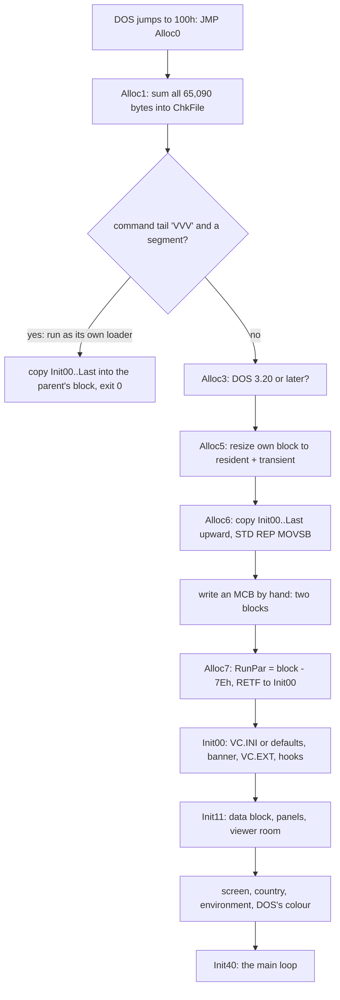
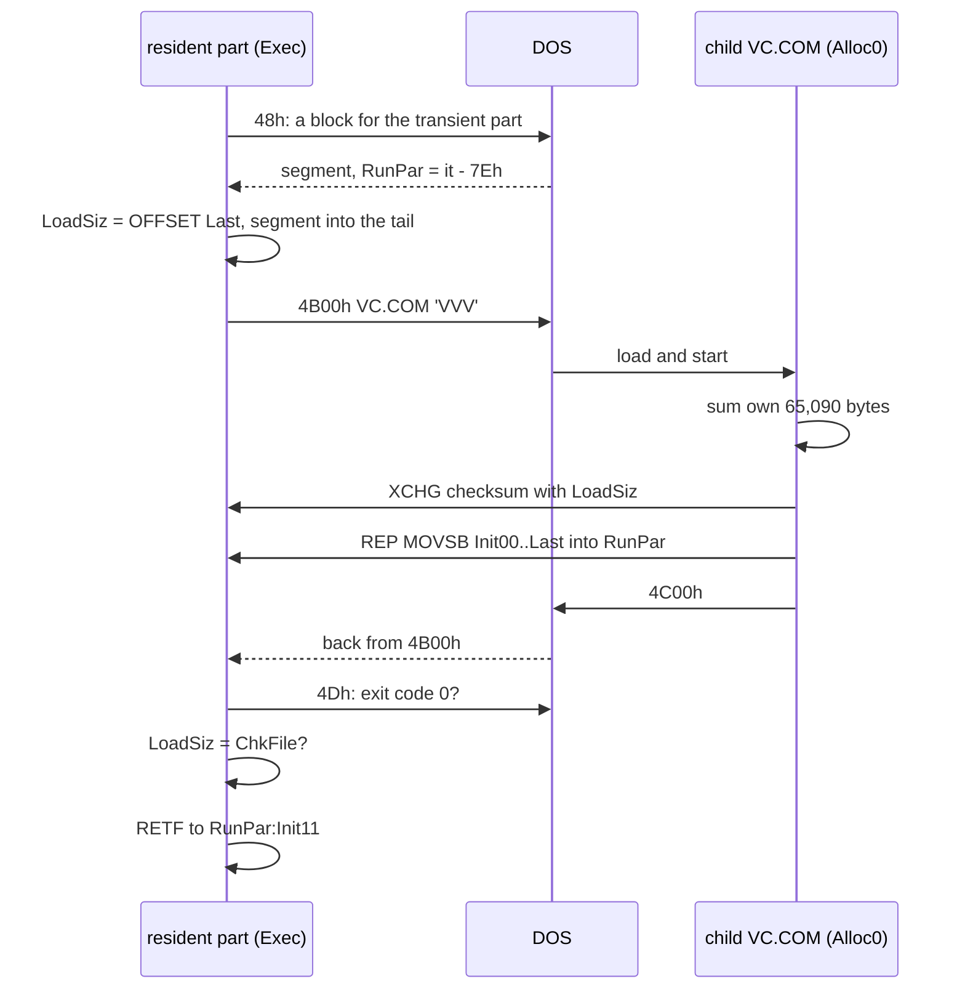
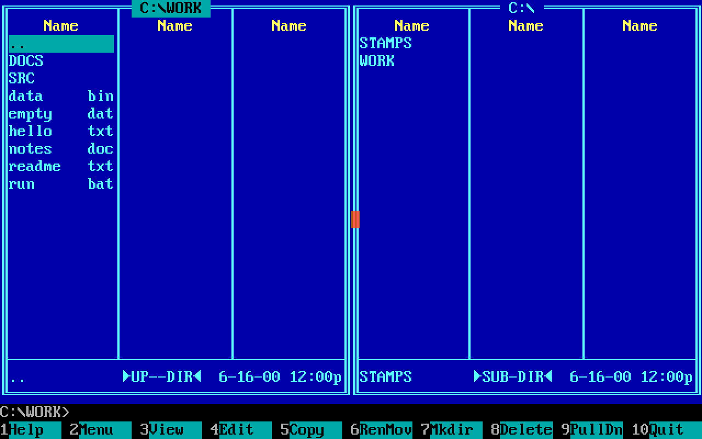
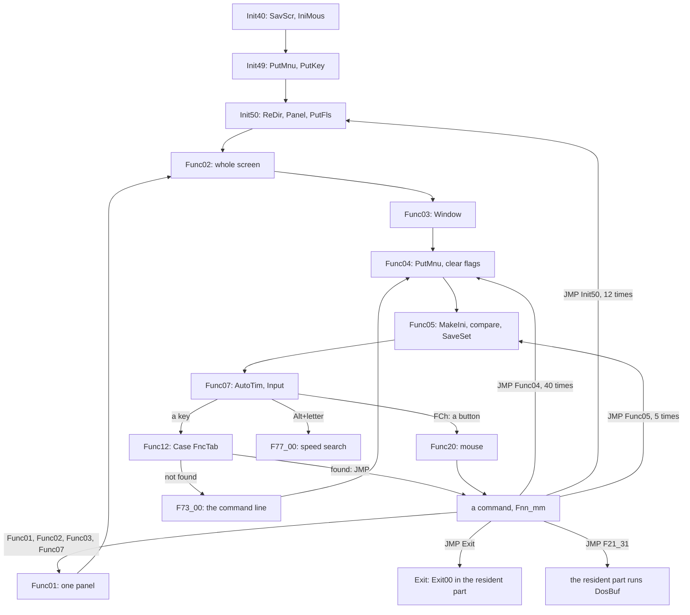
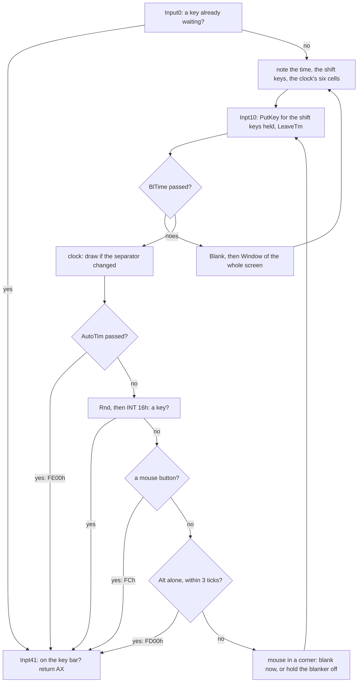
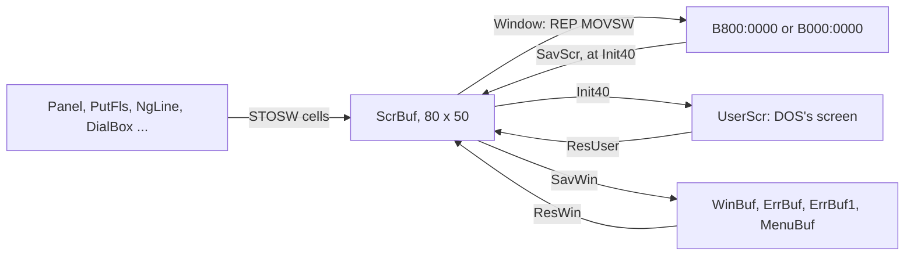
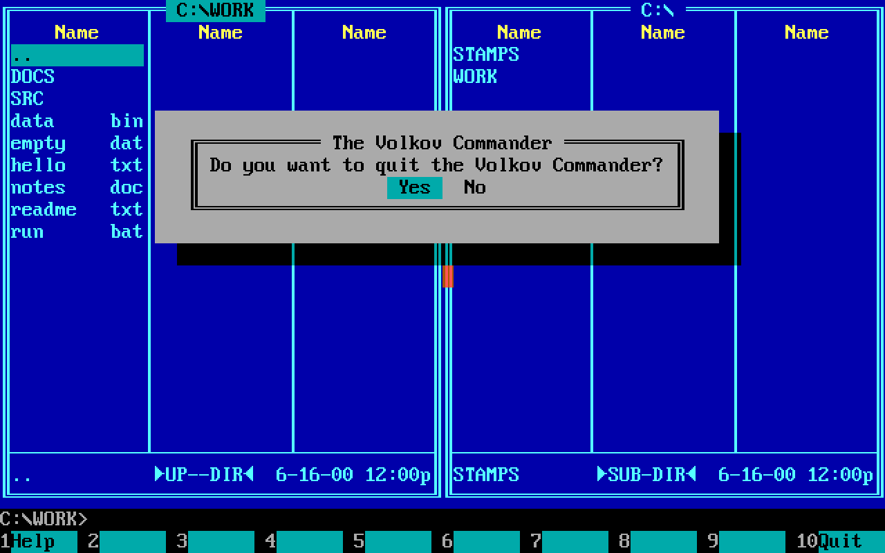
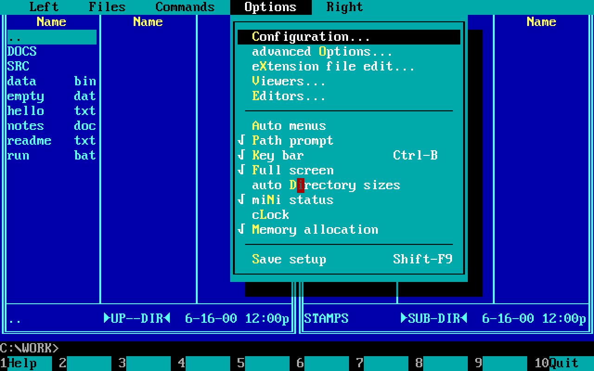
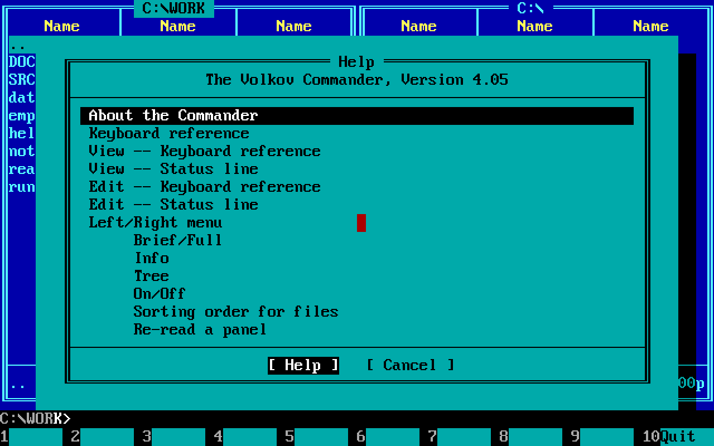

# 1. The program: one segment, one loop, one screen buffer

Volkov Commander 4.05 is a `.COM` file of 65,090 bytes. DOS loads it
into a single 64K segment and jumps to its offset 100h; there is no
header, no relocation table, nothing but the bytes. Everything else the
program needs it makes at run time out of the memory that DOS hands a
`.COM`, which is all of it: a block of 62,603 bytes for its data, a
segment for each of the two panels, and whatever is left for the viewer
and the editor. When the user runs a command, the program packs up and
gives its data back to DOS, and in the small mode of Memory allocation,
which is how it is distributed, its code too, keeping 12,690 bytes of
itself, stack and all.

This chapter is the skeleton that the features of
[chapter 2](02-the-features.md) hang on, read from the source in
`src/asm/`: how the source is put together, what is in the file, how
the program cuts up its memory when it starts, the structures of its
data and its panels, the main loop and its commands, the input, the
screen, the tables that describe every box and menu, the help, and the
clock and the blanker. The calls of DOS and the BIOS underneath are
[chapter 3](03-the-system.md). The last section lists the economies in
one place, with their sizes.

The figures come from the assembler's listing of the source as built
to the layout of the shipped binary, `VC.LST`, and from the source
itself. Code is quoted as Volkov wrote it; a comment that starts with
`;;` is this book's, the others are his.

## A PC refresher, in the terms the program uses

Four facts about real-mode DOS carry most of this chapter.

- **A segment is 64K, and a paragraph is 16 bytes.** An 8086 address
  is a 16-bit segment and a 16-bit offset, and the physical address is
  the segment times 16 plus the offset. Two segments one paragraph
  apart overlap in all but 16 bytes. A program that keeps every
  pointer as an offset within one segment never has to load a segment
  register to follow one.
- **DOS hands out memory in paragraphs.** INT 21h function 48h asks for
  a block of BX paragraphs and answers with its segment; 49h gives one
  back; 4Ah makes one longer or shorter. Each block is preceded by a
  16-byte *memory control block*, the MCB, in the paragraph in front of
  it: a byte `M` (or `Z` for the last), the segment of the owner's
  PSP, and the block's length in paragraphs. Asked for FFFFh
  paragraphs, which no machine has, DOS fails and says in BX how much
  the largest block holds: that is how a program learns what there is.
- **A `.COM` file is loaded at offset 100h of its segment and gets all
  the memory.** The first 256 bytes are the *program segment prefix*,
  the PSP, which DOS fills in: the command tail at 80h, the segment of
  the environment at 2Ch, the end of the memory at 2. CS, DS, ES and SS
  all point at the PSP, and SP at the top of the 64K.
- **The text screen is memory.** A colour adapter shows the 80 x 25
  characters of its first page from `B800:0000`, a monochrome one from
  `B000:0000`: two bytes a cell, the character and then its attribute,
  80 cells a row. Writing a word there puts a character on the screen
  with no call at all.

## The source: one file and twelve includes

The program is `VC.ASM` and twelve files that it includes, 27,190
lines in all, assembled by Borland's TASM in MASM mode (`MAKE.BAT`).
The first lines say what kind of program it is:

```asm
	OPTION	OLDSTRUCTS		; Structure fields are global names
	OPTION	NOSCOPED		; Labels inside procedures are global
	INCLUDE	VCLAYOUT.INC
	.MODEL	Tiny
	.CODE
Zero:	.STARTUP			;; ORG 100h, the start of a .COM
	JMP	Alloc0
```

`.MODEL Tiny` puts code and data into one group, `DGROUP`: the
assembler makes three segments, `_TEXT` for code, `_DATA` for tables
and `CONST` for texts, and the linker lays them one behind the other in
the one segment of the `.COM`. Every file switches between the three
with `.CODE`, `.DATA` and `.CONST` as it goes, so that a routine's
texts and tables sit in its own source next to it and still end up
together in the file. `OLDSTRUCTS` makes every field of every `STRUC`
a global name, so `DS:Visible` means "the byte at offset 2 of whatever
DS points at"; `NOSCOPED` makes every label global, so any code can jump
to any label of any procedure. The program relies on both everywhere.

| File | Lines | Code | Tables | Texts | What it holds |
|---|---:|---:|---:|---:|---|
| `VC.ASM` | 3,047 | 5,266 | 705 | 886 | the structures, the resident part, the start, the main loop, the exit, the critical error |
| `VCFUNC.INC` | 2,832 | 6,164 | 415 | 249 | the commands of the keys at the panels |
| `VCMENU.INC` | 1,631 | 2,708 | 1,027 | 2,121 | the menu bar and the commands of its menus |
| `VCF1.INC` | 1,806 | 2,472 | 1,734 | 959 | make directory, delete, attributes, label, and the other F-key commands |
| `VCCOPY.INC` | 1,914 | 3,902 | 595 | 487 | copy, move, rename |
| `VCVIEW.INC` | 2,167 | 4,853 | 401 | 262 | the viewer |
| `VCEDIT.INC` | 2,689 | 6,062 | 400 | 688 | the editor |
| `VCHELP.INC` | 712 | 1,403 | 97 | 147 | the help |
| `VCMEM.INC` | 991 | 2,036 | 62 | 120 | the map of the memory |
| `VCFIND.INC` | 1,159 | 2,489 | 92 | 130 | find file |
| `VCSUB1.INC` | 3,139 | 5,020 | 192 | 0 | the screen, boxes, lines, dialogs, the mouse |
| `VCSUB2.INC` | 2,514 | 4,408 | 358 | 362 | the bars, the panels on the screen, input, the blanker |
| `VCSUB3.INC` | 2,589 | 5,211 | 136 | 471 | reading directories, the tree, the setup file, disks |
| **in all** | **27,190** | **51,994** | **6,214** | **6,882** | **65,090 bytes** |

The bytes are those that each file puts into `VC.COM`, worked out from
the addresses of the listing; the code of `VC.ASM` leaves out the
buffers that it declares but does not put into the file (see the next
section).

`VCLAYOUT.INC` has no code of its own. The source that Volkov published
is the freeware edition, and the binaries he shipped in 2000 were
shareware, with registration code, a check of it and some lines of the
banner that the source lacks. Two macros reserve their room:

```asm
ShwCode	MACRO	Bytes			; Shareware-only code
IFDEF	SHAREWARE_LAYOUT
	DB	Bytes DUP(90h)		;; NOPs
ENDIF
	ENDM
```

and `ShwData` the same with zeros. Five uses in `VC.ASM`, 61 bytes of
code and 48 of data, all at the banner, put every later byte at the
address it has in the shipped `VC.COM`; that is why the figures of this
book are the shipped file's, 65,090 bytes, where the source alone
assembles to 64,981.

The names are Volkov's numbering, not words. A command is `Fnn_mm`,
`nn` the command and `mm` a place in it: `F11_00` is Ctrl-O, `F30_00`
F10. The menu's commands are `Mnn_mm`, the viewer's `Vnn_mm`, the
editor's `Tnn_mm`, the copy's `Cnn_mm`. The start is `Init00` to
`Init93`, the main loop `Func01` to `Func62`. A text ends in `_S`, a box
in `_P`, a dialog in `_B`, a row of buttons in `_D`, a table of keys in
`_T`, a file name in `_F`, a colour in `_C`. The listing has 305
procedures and 2,486 labels in the code; the procedures hold 28,981 of
its 51,994 bytes, and the rest, 44 percent of the program, is code
between procedures that is entered by jumps.

## The parts of `VC.COM`

```
 offset in the segment                                              bytes
 0000h +--------------------------------------------------+
       | PSP, made by DOS, not in the file                 |          256
 0100h +--------------------------------------------------+ <- the file starts
       | JMP Alloc0, RunPar, ChkFile, 'COMMAND.COM',       |          202
       | OvlPrm, five messages                             |
 01CAh | Exec: run the commands of DosBuf                  |
       | Exit00..Exit05, OutStr, SetBrk, GetStat, CtrlC    |        1,309
       | New21, New27, ExeProg, AddProg, FreeBlk, Release  |
 06E7h +-- LastRes -------------------------------------- +
       | Alloc0..Alloc9: the loader, run once              |          256
 07E7h +-- Init00 ---------------------------------------- +
       | the start, Init00..Init33                         |        1,266
 0CD9h | the main loop, Init40..Func62                     |        1,470
 1297h | VCFUNC, VCMENU, VCF1, VCCOPY, VCVIEW, VCEDIT,     |
       | VCHELP, VCMEM, VCFIND, the exit, VCSUB1..3        |       47,491
 CC1Ah +-- _DATA ----------------------------------------- +
       | colours, defaults, FncTab, boxes, dialogs, tables |        6,214
 E460h +-- CONST ----------------------------------------- +
       | texts                                             |        6,882
 FF42h +-- Last ------------------------------------------ +
       | (the stack of a .COM, until Alloc0 moves it)      |          190
 FFFFh +--------------------------------------------------+
```

Three things in this picture are the design.

**The file ends 190 bytes short of 64K.** DOS starts a `.COM` with its
stack at the top of the segment, just behind the code, and the program
has to leave it before it calls anything that pushes much. It does: the
loader's first `PUSH` that matters comes after it has set SP to the
program's own stack.

**The resident part is first, and its buffers cost nothing.** Behind
the resident code, at `LastRes`, the source declares 10,923 bytes of
buffers for the time while a command runs:

```asm
LastRes:

;--------------------- Release data --------------------
IntTab	DD	256	DUP(?)		;; the interrupt table, for the TSR list
SavePtr	DD	?
Vect21	DD	?
Vect22	DD	?
Vect27	DD	?
Counter	DW	?
PrgList	DW	MaxProg	DUP(?)
NameBuf	DB	12	DUP(?)

;------------------ Data save segment ------------------
WCB1sav	DB	WCBsave + 13 * MinFls	DUP(?)	; WCB1
WCB2sav	DB	WCBsave + 13 * MinFls	DUP(?)	; WCB2
ComnIni	DB	CmnSave			DUP(?)	; Common data
DataSav	DB	LenStk			DUP(?)	; Local stack
VcStack:
LastDat:
```

and then, further down, goes back:

```asm
;--------------------- Main module ---------------------
	.CODE
	ORG	LastRes			;; back to 06E7h

Alloc0:	CLD
```

`ORG LastRes` sets the place of assembly back to the start of the
buffers, so the loader and the transient code are assembled over them.
In the file those bytes are code. Once the program runs, the code has
been copied elsewhere and the same addresses of the first segment are
the buffers: the save areas of the two panels, the copy of the main
data, the 256-byte stack ending at `VcStack`, 3192h. The resident part
is 3192h = 12,690 bytes from the start of the PSP, of which 1,511 are in
the file.

**The rest is one transient part.** From `Init00` to the end, 63,323
bytes of code, tables and texts are needed only while the commander is
on the screen, and are given back while a command runs. Tables and
texts are in it because the tiny model put `_DATA` and `CONST` behind
`_TEXT`: everything that follows the resident part goes and comes back
as one block, with nothing to sort.

## The start: from one block to four

DOS has given the program all of memory in one block, with every
segment register on the PSP. `Alloc0` makes of it two blocks of DOS's,
a resident one and a transient one, and `Init11` then asks DOS for
the data.



### The checksum

The first loop of `Alloc0` adds up every byte of the file, 100h to
`Last`, into BX: 16 bits, no carry kept. The sum goes into `ChkFile`,
and its use comes later, when the program loads itself again (see
"A command runs in 12,690 bytes").

```asm
Alloc0:	CLD
	MOV	SI,100h
	MOV	CX,OFFSET Last-100h	;; 65,090
	XOR	BX,BX
	XOR	DX,DX
	MOV	AH,0
Alloc1:	LODSB
	ADD	BX,AX			;; the sum of the bytes
	LOOP	Alloc1
	MOV	SI,80h			;; the command tail
	MOV	DI,OFFSET OvlPrm	;; 10,'VVV',0,...
	MOV	CL,DS:[DI]
	DEC	CX
	REPE	CMPSB
	JNE	Alloc3			;; an ordinary start
```

### Cutting the block in two by hand

The resident part is `LastDat`, 794 paragraphs. The transient part is
copied behind it, one paragraph being left for an MCB:

```asm
Alloc5:	XOR	BP,BP			; Allocate segments
	MOV	BX,((LastDat-Zero-1) SHR 4)+1	;; 794 paragraphs that stay
	MOV	DX,DS
	ADD	DX,BX
	INC	DX			;; + 1 for the MCB: the transient block
	PUSH	DX
	MOV	DX,OFFSET Last-1
	MOV	SI,DX			;; copy from the last byte down
	SUB	DX,(Init00-Zero) AND 0FFF0h
	MOV	DI,DX
	...
	MOV	AH,4Ah			;; make our block as long as both parts
	INT	21h
	...
Alloc6:	STD
	CLI
	PUSH	CS
	POP	SS
	MOV	SP,OFFSET VcStack	;; the program's own 256 bytes
	REP	MOVSB			;; backwards: source and target overlap
	CLD
```

Then the program splits its own DOS block in two without asking DOS:
it shortens the MCB in front of the PSP to 794 paragraphs, and writes
a new MCB in the paragraph in front of the transient part, with the
`M` or `Z` and the remaining length that the old one had, and the PSP
as its owner:

```asm
	MOV	AX,ES
	DEC	AX			;; the paragraph in front of the copy
	PUSH	AX
	MOV	AX,CS
	DEC	AX
	MOV	DS,AX			;; our own MCB
	MOV	AL,'M'
	XCHG	AL,DS:[0]		;; ours is not the last any more
	XCHG	BX,DS:[3]		;; our length: 794
	SUB	BX,DS:[3]
	DEC	BX			;; what is left, less the new MCB
	POP	DS
	MOV	DS:[0],AL		;; 'M' or 'Z', as ours was
	MOV	DS:[1],CS		;; owned by our PSP
	MOV	DS:[3],BX
```

Where DOS cannot make the block that long, `Alloc0` asks for a second
block with 48h, copies into that, and shrinks its own.

### `RunPar`: a `.COM` that needs no relocation

The transient code was assembled for offsets 07E7h and up of a
segment that begins at the PSP. Copied to a block whose first
paragraph is P, its first byte is at P:0007h. So the program runs it
from the segment P - 7Eh, where `Init00` is at offset 07E7h again, and
every offset of the listing is right without a single relocation:

```asm
Alloc7:	MOV	AX,ES			;; the transient block
	SUB	AX,WORD PTR ((Init00-Zero) SHR 4)	;; - 7Eh
	MOV	DS:RunPar,AX
	PUSH	AX
	CALL	SetStat
	MOV	AX,OFFSET Init00
	PUSH	AX
	RETF				;; CS = RunPar, IP = Init00
```

The first 7E0h bytes of that segment, which lie over the resident
block and its MCB, are never addressed through CS. The transient
part's 63,323 bytes take a block of 3,959 paragraphs, 63,344 bytes.

### `Init00`: the setup file, read in place

`VC.INI` is 511 bytes: `VVV`, the first 88 bytes of each panel, the
first 330 bytes of the main data, and a 16-bit sum of all that. `Init00`
reads it straight into the resident part, at a place chosen so that the
330 bytes land on `ComnIni`, the copy of the main data that `Init11`
will copy down, and the panels' bytes just in front:

```asm
	MOV	SI,OFFSET Init_F	;; 'VC.INI'
	MOV	BP,OFFSET ComnIni - (3 + 2*WCBini)	;; read to here
	MOV	CX, 3 + 2*WCBini + CmnIni + 2 + 1	;; 512: one byte too many
	CALL	ReadOne
	MOV	BX,0
	JC	Init03			;; no file: the defaults
	DEC	CX
	SUB	AX,CX			;; exactly 511 read?
	JNE	Init02
	DEC	CX
	DEC	CX
	MOV	SI,BP
	XOR	DX,DX
Init01:	LODSB				;; the sum of 509 bytes
	ADD	DX,AX
	LOOP	Init01
	LODSW
	CMP	AX,DX
	JNE	Init02
	MOV	DI,BP
	MOV	AL,'V'
	MOV	CL,3
	REPE	SCASB			;; and 'VVV' in front
	JNE	Init02
```

Asking DOS for 512 bytes and expecting 511 is how a longer file is told
from a right one with no call to learn its length. The main data's 330
bytes are then already where they belong; only each panel's 88 go on to
`WCB1sav` and `WCB2sav`.

Without a good file the defaults come from `_DATA`, which begins with
them laid out exactly as the main data begins: `Palets`, 240 bytes of
colours, and behind them `DefInit`, one byte for each option, so that
one `REP MOVSB` of `OFFSET ResIni` = 279 bytes makes the first part of
the main data. A panel's default is `DefWCB`, of which the source has
8 bytes; the copy is 88 (`WCBini`), and the 80 that follow are the
first 20 entries of `FncTab`, the key table, behind the empty mask in
`DskMas` and under the path that `Init03` writes over them. Nothing
reads them: `MkIni1` clears everything behind the zero of the mask and
of the path before the setup is ever saved.

Then `Init04` prints the banner through DOS, AH 09h, after building it
with `MvzLin0` in the room that the main extension file will have,
`ComnIni.ExtMain`; reads `VC.EXT` into that same room and ends it with
1Ah; and, with the TSR manager on, takes INT 21h and INT 27h. A failed
setup file is reported with "VC.INI is not correct." under the banner.

### `Init11`: the data block, cut in paragraphs

`Init11` is also where the program comes back after every command. It
shrinks the transient block to its own length, asks DOS for FFFFh
paragraphs to learn the largest block, takes it, and cuts it by
arithmetic:

```asm
	MOV	BX,0FFFFh
	MOV	AH,48h
	INT	21h			;; fails: BX = the largest block
	MOV	AH,48h
	INT	21h			;; take it
	MOV	ES,AX
	MOV	DX,((SIZE MainDat-1) SHR 4)+1	;; 3,913 paragraphs
	MOV	DI,((SIZE WCBdef -1) SHR 4)+1	;;   423 each panel
	MOV	AX,((   MinView  -1) SHR 4)+1	;;   500 at least for the viewer
	ADD	AX,DX
	ADD	AX,DI
	ADD	AX,DI			;; 5,259 paragraphs, 84,144 bytes
	CMP	AX,BX
	JBE	Init13
	MOV	AX,OFFSET AlocEr	;; "Program too big to fit in memory"
	...
Init14:	MOV	ES:FreMem1,SI
	MOV	AX,ES
	ADD	AX,DX
	MOV	ES:WCB1seg,AX		;; the left panel
	ADD	AX,DI
	MOV	ES:WCB2seg,AX		;; the right panel
	ADD	AX,DI
	MOV	ES:ViewSeg,AX		;; all the rest: viewer, editor, copy
	MOV	CS:SecDat,ES		;; for the critical error
```

It copies the saved main data and panels down (`CmnSave` = 2,733 bytes,
and `Expand` for each panel), and then looks at what a command may
have changed: the video mode, which it puts back to text after asking
for Enter, the cursor's shape, the country and with it `LowTab`, the
lower case of 80h to FFh made by inverting DOS's routine for capitals,
the environment's `COMSPEC=`, `VC=` and `TEMP=`, the number of rows,
whether the adapter snows, and the colour DOS writes in, which it learns
by having DOS write a space and reading the cell back.

At run time the memory is then:

```
 PSP:0000  +--------------------------+  SS = the PSP's segment, always
           | PSP                  256 |
           | resident code      1,511 |
           | IntTab .. NameBuf  1,090 |
           | WCB1sav            3,422 |  while the commander runs: IniSave,
           | WCB2sav            3,422 |   the setup as last saved
           | ComnIni            2,733 |
           | DataSav, stack       256 |  SP starts at VcStack, 3192h
 3192h     +--------------------------+  794 paragraphs
           | MCB                      |
 RunPar+7Eh+--------------------------+  CS = RunPar
           | Init00 .. Last    63,323 |  code, _DATA, CONST
           +--------------------------+  3,959 paragraphs
           | MCB                      |
 SecDat    +--------------------------+  ES = the main data, always
           | MainDat           62,603 |  3,913 paragraphs
 WCB1seg   +--------------------------+  DS = a panel, while a command works
           | left panel WCBdef  6,754 |  423 paragraphs
 WCB2seg   +--------------------------+
           | right panel        6,754 |  423 paragraphs
 ViewSeg   +--------------------------+
           | the room: viewer,        |  the rest of the block,
           | editor, copy buffer      |  at least 500 paragraphs
           +--------------------------+
```

The four segment registers have fixed jobs, and the whole program is
written to them: **CS** is the transient part, and every table and text
is read through it, `CS:[BP]`, `CS:[SI]`, since they are in the same
segment as the code; **ES** is the main data; **DS** is the panel that a
command works on, or the main data where a routine works on that; **SS**
is the resident part, the PSP's segment, where the stack and the saved
copies are. A routine that needs the main data writes `ES:Lines`; one
that needs the current panel writes `DS:Visible`. A comment in the
source rarely says so: the convention is the documentation.

## A command runs in 12,690 bytes

Enter on a command line ends at `F21_31` of `VCFUNC.INC`, which packs
up the commander:

1. It puts the critical-error and Ctrl-Break vectors back
   (`RestVct`), copies the first `CmnSave` = 2,733 bytes of the main
   data, the setup, the history, the extension file and the command line
   `DosBuf`, to `ComnIni` in the resident part, and packs each panel into
   its save area with `F21_40`.
2. It gives the data block back to DOS (`MOV AH,49h` with ES on it) and
   jumps, by `PUSH`/`RETF`, to `Exec` in the resident part, with ES on
   the transient block.
3. `Exec` gives the transient block back too when `LoadFl`, the small
   mode of Memory allocation, is set, as it is by default; otherwise
   the code stays, and only the block of the data and the panels has
   gone. Then it runs each command of `DosBuf` in turn: through
   `COMMAND.COM /C` with 4B00h, or with Quick execute (`ExecTyp`)
   through COMMAND.COM's own INT 2Eh, after which it has to set its own
   stack again, since INT 2Eh keeps no register.
4. In the small mode it then loads the transient part again; either way
   it comes back to `Init11`, which takes the data anew.

### A panel in 13 bytes a file

`F21_40`, 110 bytes, keeps 94 bytes of the panel's header (`WCBsave`:
the 88 that the setup file keeps, the cursor, the first line shown and
the end of the list) and, for at most 256 files, 13 bytes of each
24-byte entry: the first 12 bytes of the name, which a name of 8.3
never fills, and the attribute byte. A panel saves in 94 + 13 x 256 =
3,422 bytes. If the cursor was beyond the 256th file, it and the first
line are moved to the last entries kept, with their marks of selection
cleared. Coming back, `Expand`, 46 bytes, makes each entry 24 bytes again
with the name's zero put back; the sizes and dates come back when the
directory is read again.

### `VC.COM` as its own overlay loader

The program does not reopen its file and read 63,323 bytes from the
right offset. It **runs itself**. `Exec11` asks DOS for a block as long
as the transient part, sets `RunPar` for it, and runs `VC.COM` (the
path that `OvlPth` found in the environment, where DOS puts the
program's own path behind its strings) with the command tail of
`OvlPrm`: `VVV`, five zeros, and its own segment written into the last
word of it:

```asm
Exec12:	XOR	AX,AX
	MOV	DS:ComnIni.LoadSiz,OFFSET Last	;; what the child is to copy
	MOV	SI,OFFSET OvlPrm	;; 10,'VVV',0,0,0,0,0,0,0,0Dh
	MOV	BL,CS:[SI]
	MOV	BH,0
	MOV	CS:[SI+BX-1],CS		;; our segment, into the tail
	MOV	BX,OFFSET ComnIni.EPB
	MOV	ES:[BX].CmdLine.Offs,SI
	MOV	ES:[BX].CmdLine.Segm,CS
	MOV	DX,ES:ComnIni.OvlPth	;; the path of VC.COM
	MOV	DS,CS:[2Ch]
	MOV	AX,4B00h		;; run it
	INT	21h
	...
Exec14:	MOV	AH,4Dh			;; its exit code
	INT	21h
	OR	AX,AX
	JNE	Exec13
	PUSH	ES
	POP	DS
	MOV	AX,DS:ComnIni.LoadSiz	;; the child's checksum
	CMP	AX,DS:ChkFile		;; is ours?
	JNE	Exec13			;; "Bad or missing" the file
Exec15:	PUSH	CS:RunPar
	MOV	AX,OFFSET Init11
	PUSH	AX
	RETF
```

The child is an ordinary start of `VC.COM`. Its `Alloc0` sums its own
file, sees `VVV` and a segment in its tail, and becomes a copy loop:

```asm
	LODSW				;; the parent's segment, from the tail
	CMP	BYTE PTR DS:[SI],0Dh
	JNE	Alloc3
	MOV	ES,AX
	XCHG	BX,ES:ComnIni.LoadSiz	;; hand back our checksum, take the length
	MOV	ES,ES:RunPar		;; the parent's new transient block
	MOV	SI,OFFSET Init00
	MOV	DI,SI
	MOV	CX,BX
	SUB	CX,SI
	REP	MOVSB			;; our transient part into it
	MOV	AX,4C00h
	SUB	BX,OFFSET Last
	JE	Alloc2
	INC	AX
Alloc2:	INT	21h			;; exit, code 0
```

One word, `LoadSiz` (the first word of the saved `DosBuf`, which has
been run by now), carries the length to copy one way and the checksum
of the file the other. A file that has changed since the commander
started, another version or a damaged copy, gives another sum, and the
commander says so and asks for Enter or Esc rather than run code that
is not its own. The whole mechanism costs some 55 bytes in `Alloc0` and
137 in `Exec11` to `Exec15`. The price is that DOS must be able to load
all 65,090 bytes of the child for a moment, which it can, since the
commander has just given back more than that.



## The main data

### `MainDat`: one `STRUC`, 62,603 bytes

All the state of the program that is not a panel is one structure,
`MainDat`, declared in `VC.ASM` and never instantiated in the file: it
is a layout, laid over the block that `Init11` takes, with ES on it.
Its order is the order of how long a field must live. The first 330
bytes are what the setup file keeps; up to 2,733 what survives a
command; the rest is made anew each time the transient part comes
back.

```
 offset  bytes  field              what it is
 ------  -----  -----------------  ------------------------------------------
  0000     240  ColTab             40 colours x 6 palettes: B/W, colour,
                                   laptop, each for colour and mono adapters
  00F0      32  FulScr .. DriveB   one byte for each option of the setup
  0110       2  DelayTm            delay of auto change dir: 1/100 s, s
  0112       5  StarTab            the blanker's five shapes of a star
  0117      51  ResIni             reserved
 ---- 014Ah = CmnIni: end of what VC.INI keeps (330 bytes) --------------------
  014A       5  LoadRes .. MenuFl  the original LoadFl, mode, mouse, break
  014F      13  SelMas             the mask of Grey +
  015C     512  HstBuf             command history
  035C     512  ExtMain            VC.EXT, ended by 1Ah
  055C      14  EPB                DOS's block for 4B00h
  056A      14  MouseX .. ComSpec  where the mouse was, where COMSPEC= is
  0578      68  CrnPath            the directory under the tree's cursor
  05BC     260  ViewFil, ToFile,   4 x 65: file names of the last commands
                FindStr, SrchStr
  06C0       5  DosChg             "C:" to change drive in Exec
  06C5    1000  DosBuf             the command line, and dialogs' typing
 ---- 0AADh = CmnSave: end of what survives a command (2,733 bytes) ----------
  0AAD      26  DosLin .. ErrDat   bytes of state: lines, EGA, quote, flags
  0AB3       1   Lines             rows on the screen, 25 to 50
  0AC7       2  VerDOS
  0AC9      10  WCBcrn, WCBsec,    the four panel segments and the room
                WCB1seg, WCB2seg,
                ViewSeg
  0AD3       6  FreMem1, FreMem2,  memory figures
                Memorys
  0AD9      22  HstAdr .. FncAddr  places in the history, the tree, Info,
                                   the random numbers, a group command
  0AEF      22  MousPos .. BrkVct  double click, AutoTim, the screen's
                                   address, the old INT 24h and 1Bh
  0B05      12  Volume             volume label
  0B11     204  DosPth, NcPath,    the current path, VC=, TEMP=
                TempDir
  0BDD      32  Country            DOS's country information
  0BFD      44  DTA                DOS's record of a search
  0C29     128  LowTab             lower case of 80h..FFh
  0CA9     256  TmpBuf             scratch for everybody
  0DA9     256  TmpErr             texts put into boxes, ^V at +1, ^W at +101
  0EA9     128  Stars              32 stars of the blanker, 4 bytes each
  0F29    4000  MenuBuf            the user menu; the setup image; a box's room
  1EC9    1406  InfBuf             the Info panel's text, 37 x 38
  2447       1  (EVEN)
  2448    8000  ScrBuf             the screen, 80 x 50 cells
  4388    7840  UserScr            what DOS showed, 80 x 49 cells
  6228    7392  WinBuf             what a box covers, 77 x 48 cells
  7F08    7392  ErrBuf             the second level of boxes
  9BE8    7392  ErrBuf1            the third: errors and help
  B8C8    3000  HelpBuf            one entry of the help, and its state
  C480   12299  TreeBuf            the tree: header + 768 entries of 16
  F48B          end
```

Every size here is an `EQU` of `VC.ASM`: `LenPath` = 68 for a path,
`LenStr` + 1 = 65 for a file name typed in, `LenBat` = 1000 for the
commands, `LenMenu` = 4000, `MaxLins` = 50, `MinTree` = 768,
`NmbStrs` = 32. The screen buffers are sized for the largest screen, 50
rows, and the buffer under a box for the largest box, 77 x 48.

`VC.INI` is therefore not parsed: `MakeIni` writes `VVV`, the 88 bytes
of each panel (after `MkIni1` clears the junk behind the strings), the
first 330 bytes of `MainDat` and `ChkSum` of all of it into `MenuBuf`,
and `SaveSet` writes that out, 511 bytes. A new option is a byte taken
from `ResIni`.

### Saving the setup without a "dirty" flag

Every time the main loop comes round, at `Func05`, it makes the setup
file's image anew and compares it with the image as last saved. There
is no flag anywhere that says that an option has changed. The image as
last saved is kept at `IniSave`, which is

```asm
IniSave	EQU	WCB1sav
```

the save area of the left panel in the resident part, which is unused
while the commander is on the screen and needed only while a command
runs, when nothing is compared. The paths, the active panel and
`Ctrl_O` are copied across first, so that changing directory or panel
does not count:

```asm
Func05:	CALL	MakeIni			;; the image, into MenuBuf
	PUSH	SS
	POP	ES
	MOV	DI,OFFSET IniSave	;; SS:WCB1sav
	CMP	WORD PTR ES:[DI],'VV'	;; nothing saved yet: just copy
	JNE	Func06
	PUSH	CX
	MOV	AX,OFFSET [3].WinPath	;; the left path is not a change
	MOV	CX,LenPath
	PUSH	CX
	CALL	Func15
	POP	CX
	MOV	AX,OFFSET [3+WCBini].WinPath	;; nor the right one
	CALL	Func15
	POP	CX
	MOV	BX,OFFSET [3+2*WCBini].Active	;; nor which is active
	...
	DEC	CX
	DEC	CX
	REPE	CMPSB			;; 509 bytes
	...
	JE	Func06
	CMP	DS:AutoSav,0
	JZ	Func06
	...
	CALL	SaveSet			;; something did change
	...
Func06:	PUSH	SS
	POP	ES
	REP	MOVSB			;; the new image is the saved one
```

The cost is a comparison of 509 bytes per key, about a millisecond on a
4.77 MHz PC, and it catches every way an option can change: a menu, a
dialog, Ctrl-B, the setup program.

## The panels

### `WCBdef`: a header and a list, in a segment of its own

A panel, a *window control block*, is a segment. Its first 610 bytes
are the header and from 262h on is its list of files, 24 bytes an
entry:

```
 WCBdef                                       FILENT, 24 bytes
 offset  bytes  field                         offset  bytes  field
 0000      1    WinTyp   0 files, 1 tree,     00      13     NameF   name, ASCIIZ
                         2 info               0D       1     AttrF   DOS attributes;
 0001      1    BrfFul   brief or full                               bit 7 selected
 0002      1    Visible                       0E       2     TimeF
 0003      1    Hidden   hidden files shown   10       2     DateF
 0004      1    MasTyp   which filter         12       4     SizeF
 0005      1    SortTyp  name, ext, time,     16       2     NumbF   its place in
                         size, unsorted                              the directory
 0006      1    Ctrl_L
 0007     13    DskMas   the filter
 0014     68    WinPath
 ---- 0058h = WCBini: end of what VC.INI keeps (88) ----
 0058      2    CurAdr   offset of the cursor's entry
 005A      2    First    offset of the first entry shown
 005C      2    EndBuf   offset behind the last entry
 ---- 005Eh = WCBsave: end of what a command keeps (94) ----
 005E    512    ExtBuf   this directory's own extension file
 025E      2    EndFul   offset of the end of the room
 0260      1    ChgFlg   to be read again
 0261      1    SizDir
 ---- 0262h = WCBsize ----
 0262   6144    DskBuf   MinFls = 256 entries, and as many more
                         as the segment can hold
 1A62           end of the 423 paragraphs that Init11 gives
```

`FILENT` is DOS's 43-byte search record (`DTAs`) cut down to what a
panel shows, in the same order: name, attribute, time, date, size, and
then a number of its own. The cursor, the first line and the ends of
the list are offsets in the panel's segment; a routine that walks the
list keeps the entry in SI or DI with DS on the panel, and steps by
`SIZE FilEnt`. The list may grow past the 256 entries of the 423
paragraphs: `ReDir` moves the other panel and the room up to make
space, and a panel stops at 64K, 2,703 entries.
[Chapter 2](02-the-features.md) has the reading, the sorting and the
selection.

### A panel is its segment

The program has no number for "the left panel" and no pointer to a
structure: a panel is the value of its segment, and the main data has
four words of them. `WCB1seg` and `WCB2seg` are the panels on the left
and on the right of the screen, `WCBcrn` and `WCBsec` the current one
and the other. A routine that needs to know which side its panel is on
compares DS with `WCB1seg`; `BegBX`, which answers where a panel begins
on the screen, is eight instructions:

```asm
BegBX	PROC	NEAR
	MOV	BX,DS
	CMP	BX,ES:WCB1seg		;; is the panel in DS the left one?
	MOV	BX,0			;; row 0, column 0
	JE	BegBX1
	MOV	BL,40			;; the right one: column 40
BegBX1:	CMP	BH,ES:MenuVs		;; one row down under a visible menu bar
	JZ	BegBX2
	INC	BH
BegBX2:	RET
BegBX	ENDP
```

Swapping the panels with Ctrl-U is swapping two words, and Tab two
others:

```asm
F15_00:	CMP	DS:Visible,0		; ^U
	JNZ	F15_01
	JMP	Func04
F15_01:	MOV	AX,ES:WCB1seg		;; left and right exchange places
	XCHG	AX,ES:WCB2seg
	MOV	ES:WCB1seg,AX
	MOV	BX,OFFSET Active
	CALL	InvVar			;; the active side changes with them
	CALL	BegBX
	CALL	SizDX
	MOV	BL,0
	MOV	DL,80
	CALL	ResUser			;; DOS's screen under both
	JMP	Init50			;; and draw the panels again
```

The whole command is 45 bytes, and the panels' 6,754 bytes stay where
they are.

The directory tree is a panel of type 1, but its list is not in the
panel: it is `TreeBuf` of the main data, the header of the Norton
Commander's `TREEINFO.NCD` file followed by 16-byte `DIRENT` entries.
The `DIRTREE` structure has `TreList` as a label of no length at the
place of `TreSum2`, so the first entry is laid over the checksum of
the list, which the file has at the end. Code that walks a list of
files and code that walks the tree are often the same code, with an
offset in either.



*The start: two file panels of `WCBdef` on the left and on the right,
the command line on row 23 (`DosLin`), the key bar on row 24. Every cell
is a word of `ScrBuf`.*

## The main loop

### Labels, not a procedure

The main loop of the program is no `PROC`. The start falls into it at
`Init40`, and it is a row of labels that fall into one another, each
the entry for a different amount of work to do before the next key:

| Label | Offset | What it does, before it falls into the next |
|---|---|---|
| `Init40` | 0CD9h | find DOS's cursor and the command line's row, save what DOS shows (`SavScr`), start the mouse |
| `Init49` | 0DABh | draw the menu bar and the key bar |
| `Init50` | 0DB5h | read again the panels that `ChgFlg` marks, draw both |
| `Func01` | 0FB7h | draw the panel in DS only |
| `Func02` | 0FC0h | take the whole screen, rows 0 to `Lines` |
| `Func03` | 0FC9h | copy the rectangle in BX, DX to the screen (`Window`) |
| `Func04` | 0FCCh | the menu bar; clear `OneFile`, `FlagCD`, the double click |
| `Func05` | 0FE0h | make the setup's image, save it if it changed |
| `Func07` | 103Dh | the cursor on the command line, the alarm of auto change dir, wait for a key |
| `Func12` | 110Bh | the key in AX to its command |
| `Func20` | 112Ch | the mouse at the panels |



A command ends with a jump to whichever label leaves the least to do.
One that changed a byte of the setup and nothing on the screen jumps to
`Func05`, which saves it; one that changed one panel to `Func01`; one
that changed what is in a directory to `Init50` with `ChgFlg` set; most,
which have put back what a box covered and drawn what changed, to
`Func04`. Counted over the twelve include files, the commands jump back
to `Func04` 40 times, to `Init50` 12 times, to `Func05` 5 times, to
`Func01` 3 times, and once or twice each to `Func07`, `Init40`,
`Init11`, `Func12`, `Func03` and `Func02`. A command may also jump into
another command: the menu's "Panels on/off" is `F11_00` itself.

What stays in the registers stays: a command finds in BX, DX, SI and
DI what the command before left there, and Rename, for one, reads
them.

### `Func07`: an alarm and an injected key

Before it waits, `Func07` sets an alarm. With Auto change dir on and a
tree panel whose cursor has moved off the current directory, `AutoTim`
is set to now plus `DelayTm`, 0.60 seconds by default, in the packed
form of INT 21h AH 2Ch: CX hours and minutes, DX seconds and
hundredths:

```asm
	MOV	AH,2Ch			;; the time: CH:CL hours:minutes,
	INT	21h			;;           DH:DL seconds:hundredths
	ADD	DL,DS:DelayTm[0]
	CMP	DL,100
	JB	Func08
	SUB	DL,100
	INC	DH
Func08:	ADD	DH,DS:DelayTm[1]
	...
Func09:	MOV	CX,0FFFFh		;; no alarm
Func10:	POP	DS
	MOV	ES:AutoTim.Lo,CX
	MOV	ES:AutoTim.Hi,DX
	XOR	CX,CX
	MOV	ES:HlpPage,CL
	XCHG	CH,ES:MenuFl		;; the user menu to come up by itself?
	MOV	AX,3C00h		;; then the key is F2
	OR	CH,CH
	JNE	Func12
```

When the moment comes, `Input0` answers with the pseudo-key FE00h, and
`FncTab` sends that to `F75_00`, which changes the directory. Auto menus
work the same way: with `MenuFl` set, the loop does not wait at all but
goes on to `Func12` with F2 in AX, as if it had been pressed. Neither
feature has code of its own in the loop beyond these lines.

### `Func12` and `Case`: a key table walked by 37 bytes

```asm
Func12:	CMP	AH,0FCh			;; a mouse button?
	JE	Func20
	CMP	ES:Quote,0		;; Ctrl-Q: the next key is text
	JNZ	Func14
	MOV	SI,OFFSET FncTab
	CALL	Case			;; jumps to the command if it finds it
Func14:	JMP	F73_00			;; otherwise the key goes to the line
```

`FncTab` is 72 entries of two words, the key as the BIOS gives it and
the address of its command, and a zero: 290 bytes for every key of the
panels.

```asm
FncTab	DW	4800h, F00_00		; Up
	DW	5000h, F01_00		; Down
	...
	DW	0F09h, F20_00		; Tab     - change active panel
	DW	1C0Dh, F21_00		; Enter   - run / change directory
	...
	DW	000Fh, F11_00		; ^O      - on/off panels
	DW	0015h, F15_00		; ^U      - swap panels
	...
	DW	4400h, F30_00		; F10     - quit
	...
	DW     0FD00h, F39_00		; Alt     - pull down menu
	DW     0FE00h, F75_00		;         - auto CD / quick view
	DW	0
```

A BIOS key word has the scan code in the high byte and the character
in the low byte. An entry whose high byte is 0 matches the character
with any scan code, which is how one entry, 000Fh, takes Ctrl-O however
the keyboard makes it; an entry with both matches only that key, Tab
being 0F09h ahead of the Ctrl-I that its character 09h also is. `Case`
does the rest:

```asm
Case	PROC	NEAR			;; CS:SI the table, AX the key
	PUSH	SI
	PUSH	CX
	OR	AH,AH			;; no scan code (Alt+digits): no match
	JE	Case3
Case1:	MOV	CX,CS:[SI]
	ADD	SI,4
	JCXZ	Case3			;; end of the table
	CMP	AL,CL			;; the character
	JNE	Case1
	OR	CH,CH			;; any scan code?
	JE	Case2
	CMP	AH,CH
	JNE	Case1
Case2:	POP	CX
	ADD	SP,4			;; drop the saved SI and the return address
	JMP	WORD PTR CS:[SI-2]	;; and jump to the entry's address
Case3:	POP	CX
	POP	SI
	RET				;; not found: back behind the CALL
Case	ENDP
```

`Case` is a call that does not come back when it finds the key: `ADD
SP,4` throws away its own return address, and the jump lands in the
command with the stack as it was before the `CALL`. So the line behind
`CALL Case` is the "otherwise" of a `switch`, and the table is the
cases. The same 37 bytes serve 18 tables, from 24 calls: the panels
(`FncTab`), the menu bar (`MenuTab`), every dialog (`Dial_T`), the
input line (`InSt_T`), a group of choices (`Slct_T`), buttons
(`MnMn_T`), the viewer (`View_T`), the editor (`Edit_T`), the help
(`Help_T`), the history (`Hist_T`), find file (`Find_T`), the user menu
(`User_T`), a drive not ready (`Ready_T`), and five more.

```
 stack inside Case                 after JMP CS:[SI-2]
 +--------------------+            +--------------------+
 | ...                |            | ...                |  <- SP, as before
 | return to Func14   |  dropped   |                    |     CALL Case
 | saved SI           |  by ADD SP |                    |
 | saved CX  <- SP    |  popped    |                    |
 +--------------------+            +--------------------+
```

Since a command is reached by a jump, it is no procedure either: it
ends by jumping to a label of the loop, and the stack never holds more
than whatever the command itself calls.

### The mouse at the panels

`Func20` and `Func21` take a press of a button at the panels. The
mouse's position comes from `GetMous` as a cell, row in CH and column
in CL, and the buttons in AL:

- in the two cells at the top left, the pointer becomes `■` while the
  button is held, and letting go there is Ctrl-O, `JMP F11_00`;
- elsewhere on the top row, the menu bar, `JMP F39_00`;
- in the other panel, Tab, `JMP F20_00`;
- in a list, `Func40` works out the entry under the pointer from the
  row, and in brief mode from the column divided by 13, and jumps to
  the cursor's own commands, `F00_60`, or `F00_05` to scroll up and
  `F01_05` down; a second click on the same entry within `MoDelay` =
  40 hundredths of a second, which `DoublMo` measures with INT 21h AH
  2Ch, is Enter, `JMP F21_10`;
- in the Info panel, the editor on its `dirinfo` file, `JMP F34_10`.

The mouse's commands are the keys' commands, entered at labels a few
instructions further in, where the keys' code has already worked out
what the mouse supplies.

## Input

### `Input` and `Input0`

Everything that waits for a key calls `Input`, with the number of the
key bar to show in AL, and gets the BIOS's key word in AX. `Input` is
18 bytes, and gives every routine of the program the help on F1 (3B00h)
without any of them knowing:

```asm
Input	PROC	NEAR
	PUSH	AX			;; the key bar
	CALL	Input0
	CMP	AX,3B00h		;; F1?
	JNE	Input1
	CALL	Help			;; the help, over whatever is there
	POP	AX
	JMP	Input			;; and wait again
Input1:	INC	SP
	INC	SP
	RET
Input	ENDP
```

`Input0` is the wait itself, 729 bytes, and the only procedure of the
program that declares local variables, 30 bytes of them in its frame on
the 256-byte stack, the six cells under the clock among them:

```asm
Input0	PROC	NEAR C USES DS SI DI DX CX BX
	LOCAL	IKeyBar[2]:BYTE	,\	; Each byte takes a word of stack
		BlMouse[2]:BYTE	,\
		KbdFlgs[2]:BYTE	,\
		AltLock[2]:BYTE	,\
		ClkFlag[2]:BYTE	,\
		ClkBuf[6]:WORD	,\	;; what the clock covers
		BlTime	:DWORD	,\	;; when to blank the screen
		AltTime	:DWORD		;; when Alt went down
```

It answers in the BIOS's form, extended by three scan codes of its
own: FCh for a button of the mouse, FDh for Alt pressed and let go by
itself, FEh for the moment in `AutoTim`. A caller tells them apart with
one `CMP AH`.



What the loop does each time round:

1. `PutKey` reads the shift state, INT 16h AH 2, and draws the key bar
   for Alt, Ctrl, Shift or none; `PutKey0` draws only when the bar it
   picks differs from `BarPrev`, so holding a key costs nothing.
2. `LeaveTm` gives the time away: INT 28h, which lets DOS's own TSRs
   such as `PRINT` work; INT 2Fh AX 1680h, Windows' "release the time
   slice", which it stops calling for good once the call answers that
   Windows is not there; and DESQview's pause through INT 15h.
3. With a blank delay set, it compares the time with `BlTime`, now
   plus `BlDelay` minutes, set again whenever something happens.
4. With the clock on, it draws the clock.
5. It compares the time with `AutoTim`.
6. It steps the random numbers, `Rnd`, so that how long the user waits
   decides the blanker's sky.
7. It looks for a key, a button, and a tap of Alt: Alt down and up
   within 3 timer ticks with nothing else between, which brings up the
   menu bar when `AltBar` is set.
8. It looks at the mouse in two corners: the top right one blanks the
   screen at once, once the pointer has moved into it, and the bottom
   right one keeps the blanker off for as long as the pointer is there.

A key that comes back is looked at once more by `Inpt41`: a button
pressed on the key bar is held there, the bar showing the Shift keys'
names for the middle button and Alt's for the right one, and the
pointer a `√` while it is on a key; letting go on a key returns that
key, 3Bh plus the column divided by 8 for F1 to F10, 54h on for Shift,
68h on for Alt.

### The mouse driver, in eight calls

The mouse is INT 33h, and the program uses it in a few lines of
`VCSUB1.INC`. `GetMous` (62 bytes) asks for the position, AX 3, which
the driver gives in pixels of a virtual screen of 8 x 8 a cell, and
divides by 8 with `SHR`; with `LftMous` set it exchanges the bits of
the two buttons. `CurMous` shows and hides the pointer, AX 1 and 2, the
choice made from the carry of a `CMP`. `TypMous` makes the pointer a
character:

```asm
TypMous	PROC	NEAR
	...
	MOV	CX,0FFFFh		;; keep the whole cell ...
	MOV	DX,7700h		;; ... and invert its colours
	CMP	AL,0
	JE	TypMo1
	MOV	CL,0			;; keep the colours only ...
	MOV	DL,AL			;; ... and show this character
TypMo1:	XOR	BX,BX			;; a software text cursor
	MOV	AX,0Ah
	INT	33h
```

The driver draws the pointer by ANDing the cell under it with CX and
XORing it with DX, so the same call makes the ordinary block pointer
and the `√`, `■` and `x` that tell the user what letting go will do.

## The screen

### `ScrBuf`, and places in one register

The program never draws on the screen. It draws into `ScrBuf`, 4,000
words of the main data, 80 x 50 cells in exactly the layout of the
adapter's memory, and copies rectangles of it out. A place on the
screen is one word, the row in the high byte and the column in the low
byte, so that it fits a register and its row and column are BH and BL,
DH and DL, with no shift to take it apart; a size is packed the same
way. `BasAdr` makes an address of a place:

```asm
BasAdr	PROC	NEAR			;; BH,BL: row, column
	PUSH	BX
	PUSH	AX
	MOV	AL,80
	MUL	BH			;; the row times 80
	MOV	BH,0
	ADD	AX,BX			;; and the column
	ADD	AX,AX			;; two bytes a cell
	ADD	AX,OFFSET ScrBuf
	MOV	DI,AX			;; DI: the cell, in ES
	POP	AX
	POP	BX
	RET
BasAdr	ENDP
```

20 bytes, called from almost everything that draws.

### `Window` and `MovScr`

`Window`, 121 bytes, copies the rectangle of `ScrBuf` at BX, of size
DX, to the screen, whose segment and offset the start has put in
`Screen`: `B800h`, or `B000h` on a monochrome adapter, or the buffer
that TopView or DESQview answers to INT 10h AH FEh; and the offset of
the page shown, from the BIOS's data at 44Eh. A single row it copies
cell by cell; a taller rectangle it widens to whole rows, from column 0
to 79, so that the copy is one block:

```asm
Window	PROC	NEAR			;; BX the place, DX the size
	...
	MOV	AL,0
	CALL	CurMous			;; the pointer off: the driver draws it
	PUSH	ES			;;  into the same memory
	POP	DS
	MOV	ES,DS:Screen.Segm
	CALL	BasAdr
	MOV	SI,DI
	SUB	DI,OFFSET ScrBuf
	ADD	DI,DS:Screen.Offs	;; the same cell on the screen
	MOV	AL,DS:Snow
	CMP	DH,1
	JE	Wind1			;; one row: cell by cell
	MOV	BH,0
	ADD	BX,BX
	SUB	SI,BX			;; several: from column 0, whole rows
	SUB	DI,BX
	PUSH	DI
	PUSH	DX
	CALL	MovScr
	...
Wind7:	MOV	AL,1
	CALL	CurMous			;; the pointer on again
```

`MovScr` (52 bytes) is the copy, `REP MOVSW`, in pieces of at most
seven rows. On a CGA, whose memory shows "snow" when the processor
writes to it while it draws, `Snow` is 0, and `MovScr` waits for the
vertical retrace, polling port 3DAh, before each piece; the start tells
such an adapter by timing that bit. `SavScr` is the copy the other way,
the screen into `ScrBuf`, which `Init40` makes after every command, and
then keeps in `UserScr`, the 49 rows of what DOS showed: switching the
panels off with Ctrl-O shows it again, `ResUser`, as does Esc with
`EscBar`.



### What a box covers

There is no window system and no redrawing of what lies under a box. A
box saves the cells it is about to cover with `SavWin`, 39 bytes, and
puts them back with `ResWin`, 42, both `REP MOVSW` row by row from and
to a buffer of the main data. Which buffer is a word of the box's
table. There are three of 77 x 48 cells, 7,392 bytes each, so boxes nest
three deep: `WinBuf` for a box or a menu over the panels, `ErrBuf` for
a box over that (and the menu bar's row while the bar is up), `ErrBuf1`
for the help and the critical error, which can come up over anything.
A small box may use `MenuBuf` or `TmpBuf` instead. 22,176 bytes of
buffers are the whole of the program's windowing.

### Colours

Every colour the program draws is a number from 0 to 39, an `EQU`
of `VC.ASM`, from `Back_C` = 0 for the panels to `Sky2_C` = 37 for the
blanker's bright stars. `Color` (9 bytes) makes an attribute of it, by
`ColTab`, 40 entries of six bytes, one for each palette (black and
white, colour, laptop) on each kind of adapter: which byte is read is
`ColTyp` and whether the adapter is a monochrome one. Entry 38,
`ShadFl`, is no colour but says how a box's shadow is drawn. The setup
program edits the table, and the file keeps it in its first 240 bytes.

## Boxes, dialogs and menus as tables

### A line and its markup: `NgLine`

Every text that the program shows in a box, a menu, a status line or
the help goes through one routine, `NgLine`, 204 bytes, in a markup
like that of Norton Guides:

| In the text | It does |
|---|---|
| `^N` `^R` `^B` `^U` | normal, reversed, bold, underlined: the 1st to 4th colour of the line's table; the same twice is back to normal |
| `^V`, `^W` | put in the text at `TmpErr+1`, `TmpErr+101` |
| `^I` | put in the "include line" that the caller passes in DX |
| `^Cxx` | colour xx, in hex |
| `^Axx` | character xx, in hex |
| `^^` | a caret |
| `FFh, n` | n spaces |
| `FFh, 80h+n, c` | n copies of the character c |

`LnStr`, 112 bytes, counts the cells a line will take with the same
markup, so that a box can be as wide as its longest line. The runs are
the commonest mark: "Yes" and "No" three spaces apart are

```asm
YesNo_S	DB	'Yes',0FFh,3,'No',0
```

and a menu's line with its hot key on the right is `'Copy',0FFh,14,'F5',0`,
nine bytes for a line of 20 cells. `LnStr` counts a run with a carry
trick: it reads the two bytes behind the FFh as one word, adds n - 1
and the inverted bit 7 shifted out into the carry, and leaves a run's
character to the next round of its loop, which counts it as an
ordinary one.

`NgLine` and `LnStr` disagree in one place. `LnStr` counts `^Cxx` as a
cell and `^Axx` as none, and `NgLine` writes a character for `^A` and
changes the colour for `^C`: a line that used either would be measured
wrong by one cell.

### `DialBox`: a box is 8 bytes and its lines

A box is a table in `_DATA`. The F10 box:

```asm
	.CONST
Name_S	DB	PrgName,0		;; 'Volkov Commander'
Quit1_S	DB	' The ^I ',0
Quit2_S	DB	'Do you want to quit the ^I?',0
YesNo_S	DB	'Yes',0FFh,3,'No',0

	.DATA
Quit_P	DB	Box_C, BoxCu_C, BoxCu_C, 0	;; four colours for ^N ^R ^B ^U
	DB	3, 0			;; three lines, no variable texts
	DW	OFFSET WinBuf		;; where what it covers goes
	DW	OFFSET Quit1_S		;; the title, on the frame
	DW	OFFSET Quit2_S
	DW	OFFSET YesNo_S
```

```
 a box (_P)                          for each of 0 to 2 variable texts
 +0  DB  4 colours                   +0  DW  where the text is (DS:)
 +4  DB  number of lines             +2  DB  how: 4 trim, 2 a path,
 +5  DB  number of variable texts            1 the drive letter too
 +6  DW  save buffer, in ES                   (NormStr, PathLin, LetLin)
 +8  ... the variable texts          +3  DB  the most cells, cut in
 ... DW  a line each: the first is           front (ShrtLin)
         the title, 0 is a rule
```

`DialBox`, 210 bytes, does all of it: copies the variable texts into
`TmpErr` at +1 and +101, 81 bytes each, and shortens a path that is
too long; finds the widest line with `LnStr`; adds 040Ch to the size,
four rows and twelve columns for the margins, the frame and the
shadow; centres the box on the place it is given; saves what it covers;
draws the frame and the shadow, growing it from the middle first when
`ZoomWin` is set (`MinBox`); and writes each line centred, or a rule
`╟──╢` across for a line of 0. On a screen of more than 25 rows,
`SftEGA` moves the box down by half the extra rows.

### `Dialog`: a header of 10 bytes, a field of 11

A dialog is a box with fields that take keys. Its table is a `BOXHD`
and a `BOXMN` for each field, ended by a zero:

```asm
BOXHD	STRUC				;; 10 bytes
  pDiBox  DW	?			; Pointer to DialBox structure
  BoxBase DW	?			; The dialog box begin-center
  SubFunc DW	?			; Subfunction
  bKeyBar DB	?			; KeyBar
  bMenu   DB	0FFh			; PutMnu
  bHelp   DB	0			; HlpPage
  bFlags  DB	0			; Flags
BOXHD	ENDS

BOXMN	STRUC				;; 11 bytes
  mType	  DB	?			; Menu type
  mUp	  DB	0			; Up link
  mDown	  DB	0			; Down link
  mLeft	  DB	0			; Left link
  mRight  DB	0			; Right link
  mBase	  DW	?			; Menu base
  mPoint  DW	?
  mCtrl	  DW	?
BOXMN	ENDS
```

The quit dialog is 22 bytes, its buttons 5:

```asm
YesNo_D	DB	5, 0			;; a button 5 cells wide at column 0
	DB	4, 6			;;  and one of 4 at column 6
	DB	0
Quit_B	BOXHD	< Quit_P, 528h, 0, 1, 2, 26, 0 >
	;; the box above; its top centred at row 5, column 40; no routine;
	;; key bar 1; the Files menu lit; help page 26; no flags
	BOXMN	< 4, 0,0,0,0, 323h, TmpBuf, YesNo_D>
	;; buttons, no links, row 3 column 23 of the box; the answer into
	;; TmpBuf; the buttons YesNo_D
	DB	0

	.CODE
F30_00:	CMP	ES:QuitAck,0		; F10 - quit
	JZ	F30_01
	MOV	DX,OFFSET Name_S	;; what ^I stands for
	MOV	BP,OFFSET Quit_B
	CALL	Dialog
	JE	F30_01			;; Yes
	JMP	Func04
F30_01:	JMP	Exit
```

The command is 25 bytes, and the whole of F10 with its texts and
tables about a hundred.



*F10: `Quit_B`. The box of `Quit_P` saved what it covers in `WinBuf`;
its shadow is two cells wide and one row deep; the `^I` of both lines
is `Name_S`.*

A field's `mType` says which routine takes the keys while the cursor is
on it: 1 an input line, `InpStr`, typed into `DosBuf` behind the command
line at +134, or +234 for a second one; 2 a group of choices, `Select`,
whose answer is a byte; 3 a tick, `FlipFl`; 4 a row of buttons,
`MinMnu`. `mPoint` is where the field's value is in ES, the main data,
and `mBase` its place in the box. The four links name the field that
Up, Down, Left and Right go to, by number, so that a dialog of several
groups is a graph of fields in a few bytes. `bFlags` asks for the
keyboard to be emptied first (bit 0), a beep (bit 1), the shift of
`SftErr` (bit 2), and no box at all where the box is on the screen
already (bit 4); the source's comment on the header has bits 0 and 1
the other way round, and the code is as here. `SubFunc` is the address
of a routine that `Dialog` calls on Enter, which may refuse the answer:
the dialog of attributes checks a typed date so.

`Dialog`, 1,006 bytes, then draws the bars (`bMenu`, `bKeyBar`), the
box, every field from its value, sets the help page, and loops on
`Input` and its table `Dial_T`: Tab and Shift-Tab, the arrows by the
links, Home, End, PgUp and PgDn, Enter, Esc, F10, and Alt-F10 for the
tree where `bFlags` bit 3 asks for it. It answers with the button
chosen, and Esc with FFh. Every dialog of the program, the error boxes
included, is a table run by this one routine.

<!-- SCREENSHOT: golden dialog-keys step 1 -->

*F9, O, Enter: the Configuration dialog, `Conf_P` and its fields:
groups of choices, ticks and buttons, linked by their `mUp` to
`mRight`.*

### The menu bar: `MnuTab` and a table of commands

The bar is drawn by `PutMnu`, from one text with runs of spaces between
the names:

```asm
PtMnu_S	DB	0FFh,4,'Left',0FFh,4,'Files',0FFh,4,'Commands'
	DB	0FFh,4,'Options',0FFh,4,'Right',0FFh,31,0
```

F9 runs it, `F39_00`, and each of the five menus is a row of `MnuTab`,
eight bytes: the place of its box, its size, its lines and the help
pages of its lines. The Right menu is the Left one again at another
place:

```asm
MnuTab	DW	102h, 121Bh, MenuLn1, MnuHlp1	;; Left: row 1 column 2, 18 x 27
	DW	10Ah, 141Eh, MenuLn2, MnuHlp2	;; Files
	DW	113h, 1023h, MenuLn3, MnuHlp3	;; Commands
	DW	11Fh, 1322h, MenuLn4, MnuHlp4	;; Options
	DW	12Ah, 121Bh, MenuLn1, MnuHlp1	;; Right
```

A menu's lines are one block of texts behind one another, each ended
by its zero, and an empty one, a single 0, for a rule:

```asm
MenuLn2	DB	'Help'		   ,0FFh,14,'F1',0
	DB	'User menu'	   ,0FFh, 9,'F2',0
	DB	'View'		   ,0FFh,14,'F3',0
	...
	DB	'Delete'	   ,0FFh,12,'F8',0
	DB					 0
	DB	'file Attributes'  ,0FFh, 3,'^A',0
```

The letter that chooses a line is its first capital: `file Attributes`
is A. `MnuKey`, five bytes `'LFCOR'`, are the letters of the bar. What
an item does is an address in a table of the same shape, a word for
each line and 0 for a rule: `Menu2_T` has `F33_00` for View, the
command of F3. The menu jumps to the same command as the key, and
`KeyTab` lets an open menu take a command's own key: 34 pairs of the
key and the item, so that F5 with the Files menu open chooses Copy.



*F9, O: the Options menu, a row of `MnuTab` and the texts of
`MenuLn4`; the ticks are bytes of the main data, `FulScr` and its
neighbours.*

### The key bar

The bottom row is drawn by `PutKey0`, 132 bytes, from three tables:
`KeyB_T`, four bytes for each of the 15 bars, which picks a row by the
bar's number and the shift keys held; `KeyC_T`, ten numbers for each of
its 19 rows, one for each key; and `Key_S`, 34 names of six characters,
204 bytes in which "Help  ", "View  " and "Quit  " each occur once
however many bars show them. A key is its number, its six letters and
a space, eight cells, so ten keys fill the 80 columns, the tenth with
"10" in place of a digit and a space.

## The help: `VC.HLP`, one entry at a time

The text of the help is not in the program. `Help`, 1,115 bytes in
`VCHELP.INC`, opens `VC.HLP` from the program's directory at every F1,
reads the one entry that is asked for, shows it and closes the file
when the help is left. Only one entry is in memory, in `HelpBuf`,
3,000 bytes of the main data; the structure `HlpData` lays the help's
state over the first 32 bytes of the buffer and the text behind it:

```asm
HlpData	STRUC
	DB	HelpBuf DUP(?)		;; start at HelpBuf, in the main data
HlpHndl	DW	?			;; the open file
HlpPrms	DB	0 DUP(?)		;; 26 bytes of an entry's header:
HlpMode	DW	?			;;   0 the index, or a page
HlpSize	DW	?			;;   length of its text
HlpLins	DW	?			;;   its lines
	DW	?
HlpBkLn	DW	?			;;   the line of the index it is under
HlpOffs	DD	?			;;   the offset of the index
HlpFrst	DW	?
HlpCur	DW	?
	DB	10 DUP(?)
HlpBkFr	DW	?
HlpInfo	DB	0 DUP(?)		;; the text, at HelpBuf+32
HlpData	ENDS
```

The file has `VC 4.05 Help` and a zero at offset 8, which `Help`
compares, and at offset 194h the offset of the index. An entry is its
26 bytes and its text, at most 2,968 bytes, and the whole file is XORed
with 1Ah, which `DeCode`, 13 bytes, undoes as each piece is read:

```asm
DeCode	PROC	NEAR
	PUSH	SI
	PUSH	CX
	MOV	SI,DX
DeCod1:	XOR	BYTE PTR DS:[SI],1Ah
	INC	SI
	LOOP	DeCod1
	POP	CX
	POP	SI
	RET
DeCode	ENDP
```

Each line of the index carries six bytes behind its text, four of them
the offset of its page in the file, so the index is the table of
contents and the directory at once. What page F1 opens is `HlpPage`, a
byte of the main data: `Func07` clears it to 0, the index, and every
dialog and menu sets its own, the `bHelp` of its header, 26 for the
quit dialog. While the help is up, `HlpPage` is FFh, and the F1 that
`Input` passes to `Help` from within the help itself returns at once.
The window is drawn at row 2, column 4, 74 columns wide, over what it
saves in `ErrBuf1`, and its lines are drawn by `NgLine`, the same markup
as every box, in the colours of `Help_P`.



*F1 at the panels: one entry of `VC.HLP`, decoded into `HelpBuf`.*

## The clock and the blanker

### The clock

With `Clock` set, `Input0` keeps the time in the top right corner. It
saves the six cells there, `ScrBuf+2*74`, into `ClkBuf` on its stack
when it starts waiting, and puts them back when it returns a key, so
the clock is never in `ScrBuf` while anything else draws. Each round
it asks DOS for the time and builds the clock from it:

```asm
Inpt20:	CMP	DS:Clock,0
	JE	Inpt30
	MOV	DI,OFFSET ScrBuf+2*75	;; five cells: hh:mm
	MOV	AH,2Ch
	INT	21h
	MOV	AL,CH			;; the hours
	MOV	AH,0
	CMP	DS:Country.TimeFmt,0	;; 12-hour country?
	JNZ	Inpt22
	DEC	DI			;; then six cells, from column 74,
	DEC	DI			;;  and an a or a p
	...
Inpt22:	MOV	BL,' '
	CMP	DL,50			;; the second half of a second?
	JB	Inpt23
	MOV	BL,DS:Country.TimeSep	;;  then the separator, else a space
Inpt23:	CMP	BL,ClkFlag		;; has it changed?
	JE	Inpt30			;;  no: nothing to draw
	MOV	ClkFlag,BL
```

The separator blinks, and the clock is drawn, one `Window` of six cells,
only when the separator changes, twice a second, however fast the loop
goes round.

<!-- SCREENSHOT: golden clock step 2 -->

*F9, O, L: the clock on, in the top right corner, over the panel's
frame.*

### The blanker

`Blank`, 402 bytes, runs when `BlDelay` minutes pass without a key, or
when the pointer is moved into the top right corner. It does not draw
into `ScrBuf`: it hides the cursor and clears the screen through the
BIOS, INT 10h AH 6, and writes each star with AH 9 at a cursor set with
AH 2. `ScrBuf` keeps the screen as it was, and `Input0` gets it back with
one `Window` of the whole of it.

The stars are 32 records of `STAR` in the main data, `Stars`:

```asm
STAR	STRUC
  StarClk  DB	   0 DUP(?)		; Time counter
  StarMod  DW	   ?			; Low byte - counter, High - explosion
  StarPos  DW	   ?			; Coordinates of star
STAR	ENDS
```

At every tick of the timer, the count at 46Ch of the BIOS's data, a
star may be born at a random cell in a free slot, with a countdown of
100 to 255 in the low byte of `StarMod` and in the high byte whether it
explodes; it shows the first shape of `StarTab`. Each tick takes one
from every countdown, and as it passes 12, 9, 6 and 3 the star takes
the next shape:

```asm
	DEC	BX			;; the countdown, and the kind in BH
	MOV	DS:[SI-SIZE STAR].StarClk,BL
	MOV	AL,ES:StarTab[1]
	CMP	BL,12
	JE	Blnk08			;; draw it
	MOV	AL,ES:StarTab[2]
	CMP	BL,9
	JNE	Blnk07
	OR	BH,BH			;; a star that explodes goes on,
	JE	Blnk08
	MOV	BL,0			;;  the other goes out at 9
Blnk07:	MOV	AL,ES:StarTab[3]
	CMP	BL,6
	JE	Blnk08
	MOV	AL,ES:StarTab[4]
	CMP	BL,3
	JE	Blnk08
	OR	BL,BL
	JNE	Blnk09
	XOR	AX,AX			;; out: a space, and the slot free
```

`StarTab` is five bytes of the setup, so the user's own shapes of a star
are saved in `VC.INI` with the colours. The random numbers are `Rnd`,
37 bytes, a recurrence of two words, the new one three times the sum of
both plus 23,457:

```asm
Rnd	PROC	NEAR
	...
	MOV	BX,3
	MOV	AX,ES:Rand1
	MUL	BX
	MOV	CX,AX			;; 3 x Rand1
	MOV	AX,ES:Rand2
	MOV	ES:Rand1,AX
	MUL	BX			;; 3 x Rand2
	ADD	AX,CX
	ADD	AX,23457
	MOV	ES:Rand2,AX
	...
Rnd	ENDP
```

Nothing seeds it: `Input0` steps it at every round of its wait, so the
number of rounds the user waited before the screen blanked is the seed.
A key, which is taken and thrown away, a change of the shift keys, a
button, or a move of the pointer anywhere but within the four columns
and two rows of the top right corner end the sky. Between ticks `Blank`
calls `LeaveTm`, so even the blanker gives its time to DOS and Windows.

<!-- SCREENSHOT: golden blank step 1 -->

*The pointer moved to the top right corner: the screen blanked at
once, the first stars of `StarTab` coming out.*

## The economies, in one list

| Economy | Where | What it saves |
|---|---|---|
| One segment for code, tables and texts, the tiny model: every pointer is a 16-bit offset, every table is read through CS, and a table names another by a word | `.MODEL Tiny` | no segment is loaded to follow a pointer; a box's line is a 2-byte word |
| The loader and the start assembled over the resident part's buffers | `ORG LastRes` | 10,923 bytes of buffers and stack cost no byte of the file |
| The data are a `STRUC` laid over memory from DOS, not data of the file | `MainDat`, `WCBdef` | 62,603 + 2 x 6,754 bytes that are not in the file |
| A `.COM` copied to a block and run from its segment less 7Eh, so every offset holds | `Alloc7`, `RunPar` | no relocation, no table of them |
| The block split by writing an MCB by hand | `Alloc6` | the two parts adjacent, with one call of DOS |
| The program its own overlay loader: it runs itself, and the child copies its transient part into the parent | `Exec11`, `Alloc0` | no seek and read of its own file; the length one way and the checksum the other in one word |
| The data, and in the small mode the transient part, given back while a command runs | `F21_31`, `Exec` | 62,603 bytes of data and the panels, and 63,323 of code, free for the command; 12,690 stay |
| A panel kept in 13 bytes a file across a command | `F21_40`, `Expand` | 3,422 bytes a panel instead of 6,754 |
| The setup file read straight into its place, one byte more asked for than it has | `Init00` | no copy of the 330 bytes, no call for the length |
| The defaults laid out in `_DATA` as the main data is, copied with one `REP MOVSB` | `Palets`, `DefInit` | 279 bytes of defaults with no code per option |
| The setup saved by comparing its image with the last saved one, kept in an idle save area | `Func05`, `IniSave` = `WCB1sav` | no "changed" flag anywhere; no buffer of its own |
| A panel is its segment: which side, which is current, the swap, by segment words | `BegBX`, `F15_00` | Ctrl-U is 45 bytes; nothing moves |
| Commands as jumps back into a loop of labels, entered where the least is left to do | `Init40` .. `Func12` | no call frame per command; 40 jumps to `Func04` |
| Key tables of 4 bytes an entry, walked by one routine that jumps by dropping its own return | `Case`, `FncTab` and 17 more | 37 bytes for every `switch` on a key; 72 keys of the panels in 290 bytes |
| An injected key: auto menus are F2 in AX, auto change dir the pseudo-key FE00h | `Func07`, `Input0` | no code path of their own in the loop |
| F1 caught in `Input` for every routine that waits | `Input` | help everywhere in 18 bytes |
| Places on the screen as row and column in one word | `BasAdr` and everything | a place in a register, its row and column in BH and BL |
| A shadow screen, copied out in whole rows | `ScrBuf`, `Window`, `MovScr` | one `REP MOVSW` per redraw, and snow handled in one place |
| Three save buffers for what boxes cover | `WinBuf`, `ErrBuf`, `ErrBuf1` | no window system, no redraw of what is under a box |
| One line routine and one markup for every text, with runs of characters | `NgLine`, `LnStr` | `'Yes',0FFh,3,'No'` is 9 bytes; a rule of 40 is 3 |
| Boxes and dialogs as tables, run by `DialBox` and `Dialog` | `_P`, `_B`, `_D` | a header of 10 bytes, a field of 11; F10 in about 100 bytes all told |
| Menus as blocks of texts and tables of addresses of the same shape | `MnuTab`, `MenuLn1`..`4`, `Menu1_T`.. | a menu item is its text and one word |
| Key bar names shared by number | `KeyB_T`, `KeyC_T`, `Key_S` | 15 bars in 4 shift states from 34 names |
| The help kept in its file, one entry read at a time, XORed with 1Ah | `Help`, `HelpBuf`, `DeCode` | the help's text costs no byte of the program; 3,000 bytes of data |
| The clock's covered cells kept in the wait's own stack frame, the clock drawn only when its separator changes | `Input0`, `ClkBuf` | no buffer in the main data; two copies a second |
| The blanker drawing through the BIOS, so the shadow screen keeps the real one | `Blank` | nothing to save to blank, one `Window` to come back |
| A pointer that is a character, by the driver's own masks | `TypMous` | the `√`, `■` and `x` feedback in one call |
| Code shared by falling through and jumping into other code | 2,486 labels against 305 procedures | 44 percent of the code is entered by jumps, a 2- or 3-byte jump where a call and a copy of a tail would be more |

The C translation of all this, which keeps the layouts and the names,
is the subject of [chapter 5](05-into-c.md).
