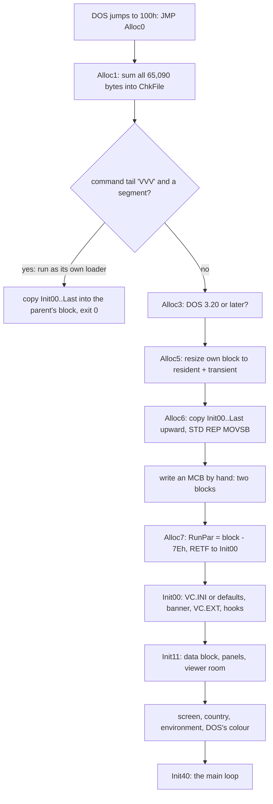
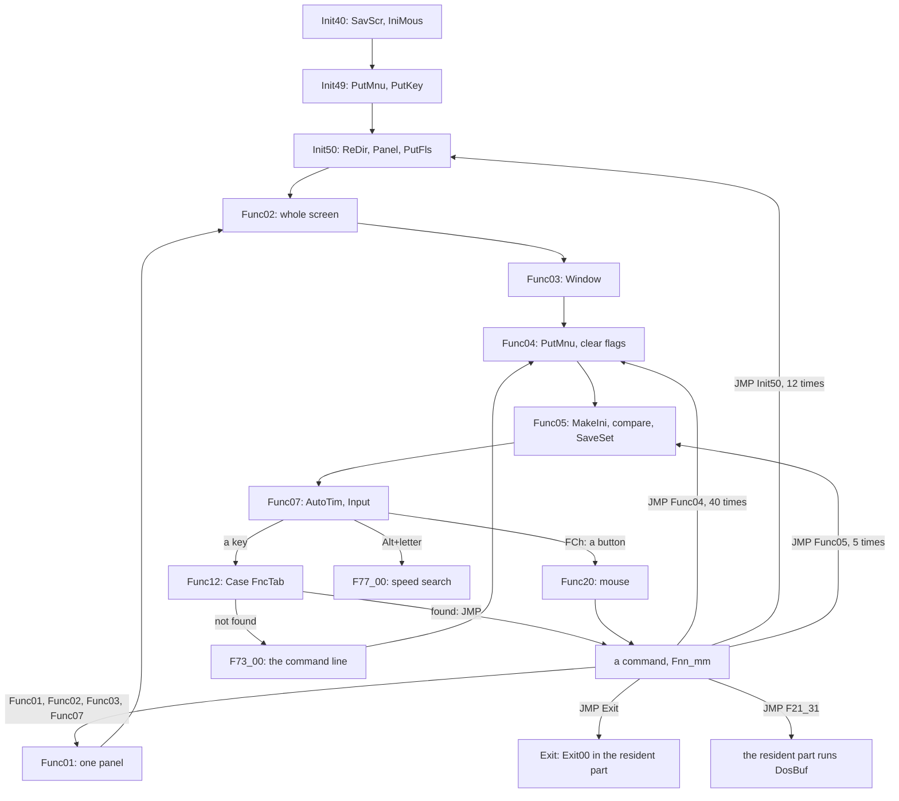
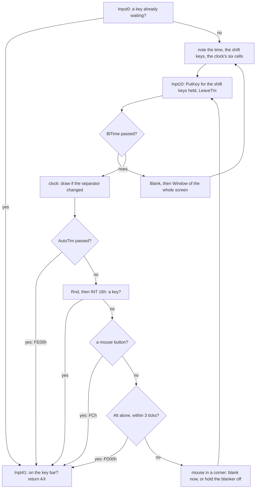
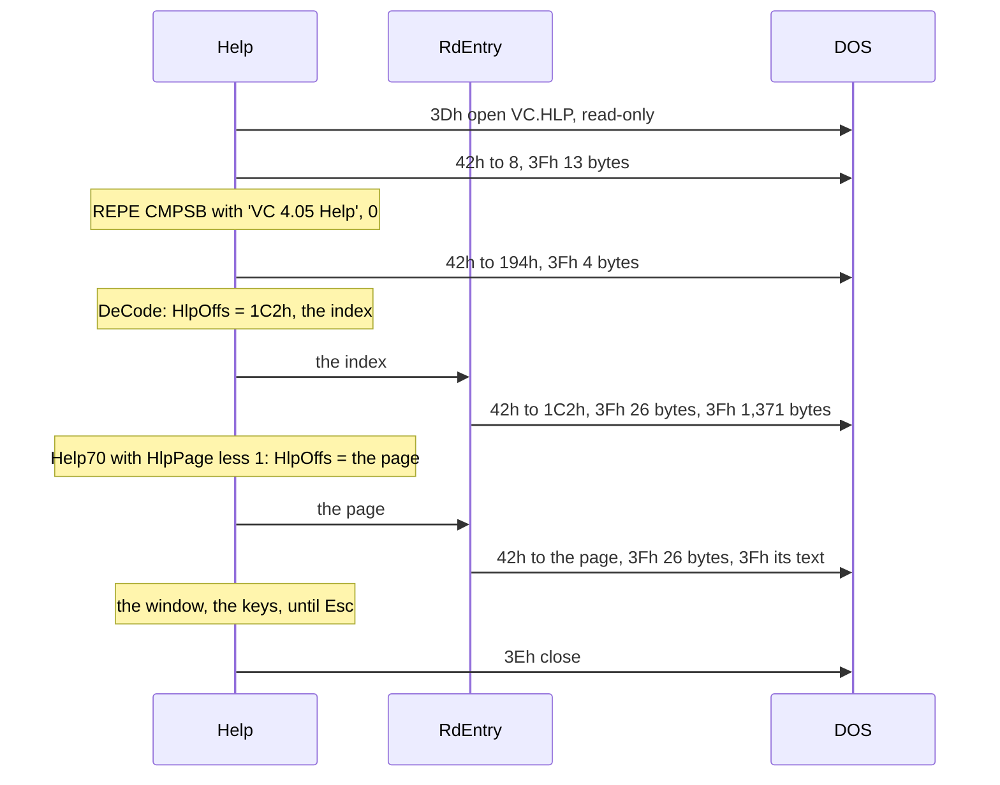
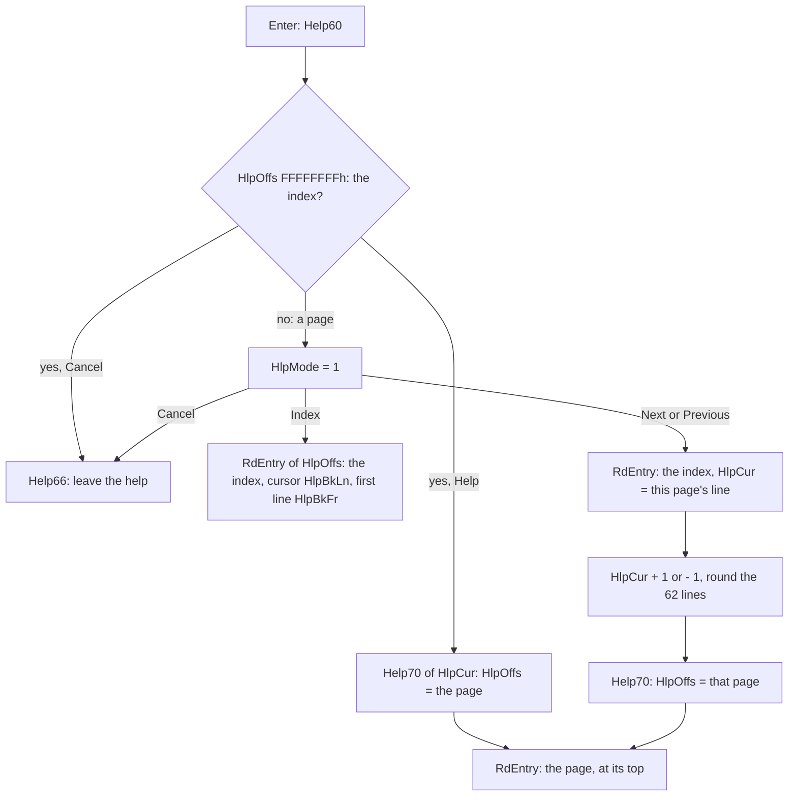
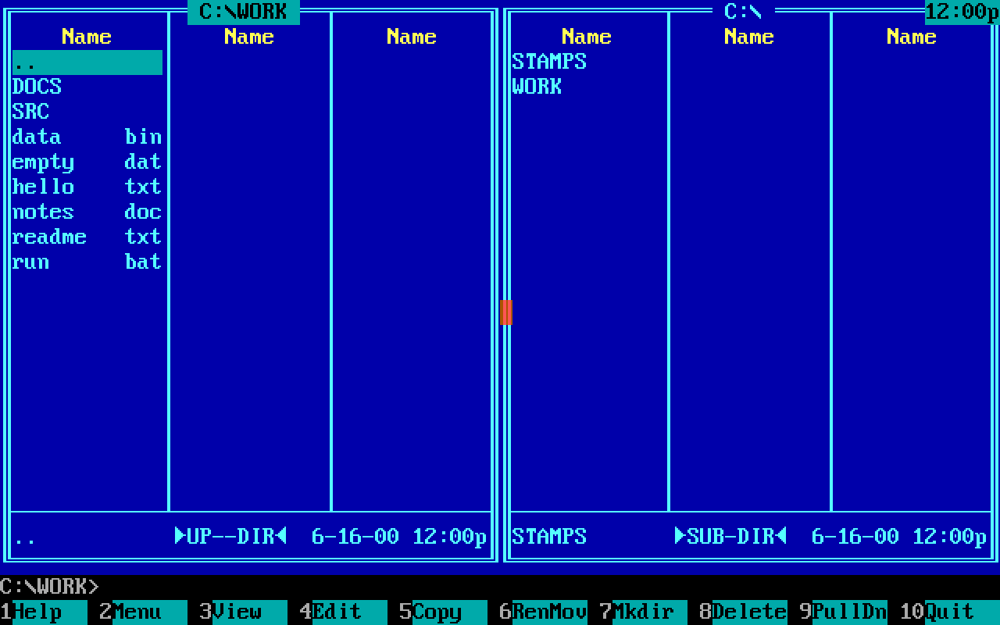

# 1. The program: one segment, one loop, one screen buffer

Volkov Commander 4.05 is a `.COM` file of 65,090 bytes. DOS loads it
into a single 64K segment and jumps to its offset 100h; there is no
header, no relocation table, nothing but the bytes. Everything else the
program needs it makes at run time out of the memory that DOS hands a
`.COM`, which is all of it: a block of 62,603 bytes for its data, a
segment for each of the two panels, and whatever is left for the viewer
and the editor. When the user runs a command, the program packs up and
gives its data back to DOS, and in the small mode of Memory allocation,
which is how it is distributed, its code too, keeping 12,690 bytes of
itself, stack and all.

This chapter is the skeleton that the toolkit of the screen in
[chapter 2](02-the-screen.md) and the features of
[chapter 3](03-the-features.md) hang on, read from the source in
`src/asm/`: how the source is put together, what is in the file, how
the program cuts up its memory when it starts, the structures of its
data and its panels, the main loop and its commands, the input, the
screen in outline, the help, and the clock and the blanker. The calls of DOS and the BIOS underneath are
[chapter 6](06-the-system.md), and so is the resident part that runs a
command; this chapter has it in outline. The last section lists the
economies in one place, with their sizes. A reader who wants a reminder
of segments, the PSP and memory control blocks will find one in the
[preface](00-preface.md#a-dos-refresher).

## The source: one file and twelve includes

The program is `VC.ASM` and twelve files that it includes, 27,190
lines in all, assembled by Borland's TASM in MASM mode (`MAKE.BAT`).
The first lines say what kind of program it is:

```asm
	OPTION	OLDSTRUCTS		; Structure fields are global names
	OPTION	NOSCOPED		; Labels inside procedures are global
	INCLUDE	VCLAYOUT.INC
	.MODEL	Tiny
	.CODE
Zero:	.STARTUP			;; ORG 100h, the start of a .COM
	JMP	Alloc0
```

`.MODEL Tiny` puts code and data into one group, `DGROUP`: the
assembler makes three segments, `_TEXT` for code, `_DATA` for tables
and `CONST` for texts, and the linker lays them one behind the other in
the one segment of the `.COM`. Every file switches between the three
with `.CODE`, `.DATA` and `.CONST` as it goes, so that a routine's
texts and tables sit in its own source next to it and still end up
together in the file. `OLDSTRUCTS` makes every field of every `STRUC`
a global name, so `DS:Visible` means "the byte at offset 2 of whatever
DS points at"; `NOSCOPED` makes every label global, so any code can jump
to any label of any procedure. The program relies on both everywhere.

| File | Lines | Code | Tables | Texts | What it holds |
|---|---:|---:|---:|---:|---|
| `VC.ASM` | 3,047 | 5,266 | 705 | 886 | the structures, the resident part, the start, the main loop, the exit, the critical error |
| `VCFUNC.INC` | 2,832 | 6,164 | 415 | 249 | the commands of the keys at the panels |
| `VCMENU.INC` | 1,631 | 2,708 | 1,027 | 2,121 | the menu bar and the commands of its menus |
| `VCF1.INC` | 1,806 | 2,472 | 1,734 | 959 | make directory, delete, attributes, label, and the other F-key commands |
| `VCCOPY.INC` | 1,914 | 3,902 | 595 | 487 | copy, move, rename |
| `VCVIEW.INC` | 2,167 | 4,853 | 401 | 262 | the viewer |
| `VCEDIT.INC` | 2,689 | 6,062 | 400 | 688 | the editor |
| `VCHELP.INC` | 712 | 1,403 | 97 | 147 | the help |
| `VCMEM.INC` | 991 | 2,036 | 62 | 120 | the map of the memory |
| `VCFIND.INC` | 1,159 | 2,489 | 92 | 130 | find file |
| `VCSUB1.INC` | 3,139 | 5,020 | 192 | 0 | the screen, boxes, lines, dialogs, the mouse |
| `VCSUB2.INC` | 2,514 | 4,408 | 358 | 362 | the bars, the panels on the screen, input, the blanker |
| `VCSUB3.INC` | 2,589 | 5,211 | 136 | 471 | reading directories, the tree, the setup file, disks |
| **in all** | **27,190** | **51,994** | **6,214** | **6,882** | **65,090 bytes** |

The bytes are those that each file puts into `VC.COM`, worked out from
the addresses of the listing; the code of `VC.ASM` leaves out the
buffers that it declares but does not put into the file (see the next
section).

`VCLAYOUT.INC` has no code of its own. The source that Volkov published
is the freeware edition, and the binaries he shipped in 2000 were
shareware, with registration code, a check of it and some lines of the
banner that the source lacks. Two macros reserve their room:

```asm
ShwCode	MACRO	Bytes			; Shareware-only code
IFDEF	SHAREWARE_LAYOUT
	DB	Bytes DUP(90h)		;; NOPs
ENDIF
	ENDM
```

and `ShwData` the same with zeros. Five uses in `VC.ASM`, 61 bytes of
code and 48 of data, all at the banner, put every later byte at the
address it has in the shipped `VC.COM`; that is why the figures of this
book are the shipped file's, 65,090 bytes, where the source alone
assembles to 64,981.

The names are Volkov's numbering, not words. A command is `Fnn_mm`,
`nn` the command and `mm` a place in it: `F11_00` is Ctrl-O, `F30_00`
F10. The menu's commands are `Mnn_mm`, the viewer's `Vnn_mm`, the
editor's `Tnn_mm`, the copy's `Cnn_mm`. The start is `Init00` to
`Init93`, the main loop `Func01` to `Func62`. A text ends in `_S`, a box
in `_P`, a dialog in `_B`, a row of buttons in `_D`, a table of keys in
`_T`, a file name in `_F`, a colour in `_C`. The listing has 305
procedures and 2,486 labels in the code; the procedures hold 28,981 of
its 51,994 bytes, and the rest, 44 percent of the program, is code
between procedures that is entered by jumps.

## The parts of `VC.COM`

```
 offset in the segment                                              bytes
 0000h +--------------------------------------------------+
       | PSP, made by DOS, not in the file                |          256
 0100h +--------------------------------------------------+ <- the file starts
       | JMP Alloc0, RunPar, ChkFile, 'COMMAND.COM',      |          202
       | OvlPrm, five messages                            |
 01CAh | Exec: run the commands of DosBuf                 |
       | Exit00..Exit05, OutStr, SetBrk, GetStat, CtrlC   |        1,309
       | New21, New27, ExeProg, AddProg, FreeBlk, Release |
 06E7h +-- LastRes ---------------------------------------+
       | Alloc0..Alloc9: the loader, run once             |          256
 07E7h +-- Init00 ----------------------------------------+
       | the start, Init00..Init33                        |        1,266
 0CD9h | the main loop, Init40..Func62                    |        1,470
 1297h | VCFUNC, VCMENU, VCF1, VCCOPY, VCVIEW, VCEDIT,    |
       | VCHELP, VCMEM, VCFIND, the exit, VCSUB1..3       |       47,491
 CC1Ah +-- _DATA -----------------------------------------+
       | colours, defaults, FncTab, boxes and dialogs     |        6,214
 E460h +-- CONST -----------------------------------------+
       | texts                                            |        6,882
 FF42h +-- Last ------------------------------------------+
       | (the stack of a .COM, until Alloc0 moves it)     |          190
 FFFFh +--------------------------------------------------+
```

Three things in this picture are the design.

**The file ends 190 bytes short of 64K.** DOS starts a `.COM` with its
stack at the top of the segment, just behind the code, and the program
has to leave it before it calls anything that pushes much. It does: the
loader's first `PUSH` that matters comes after it has set SP to the
program's own stack.

**The resident part is first, and its buffers cost nothing.** Behind
the resident code, at `LastRes`, the source declares 10,923 bytes of
buffers for the time while a command runs:

```asm
LastRes:

;--------------------- Release data --------------------
IntTab	DD	256	DUP(?)		;; the interrupt table, for the TSR list
SavePtr	DD	?
Vect21	DD	?
Vect22	DD	?
Vect27	DD	?
Counter	DW	?
PrgList	DW	MaxProg	DUP(?)
NameBuf	DB	12	DUP(?)

;------------------ Data save segment ------------------
WCB1sav	DB	WCBsave + 13 * MinFls	DUP(?)	; WCB1
WCB2sav	DB	WCBsave + 13 * MinFls	DUP(?)	; WCB2
ComnIni	DB	CmnSave			DUP(?)	; Common data
DataSav	DB	LenStk			DUP(?)	; Local stack
VcStack:
LastDat:
```

and then, further down, goes back:

```asm
;--------------------- Main module ---------------------
	.CODE
	ORG	LastRes			;; back to 06E7h

Alloc0:	CLD
```

`ORG LastRes` sets the place of assembly back to the start of the
buffers, so the loader and the transient code are assembled over them.
In the file those bytes are code. Once the program runs, the code has
been copied elsewhere and the same addresses of the first segment are
the buffers: the save areas of the two panels, the copy of the main
data, the 256-byte stack ending at `VcStack`, 3192h. The resident part
is 3192h = 12,690 bytes from the start of the PSP, of which 1,511 are in
the file.

**The rest is one transient part.** From `Init00` to the end, 63,323
bytes of code, tables and texts are needed only while the commander is
on the screen, and are given back while a command runs. Tables and
texts are in it because the tiny model put `_DATA` and `CONST` behind
`_TEXT`: everything that follows the resident part goes and comes back
as one block, with nothing to sort.

## The start: from one block to four

DOS has given the program all of memory in one block, with every
segment register on the PSP. `Alloc0` makes of it two blocks of DOS's,
a resident one and a transient one, and `Init11` then asks DOS for
the data.



`Alloc0`, 256 bytes that run once, does four things before anything
else, and [chapter 6](06-the-system.md#alloc0-a-sum-a-version-a-move-and-a-hand-made-mcb)
has each of them instruction by instruction. It adds up the 65,090
bytes of its own file into a 16-bit sum, `ChkFile`, by which it will
know the file again when it loads itself after a command. It refuses a
DOS older than 3.20. It copies the transient part, `Init00` to the
end, upward behind the 794 paragraphs that are to stay, and splits its
one block of DOS's in two by writing a memory control block by hand.
And it jumps into the copy by a far return to `RunPar:Init00`, where
`RunPar` is the new block's segment less 7Eh: from that segment
`Init00` is at offset 07E7h again, the offset that the assembler gave
it, so not one address of the transient part is relocated. The
transient part's 63,323 bytes take a block of 3,959 paragraphs, 63,344
bytes.

### `Init00`: the setup file, read in place

`VC.INI` is 511 bytes: `VVV`, the first 88 bytes of each panel, the
first 330 bytes of the main data, and a 16-bit sum of all that. `Init00`
reads it with one call of DOS straight into the resident part, at a
place chosen so that the 330 bytes land on `ComnIni`, the copy of the
main data that `Init11` will copy down, and asks for one byte more than
the file has: only a file of the right length reads one byte less than
was asked. [Chapter 7](07-the-setup.md#reading-it-the-commander) has the
code. Only each panel's 88 bytes then go on, to `WCB1sav` and `WCB2sav`.

The read lands across three of the resident part's buffers, and the
addresses are those of the listing, offsets from the PSP:

```
 resident part, before the read           the 512 bytes asked for, at BP = 2532h
 0B29h +------------------------------+
       | WCB1sav, 3,422 bytes         |
 0B87h |  +94: the path of VC.INI,    |   MainPth builds "C:\VC\VC.INI" here,
       |       made by MainPth        |   behind the panel's header, in its
       |                              |   list, which is still unused
       |                              |
 1887h +------------------------------+
       | WCB2sav, 3,422 bytes         |
       |                              |
 2532h |  +3,243 ...................  |   0000  'VVV'                 3
 2535h |                              |   0003  WCB 1, 88 bytes      88  --+
 258Dh |                              |   005B  WCB 2, 88 bytes      88  --|--+
 25E5h +-- ComnIni, 2,733 bytes ------+   00B3  ColTab .. ResIni    330   |  |
       |  the 330 bytes land on       |         already where Init11  |  |
       |  their final place           |         will copy them from   |  |
 272Fh |                              |   01FD  the sum               2   |  |
 2731h |                              |   01FF  a 512th byte, never   1   |  |
       |                              |         read if the file is good |  |
 3092h +-- DataSav, the stack --------+                                  |  |
                                                                         |  |
 then:  REP MOVSB 88 bytes from 2535h to WCB1sav, 0B29h  <---------------+  |
        REP MOVSB 88 bytes from 258Dh to WCB2sav, 1887h  <------------------+
```

The 179 bytes in front of `ComnIni` fall on the end of `WCB2sav`, which
holds a panel's list only while a command runs, and the path that
named the file is in `WCB1sav` behind the 94 bytes of the panel's
header, where the 88 bytes copied to the head of the buffer do not
reach it: `Init09` takes the same path again, with `VC.EXT` put in
place of the name, to read the extension file. Nothing is copied twice
but the two panels: one buffer for the file, one for its name, and
none of the main data's, which does not exist yet.

Without a good file the defaults come from `_DATA`, which begins with
them laid out exactly as the main data begins: `Palets`, 240 bytes of
colours, and behind them `DefInit`, one byte for each option, so that
one `REP MOVSB` of `OFFSET ResIni` = 279 bytes makes the first part of
the main data. A panel's default is `DefWCB`, of which the source has
8 bytes; the copy is 88 (`WCBini`), and the 80 that follow are the
first 20 entries of `FncTab`, the key table, behind the empty mask in
`DskMas` and under the path that `Init03` writes over them. Nothing
reads them: `MkIni1` clears everything behind the zero of the mask and
of the path before the setup is ever saved.

Then `Init04` prints the banner through DOS, AH 09h, after building it
with `MvzLin0` in the room that the main extension file will have,
`ComnIni.ExtMain`; reads `VC.EXT` into that same room and ends it with
1Ah; and, with the TSR manager on, takes INT 21h and INT 27h. A failed
setup file is reported with "VC.INI is not correct." under the banner.

### `Init11`: the data block, cut in paragraphs

`Init11` is also where the program comes back after every command. It
shrinks the transient block to its own length, asks DOS for FFFFh
paragraphs to learn the largest block, takes it, and cuts it by
arithmetic:

```asm
	MOV	BX,0FFFFh
	MOV	AH,48h
	INT	21h			;; fails: BX = the largest block
	MOV	AH,48h
	INT	21h			;; take it
	MOV	ES,AX
	MOV	DX,((SIZE MainDat-1) SHR 4)+1	;; 3,913 paragraphs
	MOV	DI,((SIZE WCBdef -1) SHR 4)+1	;;   423 each panel
	MOV	AX,((   MinView  -1) SHR 4)+1	;;   500 at least for the viewer
	ADD	AX,DX
	ADD	AX,DI
	ADD	AX,DI			;; 5,259 paragraphs, 84,144 bytes
	CMP	AX,BX
	JBE	Init13
	MOV	AX,OFFSET AlocEr	;; "Program too big to fit in memory"
	...
Init14:	MOV	ES:FreMem1,SI
	MOV	AX,ES
	ADD	AX,DX
	MOV	ES:WCB1seg,AX		;; the left panel
	ADD	AX,DI
	MOV	ES:WCB2seg,AX		;; the right panel
	ADD	AX,DI
	MOV	ES:ViewSeg,AX		;; all the rest: viewer, editor, copy
	MOV	CS:SecDat,ES		;; for the critical error
```

It copies the saved main data and panels down (`CmnSave` = 2,733 bytes,
and `Expand` for each panel), and then looks at what a command may
have changed: the video mode, which it puts back to text after asking
for Enter, the cursor's shape, the country and with it `LowTab`, the
lower case of 80h to FFh made by inverting DOS's routine for capitals,
the environment's `COMSPEC=`, `VC=` and `TEMP=`, the number of rows,
whether the adapter snows, and the colour DOS writes in, which it learns
by having DOS write a space and reading the cell back.

At run time the memory is then:

```
 PSP:0000  +--------------------------+  SS = the PSP's segment, always
           | PSP                  256 |
           | resident code      1,511 |
           | IntTab .. NameBuf  1,090 |
           | WCB1sav            3,422 |  while the commander runs: IniSave,
           | WCB2sav            3,422 |   the setup as last saved
           | ComnIni            2,733 |
           | DataSav, stack       256 |  SP starts at VcStack, 3192h
 3192h     +--------------------------+  794 paragraphs
           | MCB                      |
 RunPar+7Eh+--------------------------+  CS = RunPar
           | Init00 .. Last    63,323 |  code, _DATA, CONST
           +--------------------------+  3,959 paragraphs
           | MCB                      |
 SecDat    +--------------------------+  ES = the main data, always
           | MainDat           62,603 |  3,913 paragraphs
 WCB1seg   +--------------------------+  DS = a panel, while a command works
           | left panel WCBdef  6,754 |  423 paragraphs
 WCB2seg   +--------------------------+
           | right panel        6,754 |  423 paragraphs
 ViewSeg   +--------------------------+
           | the room: viewer,        |  the rest of the block,
           | editor, copy buffer      |  at least 500 paragraphs
           +--------------------------+
```

The four segment registers have fixed jobs, and the whole program is
written to them: **CS** is the transient part, and every table and text
is read through it, `CS:[BP]`, `CS:[SI]`, since they are in the same
segment as the code; **ES** is the main data; **DS** is the panel that a
command works on, or the main data where a routine works on that; **SS**
is the resident part, the PSP's segment, where the stack and the saved
copies are. A routine that needs the main data writes `ES:Lines`; one
that needs the current panel writes `DS:Visible`. A comment in the
source rarely says so: the convention is the documentation.

## A command runs in 12,690 bytes

Enter on a command line ends at `F21_31` of `VCFUNC.INC`, which packs
up the commander, and the resident part does the rest. In outline:

1. `F21_31` copies the first `CmnSave` = 2,733 bytes of the main data,
   the setup, the history, the extension file and the command line
   `DosBuf`, to `ComnIni` in the resident part, keeps each panel in its
   save area, 13 bytes a file for at most 256 files, and puts the
   critical-error and Ctrl-Break vectors back (`RestVct`).
2. It gives the data block back to DOS and jumps, by `PUSH`/`RETF`, to
   `Exec` in the resident part.
3. `Exec` gives the transient block back too when `LoadFl`, the small
   mode of Memory allocation, is set, as it is by default: then 12,690
   bytes of the commander are left in memory. Otherwise the code stays
   with them, 76,050 bytes in all. Then it runs each command of
   `DosBuf` in turn, through `COMMAND.COM /C`, or with Quick execute
   through COMMAND.COM's own INT 2Eh.
4. In the small mode it then loads the transient part again, by running
   `VC.COM` as its own loader; either way it comes back to `Init11`,
   which takes the data anew.

[Chapter 6](06-the-system.md#the-resident-part-12690-bytes-that-stay)
has the four steps byte by byte: what stays, how a command line is made
in place, and how the second copy of `VC.COM` hands the first its code
and its check sum through one word.

## The main data

### `MainDat`: one `STRUC`, 62,603 bytes

All the state of the program that is not a panel is one structure,
`MainDat`, declared in `VC.ASM` and never instantiated in the file: it
is a layout, laid over the block that `Init11` takes, with ES on it.
Its order is the order of how long a field must live. The first 330
bytes are what the setup file keeps; up to 2,733 what survives a
command; the rest is made anew each time the transient part comes
back.

```
 offset  bytes  field              what it is
 ------  -----  -----------------  ------------------------------------------
  0000     240  ColTab             40 colours x 6 palettes: B/W, colour,
                                   laptop, each for colour and mono adapters
  00F0      32  FulScr .. DriveB   one byte for each option of the setup
  0110       2  DelayTm            delay of auto change dir: 1/100 s, s
  0112       5  StarTab            the blanker's five shapes of a star
  0117      51  ResIni             reserved
 ---- 014Ah = CmnIni: end of what VC.INI keeps (330 bytes) --------------------
  014A       5  LoadRes .. MenuFl  the original LoadFl, mode, mouse, break
  014F      13  SelMas             the mask of Grey +
  015C     512  HstBuf             command history
  035C     512  ExtMain            VC.EXT, ended by 1Ah
  055C      14  EPB                DOS's block for 4B00h
  056A      14  MouseX .. ComSpec  where the mouse was, where COMSPEC= is
  0578      68  CrnPath            the directory under the tree's cursor
  05BC     260  ViewFil, ToFile,   4 x 65: file names of the last commands
                FindStr, SrchStr
  06C0       5  DosChg             "C:" to change drive in Exec
  06C5    1000  DosBuf             the command line, and dialogs' typing
 ---- 0AADh = CmnSave: end of what survives a command (2,733 bytes) ----------
  0AAD      26  DosLin .. ErrDat   bytes of state: lines, EGA, quote, flags
  0AB3       1   Lines             rows on the screen, 25 to 50
  0AC7       2  VerDOS
  0AC9      10  WCBcrn, WCBsec,    the four panel segments and the room
                WCB1seg, WCB2seg,
                ViewSeg
  0AD3       6  FreMem1, FreMem2,  memory figures
                Memorys
  0AD9      22  HstAdr .. FncAddr  places in the history, the tree, Info,
                                   the random numbers, a group command
  0AEF      22  MousPos .. BrkVct  double click, AutoTim, the screen's
                                   address, the old INT 24h and 1Bh
  0B05      12  Volume             volume label
  0B11     204  DosPth, NcPath,    the current path, VC=, TEMP=
                TempDir
  0BDD      32  Country            DOS's country information
  0BFD      44  DTA                DOS's record of a search
  0C29     128  LowTab             lower case of 80h..FFh
  0CA9     256  TmpBuf             scratch for everybody
  0DA9     256  TmpErr             texts put into boxes, ^V at +1, ^W at +101
  0EA9     128  Stars              32 stars of the blanker, 4 bytes each
  0F29    4000  MenuBuf            the user menu; the setup image; a box's room
  1EC9    1406  InfBuf             the Info panel's text, 37 x 38
  2447       1  (EVEN)
  2448    8000  ScrBuf             the screen, 80 x 50 cells
  4388    7840  UserScr            what DOS showed, 80 x 49 cells
  6228    7392  WinBuf             what a box covers, 77 x 48 cells
  7F08    7392  ErrBuf             the second level of boxes
  9BE8    7392  ErrBuf1            the third: errors and help
  B8C8    3000  HelpBuf            one entry of the help, and its state
  C480   12299  TreeBuf            the tree: header + 768 entries of 16
  F48B          end
```

Every size here is an `EQU` of `VC.ASM`: `LenPath` = 68 for a path,
`LenStr` + 1 = 65 for a file name typed in, `LenBat` = 1000 for the
commands, `LenMenu` = 4000, `MaxLins` = 50, `MinTree` = 768,
`NmbStrs` = 32. The screen buffers are sized for the largest screen, 50
rows, and the buffer under a box for the largest box, 77 x 48.

`VC.INI` is therefore not parsed: `MakeIni` writes `VVV`, the 88 bytes
of each panel (after `MkIni1` clears the junk behind the strings), the
first 330 bytes of `MainDat` and `ChkSum` of all of it into `MenuBuf`,
and `SaveSet` writes that out, 511 bytes. A new option is a byte taken
from `ResIni`.

### Saving the setup without a "dirty" flag

Every time the main loop comes round, at `Func05`, it makes the setup
file's image anew and compares it with the image as last saved. There
is no flag anywhere that says that an option has changed. The image as
last saved is kept at `IniSave`, which is

```asm
IniSave	EQU	WCB1sav
```

the save area of the left panel in the resident part, which is unused
while the commander is on the screen and needed only while a command
runs, when nothing is compared. The paths, the active panel and
`Ctrl_O` are copied across first, so that changing directory or panel
does not count:

```asm
Func05:	CALL	MakeIni			;; the image, into MenuBuf
	PUSH	SS
	POP	ES
	MOV	DI,OFFSET IniSave	;; SS:WCB1sav
	CMP	WORD PTR ES:[DI],'VV'	;; nothing saved yet: just copy
	JNE	Func06
	PUSH	CX
	MOV	AX,OFFSET [3].WinPath	;; the left path is not a change
	MOV	CX,LenPath
	PUSH	CX
	CALL	Func15
	POP	CX
	MOV	AX,OFFSET [3+WCBini].WinPath	;; nor the right one
	CALL	Func15
	POP	CX
	MOV	BX,OFFSET [3+2*WCBini].Active	;; nor which is active
	...
	DEC	CX
	DEC	CX
	REPE	CMPSB			;; 509 bytes
	...
	JE	Func06
	CMP	DS:AutoSav,0
	JZ	Func06
	...
	CALL	SaveSet			;; something did change
	...
Func06:	PUSH	SS
	POP	ES
	REP	MOVSB			;; the new image is the saved one
```

The two images side by side, with what `Func15` and the two `MOV`s copy
from the new into the old before the compare:

```
 image of VC.INI, 511 bytes          new: MenuBuf (DS)    old: IniSave = WCB1sav (SS)
 offset
 000  'VVV'                          compared
 003  WCB 1: WinTyp .. DskMas        compared
 017  WCB 1: WinPath, 68 bytes       ########  copied new -> old by Func15
 05B  WCB 2: WinTyp .. DskMas        compared
 06F  WCB 2: WinPath, 68 bytes       ########  copied new -> old by Func15
 0B3  ColTab, 240 bytes              compared
 1A3  FulScr .. ClrBuf, 27 bytes     compared
 1BE  Active                         ########  copied by MOV AL / MOV ES:[DI+BX]
 1BF  Ctrl_O                         ########  copied by MOV AL / MOV ES:[DI+BX]
 1C0  ChkTSR .. ResIni, 61 bytes     compared
 1FD  the sum, 2 bytes               not compared: DEC CX twice
 1FF  end
      509 bytes go through REPE CMPSB; 138 of them were made equal first,
      so 371 bytes decide. Then REP MOVSB copies all 511 new over old.
```

What that costs, in the 8088's own clocks from Intel's tables (a
string instruction's byte form costs the same on the 8088 as on the
8086), when nothing has changed and the compare runs to the end:

| Step | Work | Clocks |
|---|---|---:|
| `MakeIni`: `MkIni1` twice | `FilZero` over 13 + 68 bytes (`SCASB` 15 or `STOSB` 10 a byte), `REP MOVSB` of 88 (9 + 17 x 88) | about 5,200 |
| `MakeIni`: the settings | `REP MOVSB` of 330: 9 + 17 x 330 | 5,619 |
| `ChkSum` | 509 rounds of `LODSB` 12 + `ADD` 3 + `LOOP` 17 = 32 | 16,288 |
| `Func15` twice | `REP MOVSB` of 68: 2 x (9 + 17 x 68) | 2,330 |
| the compare | `REPE CMPSB` of 509: 9 + 22 x 509 | 11,207 |
| the copy | `REP MOVSB` of 511: 9 + 17 x 511 | 8,696 |
| **in all** | | **about 49,300** |

At 4.77 MHz a clock is 210 ns, so the round costs about 10 ms: not a
millisecond, and a tenth of the 92 ms between two keys that the BIOS
repeats at its default rate. Volkov kept it off the one path where
that would be felt. The cursor keys end at `F00_80`, `JMP Func07`, and
go round the loop behind `Func05`: holding Down through a list costs no
comparison at all. Every other command, a key typed into the command
line among them (`F73_01: JMP Func05`), pays its 10 ms. On a 286 at
8 MHz, where `MOVSB` costs 4 clocks a byte, `CMPSB` 9 and a round of
`ChkSum` about 16, the same work is some 18,000 clocks, about 2 ms.

It catches every way an option can change: a menu, a dialog, Ctrl-B,
the setup program.

## The panels

### `WCBdef`: a header and a list, in a segment of its own

A panel, a *window control block*, is a segment. Its first 610 bytes
are the header and from 262h on is its list of files, 24 bytes an
entry:

```
 WCBdef                                       FILENT, 24 bytes
 offset  bytes  field                         offset  bytes  field
 0000      1    WinTyp   0 files, 1 tree,     00      13     NameF   name, ASCIIZ
                         2 info               0D       1     AttrF   DOS attributes;
 0001      1    BrfFul   brief or full                               bit 6 selected
 0002      1    Visible                       0E       2     TimeF
 0003      1    Hidden   hidden files shown   10       2     DateF
 0004      1    MasTyp   which filter         12       4     SizeF
 0005      1    SortTyp  name, ext, time,     16       2     NumbF   its place in
                         size, unsorted                              the directory
 0006      1    Ctrl_L
 0007     13    DskMas   the filter
 0014     68    WinPath
 ---- 0058h = WCBini: end of what VC.INI keeps (88) ----
 0058      2    CurAdr   offset of the cursor's entry
 005A      2    First    offset of the first entry shown
 005C      2    EndBuf   offset behind the last entry
 ---- 005Eh = WCBsave: end of what a command keeps (94) ----
 005E    512    ExtBuf   this directory's own extension file
 025E      2    EndFul   offset of the end of the room
 0260      1    ChgFlg   to be read again
 0261      1    SizDir
 ---- 0262h = WCBsize ----
 0262   6144    DskBuf   MinFls = 256 entries, and as many more
                         as the segment can hold
 1A62           end of the 423 paragraphs that Init11 gives
```

`FILENT` is DOS's 43-byte search record (`DTAs`) cut down to what a
panel shows, in the same order: name, attribute, time, date, size, and
then a number of its own. The cursor, the first line and the ends of
the list are offsets in the panel's segment; a routine that walks the
list keeps the entry in SI or DI with DS on the panel, and steps by
`SIZE FilEnt`. The list may grow past the 256 entries of the 423
paragraphs: `ReDir` moves the other panel and the room up to make
space, and a panel stops at 64K, 2,703 entries.
[Chapter 3](03-the-features.md) has the reading, the sorting and the
selection.

### A panel is its segment

The program has no number for "the left panel" and no pointer to a
structure: a panel is the value of its segment, and the main data has
four words of them. `WCB1seg` and `WCB2seg` are the panels on the left
and on the right of the screen, `WCBcrn` and `WCBsec` the current one
and the other. A routine that needs to know which side its panel is on
compares DS with `WCB1seg`; `BegBX`, which answers where a panel begins
on the screen, is eight instructions:

```asm
BegBX	PROC	NEAR
	MOV	BX,DS
	CMP	BX,ES:WCB1seg		;; is the panel in DS the left one?
	MOV	BX,0			;; row 0, column 0
	JE	BegBX1
	MOV	BL,40			;; the right one: column 40
BegBX1:	CMP	BH,ES:MenuVs		;; one row down under a visible menu bar
	JZ	BegBX2
	INC	BH
BegBX2:	RET
BegBX	ENDP
```

Swapping the panels with Ctrl-U is swapping two words, and Tab two
others:

```asm
F15_00:	CMP	DS:Visible,0		; ^U
	JNZ	F15_01
	JMP	Func04
F15_01:	MOV	AX,ES:WCB1seg		;; left and right exchange places
	XCHG	AX,ES:WCB2seg
	MOV	ES:WCB1seg,AX
	MOV	BX,OFFSET Active
	CALL	InvVar			;; the active side changes with them
	CALL	BegBX
	CALL	SizDX
	MOV	BL,0
	MOV	DL,80
	CALL	ResUser			;; DOS's screen under both
	JMP	Init50			;; and draw the panels again
```

The whole command is 45 bytes, and the panels' 6,754 bytes stay where
they are.

The directory tree is a panel of type 1, but its list is not in the
panel: it is `TreeBuf` of the main data, the header of the Norton
Commander's `TREEINFO.NCD` file followed by 16-byte `DIRENT` entries.
The `DIRTREE` structure has `TreList` as a label of no length at the
place of `TreSum2`, so the first entry is laid over the checksum of
the list, which the file has at the end. Code that walks a list of
files and code that walks the tree are often the same code, with an
offset in either.


*The start: two file panels of `WCBdef` on the left and on the right,
the command line on row 23 (`DosLin`), the key bar on row 24. Every cell
is a word of `ScrBuf`.*

## The main loop

### Labels, not a procedure

The main loop of the program is no `PROC`. The start falls into it at
`Init40`, and it is a row of labels that fall into one another, each
the entry for a different amount of work to do before the next key:

| Label | Offset | What it does, before it falls into the next |
|---|---|---|
| `Init40` | 0CD9h | find DOS's cursor and the command line's row, save what DOS shows (`SavScr`), start the mouse |
| `Init49` | 0DABh | draw the menu bar and the key bar |
| `Init50` | 0DB5h | read again the panels that `ChgFlg` marks, draw both |
| `Func01` | 0FB7h | draw the panel in DS only |
| `Func02` | 0FC0h | take the whole screen, rows 0 to `Lines` |
| `Func03` | 0FC9h | copy the rectangle in BX, DX to the screen (`Window`) |
| `Func04` | 0FCCh | the menu bar; clear `OneFile`, `FlagCD`, the double click |
| `Func05` | 0FE0h | make the setup's image, save it if it changed |
| `Func07` | 103Dh | the cursor on the command line, the alarm of auto change dir, wait for a key |
| `Func12` | 110Bh | the key in AX to its command |
| `Func20` | 112Ch | the mouse at the panels |



A command ends with a jump to whichever label leaves the least to do.
One that changed a byte of the setup and nothing on the screen jumps to
`Func05`, which saves it; one that changed one panel to `Func01`; one
that changed what is in a directory to `Init50` with `ChgFlg` set; most,
which have put back what a box covered and drawn what changed, to
`Func04`. Counted over the twelve include files, the commands jump back
to `Func04` 40 times, to `Init50` 12 times, to `Func05` 5 times, to
`Func01` 3 times, and once or twice each to `Func07`, `Init40`,
`Init11`, `Func12`, `Func03` and `Func02`. A command may also jump into
another command: the menu's "Panels on/off" is `F11_00` itself.

What stays in the registers stays: a command finds in BX, DX, SI and
DI what the command before left there, and Rename, for one, reads
them.

### `Func07`: an alarm and an injected key

Before it waits, `Func07` sets an alarm. With Auto change dir on and a
tree panel whose cursor has moved off the current directory, `AutoTim`
is set to now plus `DelayTm`, 0.60 seconds by default, in the packed
form of INT 21h AH 2Ch: CX hours and minutes, DX seconds and
hundredths:

```asm
	MOV	AH,2Ch			;; the time: CH:CL hours:minutes,
	INT	21h			;;           DH:DL seconds:hundredths
	ADD	DL,DS:DelayTm[0]
	CMP	DL,100
	JB	Func08
	SUB	DL,100
	INC	DH
Func08:	ADD	DH,DS:DelayTm[1]
	...
Func09:	MOV	CX,0FFFFh		;; no alarm
Func10:	POP	DS
	MOV	ES:AutoTim.Lo,CX
	MOV	ES:AutoTim.Hi,DX
	XOR	CX,CX
	MOV	ES:HlpPage,CL
	XCHG	CH,ES:MenuFl		;; the user menu to come up by itself?
	MOV	AX,3C00h		;; then the key is F2
	OR	CH,CH
	JNE	Func12
```

When the moment comes, `Input0` answers with the pseudo-key FE00h, and
`FncTab` sends that to `F75_00`, which changes the directory. Auto menus
work the same way: with `MenuFl` set, the loop does not wait at all but
goes on to `Func12` with F2 in AX, as if it had been pressed. Neither
feature has code of its own in the loop beyond these lines.

### `Func12` and `Case`: a key table walked by 37 bytes

```asm
Func12:	CMP	AH,0FCh			;; a mouse button?
	JE	Func20
	CMP	ES:Quote,0		;; Ctrl-Q: the next key is text
	JNZ	Func14
	MOV	SI,OFFSET FncTab
	CALL	Case			;; jumps to the command if it finds it
Func14:	JMP	F73_00			;; otherwise the key goes to the line
```

`FncTab` is 72 entries of two words, the key as the BIOS gives it and
the address of its command, and a zero: 290 bytes for every key of the
panels.

```asm
FncTab	DW	4800h, F00_00		; Up
	DW	5000h, F01_00		; Down
	...
	DW	0F09h, F20_00		; Tab     - change active panel
	DW	1C0Dh, F21_00		; Enter   - run / change directory
	...
	DW	000Fh, F11_00		; ^O      - on/off panels
	DW	0015h, F15_00		; ^U      - swap panels
	...
	DW	4400h, F30_00		; F10     - quit
	...
	DW     0FD00h, F39_00		; Alt     - pull down menu
	DW     0FE00h, F75_00		;         - auto CD / quick view
	DW	0
```

A BIOS key word has the scan code in the high byte and the character
in the low byte. An entry whose high byte is 0 matches the character
with any scan code, which is how one entry, 000Fh, takes Ctrl-O however
the keyboard makes it; an entry with both matches only that key, Tab
being 0F09h ahead of the Ctrl-I that its character 09h also is. `Case`
does the rest:

```asm
Case	PROC	NEAR			;; CS:SI the table, AX the key
	PUSH	SI
	PUSH	CX
	OR	AH,AH			;; no scan code (Alt+digits): no match
	JE	Case3
Case1:	MOV	CX,CS:[SI]
	ADD	SI,4
	JCXZ	Case3			;; end of the table
	CMP	AL,CL			;; the character
	JNE	Case1
	OR	CH,CH			;; any scan code?
	JE	Case2
	CMP	AH,CH
	JNE	Case1
Case2:	POP	CX
	ADD	SP,4			;; drop the saved SI and the return address
	JMP	WORD PTR CS:[SI-2]	;; and jump to the entry's address
Case3:	POP	CX
	POP	SI
	RET				;; not found: back behind the CALL
Case	ENDP
```

`Case` is a call that does not come back when it finds the key: `ADD
SP,4` throws away its own return address, and the jump lands in the
command with the stack as it was before the `CALL`. So the line behind
`CALL Case` is the "otherwise" of a `switch`, and the table is the
cases. The same 37 bytes serve 18 tables, from 24 calls: the panels
(`FncTab`), the menu bar (`MenuTab`), every dialog (`Dial_T`), the
input line (`InSt_T`), a group of choices (`Slct_T`), buttons
(`MnMn_T`), the viewer (`View_T`), the editor (`Edit_T`), the help
(`Help_T`), the history (`Hist_T`), find file (`Find_T`), the user menu
(`User_T`), a drive not ready (`Ready_T`), and five more.

```
 stack inside Case                 after JMP CS:[SI-2]
 +--------------------+            +--------------------+
 | ...                |            | ...                |  <- SP, as before
 | return to Func14   |  dropped   |                    |     CALL Case
 | saved SI           |  by ADD SP |                    |
 | saved CX  <- SP    |  popped    |                    |
 +--------------------+            +--------------------+
```

Since a command is reached by a jump, it is no procedure either: it
ends by jumping to a label of the loop, and the stack never holds more
than whatever the command itself calls.

### The mouse at the panels

`Func20` and `Func21` take a press of a button at the panels. The
mouse's position comes from `GetMous` as a cell, row in CH and column
in CL, and the buttons in AL:

- in the two cells at the top left, the pointer becomes `■` while the
  button is held, and letting go there is Ctrl-O, `JMP F11_00`;
- elsewhere on the top row, the menu bar, `JMP F39_00`;
- in the other panel, Tab, `JMP F20_00`;
- in a list, `Func40` works out the entry under the pointer from the
  row, and in brief mode from the column divided by 13, and jumps to
  the cursor's own commands, `F00_60`, or `F00_05` to scroll up and
  `F01_05` down; a second click on the same entry within `MoDelay` =
  40 hundredths of a second, which `DoublMo` measures with INT 21h AH
  2Ch, is Enter, `JMP F21_10`;
- in the Info panel, the editor on its `dirinfo` file, `JMP F34_10`.

The mouse's commands are the keys' commands, entered at labels a few
instructions further in, where the keys' code has already worked out
what the mouse supplies.

## Input

### `Input` and `Input0`

Everything that waits for a key calls `Input`, with the number of the
key bar to show in AL, and gets the BIOS's key word in AX. `Input` is
18 bytes, and gives every routine of the program the help on F1 (3B00h)
without any of them knowing:

```asm
Input	PROC	NEAR
	PUSH	AX			;; the key bar
	CALL	Input0
	CMP	AX,3B00h		;; F1?
	JNE	Input1
	CALL	Help			;; the help, over whatever is there
	POP	AX
	JMP	Input			;; and wait again
Input1:	INC	SP
	INC	SP
	RET
Input	ENDP
```

`Input0` is the wait itself, 729 bytes, and the only procedure of the
program that declares local variables, 30 bytes of them in its frame on
the 256-byte stack, the six cells under the clock among them:

```asm
Input0	PROC	NEAR C USES DS SI DI DX CX BX
	LOCAL	IKeyBar[2]:BYTE	,\	; Each byte takes a word of stack
		BlMouse[2]:BYTE	,\
		KbdFlgs[2]:BYTE	,\
		AltLock[2]:BYTE	,\
		ClkFlag[2]:BYTE	,\
		ClkBuf[6]:WORD	,\	;; what the clock covers
		BlTime	:DWORD	,\	;; when to blank the screen
		AltTime	:DWORD		;; when Alt went down
```

It answers in the BIOS's form, extended by three scan codes of its
own: FCh for a button of the mouse, FDh for Alt pressed and let go by
itself, FEh for the moment in `AutoTim`. A caller tells them apart with
one `CMP AH`.



What the loop does each time round:

1. `PutKey` reads the shift state, INT 16h AH 2, and draws the key bar
   for Alt, Ctrl, Shift or none; `PutKey0` draws only when the bar it
   picks differs from `BarPrev`, so holding a key costs nothing.
2. `LeaveTm` gives the time away to DOS's background programs, to
   Windows and to DESQview ([chapter 6](06-the-system.md#giving-time-away)).
3. With a blank delay set, it compares the time with `BlTime`, now
   plus `BlDelay` minutes, set again whenever something happens.
4. With the clock on, it draws the clock.
5. It compares the time with `AutoTim`.
6. It steps the random numbers, `Rnd`, so that how long the user waits
   decides the blanker's sky.
7. It looks for a key, a button, and a tap of Alt: Alt down and up
   within 3 timer ticks with nothing else between, which brings up the
   menu bar when `AltBar` is set.
8. It looks at the mouse in two corners: the top right one blanks the
   screen at once, once the pointer has moved into it, and the bottom
   right one keeps the blanker off for as long as the pointer is there.

A key that comes back is looked at once more by `Inpt41`: a button
pressed on the key bar is held there, the bar showing the Shift keys'
names for the middle button and Alt's for the right one, and the
pointer a `√` while it is on a key; letting go on a key returns that
key, 3Bh plus the column divided by 8 for F1 to F10, 54h on for Shift,
68h on for Alt.

### The key bar: one byte from the caller, three tables

The number that every caller of `Input` hands over in AL is the key
bar's, and the shift keys held pick one of four variants of it. Ten
names are found for it in three steps, each a table indexed by what the
step before found. `PutKey` makes of the BIOS's shift flags, INT 16h AH
2, a number in AH, 3 for Alt (bit 3), 2 for Ctrl (bit 2), 1 for either
Shift (bits 0 and 1), 0 for none, in that order of precedence; then
`PutKey0` does the rest:

```asm
	SHL	AL,1
	SHL	AL,1
	OR	AL,AH			;; bar x 4 + shift
	MOV	AH,0
	MOV	BX,AX
	MOV	AL,0			;; a bar past the table: row 0, no names
	CMP	BL,LenKeyB
	JAE	PutKy3
	MOV	AL,CS:KeyB_T[BX]	;; 1: the row
	...
	MOV	AH,10
	MUL	AH
	MOV	SI,AX			;; the row's ten numbers in KeyC_T
	...
	MOV	CX,6
	MOV	AL,CS:KeyC_T[SI]	;; 2: the name's number
	MUL	CL
	ADD	AX,OFFSET Key_S		;; 3: its six letters
	MOV	SI,AX
```

Worked through for one key, F5 at the panels with Alt held:

```
 Input, AL = 0 (the panels)    PutKey: shift flags 08h -> AH = 3 (Alt)

 KeyB_T, 15 bars x 4 shifts = 60 bytes
          none Shift Ctrl Alt
 bar  0     1    2     3    4  <-- index 0 x 4 + 3 = 3: row 4
 bar  1     7    0     0    0
 ...
                                  |
                                  v
 KeyC_T, 19 rows x 10 keys = 190 bytes
          F1  F2  F3  F4  F5  F6  F7  F8  F9  F10
 row  1    1   2   3   4   5   6   7   8   9  10
 ...
 row  4   13  14  15  16  30  17  18  19  20  21  <-- index 4 x 10 + 4 = 44: name 30
 ...                       |
                           v
 Key_S, 34 names x 6 = 204 bytes
  0 '      '   1 'Help  '   2 'Menu  '  ...  29 'Q&Save'
 30 'Memory'  <-- offset 30 x 6 = 180          31 'Main  ' ...

 the bottom row:  1Left   2Right  3View.. 4Edit.. 5Memory 6DirSiz 7Find   8Histry 9EGA Ln 10Tree
```

The three tables are 454 bytes for 60 variants of the bottom row, of
which 37 are in use. Written out as texts, the 19 rows of ten names
would be 1,140 bytes; written out per variant, 3,600. A name that many
rows show, "Help  " and "Quit  " in 10 each, is six bytes once. A bar
that has nothing for a shift key held, such as a dialog's with Ctrl,
has 0 there and gets row 0, ten blank names: holding Ctrl in a dialog
leaves the numbers 1 to 10 alone on the bottom row. How the row is drawn, eight cells a key and the
numbers counted rather than stored, is in
[chapter 2](02-the-screen.md#the-key-bar).

### The mouse driver

The mouse is INT 33h, eight calls in a few lines of `VCSUB1.INC`, and
[chapter 6](06-the-system.md#the-mouse-eight-calls-of-int-33h) has them
all: the position in cells, the buttons exchanged for a left-handed
mouse, and a pointer that is a character, `√`, `■` or `x`, to tell the
user what letting go will do.

## The screen and its boxes

The program never draws on the display directly. Every routine draws
into `ScrBuf`, 8,000 bytes of the main data laid out as the adapter's
memory, 80 x 50 cells, with a place on the screen kept as one word,
the row in the high byte and the column in the low; `Window` copies a
rectangle of it out. A box saves the cells it will cover into one of
three buffers of 7,392 bytes, `WinBuf`, `ErrBuf` and `ErrBuf1`, and
puts them back when it closes, so nothing is ever redrawn for being
uncovered. Every box, dialog and menu is a table of bytes read by a
handful of routines: `DialBox` draws a box from 8 bytes and its lines,
`NgLine` writes every text in one markup, `Dialog` runs a header of 10
bytes and fields of 11, and every colour is a number looked up in
`ColTab`. [Chapter 2](02-the-screen.md) is all of it: the frames and
their junctions, the shadow, the growing box, focus and hot letters,
the input lines, how deep boxes nest, the menus, the key bar and the
panels as drawn.

## The help: `VC.HLP`, one entry at a time

The text of the help is not in the program. `Help`, 1,115 bytes in
`VCHELP.INC`, opens `VC.HLP` from the program's directory at every F1,
reads the one entry that is asked for, shows it and closes the file
when the help is left. Only one entry is in memory, in `HelpBuf`,
3,000 bytes of the main data; the structure `HlpData` lays the help's
state over the first 32 bytes of the buffer and the text behind it:

```asm
HlpData	STRUC
	DB	HelpBuf DUP(?)		;; start at HelpBuf, in the main data
HlpHndl	DW	?			;; the open file
HlpPrms	DB	0 DUP(?)		;; 26 bytes of an entry's header, read as they are:
HlpMode	DW	?			;;   0 the index, 1 a page
HlpSize	DW	?			;;   length of its text
HlpLins	DW	?			;;   its lines
	DW	?
HlpBkLn	DW	?			;;   a page's own line in the index
HlpOffs	DD	?			;;   the entry to read next; a page has the index
HlpFrst	DW	?			;; the first line shown
HlpCur	DW	?			;; the index's line under the cursor
	DB	10 DUP(?)
HlpBkFr	DW	?			;; the index's first line, kept for the way back
HlpInfo	DB	0 DUP(?)		;; the text, at HelpBuf+32
HlpData	ENDS
```

### The file: a Norton Guides database

`VC.HLP` is 68,836 bytes, and its layout is that of a database of
Norton Guides, the pop-up reference reader of the late 1980s: the
signature `NG`, a title at offset 8, five lines of credits of 66 bytes
from 30h, a menu, and then entries of two kinds, a *short* entry, which
is a list of lines that each lead to another entry, and a *long* one,
which is a page of text, each behind a header of 26 bytes, and all of
it XORed with 1Ah. The program reads it with nothing of a reader of
Norton Guides but the two kinds of entry. Of the menu it reads one
dword, the offset of its first item, at the fixed place 194h, and that
item is the index:

```
 VC.HLP, 68,836 bytes                                  in clear / XOR 1Ah
 0000  'NG', 00 01 00 00, 01 00          signature, one menu       clear
 0008  'VC 4.05 Help', 0                 the title; Help compares  clear
                                         these 13 bytes
 0030  'Copyright (C) 1991-2000 by       five lines of 66 bytes    clear
        Vsevolod V. Volkov', 0 ...
 017A  menu: 02 00 2E 00 02 00 ...       one item, "VC Main"       XOR
 0194  dword 000001C2h                   its entry: the index      XOR
 01C2  the index, a short entry          type 0                    XOR
       +00  HlpMode  0
       +02  HlpSize  1,371               the text behind the header
       +04  HlpLins  62                  lines, one for each page
       +08  HlpBkLn  FFFFh               no parent:
       +0A  HlpOffs  FFFFFFFFh             no Next, no Index button
       +1A  62 x 6 bytes:  word   where the line's text is (not read)
                           dword  where the page's entry is
       +1A+372  62 texts, each ended by a zero:
                " About the Commander", " Keyboard reference", ...
 0737  page 1, a long entry              type 1                    XOR
       +00  HlpMode  1
       +02  HlpSize  1,470
       +04  HlpLins  41                  its title is line 0
       +08  HlpBkLn  0                   its own line in the index
       +0A  HlpOffs  000001C2h           the index, for the Index button
       +0E  zeros, and FFh x 8           the reader's Previous and Next
                                         entries: not read
       +1A  the text, lines ended by a zero
 0D0F  page 2 ... page 62, one behind the other
109DA  page 62, "VC Environment variable", 752 bytes
10CE4  end: 1C2h + 26 + 1,371 + 62 x 26 + 65,377 = 68,836
```

So the index is the table of contents and the directory at once:
`Help70`, 23 bytes, turns a line of it into the place of a page, six
bytes a line, by additions:

```asm
Help70	PROC	NEAR			;; AX the line of the index
	ADD	AX,AX
	MOV	SI,AX
	ADD	SI,AX
	ADD	SI,AX			;; x 6
	MOV	AX,DS:[SI].HlpInfo[2].Lo	;; skip the word, take the dword
	MOV	DS:HlpOffs.Lo,AX
	MOV	AX,DS:[SI].HlpInfo[2].Hi
	MOV	DS:HlpOffs.Hi,AX
	RET
Help70	ENDP
```

The texts are in the markup of Norton Guides, `^b` and `^u` for bold
and underlined and FFh with a count for a run of spaces, which is the
markup of every box of the program: `NgLine`
([chapter 2](02-the-screen.md#ngline-one-markup-for-every-text)) draws
the help's lines as it draws a dialog's. The XOR with 1Ah is the
Norton Guides' own, and is no secret: it keeps `TYPE VC.HLP` from
showing the text, and 1Ah being DOS's end of file, from showing much
at all. `DeCode`, 13 bytes, undoes it in place after every read:

```asm
DeCode	PROC	NEAR			;; DS:DX the bytes, CX how many
	PUSH	SI
	PUSH	CX
	MOV	SI,DX
DeCod1:	XOR	BYTE PTR DS:[SI],1Ah
	INC	SI
	LOOP	DeCod1
	POP	CX
	POP	SI
	RET
DeCode	ENDP
```

The 62 pages hold 65,377 bytes of text; the largest is page 55,
"Configuration", which is the setup program's, at 2,939 bytes.
`RdEntry` refuses a page of 2,968 bytes or more, `LenHelp` less the 32
bytes of the state, by `CMP CX,LenHelp-20h` and a `CMC` that turns
"below" into "no error". How the setup program reads its seven pages
from the same file is in [chapter 7](07-the-setup.md#read-once-at-start).

### One F1: twelve calls of DOS

`HlpPage`, a byte of the main data, says which page F1 opens: `Func07`
clears it to 0, the index, before every key at the panels, and every
dialog and menu sets its own, the `bHelp` of its header, 26 for the
quit dialog. A page is found through the index, so F1 in a dialog reads
two entries, the index and then its page:



Twelve calls and at most 4.4 KB read, nine calls for the index alone
at the panels, for a page that the program cannot keep:
the alternative was 65,377 bytes of text in a program of 65,090. A
file that is missing, or not this help, or a read that comes short,
gets one box, "There was error reading data from the help file.", and
the help is left.

### The index and the pages

The window is at row 2, column 4, 74 columns wide and `Lines` less 3
rows high, drawn by `MinBox` over what it saves in `ErrBuf1`; its text
is 62 columns of `Lines` less 12 rows, 13 on a screen of 25. On the
index the first row is the program's title line, `Title_S`, "The Volkov
Commander, Version 4.05", and the lines below it are
the index's texts with a cursor bar; on a page the first row is the
page's line 0, its title, the rest scroll under it, and there is no
cursor. The buttons tell the two apart by the index's own header:
where `HlpOffs` is FFFFFFFFh, the entry has no index to go back to,
and the buttons are `[ Help ]` and `[ Cancel ]`; on a page they are
`[ Next ]`, `[ Previous ]`, `[ Index ]` and `[ Cancel ]`, and CL holds
the one that is current.

Five words of the state say where the user is. `HlpCur` and `HlpFrst`
are the cursor and the first line shown; `HlpBkLn` comes from a page's
header, the line of the index that the page hangs under; `HlpBkFr` is
`HlpFrst` of the index, kept by `RdEntry` when it leaves the index for
a page. `RdEntry` sets the two for the entry it reads by where it comes
from:

```asm
RdEntry	PROC	NEAR
	...
	MOV	SI,DS:HlpBkLn		;; from a page: the index's cursor on
	MOV	DI,DS:HlpBkFr		;;  that page's line, the list as it was
	CMP	DS:HlpMode,0
	JNE	RdEnt1
	MOV	AX,DS:HlpFrst		;; from the index: keep where it stood,
	MOV	DS:HlpBkFr,AX
	XOR	SI,SI			;;  and open the page at its top
	XOR	DI,DI
RdEnt1:	...				;; seek, 26 bytes, DeCode, the text, DeCode
	MOV	AX,DS:HlpMode
	SUB	DS:HlpLins,AX		;; a page's title is not a line to scroll
	MOV	DS:HlpFrst,DI
	MOV	DS:HlpCur,SI
```

Enter, `Help60`, or a double click on a line of the index, then does
one of five things:



The index is read on the way back with the page's `HlpBkLn` as its
cursor, so Index goes back to the index with the cursor on the line of
the page that was read and the list scrolled as it was when the page
was chosen, and Next and Previous are that same index read again and
its next or previous line followed: the pages need no
links of their own, and their order is the index's, wrapping from the
last page to the first. Esc and F10 leave the help from anywhere, by
the same `Help66` as Cancel; the way back to the index is the Index
button.

`Help10`, which every key goes back to, keeps the cursor within the
window: it moves `HlpFrst` so that `HlpCur` is visible, and redraws
only what moved. A line is found by `Help72`, which counts zeros with
`REPNE SCASB` from the start of the text, the six-byte records of the
index skipped; Up and Down at the edge scroll the window by a line
with the BIOS's INT 10h AH 6 and 7 and draw only the new line. While
the help is up, `HlpPage` is FFh, and the F1 that `Input` passes to
`Help` from within the help itself returns at once.


*F1 at the panels: one entry of `VC.HLP`, decoded into `HelpBuf`.*

## The clock and the blanker

### The clock

With `Clock` set, `Input0` keeps the time in the top right corner. It
saves the six cells there, `ScrBuf+2*74`, into `ClkBuf` on its stack
when it starts waiting, and puts them back when it returns a key, so
the clock is never in `ScrBuf` while anything else draws. Each round
it asks DOS for the time and builds the clock from it:

```asm
Inpt20:	CMP	DS:Clock,0
	JE	Inpt30
	MOV	DI,OFFSET ScrBuf+2*75	;; five cells: hh:mm
	MOV	AH,2Ch
	INT	21h
	MOV	AL,CH			;; the hours
	MOV	AH,0
	CMP	DS:Country.TimeFmt,0	;; 12-hour country?
	JNZ	Inpt22
	DEC	DI			;; then six cells, from column 74,
	DEC	DI			;;  and an a or a p
	...
Inpt22:	MOV	BL,' '
	CMP	DL,50			;; the second half of a second?
	JB	Inpt23
	MOV	BL,DS:Country.TimeSep	;;  then the separator, else a space
Inpt23:	CMP	BL,ClkFlag		;; has it changed?
	JE	Inpt30			;;  no: nothing to draw
	MOV	ClkFlag,BL
```

The separator blinks, and the clock is drawn, one `Window` of six cells,
only when the separator changes, twice a second, however fast the loop
goes round.



*F9, O, L: the clock on, in the top right corner, over the panel's
frame.*

### The blanker

`Blank`, 402 bytes, runs when `BlDelay` minutes pass without a key, or
when the pointer is moved into the top right corner. It does not draw
into `ScrBuf`: it hides the cursor and clears the screen through the
BIOS, INT 10h AH 6, and writes each star with AH 9 at a cursor set with
AH 2. `ScrBuf` keeps the screen as it was, and `Input0` gets it back with
one `Window` of the whole of it.

The stars are 32 records of `STAR` in the main data, `Stars`:

```asm
STAR	STRUC
  StarClk  DB	   0 DUP(?)		; Time counter
  StarMod  DW	   ?			; Low byte - counter, High - explosion
  StarPos  DW	   ?			; Coordinates of star
STAR	ENDS
```

At every tick of the timer, the count at 46Ch of the BIOS's data, a
star may be born at a random cell in a free slot, with a countdown of
100 to 255 in the low byte of `StarMod` and in the high byte whether it
explodes; it shows the first shape of `StarTab`. Each tick takes one
from every countdown, and as it passes 12, 9, 6 and 3 the star takes
the next shape:

```asm
	DEC	BX			;; the countdown, and the kind in BH
	MOV	DS:[SI-SIZE STAR].StarClk,BL
	MOV	AL,ES:StarTab[1]
	CMP	BL,12
	JE	Blnk08			;; draw it
	MOV	AL,ES:StarTab[2]
	CMP	BL,9
	JNE	Blnk07
	OR	BH,BH			;; a star that explodes goes on,
	JE	Blnk08
	MOV	BL,0			;;  the other goes out at 9
Blnk07:	MOV	AL,ES:StarTab[3]
	CMP	BL,6
	JE	Blnk08
	MOV	AL,ES:StarTab[4]
	CMP	BL,3
	JE	Blnk08
	OR	BL,BL
	JNE	Blnk09
	XOR	AX,AX			;; out: a space, and the slot free
```

With the default `StarTab`, FAh F9h 07h 04h 0Fh, a star's life is this,
in ticks of the timer, 18.2 a second:

| Countdown after the tick | High byte 0: it explodes | High byte 1: it goes out | Colour |
|---|---|---|---|
| born, 100 to 255 | `StarTab[0]`, `·` | `·` | `Sky1_C`, 36, "Stars" |
| 12 | `StarTab[1]`, `∙` | `∙` | `Sky2_C`, 37, "Explosing stars" |
| 9 | `StarTab[2]`, `•` | a space, the slot free | `Sky2_C` |
| 6 | `StarTab[3]`, `♦` | | `Sky2_C` |
| 3 | `StarTab[4]`, `☼` | | `Sky2_C` |
| 0 | a space, the slot free | | |

```
 ticks:   0 ............................ n-12   n-9   n-6   n-3    n
 explodes:  ·  ·  ·  ·  ·  ·  ·  ·  ·  ·   ∙     •     ♦     ☼    (gone)
 goes out:  ·  ·  ·  ·  ·  ·  ·  ·  ·  ·   ∙   (gone)
            |<-- 88 to 243 ticks, 4.8 to 13.4 s ---->|<- 12 ticks, 0.66 s ->|
```

A star sits as a dim dot for most of its life and then, in the last
two-thirds of a second, brightens and either winks out or swells
through three shapes. Each tick makes one attempt at a birth, at a
random row and column, which goes on past two random tests, a count of
100 or more out of 0 to 255 and then 50 or more, 61 and 80 percent,
and past a scan of the 32 slots for a free one and for a star on the
same cell: about 9 births a second against lives of 9.7 s on average.
The 32 slots are full four seconds after the screen goes dark, and
from then on a star is born only where one has gone out. Whether it
explodes is one bit of a random number at birth, so half the stars do.

`StarTab` is five bytes of the setup, so the user's own shapes of a star
are saved in `VC.INI` with the colours. The random numbers are `Rnd`,
37 bytes, a recurrence of two words, the new one three times the sum of
both plus 23,457:

```asm
Rnd	PROC	NEAR
	...
	MOV	BX,3
	MOV	AX,ES:Rand1
	MUL	BX
	MOV	CX,AX			;; 3 x Rand1
	MOV	AX,ES:Rand2
	MOV	ES:Rand1,AX
	MUL	BX			;; 3 x Rand2
	ADD	AX,CX
	ADD	AX,23457
	MOV	ES:Rand2,AX
	...
Rnd	ENDP
```

Nothing seeds it: `Input0` steps it at every round of its wait, so the
number of rounds the user waited before the screen blanked is the seed.
A key, which is taken and thrown away, a change of the shift keys, a
button, or a move of the pointer anywhere but within the four columns
and two rows of the top right corner end the sky. Between ticks `Blank`
calls `LeaveTm`, so even the blanker gives its time to DOS and Windows.

## The economies, in one list

| Economy | Where | What it saves |
|---|---|---|
| One segment for code, tables and texts, the tiny model: every pointer is a 16-bit offset, every table is read through CS, and a table names another by a word | `.MODEL Tiny` | no segment is loaded to follow a pointer; a box's line is a 2-byte word |
| The loader and the start assembled over the resident part's buffers | `ORG LastRes` | 10,923 bytes of buffers and stack cost no byte of the file |
| The data are a `STRUC` laid over memory from DOS, not data of the file | `MainDat`, `WCBdef` | 62,603 + 2 x 6,754 bytes that are not in the file |
| The setup file read straight into its place, one byte more asked for than it has | `Init00` | no copy of the 330 bytes, no call for the length |
| The defaults laid out in `_DATA` as the main data is, copied with one `REP MOVSB` | `Palets`, `DefInit` | 279 bytes of defaults with no code per option |
| The setup saved by comparing its image with the last saved one, kept in an idle save area | `Func05`, `IniSave` = `WCB1sav` | no "changed" flag anywhere; no buffer of its own |
| A panel is its segment: which side, which is current, the swap, by segment words | `BegBX`, `F15_00` | Ctrl-U is 45 bytes; nothing moves |
| Commands as jumps back into a loop of labels, entered where the least is left to do | `Init40` .. `Func12` | no call frame per command; 40 jumps to `Func04` |
| Key tables of 4 bytes an entry, walked by one routine that jumps by dropping its own return | `Case`, `FncTab` and 17 more | 37 bytes for every `switch` on a key; 72 keys of the panels in 290 bytes |
| An injected key: auto menus are F2 in AX, auto change dir the pseudo-key FE00h | `Func07`, `Input0` | no code path of their own in the loop |
| F1 caught in `Input` for every routine that waits | `Input` | help everywhere in 18 bytes |
| The key bar as a bar, a row and a name, each a number into the next table | `PutKey0`, `KeyB_T`, `KeyC_T`, `Key_S` | 60 variants of the bottom row in 454 bytes |
| The help kept in its file, a Norton Guides database, one entry read at a time; the index is the directory of the pages, and Next and Previous follow it | `Help`, `RdEntry`, `Help70`, `DeCode` | 65,377 bytes of text cost no byte of the program; 3,000 bytes of data; no links in the pages |
| The clock's covered cells kept in the wait's own stack frame, the clock drawn only when its separator changes | `Input0`, `ClkBuf` | no buffer in the main data; two copies a second |
| The blanker drawing through the BIOS, so the shadow screen keeps the real one | `Blank` | nothing to save to blank, one `Window` to come back |
| A pointer that is a character, by the driver's own masks | `TypMous` | the `√`, `■` and `x` feedback in one call |
| Code shared by falling through and jumping into other code | 2,486 labels against 305 procedures | 44 percent of the code is entered by jumps, a 2- or 3-byte jump where a call and a copy of a tail would be more |

The economies of the screen, its boxes, dialogs and menus are listed
in [chapter 2](02-the-screen.md#the-economies-in-one-table). The
economies of the resident part, of the hand-made MCB, `RunPar` and
the program that loads itself, are listed with the rest of the system in
[chapter 6](06-the-system.md#what-it-adds-up-to).

## Where to read next

- `src/asm/VC.ASM`: the structures near the top, `MainDat`, `WCBdef`,
  `BOXHD` and `BOXMN`; `Init00` to `Init33` for the start; `Init40` to
  `Func62` for the main loop, with `FncTab`.
- `src/asm/VCSUB1.INC`: `Case`; `VCSUB2.INC`: `Input`, `Input0`,
  `Blank` and `Rnd`; `VCHELP.INC`: `Help`.
- [Chapter 2](02-the-screen.md) for the screen, the boxes, the
  dialogs and the menus; [chapter 3](03-the-features.md) for what the
  panels, the viewer, the editor, copy and find file do on this
  skeleton;
  [chapter 6](06-the-system.md) for the calls of DOS and the BIOS and
  for the resident part; [chapter 7](07-the-setup.md) for `VC.INI` and
  the setup program.
