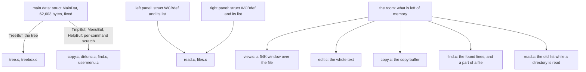
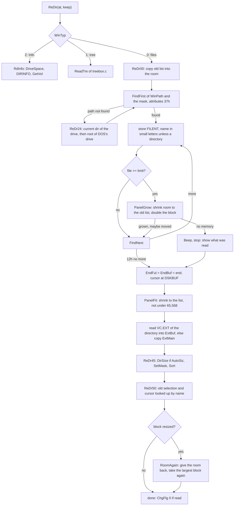
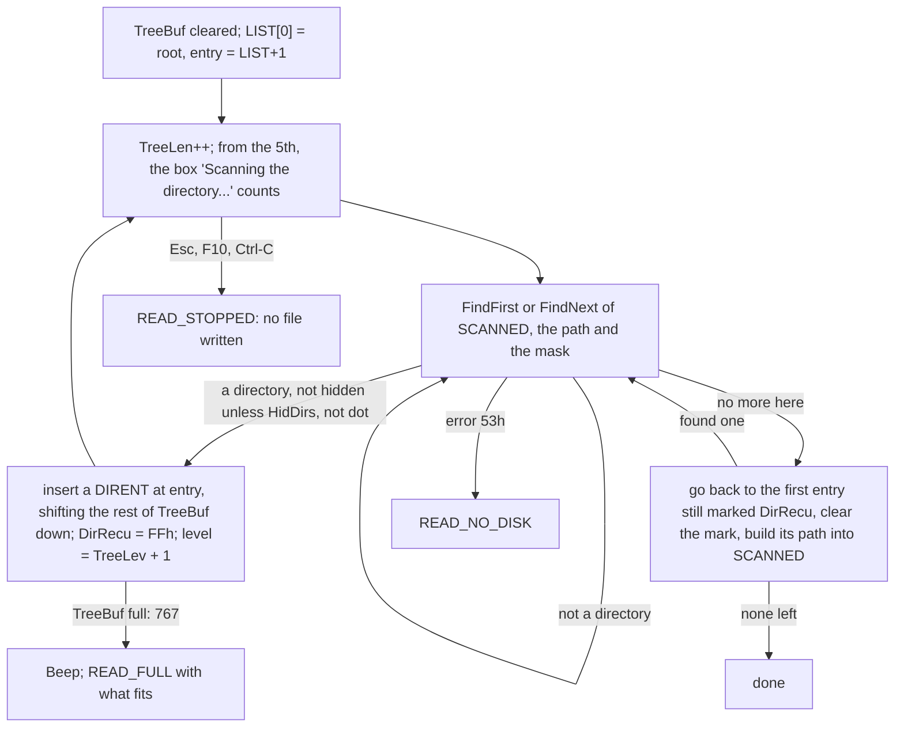
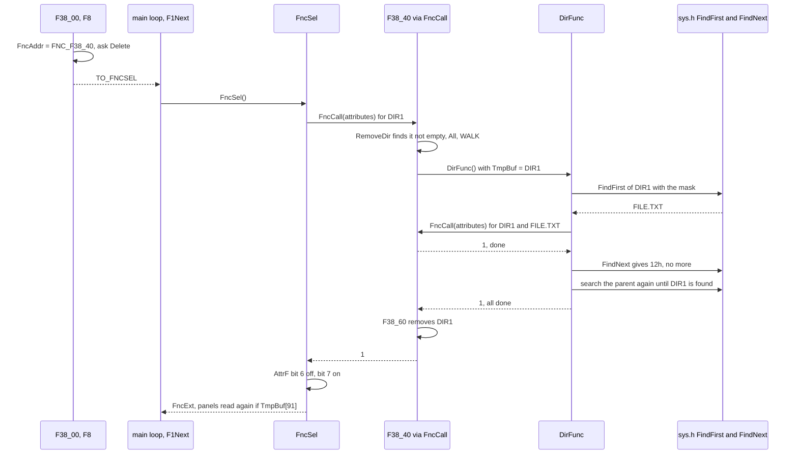
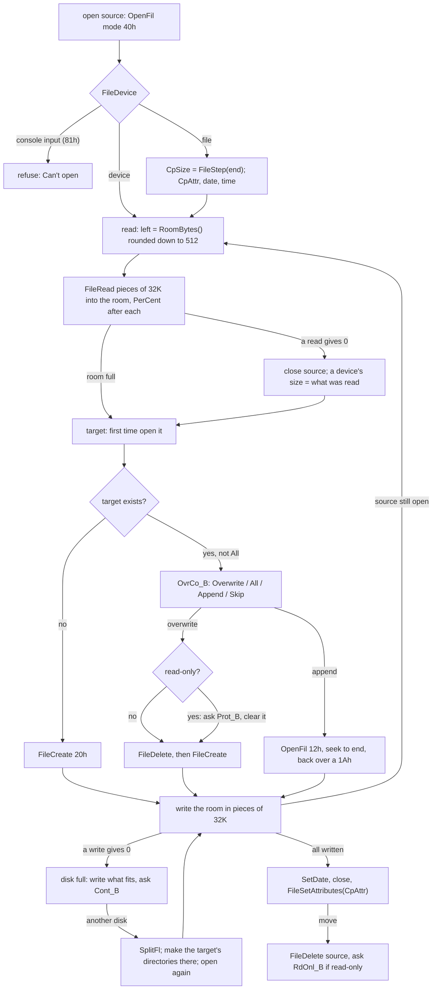
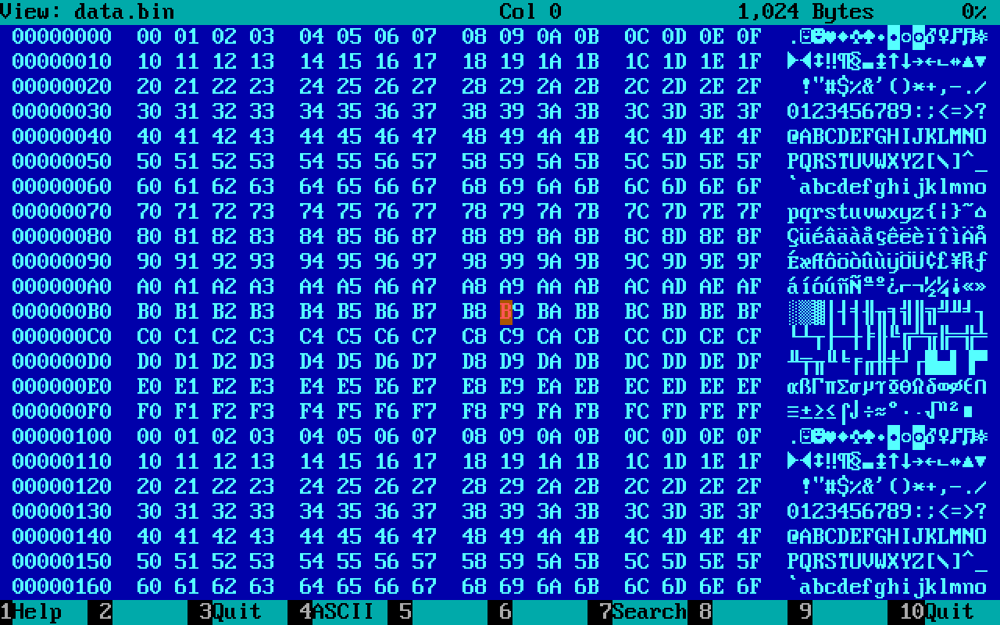
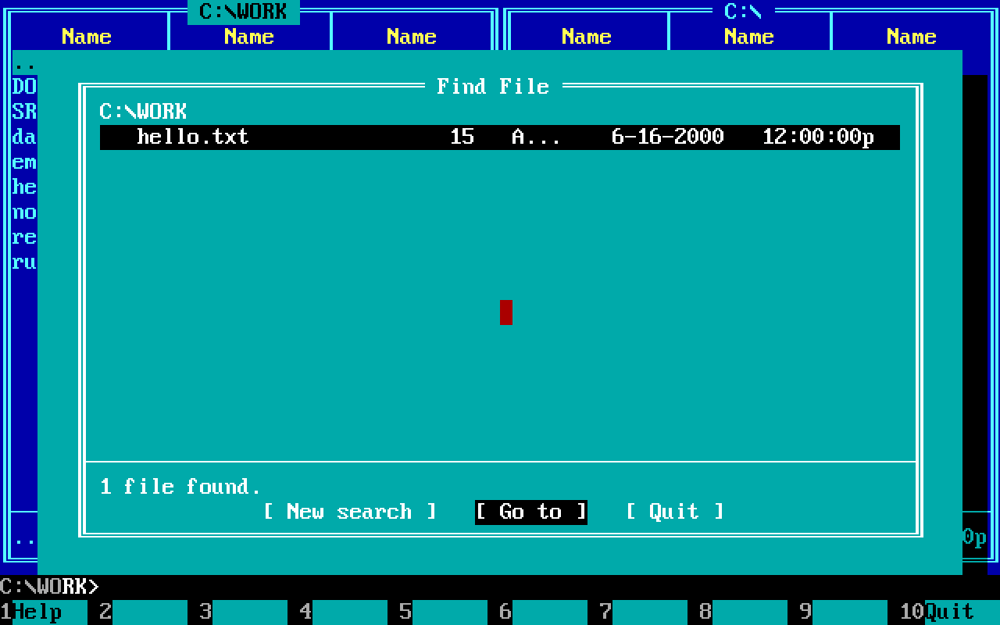
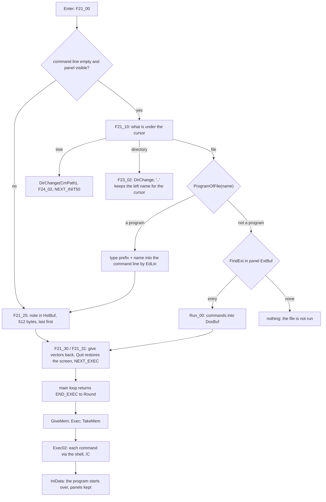
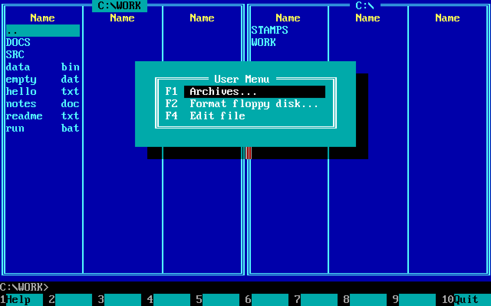

# 2. Working with files: the commander's features

A file manager is a few lists and a few loops over them. Volkov
Commander has two lists of files, one per panel, a list of directories
for the tree, a list of found files for the file search, and one buffer,
the *room*, that the viewer, the editor, the copy and the search take
turns to fill. Almost every feature in this chapter is one of three
loops: read a directory into a list, go through the files of a list or
of a directory, or move a file through the room a piece at a time. That
is how the features fit: the copy, the delete, the attributes, the
directory sizes and the file search are one walker over the disk with
five different routines plugged into it, and the viewer, the editor and
the copy never hold their own buffers.

The code shown is the portable C, `src/portable_c/`, which keeps the
original's routines under their labels (`ReDr00`, `C20_00`, `V00_10`,
`T00_00`) and the main data, `struct MainDat`, at its 62,603 bytes,
field for field, with the scratch fields of a command in `TmpBuf` at the
original's offsets. Where the C has moved something big, a panel or the
room, out of the original's segments, the original's way comes first.



## The memory: one block cut in four

The original takes all the memory DOS has left in one block and cuts it
by paragraph arithmetic ([chapter 1](01-the-program.md#how-the-program-starts)):

```
 one block from DOS, all that is free                    paragraphs
 +------------------------------------------+ SecDat
 | main data, struct MainDat, 62,603 bytes  |  3,913
 +------------------------------------------+ WCB1seg
 | left panel: header 610 + 256 x 24        |    423, or up to 4,096
 +------------------------------------------+ WCB2seg
 | right panel: the same                    |    423, or up to 4,096
 +------------------------------------------+ ViewSeg
 | the room: viewer, editor, copy, search,  |  at least 500, 8,000 bytes
 |   the old list while a panel is read     |
 +------------------------------------------+ FreMem2: the block's end
```

A panel starts with room for 256 files and grows when a directory has
more: the panel being read may reach to 500 paragraphs short of the
block's end, but no further than its own 64K. A panel that grows pushes
the one above it up, and both push the room. Every user of the room
sizes it as `FreMem2 - ViewSeg` when it starts, so the viewer, the
editor (`VCEDIT.INC`), the search (`VCFIND.INC`) and the copy
(`VCCOPY.INC`) each have whatever is left at the time, and nothing is
reserved for any of them. On a 640K machine with DOS and a mouse driver
loaded that is some 345K.

The C gives the same four things blocks of their own, from three
functions of `sys.h` that are DOS's 48h, 49h and 4Ah in DOS's terms:

```c
struct Block MemTake(i32 bytes);
struct Answer MemGive(u8 *block);
struct Block MemResize(u8 *block, i32 bytes);
```

and asks as the original asked: for more than there is, which is
refused with the largest size, then for that. `TakeRoom` of `start.c`:

```c
largest = MemTake(BYTES_MOST).largest;
block = MemTake(largest);
answer.value = Paragraphs(largest);
answer.failed = LEAST_ROOM > largest;
```

`Init11` takes the two panels first, `PANEL_LEAST` bytes each, the
original's 64K and the 32 bytes of `struct Places`, so that the room,
taken last, is as large as it can be; with fewer than `LEAST_ROOM`
bytes, 8,000, the program does not start. The four pointers of `main.c`,
`LeftPanel`, `RightPanel`, `Room` and `RoomEnd`, take the place of
`WCB1seg`, `WCB2seg`, `ViewSeg` and `FreMem2`.

The room has no owner. Whoever is working fills it from `Room` on and
expects nothing to be left in it from before. Nothing keeps a pointer
into it across a command, or across `ReDir`, which may move it. In the
original nothing at all survives a command but the setup and 256 names
of each panel ([chapter 1](01-the-program.md#a-command-runs-in-the-commanders-memory)).

## A panel: the block, the list, the places

A panel's block is three things in a row:

```
 PLACES(wcb) = (struct Places *)wcb - 1          wcb = LeftPanel, ...
 |                                               |
 v                                               v
 +------------------------------+----------------------------------+------------------------------+
 | struct Places, 32 bytes      | struct WCBdef header, 610 bytes  | list: struct FILENT[n]       |
 |  +0  Bytes   block length    |  +0   WinTyp  0 files 1 tree     |  DSKBUF = 610, 24 B each     |
 |  +4  Unused[3]               |             2 info               |                              |
 | +16  CurAdr  cursor          |  +1   BrfFul  +2 Visible         |  .. EndBuf: shown            |
 | +20  First   first shown     |  +3   Hidden  +4 MasTyp          |  .. EndFul: left out by the  |
 | +24  EndBuf  end of shown    |  +5   SortTyp +6 Ctrl_L          |             filter           |
 | +28  EndFul  end of all read |  +7   DskMas[13]  filter mask    |  then PANEL_TAIL = 64 bytes  |
 |                              | +20   WinPath[68] the directory  |  (a paragraph, 2 entries)    |
 |                              |       (+0..+87 saved in VC.INI)  |                              |
 |                              | +88   three 16-bit words of the  |                              |
 |                              |       original, unset            |                              |
 |                              | +94   ExtBuf[512] its VC.EXT     |                              |
 |                              | +606  EndFul16 (unset)           |                              |
 |                              | +608  ChgFlg  +609 SizDir        |                              |
 +------------------------------+----------------------------------+------------------------------+
   all four places are i32 offsets from wcb, so ENTRY(wcb, CurAdr) is the entry under the cursor
```

`struct WCBdef` is declared with 256 entries of `DskBuf`, the original's
minimum `MinFls`, which is why `DSKBUF` is written as
`sizeof(struct WCBdef) - MinFls * sizeof(struct FILENT)`: the list starts
where those 256 would. The list may run far beyond the structure's end.
An entry is the original's 24 bytes:

```
 struct FILENT, 24 bytes
 +0  NameF[13]  name, ASCIIZ; files in small letters, directories in capitals
 +13 AttrF      DOS attributes, low 6 bits; 0x40 selected; 0x80 selected before
 +14 TimeF      DOS packed time
 +16 DateF      DOS packed date
 +18 SizeF      u32; for a directory, its size when Auto calculate is on
 +22 NumbF      u16 order in which DOS gave it (written, read by nothing)
```

Why are the places of the list in front of the panel and not in it? The
original kept `CurAdr`, `First`, `EndBuf` and `EndFul` inside the panel,
as 16-bit offsets in the panel's segment. A segment was as far as a panel
reached, so 16 bits were enough. Here a panel can be any size, so the
places are `i32`. They cannot go into `struct WCBdef`, because its
first 88 bytes are what `VC.INI` saves of a panel, laid out byte for byte
(`/* End of WCB part saved in VC.INI */`), and the original's three words
that follow are still there, unset, as is the rest of its layout. So the four `i32` go into the paragraph in
front of the panel, and the length of the block goes in the paragraph
before that. The panel still starts on a paragraph, as its block does.
`PLACES(wcb)` is a cast and a minus one.

Four pointers of `main.c` name the panels: `CurrentPanel`, `OtherPanel`,
`LeftPanel`, `RightPanel`. They take the place of the four segment words
of the original's main data (`WCBcrn`, `WCBsec`, `WCB1seg`, `WCB2seg`),
which are still in `struct MainDat`, unset. A pointer is wider than the
word. Since a block may move when it grows, the rule is the one at the
top of `vc.h`: nothing keeps a pointer to a panel, or into its list,
across `ReDir`. Places are offsets for that reason too.

## Reading a directory into a panel

`ReDir(struct WCBdef **at, bool keep)` of `read.c` is the one entry. It
chooses by `WinTyp`: `RdInfo` for the Info panel, `ReadTre` of
`treebox.c` for the tree, and for files three functions one after the
other, `ReDr00`, `ReDr45` and `ReDr50`. The split into three is a fossil
of a 256-byte stack. Filtering calls DOS for the capitals of a mask, and
DOS makes them on the caller's stack, so the original made sure nothing
of the read was still on the stack then. The C keeps the split, and the
function names say where the assembly's labels were.



### The old list, kept in the room

Before a single entry is read, `ReDr00` copies the panel's list, as far
as `EndBuf`, into the room, in whole entries, and notes where the cursor
and the first line were as offsets into that copy (`struct OldList`).
After the new list is sorted, `ReDr50` walks the copy. Every entry with
a mark in its top two bits is looked up by name with `FnFile`, and its
marks go to the new entry. Then `NearFl` puts the cursor on the same
file, or on the nearest one that survived, looking forward first and
then back. With `keep` false, which is the case when the directory was
gone and another was read, only bit 7 is carried over: the "was
selected" mark that Ctrl-M selects again. A file of that name in another
directory gets it.

The original kept no more of the old list than a paragraph short of 64K.
Here the room bounds it, and what does not fit is lost from the end. The
cursor is clamped to what was kept.

### How a list grows past 64K

The loop reads until `file >= limit`. `limit` is the block length minus
the places and `PANEL_TAIL`, 16 + 2 x 24 = 64 bytes. The original
stopped the same distance short of its 64K. That is how it ended at
2,703 entries: (65,536 - 64 - 610) / 24, rounded up for the entry that
crosses the line. Instead of beeping there, `PanelGrow` of `start.c`
does two things:

1. The room, which holds the old list in its first `count` bytes, is made
   as short as that list, but not under `LEAST_ROOM`. This gives back
   the memory that the panel is about to grow into.
2. The panel's block is resized to twice its length. If the system
   refuses, it is resized to the largest block there is, if that is
   longer than what it has. `MemResize` may move the block, contents and
   all. `Moved` then updates whichever of the four panel pointers
   pointed at the old place.

```c
want = BYTES_MOST & ~15;
if (bytes < want / 2)
    want = bytes * 2;
made = MemResize(block, want);
if (made.failed) {
    want = MemTake(BYTES_MOST).largest & ~15;
    if (want <= bytes)
        return 0;
    made = MemResize(block, want);
    ...
}
return Moved(panel, made, want);
```

Only when no larger block is possible does the program beep and show
what it has, which is the original's behaviour at its own limit. After
the read, `PanelFit` cuts the block back to the list and its tail,
rounded to a paragraph, never under `PANEL_LEAST`. Since the room was
cut or the free memory moved, `ReDir` ends with `RoomAgain`, which gives
the room back and takes the largest block again. Its contents are not
kept. They were the old list, which `ReDr50` has finished with by then.

`ReDr00` re-reads `PLACES(panel)->Bytes` and `limit` after every grow,
and returns the panel's new address. `ReDir` writes it to `*at`. That is
the whole protocol for a moving panel.

### 65,536

`NumbF`, the order in which DOS gave an entry, is a 16-bit word: an
entry is 24 bytes and not one more. A DOS directory holds at most 65,536
entries, so the number always fits, and it is the most that a panel of
the C can hold. The 16-bit side shows elsewhere too: `Func40` of
`main.c` leaves the number of the last line in DX for Rename, as the
original does, and a panel of more than 65,536 entries would be cut
there ("wraps").

### The filter: `SetMask`

The filter does not delete anything. It *partitions*. `SetMask` of
`files.c` runs a cursor from the front and a cursor from the back. An
entry that passes stays; one that fails is swapped with the entry at the
back, loses its selection (`AttrF &= 0x3F`), and the back cursor steps
in. When they meet, `EndBuf` is set. Everything from there to `EndFul` is
read, kept and invisible. That is why a filter can be changed without
reading the disk again.

An entry passes if:

- it is not hidden or system, unless the panel shows those (`Hidden`); and
- it is a directory, or else it passes both of these:
  - when `MasTyp` asks for programs only, `TstExe`, which asks
    `ProgramOfFile` of `sys.h` with the panel's directory and the name;
  - `TstMas` against the mask `DskMas`, which `Convert` has put into its
    fixed form: eleven characters, 8 + 3, with `?` for wildcards.

On DOS `ProgramOfFile` compares the three characters behind the first
full stop with `com`, `exe` and `bat` and asks DOS nothing: in the
original that is three `CMP`s of a word and a byte in `TstExe`. It is a
function of the system layer because another system has another idea of
a program ([chapter 3](03-the-system.md)).

### Sorting: `Sort` and `CmpPar`

Before it sorts, `Sort` lays every name out in columns: the name padded
with spaces to eight characters and the extension moved to bytes 9-11.
Then a byte comparison of 12 characters (skipping byte 8) orders by name
and extension, and the extension alone sits at a fixed place for sorting
by type. After the sort the names are put back together. The sort itself
is a diminishing-gap exchange sort. It is the original's, and it is not
quite Shell sort:

```c
gap = PLACES(panel)->EndBuf - DSKBUF;
for (;;) {
    gap = gap / SIZE_FILENT >> 1;
    gap = (gap << 4) + (gap << 3);  /* times the size of an entry */
    if (gap == 0)
        break;
    end = PLACES(panel)->EndBuf;
    do {
        swapped = 0;
        for (file = DSKBUF; file + gap < end; file += SIZE_FILENT) {
            if (!CmpPar(ENTRY(panel, file), ENTRY(panel, file + gap),
                        panel->SortTyp))
                continue;
            swapped = file + gap;
            ... exchange the two through the spare entry at EndFul ...
        }
        end = swapped;
    } while (swapped != 0);
}
```

Each gap is a bubble sort whose pass ends at the last exchange of the one
before. `(gap << 4) + (gap << 3)` is times 24 without a multiply, which a
16-bit 8086 paid dearly for. The exchange goes through the entry behind
`EndFul`, one of the two that `PANEL_TAIL` reserves.

`CmpPar` puts directories before files, `.` and `..` first, and system
files before other files. Then it orders by `SortTyp`: 1 by extension,
2 by date and time (newest first), 3 by size (largest first), and by
name for 0 and as the tie-break for the others. The original has a
fifth order, unsorted, which is simply the order in which DOS gave the
entries: `NumbF` exists so that it can be restored without reading the
disk again. The C has dropped that order, and `NumbF` is written and
never read.


*Gray+ with `*.txt`: two files selected, bit 6 of their attributes set, and the status line counting them in 32 bits.*

### Selection

Selecting a file sets bit 6 of `AttrF`, `ATTR_SELECTED`. Ins toggles it
(`keys.c`). Gray+ and Gray- ask for a mask and walk the list. The right
mouse button drags it over a run of files and remembers, in `WinMous`,
whether the first file passed was selected, so that the drag either
selects or unselects all of them. `TotSel` counts selected files and
directories in 32 bits.

Bit 7 is the program's memory of the *last* group operation. When
`FncSel` has done its work on a file, it clears bit 6 and sets bit 7.
Ctrl-M then reselects whatever has bit 7, and `ReDr50` carries bit 7 even
across a change of directory.

## The tree and its file

The tree is not in a panel's block. It lives in the main data, in
`TreeBuf`, 12,299 bytes: a `struct DIRTREE` header and room for 768
entries of 16 bytes (`MinTree`). The layout of the buffer *is* the
layout of the file, `\TREEINFO.NCD` in the root of the disk, a format
inherited from the Norton Commander:

```
 TreeBuf / TREEINFO.NCD
 +0   TreHead[5]  "PNCI",0         (while reading: [0] how it ended, [1] the level)
 +5   TreeLen     u16, number of directories
 +7   TreSum1     u16, ChkSum of the 7 bytes before it
 +9   TRELIST ->  struct DIRENT[TreeLen], the root first   (the list begins
                                                            where TreSum2 is
                                                            declared)
 +9+16n           u16, ChkSum of the list
                  file length = 16 x TreeLen + 11

 struct DIRENT, 16 bytes
 +0   DirName[13]  name; byte 12 doubles as DirRecu, "not read yet", while scanning
 +13  DirLevel     depth, root = 0
 +14  DirShift     1 if this entry starts a new branch
 +15  DirCont      1 if a sibling follows below at the same level
```

No path is stored. A path is rebuilt by walking the list: `DESCEND` in
`tree.c` puts each name behind the backslash of its level in a path
carried along in `MenuBuf`. `DirShift` and `DirCont` are all that
`PutTree` needs to draw the lines, `├`, `└` and `│`, without looking
ahead.

`ReadTre` of `treebox.c` tries the file first. `TreeFileRight` checks
the signature, both sums, and that the length is exactly `16n + 11`. A
file that claims no entries, or 4,096 or more, counts as broken: the
original counted the list's bytes in 16 bits, so a list of 4,096
entries of 16 bytes is 0 to it. Otherwise the disk is scanned by
`RdTr10`:



Each subdirectory found is inserted right behind its parent, and the
scan goes on with the first entry still marked unread. So the list comes
out in pre-order, each directory followed by its subtree, without any
recursion or path stack. The only state is the mark in byte 12 of each
name. The cost is a `memmove` of the tail of `TreeBuf` for each
directory found. With at most 767 entries, that was cheap even on an
8088.

A scan that ran to the end writes the file, if it found five or more
directories. With fewer, it deletes the file. Whoever changes the
directory structure marks the file out of date: `DelTr0` of `dirfunc.c`
writes 0 over its first byte. The first directory that a delete
(`F38_54`), a copy or a move (`C30_00`) makes or removes does that, and
only if `ChgTree` (auto rescan) is on. `ChDir` in a tree box is
`ChTree`, which opens the same list in a dialog with a speed search kept
at `MenuBuf+230`.

## Going through files: FncAddr, FncSel, FncMas, DirFunc

Delete, attributes, copy, move and the file search all do the same
thing: for each file, call a routine, and for each directory, the same
routine again on each of its files. In the assembly the routine was a
code address stored in `FncAddr` of the main data. In C, `FncAddr` is
still a 16-bit word of the main data at the original's place, and holds
an index into a table of functions:

```c
typedef u16 FncFn(u16 attributes);
static FncFn * const Fnc_T[] = {
    C00_00, DiSi10, FindFil, F38_40, M30_50
};

u16 FncCall(u16 attributes)
{
    return Fnc_T[md.FncAddr](attributes);
}
```

A routine is handed the file's attributes, finds the file's path at the
start of `TmpBuf`, and answers 1 for done, 0 for not done, and something
in the high byte (100h) to stop the whole command. Three drivers call it:

- `FncSel` goes through the selected entries of the current panel, or the
  one under the cursor when nothing is selected or the command is for one
  file (`OneFile`, the Ctrl variants). After each file it turns bit 6
  into bit 7, and with `UnSlct` set it redraws that file's row of the
  panel at once.
- `FncMas` (`FncMs1`) goes through what a mask at `TmpBuf` matches on
  the disk, skipping directories, hidden and system files. Shift-F8 and
  Shift-F5 use it.
- `DirFunc` goes through every entry of the directory at `TmpBuf` and
  calls the routine with the name appended to the path. A routine that
  meets a directory calls `DirFunc` again, so the commands reach as deep
  as the disk does.



### One DTA

The interesting part of `DirFunc` is at its end. DOS searches with one
record, the DTA (`md.DTA`, a `struct DTAs` of 44 bytes), and the search
remembers where it is only in that record's 21 reserved bytes. When the
routine called for a subdirectory runs its own `DirFunc`, it overwrites
the parent's search. The parent cannot simply call `FindNext` afterwards.
So when the inner search ends, `DirFunc` cuts its name off the path and
searches the *parent* directory again from the start, `\*.*`, until it
finds a directory with the name it just finished (kept in `MenuBuf`).
That leaves DOS's record exactly where the outer `FindNext` expects it.
It is quadratic in the size of the parent directory, and it needs no
memory at all.

A path of 68 characters or more is not entered (`PthEr_B`): DOS's
limit is 67, a drive, a colon, a backslash and 64 characters, and every
path buffer of the program is `LenPath`, 68 bytes with its zero.

### Delete and attributes

`F38_00`, F8, sets `FncAddr = FNC_F38_40`, clears the three flags it
keeps in `TmpBuf` (`DEL_ALL` at 90, `FNC_CHANGE` at 91, `DEL_TREE` at
92), asks once, and returns `TO_FNCSEL`. `F38_40` deletes a file through
`FileDelete`. A read-only file gets the dialog `RdOnl_B`, and on
"Delete" its attributes are set to 20h and the delete is tried again. A
directory is tried with `DirRemove` first. If it is not empty, the user
is asked once (or never again after "All"), and then:

1. `F38_70` deletes the directory's files with one FCB call, DOS's 13h,
   `FcbDelete` of `sys.h`: a single call that removes every file that
   `*.*` matches, hidden and system files included. An FCB has no path,
   so the directory is made the current one for the call and the old one
   put back;
2. `DirFunc` deals with what is left, read-only files and the
   subdirectories, by calling `F38_40` for each;
3. `F38_60` removes the directory. If it is the current one, it first
   changes to the directory above.

`M30_00`, Ctrl-A, is the same machine with `M30_50`. Its dialog leaves a
mask of bits to keep at `TmpBuf+94`, bits to set at `+95`, and a date
and a time at `+96` and `+98` (0FFFFh for "unchanged"). `M30_51` clears
read-only, opens the file to set the stamp, then writes
`(old & ATTR_KEEP) | ATTR_SET`. For a directory it goes into the
directory through `DirFunc` and does not touch the directory itself.

Every one of these ends at `FncExt`, which marks both panels for
re-reading if `TmpBuf[91]` says that anything on the disk changed.

## Copy, move and rename

`copy.c` holds the longest single routine in the program. `C20_00` runs
to some 460 lines of C, with 22 labels left from the assembly, whose
paths cross too much for `if` and loops: the C keeps the jumps.
The parts are:

- `F35_01`, F5 and F6, and `F45_01`, the Shift variants, ask for the
  target in the dialog `Copy1_B`, copy the answer into `ToFile`, set
  `CopyMov` (`TmpBuf[100]`: 0 copy, 1 move, 2 move that has to copy, 3
  rename of a directory in the tree), set `FncAddr = FNC_C00_00` and
  return `GO_SELECTED`.
- `C00_00` is the routine of `FncAddr`. `C00_01` builds the target's
  name in `CpDest` (`TmpBuf+130`) from `ToFile` and the source (`CpSrc`
  at `TmpBuf+0`): a directory, a name with wildcards, or a device. Then
  it decides: a move on the same drive is a rename (`C10_00`, which is
  `FileRename`, DOS's 56h); a move across drives, or to a device, is a
  copy followed by a delete. A directory goes to `C30_00`, which makes
  the target directory, runs `DirFunc` over the source, and for a move
  removes the source afterwards.
- `C20_00` copies one file.

Everything the copy keeps between DOS calls is in `TmpBuf`, by the
equates at the top of `VCCOPY.INC`:

```
 TmpBuf during a copy (copy.c, #define Cp...)
 +0    CpSrc[..]   source path             +100 CopyMov   0/1/2/3
 +86   CpDev1      source is a device      +104 CpDev2    target is a device
 +87   CpCase                              +106 CpRead    u32 bytes read
 +88   CpTree1     +89 CpTree2             +110 CpWrite   u32 bytes written
 +90   CpAll       "All" was answered      +116 CpHndl1   +118 CpHndl2
 +91   FncChg      something was written   +120 CpAttr  +122 CpDate  +124 CpTime
 +94   SplitFl     the file was split      +126 CpCntBg   where the bar is
 +95   CpCntSz     cells of the bar        +130 CpDest[..] target path
 +96   CpSize      u32 source size
```

Two words of the original's layout held addresses: `CpBgNam` at 102 and
`CpCont` at 128. A pointer is wider than a word, so they moved out into
C variables (`CpBgNam` static in the file, `CpCont` as `rest` in
`C20_00`), and their bytes in `TmpBuf` stay unset.

### The loop



The room is the copy buffer, and all of it is used: the program reads
as much of the source as the room holds, then writes all of it, then
reads again. A 4 MB file on a machine with 300 MB free is one read and
one write, in pieces of 32K (`count = 0x8000`). DOS takes a 16-bit count
per call, and the original stepped a segment per piece. A device can
answer a piece in several short reads. The original counted the room
down by the last of them only, so a slow device could have it read past
the room's end; the C counts every read. The writes
step the buffer by whole paragraphs only (`buffer += got >> 4 << 4`),
because the original stepped a segment by the paragraphs written. A
short write is followed by the disk-full path and never by the next
piece, so the rounding never misplaces data.

The progress bar is `PerCent`. It counts what has been read plus what has
been written against twice the size, so the bar is half full when the
file has been read, and full when it has been written. It does that in
48-bit arithmetic made of 32-bit `Plus32` and `Minus32` with explicit
carries, a direct transcription of the original's register pairs: a
286 had no instruction for a 32-bit sum, so the original chains `ADD`
and `ADC` over DX:AX, and over a third word for the doubled size.

A full disk is a feature, not just an error. `C20_00` asks `DriveSpace`
how much is free, writes exactly that much of the piece, closes the
file, and asks with `Cont_B` whether to continue on another disk. If so,
it makes the target's directory chain on the new disk with `DirMake` and
goes back to `open` with `SplitFl` set. `rest` remembers where in the
room the unwritten part begins. That is how files larger than a floppy
were copied in 1991.


### Errors

Every failure leads to one of five labels near the bottom of `C20_00`:
`skip` (this file is not done, go on), `terminate` (stop, and delete a
target that was half written), `close_source`, `stop`, and `close`, which
puts the screen back. Error 53h, the critical-error box answered with
Cancel, never gets a second box: the user has just seen one. A target
that was appended to is deleted like any other when the copy stops. The
code keeps that bug of the original, as it does the source that stays
open when DOS will not give its attributes. The comment at `C20_00` lists
what it keeps and what it fixed.

## The viewer: a 64K window over any file

The viewer reads its file into the room, but never more than 65,504
bytes, `0xFFE0`, whatever the room holds:

```c
ViSpace = RoomBytes() & ~0xF;
if (ViSpace > 0xFFE0)
    ViSpace = 0xFFE0;
```

The reason is the table of lines. The viewer keeps, at the *top* of the
same bytes, a table of 16-bit words, one per screen line, each the offset
in the text where that line begins. The table grows down from `ViSpace`
toward the text. Where they meet, the part of the file that is in the
memory ends. Offsets of 16 bits reach 64K, and `WORD_AT` cuts every
offset to 16 bits on purpose, so that a place two bytes before 0 reads
the word at the segment's end as on DOS. Widening that table would buy
nothing a user sees, since the window moves anyway.

```
 the room while the viewer shows a file                     ViSpace (<= 0xFFE0)
 0                                                                    |
 +--------------------------------------+-------------+---------------+
 | text: ViLoaded bytes of the file,    |    free     | line table    |
 | from file offset ViOffset            |             | u16 per line, |
 |                                      |             | grows down    |
 +--------------------------------------+-------------+---------------+
 ^ ViFirst: first screen line           ^ ViLoaded     ^ ViEndTab     ^ ViSpace-2: line 0
                                                                        (ViPoint: its entry)
 V50_00 (forward): second half becomes first, ViOffset += ViSpace/2, read on
 V51_00 (back):    move up by half, read the half before, rebuild the table
```

`V60_00` builds the table from a place on. A line ends behind CR LF or
LF CR, or at 80 columns. A tab advances the column to the next multiple
of eight (`column |= 7; column++`). A line of exactly 80 columns that a
line end follows does not make an empty line. In unwrapped mode a screen
line is everything between two line ends, however many table entries
that spans, and `NextLin` skips entries to the next one that follows a
CR LF. Hex mode has no table: a line is 16 bytes, `at = (at & 0xFFF0) +
0x10`.

When the screen runs off the end of what is loaded and the first line is
in the second half, `V50_00` slides: the second half moves to the
start, the line offsets that survive are rebased by `half`, and the file
is read on behind them. Going back, `V51_00` does the mirror image and
then rebuilds the table from the start up to the line where the second
line was, so the lines below it come out the same as before. A file is
never more than 65,504 bytes in memory, and any file can be paged
through, a gigabyte as easily as a kilobyte.

`struct ViewDat`, 43 bytes, is the viewer's state, at `TmpBuf+200`. The
editor's `EdData` lies over it from `TmpBuf+100`, and the two share six
fields at the same places: `ViLen` is `EdLen`, `ViBase` and `ViSize` are
`EdBase`, `EdSizeX` and `EdSizeY`, and `ViTxHex` is `EdTxHex`. That is
how F4 inside the viewer hands the open file to the editor without
copying anything. The structure ends 13 bytes before `TmpBuf` does and
cannot grow, so every field that counts is also a 32-bit static of
`view.c` under the same name (`ViSpace`, `ViLoaded`, `ViFirst`, ...).
The 16-bit fields keep their bytes but are no longer written.



*F3, then F4: the viewer in hex, 16 bytes a line, no table of lines needed.*

### Search

F7 asks for a text (`Srch_B`), and `V81_00` prepares it in `HelpBuf`:
the text in capitals at offset 0 with its length at +90, and, if the
viewer shows hex, the bytes that the text spells as hex digits (one or
two digits to a byte, spaces or commas between) at +100, with their count
at +190. `V82_00(text, at, count)` then scans: at each place it tries the
text, comparing `UpCase` of each byte, then the bytes. The answer says
which matched: 1 for the text, 0 for the bytes, 100h for neither.

`UpCase` is the country's capital, which DOS knows: DOS hands the
program a far routine for the capitals of bytes 80h to FFh (INT 21h AX
3800h gives its address in the country record), and the original calls
it for every byte that it compares. Below 80h it is a subtraction.

The file search and the editor's search use the same `V82_00`.

## The editor: the whole text, and one line apart

The editor shares the viewer's entry. `V00_02` opens the file with the
"Reading the file" box, and when the command is F4, `V00_03` of
`main.c` goes on to `T00_00` of `edit.c`. The editor wants the whole
file in the room:

```c
EdSpace = RoomBytes() & ~0x0F;
if ((u32)ed.EdLen >= (u32)EdSpace) {
    if ((u8)Dialog(&BigFi_B, 0, 0, 0, &md) != 0)   /* "too large for Edit" */
        return T00_10(begin, size);
    ...
    return Ends(EDIT_VIEW, 0);                      /* View it instead */
}
```

In the original the room is what DOS has left once the main data and
the panels are taken, some 345K on a 640K machine with DOS and a mouse
driver loaded, so "too large for Edit" was a box that users met. In the
C it is all the memory there is.

The file is read in pieces of `0xFF00` bytes. That is the largest piece
that fits in one 16-bit count and stays a whole number of paragraphs, and
it is the piece size the original used. A file that gives fewer bytes
than its size claims is as long as what it gave.

```
 the room while the editor runs                       EdSpace
 0             EdOffst      EdEndBf                   EdLen          |
 +-------------+------------+-------------------------+--------------+
 | text before | the cursor | text after              |    free      |
 |             | line       |                         |              |
 +-------------+------------+-------------------------+--------------+
                     |  T50_00 copies it out (at most 3,900 bytes)
                     v  T51_00 puts it back: moves "text after" up or down
 MenuBuf = EditBuf [4000]: the line being edited, EdSizLn bytes, cursor EdCursr
 ErrBuf  = UndoBuf: the line as it was (Ctrl-U), EdUndo bytes
```

Editing in the middle of a big text by moving the whole tail for every
key would be slow, so the editor does not. The line under the cursor is
copied out into a buffer of its own, `EditBuf`, which is `MenuBuf` (no
menu is open while the editor runs), as much of it as 3,900 bytes. Keys
change only that buffer, and `EdUpdat` notes that it changed. When the
cursor leaves the line, `T51_00` puts the buffer back in one move: if the
line got longer, the rest of the text moves down by the difference
(`T51_30` copies downward from the end), if shorter, up. If the text
would pass `EdSpace`, the editor beeps and the end of the *text* is cut,
not the line. The comment marks that as ported as it is. In hex mode
there is no buffer: a line is 16 bytes, and keys edit the text in place.

Places in the text are `i32` offsets from `Room`, with 32-bit statics
(`EdOffst`, `EdEndBf`, `EdFirst`, `EdLine`, ...) beside the 16-bit fields
of `struct EdData` (138 bytes at `TmpBuf+100`), as in the viewer. The
line count is 32 bits as well, so a text of more than 65,535 lines can be
reached, where the original's count of lines wrapped at 65,535, and
`Col` moves right only when the line number needs a sixth digit.

### Keys

`T00_19` is the loop: draw (`T00_20`), wait for a key with the right key
bar (6 hex, 7 text, 10 with no status line), then hand the key to
`T00_83`. That function is the original's `Case` table written as two
`switch` statements: one on the character for keys that have one (Tab,
the WordStar controls ^S ^D ^E ^X ^R ^C ^G ^Y ^K ^U ^T ^W, BackSpace,
Esc), and one on the scan code for the rest (arrows, PgUp, PgDn, Home,
End, Ctrl-PgUp, Del, F2, Shift-F2, F4 for hex, F7 and Shift-F7 for
search, F10, Shift-F10). Any other key with a character is typed:
`T01_03` in text, `T01_10` in hex. ^Q makes the next key a character
whatever it is.

Opening `VC.MNU`, `VC.EXT`, `VCVIEW.EXT` or `VCEDIT.EXT` takes ten rows
off the window for a help pane on the format of those files (`EdtH1_S`
or `EdtH2_S`).

### Save

`T80_00` puts the line buffer back, shows "Saving the file", has
`ChgDisk` ask for the disk if the drive is a shared floppy, and calls
`T80_02`. That function clears read-only if the user agrees,
`FileCreate`s the file, writes the room in pieces of `0xFF00`, and gives
the attributes back. A device keeps its own attributes, and the console
is written nothing. A short write is a full disk, error 27h. The file is
then deleted rather than left truncated, and the error box shows only if
the delete worked. `T80_14` runs after every save, successful or not: if
the file was the main `VC.EXT` in the program's directory (`NcPath`), its
first 511 bytes are copied into `md.ExtMain`, so the change takes effect
without a restart.

## Find file

Alt-F7, `F67_00` of `find.c`, is `DirFunc` again, with `FindFil` as the
routine, plus a list in the room:

```
 the room during a file search
 Room
 +-------+-------+-------+------ ... ------+-------------------------------+
 | line0 | line1 | line2 |  65 bytes each  | part of a file being searched |
 | dir   | file  | file  |  FndNumb lines  | for a text: <= 32,848 bytes   |
 +-------+-------+-------+------ ... ------+-------------------------------+
                                           ^ Line(FndNumb+1), back to its paragraph
 FndSize = RoomBytes() / 65 - 1 lines at most
```

A found file is a line of 65 bytes (`LenFnf`), formatted the way the box
shows it: name, size or `SUB-DIR`, the attribute letters `ASHR`, date and
time. Before the first file found in a directory comes a line with the
directory's path, and before that an empty line. `FndStuf` appends a
line and redraws, and the counts in `struct FndData` (28 bytes at
`TmpBuf+100`) are 32 bits. The original's list was bounded by its 16-bit
counts and its segment; here it holds as many lines as the room does.

`FindFil` is called for each directory. It expands the mask
(`FindStr`, with `*.*` behind a name that has no full stop), runs
FindFirst and FindNext over the directory, lists the matches, and when the
directory has no more entries it cuts the name off and calls `DirFunc`,
which calls `FindFil` back for each subdirectory. The single-DTA trick of
`DirFunc` is what makes it resumable. With `*:` as the drive, `F67_08`
does this for every drive from A: to Z: that is fixed or on a network,
leaving CD-ROMs out (`DriveCd`, `DriveRemote`, `DriveFixed`).

### Searching inside files

With a text in "Containing", each candidate file is opened and read into
the memory *behind* the list, in parts. Each part is searched with
`V82_00`, and the next part starts 80 bytes before the end of the last,
`FileStep(handle, 1, -80)`, so that a match across the seam is found:

```c
left = (i32)(RoomEnd - part);
chunk = 0x8000 + 80;
if (left < chunk)
    chunk = left;
if (chunk < 4000)
    return FnFl48(handle);          /* the list has eaten the room: stop */
```

The original took the part's length from the whole room rather than
from what was left behind the list, and with a long list it read past
its own buffer's end: a bug of the original, which the C mends. `part` is
rounded back to the paragraph its line starts in, up to 15 bytes into the
free end of the last line, because the original addressed it by segment.

The search stays interactive. `FndBack` runs before every DOS call that
can take long. It looks at the keyboard and the mouse, lets the cursor
move in the list while the search runs (`MODE_CURSOR`), and opens the box
menu `[ Stop ] [ Go to ] [ Quit ]`. Go to changes directory to the
chosen line's directory and puts the cursor on the file (`TO_F24_02`).
The original asks DOS for the disk of the wrong drive there, reading
the drive's letter at the wrong place; the C reads the right one.



*Alt-F7: the file search's list, a line of 65 bytes for each name and one for each directory, kept in the room.*

## The user menu and the extension files

Both are text files in one format, read by `FndItem` of `extfile.c`. A
line that starts at the margin begins an entry. Lines below it that start
with a space or a tab are its commands. A line that starts with `'` is a
comment. The program puts 1Ah behind what it read, and the file ends
there.

```
 VC.MNU                                VC.EXT
 F1: Compile this file                 c:   tcc !.!
     tcc !.!                           txt: edit !.!
     pause                             d??: debug !.!
 'a comment                            *:   type !.!
 G: Go to the root
     cd \
 X: Another menu
     extra.mnu
```

**Extension files.** Every `ReDir` of a panel of files reads the
directory's `VC.EXT` into the panel's own `ExtBuf[512]`, or copies the
main one, `md.ExtMain`, read once at start from the program's directory.
So each panel has its extension table at hand without reading the disk
on Enter. `FindExt` copies the 512 bytes to `MenuBuf` with a 1Ah, puts
the file's extension at `TmpErr` padded with spaces, and walks the
entries. Up to three characters are compared, `?` matching any one and
`*` the rest, and the comparison is by `LowCase`. The answer is a pointer
behind the colon, where the commands begin.

**The user menu.** F2, `F32_00`, reads `VC.MNU` of the current directory,
or else the program's (Shift-F2 goes there directly), into `MenuBuf`,
4,000 bytes, and keeps one word per entry at `TmpBuf+100`: the letter in
capitals, or a function key's scan code in the high byte. A command that
is only the name of a `*.mnu` file opens that menu instead (`F34_40`).

**Run_00** turns the commands of an entry into something to execute. It
copies each command into `DosBuf` (1,000 bytes), each ending in a zero,
the list ending in two, and expands the macros on the way:

| macro | becomes |
|---|---|
| `!` | name of the file under the cursor, without extension |
| `!.!` | the name with its extension |
| `!:` | the current drive's letter |
| `!\` | the current directory, ending in a backslash |
| `!@` | the name of `vc.lst`, which `FileLst` writes then with the selected files |
| `!!` | `!` |

A first command that starts with `@` runs without the prompt and its echo
(`LoadFl |= 0x80`). A command is cut at 123 characters (`LenCmd - 1`).
`Run_00` is a nest of 12 labels in the C too, as in the assembly: its
paths cross.

## Enter, and running a program



Enter on a program does not run it directly. It *types* it into the
command line, through the same `EdLin` that a key goes through, and then runs the command line. So running a program by Enter and by typing its name
are one path, and the program lands in the history.

To run, the program leaves its loop. `F21_31` gives the interrupts back
(`RestVct`), puts back the screen DOS had (`Quit`), writes the prompt and
returns `NEXT_EXEC`. The main loop returns `END_EXEC` to `Round` of
`main.c`, which gives the room back, calls `Exec` of `exec.c`, takes the
room again, and starts the loop over from `IniData`. The stack is as deep
after a command as before it.

`Exec02` runs each command of `DosBuf` with the shell that `COMSPEC`
names, `ProgramRunBare(name, tail)`. It writes the tail into the four
bytes in front of the command, a count, `/C` and a space; the four in
front of the first command are the end of `DosChg`, there for that
purpose. Between commands it prints a prompt the way COMMAND.COM would,
drive and path and `>`. A command that begins with `@` skips that.

`ProgramRun` of `sys.h` is DOS's 4B00h, EXEC: DOS loads `COMMAND.COM`
into the largest free block, hands it the tail `/C command` and the
parameter block in `md.EPB` (14 bytes: the environment's segment and far
pointers to the tail and to two FCBs), and returns when it ends. The
command needs memory to run in, and on a 640K machine that memory is the
commander's own. How the original makes room, by giving back everything
but a few kilobytes and loading itself again afterwards, is in
[chapter 1](01-the-program.md#a-command-runs-in-the-commanders-memory);
how the C makes the call, through DOS/32A, in
[chapter 3](03-the-system.md).

The original has a second way, "Quick execute": it hands each command to
the copy of `COMMAND.COM` that it was started from, through INT 2Eh, an
undocumented entry of `COMMAND.COM` that runs a command line in the
shell's own memory, which saves loading a second shell. The C does not
have it.



*F2: the user menu, read from `VC.MNU` into `MenuBuf`; each entry's hot key is one word at `TmpBuf+100`.*

## How the pieces share the main data

The scratch areas are worth one table, because who may use what at the
same time is not checked by any type:

| Buffer | Size | Used by |
|---|---|---|
| `TmpBuf+0` | path, up to 81 | the file that `FncCall` is handed; `CpSrc` |
| `TmpBuf+90..+100` | flags | each command's own (`DEL_ALL`, `CpAll`, `ATTR_KEEP`, ...) |
| `TmpBuf+100` | 28 / 138 | `FndData` of the search, or `EdData` of the editor, or menu keys |
| `TmpBuf+130` | path | `CpDest` |
| `TmpBuf+200` | 43 | `ViewDat` |
| `TmpErr` | 256 | names being compared or reported, the extension for `FindExt` |
| `MenuBuf` | 4,000 | menus; the editor's line; the tree's path; the extension file on Enter |
| `HelpBuf` | 3,000 | help pages; the prepared search text |
| `ErrBuf` | 2 x 77 x 48 | what a box covers; the editor's undo line |
| `TreeBuf` | 12,299 | the tree and its file |
| `DosBuf` | 1,000 | the commands to run next |

The editor's `EditBuf` is the menu buffer because no menu is open while
the editor runs. `DirFunc` keeps the name of the directory it is leaving
in `MenuBuf` because nothing that calls it has a menu open. The program
is full of such contracts. The original made them to fit 64K: every
buffer that two features never need at the same time is one buffer, and
the table above is the whole list of who may use what. The C keeps them
because `struct MainDat` keeps the original's layout.

## Where to read next

- `src/portable_c/vc.h`: `struct MainDat`, `struct WCBdef`,
  `struct Places`, `struct FILENT`, `struct DIRTREE`, and `DSKBUF`,
  `ENTRY` and `PLACES` near the end.
- `src/portable_c/start.c`: `Init11`, `TakeRoom`, `PanelGrow`,
  `PanelFit`, `RoomAgain`, `GiveMem`, `TakeMem`.
- `src/portable_c/read.c`: `ReDir`, `ReDr00`, `ReDr50`; then
  `files.c`: `SetMask`, `Sort`, `CmpPar`, `NearFl`.
- `src/portable_c/treebox.c`: `ReadTre`, `RdTr10`, `TreeFileRight`;
  `tree.c` for drawing.
- `src/portable_c/dirfunc.c`: `Fnc_T`, `FncSel`, `FncMs1`, `DirFunc`,
  `F38_40`, `M30_51`.
- `src/portable_c/copy.c`: `C00_00`, then `C20_00` from the label
  `read:` to `write:`.
- `src/portable_c/view.c`: `V00_10`, `V60_00`, `V50_00`, `V51_00`,
  `V82_00`.
- `src/portable_c/edit.c`: `T00_00`, `T50_00`, `T51_00`, `T00_83`,
  `T80_02`.
- `src/portable_c/find.c`: `FindFil`; `usermenu.c`: `Run_00`;
  `extfile.c`: `FindExt`.
- `src/portable_c/enter.c`: `F21_10`, `F21_31`; `exec.c`: `Exec02`;
  `sys.h` with `sys_dos.c` and `sys_posix.c` for `MemTake`,
  `ProgramOfFile` and `ProgramRun`.
- The assembly, `src/asm/`: `VCF1.INC` for the group commands,
  `VCCOPY.INC` for the copy, `VCVIEW.INC` and `VCEDIT.INC` for the
  viewer and the editor, `VCFIND.INC` for the search.
- [Chapter 1](01-the-program.md) for the main data, the loop and the
  screen that these features draw on, and
  [chapter 3](03-the-system.md) for the calls of DOS behind
  `FindFirst`, `FileRead` and `ProgramRun`.
