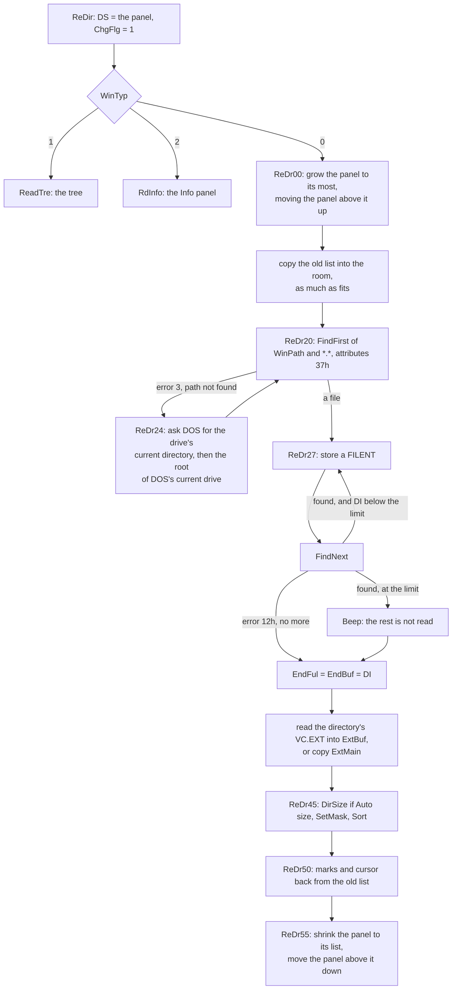
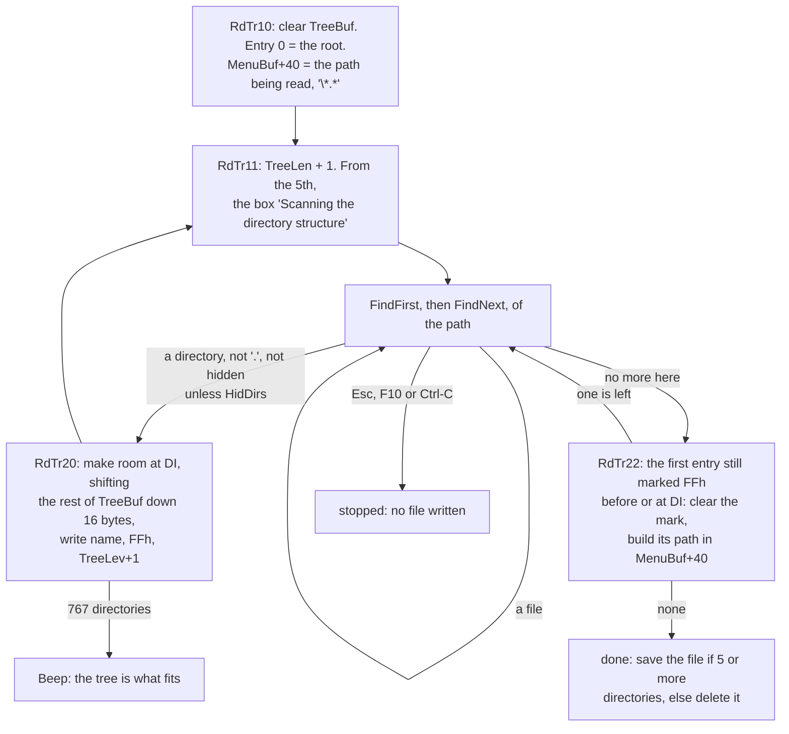
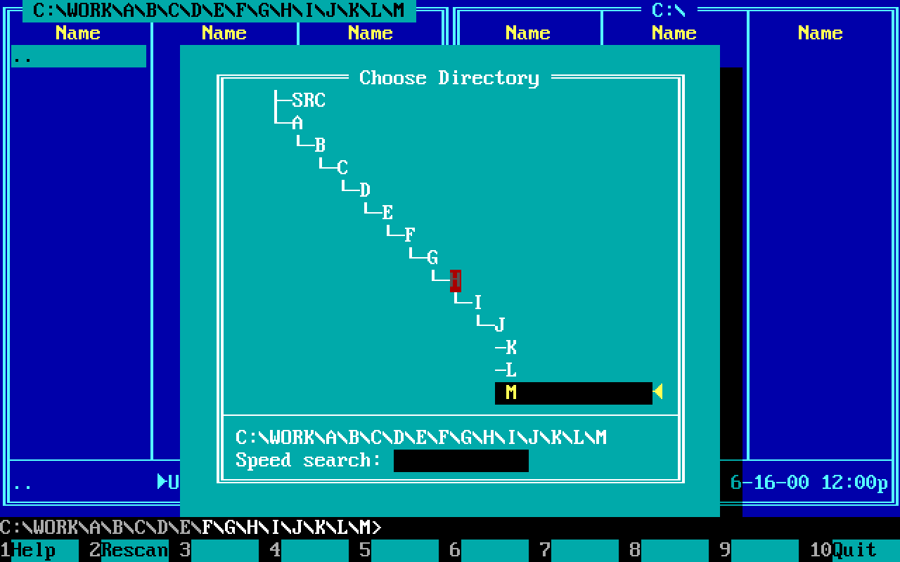
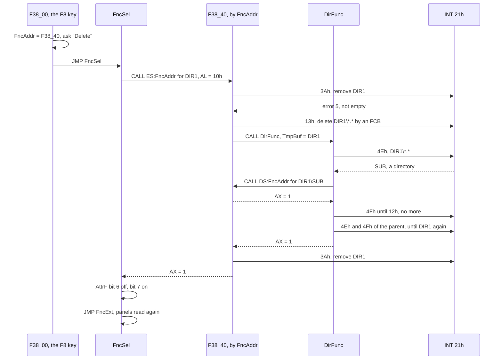
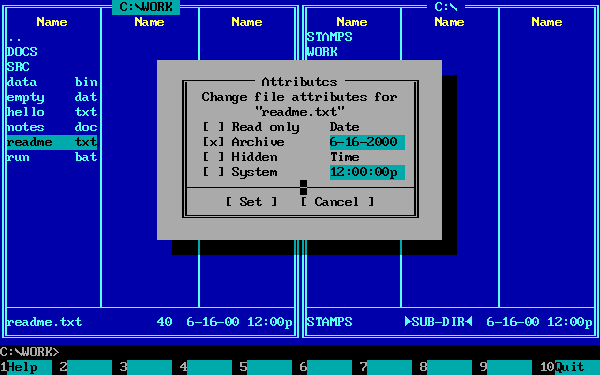
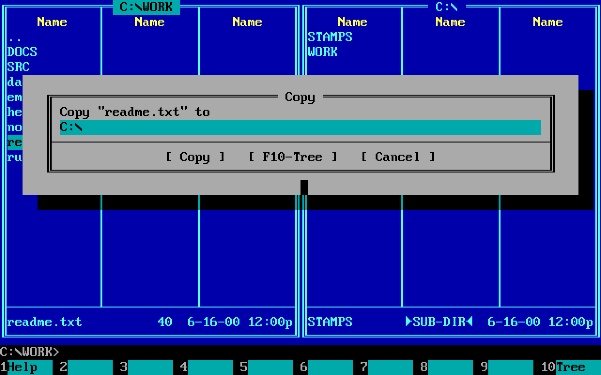
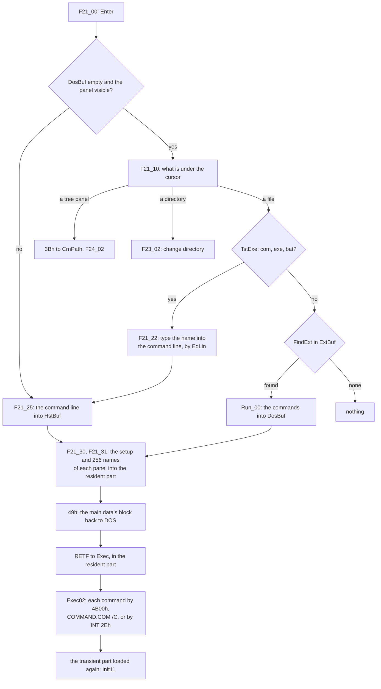

# 2. Working with files: the commander's features

[Chapter 1](01-the-program.md) has the skeleton of `VC.COM`: the main
data, the main loop, the screen and the dialogs. This chapter is about
the flesh: what the program does with files, and how each feature is
built out of a few routines that the others use too. Everything here is in Volkov's
assembly in `src/asm/`, mostly in these include files:

| File | Lines | What it holds |
|---|---:|---|
| `VCSUB2.INC`, `VCSUB3.INC` | 2,514 + 2,589 | reading a directory (`ReDir`), the filter, the sort, the tree, the extension files |
| `VCF1.INC` | 1,806 | delete, attributes, the walkers `DirFunc`, `FncSel` and `FncMas` |
| `VCCOPY.INC` | 1,914 | copy, move and rename |
| `VCVIEW.INC` | 2,167 | the viewer, and the search that three features share |
| `VCEDIT.INC` | 2,689 | the editor |
| `VCFIND.INC` | 1,159 | find file |
| `VCFUNC.INC` | 2,832 | Enter, the user menu, the macros of the commands |

Read from far enough away, the whole chapter is three loops and one
rule. The loops: read a directory into a list; walk the files of a list
or of a disk and call a routine on each; move a file through memory a
piece at a time. The rule: nothing owns a buffer. The memory that DOS
gives the program is cut into four pieces when it starts, and the last
of them, which this chapter calls the *room*, is filled by whichever
feature is running, from its first byte, every time. The 256 bytes of
`TmpBuf` in the main data are the same: each command lays its own
variables over them with `EQU`s. That is how a viewer for files of any
size, an editor, a copier that splits files across floppies, a file
search that reads inside files, and a tree of the disk fit into a
65,090-byte `.COM` and one 64K data segment.

Every excerpt below takes the convention of the segment registers for
granted ([chapter 1](01-the-program.md#init11-the-data-block-cut-in-paragraphs)):
in the commands, **ES is the main data** and **DS is the current
panel's segment**. `MOV DS:CurAdr,SI` writes the panel; `MOV
ES:FncAddr,AX` writes the main data. Many routines swap the two with
`PUSH ES / POP DS` when they want to work in the main data alone.

## The room

`Init11` takes the largest block that DOS has and cuts it into the main
data, the two panels and, behind them, everything that is left
([chapter 1](01-the-program.md#init11-the-data-block-cut-in-paragraphs)
has the arithmetic and the map). That last piece is the room. It is not
a buffer with a length: it is a segment, `ViewSeg`, and its end is the
main data's segment plus `FreMem2`, the length of the whole block. The
program will not start with less than 500 paragraphs of it, 8,000
bytes, and whatever DOS has beyond the least that the program needs
goes to it. No feature reserves any of it: each one works out
`FreMem2 - ViewSeg` again when it starts, and has what is there.

## A panel: `WCBdef`

The panel's segment starts with a header of 610 bytes, `WCBsize`, and
the list of files follows it ([chapter 1](01-the-program.md#wcbdef-a-header-and-a-list-in-a-segment-of-its-own)
has every field). `CurAdr`, `First`, `EndBuf` and `EndFul` are offsets
in the panel's own segment, so moving a panel means changing its
segment number and nothing inside it. `DskBuf` is declared with
`MinFls` = 256 entries, which gives `SIZE WCBdef` = 6,754 bytes, the
panel's least size. A larger directory simply runs on behind the
declared end; the segment reaches as far as 64K.

An entry is 24 bytes:

```
 FILENT                          DTAs (what DOS writes on a search)
 +0   NameF [13]                 +0    [21] DOS's own, the search's place
 +13  AttrF       --.            +15h  FilAttr
 +14  TimeF         | 9 bytes    +16h  FilTime
 +16  DateF         | in DOS's   +18h  FilDate
 +18  SizeF  (DD)   | order      +1Ah  FilSize (DD)
 +22  NumbF       --'            +1Eh  FilName [13]
```

The four fields from `AttrF` to `SizeF` are in the order in which DOS
puts them into the disk transfer area after a `FindFirst` or a
`FindNext`, so an entry is filled by copying the name and then one
`REP MOVSB` of nine bytes from `DTA.FilAttr`. `NumbF` is the place in
which DOS gave the file, which the fifth sort order uses. Bits 6 and 7
of `AttrF` are free in DOS's attributes, and the program uses them for
its own: **40h is "selected"**, **80h is "selected before"**.

## Reading a directory: `ReDir`

`ReDir` of `VCSUB3.INC` (957 bytes) is the one way to fill a panel. It is
called with DS on the panel and AL saying whether to keep the selection.
It looks at `WinTyp` first: a tree panel goes to `ReadTre`, an Info
panel to `RdInfo`, and a panel of files goes on in four steps, which are
labels inside the one procedure.



### Growing the panel, and the 2,703

A panel lives between other blocks. The left panel has the right one
above it; the right one has the room. So before reading, `ReDr00` makes
the panel being read as large as it can be: up to 64K (`DS+1000h`), but
never so large that the room would be shorter than `MinView`, 500
paragraphs. If another panel is above it, that panel is moved up out
of the way with a backwards `REP MOVSB` (`STD`), and whichever of the
four segment words named it, `WCB1seg`, `WCB2seg`, `WCBcrn` and
`WCBsec`, is changed. When the read is over, `ReDr55` does the opposite:
the panel is cut to `EndFul` plus one entry, rounded up to a paragraph,
but never under 423 paragraphs, and the panel above is moved down again
behind it.

Then the limit for the read:

```asm
ReDr08:	MOV	AX,DS			; Save old files
	SUB	BP,AX			; BP = paragraphs the panel may have
	CMP	BP,0FFFh
	JBE	ReDr09
	MOV	BP,0FFFh		; at most 0FFFh: 65,520 bytes
ReDr09:	MOV	CL,4
	SHL	BP,CL			; in bytes
	SUB	BP,SIZE FilEnt + SIZE FilEnt	; less two entries: 65,472
```

The loop stores an entry, asks for the next, and stores that one only
while DI is below BP:

```asm
ReDr32:	MOV	AH,4Fh			; Find next
	CALL	Intr21
	JC	ReDr33			; no more
	CMP	DI,BP
	JB	ReDr27			; room: store it
	CALL	Beep			; full: the rest of the directory is lost
```

So the most a panel holds is the number of 24-byte entries that start
below 65,472 when the first starts at 610: **2,703**, `..` included.
Every number in that sum is a consequence of 16-bit offsets. A panel is
one segment, so the list must end inside 64K; the panel's length is
held in paragraphs and capped at `0FFFh` so that `SHL BP,4` cannot wrap
to 0; and two entries are kept back behind the list, of which the sort
needs one: it exchanges two entries through the space behind
`EndFul`.

### One entry, from the DTA

```asm
ReDr28:	MOV	ES:[DI].NumbF,BX	; DOS's order
	INC	BX
	LEA	CX,[DI+SIZE FilEnt]
	PUSH	CX
	MOV	CX,13
ReDr29:	LODSB				; the name from DTA.FilName
	TEST	AH,10h			; a directory keeps its capitals,
	JNZ	ReDr30
	...
	CALL	LowCase			; a file is shown in small letters
	...
ReDr30:	STOSB
	LOOP	ReDr29
ReDr31:	MOV	SI,OFFSET DTA.FilAttr
	AND	BYTE PTR DS:[SI],3Fh	; DOS's attributes, no marks
	MOV	CX,9
	REP	MOVSB			; attribute, time, date, size: one move
	POP	DI
```

(The registers are swapped here, DS on the main data and ES on the
panel, so that `LODSB` reads the DTA and `STOSB` writes the list.)

The entry `..` is not taken from DOS. Before the first `FindFirst`,
`ReDr20` writes one at the head of the list in any directory that is not
a root, with the attribute 10h and the date `182Fh`, 15 January 1992;
when DOS then hands over `.` and `..`, their attributes, time, date and
size are copied over that entry, with hidden and system cleared so that
no filter ever takes it away. If a DOS does not report `..`, the panel
still has one.

### The old list, kept in the room

Before reading, `ReDr00` copies the panel's visible entries, from
`DskBuf` to `EndBuf`, to the start of the room, as many as fit there, and
keeps the cursor and the first line as offsets into that copy, clamped to
it. After the new list is sorted, `ReDr50` walks the copy:

```asm
ReDr50:	MOV	AH,ES:[DI].AttrF	; ES = the room: the old entry
	AND	AH,0C0h			; its two marks
	JZ	ReDr52
	CMP	AL,0			; a different directory was read?
	JNZ	ReDr51
	AND	AH,80h			; then only "selected before" goes on
	JZ	ReDr52
ReDr51:	CALL	FnFile			; the same name in the new list
	JNC	ReDr52
	OR	DS:[SI].AttrF,AH	; gets the old marks
ReDr52:	ADD	DI,SIZE FilEnt
ReDr53:	CMP	DI,BX
	JB	ReDr50
```

`FnFile` is a linear search by name, so this is quadratic in the
directory's size; with at most 2,703 names that was acceptable. Then
`NearFl` puts the cursor back on the file it was on, or, if that file
is gone, on the next old file that still exists, looking forward first
and then back. The first line shown is found the same way. Nothing of
this needs memory of its own: the room is free between commands, and
the copy lives there only for the length of `ReDir`.

### The extension file comes with the directory

A directory may have its own `VC.EXT`, the table of what Enter does with
a file by its extension. `ReDir` reads it, at most 511 bytes and a 1Ah
behind them, into `ExtBuf`, 512 bytes inside the panel's header. Where
there is none, it copies `ExtMain`, the program's own `VC.EXT`, read
once when the program started. So Enter on a file never reads the disk
to find out what to do: the table is in the panel already.

### The filter: `SetMask`

The filter removes nothing. `SetMask` (122 bytes) partitions the list in
place, with a cursor from the front, SI, and one from the back, BX. An
entry that passes stays where it is; one that fails is exchanged with
the entry at the back, byte by byte, and loses its marks:

```asm
SetMs3:	CMP	BYTE PTR DS:Hidden,0
	JNZ	SetMs4
	TEST	BYTE PTR DS:[SI+13],6	; hidden or system: out
	JNZ	SetMs6
SetMs4:	TEST	BYTE PTR DS:[SI+13],10h	; a directory always passes
	JNZ	SetMs8
	CMP	BYTE PTR DS:MasTyp,0
	JZ	SetMs5
	CALL	TstExe			; "programs only"
	JNC	SetMs6
SetMs5:	CALL	TstMas			; the mask
	JC	SetMs8
SetMs6:	...				; out: exchange [SI] and [BX], 24 bytes
	AND	BYTE PTR DS:[BX+13],3Fh	; an entry not shown is not selected
	JMP	SetMs2			; BX one entry back, test [SI] again
SetMs8:	ADD	SI,SIZE FilEnt		; in: go on
	CMP	SI,BX
	JBE	SetMs3
SetMs9:	MOV	DS:EndBuf,SI		; the shown ones end here
```

The entries from `EndBuf` to `EndFul` are read, kept, and invisible.
Changing the filter calls `SetMask` and `Sort` again over all of them,
without the disk.

`TstMas` works on the *fixed form* of a name that DOS itself uses in a
directory: eleven characters, eight of name and three of extension,
padded with spaces. `Convert` (36 bytes) makes that form, in capitals,
with `*` turned into as many `?` as fill its part; the mask is converted
once into `TmpBuf`, each name into `TmpBuf+20`, and the test is a loop
of eleven comparisons where `?` matches anything. `TstExe` is three
three-byte comparisons of what follows the first full stop with
`'com','exe','bat'`, a nine-byte table.

### Five orders, one sort

`Sort` (236 bytes) first turns every name *in place* into the fixed
form, in the 13 bytes it has: the name padded to eight characters with
spaces, the extension moved to bytes 9 to 11. Now two names compare by
name with one `REPE CMPSB` of eight bytes, and by extension with one of
three bytes at a fixed place, `CmpExt`. At the end the names are put
back together.

The sort itself is Volkov's "Shell sort", whose comment it bears. It is
a diminishing-gap exchange sort: the gap starts at half the list and
halves, and for each gap the list is passed over, exchanging pairs that
are out of order, until a pass exchanges nothing; each pass ends where
the last exchange of the one before was.

```asm
	MOV	BX,DS:EndBuf		; Shell sort
	SUB	BX,OFFSET DskBuf	; BX = the list in bytes
Sort10:	MOV	CX,SIZE FilEnt
	MOV	AX,BX
	XOR	DX,DX
	DIV	CX			; in entries,
	SHR	AX,1			; halved,
	MUL	CX			; in bytes again: the gap
	MOV	BX,AX
	OR	BX,BX
	JE	Sort15			; gap 0: sorted
	MOV	CX,DS:EndBuf		; this pass ends at the end
Sort11:	XOR	DX,DX			; DX = where the last exchange was
	MOV	SI,OFFSET DskBuf
Sort12:	LEA	DI,[SI+BX]
	CMP	DI,CX
	JAE	Sort14
	PUSH	CX
	CALL	CmpPar			; CF = 1: exchange
	JNC	Sort13
	MOV	DX,DI
	MOV	DI,DS:EndFul		; three moves of 24 bytes,
	...				; through the spare entry at EndFul
```

`CmpPar` (136 bytes) decides the order. Its first lines are the fifth
order, "unsorted":

```asm
CmpPar	PROC	NEAR
	MOV	AL,DS:SortTyp
	CMP	AL,4			; 4: unsorted
	JB	CmpPr0
	MOV	AX,DS:[DI+22]		; NumbF: the order DOS gave
	CMP	AX,DS:[SI+22]
	RET
```

"Unsorted" is not a missing sort: it is the same sort by `NumbF`, which
is why the field is there. It puts the list back into DOS's order
without reading the disk again. For the other four orders, directories
come before files, `.` and `..` before other directories, system files
before other files, and then name (0), extension and name (1), date and
time with the newest first (2), or size with the largest first (3).


*Gray+ with `*.txt`: two files selected, bit 6 of their `AttrF` set,
and the status line counting them.*

### Selection

Ins toggles bit 6 of the entry under the cursor. Gray+ and Gray- ask
for a mask, kept in `SelMas`, and walk the list with `TstMas`. `TotSel`
(36 bytes) counts selected entries in one pass, files in DX and
directories in BX. Bit 7 is the program's memory of the last group
operation: every walker clears it on all entries first, and sets it on
each entry that it has done, in place of bit 6. Ctrl-M then selects
again whatever has bit 7. Since `ReDr50` carries bit 7 to the new list
when another directory is read, a file of the same name elsewhere is
reselected too.

## The tree and `TREEINFO.NCD`

The tree is not a panel's list. It lives in the main data, `TreeBuf`,
12,299 bytes: `MinTree` entries of 16 bytes and an 11-byte header. That
buffer is laid out byte for byte as the file `\TREEINFO.NCD` in the
root of the disk, the format of the Norton Commander's tree, so reading
the tree from the file is one `INT 21h` 3Fh into the buffer, and saving
it one 40h out of it.

```
 DIRTREE, TreeBuf, \TREEINFO.NCD                             VC.ASM
 +0    TreHead [5]  'PNCI',0       while scanning: [0] TreeErr, [1] TreeLev
 +5    TreeLen      number of directories, the root counted
 +7    TreSum1      the sum of the 7 bytes before it
 +9    TreList      DIRENT[TreeLen], the root first, in pre-order
 +9+16n             the sum of the list
                    a file is 16 x TreeLen + 11 bytes

 DIRENT, 16 bytes
 +0    DirName [13]  byte 12 is DirRecu while scanning: FFh "not read yet"
 +13   DirLevel      0 for the root
 +14   DirShift      1: a new branch begins here
 +15   DirCont       1: a sibling follows lower down ('├'), 0: '└'
```

No path is stored: a path is the names of the entries above, one per
level, and the levels and the two bits are all that `PutTree` needs to
draw `├`, `└` and `│` without looking ahead. `ChkSum` is 21 bytes:
add bytes into BX, then compare with the word that follows.

`ReadTre` (776 bytes) believes the file only if the signature is
there, both sums agree, and the file is exactly `16 x TreeLen + 11`
bytes long; a file that fills the whole buffer is taken for one too
large. (`TreeLen` is shifted left by four in 16 bits, so a file that
claims 4,096 entries passes with a list of none: a bug that a damaged
file can reach.) Otherwise the disk is scanned, and the scan is a
small marvel.



Each subdirectory that is found is inserted right behind its parent's
earlier children, marked unread in byte 12 of its name. When a
directory has no more entries, the scan steps back from DI to the first
entry of the run that is still marked, and reads that one next. So the
list comes out in pre-order, each directory followed by its whole
subtree, with no recursion and no stack of paths: the only state is one
byte in each name, and the insertion point. The insertion itself is
one backwards `REP MOVSB` of the rest of the buffer:

```asm
RdTr20:	LEA	CX,[BP]-SIZE DIRENT	; BP = the end of TreeBuf
	SUB	CX,DI			; what lies behind the insertion point
	JBE	RdTr80
	...
	LEA	DI,[BP]-1
	LEA	SI,[DI]-SIZE DIRENT
	STD
	REP	MOVSB			; all of it 16 bytes down
	CLD
	...
RdTr80:	MOV	CX,12
	...
	REP	MOVSB			; the name from the DTA
	...
	CALL	FilZero
	MOV	AL,0FFh			; DirRecu: not read yet
	STOSB
	MOV	AL,DS:TreeBuf.TreeLev
	INC	AX
	STOSB				; DirLevel = the parent's + 1
```

The path in `MenuBuf+40` is rebuilt for each directory that is read
next by skipping as many backslashes as its level and copying its name
there: the path of the parent is always what is left in front. A path
that would pass 68 bytes is skipped. The limit is the buffer:
`(12,299 - 11 - 16) / 16` = **767** directories, root included. The
line `MOV BP,OFFSET TreeBuf+MinTree*SIZE DIRENT+SIZE DIRTREE ; ???
Expand` at the head of `ReadTre`, and `; ??? Compress` at its end, are
Volkov's own notes: he meant the tree to grow as the panels do, and it
never did.

A scan that ran to the end writes the file, if it found five
directories or more, and deletes it otherwise: on a disk that small,
scanning is cheaper than a file. Writing goes with `BlocEr` set, so that
a write-protected floppy does not raise the critical-error box: the
program beeps.

Whoever makes or removes a directory makes the file out of date, and
`DelTree` of `VCF1.INC` does that by writing **one zero byte** over the
`P` of `PNCI`:

```asm
DelTr3:	MOV	BX,AX			; the file, opened for writing
	MOV	SI,DX
	MOV	BYTE PTR DS:[SI],0	; one byte: 0
	MOV	CX,1
	MOV	AH,40h
	CALL	Intr21			; over the 'P' of 'PNCI'
```

The next time the tree is read, the signature fails and the disk is
scanned. `DelTree` does nothing unless Auto rescan, `ChgTree`, is on;
delete and copy call it once per command, keeping a flag in `TmpBuf` so
that the file is written only for the first directory that changes.



*Alt-F10 in a directory thirteen levels deep: the tree of
`TreeBuf` drawn in a box, each entry by its level and its two bits.*

## Walking the files: `FncAddr`, `FncSel`, `FncMas`, `DirFunc`

Delete, attributes, copy, move, the directory sizes and find file all
do the same thing: for each file, a routine; for each directory, the
same routine for each of its files. Volkov wrote the walking once and
made the routine a variable: `FncAddr`, a word of the main data, holds
the address of the routine, and the walkers call through it.

```asm
	MOV	AL,DS:DTA.FilAttr	; the file's attributes in AL,
	CALL	DS:FncAddr		; its path in TmpBuf: one indirect call
```

Five routines are ever put there:

| `FncAddr` | Set by | Does to one file |
|---|---|---|
| `F38_40` | F8, `F38_00` | delete |
| `M30_50` | Ctrl-A, `M30_00` | set attributes, date and time |
| `C00_00` | F5 and F6, `F35_01`, `F45_01` | copy, move or rename |
| `DiSi10` | `DirSize` | add a file's size to a sum in `TmpBuf+90` |
| `FindFil` | Alt-F7, `F67_00` | find files in a directory |

A routine takes the attributes in AL and the path at `TmpBuf`, and
answers in AX: AL 1 for done and 0 for not done, AH not 0 to stop the
whole command (100h). It may call the walkers itself. There are three:

- **`FncSel`** walks the current panel: the selected entries, or the
  one under the cursor when none is selected or the command is for one
  file (`OneFile`). It copies the entry's 13-byte name to `TmpBuf`,
  which with the current directory being DOS's is a path, calls the
  routine, and on success turns bit 6 into bit 7. With Unselect on,
  `UnSlct`, it redraws that row of the panel at once, working out the
  row and column from the entry's offset with two `DIV`s.
- **`FncMas`** walks what a mask at `TmpBuf` matches on the disk, files
  only (`TEST DS:DTA.FilAttr,16h` leaves out directories, hidden and
  system), for Shift-F8 and Shift-F5. It says "Can't find file" when
  nothing matched, and puts an `s` behind the word when the mask had a
  wildcard.
- **`DirFunc`** (281 bytes) walks a directory: every entry of the path
  at `TmpBuf`, with `\*.*` behind it, calls the routine with the name
  put behind the path, and returns AL 1 if every call answered 1. A
  routine that meets a directory calls `DirFunc` again, so the commands
  go as deep as the disk does.

All three end at `FncExt`, which marks both panels to be read again,
`ChgFlg = 1`, if `TmpBuf+91` says that any routine changed the disk, and
goes back to the main loop.



### One DTA, and the search found again

DOS keeps the state of a search in 21 bytes at the head of the DTA, and
the program has one DTA, `DTA` in the main data, 44 bytes. A recursive
walk with one DTA should not work: the inner `DirFunc` overwrites the
outer search, and the outer `FindNext` would go on from the inner one's
place.

`DirFunc` repairs that at its end, and this is the cleverest thing in
the chapter. When the search of a directory ends, it cuts the last name
off the path, keeps that name in `MenuBuf`, searches the *parent*
directory again from the start, and goes through it until it meets a
directory of that name:

```asm
DiFu08:	...
	MOV	SI,DX
	CALL	CutPath			; SI = the name that has just ended
	PUSH	SI
	MOV	DI,OFFSET MenuBuf
	MOV	CX,13
	REP	MOVSB			; keep it
	POP	DI
	...
	MOV	SI,OFFSET Mask_S+1	; and put '*.*' in its place
	MOV	CX,4
	REP	MOVSB
	...
	MOV	CX,37h
	MOV	AH,4Eh			; search the parent from the start
	JMP	DiFu11
DiFu09:	TEST	DS:DTA.FilAttr,10h
	JZ	DiFu10
	MOV	DI,OFFSET MenuBuf
	...
	MOV	SI,OFFSET DTA.FilName
	REPE	CMPSB			; is it the one?
	JE	DiFu12			; the DTA is where the caller left it
DiFu10:	MOV	AH,4Fh
DiFu11:	CALL	Intr21
	JNC	DiFu09
```

Then the path in `TmpBuf` is put back as the caller had it, and the
DTA is exactly where the caller's `FindNext` expects it. The cost is
time, a scan of the parent for every subdirectory, which is quadratic in
the size of a directory full of directories. The gain is that a
recursion of any depth needs no memory at all beyond the path: no saved
DTAs, no stack of searches on a 256-byte stack. A path of 68 bytes or
more is not entered, the box `PthEr_B`, since every path buffer is
`LenPath`, 68 bytes.

One curiosity of the source: `DirFunc`, `FncSel` and `FncExt` follow a
`.DATA` block in `VCF1.INC` (the box `PthEr_B`) with no `.CODE` in
between, so the assembler put them into the data segment, `_DATA`,
where the listing has `DirFunc` at 0C57h. In a `.COM` file all segments
are one, `DGROUP`, so the code runs there as well as anywhere.

### Directory sizes

With Auto size on, `ReDir` calls `DirSize` for each directory of the
list, and `DirSize` is the walk in its smallest form: `FncAddr =
DiSi10`, a sum of 32 bits cleared in `TmpBuf+90`, `CALL ES:FncAddr` with
AL 10h, and the sum written into the entry's `SizeF`. `DiSi10` (60 bytes)
adds the file's size from the DTA, stopping at `0FFFFFFFFh` rather than
wrapping, and calls `DirFunc` for a directory. `DirFunc` knows the one
caller that may not show a box: for `DiSi10` a path that is too long is
skipped in silence.

## Delete and attributes

`F38_00`, F8, clears three bytes of `TmpBuf` that it keeps for the
command, 90 for "All" answered, 91 for "the disk changed" and 92 for
"the tree is marked out of date", sets `FncAddr = OFFSET F38_40`, asks
once, and jumps to `FncSel`.

`F38_40` (356 bytes) deletes a file with 41h. If DOS refuses with error
5 and the file is read-only, it asks `RdOnl_B`, sets the attributes to
20h, and tries again. For a directory it tries 3Ah, remove, through
`F38_60`, which knows one more trick: if DOS says error 10h, "the
current directory", it asks DOS for the true name (60h), changes to `..`
and removes it then. The two bytes for `..` cost three instructions:

```asm
	MOV	AX,'.'			; AL = '.', AH = 0
	STOSB				; '.'
	STOSW				; '.', 0: "..", ended
	MOV	AH,3Bh			; change to it
```

A directory that is not empty is emptied in two passes. First `F38_70`
deletes every plain file in it with **one call of DOS**: 13h, delete by
an FCB. It builds an extended FCB at `TmpBuf+200`, the byte FFh, five
reserved bytes, the attribute 26h, archive, hidden and system, the
drive, and the name `*.*` put into FCB form by 29h. An FCB has no path,
so the directory is made the current one around the call and the old
one put back. Then `DirFunc` calls `F38_40` for what is left:
read-only files, which the FCB call does not touch, and
subdirectories, each emptied the same way. Last, `F38_60` removes the
directory. One call of DOS does what would otherwise be a search and a
41h for every file.

`M30_00`, Ctrl-A, is the same machine with `M30_50`. Its dialog leaves,
in `TmpBuf`, a mask of attribute bits to keep at +94, bits to set at
+95, and a date and a time at +96 and +98, `AttrDat` and `AttrTim`,
0FFFFh meaning "unchanged". Whether the stamp is to be set at all is
tested in three instructions, since only `0FFFFh AND 0FFFFh` gives a
word that `INC` turns into 0:

```asm
	MOV	DI,CX			; the old attributes
	MOV	AX,DS:AttrDat
	AND	AX,DS:AttrTim
	INC	AX			; both 0FFFFh?
	JE	M30_54			; then leave the stamp alone
	AND	CL,0FEh			; else clear read-only,
	MOV	AX,4301h
	CALL	Intr21
	...				; open, 5700h, 5701h, close
M30_54:	MOV	CX,DI
	AND	CL,DS:[TmpBuf+94]	; keep these
	OR	CL,DS:[TmpBuf+95]	; set these
	MOV	AX,4301h
```

For a directory, `M30_50` calls `DirFunc` and changes what is inside,
not the directory itself.



*Ctrl-A on a file: `StAt1_B`, whose `SubFunc`, `M30_60`, reads the
date and the time typed in before Set is taken.*

## Copy, move and rename

`VCCOPY.INC` is the longest single routine in the program: `C00_00 PROC`
runs from `C00_00` through `C10_00`, `C20_00` and `C30_00` to its
`ENDP`, 2,684 bytes of code with 128 labels. Its state lives in
`TmpBuf`, named by 27 `EQU`s at the top of the file, and some of
them share bytes: `CpVar1`, a variable of the dialog, is `TmpBuf+120`,
which is also `CpAttr` once the copy runs.

```
 TmpBuf during a copy, by the EQUs of VCCOPY.INC
 +0    CpSrc    the source path          +100  CopyMov  0 copy, 1 move,
                (and CpInpt, the input)                 2 move by copying,
 +86   CpDev1   the source is a device                  3 rename
 +87   CpCase   the target: 0 not known, +102  CpBgNam  where the name
                1 a name, 2 a directory,               begins in CpSrc
                3 a device               +104  CpDev2   the target is a device
 +88   CpTree1  +89 CpTree2: the trees   +106  CpRead   DD bytes read
                were marked out of date  +110  CpWrite  DD bytes written
 +90   CpAll    "All" was answered       +116  CpHndl1  +118 CpHndl2
 +91   FncChg   the disk changed         +120  CpAttr   +122 CpDate  +124 CpTime
 +94   SplitFl  the file was split       +126  CpCntBg  where the bar is
 +95   CpCntSz  the bar's width          +128  CpCont   segment to go on from
 +96   CpSize   DD the source's size     +130  CpDest   the target path
```

`F35_01`, F5 and F6, asks for the target in `Copy1_B`, puts it into
`ToFile`, sets `CopyMov`, and sets `FncAddr = C00_00` for `FncSel`.



*F5 on a file: `Copy1_B`, the target typed into the line under the
name, and F10 for the tree, bit 3 of the dialog's `bFlags`.*

Then for each file:

- **`C00_00`** builds the target's name in `CpDest`. If `ToFile` names
  a directory, the source name goes behind it; if it has wildcards,
  `Convert` puts both the source name and the mask into the 11-byte
  form, every `?` of the mask takes the source's character at the same
  place, and `UnConv` turns the result back into a name: copying
  `*.txt` to `*.bak` is eleven byte comparisons. For a file inside a
  directory being copied, `CpBgNam` says where the part of the source
  path below the top directory begins, and that part goes behind
  `ToFile`: that is how the recursion maps source paths to target paths
  without a stack of its own. Then it decides: a move on one drive is a
  rename, `C10_00`; anything else is a copy, `C20_00`; a directory goes
  to `C30_00`.
- **`C10_00`** is DOS's 56h. If DOS refuses it with anything but
  "access denied", as it does for a move across drives, `CopyMov`
  becomes 2 and the file is copied and then deleted.
- **`C30_00`** makes the target directory with the source's
  attributes, runs `DirFunc` over the source with `C00_00` still in
  `FncAddr`, and for a move removes the source directory afterwards.
  A directory moved on one drive is simply renamed.

### The copy loop: all of the room

`C20_00` does not copy a file through a buffer of its own. It reads as
much of the source as the room holds, then writes all of it, then reads
again. A file smaller than the room is one read and one write.

```asm
C20_10:	MOV	AX,ES			; Reading
	ADD	AX,ES:FreMem2
	SUB	AX,ES:ViewSeg		; the room, in paragraphs
	AND	AL,0E0h			; down to 32 paragraphs, 512 bytes
	MOV	SI,AX			; DI:SI = the room in bytes
	MOV	AL,AH
	MOV	AH,0
	MOV	CL,4
	SHL	SI,CL
	SHR	AX,CL
	MOV	DI,AX
	MOV	DS,ES:ViewSeg
	...
C20_11:	...
	XOR	DX,DX			; each piece at offset 0
	MOV	CX,8000h		; of 32K, or what is left
	...
C20_12:	MOV	AH,3Fh
	CALL	Intr21
	...
	ADD	ES:CpRead.Lo,AX
	ADC	ES:CpRead.Hi,0
	CALL	PerCent
	OR	AX,AX
	JE	C20_15			; read 0: the end of the source
	ADD	DX,AX
	SUB	CX,AX
	JNE	C20_12			; a short read: read the rest
	MOV	DX,DS
	ADD	DX,800h			; the next 32K: the next segment
	MOV	DS,DX
	SUB	SI,AX
	SBB	DI,0
```

DOS takes a 16-bit count, and an 8086 offset reaches 64K, so the room,
which may be hundreds of kilobytes, is walked as a row of segments
`800h` paragraphs apart, each piece read to offset 0 of its own. The
same in the writing loop, which steps DS by the paragraphs written,
`SHR AX,4`. A piece that a device answers in several short reads is
read on at `ADD DX,AX`, but the room is counted down only by the last
of them, `SUB SI,AX`, so a slow device can have the loop read past the
room's end: a bug of the original.

### The bar: 48-bit arithmetic without `MUL`

The bar in the copy box fills in proportion to (read + written) against
twice the size, so it is half full when the file has been read and full
when it is written. The sizes are 32 bits, the product with the bar's
width up to 48, and the 8086 multiplies 16 by 16. `PerCent` (125 bytes)
does without multiplying or dividing at all:

```asm
	MOV	AX,DS:CpRead.Lo		; BX:AX = read + written,
	MOV	BX,DS:CpRead.Hi
	XOR	DX,DX
	ADD	AX,DS:CpWrite.Lo
	ADC	BX,DS:CpWrite.Hi
	ADC	DX,0			; with its carry in DX: 48 bits
	XOR	SI,SI
	XOR	DI,DI
	XOR	BP,BP
	MOV	CL,DS:CpCntSz		; times the width of the bar,
PerCn1:	ADD	SI,AX			; by adding it that many times
	ADC	DI,BX
	ADC	BP,DX
	LOOP	PerCn1
	...				; DX:BX:AX = 2 x the size
	MOV	CX,0FFFFh
PerCn2:	INC	CX			; divided, by subtracting
	SUB	SI,AX			; until it goes below 0
	SBB	DI,BX
	SBB	BP,DX
	JAE	PerCn2			; CX = the cells to fill
```

The bar is a few dozen cells wide, so each loop runs at most that many
times: a multiplication and a division of 48 bits in a few dozen bytes
of code, in a time that a 4.77 MHz 8088 does not notice.

### A disk that fills up

A write that writes nothing is not just an error. `C20_50` asks DOS for
the free room of the target drive, 36h, multiplies sectors per cluster,
bytes per sector and free clusters, writes exactly that much of the
piece if it fits in 16 bits, closes the file, and asks `Cont_B`, "There
isn't enough room to copy: Abort / Continue". On Continue it sets
`SplitFl`, makes the target's chain of directories on the new disk, and
goes back to open the target with `CpCont` holding the segment in the
room where the unwritten part begins. That is how a file larger than a
floppy was carried on several. On Abort the half-written target is
deleted.

Every way out of `C20_00` goes through `C20_45`, which closes the target
and deletes it, and closes the source; error 53h, the critical-error
box answered with Cancel, ends without a second box, since the user has
just seen one.

## The viewer: a 64K window over any file

F3 is `V00_00` in `VCVIEW.INC`. The viewer's state is a structure laid
over `TmpBuf`, and the way it is declared is a trick of its own: the
first member of the `STRUC` is padding as long as the offset of
`TmpBuf+200` in the main data, so that every field's name *is* its
address in the main data and needs no base register:

```asm
ViewDat	STRUC
	 DB	TmpBuf+200 DUP(?)	; nothing: the fields start at TmpBuf+200
ViSpace	 DW	?			; Edit buffer size in paragraphs
ViewEdit DB	?			; View / Edit
ViStatus DB	?			; Output status line
ViLoaded DW	?			; Bytes loaded in buffer
ViLen	 DD	?			; Size of file
ViOffset DD	?			; Offset of first loaded byte in buffer
...
ViFirst	 DW	?			; Offset of first line of screen
ViHandle DW	?			; File handle
...
ViPoint	 DW	?			; Point to address of first line
ViEndTab DW	?			; Point to end of line table
ViBase	 DW	?			; View window base
ViSize	 DW	?			; View window size
...
ViewDat	ENDS
```

With `OPTION OLDSTRUCTS` at the head of `VC.ASM` the field names are
global, so `MOV ES:ViFirst,AX` writes `TmpBuf+218` of the main data.
The 43 bytes run from `TmpBuf+200` to `TmpBuf+242`. (`ViSpace` holds
bytes, not paragraphs as its comment says: the comment is older than the
code.)

The file is opened, its length taken by seeking to the end, 4202h, and
then the viewer takes as much of the room as it can address with one
segment, never more:

```asm
V00_10:	MOV	AX,ES
	ADD	AX,DS:FreMem2
	SUB	AX,DS:ViewSeg		; the room in paragraphs
	CMP	AX,0FFEh
	JBE	V00_11
	MOV	AX,0FFEh		; at most 65,504 bytes
V00_11:	MOV	CL,4
	SHL	AX,CL
	MOV	DS:ViSpace,AX
	MOV	CX,AX
	MOV	DS,DS:ViewSeg
	XOR	DX,DX
	CALL	V55_00			; read that much from offset 0
```

`V55_00` (20 bytes) clears the buffer before it reads, so a short read
leaves zeros. The segment holds the text from its bottom and a table of
the lines from its top, growing down:

```
 ViewSeg while the viewer runs                                ViSpace
 0                                                       (<= 65,504)
 +----------------------------------+-----------+------------------+
 | the text: ViLoaded bytes of the  |   free    | the line table:  |
 | file, from file offset ViOffset  |           | one word a line, |
 |                                  |           | its offset in the|
 |                                  |           | text, growing    |
 |                                  |           | down             |
 +----------------------------------+-----------+------------------+
 ^ ViFirst: first line on screen    ^ ViLoaded  ^ ViEndTab  ViSpace-2:
                                                           line 0 (ViPoint)
```

`V60_00` (93 bytes) builds the table from a place on. Where the table
grows down into the text, the text ends there: `ViLoaded` is cut to the
table, so a file of short lines keeps less text in memory than one of
long lines, and the two always share the segment exactly.

```asm
V60_01:	XOR	BX,BX			; a new line: column 0
	CMP	SI,DI
	JAE	V60_02
	DEC	DI
	DEC	DI
	MOV	DS:[DI],SI		; the table: where it begins
	CMP	DI,DX
	JAE	V60_03
V60_02:	MOV	DX,DI			; the table has reached the text
V60_03:	CMP	SI,DX
	JAE	V60_06
	LODSW				; two bytes at once,
	CMP	SI,DX
	JA	V60_04
	CALL	IsCrLf			; CR LF or LF CR?
	JE	V60_01
V60_04:	DEC	SI			; else one character
	CMP	AL,9
	JNE	V60_05
	OR	BL,7			; a tab: to the next column of 8
V60_05:	INC	BX
	CMP	BX,80
	JB	V60_03
	JA	V60_01			; past 80: a new line
	...				; at 80, unless a line end follows
```

`IsCrLf` is two instructions, `CMP AX,0D0Ah` and `CMP AX,0A0Dh`: having
read a word, the test for a line end in either order is a comparison of
a register. The tab is `OR BL,7` and the `INC` behind it.

When the screen runs past what is loaded and the first line shown is in
the second half, `V50_00` (194 bytes) slides the window: `ViOffset` goes
on by half of `ViSpace`, the second half of the text is moved to the
bottom, the table's entries that survive are rebased by the same amount
in one pass, and the file is read on behind. Going back, `V51_00` (189
bytes) moves the text up by half, reads the half before into the bottom,
builds the table from the start and then again from the line that was
the first, so that the lines below it come out as before. So any file
can be paged through, a gigabyte as easily as a kilobyte, in a window
of 64K, by line offsets of 16 bits.

In hex mode no table is needed: a line is 16 bytes.


*F3, then F4: the viewer in hex, 16 bytes a line.*

The mouse in the viewer has no buttons drawn: the window is cut into
thirds from top to bottom and quarters from left to right, and a click
in the top or bottom third scrolls up or down, in the left or right
quarter left or right (`V00_31` to `V00_35`, with `DIV BL` by 3 and two
`SHR`s for the quarter).

### Search: `V81_00` and `V82_00`

F7 asks for a text, `Srch_B`, into `SrchStr`. `V81_00` (105 bytes)
prepares it in `HelpBuf`, the buffer of the help pages, which is free
while a dialog is not asking for help: the text in capitals from
offset 0, its length at +90, and, in hex mode, the bytes that the text
spells as hex digits at +100, `HexLen` of them at +190. Since F1 may
fill `HelpBuf` with a help page at any time, `V81_00` is run again
before every search, never trusted to have survived.

`V82_00` (90 bytes) is the search itself. At each place of the text it
compares the pattern with `UpCase` of each byte, then the hex bytes
exactly, and says which matched: AL 1 for the text, 0 for the bytes.

```asm
V82_02:	PUSH	CX
	MOV	BX,SI			; this place
	MOV	DI,OFFSET HelpBuf
	MOV	CX,ES:[DI+90]		; the text's length
V82_03:	LODSB
	CALL	UpCase			; the file's byte in capitals
	SCASB
	LOOPE	V82_03
	MOV	AL,1
	JE	V82_05			; the text matched
	MOV	SI,BX
V82_04:	MOV	DI,OFFSET HelpBuf[100]
	MOV	CX,ES:[DI+90]		; HexLen
	JCXZ	V82_05
	REPE	CMPSB			; the bytes?
	MOV	AL,0
V82_05:	POP	CX
	JE	V82_07
	LEA	SI,[BX+1]		; the next place
	LOOP	V82_02
```

`UpCase` is what makes a search of Russian text work: for a byte of
`a` to `z` it subtracts 20h, and every byte then goes through
`Country.CaseMap`, the far routine for capitals above 80h whose address
DOS gives in its country record (3800h). It is called for every byte
compared. Its opposite, `LowCase`, which the panels use to show names,
cannot be asked of DOS, so `Init21` of `VC.ASM` builds a table of 128
bytes, `LowTab`, at the start by asking `CaseMap` for every byte from
80h up and inverting the answers.

Past what is loaded, `V15_04` searches the file itself: it reads it
4,000 bytes at a time into `MenuBuf`, overlapping each read by the
length of the text so that a match across the seam is found, and when
one is found it moves the window to 2,000 bytes before it. The same
`V82_00` serves the editor's F7 and find file's "Containing".

## The editor: the whole text, and one line apart

F4 opens the file exactly as F3 does, `V00_02` with `ViewEdit` set, and
then jumps to `T00_00` of `VCEDIT.INC`. The editor's state is another
structure over `TmpBuf`, `EdData`, from `TmpBuf+100` to `TmpBuf+237`,
and it is laid out with holes so that the viewer's fields under it
survive:

```
 TmpBuf+   ViewDat (viewer)         EdData (editor)
 100..199                           EdOffst, EdEndBf, EdSizLn, EdCursr, ...
                                    EdUndo, then 77 bytes of nothing
 200       ViSpace       =          EdSpace
 202       ViewEdit                 (a byte of nothing)
 203       ViStatus      =          EdStat
 206       ViLen         =          EdLen     the file's size, from V00_06
 214       ViKeyBar                 (a word of nothing: kept)
 216       ViTxHex       =          EdTxHex
 218       ViFirst, ViHandle        (a double word of nothing: kept)
 228       ViBase        =          EdBase
 230       ViSize        =          EdSize
```

The editor takes the file's size, the handle and the window that the
viewer's entry has just set, without copying anything; the 77 bytes of
padding are there to make the shared fields land.

Unlike the viewer, the editor wants all of the file in the room:

```asm
T00_00:	...
	MOV	AX,ES
	ADD	AX,DS:FreMem2
	SUB	AX,DS:ViewSeg
	MOV	DS:EdSpace,AX		; the room in paragraphs
	...				; DI:AX = the room in bytes
	CMP	DI,DS:EdLen.Hi
	JB	T00_01
	JA	T00_03
	CMP	AX,DS:EdLen.Lo
	JA	T00_03
T00_01:	PUSH	BP			; File too large
	MOV	BP,OFFSET BigFi_B	; "... is too large for Edit. View / Cancel"
```

The room is whatever DOS left after the main data and the panels, so
"too large for Edit" was a box that users met with files of a few
hundred kilobytes; View then opens the viewer on it in place.

The file is read in pieces of `0FF00h` bytes, the largest piece that
fits a 16-bit count and is a whole number of paragraphs, so that each
next piece starts at offset 0 of the segment `0FF0h` paragraphs on. The
text is one run of bytes across several segments, and a place in it is
a 32-bit offset, `EdOffst`, `EdEndBf`, `EdFirst`. Two routines of a few
bytes turn one into the other: `T61_00` makes a segment and an offset
below 16 of a 32-bit place, and `T60_00` the reverse.

```asm
T61_00:	PUSH	DX			; DX BX -> DS:SI
	PUSH	CX
	PUSH	AX
	MOV	SI,BX
	AND	SI,0Fh			; the offset: the low four bits
	MOV	AX,BX
	MOV	CL,4
	SHR	AX,CL			; the paragraph: bits 4 to 19,
	SHL	DL,CL
	OR	AH,DL			; with four bits of the high word
	ADD	AX,ES:ViewSeg
	MOV	DS,AX			; DS:SI = the place, SI < 16
```

With SI always below 16, the next 65,520 bytes can be read through
DS:SI without crossing the segment's end, which is all that a line of
text needs.

```
 the room while the editor runs                         ViewSeg+EdSpace
 0                EdOffst     EdEndBf                   EdLen     |
 +----------------+-----------+-------------------------+---------+
 | text before    | the line  | text after              |  free   |
 +----------------+-----------+-------------------------+---------+
                       |   T50_00: copied out, at most 3,900 bytes
                       v   T51_00: put back, moving "text after"
 EditBuf = MenuBuf (4,000 bytes): the line being edited, EdSizLn, EdCursr
 UndoBuf = ErrBuf  (7,392 bytes): the line as it was, for Ctrl-U
```

Moving the whole rest of a large text for every key would be slow, so
the editor does not. The line under the cursor is copied out into a
buffer of its own, `EditBuf`, which is `MenuBuf`, by `EQU`: no menu is
open while the editor runs. Keys change only that buffer and set
`EdUpdat`. When the cursor leaves the line, `T51_00` (374 bytes) puts the
buffer back in one move: if the line got shorter, the rest of the text
moves up (`CLD`), if longer, down (`STD`), in pieces of `0FF00h` with
the segment stepped by `0FF0h` either way. If the text would pass the
room, the editor beeps and cuts the end of the *text*, not the line.
In hex mode there is no line buffer: keys edit the text in place.
The comment beside the `EQU`s states the one rule that this rests on:
`; The length of undo buffer must be greate then edit buffer`.

The keys are a `Case` table, `Edit_T`: 41 entries of a key word and an
address, four bytes each, and a zero. A key word is the BIOS's, the
scan code in the high byte for a key without a character, `4B00h` for
Left, and the character in the low byte for one with, `0013h` for ^S,
so the arrows and the WordStar keys are two entries to one routine:

```asm
Edit_T	DW	0009h, T03_00		; Tab
	DW	0011h, T04_00		; ^Q
	DW	4B00h, T05_00		; Left
	DW	0013h, T05_00		; ^S
	DW	4D00h, T06_00		; Right
	DW	0004h, T06_00		; ^D
	...
	DW	001Bh, T35_00		; Esc
	DW	4400h, T35_00		; F10
	DW	5D00h, T35_01		; Shift F10
	DW	0
```

Opening `VC.MNU`, `VC.EXT`, `VCVIEW.EXT` or `VCEDIT.EXT` takes ten
rows off the window for a pane of help on the file's macros: `T00_03`
compares the name with the four by `T64_00`, and `AX = 0A01h` gives both
the kind of help and the ten rows in one load.

### Save

`T80_00` (432 bytes) puts the line back, asks for the attributes, asks
`Prot_B` if the file is read-only, creates the file with 3Ch and the
old attributes and archive, writes the text in pieces of `0FF00h`, and
gives the attributes back. A short write is a full disk: the file is
deleted rather than left cut short. Then it does something that no
user sees and every user relies on: if the file saved is the program's
own `VC.EXT`, in the directory of `NcPath`, its first 511 bytes are
copied into `ExtMain` with a 1Ah behind them, so the change takes
effect at the next Enter without starting the program again.

## Find file

Alt-F7, `F67_00` of `VCFIND.INC`, is `DirFunc` once more, with
`FindFil` in `FncAddr`, and a list in the room. Its state, `FndData`,
is the third structure over `TmpBuf`, 18 bytes from `TmpBuf+100`: the
cursor, the first line shown, the number of lines, the most there may
be, the window, the number of files found, and four bytes of flags.

A found file is a line of 65 bytes, `LenFnf`, already in the form the
box shows: three spaces, the name in small letters or a directory's in
capitals, the size or `SUB-DIR`, the letters `ASHR` or dots, the date
and the time. Before the first file of a directory comes a line with
the directory's path, and before that an empty line. So the box draws a
line by copying it, and Go to finds the directory of a file by walking
up the list to the line before.

```
 the room during a search                                 FreMem2
 ViewSeg
 +-------+-------+-------+----- ... -----+---------------------------+
 | line0 | line1 | line2 | 65 bytes each | a part of the file being  |
 | path  | file  | file  | FndNumb lines | searched for a text,      |
 |       |       |       |               | at most 32,848 bytes      |
 +-------+-------+-------+----- ... -----+---------------------------+
 FndSize = room in bytes / 65 - 1          ^ FndAdr(FndNumb + 1)
```

Line N is at `ViewSeg` plus 65 x N bytes, which can pass 64K, so
`FndAdr` (30 bytes) makes a segment and offset of the 32-bit product of
one `MUL`, the same arithmetic as the editor's `T61_00`.

`FindFil` (585 bytes) is called with AL, the attributes of what
`DirFunc` found, and returns at once for anything that is not a
directory. For a directory, it runs its own `FindFirst` and `FindNext`
of the mask over it, lists the matches, and at its end cuts its own
name off and calls `DirFunc`, which calls `FindFil` for each
subdirectory. The DTA trick of `DirFunc` is what makes this nest. With
`*:` as the drive, `F67_10` does this for each drive from A: to Z: that
is not a CD-ROM (INT 2Fh 150Bh, which `MSCDEX` answers with `0ADADh` in
BX) and is a network drive (4409h, bit 12 of DX) or a fixed one (4408h).

### Searching inside files

With a text in "Containing", each file that matches is opened and read
into the room *behind* the list, in parts of up to 32,848 bytes,
`8000h + 80`. Each part is searched with `V82_00`, and the next part
begins 80 bytes before the end of the last, `4201h` with `CX:DX =
-1:-80`, so that a match across the seam is not lost:

```asm
	MOV	AX,ES
	ADD	AX,DS:FreMem2
	SUB	AX,DS:ViewSeg		; the whole room, in paragraphs
	MOV	BP,8000h+80
	...				; BP = the room or 32,848, the smaller
FnFl45:	CMP	BP,4000
	JB	FnFl48			; Out of memory ???
	MOV	AX,DS:FndNumb
	INC	AX
	CALL	FndAdr			; DS = behind the list
FnFl46:	...
	MOV	CX,BP
	XOR	DX,DX
	MOV	AH,3Fh
	CALL	Intr21			; read a part there
	...
	CALL	V82_00
	...
	MOV	AX,4201h		; back 80 bytes
	MOV	CX,-1
	MOV	DX,-80
	CALL	Intr21
```

The length of the part is taken from the whole room, not from what the
list has left of it, so with a long list and little memory the read
goes past the room's end: a bug of the original. `Out of memory ???` is
Volkov's comment, three times in `FindFil`.

The search stays responsive because `FndBack` (144 bytes) runs before
every call of DOS that can take long: it looks at the keyboard and the
mouse, moves the cursor in the list while the search goes on, and opens
the menu `[ Stop ] [ Go to ] [ Quit ]`.


*Alt-F7: the list in the room, 65 bytes for each line.*

## The user menu and the extension files

`VC.MNU` and `VC.EXT` are text files of one format, which `FndItem` (37
bytes) walks: a line that begins at the margin begins an entry; lines
below it that begin with a space or a tab are its commands; a line that
begins with `'` is a comment; the program has put a 1Ah behind what it
read, and that is the end.

```
 VC.MNU                                 VC.EXT
 F1: Compile this file                  c:   tcc !.!
     tcc !.!                            txt: edit !.!
     pause                              d??: debug !.!
 'a comment                             *:   type !.!
 G: Go to the root
     cd \
```

**The extension files.** Enter on a file that is not a program copies
the panel's `ExtBuf` into `MenuBuf` with a 1Ah and calls `FindExt` (104
bytes). That puts the file's extension at `TmpErr`, three characters
padded with spaces, and walks the entries, comparing up to three
characters by `LowCase`, `?` matching any one and `*` the rest. It
answers with SI behind the colon, where the commands begin.

**The user menu.** F2, `F32_00`, reads `VC.MNU` of the current
directory, or the program's own (Shift-F2 goes there at once), into
`MenuBuf`, at most 3,999 bytes, and builds the menu from it: one word
per entry at `TmpBuf+100`, the entry's letter in capitals in the low
byte, or for `F1` to `F12` the BIOS's scan code in the high byte, `3Bh`
to `44h` and `85h`, `86h`, worked out from the digits. The box is as
wide as the longest line and as tall as the entries, at most the
screen's rows less six.

### `Run_00`: the macros

`Run_00` turns the commands of an entry into the command line to run,
in `DosBuf`, 1,000 bytes: each command ended by a zero, the list by two.
A first command that begins with `@` sets bit 7 of `LoadFl`, which runs
the commands without the prompt and the echo. On the way it expands the
macros:

| Macro | Becomes |
|---|---|
| `!` | the name of the file under the cursor, without its extension |
| `!.!` | the name with its extension |
| `!:` | the current drive, `C:` |
| `!\` | the current directory, ending in a backslash |
| `!@` | the name of `vc.lst` in `TEMP`, which `FileLst` fills with the selected files |
| `!!` | `!` |

The expansion is economical in a way only assembly invites. `!` and
`!.!` are one piece of code, which copies the name up to a terminator
in DL: `.` for `!`, 0 for `!.!`. And `!:` writes the drive's letter and
*does not step past the colon*, so the colon of the macro is copied as
the next character and the drive comes out as `C:` for free:

```asm
Run_11:	CMP	AL,':'
	JNE	Run_12
	MOV	AL,DS:DosPth[0]		; the letter; SI stays on the ':',
	JMP	Run_06			; which is copied next
	...
Run_18:	MOV	DX,'.'			; '!': up to the full stop
	CMP	AX,'!.'			; '!.!'?
	JNE	Run_19
	INC	SI
	INC	SI
	MOV	DL,0			; then up to the end of the name
```

With BP not 0, the name is taken from `ViewFil`, the file of the viewer
or the editor, which is how `VCVIEW.EXT` and `VCEDIT.EXT` name an
outside viewer or editor for Alt-F3 and Alt-F4.


*F2: the user menu, read from `VC.MNU` into `MenuBuf`.*

## Enter, and running a program



Enter on a program does not run it. It *types* it: `F21_22` puts the
name into the command line one character at a time through `EdLin`, the
routine that a key goes through, and then runs the command line. So a
program run by Enter and one run by typing its name take one path, and
both land in the history. The history, `HstBuf`, is 512 bytes of
commands ended by zeros, the last one first; `F21_25` moves it down by
the command's length with one backwards `REP MOVSB`, puts the command at
its head unless it is already the newest, and cuts the oldest off at a
zero.

### Running it

What follows is the resident part's: `F21_31` copies the setup, the
history, the extension file and `DosBuf` into it, keeps each panel in
13 bytes a file, gives the main data back to DOS and goes to `Exec`,
which runs each command of `DosBuf` and then brings the commander back
at `Init11`, the panels read again and the cursor and the selection
found in what was kept.
[Chapter 3](03-the-system.md#the-resident-part-12690-bytes-that-stay)
has all of it.

## How the features share the main data

No type checks who may use which buffer at the same time. The rule is
that every buffer which two features never need at once is one buffer,
and this table, from the listing, is the whole contract:

| Buffer | At | Bytes | Used by |
|---|---:|---:|---|
| `HstBuf` | 015Ch | 512 | the history |
| `ExtMain` | 035Ch | 512 | the program's own `VC.EXT` |
| `DosBuf` | 06C5h | 1,000 | the commands to run next, from Enter, `Run_00` and the command line |
| `DTA` | 0BFDh | 44 | every search of DOS: `ReDir`, `ReadTre`, `DirFunc`, `FncMas`, `FindFil` |
| `LowTab` | 0C29h | 128 | small letters above 80h |
| `TmpBuf` | 0CA9h | 256 | the path handed to `FncAddr`, `CpSrc`; a command's flags at +90; `FndData` at +100, or `EdData` at +100, or the user menu's keys at +100; `CpDest` at +130; `ViewDat` at +200; the extended FCB of a delete at +200 |
| `TmpErr` | 0DA9h | 256 | names in a box, the extension for `FindExt`, a found file's line, converted masks |
| `MenuBuf` | 0F29h | 4,000 | the menus; the user menu's file; `VC.EXT` on Enter; the editor's line, `EditBuf`; the path that the tree scan builds at +40; the name `DirFunc` is leaving; the viewer's search beyond the window |
| `ScrBuf` | 2448h | 8,000 | the program's copy of the screen |
| `UserScr` | 4388h | 7,840 | the screen of DOS, behind the panels |
| `WinBuf` | 6228h | 7,392 | what a box of the first level covers |
| `ErrBuf` | 7F08h | 7,392 | what an error box covers; the editor's undo line, `UndoBuf` |
| `ErrBuf1` | 9BE8h | 7,392 | what the help and the critical error cover |
| `HelpBuf` | B8C8h | 3,000 | a help page; the prepared search text and its hex bytes |
| `TreeBuf` | C480h | 12,299 | the tree, laid out as `TREEINFO.NCD` |
| the room | `ViewSeg` | the rest | the old list in `ReDir`; the viewer's window; the editor's text; the copy's pieces; find file's list and the part of a file behind it |

Three things make the sharing work. The **`EQU`**, which gives one
buffer a second name for a second use, `EditBuf EQU MenuBuf`, so the
code says what it means and costs nothing. The **`STRUC` padded to an
address**, `DB TmpBuf+200 DUP(?)`, which overlays a feature's variables
on scratch memory with every field addressable without a base register.
And **work in place**, which needs no buffer at all: the sort converts
names inside the entries; the filter partitions the list instead of
copying it; the tree scan inserts into its own buffer; `DirFunc` finds
its search again instead of saving it; `F21_40` keeps 13 bytes of an
entry by skipping the one byte that is always 0. Of the 62,603 bytes of
the main data, 38,016 are the screen and the four save areas behind
boxes, and the features in this chapter work in the rest and in the
room, which is whatever DOS has left.

## Where to read next

- `src/asm/VC.ASM`: `MainDat`, `WCBdef`, `FILENT`, `DIRENT`, `DIRTREE`
  near the top; `Init11` for the memory.
- `src/asm/VCSUB3.INC`: `ReDir`, `ReadTre`, `DirSize`, `NearFl`; and
  `VCSUB2.INC` for `SetMask`, `TstExe`, `Sort`, `CmpPar`, `FnFile`,
  `TotSel`, `FndItem`, `FindExt`.
- `src/asm/VCF1.INC`: `F38_00` to `F38_70`, `M30_00`, `M30_50`,
  `DirFunc`, `FncSel`, `FncMas`, `DelTree`.
- `src/asm/VCCOPY.INC`: the `EQU`s at the top, `C00_00` to `C30_00`,
  `PerCent`.
- `src/asm/VCVIEW.INC`: `ViewDat`, `V00_10`, `V50_00`, `V51_00`,
  `V60_00`, `V81_00`, `V82_00`.
- `src/asm/VCEDIT.INC`: `EdData`, `Edit_T`, `T00_00`, `T50_00`,
  `T51_00`, `T61_00`, `T80_00`.
- `src/asm/VCFIND.INC`: `FndData`, `F67_00`, `FindFil`, `FndAdr`.
- `src/asm/VCFUNC.INC`: `F21_00` to `F21_40`, `F32_00`, `Run_00`,
  `FileLst`.
- [Chapter 1](01-the-program.md) for the main data, the loop, the
  screen and the dialogs; [chapter 3](03-the-system.md) for `Intr21`,
  the critical error, the calls of DOS and the resident part that runs
  a command; [chapter 4](04-the-setup.md) for `VC.INI`, which keeps each
  panel's mode, sort order, filter and path.
