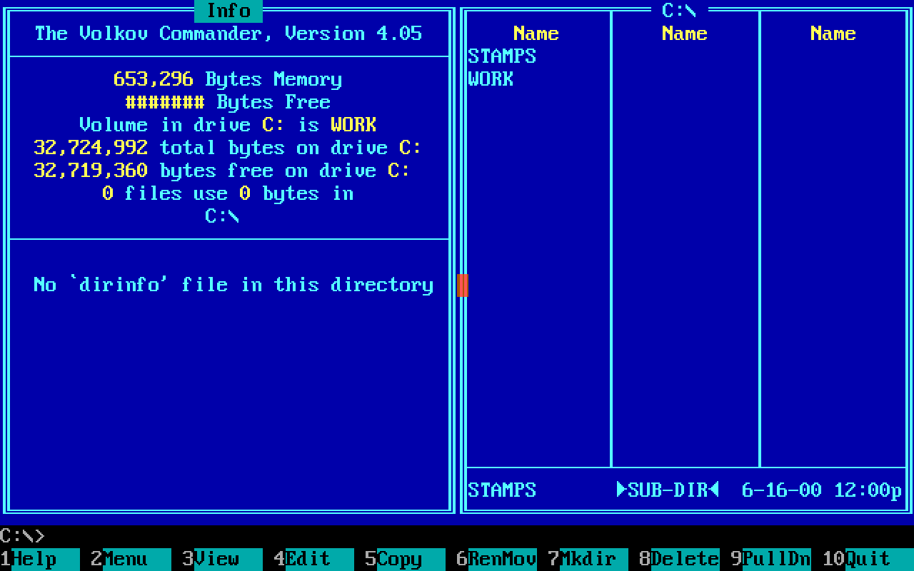
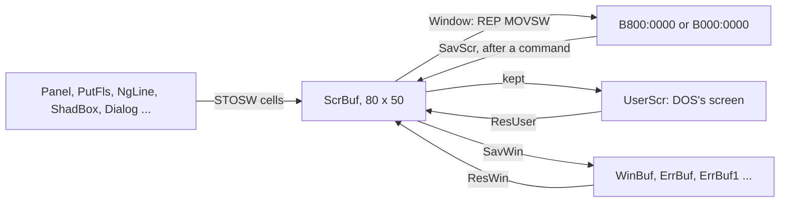
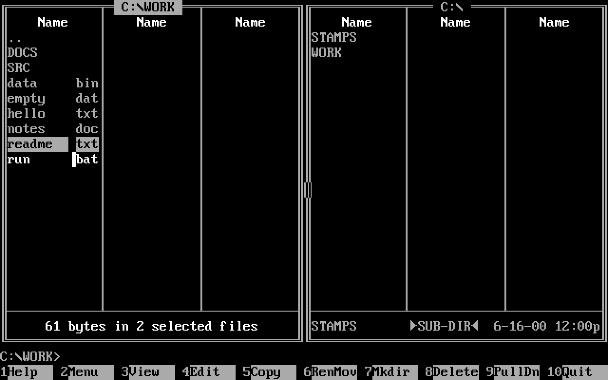
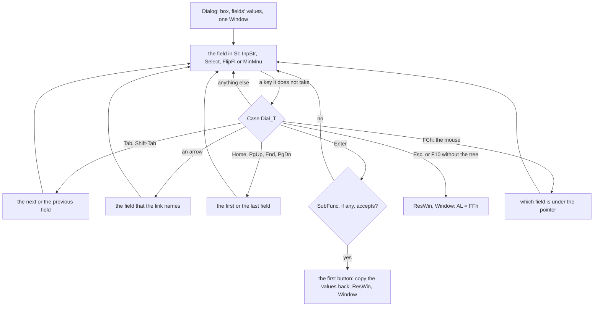
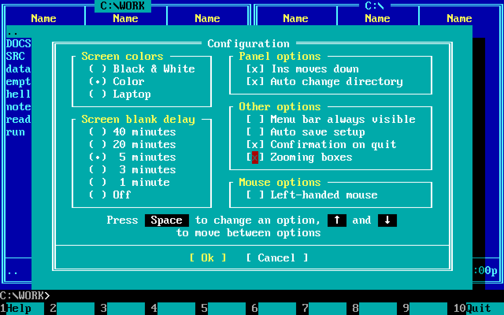
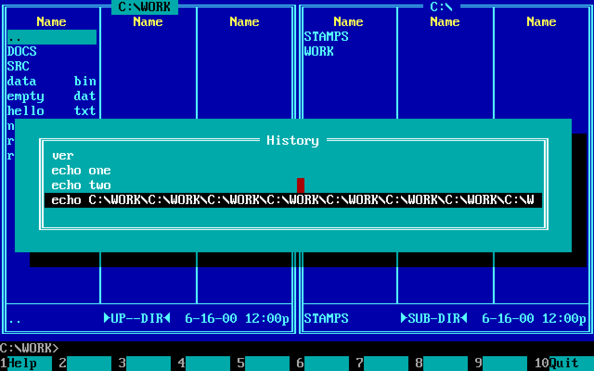
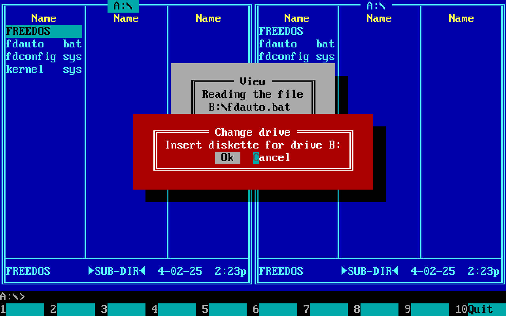
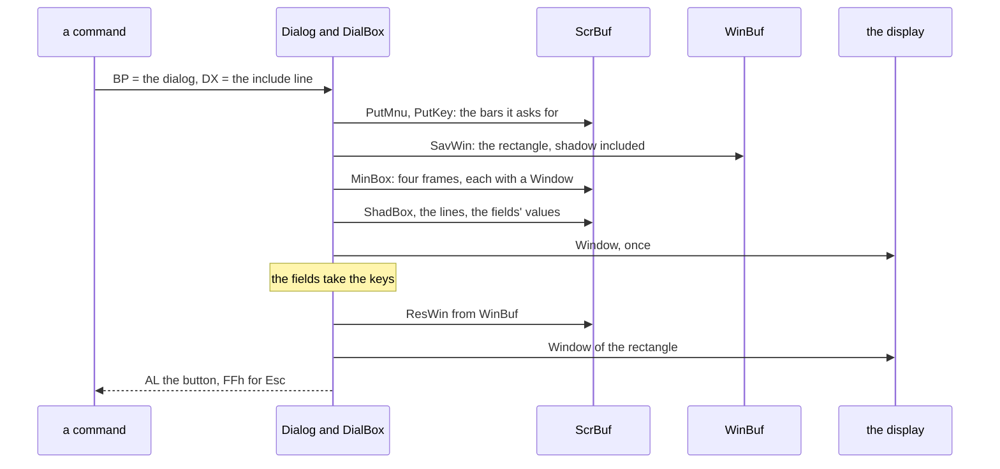
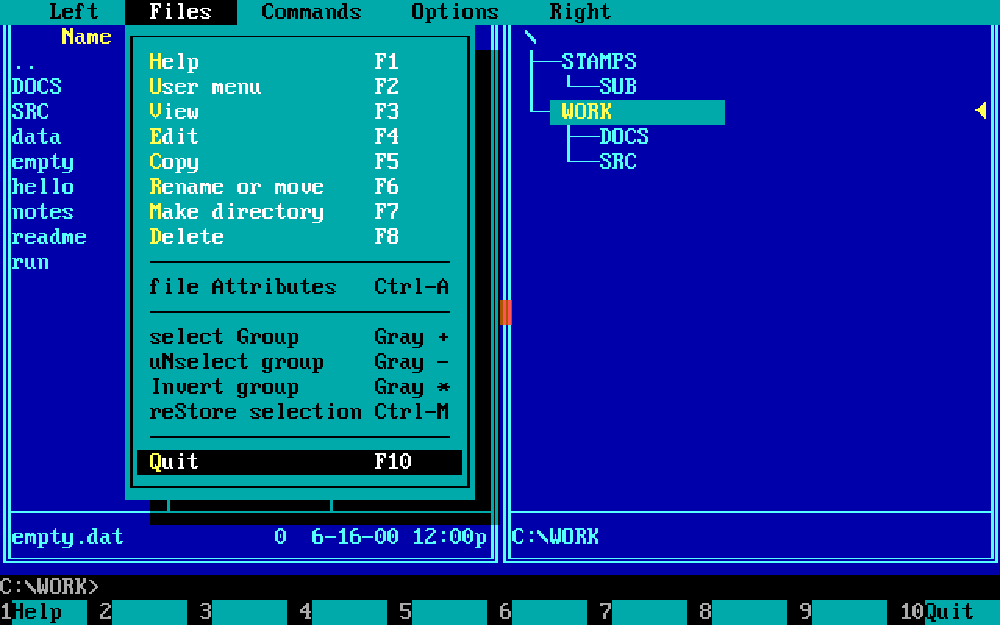

# 2. The screen: a text-mode toolkit in tables

Everything the user sees of Volkov Commander is 80 columns of
characters, 25 rows of them or up to 50, each cell a character byte
and a colour byte. On that grid the program draws double frames with
shadows, menus that drop down from a bar, dialogs with groups of
choices, ticks, input lines and buttons, a cursor bar over a list of
files, a row of function keys that changes with the shift keys, and
boxes that grow out of the middle of the screen. A modern toolkit
would have widget objects, a tree of windows, an event queue and a
damage list. This one has none of them. It has about forty routines,
3,550 bytes of them in `VCSUB1.INC` and `VCSUB2.INC`, which read
tables of bytes; one copy of the screen in memory; and three buffers
for what a box covers.

This chapter takes the toolkit apart in the order a box is built:
the characters it is made of, the shadow screen it is drawn into, the
frame and its shadow, the box as a table and the markup of its lines,
the dialog as a graph of fields and how the keys and the mouse move
between them, the input line, what a box saves and how deep boxes
nest, the growing box, the menus, the key bar and the panels. The last
section lists the economies, with their sizes.

[Chapter 1](01-the-program.md) has the skeleton that this runs on: the
main data where every buffer here lives, the main loop, and `Input`,
which every routine of this chapter calls to wait for a key. Where the
display is, how CGA snow is avoided and how the mouse driver is called
are [chapter 6](06-the-system.md#the-screen). The assembly is quoted
with its labels and Volkov's comments; a comment that starts with `;;`
is the book's. Sizes are those of the routines in the listing of the
shipped `VC.COM`.

## Pseudographics: frames out of a code page

### The characters

A text-mode frame is made of characters, and the characters are those
of the code page that the display adapter's font holds. Volkov wrote
for Russian DOS, whose code page is 866, and the program runs the same
on the American 437, because the box-drawing block, B0h to DFh, is the
same in both: [chapter 5](05-numbers-and-names.md#one-binary-for-cp437-and-cp866)
has the map of the two code pages and what the program asks DOS for
where they differ. Every frame in the program is drawn with bytes from
that block:

| Bytes | Characters | Used for |
|---|---|---|
| CDh BAh C9h BBh C8h BCh | `═ ║ ╔ ╗ ╚ ╝` | every box and both panels: the double frame |
| C4h B3h DAh BFh C0h D9h | `─ │ ┌ ┐ └ ┘` | the pull-down menus, the groups inside a dialog, the panel's columns |
| C7h B6h | `╟ ╢` | a single rule that meets a double frame: the rules of boxes, the panel's mini status |
| D1h CFh C1h | `╤ ╧ ┴` | where a panel's columns meet its frame or its mini status |
| C3h C0h | `├ └` | the branches of the tree |
| B0h DEh DBh | `░ ▐ █` | marks on a file name: hidden, selected, both |
| DCh DFh | `▄ ▀` | the borders of the editor's help line |

A few more come from below 20h, where the PC's font has pictures for
the control codes: 07h `•` for the chosen line of a group, 10h and 11h
`►◄` around `UP--DIR` and at the tree's current directory, 18h and 19h
`↑↓` in a dialog's hint. And FBh `√`, a tick, which is also the mouse
pointer over something clickable, is one of the few bytes above DFh
that the two code pages share.

Since the source is CP866 text, the assembly holds these characters
as themselves. A frame's corners are an immediate operand:

```asm
	MOV	BX,'╔╗'			;; BH = ╔ (C9h), BL = ╗ (BBh)
	MOV	AL,'═'			;; and what goes between them
	CALL	ShadLin
```

A word written as two characters in quotes has the first in its high
byte, so `'╔╗'` puts the left corner in BH and the right one in BL.
There is no table of frame pieces anywhere in the program: a frame is
a row of calls, each with the piece for the left end, the right end
and the middle in three byte registers, and the colour in AH. Counted
over the thirteen files of `VC.COM`, `╔`, `╗`, `╚` and `╝` occur twice
each: once in `ShadBox`, which draws every box, and once in `BoxDubl`,
which draws the panels.

### One row of a frame: `BoxLn0`

Every row of every frame comes out of 31 bytes:

```asm
;		│   ╟───────────────────────╢   │
;		 └┬┘|└──────────┬──────────┘|└┬┘
;		 CX BH         DX(AL)      BL CX
BoxLn0	PROC	NEAR			;; ES:DI the first cell, AH the colour
	PUSH	CX
	PUSH	AX
	PUSH	CX
	PUSH	AX
	JCXZ	BoxLn1
	MOV	AL,' '			;; CX cells of margin
	REP	STOSW
BoxLn1:	MOV	AL,BH			;; the left piece
	STOSW
	POP	AX
	MOV	CX,DX			;; DX cells of the middle piece
	REP	STOSW
	MOV	AL,BL			;; the right piece
	STOSW
	POP	CX
	JCXZ	BoxLn2
	MOV	AL,' '			;; and the margin again
	REP	STOSW
BoxLn2:	POP	AX
	POP	CX
	RET
BoxLn0	ENDP
```

The diagram is Volkov's own comment, drawn in the same characters.
`BoxLine` (10 bytes) calls it and steps DI down a row; `ShadLin` (16)
does the same and shades the two cells to the right; `BoxDubl` (34)
calls `BoxLine` for a top, SI middles and a bottom. A rule across a
box is the same call with `'╟╢'` and `'─'`, a panel's line above its
mini status too, and the menus' frames are a fourth caller with
`'┌┐'`. Each kind of frame costs the program a dozen bytes of calls.

### Joining lines: the panel's columns

A panel is a double frame with the column dividers of its list of
files laid over it. `Panel` (204 bytes) draws the frame with `BoxDubl`
over the whole panel, the header `Name` or `Name Size Date Time` in
the colour of titles, and the line over the mini status; then
`Panel8`, 21 bytes, writes one character into each column of a row,
at the places that a table of three or four bytes gives:

```asm
Brief_T	DB	13, 26, 0		;; brief: dividers at columns 13 and 26
Full_T	DB	13, 23, 32, 0		;; full: name, size, date, time

Panel8	PROC	NEAR			;; AX the character and colour, DS:SI a table
	PUSH	SI
	MOV	BH,0
Panel9:	MOV	BL,DS:[SI]		;; the next column
	ADD	BL,BL
	MOV	ES:[DI+BX],AX		;; one cell, written over the frame
	INC	SI
	CMP	BH,DS:[SI]		;; up to the table's 0
	JNE	Panel9
	ADD	DI,2*80			;; and the next row
	POP	SI
	RET
Panel8	ENDP
```

`Panel` calls it with `╤` on the top frame, with `│` once for every
row of the list, and at the bottom with `╧` on the bottom frame, or,
with the mini status on, with `┴` on the line `╟───╢` above it. The
junctions are not worked out: the frame is drawn whole and the
crossings are overwritten, a cell each.

```
 BoxDubl                  Panel8 with ╤, │ ... │, ┴     the result
 ╔════════════════════╗   ....╤.........╤.......        ╔═══╤═════════╤══════╗
 ║                    ║   ....│.........│.......        ║   │         │      ║
 ║                    ║   ....│.........│.......        ║   │         │      ║
 ╟────────────────────╢   ....┴.........┴.......        ╟───┴─────────┴──────╢
 ║                    ║                                 ║ mini status        ║
 ╚════════════════════╝                                 ╚════════════════════╝
```

The Info panel does it with rules alone, two `╟──╢` lines under its
title and under the figures, and the tree with one, above the line
that names the current directory.



*F9, L, I: the Info panel on the left, a double frame with two rules
`╟──╢`; on the right a panel of files, whose dividers `╤ │ ┴` are
written over its frame and its mini status line by `Panel8`.*

## The shadow screen: `ScrBuf`

### Drawing never touches the display

No routine of the program draws on the screen. They draw into
`ScrBuf`, 8,000 bytes of the main data, 80 x 50 cells in exactly the
layout of the adapter's memory, and one routine copies rectangles of
it out. A place on the screen is one word, the row in the high byte
and the column in the low byte, so that it fits one register and its
row and column are BH and BL, DH and DL, with no shift to take it
apart; a size is packed the same way. `BasAdr` makes an address of a
place:

```asm
BasAdr	PROC	NEAR			;; BH,BL: row, column
	PUSH	BX
	PUSH	AX
	MOV	AL,80
	MUL	BH			;; the row times 80
	MOV	BH,0
	ADD	AX,BX			;; and the column
	ADD	AX,AX			;; two bytes a cell
	ADD	AX,OFFSET ScrBuf
	MOV	DI,AX			;; DI: the cell, in ES
	POP	AX
	POP	BX
	RET
BasAdr	ENDP
```

20 bytes, called from almost everything that draws.

`Window`, 121 bytes, copies the rectangle of `ScrBuf` at BX, of size
DX, to the display, whose segment and offset the start has put in
`Screen`. A single row it copies cell by cell; a taller rectangle it
widens to whole rows, from column 0 to 79, so that the copy is one
block:

```asm
Window	PROC	NEAR			;; BX the place, DX the size
	...
	MOV	AL,0
	CALL	CurMous			;; the pointer off: the driver draws it
	PUSH	ES			;;  into the same memory
	POP	DS
	MOV	ES,DS:Screen.Segm
	CALL	BasAdr
	MOV	SI,DI
	SUB	DI,OFFSET ScrBuf
	ADD	DI,DS:Screen.Offs	;; the same cell on the screen
	MOV	AL,DS:Snow
	CMP	DH,1
	JE	Wind1			;; one row: cell by cell
	MOV	BH,0
	ADD	BX,BX
	SUB	SI,BX			;; several: from column 0, whole rows
	SUB	DI,BX
	PUSH	DI
	PUSH	DX
	CALL	MovScr
	...
Wind7:	MOV	AL,1
	CALL	CurMous			;; the pointer on again
```

`MovScr` (52 bytes) is the copy, `REP MOVSW`, in pieces of at most
seven rows. Widening to whole rows copies more than was asked, at
most 80 cells a row, and saves the code of a loop over rows with two
strides; the box that changed is a few rows tall, and `REP MOVSW` of a
few hundred words is cheap. `SavScr` is the copy the other way, the
display into `ScrBuf`, which the main loop makes after every command
to keep what DOS showed in `UserScr`; `ResUser` puts any rectangle of
that back, which is what switching the panels off with Ctrl-O does.



Three things follow from drawing off the screen.

**`ScrBuf` is always what the display shows**, so what a box will
cover is read from memory, not from the adapter: fast, and with no
snow on a CGA. Only three things are on the display and not in
`ScrBuf`: the mouse pointer, which the driver draws and `Window` hides
around every copy; the clock, whose six cells `Input0` keeps on its
own stack while it waits
([chapter 1](01-the-program.md#the-clock)); and the blanker's sky,
which goes through the BIOS so that `ScrBuf` keeps the real screen.

**Nothing half-drawn is ever seen.** A dialog writes its box, its
lines and the value of every field into `ScrBuf`, then calls `Window`
once.

**Nothing is redrawn for being uncovered.** The panels are drawn when
they change, and never because a box went away: the box gives back
the cells it took, and that is all.

### Colours by number

The program writes almost no attribute byte that it has not looked
up. Every colour it draws is a number from 0 to 39, an `EQU` of `VC.ASM`:
`Back_C` = 0 for the panels, `Cursr_C` = 1 for the cursor bar,
`MnuBr_C` = 11 for a hot letter in a menu, `Box_C` = 16 for an
ordinary box, `Err_C` = 31 for an error, up to `Sky2_C` = 37 for the
blanker's bright stars. `Color`, 9 bytes, turns the number into an
attribute through `ColAddr`:

```asm
ColAddr	PROC	NEAR			;; AH the colour's number
	PUSH	AX
	MOV	AL,6
	MUL	AH			;; six bytes for each colour
	MOV	DI,AX
	MOV	AL,ES:ColTyp		;; the palette: 0 B/W, 1 colour, 2 laptop
	CMP	AL,3
	JB	ColAd1
	MOV	AL,1
ColAd1:	CBW
	ADD	AX,AX			;; two bytes for each palette
	CMP	ES:ScrMod,7		;; and the second on a monochrome card
	JNE	ColAd2
	INC	AX
ColAd2:	ADD	DI,AX
	ADD	DI,ColTab
	POP	AX
	RET
ColAddr	ENDP
```

`ColTab` is the first 240 bytes of the main data and of `VC.INI`, 40
rows of six bytes, from the defaults of `Palets`:

```asm
;;		   B/W      colour   laptop
;;		 col mono  col mono col mono
Palets	DB	07h,07h,1Bh,07h,07h,07h	;  0 - Main windows
	DB	70h,70h,30h,70h,70h,70h	;  1 - Cursor
	...
	DB	70h,70h,3Fh,70h,70h,70h	; 10 - Menu box text
	DB	7Fh,70h,3Eh,70h,70h,70h	; 11 - Menu box high letters
	...
	DB	70h,70h,30h,70h,70h,70h	; 14 - Menu box dark lines
	DB	70h,70h,33h,70h,70h,70h	; 15 - Menu box dark lines '-'
	DB	07h,07h,70h,07h,07h,07h	; 16 - Function box
	...
	DB	02h,02h,01h,02h,00h,00h	; 38 - Shadow flag
	DB	02h,02h,02h,02h,02h,02h	; 39 - Blink / High background / None
```

Three palettes, each for a colour and a monochrome card, are one
table, and switching between them in the Configuration dialog is one
byte, `ColTyp`. The setup program edits the table as a grid
([chapter 7](07-the-setup.md)). Two rows are no colours: 38 says how a
shadow is made, below; and 39, "Blink / High background", no code of
either program names.

The laptop palette is grey on black and black on grey and nothing
else, for the LCD screens of 1991 that showed colours as shades or not
at all. Where a colour would have said something, the laptop palette
says it with a shape: the cell between a file's name and its
extension, where a dot would be, shows `░` for a hidden or system file
in every palette, and in the laptop palette also `▐` for a selected
file and `█` for one that is both (`PutName`, 72 bytes, and `SetCur`).
The cursor of an input line is a block there, not an underline.



*The laptop palette: `readme.txt` is hidden and selected, `█`;
`run.bat` is selected, `▐`; the cursor bar, on `readme.txt`, is
black on grey.*

### The cursor

The text cursor is the BIOS's, set by `Cursor` (17 bytes) with INT 10h
AH 2. It is never switched off: `HidCur`, 9 bytes, moves it to row
127, which no screen has. `ChgCur` sets the shape for a dialog, an
underline (0607h, or 0B0Ch on a monochrome card) or a full block on
the laptop palette, and hands back the old shape, which `Dialog`
restores when it returns.

## A box, and its shadow

### `ShadBox`: margin, frame, shadow

A box of the program is more than its frame. Around the double frame
is a margin of three cells to the left and the right and one row
above and below, in the box's colour, and to the right of that and
below it a shadow. `ShadBox`, 90 bytes, draws all of it from a place
and a size:

```asm
ShadBox	PROC	NEAR			;; BX the place, DX the size, AH the colour
	...
	CALL	BasAdr
	MOV	CL,DH
	MOV	CH,0
	MOV	SI,CX			;; SI: the rows
	SUB	DL,10			;; the middle: the width less margins,
	MOV	DH,0			;;  frame and shadow
	MOV	CL,3			;; three cells of margin each side
	MOV	BX,'  '
	MOV	AL,' '
	CALL	BoxLine			;; the top margin: no shadow on it
	MOV	BX,'╔╗'
	MOV	AL,'═'
	CALL	ShadLin
	SUB	SI,5
	JBE	ShdBx2
	MOV	BX,'║║'
	MOV	AL,' '
ShdBx1:	CALL	ShadLin			;; the inside, two cells of shadow each
	DEC	SI
	JNE	ShdBx1
ShdBx2:	MOV	BX,'╚╝'
	MOV	AL,'═'
	CALL	ShadLin
	MOV	BX,'  '
	MOV	AL,' '
	CALL	ShadLin			;; the bottom margin
	ADD	DI,2*2			;; the last row: two cells in,
	MOV	CX,DX
	ADD	CL,8
ShdBx3:	CALL	Shadow			;;  and shaded to the end
	LOOP	ShdBx3
	...
ShadBox	ENDP
```

```
 col  0  1  2  3                          W-5 W-4 W-3 W-2 W-1
 row 0   .  .  .  .  .  .  .  .  .  .  .  .  .  .  .            margin, in the box's colour
     1   .  .  .  ╔  ═  ═  ═ Title  ═  ═  ╗  .  .  .  ▒  ▒      the title over the frame
     2   .  .  .  ║     a line of text    ║  .  .  .  ▒  ▒
     3   .  .  .  ╟  ─  ─  ─  ─  ─  ─  ─  ╢  .  .  .  ▒  ▒      a line of 0 in the table
     4   .  .  .  ║        Yes   No       ║  .  .  .  ▒  ▒
     5   .  .  .  ╚  ═  ═  ═  ═  ═  ═  ═  ╝  .  .  .  ▒  ▒
     6   .  .  .  .  .  .  .  .  .  .  .  .  .  .  .  ▒  ▒
     7         ▒  ▒  ▒  ▒  ▒  ▒  ▒  ▒  ▒  ▒  ▒  ▒  ▒  ▒  ▒      shadow: one row down, two columns right
```

So a box with lines of n cells at the widest is n + 12 cells wide: one
space inside the frame on each side, the frame, three cells of margin,
and two of shadow. With L lines, the title counted, it is L + 4 rows.
`DialBox` adds exactly that, `ADD DX,40Ch`, to what `LnStr` measured.

### `Shadow`: an attribute, not a colour

A shadow does not paint cells; it changes the colour byte of the cell
that is already there and keeps the character, so the panel shows
through it. `Shadow`, 28 bytes, does one cell, and row 38 of
`ColTab`, `ShadFl`, says how:

```asm
Shadow	PROC	NEAR			;; ES:DI a cell
	PUSH	AX
	INC	DI			;; its colour byte
	MOV	AH,ShadFl
	CALL	Color			;; this palette's kind of shadow
	MOV	AL,ES:[DI]
	CMP	AH,1
	JB	Shadw1			;; 0: no shadow, the colour as it is
	PUSHF
	AND	AL,8Fh			;; keep blink and the foreground,
	XOR	AL,8			;;  black behind, intensity flipped
	POPF
	JE	Shadw1			;; 1: that
	MOV	AL,7			;; 2 and up: grey on black
Shadw1:	STOSB
	POP	AX
	RET
Shadow	ENDP
```

The colour palette has kind 1, black and white has 2, and the laptop
has 0, no shadow, since grey on black would be lost on its screen. Kind
1 makes the background black and flips the intensity bit: the panel's
bright cyan on blue, 1Bh, becomes cyan on black, 03h, and its yellow
1Eh becomes brown, 06h, so what is under a shadow looks dimmed. But
the flip is an `XOR`, so text that was dim gets brighter: a shadow
over DOS's grey on black, 07h, makes it white, 0Fh. The pull-down
menu over a screen with the panels off shows it.

```
 under the shadow     1Bh ║ on blue      1Eh Name     07h DOS's text     30h a menu
 kind 1 makes         03h ║ dim cyan     06h brown    0Fh bright white   08h dark grey
```


*F10: `Quit_B`. The box of `Quit_P` saved what it covers in `WinBuf`;
the margin of three cells and a row is the box's colour, the frame is
inside it, and the shadow, a row down and two cells to the right, is
the panels' own characters in cyan on black. The `^I` of both lines is
`Name_S`.*

### The growing box: `MinBox`

With "Zooming boxes" on, as distributed, a box does not appear; it
grows out of the middle of where it will be, in five frames.
`MinBox`, 96 bytes, does it before it draws the box for good:

```asm
Diskret	EQU	5
MinBox	PROC	NEAR			;; BX the place, DX the size, AH the colour
	...
	CMP	AL,ES:ZoomWin
	JZ	MinBx2			;; no zooming: just the box
	PUSH	AX
	MOV	AH,ShadFl
	CALL	ColAddr
	POP	AX
	XCHG	AL,ES:[DI]		;; the shadow's kind made 0 for a while
	PUSH	DI
	PUSH	AX
	XOR	DI,DI
	CALL	MinBx3			;; wait for a tick of the timer
	MOV	CX,Diskret-1		;; four frames
MinBx1:	...
	MOV	CH,11
	CALL	MinBx5			;; the width, from 11 cells up
	...
	MOV	CH,5
	CALL	MinBx5			;; the height, from 5 rows up
	...
	CALL	ShadBox			;; the frame at this size,
	CALL	MinBx3			;;  a tick later
	CALL	Window			;;  on the screen
	...
	LOOP	MinBx1
	CALL	MinBx3
	POP	AX
	POP	DI
	MOV	ES:[DI],AL		;; the shadow's kind back
MinBx2:	CALL	ShadBox			;; and the box, into ScrBuf only
	...
MinBox	ENDP
```

`MinBx5`, 21 bytes, works out a frame's size and place from the
final's: at step k, from 4 down to 1, it takes `(size - least) / 2 *
k / 4` off each side, so the first frame is 11 cells by 5 rows and
each later one is a quarter of the way nearer the final. `MinBx3` waits
for the BIOS's count of timer ticks to change, so each frame is on the
screen for one tick, 55 ms, and the whole growth is five ticks, some
0.27 seconds, on any machine.

```
 k=4            k=3                 k=2                    final
                                 ╔═══════════════╗      ╔═══════════════════╗
     ╔═══╗     ╔═════════╗       ║               ║      ║                   ║
     ╚═══╝     ╚═════════╝       ╚═══════════════╝      ║                   ║
                                                        ╚═══════════════════╝
```

Nothing erases a frame: each is larger than the one before on every
side and is drawn over it, and the final box covers all of them. What
is left is the shadow, and that is what the `XCHG` is for. The frames
are drawn with the shadow's kind made 0, so `Shadow` writes each cell's
colour back as it found it. The cells where the final box will put
its shadow, two columns at its right and a row at its bottom, lie in
a frame's own shadow or outside it, never under its margin or frame,
so when the final `ShadBox` darkens them they still hold what was
under the box. The effect costs 134 bytes, `MinBox`, `MinBx3` and
`MinBx5`, and no buffer.

A box that comes back again and again, the progress of a copy for each
file, would grow each time. `OncZoom`, 37 bytes, lets it grow the
first time only, and the copy uses it.

## A box is a table: `DialBox` and `NgLine`

### The table of a box

A box is a table in `_DATA`. The F10 box:

```asm
	.CONST
Name_S	DB	PrgName,0		;; 'Volkov Commander'
Quit1_S	DB	' The ^I ',0
Quit2_S	DB	'Do you want to quit the ^I?',0
YesNo_S	DB	'Yes',0FFh,3,'No',0

	.DATA
Quit_P	DB	Box_C, BoxCu_C, BoxCu_C, 0	;; four colours for ^N ^R ^B ^U
	DB	3, 0			;; three lines, no variable texts
	DW	OFFSET WinBuf		;; where what it covers goes
	DW	OFFSET Quit1_S		;; the title, on the frame
	DW	OFFSET Quit2_S
	DW	OFFSET YesNo_S
```

```
 a box (_P)                          for each of 0 to 2 variable texts
 +0  DB  4 colours                   +0  DW  where the text is (DS:)
 +4  DB  number of lines             +2  DB  how: 4 trim, 2 a path,
 +5  DB  number of variable texts            1 the drive letter too
 +6  DW  save buffer, in ES                   (NormStr, PathLin, LetLin)
 +8  ... the variable texts          +3  DB  the most cells, cut in
 ... DW  a line each: the first is           front (ShrtLin)
         the title, 0 is a rule
```

`DialBox`, 210 bytes, does all of it:

1. copies the variable texts into `TmpErr` at +1 and +101, 81 bytes
   each, and makes them fit: a path made proper and cut to the most
   cells the table allows, a drive letter put in front (`DiBx30`, 47
   bytes);
2. finds the widest line with `LnStr`, adds `40Ch` for the margins, the
   frame and the shadow, and the number of lines and four to the rows;
3. centres the box on the place it is given, and moves it down by half
   the extra rows on a screen of more than 25 (`SftEGA`, 15 bytes);
4. saves what it will cover, `SavWin`, into the buffer the table names;
5. draws the frame and the shadow, growing it first (`MinBox`);
6. writes each line centred on its row with `CntLine` (22 bytes), the
   first on the top frame as its title; a line of 0 becomes a rule,
   `BoxLine` with `'╟╢'` and `'─'`, joined to the frame.

A title is an ordinary line that happens to be written over the row of
`═`; its spaces, `' The ^I '`, are what open the gap in the frame.

### `NgLine`: one markup for every text

Every text that the program shows in a box, a menu bar, a status line
or the help goes through one routine, `NgLine`, 204 bytes, in a markup
like that of Norton Guides:

| In the text | It does |
|---|---|
| `^N` `^R` `^B` `^U` | normal, reversed, bold, underlined: the 1st to 4th colour of the line's table; the same twice is back to normal |
| `^V`, `^W` | put in the text at `TmpErr+1`, `TmpErr+101` |
| `^I` | put in the "include line" that the caller passes in DX |
| `^Cxx` | colour xx, in hex |
| `^Axx` | character xx, in hex |
| `^^` | a caret |
| `FFh, n` | n spaces |
| `FFh, 80h+n, c` | n copies of the character c |

The colours are not in the text but in the box's table, so one text
can be drawn in an error's colours or a dialog's. `NgLine` keeps the
current one in BH and turns a mark into an index:

```asm
NgLn14:	MOV	CL,0
	CMP	AL,'N'
	JE	NgLn15
	MOV	CL,1
	CMP	AL,'R'
	JE	NgLn15
	MOV	CL,2
	CMP	AL,'B'
	JE	NgLn15
	MOV	CL,3
	CMP	AL,'U'
	JNE	NgLn17
NgLn15:	CMP	CL,BH			;; the mark that is on already?
	JNE	NgLn16
	MOV	CL,0			;;  then it goes off
NgLn16:	MOV	CH,0
	PUSH	BP
	ADD	BP,CX
	MOV	AH,CS:[BP]		;; the colour from the table
	POP	BP
	MOV	BH,CL
	JMP	NgLn01			;; Color, and on
```

The runs are the commonest mark, and the frames inside boxes are made
of them. "Yes" and "No" three spaces apart are

```asm
YesNo_S	DB	'Yes',0FFh,3,'No',0
```

and the group "Screen colors" in the Configuration dialog is a line
that draws its own frame:

```asm
Cnf01_S	DB	' ┌ ^bScreen colors^b ',0FFh,80h+6,'─┐  ┌ ^bPanel options^b ',0FFh,80h+16,'─┐ ',0
```

Twenty-two `─` there cost six bytes. The group boxes of the dialogs
are no fields and no objects: they are text in the box's lines, and
`^b` makes their titles bright.

`LnStr`, 112 bytes, counts the cells a line will take with the same
markup, so that a box can be as wide as its longest line. It counts a
run with a carry trick: it reads the two bytes behind the FFh as one
word, adds n - 1 and the inverted bit 7 shifted out into the carry,
and leaves a run's character to the next round of its loop, which
counts it as an ordinary one.

```asm
LnStr2:	MOV	AL,AH			;; AH: the byte behind FFh
	AND	AL,7Fh			;; n
	DEC	AX
	SHL	AH,1			;; bit 7 into the carry
	CMC				;; 1 if it was a run of spaces
	ADC	BL,AL			;; n - 1, + 1 for spaces
	JMP	LnStr0			;; a run's character counts itself
```

`NgLine` and `LnStr` disagree in one place, code against code: `LnStr`
counts `^Cxx` as a cell and `^Axx` as none, where `NgLine` changes the
colour for `^C` and writes a character for `^A`. A line that used
either would be measured one cell wrong; none of the program's own
texts uses either, so it never shows.

### `^I`: one text for many lines

The include line is the box's parameter: what the caller hands in DX
replaces every `^I` of every line. The F10 box names the program twice
from one string, `Name_S`. The Configuration dialog uses it the other
way round, to share the drawing of a check box between seven lines.
Its caller hands it

```asm
Chk1_S	DB	'  '			;; no zero: runs on into Chk2_S
Chk2_S	DB	'│  [ ] ',0
```

and seven lines of the box have `^I` where a check box begins:

```asm
Cnf02_S	DB	' │  ( ) Black & White  │^IIns moves down',0FFh,11,'│ ',0
Cnf03_S	DB	' │  ( ) Color',0FFh,10,'│^IAuto change directory',0FFh,4,'│ ',0
```

Each `^I` becomes `  │  [ ] `, the gap between two groups, the left
side of the second group's frame and the empty box: nine cells from
ten bytes, seven times.

## A dialog is a graph of fields: `Dialog`

### The header and the fields

A dialog is a box with fields that take keys. Its table is a `BOXHD`,
10 bytes, and a `BOXMN` of 11 bytes for each field, ended by a zero:

```asm
BOXHD	STRUC				;; 10 bytes
  pDiBox  DW	?			; Pointer to DialBox structure
  BoxBase DW	?			; The dialog box begin-center
  SubFunc DW	?			; Subfunction
  bKeyBar DB	?			; KeyBar
  bMenu   DB	0FFh			; PutMnu
  bHelp   DB	0			; HlpPage
  bFlags  DB	0			; Flags
BOXHD	ENDS

BOXMN	STRUC				;; 11 bytes
  mType	  DB	?			; Menu type
  mUp	  DB	0			; Up link
  mDown	  DB	0			; Down link
  mLeft	  DB	0			; Left link
  mRight  DB	0			; Right link
  mBase	  DW	?			; Menu base
  mPoint  DW	?
  mCtrl	  DW	?
BOXMN	ENDS
mSelTot	=	BYTE PTR mCtrl
```

The header names the box, the place of its centre, a routine to call
on Enter, the key bar to show, the item of the menu bar to light, the
page of the help that F1 opens, and five flags: empty the keyboard
first (bit 0), beep (bit 1), move the box down by `SftErr` (bit 2), F10
and Alt-F10 for the tree (bit 3), and draw no box, for a box that is on
the screen already (bit 4). `bMenu` does a little more than light an
item: with 1, the Left menu, and the current panel on the right,
`Dialog` lights Right instead and moves the box 40 columns over, so
that a dialog about a panel opens over that panel.

A field's `mType` is one of four kinds. `mBase` is its place inside the
box, `mPoint` where its value is in the main data, and `mCtrl` says
the rest:

| `mType` | Kind | Routine | `mPoint` | `mCtrl` |
|---|---|---|---|---|
| 1 | input line | `InpStr`, 165 bytes | the text | its length; bit 8: the second line's buffer; bit 9: make it a proper path on Enter |
| 2 | group of choices | `Select`, 176 bytes | two bytes: the choice and the cursor | the number of choices, `mSelTot` |
| 3 | tick | `FlipFl`, 100 bytes | a byte of the dialog's own | the byte of the main data it stands for |
| 4 | row of buttons | `MinMnu`, 53 bytes, with `MnMn10`, 262 | the button chosen | a table of the buttons |

The quit dialog is 22 bytes, its buttons 5:

```asm
YesNo_D	DB	5, 0			;; a button 5 cells wide at column 0
	DB	4, 6			;;  and one of 4 at column 6
	DB	0
Quit_B	BOXHD	< Quit_P, 528h, 0, 1, 2, 26, 0 >
	;; the box above; its top centred at row 5, column 40; no routine;
	;; key bar 1; the Files menu lit; help page 26; no flags
	BOXMN	< 4, 0,0,0,0, 323h, TmpBuf, YesNo_D>
	;; buttons, no links, row 3 column 23; the answer into
	;; TmpBuf; the buttons YesNo_D
	DB	0

	.CODE
F30_00:	CMP	ES:QuitAck,0		; F10 - quit
	JZ	F30_01
	MOV	DX,OFFSET Name_S	;; what ^I stands for
	MOV	BP,OFFSET Quit_B
	CALL	Dialog
	JE	F30_01			;; Yes
	JMP	Func04
F30_01:	JMP	Exit
```

The command is 25 bytes, and the whole of F10 with its texts and
tables about a hundred. Counted over the source, `VC.COM` has 57
dialogs, called from 65 places, and their fields are 45 rows of
buttons, 15 input lines, 15 ticks and 2 groups of choices.

The fields draw nothing of their own but their value. A button is a
word of the box's text, "Yes" or `[ Ok ]`, and its table says only
where it is and how wide; the focus on it is the cells recoloured. A
tick is `[ ]` in the text, and `FlipFl` writes an `x` into the cell
between the brackets. A group's choices are lines of the text with
`( )`, and `Select` writes `•` into one of them. An input line is an
empty row of the box, `Empty_S`, made wide enough by spaces in the
line above. The box is laid out by its text; the fields are placed on
top of it by their `mBase`.

### Walking the table

`Dialog`, 1,006 bytes, goes through the fields twice. First it fills
each with its value: copies an input line's text into a buffer of its
own, puts the `•` and the `x` into `ScrBuf`, colours the buttons; and
only then `Window`. Then it hands the keyboard to one field at a time:

```asm
Dial31:	PUSH	BP			;; SI: the field that has the focus
	PUSH	SI
	PUSH	BX
	MOV	AH,BL
	ADD	BX,CS:[SI].mBase	;; its place on the screen
	MOV	DI,BP
	MOV	BP,CS:[BP].pDiBox
	MOV	AL,CS:[SI].mType
	CMP	AL,1			; InpStr
	JNE	Dial33
	...
	CALL	InpStr			;; edit until a key it does not take
	...
Dial33:	CMP	AL,2			; Select
	JNE	Dial34
	...
	CALL	Select
	...
Dial37:	POP	BX			; Exit
	POP	DI			;; DI: the field, for the links
	POP	BP
	CMP	AH,0FCh
	JE	Dial40			;; a button of the mouse
	MOV	SI,OFFSET Dial_T
	CALL	Case			;; Tab, the arrows, Enter, Esc ...
	JMP	Dial39			;; any other key: back to the field
```

This is the whole of the event handling. Each kind of field is a loop
of its own that calls `Input` and keeps every key it can use; the
first key it cannot use, it returns. `Dialog` looks that key up in
`Dial_T`, 14 entries, with `Case`
([chapter 1](01-the-program.md#func12-and-case-a-key-table-walked-by-37-bytes)),
and what it finds moves the focus or ends the dialog. There is no
event object and no dispatch to a focused widget: the field with the
focus is the one whose routine is running, and its address is in DI.



### Focus: four links a field

Tab and Shift-Tab take the next and the previous field of the table,
round from the end to the start. The arrows go by the links: each
field names, by its number in the table, the field that Up, Down,
Left and Right go to. The two high bits of a link say where in a group
of choices to land:

```asm
Dial60:	MOV	AL,CS:[DI].mUp		; Up
	JMP	Dial65
Dial61:	MOV	AL,CS:[DI].mDown	; Down
	JMP	Dial65
	...
Dial64:	MOV	AL,80h			; Home, PgUp: field 0, at its top
Dial65:	PUSH	AX
	AND	AL,3Fh			;; the field's number
	MOV	AH,SIZE BoxMn
	MUL	AH
	LEA	SI,[BP]+SIZE BoxHd
	ADD	SI,AX			;; its entry
	POP	AX
	CMP	CS:[SI].mType,2		;; a group of choices?
	JNE	Dial67
	TEST	AL,80h			;; bit 7: put its cursor
	JZ	Dial67
	TEST	AL,40h
	MOV	AL,0			;;  on the first line,
	JZ	Dial66
	MOV	AL,CS:[SI].mSelTot	;;  or with bit 6 on the last
	DEC	AX
Dial66:	MOV	DI,CS:[SI].mPoint
	MOV	ES:[DI+1],AL
Dial67:	JMP	Dial31
```

So a dialog of several groups side by side is a graph in four bytes a
field, and moving into a group from below lands on its last line,
from above on its first. The Configuration dialog, F9 O Enter, has
ten fields:

```asm
Conf_B	BOXHD	< Conf_P, 228h, 0, 1, 4, 40, 0 >
	BOXMN	<2, 9,81h, 0, 2,  30Ah, TmpBuf   , 3 >	   ; Screen colors
	BOXMN	<2,0C0h,9, 1, 4,  80Ah, TmpBuf+2 , 6 >	   ; Screen blank delay
	BOXMN	<3, 9, 3,80h, 2,  323h, TmpBuf+4 , InsDwn> ; Ins moves down
	BOXMN	<3, 2, 4,80h, 3,  423h, TmpBuf+5 , AutoCD> ; Auto change dir
	BOXMN	<3, 3, 5,81h, 4,  723h, TmpBuf+6 , MenuVs> ; Menu bar visible
	BOXMN	<3, 4, 6,81h, 5,  823h, TmpBuf+7 , AutoSav>; Auto save setup
	BOXMN	<3, 5, 7,81h, 6,  923h, TmpBuf+8 , QuitAck>; Confirmation on quit
	BOXMN	<3, 6, 8,81h, 7, 0A23h, TmpBuf+9 , ZoomWin>; Zooming boxes
	BOXMN	<3, 7, 9,81h, 8, 0D23h, TmpBuf+10, LftMous>; Left-handed mouse
	BOXMN	<4, 8,80h, 9, 9, 121Eh, TmpBuf+11, OkCn_D> ; Ok / Cancel
	DB	0
```

```
 ┌ 0 Screen colors ┐   ┌ Panel options ───────┐
 │ ( ) B&W   top ──┼─→ │ 2 [ ] Ins moves down │   Left from 2..8: field 0 or 1,
 │ ( ) Color       │   │ 3 [ ] Auto change    │   at the first line (80h, 81h)
 │ ( ) Laptop      │   └──────────────────────┘
 └───────┬─────────┘   ┌ Other options ───────┐   Down from 0: 81h, field 1 at its top
 ┌ 1 Screen blank ─┐   │ 4 [ ] Menu bar       │   Up from 1: C0h, field 0 at its bottom
 │ ( ) 40 minutes  │   │ ...                  │
 │ ...             │   │ 7 [ ] Zooming boxes  │   Up from 0 and 2: field 9, the buttons
 │ ( ) Off   bottom│   └──────────────────────┘   Down from 9: 80h, field 0 at its top
 └─────────────────┘   ┌ Mouse options ───────┐
                       │ 8 [ ] Left-handed    │
                       └──────────────────────┘
                 9  [ Ok ]   [ Cancel ]
```

A field gives an arrow back only when it has no use for it itself.
`Select` keeps Up and Down while its cursor can move within the group
and returns Up only from the first line, Down only from the last; an
input line returns Left only with its cursor at the start. So the
arrows move inside a group and then across, with no code that knows
about groups.



*F9, O, Enter: `Conf_B`. The group frames, the `( )` and the `[ ]` are
the box's text; `Select` has written the `•` and `FlipFl` the `x`. The
red cell is the mouse pointer.*

Home and PgUp go to the first field, End and PgDn to the last; End on
a row of buttons also picks its first. Enter calls `SubFunc`, if the
header names one, which may refuse with the carry flag and leave the
focus where it is: in the dialog of attributes it is `M30_60`, which
reads the date and the time typed in. Then the dialog ends. Its answer
is in AL, the button chosen, 0 for the first, and FFh for Esc, and the
flags are set by `CMP AL,0`, so a caller's `JE` is "the first button".

### Cancel for nothing

A dialog does not change anything until it is accepted. An input line
is edited in a copy, in `DosBuf` behind the command line; a tick
flips a byte that `Dialog` copied from the main data, `mPoint` from
`mCtrl`, when it began. Only Enter on the first button copies them
back:

```asm
Dial72:	CMP	AL,0			;; the first button?
	JNE	Dial82			;;  no: leave everything as it was
	LEA	SI,[BP]+SIZE BoxHd
Dial73:	MOV	AL,CS:[SI].mType
	CMP	AL,0
	JE	Dial82
	...
	CMP	AL,1			;; an input line: its copy back,
	...
	REP	MOVSB
	...
Dial76:	CMP	AL,3			;; a tick: its byte back
	JNE	Dial77
	MOV	DI,CS:[SI].mPoint
	MOV	SI,CS:[SI].mCtrl
	MOV	AL,ES:[DI]
	MOV	DS:[SI],AL
```

Esc and every other button need no code to undo anything. The groups
of choices answer in `TmpBuf`, and the command that called the dialog
reads them only if it was accepted, as `M60_00` reads the palette and
the delay of the blanker.

### Hot letters, found on the screen

A row of buttons takes a letter: "Y" answers Yes, "C" Cancel. No table
says which letter belongs to which button. `MnMn10` takes the letter
in capitals and looks for it in the cells of each button, on the
screen:

```asm
MnMn19:	MOV	SI,OFFSET MnMn_T	;; Left, Right, Home, End ...
	CALL	Case
	CALL	UpCase
	CMP	AL,'A'
	JB	MnMn23
	CMP	AL,'Z'
	JA	MnMn23			;; not a letter: hand it back
	MOV	SI,DI			;; the table of the buttons
MnMn20:	CMP	BYTE PTR CS:[SI],0
	JE	MnMn16
	PUSH	DI
	PUSH	CX
	MOV	CX,CS:[SI]		;; CL the width, CH the column
	PUSH	BX
	ADD	BL,CH
	CALL	BasAdr			;; the button's first cell in ScrBuf
	POP	BX
	MOV	CH,0
	DEC	DI
MnMn21:	INC	DI			;; step over the colour byte
	SCASB				;; the letter?
	LOOPNE	MnMn21
	POP	CX
	POP	DI
	JE	MnMn22
	INC	SI
	INC	SI
	JMP	MnMn20			;; the next button
MnMn22:	MOV	CX,SI
	SUB	CX,DI
	SHR	CX,1			;; its number
	MOV	AX,1C0Dh		;;  and Enter
```

A letter chooses the first button whose text, as drawn, holds it as a
capital, and is answered as Enter on it. So any button gets a hot key
by being labelled, and a button gets none by having no capital that an
earlier button lacks: in the copy's `[ Copy ]   [ F10-Tree ]   [
Cancel ]`, C is Copy.

### The mouse: hit-testing by reading the screen

A press of a button comes to `Dialog` as the key FCxxh. It then walks
the fields and asks of each whether the pointer is in it, with
`InWind`, 23 bytes, a test of a cell against a place and a size. The
place of a field is its `mBase`; the size of an input line is its
length, and of a row of buttons the end of its last button
(`MnMn60`). A group of choices and a tick have no width in their
tables, and `Slct20`, 27 bytes, finds it on the screen:

```asm
Slct20	PROC	NEAR			;; BX the field's place
	PUSH	DI
	MOV	DL,0
	CALL	BasAdr
Slct21:	CMP	BYTE PTR ES:[DI],' '
	JNE	Slct22
	CMP	BYTE PTR ES:[DI+2],' '	;; two spaces in a row:
	JE	Slct23			;;  the label has ended
Slct22:	INC	DI
	INC	DI
	INC	DL			;; DL: the width so far
	JNE	Slct21
Slct23:	POP	DI
	RET
Slct20	ENDP
```

The field is as wide as its first line reads, up to two spaces, and a
group as tall as its number of choices. The label of a field, which no
table holds, is its hit box.

What the buttons of the mouse do in a dialog, `Dial40` to `Dial53`:
the left button on a field gives it the focus, and the field's own
routine then takes the same press, to place the cursor in a line, pick
a choice, flip a tick or press a button; the left button outside the
box is Esc. The right button is Enter wherever it is let go, and the
middle one Esc; while either is held, the pointer is the character
that says so, `√` or `x`
([chapter 6](06-the-system.md#the-mouse-eight-calls-of-int-33h)).

## Input lines

### `InpStr` and `EdLin`

An input line of a dialog and the command line under the panels are
edited by the same 184 bytes, `EdLin`, with the same keys:

```asm
EdKeys	DW	0013h, E01_00		; ^S
	DW	4B00h, E01_00		; Left
	DW	0004h, E02_00		; ^D
	DW	4D00h, E02_00		; Right
	DW	0001h, E03_00		; ^A
	DW	7300h, E03_00		; ^Left
	...
	DW	0019h, E09_00		; ^Y
	DW	000Bh, E10_00		; ^K
	DW	0017h, E11_00		; ^W
	DW	007Fh, E11_00		; ^BackSpace
	DW	0014h, E12_00		; ^T
	DW	0011h, E13_00		; ^Q
	DW	0
```

WordStar's control keys and the PC's arrows side by side, 21 keys in
86 bytes, a word left and right being what `CmpSym` (17 bytes) says
separates words: a space and `+:.,><|\` and Tab. There is no overwrite
mode: a character is inserted, the rest shifted right with one `STD`
`REP MOVSB`, and a beep when the line is full. Ctrl-Q quotes the next
key, so that a control character can be typed.

`InpStr`, 165 bytes, wraps `EdLin` for a dialog. A dialog's line is
edited in one of two buffers behind the command line in `DosBuf`, at
+134 and +234, each with three bytes in front of the text: the cursor,
and a byte that says whether the line has been touched. The first key
on a line that has not been touched decides what it is: an editing key
keeps the text that was offered, and a character replaces it, as a
selected text is replaced in a modern field.

```asm
InSt02:	CMP	BYTE PTR ES:[BP-1],0	;; touched yet?
	JNE	InSt04
	MOV	BYTE PTR ES:[BP-1],1	;;  now it is
	...
	CMP	AL,' '
	JB	InSt04			;; a control key: keep the text
	CMP	AL,7Fh
	JE	InSt04
InSt03:	MOV	BYTE PTR ES:[BP],0	;; a character: the text goes
InSt04:	MOV	SI,BP
	XCHG	DI,DX
	CALL	EdLin
```

A dialog's line does not scroll: the field is as wide as the longest
text it takes, 64 cells for a path. `InSt10`, 37 bytes, draws it,
padded with spaces in the colour of the cursor of the box. A click in
it puts the cursor under the pointer, or at the end of the text.

### The history

The command line has a history, a dialog's line none. `HstBuf` is 512
bytes of the main data, the commands as texts ended by zeros, the
newest first. A command that is run, unless it is the newest already,
goes in at the front with one backward `REP MOVSB` of the whole
buffer, and what is pushed off the end is cut at its last whole
command. Ctrl-E and Ctrl-X step through it, `HstAdr` keeping the place;
Ctrl-Enter on a line already begun finds the next command that begins
with it.

Alt-F8 shows the history as a box of its own, which `F68_00` draws
without a table: it measures the commands, as many as fit the screen,
calls `MinBox` with that size and writes them bottom up, the newest at
the bottom, over the box's own lines. The title, `' History '`, is nine
bytes copied to column 35 of the top frame.



*Alt-F8: three commands and a fourth that is longer than the box,
whose end is cut off where the box ends. The box is a `MinBox` sized to
its contents, its title written over the frame.*

## What a box covers, and how deep boxes go

### `SavWin` and `ResWin`

There is no window system and no redrawing of what lies under a box.
A box saves the cells it is about to cover with `SavWin`, 39 bytes,
and puts them back with `ResWin`, 42:

```asm
SavWin	PROC	NEAR			;; BX the place, DX the size, SI a buffer
	...
	CALL	BasAdr
	XCHG	SI,DI			;; from ScrBuf to the buffer
	MOV	CL,DH
	MOV	CH,0			;; CX: the rows
	MOV	DH,0			;; DX: the cells of a row
	PUSH	ES
	POP	DS
SavWn1:	PUSH	CX
	PUSH	SI
	MOV	CX,DX
	REP	MOVSW			;; one row, packed into the buffer
	POP	SI
	POP	CX
	ADD	SI,2*80			;; the next row of the screen
	LOOP	SavWn1
	...
SavWin	ENDP
```

The buffer holds the rectangle packed, without the rest of each row,
so it needs exactly width times height words. Closing a box is
`ResWin` from the same buffer and one `Window` of the same rectangle.

### Three buffers, and who uses which

Which buffer a box saves into is a word of its table. The main data
has three of 7,392 bytes, 3,696 cells, enough for 77 x 48, the
largest box on a screen of 50 rows:

| Buffer | Bytes | Boxes in `VC.COM` | What uses it |
|---|---:|---:|---|
| `WinBuf` | 7,392 | 37 | a dialog or a box over the panels, and a pull-down menu |
| `ErrBuf` | 7,392 | 27 | a box over a dialog, an error of a command; and the menu bar's row while a menu is open |
| `ErrBuf1` | 7,392 | 3 | the critical error, the prompt for a diskette in a drive that DOS calls by two letters, and the help |
| `WinBuf+2000` | 5,392 | 3 | a small error over a box in `WinBuf` that is under 1,000 cells: the viewer's "not found", the editor's failed save, a protected file in a copy |
| `MenuBuf+500` | 3,500 | 2 | the copy's progress, which stays up while its errors come and go in `ErrBuf` |

So boxes nest three deep, and the levels are not a stack that grows
but three places with jobs. The first level is whatever the user
opened; the second is what that can raise; the third is what can come
up over anything, at a time the program does not choose: DOS's
critical error, which arrives in the middle of any call, and F1,
which `Input` catches for every routine that waits for a key
([chapter 1](01-the-program.md#input-and-input0)).

The third level is one buffer for three boxes, and two guards keep
them from meeting. The help sets `BlocEr` while it is up, so a disk
error while it reads `VC.HLP` fails quietly instead of drawing the
critical error over the help's saved cells
([chapter 6](06-the-system.md#two-flags-that-stop-the-boxes-piling-up)).
And the critical error and the diskette prompt have FFh for their
`bHelp`, which `Dialog` puts into `HlpPage`, and `Help` returns at once
for that page: F1 does nothing in a box that is already on the third
level. The 22,176 bytes of the three buffers are the whole of the
program's windowing.



*Shift-F3, a file on B: on a machine with one diskette drive: the
viewer's "Reading the file" box is in `WinBuf`, and "Insert diskette
for drive B:", `Fant_B`, comes up over it in `ErrBuf1`. Each has its
own shadow over what was there when it opened.*

### The order of painting

Opening and closing a box are each one pass:



The panels are drawn in the same way, all into `ScrBuf` and then one
`Window` of the whole screen: the frame with `Panel`, the path over it
with `PutPath`, the files and the mini status with `PutFls`, and the
cursor bar as a part of the files. The menu bar and the key bar are
drawn last, each with a `Window` of its own row. A command that has
put back what its box covered and drawn what it changed returns to
`Func04` of the main loop, which draws nothing but the menu bar.

## The menus

### The bar

The menu bar is one text with runs of spaces between the names:

```asm
PtMnu_S	DB	0FFh,4,'Left',0FFh,4,'Files',0FFh,4,'Commands'
	DB	0FFh,4,'Options',0FFh,4,'Right',0FFh,31,0
```

`PutMnu`, 102 bytes, draws it with `NgLine` and lights the item asked
for by finding the n-th run in the same text. The same text is the
map of the bar for the mouse: `F40_50`, 46 bytes, walks it to turn a
column into a menu's number, so the bar's places are written down
once. The letters that open a menu from the bar are `MnuKey`, five
bytes, `'LFCOR'`.

### The pull-downs: `MnuTab` and the texts

Each of the five menus is a row of `MnuTab`, eight bytes: the place of
its box, its size, its lines and the help pages of its lines. The Right
menu is the Left one again at another place:

```asm
MnuTab	DW	102h, 121Bh, MenuLn1, MnuHlp1	;; Left: row 1 column 2, 18 x 27
	DW	10Ah, 141Eh, MenuLn2, MnuHlp2	;; Files
	DW	113h, 1023h, MenuLn3, MnuHlp3	;; Commands
	DW	11Fh, 1322h, MenuLn4, MnuHlp4	;; Options
	DW	12Ah, 121Bh, MenuLn1, MnuHlp1	;; Right
```

A menu's lines are one block of texts behind one another, each ended
by its zero, and an empty one, a single 0, for a rule:

```asm
MenuLn2	DB	'Help'		   ,0FFh,14,'F1',0
	DB	'User menu'	   ,0FFh, 9,'F2',0
	DB	'View'		   ,0FFh,14,'F3',0
	...
	DB	'Delete'	   ,0FFh,12,'F8',0
	DB					 0
	DB	'file Attributes'  ,0FFh, 3,'^A',0
```

The pull-down is not a `DialBox`. `F39_51` draws it by hand, with a
single frame `┌─┐`, a `│` and a space on each side of the text, and
two cells of `Shadow` to the right of every row; a rule is `─` across,
not joined to the frame. It reads the text a byte at a time, and two
bytes are abbreviations: `^` writes `Ctrl-` and `@` writes `Alt-`,
copied from

```asm
Ctrl_S	DB	'Ctrl-'			;; no zeros: each ends with its '-'
Alt_S	DB	'Alt-'
```

so `'^A'` is two bytes in the source and six cells on the screen, and
the runs of spaces before it count the cells already.

What an item does is an address in a table of the same shape, a word
for each line and 0 for a rule: `Menu2_T` has `F33_00` for View, the
command of F3. The menu jumps to the same command as the key. Enter
with Shift held, or a click with the right button, takes the address
from `MenuS_T` instead, and Ctrl or the middle button from `MenuC_T`:
on the first eight lines of Files, those are the commands of Shift-F2
to Shift-F8 and of Ctrl-F5, Ctrl-F6 and Ctrl-F8, so that Copy is
Shift-F5, "copy...", or Ctrl-F5, "copy file".

### Hot letters and dark items: `MnuList`

While `F39_51` draws the lines, it builds a table of what the keys may
choose. The first capital of a line is its letter, drawn in
`MnuBr_C` and noted in `MnuList`, a byte for each line in `TmpBuf`; a
rule notes a 0:

```asm
F39_97:	POP	SI
	PUSH	AX
	CMP	AL,'Z'
	JA	F39_55
	CMP	AL,'A'
	JB	F39_55			;; not a capital
	CMP	BYTE PTR DS:[BX],0
	JNE	F39_55			;; the line has its letter already
	MOV	DS:[BX],AL		;; MnuList: this line's letter
	MOV	AH,MnuBr_C
	CALL	Color			;;  in the bright colour
F39_55:	STOSW
```

So `file Attributes` is A and `uNselect group` is N, with no table of
hot keys in the source: the capitals are the table. A letter typed is
looked for in `MnuList`; Up and Down step over every line whose entry
is 0.

An item that cannot be used is made dark after the menu is drawn, by
`F40_30`, 66 bytes: the line is recoloured in `MnuDr_C`, its entry of
`MnuList` set to 0, so that neither its letter nor the arrows reach it,
and a `-` written in `MnuMi_C` into the cell before its text. In the
colour palette that `-` is cyan on cyan, 33h, and does not show: dark
is black instead of white there. On a monochrome card, where the dark
and the light colour are the same 70h, the `-` is what shows that the
line is dark. What is dark depends on the panels: with the current
panel off, or not a list of files, Files has the selection and the
attributes dark; Commands darkens Directory sizes, Swap panels and
Compare directories where the panels do not allow them, and EGA lines
without an EGA.



*F9 F with a tree on the right: `file Attributes` and the four lines
of the selection are dark, black on cyan, with their `-` invisible in
cyan on cyan; the others have their capital in yellow. The menu's
frame is single, its rules are not joined to it, and its shadow is two
cells and a row.*

The cursor bar of a menu is the line recoloured, `F40_10`, 68 bytes,
and its letter is found again on the screen to be made bright in the
bar's colours: with the line all one colour, `REPNE SCASW` for the
letter and that colour together finds the cell.

### Ticks, and a menu made from another

The ticks of the Options menu are not in its text. `F40_20`, 12 bytes,
writes a `√` into the cell before a line if a byte of the main data
says so, and steps a row:

```asm
	ADD	DI,2*561		;; row 7, column 1: Auto menus
	MOV	AL,DS:AutoMnu
	CALL	F40_20
	MOV	AL,DS:Prompt
	CALL	F40_20
	MOV	AL,DS:KeyBar
	CALL	F40_20
	...
F40_20	PROC	NEAR
	CMP	AL,0
	JE	F40_21
	MOV	BYTE PTR DS:[DI],'√'
F40_21:	ADD	DI,2*80
	RET
F40_20	ENDP
```

The Left and Right menus tick the panel's mode and its sort order by
the same means. And the Right menu is the Left one's text, with two
characters changed after it is drawn:

```asm
	MOV	DS,ES:WCB2seg		;; the Right menu: the right panel,
	INC	BYTE PTR ES:[DI+2* 422]	;;  and "Ctrl-F1" becomes "Ctrl-F2"
	INC	BYTE PTR ES:[DI+2*1221]	;;  and "Alt-F1" "Alt-F2"
```

Row 5, column 22 is the `1` of On/Off's `Ctrl-F1`, row 15, column 21
the `1` of Drive's `Alt-F1`. A second menu of 15 lines costs eight
bytes of code.

`KeyTab`, 34 pairs of a key and an item, lets an open menu take a
command's own key, so that F5 with the Files menu open chooses Copy,
and only if that item is not dark. And `MnuHlp1` to `4`, 65 bytes,
give each line its page of the help, which F1 on the line opens.

### The mouse across the bar

While the left button is held on the bar, the menu under the pointer
opens, and moving along the bar closes it and opens the next: `F39_02`
and `F39_03` ask `F40_50` which menu the column is in at every round,
and open a menu only when that changes. Let go on a line of an open
menu, the line is chosen; let go anywhere else, the menu stays open
for the keys. Each menu is a `SavWin` into `WinBuf` and a `ResWin`
when the next one opens, and the bar's row is saved once in `ErrBuf`
for all of them.


*F9, O: the Options menu, a row of `MnuTab` and the texts of
`MenuLn4`; the ticks are bytes of the main data, `FulScr` and its
neighbours, written by `F40_20`.*

## The key bar

The bottom row is drawn by `PutKey0`, 132 bytes, from three tables:
`KeyB_T`, four bytes for each of the 15 bars, which picks a row by the
bar's number and the shift keys held; `KeyC_T`, ten numbers for each of
its 19 rows, one for each key; and `Key_S`, 34 names of six characters,
204 bytes in which "Help  ", "View  " and "Quit  " each occur once
however many bars show them:

```asm
KeyB_T	DB	 1, 2, 3, 4		;  0: the panels, with no shift, Shift, Ctrl, Alt
	DB	 7, 0, 0, 0		;  1: a dialog
	...
KeyC_T	DB	 0,  0,  0,  0,  0,  0,  0,  0,  0,  0	;  0
	DB	 1,  2,  3,  4,  5,  6,  7,  8,  9, 10	;  1: Help Menu View Edit ...
	...
Key_S	DB	'      '		;  0
	DB	'Help  '		;  1
	...
```

A key is its number, its six letters and a space, eight cells, so ten
keys fill the 80 columns. The numbers are not in a table either: the
loop counts a character from `'1'` to `'9'` and writes `1` and `0` for
the tenth, and swaps the colours of the number and the name with one
`XCHG AH,DH` at each change. `PutKey`, 51 bytes, reads the shift keys
from the BIOS and calls `PutKey0`, which draws only when the row it
picks differs from `BarPrev`: `Input0` calls it at every round of its
wait, and holding Ctrl costs nothing after the first round.

## The panels as drawn

A panel is half the screen wide and, unless Full screen is on, a
little over half as tall, `SizDX` (49 bytes). What draws it:

- **`Panel`**, 204 bytes: the double frame, the header, the column
  dividers and the line over the mini status, as above.
- **`PutPath`**, 136 bytes: the path on the top frame, centred at
  column 20, with the filter behind it if there is one, cut to fit if
  it is too long. It is in the cursor's colour on the
  current panel and in the frame's on the other, which is how the user
  sees which panel is current. With the clock on, the right panel's
  path moves left far enough to leave the clock's six cells free.
- **`PutFls`**, 364 bytes: the files, and the mini status. In the
  brief mode the list goes down the first column, then the second and
  the third, by moving the place up and 13 cells right when it reaches
  the bottom. Each name is drawn by `PutName`, eight cells, the cell of
  the dot, three; a selected file in `Slct_C`.
- **`SetCur`**, 248 bytes: the cursor bar, which draws no text. It
  recolours the 12 or 38 cells of the entry in `Cursr_C`, or back in
  `Back_C`, rewrites the cell of the dot for the laptop palette's
  marks, and copies the one row out. Moving the cursor by one file is
  two calls of it.

The mini status is the line under the list: the name, size, date and
time of the file under the cursor, `►SUB-DIR◄` or `►UP--DIR◄` for a
directory, or, while files are selected, their sum. That sum is made
from one text of 25 bytes:

```asm
BytIn_S	DB	' bytes in  selected files'
```

`PutFls` copies " bytes", and drops its `s` when the sum is one byte;
then " in ", the number of files, and " selected files", without the
`s` for one. When the line is longer than the 36 cells of the panel,
it cuts the last three digits of the sum, and the separator in front
of them where the country has one, and writes a `K`: "1,234K bytes in
16 selected files". Four forms of English and a unit, from one string.

The tree is drawn by `PutTree`, 535 bytes, with `├──` and `└──` for
the branches and a `│` for each level whose branch goes on below,
which it keeps in a byte per level in `MenuBuf` as it goes down the
list. Its cursor on a panel that is not current is no colour but two
half blocks, `▌WORK▐`, and a `◄` marks the current directory.

## The economies, in one table

| Economy | Where | What it saves |
|---|---|---|
| Frame pieces as immediate operands, a row of a frame as one call with the left, middle and right pieces in BH, AL and BL | `BoxLn0`, `BoxLine`, `ShadLin` | no table of frames; 31 bytes draw every row of every frame |
| Junctions overwritten, not computed: the frame drawn whole, then one cell per crossing from a table of columns | `Panel8`, `Brief_T`, `Full_T` | 21 bytes and tables of 3 and 4 bytes for every `╤ │ ╧ ┴` of both panels |
| One copy of the screen in memory, copied out in whole rows | `ScrBuf`, `Window`, `MovScr` | what a box covers is read from memory; no flicker, no half-drawn box; one `REP MOVSW` per update |
| Colours as numbers through one table of six palettes | `Color`, `ColAddr`, `ColTab` | 240 bytes and 45 of code for three palettes on two kinds of card, switched by one byte |
| Shapes where the laptop has no colours | `PutName`, `SetCur` | `░ ▐ █` in the cell of the dot, no second layout |
| The shadow as an attribute operation, with its kind as a 39th colour | `Shadow`, `ShadFl` | 28 bytes; the text shows through; off on the laptop for free |
| The growing box drawn over itself, its shadow made a no-op meanwhile | `MinBox`, `MinBx3`, `MinBx5` | 134 bytes for the effect, no buffer and nothing to erase |
| A box as 8 bytes and its lines; a title as a line on the frame | `DialBox`, the `_P` tables | 72 boxes run by 210 bytes |
| One markup for every text, with runs of characters | `NgLine`, `LnStr` | `'Yes',0FFh,3,'No'` is 9 bytes; 22 cells of a group's frame are 6 |
| Group frames, brackets and the boxes of ticks as text, `^I` shared by seven lines | `Cnf01_S`, `Chk1_S` | no widget for a group; 10 bytes for seven check boxes |
| A dialog as a header of 10 bytes and fields of 11 | `BOXHD`, `BOXMN`, `Dialog` | 57 dialogs; F10 in about 100 bytes all told |
| Focus as four links a field, with two bits for the place in a group | `mUp` .. `mRight`, `Dial65` | the arrows across groups in 4 bytes a field and 71 of code |
| A field is a loop that returns the first key it cannot use | `InpStr`, `Select`, `FlipFl`, `MinMnu` | no event queue and no focus object; `Dial_T` is 58 bytes |
| Values edited in copies, written back only on the first button | `Dial72` .. `Dial77` | Esc and Cancel undo nothing because nothing was done |
| Hot letters and hit boxes read from the screen | `MnMn20`, `Slct20`, `F40_10` | no table of hot keys or field widths anywhere |
| One line editor for the command line and every dialog | `EdLin`, `EdKeys` | 184 bytes and 21 keys in 86 bytes |
| Three save buffers with fixed jobs, the third shared and guarded by two bytes | `WinBuf`, `ErrBuf`, `ErrBuf1`, `BlocEr`, `HlpPage` | 22,176 bytes are the whole of the windowing |
| Menu texts with `^` and `@` for `Ctrl-` and `Alt-` | `F39_51`, `Ctrl_S`, `Alt_S` | 3 to 4 bytes a line; 9 bytes for both words |
| Hot letters of menus as the first capital, gathered while drawing; dark lines by setting their entry to 0 | `MnuList` | no table of menu letters; a dark item is one recolouring and one byte |
| The Right menu as the Left one with two digits incremented on the screen | `F39_67` | a menu of 15 lines for 8 bytes of code |
| The bar's text as the bar's hit map | `PtMnu_S`, `F40_50` | the places of the menus written once |
| Key bar names shared by number, the numbers counted, not stored | `KeyB_T`, `KeyC_T`, `Key_S`, `PutKey0` | 15 bars in 4 shift states from 34 names |
| The cursor bar as a recolouring of cells | `SetCur`, `F40_10` | moving the cursor draws no text |
| One text for four forms of the selection's sum | `BytIn_S`, `PutFls` | 25 bytes |
| A place on the screen as row and column in one word | `BasAdr` and everything that draws | a place in a register, its row and column in BH and BL |

## Where to read next

- `src/asm/VCSUB1.INC`: `BasAdr` to `MovScr` for the shadow screen,
  `MinBox` to `OncZoom` for frames, shadows and the growing box,
  `DialBox`, `LnStr`, `NgLine`, `Dialog`, `InpStr`, `Select`,
  `FlipFl`, `MinMnu`, `Color` and `Shadow`.
- `src/asm/VCSUB2.INC`: `PutKey0`, `PutMnu`, `Panel` and `Panel8`,
  `PutPath`, `PutName`, `SetCur`, and `EdLin`; `VCSUB3.INC`: `PutFls`
  and `PutTree`.
- `src/asm/VCMENU.INC`: `MnuTab`, `MenuLn1` to `MenuLn4`, `KeyTab`,
  `F39_00` to `F40_50`, and `Conf_B` for a dialog of several groups.
- `src/asm/VC.ASM`: `BOXHD` and `BOXMN`, the numbers of the colours,
  and `Palets`.
- [Chapter 1](01-the-program.md) for the main data in which every
  buffer here lives and for `Input`; [chapter 3](03-the-features.md)
  for what the panels list and how they are read;
  [chapter 5](05-numbers-and-names.md) for the sizes, dates and names
  that they print; [chapter 6](06-the-system.md#the-screen) for the display's address,
  CGA snow and the mouse driver; [chapter 7](07-the-setup.md) for the
  setup program, which draws with copies of these routines.
