# 3. Working with files: the commander's features

[Chapter 1](01-the-program.md) has the skeleton of `VC.COM`, the main
data and the main loop, and [chapter 2](02-the-screen.md) the screen
and the dialogs. This chapter is about
the flesh: what the program does with files, and how each feature is
built out of a few routines that the others use too. Everything here is in Volkov's
assembly in `src/asm/`, mostly in these include files:

| File | Lines | What it holds |
|---|---:|---|
| `VCSUB2.INC`, `VCSUB3.INC` | 2,514 + 2,589 | reading a directory (`ReDir`), the filter, the sort, the tree and its box, the speed search, the prompt, the Info panel, the extension files |
| `VCF1.INC` | 1,806 | delete, attributes, the volume label, the walkers `DirFunc`, `FncSel` and `FncMas` |
| `VCCOPY.INC` | 1,914 | copy, move and rename |
| `VCVIEW.INC` | 2,167 | the viewer, and the search that three features share |
| `VCEDIT.INC` | 2,689 | the editor |
| `VCFIND.INC` | 1,159 | find file |
| `VCFUNC.INC` | 2,832 | the cursor keys, Enter, the history, the drive menu, the user menu, the macros of the commands |

Read from far enough away, the whole chapter is three loops and one
rule. The loops: read a directory into a list; walk the files of a list
or of a disk and call a routine on each; move a file through memory a
piece at a time. The rule: nothing owns a buffer. The memory that DOS
gives the program is cut into four pieces when it starts, and the last
of them, which this chapter calls the *room*, is filled by whichever
feature is running, from its first byte, every time. The 256 bytes of
`TmpBuf` in the main data are the same: each command lays its own
variables over them with `EQU`s. That is how a viewer for files of any
size, an editor, a copier that splits files across floppies, a file
search that reads inside files, and a tree of the disk fit into a
65,090-byte `.COM` and one 64K data segment.

Every excerpt below takes the convention of the segment registers for
granted ([chapter 1](01-the-program.md#init11-the-data-block-cut-in-paragraphs)):
in the commands, **ES is the main data** and **DS is the current
panel's segment**. `MOV DS:CurAdr,SI` writes the panel; `MOV
ES:FncAddr,AX` writes the main data. Many routines swap the two with
`PUSH ES / POP DS` when they want to work in the main data alone.

## The room

`Init11` takes the largest block that DOS has and cuts it into the main
data, the two panels and, behind them, everything that is left
([chapter 1](01-the-program.md#init11-the-data-block-cut-in-paragraphs)
has the arithmetic and the map). That last piece is the room. It is not
a buffer with a length: it is a segment, `ViewSeg`, and its end is the
main data's segment plus `FreMem2`, the length of the whole block. The
program will not start with less than 500 paragraphs of it, 8,000
bytes, and whatever DOS has beyond the least that the program needs
goes to it. No feature reserves any of it: each one works out
`FreMem2 - ViewSeg` again when it starts, and has what is there.

## A panel: `WCBdef`

The panel's segment starts with a header of 610 bytes, `WCBsize`, and
the list of files follows it ([chapter 1](01-the-program.md#wcbdef-a-header-and-a-list-in-a-segment-of-its-own)
has every field). `CurAdr`, `First`, `EndBuf` and `EndFul` are offsets
in the panel's own segment, so moving a panel means changing its
segment number and nothing inside it. `DskBuf` is declared with
`MinFls` = 256 entries, which gives `SIZE WCBdef` = 6,754 bytes, the
panel's least size. A larger directory simply runs on behind the
declared end; the segment reaches as far as 64K.

An entry is 24 bytes:

```
 FILENT                          DTAs (what DOS writes on a search)
 +0   NameF [13]                 +0    [21] DOS's own, the search's place
 +13  AttrF       --.            +15h  FilAttr
 +14  TimeF         | 9 bytes    +16h  FilTime
 +16  DateF         | in DOS's   +18h  FilDate
 +18  SizeF  (DD)   | order      +1Ah  FilSize (DD)
 +22  NumbF       --'            +1Eh  FilName [13]
```

The four fields from `AttrF` to `SizeF` are in the order in which DOS
puts them into the disk transfer area after a `FindFirst` or a
`FindNext`, so an entry is filled by copying the name and then one
`REP MOVSB` of nine bytes from `DTA.FilAttr`. `NumbF` is the place in
which DOS gave the file, which the fifth sort order uses. Bits 6 and 7
of `AttrF` are free in DOS's attributes, and the program uses them for
its own: **40h is "selected"**, **80h is "selected before"**.

```
 AttrF, byte 13 of an entry
 bit  mask  meaning               set by
  0   01h   read-only             DOS
  1   02h   hidden                DOS
  2   04h   system                DOS
  3   08h   volume label          DOS; never in a panel, the search asks for 37h
  4   10h   directory             DOS
  5   20h   archive               DOS
  6   40h   selected              Ins, Gray+ and Gray-, the right mouse button
  7   80h   selected before       a walker, in place of bit 6, for Ctrl-M
```

Why the name first, and the nine bytes behind it? The DTA has the name
*last*, at 1Eh, and the entry turns that round. An entry's address is
then the address of its name, and every routine that wants a name,
`FnFile`, `PutName`, `Convert`, the walkers that copy 13 bytes into
`TmpBuf`, takes the pointer to the entry as it is, with nothing to add.
The name could not have come over in the same move anyway: it is
copied a byte at a time, and a file's is put into small letters on the
way. The nine bytes that are only copied keep DOS's order, so that
they are one `REP MOVSB`, 9 + 17 x 9 = 162 clocks on an 8086, with no
register to load between the fields.

## Reading a directory: `ReDir`

`ReDir` of `VCSUB3.INC` (957 bytes) is the one way to fill a panel. It is
called with DS on the panel and AL saying whether to keep the selection.
It looks at `WinTyp` first: a tree panel goes to `ReadTre`, an Info
panel to `RdInfo`, and a panel of files goes on in four steps, which are
labels inside the one procedure.

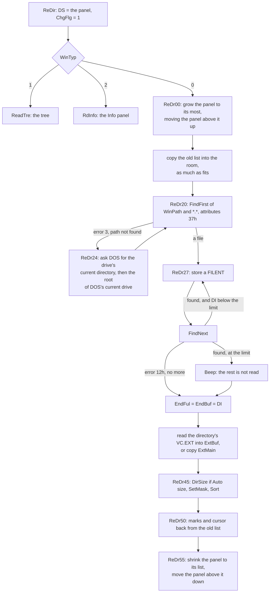

### Growing the panel, and the 2,703

A panel lives between other blocks. The left panel has the right one
above it; the right one has the room. So before reading, `ReDr00` makes
the panel being read as large as it can be: up to 64K (`DS+1000h`), but
never so large that the room would be shorter than `MinView`, 500
paragraphs. If another panel is above it, that panel is moved up out
of the way with a backwards `REP MOVSB` (`STD`), and whichever of the
four segment words named it, `WCB1seg`, `WCB2seg`, `WCBcrn` and
`WCBsec`, is changed. When the read is over, `ReDr55` does the opposite:
the panel is cut to `EndFul` plus one entry, rounded up to a paragraph,
but never under 423 paragraphs, and the panel above is moved down again
behind it.

Reading the left panel, the chain of blocks goes through three shapes.
Everything is in paragraphs from ES, the main data's segment, and
`FreMem2` is where the whole block ends:

```
 before      ES          WCB1seg         WCB2seg           ViewSeg            ES+FreMem2
             | MainDat   | left panel    | right panel     | the room            |
             | 3,913 p.  | EndFul + 24,  |                 |                     |
             |           | >= 423 p.     |                 |                     |

 ReDr00      | MainDat   | left panel, grown        | right panel     | room     |
             |           | to DS+1000h at the most  | moved up, STD   | >= 500 p.|
             |           |                          ^ BP              ^ ViewSeg  |
             |           |   the old list is copied into the room, then
             |           |   DOS's entries are written from DskBuf on

 ReDr55      | MainDat   | left panel:   | right panel     | the room: all     |
             |           | EndFul + 24   | moved down, CLD | the rest          |
```

Reading the right panel moves nothing: it is the last panel, the room
gives way to it, and `ViewSeg` is simply set. The move of the other
panel is a `REP MOVSB` of up to 64K, at 17 clocks a byte on an 8086,
some 0.2 seconds at 4.77 MHz for a panel of 2,703 files, twice a read.
It is the price of having the free memory in one piece behind the
panels, which is what the viewer, the editor, the copy and the file
search all want.

Then the limit for the read:

```asm
ReDr08:	MOV	AX,DS			; Save old files
	SUB	BP,AX			;; BP = paragraphs the panel may have
	CMP	BP,0FFFh
	JBE	ReDr09
	MOV	BP,0FFFh		;; at most 0FFFh: 65,520 bytes
ReDr09:	MOV	CL,4
	SHL	BP,CL			;; in bytes
	SUB	BP,SIZE FilEnt + SIZE FilEnt	;; less two entries: 65,472
```

The loop stores an entry, asks for the next, and stores that one only
while DI is below BP:

```asm
ReDr32:	MOV	AH,4Fh			; Find next
	CALL	Intr21
	JC	ReDr33			;; no more
	CMP	DI,BP
	JB	ReDr27			;; room: store it
	CALL	Beep			;; full: the rest of the directory is lost
```

So the most a panel holds is the number of 24-byte entries that start
below 65,472 when the first starts at 610: **2,703**, `..` included.
Every number in that sum is a consequence of 16-bit offsets. A panel is
one segment, so the list must end inside 64K; the panel's length is
held in paragraphs and capped at `0FFFh` so that `SHL BP,4` cannot wrap
to 0; and two entries are kept back behind the list, of which the sort
needs one: it exchanges two entries through the space behind
`EndFul`.

### One entry, from the DTA

```asm
ReDr28:	MOV	ES:[DI].NumbF,BX	;; DOS's order
	INC	BX
	LEA	CX,[DI+SIZE FilEnt]
	PUSH	CX
	MOV	CX,13
ReDr29:	LODSB				;; the name from DTA.FilName
	TEST	AH,10h			;; a directory keeps its capitals,
	JNZ	ReDr30
	...
	CALL	LowCase			;; a file is shown in small letters
	...
ReDr30:	STOSB
	LOOP	ReDr29
ReDr31:	MOV	SI,OFFSET DTA.FilAttr
	AND	BYTE PTR DS:[SI],3Fh	;; DOS's attributes, no marks
	MOV	CX,9
	REP	MOVSB			;; attribute, time, date, size: one move
	POP	DI
```

(The registers are swapped here, DS on the main data and ES on the
panel, so that `LODSB` reads the DTA and `STOSB` writes the list.)

The entry `..` is not taken from DOS. Before the first `FindFirst`,
`ReDr20` writes one at the head of the list in any directory that is not
a root, with the attribute 10h and the date `182Fh`, 15 January 1992;
when DOS then hands over `.` and `..`, their attributes, time, date and
size are copied over that entry, with hidden and system cleared so that
no filter ever takes it away. If a DOS does not report `..`, the panel
still has one.

### The old list, kept in the room

Before reading, `ReDr00` copies the panel's visible entries, from
`DskBuf` to `EndBuf`, to the start of the room, as many as fit there, and
keeps the cursor and the first line as offsets into that copy, clamped to
it:

```
 the room while ReDir runs
 ViewSeg:0
 +----------+----------+---- ... ----+----------+
 | old 0    | old 1    |             | old k-1  |  k = what fits, at most
 +----------+----------+---- ... ----+----------+  0FFFh paragraphs, in
 ^                     ^ DX = old First           whole entries: one DIV
 0                             ^ BX = old CurAdr  and one MUL by 24
                                                ^ both clamped to here,
                                                  the last entry copied
```

With the room at its least, 8,000 bytes, that is 333 entries, and the
marks of the files behind them are lost; with the room of a 640K
machine, the whole list. After the new list is sorted, `ReDr50` walks
the copy:

```asm
ReDr50:	MOV	AH,ES:[DI].AttrF	;; ES = the room: the old entry
	AND	AH,0C0h			;; its two marks
	JZ	ReDr52
	CMP	AL,0			;; a different directory was read?
	JNZ	ReDr51
	AND	AH,80h			;; then only "selected before" goes on
	JZ	ReDr52
ReDr51:	CALL	FnFile			;; the same name in the new list
	JNC	ReDr52
	OR	DS:[SI].AttrF,AH	;; gets the old marks
ReDr52:	ADD	DI,SIZE FilEnt
ReDr53:	CMP	DI,BX
	JB	ReDr50
```

`FnFile` (31 bytes) is a linear search by name from the head of the
new list, so this is quadratic, but only in the files that carry a
mark: an unmarked old entry costs three instructions. When the same
directory is read again, the lists are in the same order and the k-th
marked name is found after k steps, n(n+1)/2 of them for n marked
files. A step that fails on the first byte of the name is ten
instructions:

```asm
FnFil1:	CMP	SI,DS:EndBuf		;; 19 clocks on an 8088
	JAE	FnFil3			;;  4, not taken
	PUSH	SI			;; 15
	PUSH	DI			;; 15
FnFil2:	CMPSB				;; 22
	JNE	FnFil4			;; 16, taken
	...
FnFil4:	POP	DI			;; 12
	POP	SI			;; 12
	ADD	SI,SIZE FilEnt		;;  4
	JMP	FnFil1			;; 15
```

134 clocks by Intel's table, more with the 8088's prefetch starving,
and more again where names share their first letters. So:

| Marked files | Steps of `FnFile` | On a 4.77 MHz 8088 |
|---:|---:|---:|
| 100 | 5,050 | 0.14 s |
| 500 | 125,250 | 3.5 s |
| 2,703 | 3,654,456 | 103 s |

The last row is reached by Gray+ `*.*` and F5 in a directory of 2,703
files: every file then has bit 7, and both panels are read again
behind the copy. A 386 at 33 MHz, which runs the step in about 50
clocks, still takes some five seconds over it; directories of a few
hundred files, the usual kind, never notice. Then
`NearFl` puts the cursor back on the file it was on, or, if that file
is gone, on the next old file that still exists, looking forward first
and then back. The first line shown is found the same way. Nothing of
this needs memory of its own: the room is free between commands, and
the copy lives there only for the length of `ReDir`.

### The extension file comes with the directory

A directory may have its own `VC.EXT`, the table of what Enter does with
a file by its extension. `ReDir` reads it, at most 511 bytes and a 1Ah
behind them, into `ExtBuf`, 512 bytes inside the panel's header. Where
there is none, it copies `ExtMain`, the program's own `VC.EXT`, read
once when the program started. So Enter on a file never reads the disk
to find out what to do: the table is in the panel already.

### The filter: `SetMask`

The filter removes nothing. `SetMask` (122 bytes) partitions the list in
place, with a cursor from the front, SI, and one from the back, BX. An
entry that passes stays where it is; one that fails is exchanged with
the entry at the back, byte by byte, and loses its marks:

```asm
SetMs3:	CMP	BYTE PTR DS:Hidden,0
	JNZ	SetMs4
	TEST	BYTE PTR DS:[SI+13],6	;; hidden or system: out
	JNZ	SetMs6
SetMs4:	TEST	BYTE PTR DS:[SI+13],10h	;; a directory always passes
	JNZ	SetMs8
	CMP	BYTE PTR DS:MasTyp,0
	JZ	SetMs5
	CALL	TstExe			;; "programs only"
	JNC	SetMs6
SetMs5:	CALL	TstMas			;; the mask
	JC	SetMs8
SetMs6:	...				;; out: exchange [SI] and [BX], 24 bytes
	AND	BYTE PTR DS:[BX+13],3Fh	;; an entry not shown is not selected
	JMP	SetMs2			;; BX one entry back, test [SI] again
SetMs8:	ADD	SI,SIZE FilEnt		;; in: go on
	CMP	SI,BX
	JBE	SetMs3
SetMs9:	MOV	DS:EndBuf,SI		;; the shown ones end here
```

Six entries and the filter `*.txt`:

```
            0        1        2        3        4        5
 before   a.txt    b.exe    c.txt    DOCS     d.bak    e.txt
          SI                                           BX
 SI 0     passes: SI on to 1
 SI 1     b.exe fails: exchanged with BX 5, which loses its marks; BX to 4
          a.txt    e.txt    c.txt    DOCS     d.bak    b.exe
 SI 1     e.txt, tested in its new place, passes; so do c.txt and DOCS
 SI 4     d.bak fails, and SI = BX: the partition is done
 after    a.txt    e.txt    c.txt    DOCS  |  d.bak    b.exe
          '------- shown, to EndBuf -------'  '- read, kept, hidden -'
```

The order is spoiled, which does not matter, since `Sort` comes next.
The last entry that fails, where the two cursors meet, is not
exchanged, and keeps its marks: `d.bak` above, if it was selected,
stays so while it is hidden, and shows selected again when the filter
is changed.

The entries from `EndBuf` to `EndFul` are read, kept, and invisible.
Changing the filter calls `SetMask` and `Sort` again over all of them,
without the disk.

`TstMas` works on the *fixed form* of a name that DOS itself uses in a
directory: eleven characters, eight of name and three of extension,
padded with spaces. `Convert` (36 bytes) makes that form, in capitals,
with `*` turned into as many `?` as fill its part; the mask is converted
once into `TmpBuf`, each name into `TmpBuf+20`, and the test is a loop
of eleven comparisons where `?` matches anything. `TstExe` is three
three-byte comparisons of what follows the first full stop with
`'com','exe','bat'`, a nine-byte table.

### Five orders, one sort

`Sort` (236 bytes) first turns every name *in place* into the fixed
form, in the 13 bytes it has: the name padded to eight characters with
spaces, the extension moved to bytes 9 to 11. Now two names compare by
name with one `REPE CMPSB` of eight bytes, and by extension with one of
three bytes at a fixed place, `CmpExt`. At the end the names are put
back together.

```
 byte          0  1  2  3  4  5  6  7  8  9 10 11 12
 as read       n  o  t  e  s  .  t  x  t  0  ?  ?  ?
 Sort01        n  o  t  e  s  .  t  x  t  _  _  _  ?   from the zero: spaces
 the extension n  o  t  e  s  .  t  x  t  t  x  t  ?   bytes 6..8 to 9..11
 the dot       n  o  t  e  s  _  _  _  t  t  x  t  ?   the dot to byte 7: spaces
               '------ 8, by REPE CMPSB -'  '- 3 -'
                                         ^ byte 8 keeps what it had,
                                           and nothing compares it
 README        R  E  A  D  M  E  _  _  _  _  _  _  ?   no dot: no extension
```

(`_` is a space.) Putting a name back, `Sort20` looks for the last
character that is not a space among the first eight, writes the dot
and the three bytes of the extension behind it in two moves, and puts
the zero behind the last character of the extension that is not a
space, which is the dot itself when there is none. A directory's name
goes through the same, so `SRC.OLD` sorts by `OLD` as a file would.

The sort itself is Volkov's "Shell sort", whose comment it bears. It is
a diminishing-gap exchange sort: the gap starts at half the list and
halves, and for each gap the list is passed over, exchanging pairs that
are out of order, until a pass exchanges nothing; each pass ends where
the last exchange of the one before was.

```asm
	MOV	BX,DS:EndBuf		; Shell sort
	SUB	BX,OFFSET DskBuf	;; BX = the list in bytes
Sort10:	MOV	CX,SIZE FilEnt
	MOV	AX,BX
	XOR	DX,DX
	DIV	CX			;; in entries,
	SHR	AX,1			;; halved,
	MUL	CX			;; in bytes again: the gap
	MOV	BX,AX
	OR	BX,BX
	JE	Sort15			;; gap 0: sorted
	MOV	CX,DS:EndBuf		;; this pass ends at the end
Sort11:	XOR	DX,DX			;; DX = where the last exchange was
	MOV	SI,OFFSET DskBuf
Sort12:	LEA	DI,[SI+BX]
	CMP	DI,CX
	JAE	Sort14
	PUSH	CX
	CALL	CmpPar			;; CF = 1: exchange
	JNC	Sort13
	MOV	DX,DI
	MOV	DI,DS:EndFul		;; three moves of 24 bytes,
	...				;; through the spare entry at EndFul
```

The gaps are those of Shell's own paper, halving: for ten files 5, 2
and 1; for 2,703, eleven of them, 1,351, 675, 337, 168, 84, 42, 21,
10, 5, 2, 1. Each gap's passes are a bubble sort over the entries that
lie that far apart. It is not quadratic, but it is not cheap either. A
simulation of exactly these loops counts:

| Files | Order DOS gave | Comparisons | Exchanges | Passes |
|---:|---|---:|---:|---:|
| 300 | random | about 9,700 | about 1,600 | 41 |
| 2,703 | random | about 205,000 | about 28,500 | 92 |
| 2,703 | already sorted | 27,037 | 0 | 11 |
| 2,703 | reversed | 58,749 | 14,043 | 25 |

A comparison by name, with the loop around the call of `CmpPar`, its
tests of the attributes and a short `REPE CMPSB`, is some 400 clocks on
an 8088, and an exchange three `REP MOVSB` of 24 bytes, 1,251. For
2,703 files in random order that is about 80 million clocks of
comparing and 35 million of exchanging: some 25 seconds at 4.77 MHz,
against the 103 of `ReDr50` at its worst.
The exchange through the spare entry is why the panel keeps one entry
of room behind `EndFul`.

`CmpPar` (136 bytes) decides the order. Its first lines are the fifth
order, "unsorted":

```asm
CmpPar	PROC	NEAR
	MOV	AL,DS:SortTyp
	CMP	AL,4			;; 4: unsorted
	JB	CmpPr0
	MOV	AX,DS:[DI+22]		;; NumbF: the order DOS gave
	CMP	AX,DS:[SI+22]
	RET
```

"Unsorted" is not a missing sort: it is the same sort by `NumbF`, which
is why the field is there. It puts the list back into DOS's order
without reading the disk again. For the other four orders `CmpPar`
asks its questions in this order, and the first that tells the two
entries apart decides; CF set means "exchange", that is, the entry at
DI belongs in front of the one at SI:

| Question | Goes first | Bytes looked at |
|---|---|---|
| a directory and a file? | the directory | `AttrF` bit 4 |
| two directories, one named `.` or `..`? | that one | byte 0 of the name |
| two files, one of them system? | the system file | `AttrF` bit 2 |
| `SortTyp` 0, name | the smaller name, then the smaller extension | 0..7, then 9..11 |
| `SortTyp` 1, extension | the smaller extension, then the smaller name | 9..11, then 0..7 |
| `SortTyp` 2, time | the later date, then the later time, then by name | `DateF`, `TimeF` |
| `SortTyp` 3, size | the larger high word, then low word, then by name | `SizeF` |

Two directories are put in the chosen order too, by name, extension,
time or size, not always by name. The date and the time are compared as
the words that DOS packs them in, the year in the top bits of the date
and the hour in the top bits of the time, so one `CMP` of each word is
a comparison in time.


*Gray+ with `*.txt`: two files selected, bit 6 of their `AttrF` set,
and the status line counting them.*

### Selection

Ins toggles bit 6 of the entry under the cursor. Gray+ and Gray- ask
for a mask, kept in `SelMas`, and walk the list with `TstMas`. `TotSel`
(36 bytes) counts selected entries in one pass, files in DX and
directories in BX. Bit 7 is the program's memory of the last group
operation: every walker clears it on all entries first, and sets it on
each entry that it has done, in place of bit 6. Ctrl-M then selects
again whatever has bit 7. Since `ReDr50` carries bit 7 to the new list
when another directory is read, a file of the same name elsewhere is
reselected too.

## The cursor: offsets kept, numbers worked with

A panel remembers its cursor and its first visible line as offsets,
`CurAdr` and `First`, because that is what everything else wants: an
entry is read through its offset. But the keys think in places in a
list, and the eight cursor keys, `F00_00` to `F07_01`, 352 bytes in
all, never move an offset. Each one turns the offsets into numbers,
changes the numbers, and turns them back:

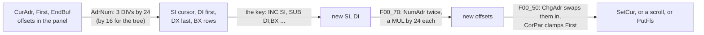

`AdrNum` (75 bytes) answers in four registers: SI the number of the
cursor's entry, DI that of the first line, DX that of the last entry,
and BX the rows of a column, which `LnsAX` works out from the panel's
height less the frame, the header and, with the mini status on, two
rows more. For the tree the same words are `TreAdr` and `TreFrst` of
the main data, the divisor 16 and the last entry `TreeLen - 1`, so the
same keys walk both lists. The keys are then a few instructions each:

| Key | What it does to the numbers |
|---|---|
| Up, Down | SI - 1 if above 0, SI + 1 if below DX |
| Home, End | SI = DI = 0, or SI = DI = DX |
| PgUp, PgDn | DI and SI by a page, a page being BX - 1, or 3 x BX - 1 in the brief mode |
| Left, Right | in the brief mode, SI by a column, BX; DI with it when it would leave the window |

Up and Down with the panels off are Ctrl-E and Ctrl-X, the history,
and Left and Right in the full mode, or with the panels off, are the
command line's: the commands jump to `F25_00`, `F26_00` and `F73_00`.
One key, two meanings, chosen by a byte of the panel.

`CorPar` (81 bytes) is the one rule for where the window stands: the
cursor must be inside it, and it must not end before the list does
while there are entries above it.

```
 a page is P = BX rows (x 3 in the brief mode)
 rule 1: DI <= SI <= DI + P - 1     else DI moves to take SI in
 rule 2: DI <= DX - (P - 1)         else DI moves back, down to 0,
                                    so the window shows a full page
```

`F00_50` (208 bytes) then decides how little of the screen to touch.
If `First` has not moved, it is two calls of `SetCur`, the old bar
recoloured to the panel's colour and the new one to the cursor's,
each one row copied to the display. If `First` moved by exactly one
entry, the list is redrawn into `ScrBuf` by `PutFls`, the BIOS scrolls
the list's rectangle on the display by one row (INT 10h AH 6 or 7, by
`Int10m`, which hides the mouse pointer around it), and `Window`
copies only the one row that came in. In the brief mode that is right
too: each column moves up by one entry, which is one row, and the
entry that leaves the top of a column is the one that arrives at the
bottom of the column before it, in the row that is copied. Anything
else, PgDn or Home, is `PutFls` and the whole panel. On a CGA, where
every word copied to the display waits for the retrace or makes snow
([chapter 4](04-the-system.md#cga-snow-and-volkovs-own-question-marks)),
a scroll by the BIOS and one row of 38 cells is a small fraction of
the 800 or so words of a whole panel.

The three `DIV`s and two `MUL`s of a key cost some 700 clocks on an
8088, half a millisecond: nothing next to the redraw.

### The mouse in a list

[Chapter 1](01-the-program.md#the-mouse-at-the-panels) has how a click
reaches a panel. `Func40` (142 bytes) turns the cell under the pointer
into a number by the same arithmetic, and goes on into the keys' code
at a label past the place where the key worked out the number:

```asm
	SUB	CL,BL			; Set cursor position
	CMP	CL,39			;; the right frame: nothing
	JAE	Func35
	MOV	BL,DS:WinTyp
	OR	BL,DS:BrfFul		;; the brief mode?
	JNE	Func42
	XCHG	AL,CL			;; AL = the column in the panel,
	CBW				;;  CL = the rows of a column
	MOV	BL,13
	DIV	BL			;; AL = which of the three columns,
	XCHG	AH,CL			;;  CL = the cell within it
	MUL	AH			;; the column x its rows
	ADD	CH,AL			;;  + the row: the entry from First
Func42:	OR	CL,CL			;; on a frame or a divider: nothing
	JE	Func35
	MOV	AL,CH
	CBW
	ADD	AX,DI			;; + First: the entry's number
```

A click above the list puts the cursor on the first line and goes on
into Up, at `F00_05`, and one below it on the last line and into Down,
at `F01_05`: either scrolls the list by one entry. A click on an entry is `F00_60`, the keys' own end. The right button, held and dragged, selects: `F00_60`
remembers in `WinMous` whether the first entry it passed was selected,
and gives every entry it passes the opposite, so a drag selects or
unselects a run of files the way the first one went. A second click on
the same entry within `MoDelay` is Enter.

## Speed search

Alt with a letter, a digit, `-` or `=`, at the panels, while the panel
shows files or the tree, opens a box over the key bar, `Search:`, and
moves the cursor to the first file, from the cursor on and round from
the top, whose name begins with what has been typed. `F77_00`, 275 bytes, draws the box and reads
the keys; `Search` of `VCSUB2.INC`, 140 bytes, finds the file, and the
tree box calls the same `Search` for its own list.

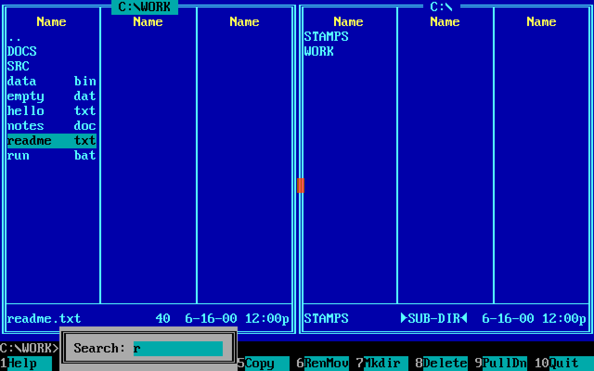

*Alt-R at the panels: `Search: r` in a box over the key bar, and the
cursor on `readme.txt`, the first name that begins with `r`.*

The first key comes with Alt held, and the BIOS gives such a key with
no character, only its scan code. The main loop looks the code up in
`AltSr_T`, 38 bytes, the scan codes of the four rows of the keyboard,
and `F77_00` turns that key and every later one typed with Alt into
the character at the same place of `Ascii_T`. A key that is neither a character nor one of the 14 editing
keys of `Srch_T` ends the search, and is not lost: `F77_20` goes to
`Func12` with it, so that Enter on the file just found opens it, and
an arrow moves on from it.

`Search` is told the list by four registers, so that one routine walks
a panel's entries and the tree's alike:

| Register | A panel | The tree |
|---|---|---|
| SI, where to start | `CurAdr` | `TreAdr` |
| BX, the first entry | `DskBuf` | `TreList` |
| BP, the end | `EndBuf` | `TreList + 16 x TreeLen` |
| DX, the stride | 24, `SIZE FilEnt` | 16, `SIZE DIRENT` |

A name is the first 13 bytes of an entry in both, which is what lets
the stride be the only difference. The search goes round from the
cursor, wrapping from BP to BX, and stops when it is back where it
began. The text being typed is a line of `EdLin`, the command line's
editor ([chapter 2](02-the-screen.md#inpstr-and-edlin)), at
`MenuBuf+228`, and `Search` edits not the line but a copy of it:

```asm
Srch01:	PUSH	SI
	PUSH	DS
	PUSH	ES
	POP	DS
	MOV	SI,OFFSET MenuBuf+228	;; the pattern: its cursor
	MOV	DI,OFFSET MenuBuf+208	;;  and 13 bytes, 15 in all,
	MOV	CX,15			;;  copied to a trial
	REP	MOVSB
	POP	DS
	CMP	AL,0Ah			;; Ctrl-Enter: the next match
	JE	Srch02			;;  of the same pattern
	PUSH	DX
	MOV	CX,12
	MOV	SI,OFFSET MenuBuf+210	;; the key edits the trial
	MOV	DX,WORD PTR ES:[MenuBuf+208]
	CALL	EdLin
	...
Srch03:	...				;; at each entry:
Srch04:	LODSB
	CALL	UpCase			;;  the name in capitals
	SCASB				;;  against the pattern,
	LOOPE	Srch04			;;  as far as it goes
	...
	JE	Srch06			;; found
	ADD	SI,DX			;; the next entry,
	CMP	SI,BP
	JB	Srch05
	MOV	SI,BX			;;  round from the end to the start
Srch05:	CMP	SI,AX
	JNE	Srch03			;; until back at the start
	JMP	Srch07			;; none: the trial is dropped
Srch06:	...
	MOV	SI,OFFSET MenuBuf+208	;; found: the trial
	MOV	DI,OFFSET MenuBuf+228	;;  becomes the pattern
	MOV	CX,15
	REP	MOVSB
```

So a letter that would make the pattern match nothing is never added:
the box keeps showing the longest prefix that names a file, and the
undo of a wrong key costs 15 bytes and two `REP MOVSB`, with no undo
code at all. Ctrl-Enter starts one entry past the cursor with the
pattern unchanged, which is "the next file that begins so". The
pattern is turned into capitals by `PathLin` before the walk, and each
name by `UpCase` as it is compared, so `r` finds `README` and
`readme.txt`.

## The tree and `TREEINFO.NCD`

The tree is not a panel's list. It lives in the main data, `TreeBuf`,
12,299 bytes: `MinTree` entries of 16 bytes and an 11-byte header. That
buffer is laid out byte for byte as the file `\TREEINFO.NCD` in the
root of the disk, the format of the Norton Commander's tree, so reading
the tree from the file is one `INT 21h` 3Fh into the buffer, and saving
it one 40h out of it.

```
 DIRTREE, TreeBuf, \TREEINFO.NCD                             VC.ASM
 +0    TreHead [5]  'PNCI',0       while scanning: [0] TreeErr, [1] TreeLev
 +5    TreeLen      number of directories, the root counted
 +7    TreSum1      the sum of the 7 bytes before it
 +9    TreList      DIRENT[TreeLen], the root first, in pre-order
 +9+16n             the sum of the list
                    a file is 16 x TreeLen + 11 bytes

 DIRENT, 16 bytes
 +0    DirName [13]  byte 12 is DirRecu while scanning: FFh "not read yet"
 +13   DirLevel      0 for the root
 +14   DirShift      1: a new branch begins here
 +15   DirCont       1: a sibling follows lower down ('├'), 0: '└'
```

No path is stored: a path is the names of the entries above, one per
level, and the levels and the two bits are all that `PutTree` needs to
draw `├`, `└` and `│` without looking ahead. `ChkSum` is 21 bytes:
add bytes into BX, then compare with the word that follows.

`ReadTre` (776 bytes) believes the file only if the signature is
there, both sums agree, and the file is exactly `16 x TreeLen + 11`
bytes long; a file that fills the whole buffer is taken for one too
large. (`TreeLen` is shifted left by four in 16 bits, so a file that
claims 4,096 entries passes with a list of none: a bug that a damaged
file can reach.) Otherwise the disk is scanned, and the scan is a
small marvel.

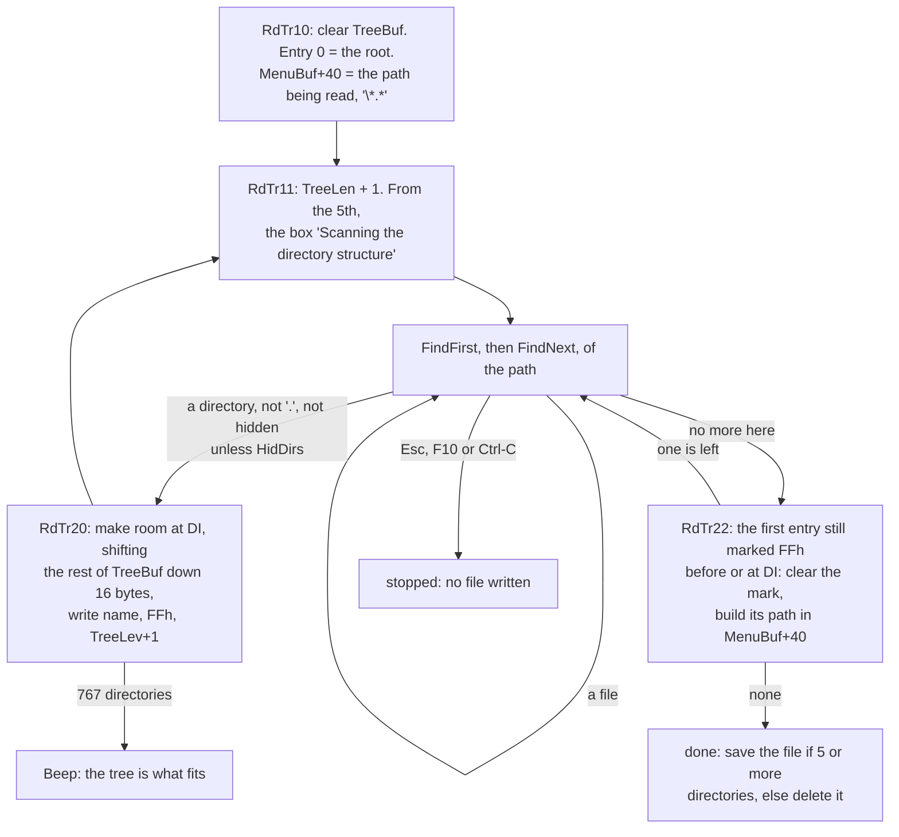

Each subdirectory that is found is inserted right behind its parent's
earlier children, marked unread in byte 12 of its name. When a
directory has no more entries, the scan steps back from DI to the first
entry of the run that is still marked, and reads that one next. So the
list comes out in pre-order, each directory followed by its whole
subtree, with no recursion and no stack of paths: the only state is one
byte in each name, and the insertion point. The insertion itself is
one backwards `REP MOVSB` of the rest of the buffer:

```asm
RdTr20:	LEA	CX,[BP]-SIZE DIRENT	;; BP = the end of TreeBuf
	SUB	CX,DI			;; what lies behind the insertion point
	JBE	RdTr80
	...
	LEA	DI,[BP]-1
	LEA	SI,[DI]-SIZE DIRENT
	STD
	REP	MOVSB			;; all of it 16 bytes down
	CLD
	...
RdTr80:	MOV	CX,12
	...
	REP	MOVSB			;; the name from the DTA
	...
	CALL	FilZero
	MOV	AL,0FFh			;; DirRecu: not read yet
	STOSB
	MOV	AL,DS:TreeBuf.TreeLev
	INC	AX
	STOSB				;; DirLevel = the parent's + 1
	INC	DI
	INC	DI			;; DI: behind the new entry
	CMP	AL,DS:[DI-2*SIZE DIRENT].DirLevel
	MOV	AL,1			;; the entry in front of it:
	JNE	RdTr21			;;  its parent, so a first child
	MOV	DS:[DI-2*SIZE DIRENT].DirCont,1	;;  or a sibling, who
	MOV	AL,0			;;  now has one behind: '├'
RdTr21:	MOV	DS:[DI-SIZE DIRENT].DirShift,AL	;; 1: first of its parent
	MOV	DS:[DI-SIZE DIRENT].DirCont,0	;; the last so far: '└'
```

The two bits are worked out from the one entry in front of the new
one, which is either the parent, when this is the first child, or the
child found just before. The children of a directory are all found
while that directory is read, before any of them is read in its turn,
so the last of them keeps `DirCont` 0 for good, and the grandchildren
that are inserted later go *behind* their own parent, never between a
directory and the sibling in front of it.

A disk with five directories, `A` and `B` in the root, `C` and `D` in
`A`, `E` in `B`, and FindFirst giving them in that order:

```
 step                         TreeList after it (FF: DirRecu, not read yet)   DI
 the root is read             \     A FF  B FF                                B+16
 none left in \: back from    \     A FF  B FF          the first FF of the   A
 DI to the first FF, A                                  run: A, read next
 A is read                    \     A     C FF  D FF  B FF                    D+16
 back to the first FF: C      \     A     C     D FF  B FF                    C
 C has none; D is taken       \     A     C     D     B FF                    D
 D has none; B is read        \     A     C     D     B     E FF              E+16
 back to E; E has none        \     A     C     D     B     E                 done

 the entries, with the bits written as each was inserted:
            DirLevel  DirShift  DirCont          drawn
 \             0         1         0             \
 A             1         1         1             ├──A
 C             2         1         1             │  ├──C
 D             2         0         0             │  └──D
 B             1         0         0             └──B
 E             2         1         0                └──E
```

`A`'s `DirCont` became 1 when `B` was inserted behind it, and `C`'s
when `D` was; nothing else was ever rewritten.

The path in `MenuBuf+40` is rebuilt for each directory that is read
next by skipping as many backslashes as its level and copying its name
there: the path of the parent is always what is left in front. A path
that would pass 68 bytes is skipped. The limit is the buffer:
`(12,299 - 11 - 16) / 16` = **767** directories, root included; the
768th place is the one that the backward move needs as room. The
line `MOV BP,OFFSET TreeBuf+MinTree*SIZE DIRENT+SIZE DIRTREE ; ???
Expand` at the head of `ReadTre`, and `; ??? Compress` at its end, are
Volkov's own notes: he meant the tree to grow as the panels do, and it
never did.

Why it stayed at 767, the source does not say, but what it would have
taken shows. A panel is a segment of its own, and its routines take it
in DS. The tree is in the main data, and every routine that touches it
also touches the main data in the same breath with the same segment
register: the scan builds its path in `MenuBuf` from the names in
`TreeBuf` and reads the DTA; `PutTree` builds a path per line in
`MenuBuf+50` and holds it against `DosPth`; `TrCr10` against `CrnPath`;
`Search` and `ChTree` keep their state in `MenuBuf`. Moving the tree
out would have meant a second segment register, or a copy, in each of
those loops. And the main data has no room to grow it in place: its
62,603 bytes leave 2,933 of the 64K, room for 183 more directories.

A scan that ran to the end writes the file, if it found five
directories or more, and deletes it otherwise: on a disk that small,
scanning is cheaper than a file. Writing goes with `BlocEr` set, so that
a write-protected floppy does not raise the critical-error box: the
program beeps.

Whoever makes or removes a directory makes the file out of date, and
`DelTree` of `VCF1.INC` does that by writing **one zero byte** over the
`P` of `PNCI`:

```asm
DelTr3:	MOV	BX,AX			;; the file, opened for writing
	MOV	SI,DX
	MOV	BYTE PTR DS:[SI],0	;; one byte: 0
	MOV	CX,1
	MOV	AH,40h
	CALL	Intr21			;; over the 'P' of 'PNCI'
```

The next time the tree is read, the signature fails and the disk is
scanned. `DelTree` does nothing unless Auto rescan, `ChgTree`, is on;
delete and copy call it once per command, keeping a flag in `TmpBuf` so
that the file is written only for the first directory that changes.

### Drawing it: `PutTree`

`PutTree` (535 bytes) draws the tree into a panel and into the box of
`ChTree` alike, told the place by BX and DX as any panel routine is.
It knows `├`, `└` and `│` from the three bytes of each entry and from
40 bytes of its own at the head of `MenuBuf`, one for each level, which
say whether the line of that level is still going down:

```
 MenuBuf while the tree is drawn
 +0    40 bytes  one a level: 1 while a '│' is to be drawn in its column
 +46   word      the row and column of the status line
 +48   word      the panel's segment, to tell the current panel by
 +50   81 bytes  the path of the entry being drawn, 'C:\A\C\'
 +140  81 bytes  the path of the cursor's entry, for the status line
```

For an entry of level L the line is made of three parts, and the
bytes change as they are read:

```
 levels 1 .. L-1   '│' where MenuBuf[level-1] is 1, else spaces
 level L           '├' if DirCont, else '└', and then MenuBuf[L-1] = 0
                   '──', or '─' when the tree is too deep for 3 cells
 behind it         MenuBuf[L] = 1 if the next entry's DirShift is 1:
                   its first child opens the next column
```

That is the whole of it: a column's `│` is switched on by the first
child of a directory and off by the last, and each line needs only its
own bits and one bit of the line below. The tree before it shows how
`D`'s `└` closes `A`'s column, so that `B`'s children have spaces where
`│` would be.

Two widths are chosen before the first line. If no directory is deeper
than level 7, a level takes three cells, `├──`; otherwise two, `├─`,
so that a deep tree still fits the 38 cells, and past the tenth level
the lines stop moving right at all. That is a pass over the list,
which the first entry deeper than 7 ends, for one byte, `TreeTyp`. And the drawing always starts at the
root, not at `TreFrst`: the lines above the window are walked and not
drawn, because the bytes of `MenuBuf` and the path at `MenuBuf+50`
depend on everything above. The path is rebuilt as the scan built it,
by skipping as many backslashes as the entry's level and writing its
name there, and two lines are marked by it:

- the line whose path is `DosPth`, the current directory, gets a `◄`
  at its end, and is remembered in `TreCrnt`;
- the cursor's line, at `TreAdr`, is drawn in the cursor's colour on
  the current panel, and between two half blocks, `▌WORK▐`, on the
  other; its path is copied into `CrnPath`, and onto the panel's
  status line, cut by `ShrtLin` to 38 cells.

So `CrnPath`, the tree's answer to "which directory is the cursor on",
is a by-product of drawing it.

### Finding a directory in it: `TreeCur`

There is no path in the list, so finding the entry of a path means
building the paths. `TrCr10` (118 bytes) copies `DosPth` into
`CrnPath` and walks `TreeList` from the root, building each entry's
path in `MenuBuf` by the same skip of backslashes, and stops at the
one that is `CrnPath`, with or without its last backslash. `TrCr20`
(28 bytes) then puts the window's first line half a window above it:
the rows made even by `AND AL,7Eh` and shifted left by three are half
the rows times 16 bytes, with no `DIV`. `TreeCur` (34 bytes) is the two
together, and tries the old `CrnPath` first, so that a tree panel keeps
its cursor where the user left it as long as that directory exists.

### The tree in a box: `ChTree`

`ChTree` of `VCSUB3.INC` is 995 bytes, the fourth largest procedure in
the program, and it is a dialog that the dialog engine of
[chapter 2](02-the-screen.md#a-dialog-is-a-graph-of-fields-dialog)
could not express: a list of up to 767 lines with a cursor, scrolling
and a speed search. Two commands call it. Alt-F10, `M41_00`, changes to
the directory chosen; F10 in the copy and move dialogs, `F35_60`, puts
it into the target's line. The caller says only the column, 16 or 28.


*Alt-F10 in a directory thirteen levels deep: the tree of `TreeBuf`
drawn in the box by `PutTree`, two cells a level because the tree is
deeper than seven, the cursor's path on the line under the list.*

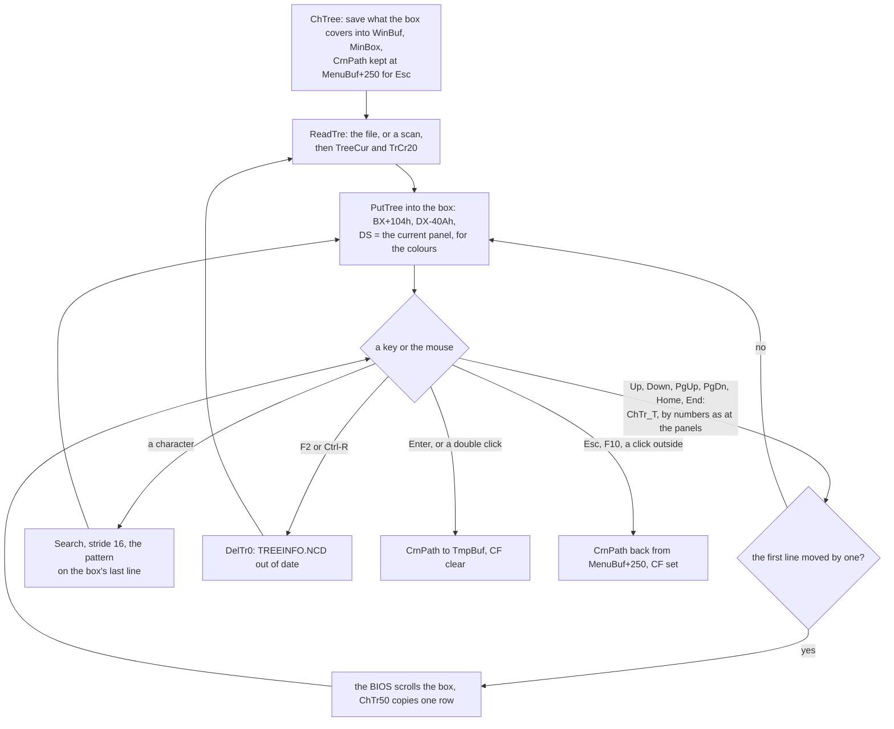

What it reuses is most of it. The lines are `PutTree`'s, drawn into the
box by handing it the box's corner and size where a panel's would go,
and DS on the current panel, so that the cursor is drawn as on the
current panel. The keys turn the cursor into numbers as the panels'
keys do, with `NumAd1` and `TreNum`, the tree's halves of `NumAdr` and
`AdrNum`. A step of one line is a BIOS scroll and one row, as
`F00_50`'s. The speed search is `Search`, but without Alt: in the box a
letter has nothing else to mean. `ChTree` keeps all of its state in
`MenuBuf`, which no menu needs while it is open, and in the main
data's tree words:

```
 MenuBuf while ChTree is open
 +0 .. +220   PutTree, as above, drawn again at every move
 +208  15     Search: the trial pattern
 +228  15     Search: the pattern, a cursor word and 13 bytes
 +250  68     CrnPath as it was, for Esc
```

`PutTree`'s cursor path ends at +220, eight bytes short of the
pattern. And since `TreAdr`, `TreFrst` and `CrnPath` are the main
data's, which a tree panel uses as well, `ChTree` sets `ChgFlg` of
either panel that shows the tree, and it is read again behind the box.
The box reads `TREEINFO.NCD` every time it opens, one read of up to
12,299 bytes, or scans the disk if the file is not good, whatever a
tree panel may have read into `TreeBuf` before.

## Walking the files: `FncAddr`, `FncSel`, `FncMas`, `DirFunc`

Delete, attributes, copy, move, the directory sizes and find file all
do the same thing: for each file, a routine; for each directory, the
same routine for each of its files. Volkov wrote the walking once and
made the routine a variable: `FncAddr`, a word of the main data, holds
the address of the routine, and the walkers call through it.

```asm
	MOV	AL,DS:DTA.FilAttr	;; the file's attributes in AL,
	CALL	DS:FncAddr		;; its path in TmpBuf: one indirect call
```

Five routines are ever put there:

| `FncAddr` | Set by | Does to one file |
|---|---|---|
| `F38_40` | F8, `F38_00` | delete |
| `M30_50` | Ctrl-A, `M30_00` | set attributes, date and time |
| `C00_00` | F5 and F6, `F35_01`, `F45_01` | copy, move or rename |
| `DiSi10` | `DirSize` | add a file's size to a sum in `TmpBuf+90` |
| `FindFil` | Alt-F7, `F67_00` | find files in a directory |

A routine takes the attributes in AL and the path at `TmpBuf`, and
answers in AX: AL 1 for done and 0 for not done, AH not 0 to stop the
whole command (100h). It may call the walkers itself. There are three:

- **`FncSel`** walks the current panel: the selected entries, or the
  one under the cursor when none is selected or the command is for one
  file (`OneFile`). It copies the entry's 13-byte name to `TmpBuf`,
  which with the current directory being DOS's is a path, calls the
  routine, and on success turns bit 6 into bit 7. With Unselect on,
  `UnSlct`, it redraws that row of the panel at once, working out the
  row and column from the entry's offset with two `DIV`s.
- **`FncMas`** walks what a mask at `TmpBuf` matches on the disk, files
  only (`TEST DS:DTA.FilAttr,16h` leaves out directories, hidden and
  system), for Shift-F8 and Shift-F5. It says "Can't find file" when
  nothing matched, and puts an `s` behind the word when the mask had a
  wildcard.
- **`DirFunc`** (281 bytes) walks a directory: every entry of the path
  at `TmpBuf`, with `\*.*` behind it, calls the routine with the name
  put behind the path, and returns AL 1 if every call answered 1. A
  routine that meets a directory calls `DirFunc` again, so the commands
  go as deep as the disk does.

All three end at `FncExt`, which marks both panels to be read again,
`ChgFlg = 1`, if `TmpBuf+91` says that any routine changed the disk, and
goes back to the main loop.

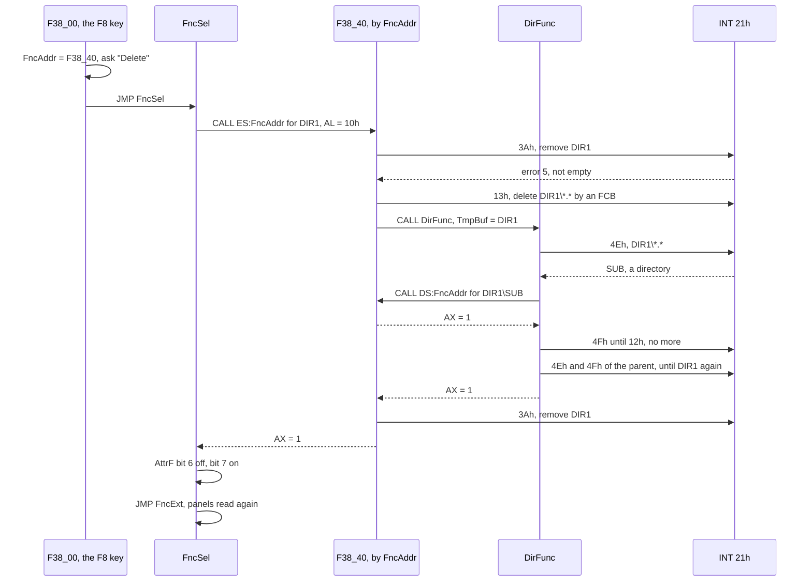

### One DTA, and the search found again

DOS keeps the state of a search in 21 bytes at the head of the DTA, and
the program has one DTA, `DTA` in the main data, 44 bytes. A recursive
walk with one DTA should not work: the inner `DirFunc` overwrites the
outer search, and the outer `FindNext` would go on from the inner one's
place.

`DirFunc` repairs that at its end, and this is the cleverest thing in
the chapter. When the search of a directory ends, it cuts the last name
off the path, keeps that name in `MenuBuf`, searches the *parent*
directory again from the start, and goes through it until it meets a
directory of that name:

```asm
DiFu08:	...
	MOV	SI,DX
	CALL	CutPath			;; SI = the name that has just ended
	PUSH	SI
	MOV	DI,OFFSET MenuBuf
	MOV	CX,13
	REP	MOVSB			;; keep it
	POP	DI
	...
	MOV	SI,OFFSET Mask_S+1	;; and put '*.*' in its place
	MOV	CX,4
	REP	MOVSB
	...
	MOV	CX,37h
	MOV	AH,4Eh			;; search the parent from the start
	JMP	DiFu11
DiFu09:	TEST	DS:DTA.FilAttr,10h
	JZ	DiFu10
	MOV	DI,OFFSET MenuBuf
	...
	MOV	SI,OFFSET DTA.FilName
	REPE	CMPSB			;; is it the one?
	JE	DiFu12			;; the DTA is where the caller left it
DiFu10:	MOV	AH,4Fh
DiFu11:	CALL	Intr21
	JNC	DiFu09
```

Then the path in `TmpBuf` is put back as the caller had it, and the
DTA is exactly where the caller's `FindNext` expects it.

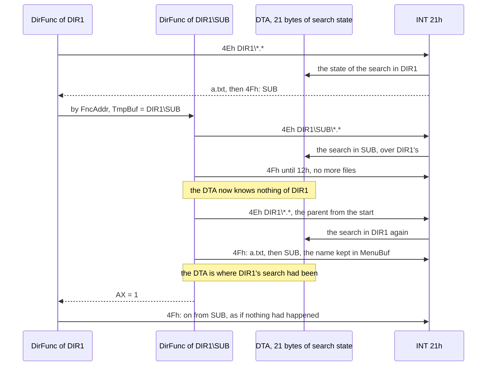

The cost is time. Every directory that the walk enters is paid for,
when the walk leaves it, by a search of its parent as far as its own
name: as many `FindNext` calls as there are entries in front of it in
the parent, in DOS's order, files included. A directory that holds 200
subdirectories and nothing else has them found again at 1, 2, ... 200
calls, some 20,000 calls of DOS for the 200 that the walk itself
makes, each one reading the directory's sectors through DOS's buffers.
Trees of the usual shape, a few subdirectories among many files, pay
far less. The gain is that a
recursion of any depth needs no memory at all beyond the path: no saved
DTAs, no stack of searches on a 256-byte stack. A path of 68 bytes or
more is not entered, the box `PthEr_B`, since every path buffer is
`LenPath`, 68 bytes.

One curiosity of the source: `DirFunc`, `FncSel` and `FncExt` follow a
`.DATA` block in `VCF1.INC` (the box `PthEr_B`) with no `.CODE` in
between, so the assembler put them into the data segment, `_DATA`,
where the listing has `DirFunc` at 0C57h. In a `.COM` file all segments
are one, `DGROUP`, so the code runs there as well as anywhere.

### Directory sizes

With Auto size on, `ReDir` calls `DirSize` for each directory of the
list, and `DirSize` is the walk in its smallest form: `FncAddr =
DiSi10`, a sum of 32 bits cleared in `TmpBuf+90`, `CALL ES:FncAddr` with
AL 10h, and the sum written into the entry's `SizeF`. `DiSi10` (60 bytes)
adds the file's size from the DTA, stopping at `0FFFFFFFFh` rather than
wrapping, and calls `DirFunc` for a directory. `DirFunc` knows the one
caller that may not show a box: for `DiSi10` a path that is too long is
skipped in silence.

## Delete and attributes

`F38_00`, F8, clears three bytes of `TmpBuf` that it keeps for the
command, 90 for "All" answered, 91 for "the disk changed" and 92 for
"the tree is marked out of date", sets `FncAddr = OFFSET F38_40`, asks
once, and jumps to `FncSel`.

`F38_40` (356 bytes) deletes a file with 41h. If DOS refuses with error
5 and the file is read-only, it asks `RdOnl_B`, sets the attributes to
20h, and tries again. For a directory it tries 3Ah, remove, through
`F38_60`, which knows one more trick: if DOS says error 10h, "the
current directory", it asks DOS for the true name (60h), changes to `..`
and removes it then. The two bytes for `..` cost three instructions:

```asm
	MOV	AX,'.'			;; AL = '.', AH = 0
	STOSB				;; '.'
	STOSW				;; '.', 0: "..", ended
	MOV	AH,3Bh			;; change to it
```

A directory that is not empty is emptied in two passes. First `F38_70`
deletes every plain file in it with **one call of DOS**: 13h, delete by
an FCB. It builds an extended FCB at `TmpBuf+200`, the byte FFh, five
reserved bytes, the attribute 26h, archive, hidden and system, the
drive, and the name `*.*` put into FCB form by 29h. An FCB has no path,
so the directory is made the current one around the call and the old
one put back. Then `DirFunc` calls `F38_40` for what is left:
read-only files, which the FCB call does not touch, and
subdirectories, each emptied the same way. Last, `F38_60` removes the
directory. One call of DOS does what would otherwise be a search and a
41h for every file.

```
 TmpBuf during F8                     the extended FCB of F38_70
 +0    the path handed to F38_40      +200  FFh         "an extended FCB"
 +90   1: "All" was answered          +201  5 bytes     reserved, as they are
 +91   1: the disk was changed        +206  26h         attributes: archive,
 +92   1: TREEINFO.NCD marked old                       hidden, system
 +100  the dialog's answer            +207  drive       0 the current, 1 A:...
 +130  the path for "Can't delete"    +208  11 bytes    '???????????', by 29h
                                                        from '*.*'
                                      +219  ...         DOS's own, to +243
```

`F38_70` builds it in five stores and one call of 29h, which parses
`*.*` into the eleven `?` itself; the call of 13h then deletes, in the
current directory, every entry whose attributes are among those of the
FCB and whose name matches, so a directory, bit 4, and a read-only
file, bit 0, are left alone for the second pass.

`M30_00`, Ctrl-A, is the same machine with `M30_50`. Its dialog leaves,
in `TmpBuf`, a mask of attribute bits to keep at +94, bits to set at
+95, and a date and a time at +96 and +98, `AttrDat` and `AttrTim`,
0FFFFh meaning "unchanged". Whether the stamp is to be set at all is
tested in three instructions, since only `0FFFFh AND 0FFFFh` gives a
word that `INC` turns into 0:

```
 TmpBuf during Ctrl-A
 +0    4 bytes   the dialog's ticks, R A H S; for several files the
                 ticks "set", and at +10 the ticks "clear"
 +15   text      the date, as the dialog shows and takes it
 +30   text      the time
 +91   byte      1: the disk was changed
 +94   byte      AND mask: the bits to keep. One file: the ticks;
                 several: NOT the ticks "clear"
 +95   byte      OR mask: the bits to set. One file: the ticks again
 +96   word      AttrDat, the date packed as DOS packs it; 0FFFFh: unchanged
 +98   word      AttrTim, the time; 0FFFFh: unchanged
 +100  13 bytes  the file's name, shown in the dialog
```

For one file the two masks are the same byte, so that the file gets
exactly the ticked bits: one `MOV AH,AL` makes the pair, and one word
store writes both.

```asm
	MOV	DI,CX			;; the old attributes
	MOV	AX,DS:AttrDat
	AND	AX,DS:AttrTim
	INC	AX			;; both 0FFFFh?
	JE	M30_54			;; then leave the stamp alone
	AND	CL,0FEh			;; else clear read-only,
	MOV	AX,4301h
	CALL	Intr21
	...				;; open, 5700h, 5701h, close
M30_54:	MOV	CX,DI
	AND	CL,DS:[TmpBuf+94]	;; keep these
	OR	CL,DS:[TmpBuf+95]	;; set these
	MOV	AX,4301h
```

For a directory, `M30_50` calls `DirFunc` and changes what is inside,
not the directory itself.


*Ctrl-A on a file: `StAt1_B`, whose `SubFunc`, `M30_60`, reads the
date and the time typed in before Set is taken.*

## Copy, move and rename

`VCCOPY.INC` is the longest single routine in the program: `C00_00 PROC`
runs from `C00_00` through `C10_00`, `C20_00` and `C30_00` to its
`ENDP`, 2,684 bytes of code with 128 labels. Its state lives in
`TmpBuf`, named by 27 `EQU`s at the top of the file, and some of
them share bytes: `CpVar1`, a variable of the dialog, is `TmpBuf+120`,
which is also `CpAttr` once the copy runs.

```
 TmpBuf during a copy, by the EQUs of VCCOPY.INC
 +0    CpSrc    the source path          +100  CopyMov  0 copy, 1 move,
                (and CpInpt, the input)                 2 move by copying,
 +86   CpDev1   the source is a device                  3 rename
 +87   CpCase   the target: 0 not known, +102  CpBgNam  where the name
                1 a name, 2 a directory,               begins in CpSrc
                3 a device               +104  CpDev2   the target is a device
 +88   CpTree1  +89 CpTree2: the trees   +106  CpRead   DD bytes read
                were marked out of date  +110  CpWrite  DD bytes written
 +90   CpAll    "All" was answered       +116  CpHndl1  +118 CpHndl2
 +91   FncChg   the disk changed         +120  CpAttr   +122 CpDate  +124 CpTime
 +94   SplitFl  the file was split       +126  CpCntBg  where the bar is
 +95   CpCntSz  the bar's width          +128  CpCont   segment to go on from
 +96   CpSize   DD the source's size     +130  CpDest   the target path
```

`F35_01`, F5 and F6, asks for the target in `Copy1_B`, puts it into
`ToFile`, sets `CopyMov`, and sets `FncAddr = C00_00` for `FncSel`.


*F5 on a file: `Copy1_B`, the target typed into the line under the
name, and F10 for the tree, bit 3 of the dialog's `bFlags`.*

Then for each file:

- **`C00_00`** builds the target's name in `CpDest`. If `ToFile` names
  a directory, the source name goes behind it; if it has wildcards,
  `Convert` puts both the source name and the mask into the 11-byte
  form, every `?` of the mask takes the source's character at the same
  place, and `UnConv` turns the result back into a name: copying
  `*.txt` to `*.bak` is eleven byte comparisons. For a file inside a
  directory being copied, `CpBgNam` says where the part of the source
  path below the top directory begins, and that part goes behind
  `ToFile`: that is how the recursion maps source paths to target paths
  without a stack of its own. Then it decides: a move on one drive is a
  rename, `C10_00`; anything else is a copy, `C20_00`; a directory goes
  to `C30_00`.
- **`C10_00`** is DOS's 56h. If DOS refuses it with anything but
  "access denied", as it does for a move across drives, `CopyMov`
  becomes 2 and the file is copied and then deleted.
- **`C30_00`** makes the target directory with the source's
  attributes, runs `DirFunc` over the source with `C00_00` still in
  `FncAddr`, and for a move removes the source directory afterwards.
  A directory moved on one drive is simply renamed.

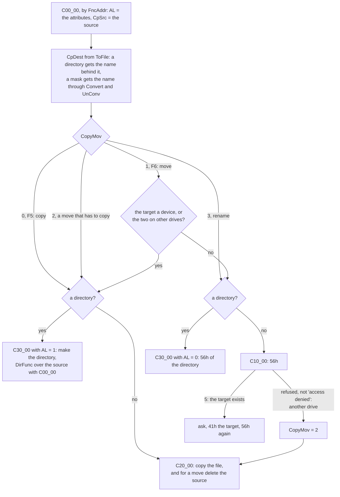

The drives are told apart by `C00_30`, nine instructions: the letter
in front of a colon, or the current drive's, and a path that begins
with `\\`, a network name, counts as no drive at all, so that a move to
or from a network path is always a copy.

A target with wildcards is made in the eleven-byte form of the
directory, where the `?` of the mask are the only places that take the
source's characters; [the chapter on numbers and
names](numbers-and-names.md#copying-txt-to-bak) has it worked through,
`notes.txt` and `*.bak` making `NOTES.BAK`. Doing it by fixed places
has one curiosity: with the mask `??x*.*`, the file `a.txt` becomes
`A_X_____TXT` (`_` a space), since the mask's `x` lands at place 2 of
a name whose place 1 is a space, and `UnConv`, which drops only the
spaces at the end of each part, keeps that one inside the name:
`A X.TXT`.

### The copy loop: all of the room

`C20_00` does not copy a file through a buffer of its own. It reads as
much of the source as the room holds, then writes all of it, then reads
again. A file smaller than the room is one read and one write.

```asm
C20_10:	MOV	AX,ES			; Reading
	ADD	AX,ES:FreMem2
	SUB	AX,ES:ViewSeg		;; the room, in paragraphs
	AND	AL,0E0h			;; down to 32 paragraphs, 512 bytes
	MOV	SI,AX			;; DI:SI = the room in bytes
	MOV	AL,AH
	MOV	AH,0
	MOV	CL,4
	SHL	SI,CL
	SHR	AX,CL
	MOV	DI,AX
	MOV	DS,ES:ViewSeg
	...
C20_11:	...
	XOR	DX,DX			;; each piece at offset 0
	MOV	CX,8000h		;; of 32K, or what is left
	...
C20_12:	MOV	AH,3Fh
	CALL	Intr21
	...
	ADD	ES:CpRead.Lo,AX
	ADC	ES:CpRead.Hi,0
	CALL	PerCent
	OR	AX,AX
	JE	C20_15			;; read 0: the end of the source
	ADD	DX,AX
	SUB	CX,AX
	JNE	C20_12			;; a short read: read the rest
	MOV	DX,DS
	ADD	DX,800h			;; the next 32K: the next segment
	MOV	DS,DX
	SUB	SI,AX
	SBB	DI,0
```

DOS takes a 16-bit count, and an 8086 offset reaches 64K, so the room,
which may be hundreds of kilobytes, is walked as a row of segments
`800h` paragraphs apart, each piece read to offset 0 of its own. The
same in the writing loop, which steps DS by the paragraphs written,
`SHR AX,4`. A piece that a device answers in several short reads is
read on at `ADD DX,AX`, but the room is counted down only by the last
of them, `SUB SI,AX`, so a slow device can have the loop read past the
room's end: a bug of the original.

```
 the room during a copy: DI:SI counts down what may still be read
 ViewSeg + 0000h  +--------------------+  a piece: up to 8000h bytes read to
                  |  32K               |  offset 0, by as many 3Fh calls as
 ViewSeg + 0800h  +--------------------+  it takes; DX steps on by each
                  |  32K               |
 ViewSeg + 1000h  +--------------------+  then DS += 800h paragraphs,
                  |  ...               |  and SI -= AX, the LAST read only
                  +--------------------+
                  |  the rest, < 32K,  |  rounded down to 512 bytes:
                  |  a multiple of 512 |  AND AL,0E0h of the paragraphs
 ViewSeg+FreMem2  +--------------------+

 a device that answers 8000h in three reads of 10,000, 10,000 and 12,768:
   DX: 0 -> 10,000 -> 20,000 -> 32,768     the piece is complete
   SI: counted down by 12,768, not 32,768  the room seems 20,000 larger
```

The room is rounded down to 512 bytes, presumably so that every piece
but the last of a file is a whole number of sectors. Writing goes the same way, from `ViewSeg` or from `CpCont`,
and steps DS by the bytes actually written, `SHR AX,4`, which is right
only because every piece but the last is a multiple of 16.

### The bar: 48-bit arithmetic without `MUL`

The bar in the copy box fills in proportion to (read + written) against
twice the size, so it is half full when the file has been read and full
when it is written. The sizes are 32 bits, the product with the bar's
width up to 48, and the 8086 multiplies 16 by 16. `PerCent` (125 bytes)
does without multiplying or dividing at all:

```asm
	MOV	AX,DS:CpRead.Lo		;; BX:AX = read + written,
	MOV	BX,DS:CpRead.Hi
	XOR	DX,DX
	ADD	AX,DS:CpWrite.Lo
	ADC	BX,DS:CpWrite.Hi
	ADC	DX,0			;; with its carry in DX: 48 bits
	XOR	SI,SI
	XOR	DI,DI
	XOR	BP,BP
	MOV	CL,DS:CpCntSz		;; times the width of the bar,
PerCn1:	ADD	SI,AX			;; by adding it that many times
	ADC	DI,BX
	ADC	BP,DX
	LOOP	PerCn1
	...				;; DX:BX:AX = 2 x the size
	MOV	CX,0FFFFh
PerCn2:	INC	CX			;; divided, by subtracting
	SUB	SI,AX			;; until it goes below 0
	SBB	DI,BX
	SBB	BP,DX
	JAE	PerCn2			;; CX = the cells to fill
```

The bar is a few dozen cells wide, so each loop runs at most that many
times: a multiplication and a division of 48 bits in a few dozen bytes
of code, in a time that a 4.77 MHz 8088 does not notice.

### A disk that fills up

A write that writes nothing is not just an error. `C20_50` asks DOS for
the free room of the target drive, 36h, multiplies sectors per cluster,
bytes per sector and free clusters, writes exactly that much of the
piece if it fits in 16 bits, closes the file, and asks `Cont_B`, "There
isn't enough room to copy: Abort / Continue". On Continue it sets
`SplitFl`, makes the target's chain of directories on the new disk, and
goes back to open the target with `CpCont` holding the segment in the
room where the unwritten part begins. That is how a file larger than a
floppy was carried on several. On Abort the half-written target is
deleted.

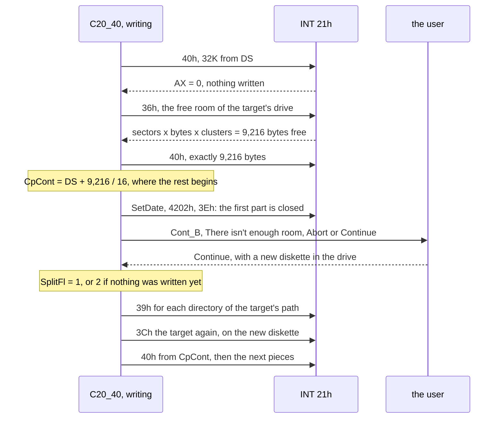

Nothing is read again from the source for the second part: what was
not written is still in the room, from `CpCont` on. The directories
are made only if the target's directory is not on the new diskette,
4300h failing, and they are made in place: a copy of the path in
`TmpErr` has every backslash turned into a zero, and then 39h makes the
first directory, a zero is turned back into a backslash, 39h makes the
next, and so on to the end. The free room is
reckoned with two `MUL`s in 16 bits, and if it does not fit 16 bits, or
is not less than what was to be written, nothing more is written before
the box: the write that wrote nothing failed for some other reason, a
full root directory say, and the user is asked all the same.

Every way out of `C20_00` goes through `C20_45`, which closes the target
and deletes it, and closes the source; error 53h, the critical-error
box answered with Cancel, ends without a second box, since the user has
just seen one.

## The viewer and the editor

F3 and F4 have [a chapter of their own](viewer-and-editor.md): the
viewer's window of 64K over a file of any size and its line table, the
search `V81_00` and `V82_00` that find file shares, and the editor's
whole text with one line apart.

## Find file

Alt-F7, `F67_00` of `VCFIND.INC`, is `DirFunc` once more, with
`FindFil` in `FncAddr`, and a list in the room. Its state, `FndData`,
is the third structure over `TmpBuf`, 18 bytes from `TmpBuf+100`:

```
 FndData, padded to TmpBuf+100 as ViewDat is to TmpBuf+200
 +100  FndCur   word  the line of the cursor
 +102  FndFrst  word  the first line shown
 +104  FndNumb  word  the lines in the list
 +106  FndSize  word  the most lines the room takes: room / 65 - 1
 +108  FndBg    word  where the window is on the screen
 +110  FndSz    word  its size
 +112  FndFls   word  the files found, for "N files found."
 +114  FndMode  byte  0: the list follows the search, 1: the user moves it
 +115  FndDir   byte  1: not the first file of this directory
 +116  FndMenu  byte  the item of [ Stop ] [ Go to ] [ Quit ]
 +117  FndDrv   byte  the drive being searched, for '*:'
```

A found file is a line of 65 bytes, `LenFnf`, already in the form the
box shows: three spaces, the name in small letters or a directory's in
capitals, the size or `SUB-DIR`, the letters `ASHR` or dots, the date
and the time. Before the first file of a directory comes a line with
the directory's path, and before that an empty line. So the box draws a
line by copying it, and Go to finds the directory of a file by walking
up the list to the line before.

```
 a line of the list, LenFnf = 65 bytes, as FnFl30 writes it ('_' a space)
 0         1         2         3         4         5         6
 01234567890123456789012345678901234567890123456789012345678901234
 ___hello.txt________________15___A...____6-16-2000___12:00:00p___
 ___FREEDOS_____________SUB-DIR___....____4-02-2025____2:23:14p___
    ^ 3: the name, small letters for a file, capitals for a directory
                  ^ 17..29: the size, 13 cells by Number, or SUB-DIR
                                  ^ 33..36: A S H R, or a dot each
                                         ^ 40..49: the date, 10 cells
                                                      ^ 53..61: the time
```

The date has four digits of the year and the time its seconds, which
the panels never show: `BufDate` and `BufTime` make the long forms of
what `PutDate` and `PutTime` made, as they do for the date and the
time in the dialog of Ctrl-A.

```
 the room during a search                                 FreMem2
 ViewSeg
 +-------+-------+-------+----- ... -----+---------------------------+
 | line0 | line1 | line2 | 65 bytes each | a part of the file being  |
 | path  | file  | file  | FndNumb lines | searched for a text,      |
 |       |       |       |               | at most 32,848 bytes      |
 +-------+-------+-------+----- ... -----+---------------------------+
 FndSize = room in bytes / 65 - 1          ^ FndAdr(FndNumb + 1)
```

Line N is at `ViewSeg` plus 65 x N bytes, which can pass 64K, so
`FndAdr` (30 bytes) makes a segment and offset of the 32-bit product of
one `MUL`, the same arithmetic as the editor's
[`T61_00`](viewer-and-editor.md#a-place-is-20-bits-t61_00-and-t60_00).

`FindFil` (585 bytes) is called with AL, the attributes of what
`DirFunc` found, and returns at once for anything that is not a
directory. For a directory, it runs its own `FindFirst` and `FindNext`
of the mask over it, lists the matches, and at its end cuts its own
name off and calls `DirFunc`, which calls `FindFil` for each
subdirectory. The DTA trick of `DirFunc` is what makes this nest. With
`*:` as the drive, `F67_10` does this for each drive from A: to Z: that
is not a CD-ROM (INT 2Fh 150Bh, which `MSCDEX` answers with `0ADADh` in
BX) and is a network drive (4409h, bit 12 of DX) or a fixed one (4408h).

### Searching inside files

With a text in "Containing", each file that matches is opened and read
into the room *behind* the list, in parts of up to 32,848 bytes,
`8000h + 80`. Each part is searched with
[`V82_00`](viewer-and-editor.md#comparing-v82_00), and the next part
begins 80 bytes before the end of the last, `4201h` with `CX:DX =
-1:-80`, so that a match across the seam is not lost:

```asm
	MOV	AX,ES
	ADD	AX,DS:FreMem2
	SUB	AX,DS:ViewSeg		;; the whole room, in paragraphs
	MOV	BP,8000h+80
	...				;; BP = the room or 32,848, the smaller
FnFl45:	CMP	BP,4000
	JB	FnFl48			; Out of memory ???
	MOV	AX,DS:FndNumb
	INC	AX
	CALL	FndAdr			;; DS = behind the list
FnFl46:	...
	MOV	CX,BP
	XOR	DX,DX
	MOV	AH,3Fh
	CALL	Intr21			;; read a part there
	...
	CALL	V82_00
	...
	MOV	AX,4201h		;; back 80 bytes
	MOV	CX,-1
	MOV	DX,-80
	CALL	Intr21
```

The length of the part is taken from the whole room, not from what the
list has left of it, so with a long list and little memory the read
goes past the room's end: a bug of the original. `Out of memory ???` is
Volkov's comment, three times in `FindFil`.

The search stays responsive because `FndBack` (144 bytes) runs before
every call of DOS that can take long: it looks at the keyboard and the
mouse, moves the cursor in the list while the search goes on, and opens
the menu `[ Stop ] [ Go to ] [ Quit ]`.


*Alt-F7: the list in the room, 65 bytes for each line.*

## The user menu and the extension files

`VC.MNU` and `VC.EXT` are text files of one format, which `FndItem` (37
bytes) walks: a line that begins at the margin begins an entry; lines
below it that begin with a space or a tab are its commands; a line that
begins with `'` is a comment; the program has put a 1Ah behind what it
read, and that is the end.

```
 VC.MNU                                 VC.EXT
 F1: Compile this file                  c:   tcc !.!
     tcc !.!                            txt: edit !.!
     pause                              d??: debug !.!
 'a comment                             *:   type !.!
 G: Go to the root
     cd \
```

**The extension files.** Enter on a file that is not a program copies
the panel's `ExtBuf` into `MenuBuf` with a 1Ah and calls `FindExt` (104
bytes). That puts the file's extension at `TmpErr`, three characters
padded with spaces, and walks the entries, comparing up to three
characters by `LowCase`, `?` matching any one and `*` the rest. It
answers with SI behind the colon, where the commands begin.

**The user menu.** F2, `F32_00`, reads `VC.MNU` of the current
directory, or the program's own (Shift-F2 goes there at once), into
`MenuBuf`, at most 3,999 bytes, and builds the menu from it: one word
per entry at `TmpBuf+100`, the entry's letter in capitals in the low
byte, or for `F1` to `F12` the BIOS's scan code in the high byte, `3Bh`
to `44h` and `85h`, `86h`, worked out from the digits. The box is as
wide as the longest line and as tall as the entries, at most the
screen's rows less six.

The two codes for F11 and F12 are dead code. `ADD BH,85h-'1'` works out
85h and 86h correctly, the scan codes that the enhanced keyboard's F11
and F12 have, but the program reads keys only with functions 0, 1 and 2
of INT 16h ([chapter 4](04-the-system.md#waiting-is-not-idle)), and the
BIOS keeps F11 and F12 from those, which were made for the 83-key
keyboard: no key the user can press ever matches an entry so marked.
Such an entry is still in the menu, and Enter or the mouse chooses it.

### `Run_00`: the macros

`Run_00` turns the commands of an entry into the command line to run,
in `DosBuf`, 1,000 bytes: each command ended by a zero, the list by two.
A first command that begins with `@` sets bit 7 of `LoadFl`, which runs
the commands without the prompt and the echo. On the way it expands the
macros:

| Macro | Becomes |
|---|---|
| `!` | the name of the file under the cursor, without its extension |
| `!.!` | the name with its extension |
| `!:` | the current drive, `C:` |
| `!\` | the current directory, ending in a backslash |
| `!@` | the name of `vc.lst` in `TEMP`, which `FileLst` fills with the selected files |
| `!!` | `!` |

The expansion is economical in a way only assembly invites. `!` and
`!.!` are one piece of code, which copies the name up to a terminator
in DL: `.` for `!`, 0 for `!.!`. And `!:` writes the drive's letter and
*does not step past the colon*, so the colon of the macro is copied as
the next character and the drive comes out as `C:` for free:

```asm
Run_11:	CMP	AL,':'
	JNE	Run_12
	MOV	AL,DS:DosPth[0]		;; the letter; SI stays on the ':',
	JMP	Run_06			;; which is copied next
	...
Run_18:	MOV	DX,'.'			;; '!': up to the full stop
	CMP	AX,'!.'			;; '!.!'?
	JNE	Run_19
	INC	SI
	INC	SI
	MOV	DL,0			;; then up to the end of the name
```

With BP not 0, the name is taken from `ViewFil`, the file of the viewer
or the editor, which is how `VCVIEW.EXT` and `VCEDIT.EXT` name an
outside viewer or editor for Alt-F3 and Alt-F4.


*F2: the user menu, read from `VC.MNU` into `MenuBuf`.*

## The command line and the history

The line under the panels is DOS's prompt and a command being typed,
and it is drawn by two routines of `VCSUB2.INC` from four bytes of the
main data and the 124 bytes at the head of `DosBuf`. Its editing keys
are `EdLin`'s, the same 184 bytes that edit a dialog's line, and
[chapter 2](02-the-screen.md#inpstr-and-edlin) has them. What is the
command line's own is how it is shown, how text gets into it besides
the keys, and the history.

### `PutPrm` and `DosCom`: a window over 123 characters

`PutPrm` (103 bytes) writes the prompt: the drive's letter, the path
of `DosPth` if the Prompt option is on, a `?` if the current directory
could not be read (`PathEr`), and `>`. Its row, `DosLin`, follows the
bottom of the panels while they are shown. The number of cells it
took is `BegCol`, and the rest of the row is a window over the command:

```
 the row DosLin
 C:\WORK>copy readme.txt d:\backup\docs\2000\
 |<----->|<------------- 80 - BegCol cells: DosBuf from OutCol --------->|
  BegCol

 DosBuf, LenCmd = 124: at most 123 characters and the zero
 0        OutCol                 DosCol                              123
 +--------+----------------------+-----------------------------------+
 |        | shown                ^ the cursor                        |
 +--------+----------------------+-----------------------------------+
 DosCom's two rules, in this order:
   OutCol <= DosCol - 5                 keep five characters left of it
   DosCol - OutCol <= 79 - BegCol       keep the cursor inside the row
```

`DosCom` (100 bytes) applies them and copies the window into `ScrBuf`,
a space for every cell past the command's zero, and the row to the
display. A command of 123 characters fits what `COMMAND.COM /C` can
be handed in the 127 bytes of a command tail.

### Text that is typed for the user

Everything that puts text into the command line does it by calling
`EdLin` once for each character, as if the user had typed it: Enter on
a program, `F21_22`; Ctrl-Enter, `F27_00`; Ctrl-I, `F80_00`, which
types the selected names; Ctrl-[ and Ctrl-], `F81_00` and `F82_00`,
the left or the right panel's path, 45 bytes for the two; and Alt-F8.
So each of them gets insertion at the cursor, the limit of 123
characters with a beep, and the window's scrolling for nothing, and
none of them knows the command line's layout. A loop of five
instructions is all each one adds:

```asm
F21_23:	MOV	AL,DS:[BX]		;; the next character of the name
	CMP	AL,0
	JE	F21_24
	INC	BX
	CALL	EdLin			;; typed, as a key would be
	JC	F21_23			;; CF: it went in
```

Ctrl-I, `F80_00`, is a walker of its own: it clears bit 7 of every
entry, types each selected name with a space behind it, a directory's
with `\*.*`, turns its bit 6 into bit 7 as `FncSel` does, and stops
before a name that would not fit the 123 characters, so that the line
never holds half a name.

### The history: 512 bytes and a zero in front

`HstBuf` is 512 bytes of the main data. Its first byte is always 0,
and the commands follow it, the newest first, each ended by its zero,
the whole ended by an empty command, a second zero:

```
 HstBuf, LenHist = 512, before
 byte  0    1        5        11                   ...    511
       00   dir 00   cd .. 00 type x.txt 00   ...  00     the end: an
       ^ HstAdr after a command: "in front of the newest"  empty command

 F21_25 runs "edit a.bat", 11 bytes with its zero:
 1. the newest already? REPE CMPSB of 11 bytes with HstBuf+1: no
 2. STD, REP MOVSB: bytes 500..0 to 511..11, the whole buffer
    11 bytes on, in one instruction
 3. REP MOVSB of the 11 bytes of DosBuf to HstBuf+1
 4. from behind it, REPNE SCASB command by command; the command that
    runs past byte 511 gets a zero at its first byte

 after
 byte  0    1             12       16       22
       00   edit a.bat 00 dir 00   cd .. 00 type x.txt 00 ...  00 00
```

`F21_25` is 88 bytes for all of it, and the oldest command is lost a
whole command at a time, never in part. (One that ends exactly in the
last byte is lost too: the walk only keeps a command whose zero lies
before byte 511.)

Ctrl-E steps to the older command and Ctrl-X to the newer, by
`HstAdr`, and the zero at byte 0 is what lets both be a single string
instruction. Older is forward, past the current command's zero:

```asm
F25_00:	MOV	DI,ES:HstAdr		; ^E
	MOV	CX,256
	MOV	AL,0
	REPNE	SCASB			;; past the zero of this one
	CMP	AL,ES:[DI]		;; the empty command, the end?
	JNE	F26_02			;;  no: that is the older one
	MOV	DI,ES:HstAdr		;;  yes: stay
	JMP	F26_02
```

Newer is backward, two zeros back, and there the direction flag is
set for one `REPNE SCASB`:

```asm
F26_00:	MOV	DI,ES:HstAdr		; ^X
	DEC	DI			;; on the zero in front of this one
	CMP	DI,OFFSET HstBuf
	JB	F26_01			;; HstAdr was byte 0: stay there
	JE	F26_02			;; the newest: to byte 0, an empty line
	DEC	DI			;; else back over that zero
	MOV	CX,256
	MOV	AL,0
	STD
	REPNE	SCASB			;; back to the zero before the newer
	CLD
	INC	DI
F26_01:	INC	DI			;; and onto its first character
F26_02:	MOV	BX,DI
	JMP	F27_06			;; HstAdr = BX, typed into the line
```

The leading zero makes the newest command look like any other, with a
zero in front of it, and makes "in front of the newest" a place in the
buffer that `HstAdr` can hold: from there Ctrl-E finds the newest by
the same scan that finds every older one, and Ctrl-X gives an empty
line. With the panels off, Up and Down are these two keys.

Ctrl-Enter, `F27_00` (179 bytes), is two commands by where the cursor
is. On a line that has been begun, it looks on from `HstAdr` for an
older command that begins with what has been typed, comparing through
`UpCase`, and puts it in the line. On an empty line, or behind a
separator of `CmpSym` or an `@`, it types the name of the file under
the cursor and a space.

### Alt-F8: the history as a box

`F68_00` is 465 bytes and draws its box without a table: it measures
the commands, as many as make a box of the screen's rows less three,
the widest deciding the width, at most 65 characters of it shown; it
calls `MinBox` with the size
and centres it on row 13; and it writes the commands into the box from
the bottom up, the newest on the last line, cut at the box's edge. The
title, `' History '`, is nine bytes without a zero written over the
frame at column 35 ([chapter 2](02-the-screen.md#the-history) has the
screen). The cursor starts on the command that `HstAdr` names, and is
one row recoloured by `F68_30` (35 bytes).

Up and Down go round from one end to the other, Home and PgUp go to the
top, End and PgDn to the bottom, and a letter goes to the next line
that begins with it. That last test reads the line's first character
back from `ScrBuf`, not from `HstBuf`: the box is on the screen, and the
screen is a table of what each row says. Enter types the command into
the line through `EdLin` and runs it, `JMP F21_25`; Ctrl-Enter only
types it. The mouse is `F32_70`, the user menu's routine for a list in
a box.

## Enter, and running a program

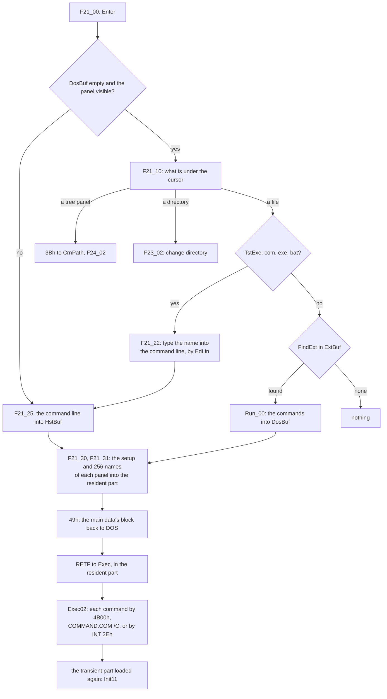

Enter on a program does not run it. It *types* it: `F21_22` puts the
name into the command line one character at a time through `EdLin`, the
routine that a key goes through, and then runs the command line. So a
program run by Enter and one run by typing its name take one path, and
both land in the history, by `F21_25`
([above](#the-history-512-bytes-and-a-zero-in-front)).

### Running it

What follows is the resident part's: `F21_31` copies the setup, the
history, the extension file and `DosBuf` into it, keeps each panel in
13 bytes a file, gives the main data back to DOS and goes to `Exec`,
which runs each command of `DosBuf` and then brings the commander back
at `Init11`, the panels read again and the cursor and the selection
found in what was kept.
[Chapter 4](04-the-system.md#the-resident-part-12690-bytes-that-stay)
has all of it.

## Drives, labels and the Info panel

### Which drives there are: Alt-F1 and Alt-F2

`F61_00` and `F62_00`, Alt-F1 and Alt-F2, share 758 bytes that put up a
row of drive letters over the panel and change the panel's drive. DOS
has no call that lists the drives, so the program asks for each of the
26 letters whether DOS will make it current. `TstDrv` of `VCSUB1.INC`
is 31 bytes:

```asm
TstDrv	PROC	NEAR
	PUSH	DX
	PUSH	AX
	SUB	AL,'A'			;; the letter as a number
	MOV	DL,AL
	MOV	AH,19h
	INT	21h			;; the current drive, to put back
	PUSH	AX
	MOV	AH,0Eh
	INT	21h			;; select the letter
	MOV	AH,19h
	INT	21h			;; and read back what is current
	CMP	AL,DL			;; ZF: DOS took it, the drive exists
	POP	DX
	PUSHF
	MOV	AH,0Eh
	INT	21h			;; the old drive current again
	POPF
	POP	AX
	POP	DX
	RET
TstDrv	ENDP
```

Four calls of DOS a letter, 104 for the alphabet, and none of them
touches a disk: selecting a drive only checks the letter against
DOS's table of drives, which is why an empty floppy drive is listed
without a sound. The letters that answer are written into `TmpBuf`,
one byte each.

One drive more is left out. A machine with one floppy drive has both
A: and B: on it, and DOS answers to both letters. Unless the setting
`DriveB` says otherwise, for A: and for B: the program asks IOCTL
440Eh which letter that drive answers to now, and drops the letter if
the answer is the other one: the panel offers the drive once, under
the letter it was last used by. [Chapter 4](04-the-system.md#the-drives-dos-would-ask-about-itself)
has `Fantom`, which keeps DOS from asking for the other diskette when
the program uses the other letter.

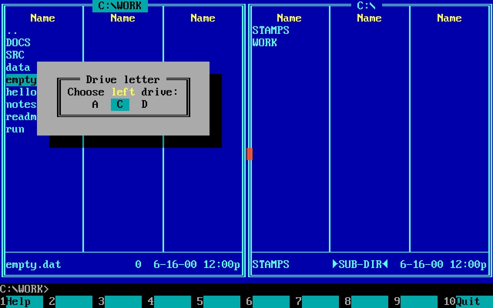

*Alt-F1 on a bench with A:, C: and D:: the box over the left panel,
three letters three cells apart, the cursor on the panel's drive.*

The row is spaced by how many letters there are: three spaces between
them for up to 7, two for up to 9, one for up to 14, and none beyond,
so that 26 drives still fit a box of 38 cells. The sentence is made of
pieces without zeros, copied by their lengths, `' Drive letter '`,
`'Choose '`, `'left'` or `'right'` in the box's bright colour, and
`' drive:'`: 37 bytes for the two sentences and the title. Enter on a
letter makes it the drive's own letter with 440Fh, so that DOS has
nothing to ask, takes the drive's current directory with 47h into the
panel's `WinPath` and changes to it with 3Bh; a drive that cannot be
read puts up `ErrRdy`'s box, in which another letter may be typed. The
panel then gets `ChgFlg` and is read again.

### The label: `GetVol` and Ctrl-F4

DOS 3 has no call for a disk's label either. `GetVol` (109 bytes) finds
it as DOS keeps it, as a directory entry of the root with attribute 8:
`FindFirst` of `\*.*` with CX = 8, and the name it gives, in the
eleven-byte form by `Convert`, cut after its last character that is
not a space. Before that it asks 60h for the true name of `A`, a
relative name: on a network drive the answer begins with `\\`, and the
server's name, up to its next backslash, is taken for the label.

Ctrl-F4, `F54_00` (195 bytes), changes the label, and a label is not a
file that 41h deletes or 56h renames. So the old one is deleted by an
FCB, as the walk of F8 deletes files: an extended FCB at `TmpBuf+20`
with attribute 8 and the old label as its name, and 13h. The new one is
made by creating a file, 3Ch with CX = 8, whose name is the label with
a dot put in after its eighth character, since the label's eleven
characters are a name and an extension to DOS:

```
 TmpBuf, as the dialog leaves it, and as 3Ch is handed it
 byte    0  1  2  3  4  5  6  7  8  9  10 11 12 13
 typed   \  M  Y  _  D  I  S  K  _  2  0  0  00
 F54_03  \  M  Y  _  D  I  S  K  _  .  2  0  0  00
            '-------- name --------'     '- ext -'
         bytes 9..12 moved one place on by two word moves,
         the dot written at 9, and moved back if 3Ch fails
```

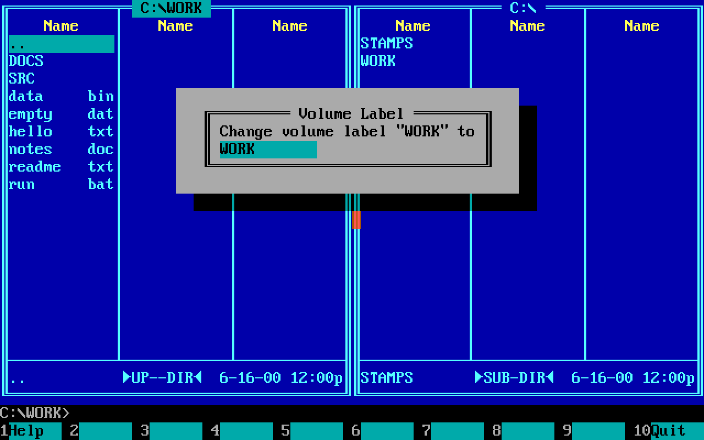

*Ctrl-F4: `Label_B`, the old label quoted in its first line and
offered in the input line, eleven characters at most.*

### The Info panel: `RdInfo` and `PutInf`

The Info panel is a panel whose `WinTyp` is 2, read by `RdInfo`
(155 bytes) where a panel of files would be read by `ReDir`. It asks
DOS three things and keeps the answers in four words of the main data:

| Asked | Kept | How |
|---|---|---|
| 36h, the drive's space | `Total`, `FreeDsk`: clusters; `ClstSiz`: bytes a cluster | sectors a cluster x bytes a sector, one `MUL`, 16 bits |
| `GetVol` | `Volume`, 12 bytes | as above |
| the file `DIRINFO` of the current directory | `InfBuf`, at most (50 - 13) x 38 = 1,406 bytes; `InfoLen` | one 3Fh, `InfoLen` 0FFFFh when there is none |

`PutInf` (469 bytes) draws it: the machine's memory and how much of it
is free, the label, the total and the free bytes, each a number of
clusters times `ClstSiz`, one `MUL` to 32 bits each, and then what the
*other* panel lists: how many files, and how much of the disk they
take. That is not the sum of their sizes, but of their sizes rounded up
to whole clusters, a 32-bit size divided by a 16-bit cluster in two
`DIV`s, the high word first and its remainder carried into the low:
[the chapter on numbers and
names](numbers-and-names.md#rdinfo-and-the-info-panel-bytes-per-cluster)
has the instructions, and why neither quotient can overflow.

Below a rule comes the text of `DIRINFO`, as much as fits, 36 cells a
line with tabs to the next column of eight, or " No `dirinfo' file in
this directory". A click on it opens the editor on the file.

## Errors as the user sees them

[Chapter 4](04-the-system.md#intr21-62-bytes-for-every-error) has how
an error comes back from DOS: `Intr21` asks function 59h for the exact
number, and turns a critical error that the user cancelled into 53h.
What the user then sees is one shape of box, a table of 42 bytes in
the source for each kind of failure, all of them alike:

```asm
DelEr_P	DB	Err_C, ErInv_C, ErInv_C, 0	;; the error colours
	DB	4, 1			;; four lines, one variable text
	DW	ErrBuf			;; saved behind: the second level
	DW	TmpBuf+130		;; the variable text: the name,
	DB	7, 64			;;  made a proper path, at most 64 cells
	DW	Inc_S			;; '^I': the title, handed in DX
	DW	CnDl_S			;; "Can't delete the file"
	DW	Var_S			;; '^V': the name
	DW	OkCan_S			;; ' Ok', 3 cells, 'Cancel'
DelEr_B	DW	DelEr_P, 928h, 0	;; centred on row 9, no routine
	DB	1, 0FFh, 0, 6		;; key bar 1, no menu, help page 0,
					;;  beep and move down by SftErr
	DB	4			;; one field: the buttons
	DB	0, 0, 0, 0
	DW	422h, TmpBuf+230, OkCan_D
	DB	0
```

```
   ╔════════ Delete ═══════╗   the title: the command's, ^I
   ║ Can't delete the file ║   what failed, one sentence
   ║       notes.doc       ║   the name, ^V
   ║      Ok   Cancel      ║   go on with the next file, or stop
   ╚═══════════════════════╝
```

The pieces are shared across the program: `Inc_S`, `Var_S`, `Ok_S` and
`OkCan_S` are one copy each in `VC.ASM`, and the title comes in DX
from the command, `Del_S`, `Copy0_S`, `Ren0_S`, so that the box of
"Can't delete the file" serves delete, the move that deletes its
source, and the rename that deletes its target. The sentences are
fixed, one for each thing that can fail:

| Box | The sentence | Shown by |
|---|---|---|
| `DelEr_B` | Can't delete the file | F8, and F5 and F6 where they delete |
| `OpnEr_B` | Can't open the file | the copy, for the source or the target |
| `RenEr_B` | Can't rename the file | F6 on one drive |
| `AtrEr_B` | Can't find the file, or Can't set attributes | Ctrl-A |
| `PthEr_B` | Path too long | every walk, at 68 bytes |
| `FndEr_B` | Can't find the file | F3 and F4, when the file does not open; F4 makes a new file for error 2 |
| `SrEr_B` | Could not find the string | F7 of the viewer and the editor |
| `ErVol_B` | Could not set the volume label | Ctrl-F4 |

None of them shows DOS's number, and none says why. The number decides
only which way the program goes, and the program goes few ways:

| Number | Meaning | What the program does | Places |
|---:|---|---|---:|
| 53h | the user has seen a critical error box | no second box: stop quietly | 35 |
| 5 | access denied | a read-only file: ask, clear the bit, try again; a target that exists: ask to overwrite | 14 |
| 2, 3 | file or path not found | another way: the root for a panel, "Can't find" for Ctrl-A, a new file for the editor | about 15 |
| 12h | no more files | the end of a search | 3 |
| 10h | the current directory | `F38_60`: change to `..` and remove it then | 2 |
| 0Fh | invalid drive | the panel's path from DOS's current drive | 1 |
| 20h | sharing violation | `OpenFil`: open again in the old mode | 1 |

`AtrEr_B` is the one place where the number picks the sentence: 2 or
3, the file or its path not found, is "Can't find the file", anything
else "Can't set attributes", handed to the box in DX through `^I`. A
table of DOS's own error messages would have cost a kilobyte or more,
and told the user little that the operation and the name do not.

`OpenFil` (25 bytes) is how every file the program reads is opened,
and the retry in it is the one place where an error is quietly worked
around:

```asm
OpenFil	PROC	NEAR
	PUSH	BX
	MOV	AH,3Dh
	MOV	BX,AX			;; the mode kept, in BL
	CALL	Intr21			;; 40h: read, others may write
	JNC	OpnFl1
	CMP	AX,WORD PTR 20h		;; SHARE says another has it
	STC				;;  open in a mode it refuses?
	JNE	OpnFl1
	MOV	AX,BX
	AND	AL,0Fh			;; then without sharing bits:
	CALL	Intr21			;;  the mode of DOS 2
OpnFl1:	POP	BX
	RET
OpenFil	ENDP
```

Mode 40h, read with nothing denied to others, is the polite way to
look at a file that another program on a network may be writing; when
SHARE refuses it all the same, the old compatibility mode, without the
bits of sharing, gets what DOS will give. A critical error, a drive
not ready or a disk that cannot be written, is another thing: DOS
stops in the middle of the call and the program's own `FatErr` asks
Retry or Cancel, before any of the boxes above
([chapter 4](04-the-system.md#the-critical-error-faterr)).

## How the features share the main data

No type checks who may use which buffer at the same time. The rule is
that every buffer which two features never need at once is one buffer,
and this table, from the listing, is the whole contract:

| Buffer | At | Bytes | Used by |
|---|---:|---:|---|
| `HstBuf` | 015Ch | 512 | the history |
| `ExtMain` | 035Ch | 512 | the program's own `VC.EXT` |
| `DosBuf` | 06C5h | 1,000 | the commands to run next, from Enter, `Run_00` and the command line |
| `DTA` | 0BFDh | 44 | every search of DOS: `ReDir`, `ReadTre`, `DirFunc`, `FncMas`, `FindFil` |
| `LowTab` | 0C29h | 128 | small letters above 80h |
| `TmpBuf` | 0CA9h | 256 | the path handed to `FncAddr`, `CpSrc`; a command's flags at +90; `FndData` at +100, or `EdData` at +100, or the user menu's keys at +100; `CpDest` at +130; `ViewDat` at +200; the extended FCB of a delete at +200, of a label at +20; the masks and the stamp of Ctrl-A at +94 |
| `TmpErr` | 0DA9h | 256 | names in a box, the extension for `FindExt`, a found file's line, converted masks |
| `MenuBuf` | 0F29h | 4,000 | the menus; the user menu's file; `VC.EXT` on Enter; the editor's line, `EditBuf`; the path that the tree scan builds at +40; `PutTree`'s levels and paths; the speed search's pattern at +208 and +228; the name `DirFunc` is leaving; the viewer's search beyond the window; `VC.INI` as it is saved |
| `ScrBuf` | 2448h | 8,000 | the program's copy of the screen |
| `UserScr` | 4388h | 7,840 | the screen of DOS, behind the panels |
| `WinBuf` | 6228h | 7,392 | what a box of the first level covers |
| `ErrBuf` | 7F08h | 7,392 | what an error box covers; the editor's undo line, `UndoBuf` |
| `ErrBuf1` | 9BE8h | 7,392 | what the help and the critical error cover |
| `HelpBuf` | B8C8h | 3,000 | a help page; the prepared search text and its hex bytes |
| `TreeBuf` | C480h | 12,299 | the tree, laid out as `TREEINFO.NCD` |
| the room | `ViewSeg` | the rest | the old list in `ReDir`; the viewer's window; the editor's text; the copy's pieces; find file's list and the part of a file behind it |

Three things make the sharing work. The **`EQU`**, which gives one
buffer a second name for a second use, `EditBuf EQU MenuBuf`, so the
code says what it means and costs nothing. The **`STRUC` padded to an
address**, `DB TmpBuf+200 DUP(?)`, which overlays a feature's variables
on scratch memory with every field addressable without a base register.
And **work in place**, which needs no buffer at all: the sort converts
names inside the entries; the filter partitions the list instead of
copying it; the tree scan inserts into its own buffer; `DirFunc` finds
its search again instead of saving it; `F21_40` keeps 13 bytes of an
entry by skipping the one byte that is always 0. Of the 62,603 bytes of
the main data, 38,016 are the screen and the four save areas behind
boxes, and the features in this chapter work in the rest and in the
room, which is whatever DOS has left.

## Every file the program reads and writes

The features above touch the disk in few ways, and always in the same
manner: open, as few reads or writes as the buffer allows, close. This
is all of it, for `VC.COM`:

| File | When | Read | Written | Into or from |
|---|---|---|---|---|
| `VC.INI` | at start; on save | one 3Fh asking 512 where the file has 511, the length test | 3Ch, one 40h of 511 | in place over the panels' save areas; `MenuBuf` ([chapter 5](05-the-setup.md#vcini-a-dump-of-the-main-data)) |
| `VC.EXT`, the program's | at start | one 3Fh of 511, and a 1Ah behind | by the editor, which copies its text into `ExtMain` too | `ExtMain`, 512 bytes |
| `VC.EXT`, a directory's | at every `ReDir` of a panel | one 3Fh of 511 | | `ExtBuf` of the panel |
| `VC.MNU` | F2 | one 3Fh of 3,999 | by the editor | `MenuBuf` |
| `VCVIEW.EXT`, `VCEDIT.EXT` | Alt-F3, Alt-F4 | one 3Fh of 3,999 | | `MenuBuf` |
| `VC.HLP` | F1, one entry a time | a header and up to 2,968 bytes of text | | `HelpBuf` ([chapter 1](01-the-program.md#the-help-vchlp-one-entry-at-a-time)) |
| `\TREEINFO.NCD` | a tree panel, Alt-F10, the copy's F10 | one 3Fh of up to 12,299 | one 40h of 16 x n + 11; one byte to mark it old | `TreeBuf` |
| `DIRINFO` | the Info panel | one 3Fh of up to 1,406 | by the editor | `InfBuf` |
| the volume label | Ctrl-F4 | `FindFirst` with attribute 8 | 13h by an FCB, then 3Ch with attribute 8 | `TmpBuf` |
| `vc.lst` in `TEMP` | a macro `!@` | | for each name 40h of the name, of `\*.*` for a directory, of CR LF | the panel's entries |
| a file copied | F5, F6 | 3Fh of 8000h a piece, the room cut to 512 | 40h of 8000h a piece; on a full disk, exactly the free room | the room |
| a file appended to | F5 onto a file that exists, Append | its last byte, a 1Ah to write over | as above, from its end | `TmpErr` |
| a file viewed | F3 | up to 65,504 into the window, then halves; the search 4,000 at a time | | the room; `MenuBuf` |
| a file edited | F4 | all of it, in pieces of 0FF00h | 3Ch, 40h in pieces of 0FF00h | the room |
| a file searched | Alt-F7, Containing | parts of 8000h + 80, overlapping by 80 | | the room behind the list |
| `VC.COM` | after a command, in the small mode | by DOS's loader | | ([chapter 4](04-the-system.md#coming-back-vccom-loads-itself)) |

Two handles at most are open at once, and only in the copy, the source
and the target. The viewer keeps one open for as long as it shows the
file, since it reads on as the user pages; everything else is opened
and closed again by the routine that reads it. The reads land in the
fixed buffers of the main data, each sized to the file it takes, 512
bytes for an extension file and the setup, 4,000 for a menu and the
viewer's search, 12,299 for the tree, or in the room, for anything
that is the user's own file and may be of any size. No file is read
through a buffer of its own and then copied onward.

## Where to read next

- `src/asm/VC.ASM`: `MainDat`, `WCBdef`, `FILENT`, `DIRENT`, `DIRTREE`
  near the top; `Init11` for the memory; `Func40` for the mouse in a
  list.
- `src/asm/VCSUB3.INC`: `ReDir`, `ReadTre`, `TreeCur`, `TrCr10`,
  `PutTree`, `ChTree`, `RdInfo`, `PutInf`, `GetVol`, `OpenFil`,
  `DirSize`, `NearFl`; and `VCSUB2.INC` for `SetMask`, `TstExe`, `Sort`,
  `CmpPar`, `FnFile`, `TotSel`, `CorPar`, `PutPrm`, `DosCom`, `Search`,
  `FndItem`, `FindExt`.
- `src/asm/VCSUB1.INC`: `Convert`, `UnConv`, `TstDrv`.
- `src/asm/VCF1.INC`: `F38_00` to `F38_70`, `M30_00`, `M30_50`,
  `F54_00`, `DirFunc`, `FncSel`, `FncMas`, `DelTree`.
- `src/asm/VCCOPY.INC`: the `EQU`s at the top, `C00_00` to `C30_00`,
  `PerCent`, and the boxes of errors at the top.
- `src/asm/VCVIEW.INC`: `ViewDat`, `V00_10`, `V50_00`, `V51_00`,
  `V60_00`, `V81_00`, `V82_00`.
- `src/asm/VCEDIT.INC`: `EdData`, `Edit_T`, `T00_00`, `T50_00`,
  `T51_00`, `T61_00`, `T80_00`.
- `src/asm/VCFIND.INC`: `FndData`, `F67_00`, `FindFil`, `FndAdr`.
- `src/asm/VCFUNC.INC`: `AdrNum`, `NumAdr`, `F00_50` and the cursor
  keys at the top; `F21_00` to `F21_40`, `F25_00` to `F27_11`,
  `F80_00`, `F61_00` and `F62_00`, `F68_00`, `F77_00`, `F32_00`,
  `Run_00`, `FileLst`.
- [Chapter 1](01-the-program.md) for the main data and the loop;
  [chapter 2](02-the-screen.md) for the screen, the panels as drawn,
  `EdLin` and the dialogs; [chapter 4](04-the-system.md) for `Intr21`,
  the critical error, `Fantom`, the calls of DOS and the resident part
  that runs a command; [chapter 5](05-the-setup.md) for `VC.INI`, which
  keeps each panel's mode, sort order, filter and path.
