# 3. DOS as the abstraction layer: one program on three platforms

Vibe Commander runs in three places: on DOS, as a 32-bit program under
the DOS/32A extender; on Linux, as a 64-bit program in a terminal; and in
a browser, as WebAssembly. The program itself, some forty C files of
panels, dialogs, an editor and a viewer, is the same on all three. It
does not know which one it is on.

What lets it not know is a single header, `src/portable_c/sys.h`. The
interesting decision is what that header says. It does not describe a
modern operating system and adapt DOS to it. It describes DOS, and asks
every other platform to pretend to be DOS. Linux and the web page are
emulators, in the way DOSBox is, but at the level of DOS's services
rather than of the processor: nothing is interpreted, the program calls a
C function named `FileRead` and gets back what DOS would have said.

This chapter goes down through that header and the four files of the
system that stand behind it on each platform.

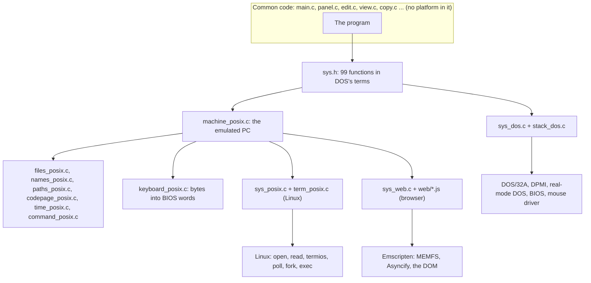

The DOS side has one file of system calls. The other two share a whole
emulated machine, `machine_posix.c`, and differ only in where the keys
come from, where the screen goes and how a command is run.

## 3.1 The contract: `sys.h`

### Why DOS's terms

The common code was translated, routine for routine, from Volkov
Commander's assembly. It has DOS's shapes in hundreds of places: a path
is at most 67 characters with backslashes, a file name 12 bytes with its
dot, attributes are DOS's bits, a date is DOS's packed word, an error is
DOS's number, a key is the BIOS's word (scan code in the high byte,
character in the low), a screen cell is a character with its colour
above it. The screens show these shapes, and the scenarios hold the
screens to the goldens recorded from the original, cell for cell.

There were two ways to go. One was to design an interface for modern
systems (long paths, Unicode, `errno`, events) and adapt the hundreds
of places. That is a redesign of the program. The other was to leave the
program alone and put the adaptation on the other side of one header.
The project took the second, on the user's word of 14 October 2026, and
the header's own comment says it in one sentence:

```c
 * What is asked for is still shaped as DOS and the BIOS of a PC have it,
 * since the rest of the program has those shapes in hundreds of places
 * and the screens show them: a drive is a letter or its number, a path
 * has backslashes and at most 67 characters, a name 12 with its dot;
 * attributes, dates and times are DOS's bits; an error is DOS's number
 * for it; a key is a character with the scan code of the key above it; a
 * cell of the screen is a character with its colour above it; a tick is
 * the 18.2th part of a second. Another system has to answer in these.
```

The one thing in `sys.h` that is not DOS's is memory. DOS hands out
paragraphs by segment; `sys.h` hands out blocks by pointer, counted in
bytes (`struct Block`, `MemTake(i32 bytes)`). Segments were gone from
the program when it became flat 32-bit code (step 2 of the road), so
there was nothing left to emulate.

The cost of this choice is real and accepted: on Linux a path deeper
than 67 characters is reachable only through aliases (section 3.3), a
file of 4 GB or more shows as `FFFFFFFFh` bytes, a disk shows at most
4 GB less 64 KB free. The benefit is that the common code has no
`#ifdef` for a platform and that every scenario recorded from the
original can judge Linux and the web page as well as DOS.

### One function, one thing asked

The header names no register, no service number, no interrupt. Each
function is one thing that is asked. Where the program asks several
things in a row, the row stays in the program, in the original's order,
because "what DOS is asked and in which order is behaviour, and the
scenarios see it". `OpenFil` of `system.c`, which opens a file and tries
again without sharing flags on a sharing violation, is two calls of
`FileOpen` in the common code, not one smarter function in the system's
file.

### Answers

Everything that may fail answers with `struct Answer` or a structure
that begins like it:

```c
struct Answer {
    u16 value;      /* what was asked for, a handle or a number of bytes,
                       or the error: AX as DOS left it */
    bool failed;    /* if that is the error */
};
```

`value` is AX as DOS leaves it *also where nothing failed*, because some
callers of the original go on with whatever AX held. The emulations
therefore answer, in AX, what the bench's DOS (FreeDOS 1.4) answers:
`files_posix.c` has a row of `AX_CLOSE 0x3E00`, `AX_DELETE 0x4100` and
so on, each read off the bench by the toy `harness/trial32/asked.py`.

The larger answers each have their own structure: `struct Moved` for a
read or a write (`i32 count`, `u16 error`, `bool failed`),
`struct FilePlace` for a seek, `struct FileAttr`, `struct FileStamp`,
`struct Device`, `struct Space` for a disk's room, `struct Block` for
memory, `struct Keys` for a waiting key.

### Asked and bare

The functions of files, directories and drives come in two kinds, and
each group of `sys.h` says which of its functions are of which:

- **Asked with the program's errors**: this is the original's `Intr21`.
  If a device is not ready, DOS asks the program what to do, the program
  shows its "Retry / Cancel" box (`FtErr1` of `main.c`), and if the user
  gives up the call fails with error `53h`. A failure DOS reports by
  itself is replaced by DOS's extended error, asked for behind the call.
- **Bare**: DOS's answer as it is. Where a function is needed both ways
  there is a second function with `Bare` behind its name:
  `FileOpenBare`, `FileCloseBare`, `FileReadBare`, `DirCurrentBare`,
  `ProgramRunBare`.

On Linux and the web the two kinds are the same function: the host has
no device that asks the program anything.

### Widths

A number that DOS or the BIOS takes or answers in keeps its width and
has no sign: a handle is `u16`, attributes `u16`, a packed date `u16`. A
count the program reckons with is an `i32` even where DOS takes it in a
16-bit register, and `sys_dos.c` splits it (`FileRead` takes an `i32`
and DOS takes `0FFFFh` at most). A file size and a place in a file are
`u32`, DOS's width, on every platform, Linux included.

### The groups

| Group | Functions | Examples |
|---|---:|---|
| Files | 18 | `FileCreate`, `FileOpen`, `FileRead`, `FileWrite`, `FileSeek`, `FileStep`, `FileAttributes`, `FileTime`, `FileDevice`, `FileTrueName` |
| Files by an FCB | 2 | `FcbParse`, `FcbDelete` (delete a whole mask; drive labels) |
| Directories | 8 | `FindRecord`, `FindFirst`, `FindNext`, `DirMake`, `DirChange`, `DirCurrent` |
| Drives | 8 | `DriveCurrent`, `DriveSelect`, `DriveSpace`, `DriveLetter`, `DriveRemote`, `DriveCd` |
| Memory | 6 | `MemTake`, `MemGive`, `MemResize`, `MemOwn`, `MemSetSearch`, `MemSetUpper` |
| Time, country, system | 8 | `TimeOfDay`, `CountryInfo`, `CaseMap`, `SystemVersion`, `BreakCheck`, `Idle` |
| Other programs, the end | 8 | `ProgramRun`, `ProgramOfFile`, `ProgramOpenFile`, `ProgramEnd`, `ProgramTail`, `ProgramEnvironment` |
| What the system asks the program | 11 | `DeviceErrorTake`, `IntOn`, `CtrlBreakTake`, `CtrlCTake`, `ProgramEndedTake` |
| Console | 2 | `ConsoleChar`, `ConsoleText` (text ends at `$`, as AH 09h) |
| Keyboard | 4 | `KeyWaiting`, `KeyRead`, `KeysHeld`, `KeyForgetIns` |
| Screen | 15 | `ScreenState`, `CursorTo`, `ScreenScroll`, `ScreenFill`, `ScreenType`, `ScreenPut`, `ScreenGet` |
| Mouse | 8 | `MouseFind`, `MouseShow`, `MouseWhere`, `MousePointer` |
| Timer | 1 | `Ticks`, 18.2 to the second since midnight |

Ninety-nine functions, counted from the header. Two of them are not
DOS's at all and were added for the other platforms: `ProgramOfFile`
asks whether a file is something Enter can run (on DOS: its extension is
COM, EXE or BAT; on Linux: the user may execute it), and
`ProgramOpenFile` hands a file that is not a program to whatever opens
files of its kind (nothing on DOS, `xdg-open` on Linux, a new browser tab
on the web).

### What the system asks the program

The last group goes the other way. DOS comes to the program, in the
middle of a call, with the critical error (INT 24h); the keyboard comes
with Ctrl-Break (INT 1Bh); DOS comes with Ctrl-C (INT 23h). The program
takes each with a Note / Take / Give protocol:

```c
typedef u16 DeviceErrorFn(u16 how, u16 error, const u8 *device);
#define DEVICE_RETRY 1
#define DEVICE_FAIL  3

void DeviceErrorNote(void);
void DeviceErrorTake(DeviceErrorFn *ask);
void DeviceErrorGive(void);
```

`Main` of `main.c` calls `DeviceErrorTake(FtErr1)` and `CtrlBreakTake()`
when it starts. `DeviceErrorFn` gets the error in DOS's terms (the
drive, the error number, the name of a character device or 0) and none
of real mode's addresses. Where the interrupt actually arrives, with its
registers and its `IRET`, is the system file's business.

The strangest member of the group is the program's end by another's
hand: DOS ending the current program because a program that it ran and
that stayed resident told it to. The program gets no word of that, and
under an extender its memory is gone before DOS goes on. So the program
says *beforehand* what is to be put back, as a value
(`ProgramEndedBreakCheck(bool on)`), and the system puts it back when
the time comes. Section 3.2 shows how DOS does that with eight
instructions of real mode.

## 3.2 DOS: `sys_dos.c` under DOS/32A

### Protected mode over real mode

The program for DOS is compiled by Open Watcom's `wcc386` in the flat
model (`-3r -mf`): one code segment, one data segment, both based at 0,
a pointer is a 32-bit offset that is also the linear address. It is
linked by `wlink` as an LE executable (`format os2 le`) with
`binw/dos32a.exe` of the pinned Open Watcom download as its stub. DOS
loads the stub, the stub switches the machine into protected mode, loads
the LE image above the megabyte, and enters the program at `Start` of
`sys_dos.c` (`option start=Start_`).

DOS, the BIOS and the mouse driver are still 16-bit real-mode code. The
program calls them by the same software interrupts as the original did,
`INT 21h`, `INT 10h`, `INT 16h`, `INT 33h`, and the extender catches
each one, drops to real mode, makes the call and comes back. What it does
on the way decides how each function of `sys.h` has to be written. The
top of `sys_dos.c` records what toys on the bench showed:

- A call that takes no address, and every call of the BIOS and of the
  mouse driver, goes over with its registers and comes back with them.
- A call of DOS that takes an address and that the extender knows,
  `3Fh` read, `40h` write, `3Dh` open and the like, is *translated*: the
  program hands its own 32-bit pointer, and the extender copies the bytes
  to a buffer of its own below the megabyte and back.
- A call the extender does not know goes over with its registers as they
  are, so the pointer in them means nothing to DOS: FCB calls (`13h`,
  `29h`), the country (`38h`), the true name (`60h`). Those must be made
  in real mode by hand.
- Four translated calls come back with the AX they were called with
  instead of DOS's AX: the search (`4Eh`, `4Fh`), the current directory
  (`47h`), set attributes (`4301h`). Since `sys.h` promises DOS's AX,
  these are made in real mode by hand as well.

Thirteen functions of `sys.h` end up being made in real mode:
`FindRecord`, `FindFirst`, `FindNext`, `FileSetAttributes`,
`DirCurrent`, `DirCurrentBare`, `FileTrueName`, `FcbParse`,
`FcbDelete`, `CountryInfo`, `CaseMap`, `ProgramRun` and
`ProgramRunBare`.

### The interrupts are seven `#pragma aux`

Every interrupt in the file is written once, as inline assembly in a
`#pragma aux`, and nowhere else: `Dos` (INT 21h), `Dpmi` (INT 31h, the
extender's own services), `Video` (INT 10h), `Keyboard` (INT 16h),
`Multiplex` (INT 2Fh), `DosIdle` (INT 28h), `MouseDriver` and
`MouseState` (INT 33h). `Dos` loads six 32-bit registers from a
`struct DosRegs`, makes the call, stores four back, and turns the carry
flag into the return value with `sbb eax,eax`:

```c
static u32 Dos(struct DosRegs *regs);
#pragma aux Dos = \
    "push ebp" "push ebx" \
    "mov eax,[ebx]" "mov ecx,[ebx+8]" "mov edx,[ebx+12]" \
    "mov esi,[ebx+16]" "mov edi,[ebx+20]" "mov ebx,[ebx+4]" \
    "int 21h" \
    "xchg ebx,[esp]" \
    "mov [ebx],eax" "mov [ebx+8],ecx" "mov [ebx+12],edx" \
    "pop eax" "mov [ebx+4],eax" "pop ebp" \
    "sbb eax,eax" \
    parm [ebx] value [eax] modify exact [eax ebx ecx edx esi edi]
```

A register goes in with all 32 bits because the extender reads all of
them where it translates; of what comes back only the low words count.

Above the interrupts sit a few helpers that every function of `sys.h`
is built from:

- `Set` and `SetLow` fill a `struct DosRegs`, with 0 in every register
  the call does not read. (The original left those as they happened to
  be; the difference is declared in `DEVIATIONS.md`, entry 6, with a
  table of every place.)
- `Call` makes INT 21h directly, or, when `regs->low` is set, in real
  mode through `Real`.
- `Real` fills a DPMI `struct RealRegs` (DS and ES on the low block, SS
  and SP 0 so that the extender lends its own stack) and asks DPMI
  `0300h` for an interrupt or `0301h` for a far call.
- `Tell` is a bare call; `Ask` is `Intr21`: it clears `md.ErrDat`, makes
  the call, turns a box the user gave up on into `53h`, and asks AH
  `59h` for the extended error of anything else that failed.

### One call through all of it: `FileRead`

`FileRead(handle, to, count)` takes an `i32`. DOS takes 16 bits. `Move`
splits the count into pieces of `PIECE_MOST` (`0xFFFF`) bytes and goes on
for as long as each piece comes back whole:

```c
do {
    piece = count - moved.count;
    if (piece > PIECE_MOST)
        piece = PIECE_MOST;
    Set(&regs, ax, handle, (u32)piece, ADDRESS(at + moved.count));
    answer = asked ? Ask(&regs, false) : Tell(&regs);
    if (answer.failed) { ... break; }
    moved.count += answer.value;
} while (answer.value == piece && moved.count < count);
```

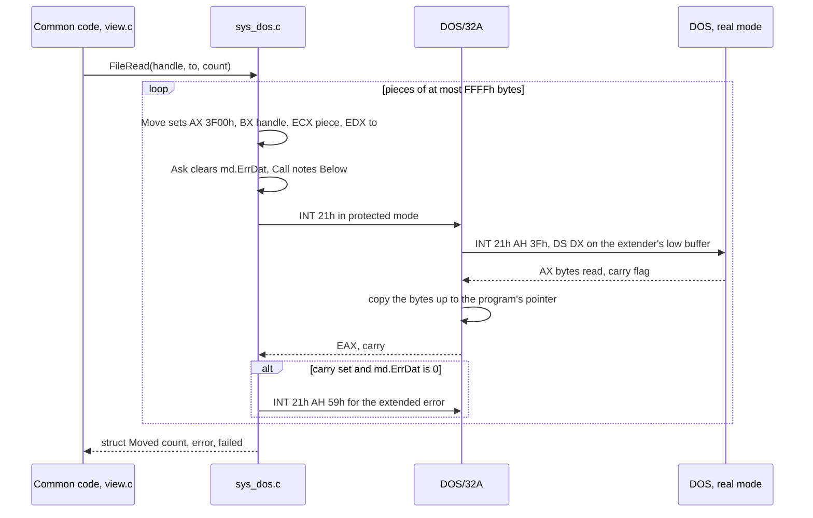

A read is one of the calls the extender translates, so `sys_dos.c` does
nothing about the buffer. A search is not, and its function looks
different:

```c
struct Answer FindNext(void)
{
    struct DosRegs regs;

    if (Record != 0)
        Bytes(LOW(LOW_RECORD), (const u8 *)Record, RECORD_SIZE);
    SetLow(&regs, 0x4F00, 0, 0, 0);
    return Searched(&regs);
}
```

The program's 43-byte search record goes down to the low block before
the call, because DOS keeps the state of the search in it and the
program may have several searches open; `Searched` copies it back up
behind every call, failed or not.

### The block below the megabyte

`Start` asks DPMI `0100h` for 32 paragraphs of DOS's memory,
`(LOW_SIZE + 15) >> 4`, and keeps its real-mode segment in `LowSeg`.
Every real-mode call keeps what DOS reads and writes there, each thing at
a place of its own:

```
LowSeg:0000  +-------------------------------+
             | LOW_NAME     name or path     |  128 bytes
     0080h   +-------------------------------+
             | LOW_RECORD   search record    |   43 bytes (64 room)
     00C0h   +-------------------------------+
             | LOW_SECOND   second path, or  |  128 bytes
             |   the command tail of 4B00h   |
     0140h   +-------------------------------+
             | LOW_FCB      extended FCB     |   44 bytes (48 room)
     0170h   +-------------------------------+
             | LOW_COUNTRY  38h's record     |   34 bytes (48 room)
     01A0h   +-------------------------------+
             | LOW_RUN      4B00h parameter  |   14 bytes (16 room)
     01B0h   | LOW_FCB1     first FCB        |   16 bytes
     01C0h   | LOW_FCB2     second FCB       |   16 bytes
     01D0h   +-------------------------------+
             | LOW_ENDED    Ended_T, real-   |   28 bytes (32 room)
             |   mode code for the end       |
     01F0h   | LOW_WAS      old PSP:0Ah      |    4 bytes
     01F4h   | LOW_PSP      PSP segment      |    2 bytes
     01F6h   | LOW_BREAK    Ctrl-C to set    |    1 byte
     0200h   +-------------------------------+  LOW_SIZE = 512
```

`LOW(place)` makes a flat pointer of it, `(u8 *)((u32)LowSeg << 4) +
place`: the program's data segment is based at 0, so the first megabyte
of the machine is simply addresses 0 to `FFFFFh`. The same trick reads
the BIOS's data (`Ticks` reads `0040:006Ch`) and the display's memory
(`CELLS`, made of `md.Screen`, for `ScreenPut` and `ScreenGet`).

If the block is refused, the program prints the original's "Program too
big to fit in memory" and ends with error 8.

### The file as the linker lays it out

The linker's command orders the segments by class, and the tests
(`portable_c-layout`, `harness/layoutcheck.py`) hold the file to it:

```
+----------------------------+  stub: dos32a.exe (DOS/32A), one bit of
|  MZ stub, DOS/32A          |  its settings cleared by tools/stub.c so it
+----------------------------+  prints no banner on the first screen
|  CODE                      |  all compiled code
+----------------------------+
|  STACK   Stack[LenStk]     |  16,384 bytes of zeros (stack_dos.c);
|                            |  zeros so the tests can see how much a
|                            |  scenario has never touched
+----------------------------+
|  DATA    CONST2, _DATA     |  constants and tables; they stand between
|                            |  the stack's low end and the code's page,
|                            |  which QEMU is slow to see written
+----------------------------+
|  MAIN    md of main.c      |  the main data, in the file as zeros
+----------------------------+
|  BSS                       |  what has no value: not in the file
+----------------------------+
```

`stack_dos.c` is the whole of the stack: 25 lines, one array, `u8
Stack[LenStk]` between `SEGMENT_BEGIN("STACK", "STACK")` and
`SEGMENT_END` of `compiler.h`, which are `#pragma data_seg` on Open
Watcom and nothing elsewhere. The linker takes a segment of class
`STACK` for the stack and has the LE header name its end. `LenStk` is
`0x4000`, sixty-four times the original's `100h`. It is a file of its
own because C has no word for a segment, and it is the DOS build's own
(`_dos.c`) because Linux and the browser make their stacks themselves.

### Memory from the extender

`MemTake` asks no DOS. The memory for the panels and the editor's text
comes from DPMI `0500h` (how much is free), `0501h` (take), `0502h`
(give back) and `0503h` (resize). The extender names a block by a 32-bit
handle in SI:DI that the program never sees: `sys_dos.c` keeps a table,

```c
struct Held {
    u8 *block;      /* where it begins */
    i32 bytes;      /* how many it has */
    u32 name;       /* the extender's name for it: SI above DI */
};
static struct Held Blocks[BLOCKS_MOST];   /* BLOCKS_MOST 8; the program has three */
```

and finds a block by its address. The program asks for memory the way
the original asked DOS: first for `BYTES_MOST` (`0x7FFFFFFF`) bytes,
which is refused with how much there is, then for that (`start.c`,
`MemTake(BYTES_MOST).largest`). `sys_dos.c` answers the first call from
`0500h` without asking `0501h`. Two things the bench showed matter
here: the extender keeps 16 bytes of its own in front of every block and
ends the program at its next memory call if a write has gone into them;
and refused a longer block, `0503h` does not say how long it could have
been, where DOS does.

`MemOwn`, which on DOS of 16 bits shrank the program's own block so a
command could run, has nothing to do: the extender gave the program what
its file says and no more.

### The critical error: from real mode into C

DOS calls INT 24h in real mode, in the middle of a call the program
made. The program takes it with DPMI `0205h`: the extender then catches
the real-mode interrupt, switches to protected mode, and enters a
routine of the program, `DeviceEntry`, *on a stack of its own of 512
bytes*, with DS and ES anywhere. The program's handler, `FtErr1`, draws
a box and waits for a key, calling the BIOS, the mouse and INT 28h
through the extender again: 512 bytes are not enough for that, and no
compiled instruction can run until DS is on the data.

So `DeviceEntry` is a naked function of `_asm`:

```c
__declspec(naked) static void DeviceEntry(void)
{
    _asm {
        push ds
        ...                         ; keep the registers on the extender's stack
        mov bx,word ptr cs:DataSel  ; the data selector, read through CS
        mov ds,bx
        mov es,bx
        cld
        mov ecx,esp
        mov edx,ss
        mov ss,bx                   ; the two that change the stack
        mov esp,Below               ;   are never apart
        push edx
        push ecx
        mov edx,ebp
        call Arrived                ; C, with a #pragma aux for its registers
        pop ecx
        pop edx
        mov ss,dx
        mov esp,ecx
        ...
        iretd
    }
}
```

Where on the program's stack is it safe to go? Not at the current stack
pointer: the extender was entered on the program's stack when the
program called DOS, and still keeps its state there. Every call through
`Call`, `Extender` or `OfBlock` notes `Below = StackNow() - STACK_KEPT`
first, with `STACK_KEPT` 512: the toys saw the extender use 190 bytes
below the stack pointer at a translated DOS call, 130 at a call made
through `0300h` and 74 at any other, and 512 is that and as much again.

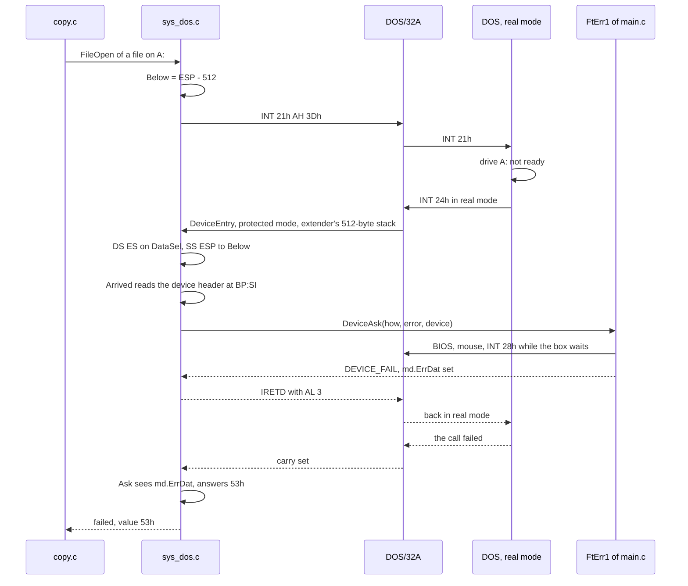

`Arrived` turns `BP:SI` into a flat pointer to the device header, looks
at bit 7 of its attribute byte at offset 5 to tell a drive from a
character device, and hands the function a pointer to the device's
8-character name at offset 10, or 0. Ctrl-Break and Ctrl-C are simpler:
both go to `NothingEntry`, which is one `iretd`.

The interrupts taken through the extender are not given back by DOS from
the PSP when the program ends, as they were in 16 bits. A bit each in
`Taken` records what is still held, and `ProgramEnd` gives all three back
(`GiveAll`) before AH `4Ch`, or the extender would print a warning for
each on the last screen.

<!-- SCREENSHOT: the critical error box over the panels, after asking for a drive with no disk in it (Alt-F1, A, with the diskette drive empty); DOS bench -->

### `Ended_T`: eight instructions for after the end

When DOS ends the program by another's hand it goes on at the address in
the program's PSP at `0Ah`. The original put a routine of its own there,
`Exit01`, which told DOS to look for Ctrl-C again as it had found it and
then jumped to where the PSP had pointed before. Under DOS/32A that
cannot be the program's code: the extender owns INT 21h of real mode
while the program runs, sees the termination, and takes itself out, with
the program's memory above the megabyte, before DOS goes on.

The block below the megabyte survives (DOS has freed it, but its bytes
are still there). So `ProgramEndedTake` copies a routine of real mode
into it, written as bytes because the compiler writes 32-bit code:

```c
static const u8 Ended_T[] = {
    0x50,                                       /* push ax */
    0xB8, 0x01, 0x33,                           /* mov ax,3301h */
    0x2E, 0x8A, 0x16, LO(LOW_BREAK), HI(LOW_BREAK),
                                                /* mov dl,cs:[LOW_BREAK] */
    0xCD, 0x21,                                 /* int 21h */
    0x58,                                       /* pop ax */
    0x2E, 0x8E, 0x06, LO(LOW_PSP), HI(LOW_PSP), /* mov es,cs:[LOW_PSP] */
    0x2E, 0x83, 0x3E, LO(LOW_WAS + 2), HI(LOW_WAS + 2), 0,
                                                /* cmp word ptr cs:[LOW_WAS+2],0 */
    0x2E, 0xFF, 0x2E, LO(LOW_WAS), HI(LOW_WAS)  /* jmp dword ptr cs:[LOW_WAS] */
};
```

and points the PSP at `LowSeg:LOW_ENDED`. The routine reads its three
data, the old address, the PSP's segment and the Ctrl-C flag, behind
itself in the same block, through CS. `ProgramEndedBreakCheck` writes the
flag there every time the program learns it anew. This is the one place
in the program where `sys.h`'s "say it beforehand, as a value" is
literally a byte in memory waiting for a CPU mode the program will never
see again.

### Start

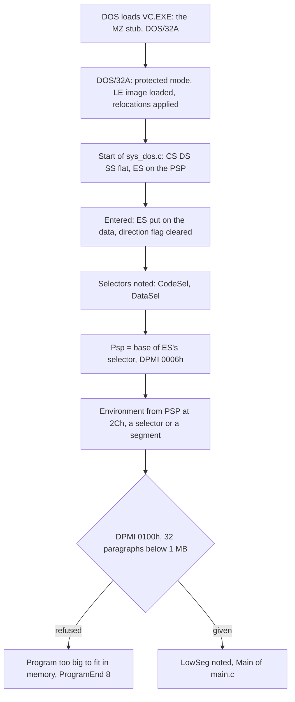

`Start` is all of a C runtime's start-up that the program needs: the
program has no C library on DOS (`-zl`), so there is nothing else to
initialise.

## 3.3 Linux: an emulated PC

### The pieces

The program for Linux is `vc`, built by clang from the common code and
every `*_posix.c`. Ten files:

| File | Lines | What it is |
|---|---:|---|
| `machine_posix.c` | 2,222 | The PC: screen memory, BIOS, mouse driver, timer, memory, country, environment, the test channel; and the one-line bindings of the file functions |
| `files_posix.c` | 1,578 | DOS's services for files, directories and drives on the host's files: `struct Dos`, 20 handles |
| `keyboard_posix.c` | 821 | Bytes of a terminal (kitty protocol, xterm, SGR mouse) made BIOS words |
| `term_posix.c` | 642 | Escape sequences and termios: draw the grid, read the bytes |
| `paths_posix.c` | 500 | Drives R: and H:, DOS paths made full, DOS paths to host paths and back |
| `sys_posix.c` | 479 | Linux's own: the key loop, `$SHELL -c`, `xdg-open`, `main` |
| `names_posix.c` | 409 | 8.3 aliases, `LONGNA~1`, per directory for the run |
| `command_posix.c` | 244 | A DOS command line made one for the host's shell |
| `codepage_posix.c` | 213 | Code page 437, the VGA font's glyphs, DOS's capitals, UTF-8 |
| `time_posix.c` | 121 | DOS stamps of host times; DOS errors of `errno` |

Their shared header, `emulate_posix.h`, is 821 lines and says what each
function answers, in DOS's terms. The rule that shapes them: everything
below `machine_posix.c` that does not need input or output is handed
what the host has (a directory's names, a `struct stat`, a time) and
reads nothing itself, so the test `portable_c-posix-unit`
(`harness/posixcheck.c`) can try it on its own.

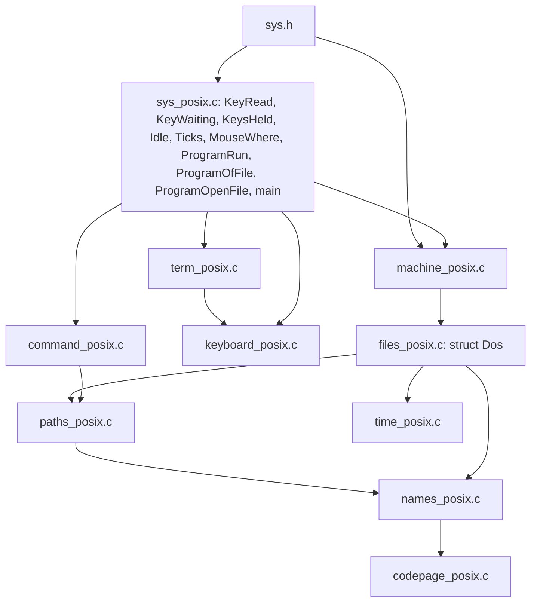

### `machine_posix.c`: the machine

The file is the part of `sys.h` that has no platform in it, which the
program for Linux and the web page share. Its comment lists what it
emulates:

- **The screen** is `static u16 Display[CELLS_ALL]`, `CELLS_ALL` being
  `0x4000` cells: the 32 KB of a VGA's text memory, of which a page of
  80 by 25 is shown. The BIOS calls answer as the bench's VGA does: mode
  3, 80 columns, page 0, an EGA-or-better display whose font is 16 lines
  high and whose last row is 24. `ScreenType` writes like a teletype and
  scrolls; DOS's console (`ConsoleChar`, `ConsoleText`) writes through it
  as DOS has the BIOS do. A `ScreenPut` beyond the memory, which on DOS
  would land in another page or in nothing, is the program's bug here
  and calls `abort()`.
- **The mouse** answers as CuteMouse does on the bench, and draws its
  pointer *into the grid*: the cell under it is kept, and in its place
  `(cell & PointerKeep) ^ PointerTurn` is written (`0x77FF` and
  `0x7700` by default, which swaps the colours). When the pointer moves,
  the old cell is put back only if it still holds what the pointer drew,
  as CuteMouse does: a cell written over meanwhile stays.
- **The timer** is the host's monotonic clock, counted from the time of
  day at start, converted at the PIT's rate:

  ```c
  return (u32)((StartMs + Elapsed()) % MS_A_DAY * 1193180 / 65536000
               % TICKS_A_DAY);
  ```

  with `TICKS_A_DAY` the BIOS's `0x1800B0`.
- **Memory** is `malloc` and `realloc`, with the same table of held
  blocks as `sys_dos.c`. "How large could a block be" is the machine's
  memory (`sysconf(_SC_PHYS_PAGES) * _SC_PAGESIZE`) less what the
  program holds, capped at `0x7FFFFFF0`, and on a heap that gives less
  found by halving to 4 KB (`Obtainable`).
- **The country** is the United States with code page 437, always.
- **The environment** is the host's `environ` turned into DOS's form:
  `COMSPEC=` first, then `NAME=value` strings in the code page, a
  zero, the count 1, and behind it the "path of the program's file",
  which is the directory of the setup file with `VC` behind it, so that
  the program finds `VC.INI`, its menu and its extension file where the
  original looks beside its own file.
- **What the system asks the program** never comes: `DeviceErrorTake`,
  `CtrlBreakTake` and the rest are empty functions. On Linux Ctrl-Break
  and Ctrl-C are keys.

### The test channel

The harness drives the DOS program from inside the emulated PC with a
resident driver (`harness/DRIVER.ASM`). On Linux the same role is played
from inside the program. With `VC_TEST` naming a directory, the program
reads its keys from `keys` there and writes its screens to `screens`.
`keys` has a line per step, each event a word:

```
    XXXX         a key, the BIOS word in hex
    XXXX+        the same, with the next key put into the buffer in the same round
    held=XX      what KeysHeld answers from then on
    wait=N       nothing until the timer has ticked N times more
    mouse=C,R,B  the mouse to a cell, with buttons B held
    asks=N       nothing until the program has asked N times where the mouse is
```

An event is due when the program is idle with no key waiting, one at a
time, exactly as the DOS driver feeds them. A step has ended when the
program has gone round idle twice with nothing left to take and nothing
pending of its own (`AutoTim` of the main data). Then the screen is
written: 4,016 bytes, the kind (`step` or `end `), a 32-bit number, the
2,000 cells, and 8 bytes of cursor, shape and mode laid out as the
bench's BIOS keeps them, which is what the harness reads there.

With `VC_TEST_CLOCK` set, the clock is the test's, as the bench's
machine clock is counted in instructions: it starts at the given time
and advances only by a tick at every idle round that a `wait=` or
`AutoTim` stands for, and when the program reads `Ticks` twice with no
idle between (the program waiting for the next tick by itself, as the
zooming boxes do). A user's run never has it.

### `files_posix.c`: DOS's files on the host's

`struct Dos` is the emulated DOS's state: the directories and their
alias tables, the drives, `struct DosHandle handles[DOS_HANDLES]` (20,
the first five DOS's own for the console, serial port and printer), the
search record, the last error, and a clock. Every file function of
`sys.h` is a line in `machine_posix.c` that calls its `Dos...` twin with
the one `MachineDos`:

```c
struct Moved FileRead(u16 handle, u8 *to, i32 count)
{
    return DosFileRead(&MachineDos, handle, to, count);
}
```

`DosFileRead` reads with `read(2)` in a loop and retries on `EINTR`.
It does not read in 64 KB pieces, but where a read fails it answers the
count as DOS would have in its pieces, `moved.count / 0xFFFF * 0xFFFF`.
And it guards the 4 GB limit: a read that would pass DOS's last place,
`0xFFFFFFFF`, in a file that has grown beyond it since it was opened is
refused with error 5, so a copy never takes part of such a file for the
whole.

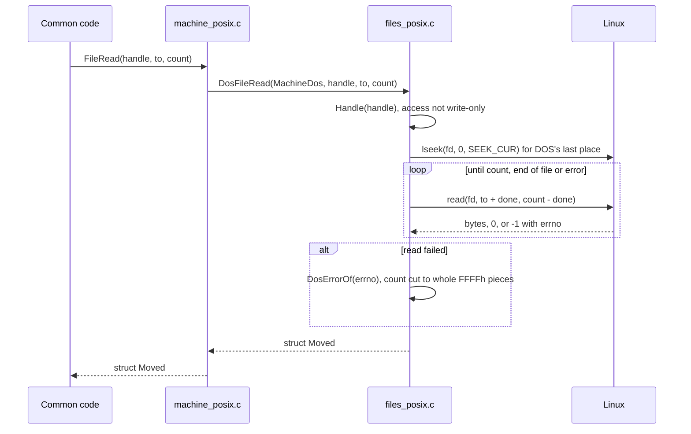

A name of the program reaches the host in two steps, `Lead`:
`DosPathFull` makes it a full DOS path (drive, root, `/` taken for `\`,
`.` and `..` worked out, every name in capitals and cut to 8.3, as
DOSBox's `DOS_MakeName` does), then `HostPathOfDos` turns each name into
the host's name it stands for in the directory before it. If the table
has a name the host no longer has, because another program deleted or
renamed it, the directory is read again and the lookup made once more.

Errors come from `DosErrorOf` of `time_posix.c`: `ENOENT` is 2 (or 3 for
a path), `EACCES`, `EPERM`, `EROFS`, `EEXIST`, `ENOTEMPTY` and `EISDIR`
are all 5, `ENOSPC` and `EDQUOT` 27h, `EXDEV` 11h, anything DOS has no
number for is 1Fh, a general failure.

Attributes come from `DosAttributes` of `names_posix.c`: a directory is
`10h`; a file `20h`, archive, and read-only (`01h`) where the mode bits
say the program's user may not write it; a name that begins with a dot
is hidden. A directory is never read-only. Hidden, system and archive
can be set and are not kept: the host has nowhere for them.

`DosDriveSpace` makes DOS's figures of `statvfs` with `DosSpaceOf`: 512-
byte sectors, as many to a cluster as it takes to keep the count of
clusters within `0xFFFF`, up to 128, so a cluster is at most 64 KB and
the free room at most 4 GB less 64 KB.

### `names_posix.c`: `LONGNA~1`

DOS has 8.3 names in capitals; Linux has 255 bytes of anything but `/`.
Every name of the host gets a name of DOS's form, by the rule of
Microsoft's `fatgen103` for a short name: in capitals and in the code
page, every character the code page lacks or DOS forbids made `_`,
spaces and leading dots dropped, up to 8 characters before the first
remaining dot and 3 of what follows the last. If nothing was changed,
cut or dropped and no other name has it, that is the name. Otherwise
`~1`, `~2` and on is put behind as much of the first part as leaves 8.

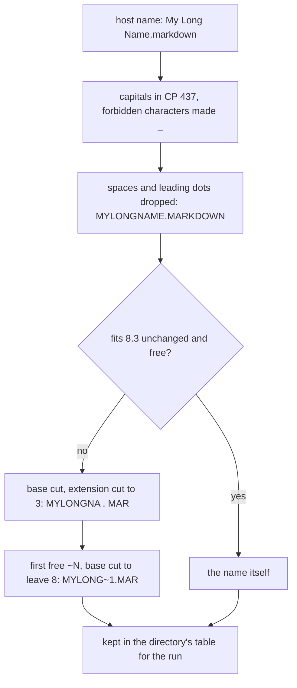

The aliases of a directory live in a `struct DirectoryNames`, two hashed
indexes over one array of `struct DirectoryName { char *host; u8
dos[13]; bool present; }`. Three rules make them stable:

- new names are numbered in the order of their bytes, so the same
  directory gets the same aliases in every run;
- a name keeps its alias for the run, whatever comes and goes;
- a name the host no longer has stays in the table, not found, and its
  alias is never given to another.

An alias leads back to its host name, so `LONGNA~1` works in the panel,
in a dialog, and in a command line (`command_posix.c` turns a word that
names a file of the current directory into the host's quoted name).

### `paths_posix.c`: R: and H:

A drive of DOS is a directory of the host, as DOSBox's `mount` has it.
On Linux there are two: **R:**, the root of the file system, labelled
`ROOT`, and **H:**, `$HOME`, labelled `HOME`. A host path under the home
directory is shown on H:, any other on R:. The program starts in the
host's current directory, on whichever drive holds it.

The 67 characters of a DOS path stay. H: is partly a way round them: a
directory deep in the home is counted from `$HOME`, not from `/`. A path
that still does not fit is reached through aliases, which are shorter,
or not at all, and the program starts in the deepest directory above it
that fits (`StartIn` of `machine_posix.c`, which strips the host path a
component at a time until `DosStartIn` accepts it).

`SetupFile` puts the original's `VC.INI` at `$XDG_CONFIG_HOME/vc/vc.ini`,
or `~/.config/vc/vc.ini`.

<!-- SCREENSHOT: the program for Linux at the panels on H:, a directory with long names shown as ~1 aliases, and a path in the panel title; Linux terminal -->

### `codepage_posix.c` and `time_posix.c`

Two tables of 128 entries each carry the code page:

- `Unicode437`, the Unicode character of each byte from `80h`, written
  from Python's `cp437` codec, which is Unicode's mapping file;
- `Upper437`, DOS's capitals for file names, from FreeDOS 1.4's
  `COUNTRY.SYS` (`FUCASE` for country 1): `é` becomes `E`, and only `ä`,
  `å`, `æ`, `ç`, `ñ`, `ö` and `ü` get their own capital.

`CodePageGlyph` is the third map: what the VGA's font *shows* for a
byte, which differs from Unicode's mapping below `20h` and at `7Fh`,
where Unicode has control characters and the font has smileys, arrows
and a house. The terminal and the web page draw by it. UTF-8 is decoded
and encoded here by hand (`Utf8Decode` rejects overlong forms,
surrogates and anything above `10FFFFh`); a host name with a byte that is
no UTF-8 or a character the code page lacks shows as `_`.

`time_posix.c` packs host times into DOS stamps, clamped to DOS's range,
1 January 1980 to 31 December 2107 23:59:58, the bounds Linux's own FAT
driver uses.

### `keyboard_posix.c`: bytes into BIOS words

A key on DOS is the word the BIOS answers INT 16h with: a US keyboard's
scan code above the character. The bench's BIOS is SeaBIOS, which
passes the enhanced keyboard's keys (F11, F12, Ctrl-Up, Alt with an
arrow) through function 0; what it answers for each was read on the
bench with `harness/trial32/keys.c` and is in the decoder's tables.

The decoder takes bytes and nothing else, so the terminal and the web
page can both feed it:

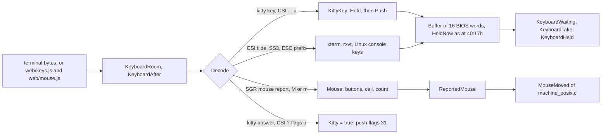

Where the terminal has the kitty keyboard protocol, the program pushes
flags 31 (`ESC [>31u`): keys disambiguated, press, repeat and release
events, the US-layout key behind each, every key as an escape code, the
modifiers alone too, and the text. That is what makes Shift, Ctrl and
Alt *held* known (`KeysHeld`, as at `40:17h`: right Shift `01h`, left
`02h`, Ctrl `04h`, Alt `08h`), so the key bar changes while Alt is held
and a tap of Alt alone opens the menu, as on DOS. Alt with a letter goes
by the US-layout key, as the BIOS's scan code does. Without kitty, keys
are read as terminals have sent them since xterm, Esc is an ESC that
nothing follows within `ESC_WAIT` (25 ms), and nothing is known to be
held.

The mouse comes as SGR reports, `CSI < b ; x ; y M` (or `m` on release),
with motion reported too. The wheel and buttons beyond three are
dropped, a DOS mouse driver having none; SGR's buttons 0, 1, 2 become
the driver's 1, 4, 2.

Timing is the subtle part. A hand on DOS presses and releases slowly
enough for the program to see both; a terminal over a slow line may
deliver press and release in one read. So a change of what is held, or
of the buttons, waits until the program has looked at the previous one
(`KeysHeld`, `MouseWhere`), or for `CHANGE_WAIT`, 100 ms, at most; and a
button change stays at least `BUTTON_HOLD`, 50 ms, because the program
looks once to see that a button is down and again to see where.

### `term_posix.c`: the grid in a terminal

No curses, no library: termios for raw mode, and escape sequences.
Taking the terminal writes

```
ESC[?1049h  alternate screen       ESC[?7l   no wrap at the row's end
ESC[?25l    cursor hidden          ESC=      keypad application mode
ESC[?1000h ESC[?1002h ESC[?1003h ESC[?1006h   mouse: all motion, SGR form
ESC[?1004h  focus reports          ESC[?u    "do you speak kitty?"
```

and the terminal is given back the same way on exit, on `SIGTERM`,
`SIGHUP`, `SIGINT`, `SIGQUIT`, on a crash (`SIGSEGV`, `SIGBUS`,
`SIGFPE`, `SIGILL`, `SIGABRT`) or a sanitizer's end, with
async-signal-safe calls only; on `SIGTSTP` it is given back and on
`SIGCONT` taken again and redrawn whole.

`TermDraw` compares the 2,000 cells with what it last drew, `Shown`, and
writes only runs of changed cells, placing the cursor at the start of
each run so that a terminal that takes a glyph for double width loses at
most that run. A frame is assembled in `Frame[FRAME_ROOM]` (64 KB) and
written inside one synchronized update, mode 2026. Colour is the VGA's
mode-3 palette, exactly, where `COLORTERM` says the terminal has 24-bit
colour:

```c
static const u8 Palette[16][3] = {
    { 0x00, 0x00, 0x00 }, { 0x00, 0x00, 0xAA }, { 0x00, 0xAA, 0x00 },
    { 0x00, 0xAA, 0xAA }, { 0xAA, 0x00, 0x00 }, { 0xAA, 0x00, 0xAA },
    { 0xAA, 0x55, 0x00 }, { 0xAA, 0xAA, 0xAA }, { 0x55, 0x55, 0x55 },
    ...
};
```

Brown, colour 6, has its green at `55h`, as the VGA BIOS programs its
DAC. Without 24 bits the 16 ANSI colours are used, with the PC's red and
blue bits swapped (`Ansi[8] = { 0, 4, 2, 6, 1, 5, 3, 7 }`), and the
theme decides what they look like. Bit 7 of the attribute is blink (SGR
5), since mode 3 starts with blinking on and `sys.h` has no call to turn
it off. The cursor follows the BIOS's shape: hidden by bit 5 of its first
line, a block if it is more than three lines tall, an underline
otherwise, always blinking.

The screen is 80 by 25 and no other size. A larger terminal shows it at
the top left; a smaller one shows a line saying how large it has to be,
and drops keys until it is.

### `sys_posix.c` and `command_posix.c`: the rest of Linux

`sys_posix.c` has what is Linux's own: the key loop and the commands.
`KeyRead` draws the screen and polls the terminal until a key waits:

```c
for (;;) {
    OwnScreen();                         /* Ctrl-O, below */
    if (!KeyboardWaiting().none)
        break;
    MouseFromTerminal(false);
    Show();                              /* TermDraw of ScreenShown */
    TermInput(-1);                       /* poll, read, KeyboardAfter */
}
```

`Idle`, which the program calls every time it finds no key, draws and
polls with `IDLE_WAIT`, 50 ms, under a tick. The process sleeps in
`poll` rather than spinning.

A command is `ProgramRun("C:\COMMAND.COM", "/C dir")` to the common
code, exactly as on DOS. `sys_posix.c` sees that the name is the shell
that `COMSPEC` names (the host's `$SHELL`, or `/bin/sh`, by its DOS path),
takes what follows `/C`, and `DosCommandToHost` makes it a line for the
shell: UTF-8, each DOS path on R: or H: at the start of a word made the
host path it leads to and single-quoted, a name with `*` or `?` left
unquoted in small letters for the shell's own globbing, and a word that
names a file of the current directory by its DOS name made the host's
name. Then:

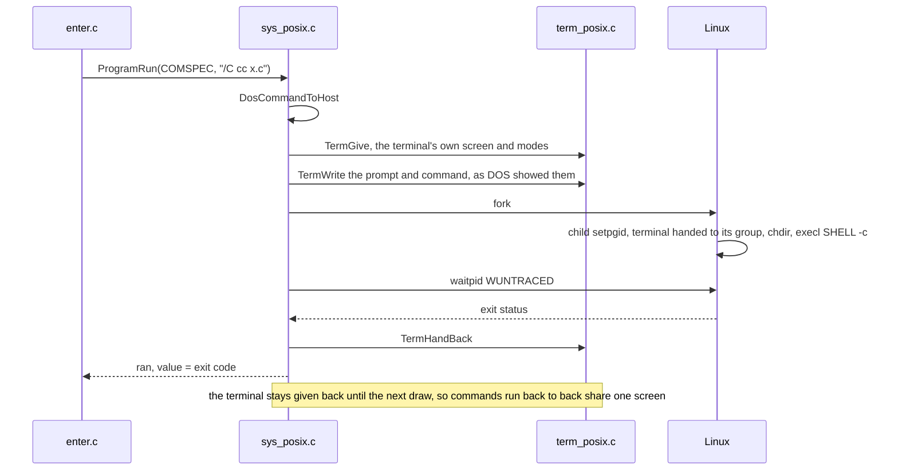

The command has the terminal as the user had it, in the foreground, so
Ctrl-C and Ctrl-Z are its signals. Ctrl-O at the panels shows that
screen until the next key (`TermOwnScreen`), as DOS's Ctrl-O does.
`ProgramOfFile` answers `.\` for a regular file the user may execute,
whatever its name: Enter then runs `./name`. Any other regular file goes
to `ProgramOpenFile`, which double-forks `xdg-open` so that nobody waits
for it.

<!-- SCREENSHOT: Ctrl-O after running a command from the command line, the terminal's own screen with the prompt line and the command's output; Linux terminal -->

## 3.4 The web page

### The same machine, a different outside

The web page is the program built by Emscripten to WebAssembly. Its
build takes the common code, every `*_posix.c` *except* `sys_posix.c`
and `term_posix.c`, and `sys_web.c`. So the browser runs the same
emulated PC as Linux, `machine_posix.c`, the same `files_posix.c` over
POSIX calls, and the same keyboard decoder. Only the outside differs:

| | Linux | Web |
|---|---|---|
| Files | the host's | Emscripten's MEMFS, in the page's memory |
| Drives | R:, H: | A: (an empty diskette), C: (labelled `VC`) |
| Screen | `term_posix.c`, escape sequences | `web_draw`, a `<pre>` of spans |
| Keys | termios bytes | `keys.js` makes kitty sequences of `KeyboardEvent`s |
| Mouse | SGR reports | `mouse.js` makes SGR reports of `PointerEvent`s |
| Waiting | `poll` | Asyncify, `emscripten_sleep` |
| Commands | `$SHELL -c` | "Commands cannot be run in a web page." |
| Opening a file | `xdg-open` | a new browser tab |
| Memory cap | none | 256 MB |

The browser has no keyboard protocol of its own that the decoder could
read, so the page *writes* one: `keys.js` turns each `keydown` and
`keyup` into the escape sequence kitty would have sent with flags 31,
and `mouse.js` turns pointer events on the `<pre>` into SGR reports by
the cell under them. "There is one decoder, and the page decides
nothing of the BIOS's words."

### Asyncify: a blocking program in an event loop

The program is a loop that blocks in `KeyRead`. A browser tab must
return to its event loop or nothing is drawn and no event arrives.
Emscripten's Asyncify squares this: at a call of `emscripten_sleep`, the
compiled code unwinds its whole C stack into a buffer
(`-sASYNCIFY_STACK_SIZE=65536`), returns to the browser, and is rewound
to the same point when the timer fires. The program never knows.

`sys_web.c` puts the yields where the program waits, and nowhere else:

- `KeyRead` waits by `PageInput(-1)`, which yields for `IDLE_WAIT`
  (50 ms) when nothing is queued;
- `Idle` yields;
- `KeyWaiting` yields once `BUSY_YIELD`, 50 ms, have passed since the
  last yield, so that a copy or a search that polls for Esc lets the
  page draw;
- `MouseWhere` the same, because the program waits for a button's
  release in a loop that asks nothing else;
- `Ticks` yields at its second read with no yield between, so the
  zooming boxes and the screen blanker are drawn.

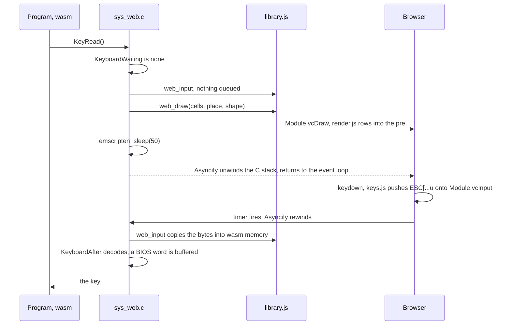

The page calls nothing of the program while it waits. What comes is
queued on `Module.vcInput`, an array of byte strings, and taken at the
next yield by `web_input`, which copies as many bytes as the decoder's
room holds into `HEAPU8`.

### How a frame reaches the DOM

`web_draw` hands the page `HEAPU16.subarray(cells >> 1, (cells >> 1) +
2000)`, a view straight over the grid in wasm memory, valid only for the
call. `render.js`'s `Screen.draw` compares it with a copy of what it
last showed, and for each row that changed makes one HTML string:

```js
export function rowHtml(cells, row, glyphs) {
    let html = "";
    let attribute = -1;
    let run = "";
    for (let at = row * COLUMNS; at < (row + 1) * COLUMNS; at++) {
        const cell = cells[at];
        if (cell >> 8 !== attribute) {
            if (attribute >= 0)
                html += `<span class="${classOf(attribute)}">${run}</span>`;
            attribute = cell >> 8;
            run = "";
        }
        run += glyphs[cell & 0xFF];
    }
    return html + `<span class="${classOf(attribute)}">${run}</span>`;
}
```

`apply` sets that row's `innerHTML` and positions a cursor element over
the `<pre>`. The colours are 256 CSS classes, `vc-a00` to `vc-aff`,
generated once (`css()`), each with the VGA colour of the low nibble and
the background of the next three bits; a blinking attribute adds
`vc-b`, and the page toggles a class on the `<pre>` every `BLINK_HALF`,
16 VGA frames at 70.086 Hz, so all blinking cells go in step. The glyph
table is the program's own `CodePageGlyph`, exported from wasm and read
256 times at `onRuntimeInitialized`, so the terminal and the page cannot
disagree on what byte `01h` looks like. The font is VileR's Web437 IBM
VGA 8x16, embedded in the page.

The mouse pointer needs nothing in JavaScript: the machine already drew
it into the cells.

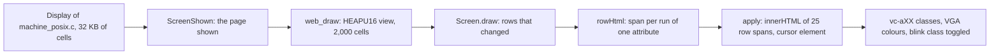

### The ephemeral C:

`page.js` puts `Module` together before the program's script runs.
Just before `main`, `pre.js` hands it Emscripten's `FS` and `ENV`
(`Module.vcBegin`), and the page:

1. sets `ENV.VC_DRIVE_C = "/drive/c"` and, unless under test, makes
   `/drive/a` empty and sets `VC_DRIVE_A`;
2. holds the program back with a run dependency while `drives.js`
   fetches `drives/c.json`, a tree of entries `{ path, directory,
   mtime, readonly, data }` with contents in base64, and writes it into
   MEMFS with each file's time and mode;
3. `chdir`s to `/drive/c/vc`, where the program's own files are, and
   lets the program start.

`sys_web.c`'s `main` reads `VC_DRIVE_A`, `_C`, `_D` and their labels into
`struct DriveGiven` entries and hands them to `MachineBegin`; from then
on C: is a drive like any other to `files_posix.c`. Nothing is written
back anywhere and nothing is kept in the browser: every change lasts
until the page is closed or reloaded, and every load starts from what is
served. Files come in by a button or by dragging them onto the page,
into DOS's current directory (which the page learns at every draw through
`web_where`); a file Enter cannot run opens in a new tab (`web_open_file`).

The static site, made by `static.mjs`, is three things: `index.html`
(the page, one file by `-sSINGLE_FILE`, with the wasm, the bundled
scripts of `bundle.mjs`, the font and the licences inside),
`drives/c.json` and `.nojekyll`, so GitHub Pages serves it as it is.

Memory is capped. Wasm memory once grown is never given back while the
page is open, and the program asks for all there is, as it asks DOS. So
`sys_web.c` passes `MEMORY_CAP`, 256 MB, to `MachineBegin`, and the link
sets `-sMAXIMUM_MEMORY=320MB`, the cap and 64 MB for the runtime.

<!-- SCREENSHOT: the web page in a desktop browser, the panels on C:\VC with the A: diskette in the drive box (Alt-F1); web page -->

<!-- SCREENSHOT: the web page on a phone, the grid fitted to the screen and the row of keys a phone lacks below it; web page -->

### `FileRead` on the web

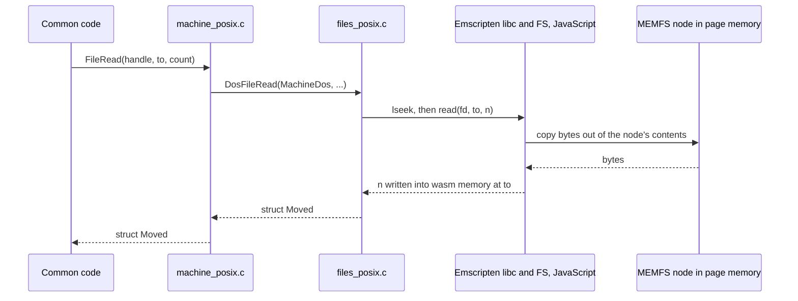

It is the Linux diagram with the kernel replaced by JavaScript. That is
the whole point of `machine_posix.c` being shared.

Under Node, the same build (linked with `-sNODERAWFS`, the host's file
system, and `web/node.js` copying the environment in) is how the
scenarios judge the web program, `portable_c-web-scenarios`. A second
test, `portable_c-web-page`, drives the real page: with `VC_TEST_PAGE`
set, the test channel asks the page to *deliver* each event
(`web_test_event`) as a user's keystroke would arrive, through `keys.js`
and the decoder, and is told of each screen it records
(`web_test_screen`) so the test can read it from the DOM. Both are
`Asyncify.handleAsync` functions of `library.js`, so the program waits
while the page acts. `portable_c-web-browser` does the same in the
machine's Chromium.

## 3.5 One CMakeLists, three toolchains

### Which file goes where

The tree is flat. A file is assigned to a build by its name:

```cmake
set(portable_c_implementations dos posix web)
set(portable_c_takes_dos dos)
set(portable_c_takes_posix posix)
set(portable_c_takes_web posix web)
set(portable_c_leaves_web sys_posix.c term_posix.c)
```

`portable_c_sources(variable implementation)` globs `src/portable_c/*.c`;
a file ending in `_dos.c`, `_posix.c` or `_web.c` is of that
implementation, every other file (`_t.c` tables included) is common. A
build takes the common files and those of the implementations its
`takes` list names, less its `leaves` list. Adding a platform is adding
a word and a file; adding a file of a platform whose suffix is not in the
list would silently make it common code, which is why the comment asks
for it to be named.

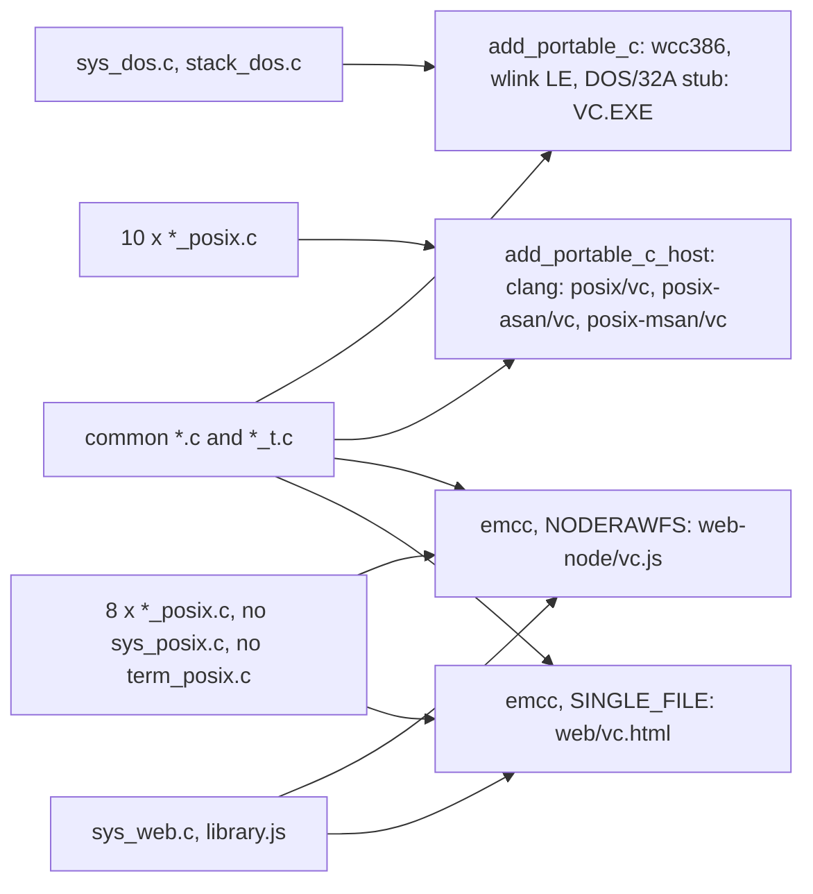

### Open Watcom for DOS

`add_portable_c` compiles every file with

```
wcc386 -q -3r -mf -s -zl -zls -wx -we <options> -i=<watcom>/h -fr
```

(386 code with register arguments, flat model, no stack checks, no
library, every warning an error) and links with `wlink ... format os2
le`, the class order `CODE STACK DATA MAIN BSS`, `start=Start_`, and
`stub=binw/dos32a.exe`. `sys_dos.c` is linked last, a habit kept from
when the tables had to lie within 64 KB of the main data. Two programs
come of it: `portable_c/VC.EXE` with `-os`, which is shipped and judged,
and `portable_c/debug/VC.EXE` with `-od -d2 -dCHECKED` for finding a
fault. The command line is written to `compiled.txt` beside the
objects, and every object depends on it, so a changed command rebuilds.

Open Watcom stays because DOS is where the program is judged. Its
peculiarities are kept in `compiler.h`: `NO_RETURN` is
`__declspec(aborts)`, `SEGMENT_BEGIN` is `#pragma data_seg`, and on
every other compiler both are nothing.

### clang for Linux

`add_portable_c_host` builds with clang, the clang of the path. Three
builds:

- `posix/vc`, the program, with distributions' hardening: `-O2
  -D_FORTIFY_SOURCE=3 -fstack-protector-strong -fstack-clash-protection
  -fcf-protection=full -fPIE`, linked `-pie -Wl,-z,relro,-z,now,-z,noexecstack`;
- `posix-asan/vc`, the one the tests run: `-O1 -g
  -fsanitize=address,undefined,integer,implicit-conversion,float-divide-by-zero
  -fno-sanitize-recover=all`;
- `posix-msan/vc`, MemorySanitizer with origin tracking, which goes with
  no other sanitizer: built only by name, for an audit by hand.

### Emscripten for the web

The same function with `COMPILER emcc`. Emscripten is fetched and pinned
by SHA-256 like everything else. Two links:

- `web-node/vc.js`: `-O2 -fsanitize=address,undefined`, `-sASYNCIFY
  -sASYNCIFY_STACK_SIZE=65536 -sNODERAWFS -sENVIRONMENT=node
  -sMAXIMUM_MEMORY=512MB`, for the scenarios under Node;
- `web/vc.html`: `-O2 -sASYNCIFY -sENVIRONMENT=web -sEXIT_RUNTIME
  -sALLOW_MEMORY_GROWTH -sMAXIMUM_MEMORY=320MB -sINITIAL_MEMORY=64MB
  -sSINGLE_FILE -sEXPORTED_FUNCTIONS=_main,_CodePageGlyph`, with the
  shell made by `bundle.mjs` and `library.js`, `pre.js`.

Under AddressSanitizer the web build would end the program where the
program does what it does on DOS, ask for more memory than there is, and
would quarantine freed blocks that `Obtainable` takes and gives back to
measure the heap. `sys_web.c` defines `__asan_default_options` to return
`allocator_may_return_null=1:quarantine_size_mb=0`.

A probe, `portable_c-web-probe`, compiles the web's files with `emcc`
and the Linux warnings, with nothing linked, for a fast answer to
"does it still compile for wasm32".

## 3.6 Strictness

Every clang and emcc build compiles with one written-out list of
warnings, each an error, close to curl's and deliberately not
`-Weverything`:

```cmake
set(clang_warnings -std=c99 -Werror -Wall -Wextra -Wpedantic -Wconversion
    -Wsign-compare -Wshadow -Wundef -Wcast-qual -Wpointer-arith
    -Wwrite-strings -Wvla -Wstrict-prototypes -Wmissing-prototypes
    -Wmissing-variable-declarations -Wformat=2 -Wconditional-uninitialized
    -Wcomma -Wassign-enum -Wshift-sign-overflow -Wextra-semi-stmt
    -Wimplicit-fallthrough -Wbad-function-cast -Wcast-function-type-strict
    -Wunreachable-code)
```

`-Wconversion` and `-Wsign-compare` are the ones that cost the most: a
number put into fewer bits, or met by one of another sign, is a cast in
the source at that place, with the word `wraps` in a comment where the
program counts on the cut. That rule came from the widening of 16-bit
numbers of step 2 of the road, and the build for Linux enforces it.
`-Wimplicit-fallthrough` is answered by `FALLTHROUGH` of `compiler.h`, a
table of bytes without its zero by `NONSTRING`, never by turning a
warning off. Left out on purpose: `-Wcast-align` (the common code reads
words out of byte buffers as DOS does; `GET16` and `PUT16` of `vc.h`
make such words of their bytes so the sanitizer's alignment check can
stay on), `-Wpadded`, `-Wswitch-default`, `-Wswitch-enum`,
`-Wdeclaration-after-statement`, `-Wdouble-promotion` and
`-Wunsafe-buffer-usage`, which say how C is to be written and not what
is wrong with it. `-fno-strict-aliasing` is on every host build.

clang-tidy 23 runs over the common code and the Linux files (test
`portable_c-tidy`, `harness/tidycheck.py`, with the version held), by
`.clang-tidy` at the top of the checkout: `clang-analyzer-*`,
`bugprone-*`, `misc-*` and six checks of `readability-*`, every warning
an error. Each check that is off has its reason beside it:

| Off | Why |
|---|---|
| `bugprone-signed-bitwise` | the program masks `u8` and `u16`, which C makes `int` |
| `bugprone-switch-missing-default-case`, `bugprone-unhandled-code-paths` | a switch of the original does nothing for a key it lacks |
| `misc-include-cleaner` | every file includes `vc.h` whole, by design |
| `bugprone-easily-swappable-parameters` | a row and a column, a place and a length |
| `bugprone-implicit-widening-of-multiplication-result` | rows times columns fit an int |
| `misc-no-recursion` | a command may go round into the main loop again |
| `bugprone-branch-clone` | two tests that do the same, as the assembly has them |

Where the analyser names a read of the main data as one block across its
fields, as the original does, that read goes through the main data as
bytes at an offset, by a piece of its own, rather than through a
suppression.

The sanitizers are the last line, and they run where the scenarios run:
every scenario of the Linux program (`portable_c-posix-scenarios`)
drives `posix-asan/vc` with addresses, undefined behaviour, integer
overflow (signed and unsigned) and implicit conversions all fatal. That
last pair is what turned "a 16-bit counter that wraps" from a comment
into a cast: a wrap that a scenario reaches without its cast ends the
run. The web scenarios run `web-node/vc.js` with address and undefined
behaviour sanitizers.

None of this applies to the DOS build: Open Watcom has its own warnings,
`-wx -we`, all errors, and nothing more. The DOS program is judged by the
scenarios on the bench, and the clang builds catch what it would hide,
since every line of the common code is compiled by both.

## 3.7 What each platform answers, side by side

| `sys.h` asks | DOS (`sys_dos.c`) | Linux and web (`machine_posix.c` and below) |
|---|---|---|
| `FileRead` | INT 21h AH 3Fh in pieces of FFFFh, translated by DOS/32A | `read(2)` loop, 4 GB guard |
| `FindFirst` | AH 4Eh in real mode, record in the low block | the directory's alias table, the pattern matched against each 8.3 alias (`Matches`) |
| `FileTrueName` | AH 60h in real mode | `DosPathFull` |
| `DriveSpace` | AH 36h, carry flag as `flagged` | `statvfs`, `DosSpaceOf` |
| `MemTake` | DPMI 0500h, 0501h | `malloc`, halving search |
| `KeyRead` | INT 16h AH 0 | decoder buffer, `poll` or Asyncify |
| `KeysHeld` | INT 16h AH 2 | kitty's held modifiers |
| `ScreenPut` | the display's memory, `B800h` or `B000h` of `md.Screen`, through a flat pointer | `Display[]`, drawn by terminal or DOM |
| `MouseWhere` | INT 33h AX 3 | SGR reports, `MouseMoved` |
| `Ticks` | `0040:006Ch` | monotonic clock times 1193180/65536000 |
| `CaseMap` | DOS's far routine, DPMI 0301h | `Upper437` |
| `ProgramRun` | AX 4B00h in real mode, block in the low memory | `$SHELL -c` (Linux), a line on DOS's screen (web) |
| `DeviceErrorTake` | DPMI 0205h, `DeviceEntry` | nothing comes |
| `ProgramEndedTake` | `Ended_T` copied below 1 MB, PSP:0Ah | nothing to do |

## Where to read next

- `src/portable_c/sys.h`: the whole contract, 670 lines, each function
  with what it answers when it fails.
- `src/portable_c/sys_dos.c`: the top comment for what the extender
  does with each kind of call; `Ask`, `Move`, `Real` for the shape of
  every function; `DeviceEntry` and `Ended_T` for the two pieces of
  machine code; `Start` for the start.
- `src/portable_c/emulate_posix.h`: the emulation's own contract, in
  DOS's terms, before any of the `*_posix.c` files.
- `src/portable_c/machine_posix.c`: the top comment for the machine, then
  "The test channel" for how scenarios drive Linux and the web.
- `src/portable_c/files_posix.c`: `Lead` and `DosFileRead` for how a DOS
  name becomes a host file.
- `src/portable_c/keyboard_posix.c`: the comment "The keys, and the
  mouse" for kitty, SGR and the timing rules.
- `src/portable_c/sys_web.c` and `src/portable_c/web/render.js`: the
  yield points, and a frame from wasm memory into the `<pre>`.
- `CMakeLists.txt`: `portable_c_sources`, `add_portable_c`,
  `add_portable_c_host`, and the `clang_warnings` list.
- `.clang-tidy`: the checks and every reason for one that is off.
