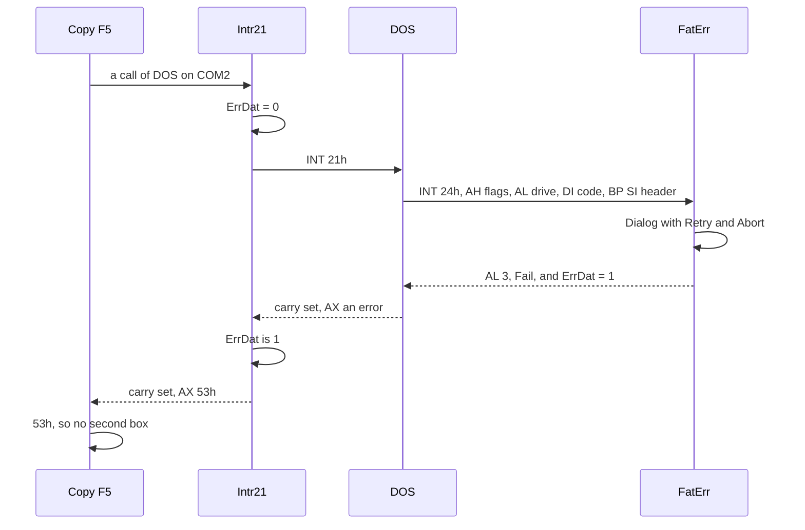
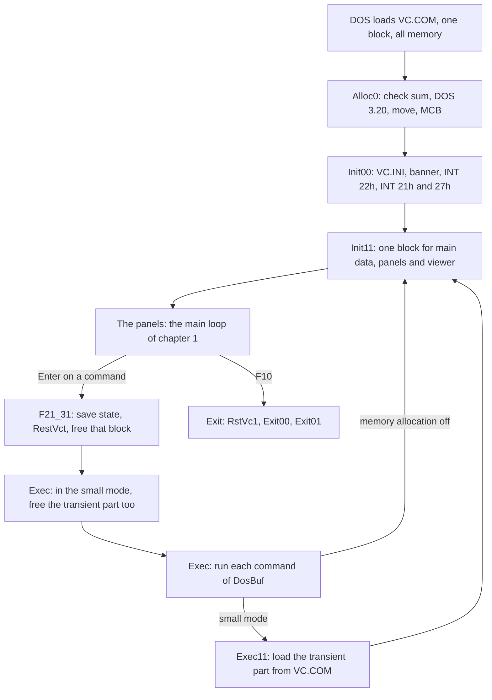
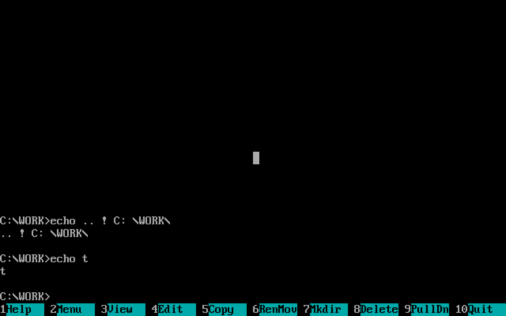
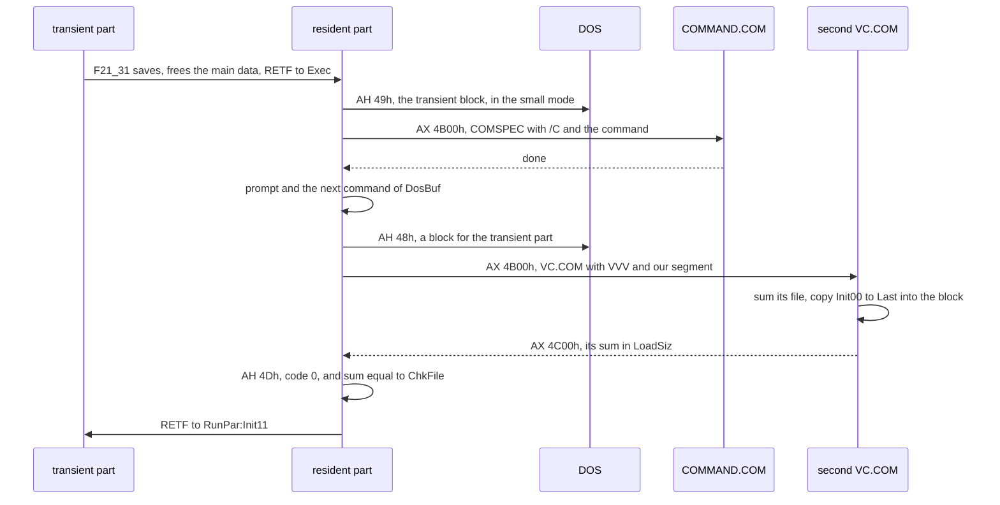

# 3. Talking to DOS and the PC: the system

A file manager is mostly a conversation with the operating system:
open, read, find the next file, ask where the cursor is, wait for a
key. Volkov Commander 4.05 holds that conversation in a vocabulary
small enough to count. Leave out the setup program, and the thirteen
files of `VC.COM` hold this many interrupt instructions and calls:

| What | How it is reached | Places in the source |
|---|---|---:|
| DOS, through the program's error wrapper | `CALL Intr21` | 166 |
| DOS, directly | `INT 21h` | 102 |
| The video BIOS | `INT 10h` | 59 |
| The video BIOS, with the mouse pointer hidden around it | `CALL Int10m` | 6 |
| The keyboard BIOS | `INT 16h` | 21 |
| The mouse driver | `INT 33h` | 8 |
| DESQview | `INT 15h` | 3 |
| Windows and the multiplex interrupt | `INT 2Fh` | 2 |
| COMMAND.COM's back door | `INT 2Eh` | 2 |
| DOS's idle call | `INT 28h` | 1 |

The program also writes straight into the display's memory at
`B800:0000`, reads two words of the BIOS's data area, and polls one
I/O port, the CGA's status register at 3DAh. It takes over six
interrupts of its own: the critical error (24h), Ctrl-Break (1Bh),
Ctrl-C (23h), the address at which DOS goes on when the program ends
(22h, in the PSP), and, for its TSR manager, DOS itself (21h) and the
old way of staying resident (27h).

This chapter goes through all of that in the order a reader meets it:
the one word by which the program finds its data from anywhere, the
error wrapper and the critical error, Ctrl-Break, the screen, the
keyboard and the mouse. Then comes the largest piece, the part of the
program that stays in memory while a command runs: how 1,511 bytes of
code and messages, 10,923 bytes of saved state and the PSP's 256 give
the user's program all but 12,690 bytes of the machine in the
program's small mode, and how the commander gets back.

The assembly is quoted from `src/asm/` with its labels and its own
comments; a comment that starts with `;;` is the book's. Sizes and
offsets come from the listing of the original's build, `VC.LST`, where
an offset counts from the start of the PSP; a `.COM` program lives in
one segment and its first byte is at 100h. The
[preface](00-preface.md#a-dos-refresher) has a refresher on segments,
the PSP, memory control blocks and interrupts.

## `SecDat`: the main data from anywhere

The whole program keeps its segment registers to one convention, which
[chapter 1](01-the-program.md#init11-the-data-block-cut-in-paragraphs)
sets out: CS on the transient part with every table and text, SS on
the resident part and its stack, ES on the main data, DS on whatever
is being worked on. Three of the four are fixed for the life of the
transient part, so a routine pays nothing to reach the settings, the
stack or its own tables. The cost lands on DS, which moves, and on the
few places that must find the main data with DS and ES both elsewhere.
For those, a word in the program's own segment holds the main data's
segment:

```asm
SecDat  DW      0                       ;; VC.ASM, set once, in Init11
```

and code reads it through CS, which is always on the program:

```asm
        PUSH    DS
        MOV     DS,CS:SecDat            ;; the main data, from anywhere
        MOV     BYTE PTR DS:[ErrDat],0
        POP     DS
```

`SecDat` is what lets the error wrapper and the critical error handler
work whatever state their caller left the registers in.

## `Intr21`: 62 bytes for every error

Most of the program's calls of DOS go through one routine at the end
of `VCSUB1.INC`. It is 3Eh bytes long, and each of its 166 callers
spends the three bytes of a near `CALL` on it, one byte more than the
`INT 21h` it replaces:

```asm
;--------------- Int 21h with fatal error --------------
Intr21  PROC    NEAR
        PUSH    DS
        MOV     DS,CS:SecDat
        MOV     BYTE PTR DS:[ErrDat],0  ;; no critical error yet
        POP     DS
        INT     21h
        PUSHF
        PUSH    DS
        MOV     DS,CS:SecDat
        CMP     BYTE PTR DS:[ErrDat],0  ;; did the user give up in a box?
        POP     DS
        JNE     I21_02
        POPF
        JNC     I21_01                  ;; no error: as DOS left it
        PUSH    DS
        PUSH    ES
        PUSH    BP
        PUSH    SI
        PUSH    DI
        PUSH    DX
        PUSH    CX
        PUSH    BX
        XOR     BX,BX
        MOV     AH,59h                  ;; DOS 3+: the exact reason
        INT     21h
        POP     BX
        ...                             ;; every register back but AX
        POP     DS
        STC
I21_01: RET
I21_02: POPF
        MOV     AX,53h                  ;; "fail on INT 24h"
        STC
        RET
Intr21  ENDP
```

It does two things that every file operation of the program needs.

**It asks for the extended error.** DOS 2 had a dozen error numbers;
DOS 3 added function 59h, which says exactly what went wrong with the
last call, and which clobbers BX, CX, DX, SI, DI, BP, DS and ES while
it does. `Intr21` saves all eight around it and hands back only the
new AX, so a caller sees the precise number and its registers as the
failed call left them.

**It folds a cancelled critical error into the error number.** When a
drive is not ready, DOS does not return from the call: it calls INT
24h in the middle of it, and the handler (next section) asks the user.
If the user gives up, the handler sets `ErrDat` in the main data and
answers Fail. DOS then returns from the call with some error, and
`Intr21` replaces it with 53h, DOS's own number for "fail on INT 24h".
The callers test for that one value and stay silent, since the user
has already seen a box.

The 102 direct calls are the ones that cannot fail in a way the user
needs to hear about, the ones in the resident part, which cannot reach
`Intr21` once the transient part has gone, and those of the start-up,
which runs before there is any main data for `ErrDat` to live in.

## The critical error: `FatErr`

### Taking the interrupt

`HookVct` of `VC.ASM`, 49 bytes, takes both of the interrupts that
DOS and the BIOS raise from under a running call. It notes who had
them in two far pointers of the main data and points them at the
program:

```asm
HookVct PROC    NEAR
        PUSH    DS
        MOV     AX,3524h
        INT     21h
        MOV     DS:ErrVct.Offs,BX       ;; the critical error, before us
        MOV     DS:ErrVct.Segm,ES
        MOV     AX,351Bh
        INT     21h
        MOV     DS:BrkVct.Offs,BX       ;; Ctrl-Break, before us
        MOV     DS:BrkVct.Segm,ES
        PUSH    CS
        POP     DS
        MOV     DX,OFFSET FatErr        ;; in the transient part
        MOV     AX,2524h
        INT     21h
        PUSH    SS
        POP     DS
        MOV     DX,OFFSET CtrlC         ;; in the resident part
        MOV     AX,251Bh
        INT     21h
        POP     ES
        RET
HookVct ENDP
```

The two handlers live in different parts on purpose. `FatErr` is 220
bytes of code with a dialog behind it, and is wanted only while the
panels are up. `CtrlC` is one byte, is wanted always, and so stays
resident, reached through SS.

Its twin, `RestVct`, puts both back. The commander calls it before
every command, because the transient part, and `FatErr` with it, may
be given back to DOS while the command runs: a critical error then
must reach the shell's handler, not freed memory. At the program's end
it calls only the second half, `RstVc1`, which restores INT 1Bh
alone. INT 24h needs nothing: DOS restores it from the PSP when the
program ends.

### Building the message

DOS enters an INT 24h handler with:

- AH: flags. Bit 7 set means the error is not on a disk; bit 4 set
  means Retry is allowed.
- AL: the drive, 0 for A:.
- the low byte of DI: the error code.
- BP:SI: the header of the device driver. Bit 7 of its byte 5 says
  character device, and its 8-character name is at byte 10.

`FatErr` turns those into the two lines of its box, in `TmpErr` of the
main data, by copying fragments of three texts:

```asm
Err_S   DB      ' Error ',0
OnDr_S  DB      'on drive A',0          ;; the A is patched
OnDv_S  DB      'on device '
Errs_S  DB      'Attempt to write on write-protected disk.',0
        DB      'Unknown disk drive.',0
        DB      'Drive or device not ready.',0
        ...                             ;; 22 messages in all
        DB      'Unknown error.',0
FatEr_S DB      'File allocation table bad.',0
```

`OnDv_S` has no zero of its own and runs on into `Errs_S`; the copy
takes its ten bytes by a count. The message for an error code is found
without a table of pointers, which would cost two bytes for each of the
22 messages. The handler counts zeros instead:

```asm
FtErr3: PUSH    CS
        POP     ES
        POP     CX                      ;; the error code, from DI
        XOR     AX,AX
        MOV     DI,OFFSET Errs_S
        JCXZ    FtErr5                  ;; code 0: the first message
        CMP     CX,15h
        JB      FtErr4
        MOV     CX,15h                  ;; past the end: "Unknown error."
FtErr4: PUSH    CX
        MOV     CL,80
        REPNE   SCASB                   ;; skip to the next zero
        POP     CX
        LOOP    FtErr4
```

For a disk, the drive letter is made by adding AL to the `'A'` that the
copy has just put in `TmpErr`, `ADD ES:[DI-2],AL`. For a character
device the eight bytes of its name are copied from the driver's header,
cut at the first space, with a colon behind: "Error on device COM2:".
An error of a block device that is not on the disk, bit 7 of AH, is
"File allocation table bad.".

### Asking

The box itself is the program's ordinary dialog, `Dialog`, handed one
of two descriptions that differ only in their buttons:

```asm
FtEr1_B BOXHD   < FtEr1_P, 928h, 0, 2, 0FFh, 0FFh, 7>  ;; Retry  Abort
        BOXMN   < 4, 0,0,0,0, 420h, TmpErr, RtAb_D>
        DB      0
FtEr2_B BOXHD   < FtEr2_P, 928h, 0, 2, 0FFh, 0FFh, 7>  ;; Ok, when DOS cannot retry
        BOXMN   < 4, 0,0,0,0, 426h, TmpErr, OkMn_D>
        DB      0
```

Around the call it saves the clock and the screen blanker and switches
both off, so that neither draws over the box while DOS waits, and saves
the help page:

```asm
FtErr5: POP     ES
        POP     CX                      ;; CH: DOS's flags from AH
        PUSH    ES
        POP     DS
        XOR     BX,BX
        XCHG    BL,DS:Clock             ;; clock off
        XCHG    BH,DS:BlDelay           ;; blanker off
        MOV     CL,DS:HlpPage
        DEC     AX
        MOV     DS:AutoTim.Lo,AX
        MOV     BP,OFFSET FtEr1_B
        TEST    CH,10h                  ;; may DOS retry?
        JNZ     FtErr6
        MOV     BP,OFFSET FtEr2_B
FtErr6: MOV     DX,DI
        CALL    Dialog
        TEST    CH,10h
        JZ      FtErr7
        CMP     AL,0                    ;; the first button, Retry
        MOV     AL,1                    ;; 1: retry
        JE      FtErr8
FtErr7: MOV     AL,3                    ;; 3: fail the call
FtErr8: MOV     DS:Clock,BL
        MOV     DS:BlDelay,BH
        MOV     DS:HlpPage,CL
        CMP     AL,1
        JE      FtErr9
        MOV     DS:ErrDat,1             ;; tell Intr21
FtErr9: CBW
        ...
        IRET
```

The button labelled Abort answers DOS 3, Fail, not 2, Abort. DOS's
Abort would end the program that made the call, and that program is
the commander, with all its panels. Fail makes DOS return an error from
the call instead, which `Intr21` then turns into 53h. Fail did not
exist before DOS 3.0.




*A copy to the device COM2 fails in the middle of the copy's own box.
`FatErr` names the device from its driver's header, and the box is
drawn over whatever was on the screen.*

### Two flags that stop the boxes piling up

`ErrDat` stays set after a Fail until the next call through `Intr21`
clears it, and `FatErr` tests it first:

```asm
        MOV     BL,DS:ErrDat
        OR      BL,DS:BlocEr            ;; or no box wanted at all
        JZ      FtErr1
        MOV     AL,3                    ;; fail at once, silently
        JMP     FtErr9
```

So a second critical error inside the same DOS call, which DOS may
raise while it fails the first, is failed without asking again.
`BlocEr` is the other way in: a caller sets it around a call whose
failure it handles itself, deleting the tree's file for instance, and
the user sees no box at all.

### The drives DOS would ask about itself

Two more situations would make DOS write on the screen behind the
panels, and the program gets to them first.

On a machine with one floppy drive, DOS calls it both A: and B:, and
when a program uses the letter that is not current, DOS prints "Insert
diskette for drive B: and press any key" with its own console calls.
`Fantom` of `VCSUB3.INC` asks first. IOCTL 440Eh says which letter the
drive answers to now; if it is not the one wanted, the routine shows
its own box, "Insert diskette for drive B:", and then makes the wanted
letter current with 440Fh, so that DOS has nothing to ask. Those two
IOCTL calls first appeared in DOS 3.20, which is the likeliest reason
for the version that `Alloc0` demands; the source does not say.

When the disk of a panel's drive cannot be read, at start or when the
user picks a drive for a panel, the program sets `BlocEr` around the
calls so that no critical error box comes first, and `ErrRdy` of
`VC.ASM` puts up "Can't read the disk in drive A:" with a
field in which the user may type another drive's letter, which
`TstDrv` checks by selecting it (AH 0Eh) and reading back the current
drive (AH 19h).

## Ctrl-Break and Ctrl-C: one `IRET`

Both keys end a DOS program by default. The BIOS raises INT 1Bh from
its keyboard interrupt on Ctrl-Break; DOS raises INT 23h when it sees
Ctrl-C during a console call, and with BREAK on during any call. The
commander answers both with the same byte, in the resident part:

```asm
CtrlC:  IRET                            ;; VC.ASM, at PSP:04ABh
```

INT 1Bh goes there from `HookVct`. INT 23h and DOS's BREAK are set by
`SetBrk`, which notes the user's BREAK in the saved copy of the main
data, switches it off so that DOS looks for Ctrl-C only at console
calls, and takes the vector:

```asm
SetBrk0 PROC    NEAR
        CLD
        PUSH    SS
        POP     ES
        POP     BP                      ;; a near return address...
        PUSH    CS
        PUSH    BP                      ;; ...made a far one
SetBrk0 ENDP

SetBrk  PROC    NEAR
        PUSH    DS
        PUSH    AX
        PUSHF
        PUSH    SS
        POP     DS
        MOV     AX,3300h
        INT     21h
        MOV     DS:ComnIni.BreakFl,DL   ;; BREAK as the user had it
        MOV     DL,0
        MOV     AX,3301h                ;; BREAK OFF
        INT     21h
        MOV     DX,OFFSET CtrlC
        MOV     AX,2523h
        INT     21h
        POPF
        POP     AX
        POP     DS
        RETF
SetBrk  ENDP
```

`SetBrk` ends in a far return because the transient part calls it from
another segment, through `CallPSP`, a six-byte routine that turns an
offset in AX into a far call into SS. The resident part calls it near,
and the six bytes of `SetBrk0` in front, which the code falls through,
rewrite the near return address on the stack into a far one. One body,
two kinds of call, for six bytes.

It runs at start and after every command, since a command may change
both BREAK and INT 23h. Every command starts with BREAK put back as
the user had it (`Exec02`), and so does every way out of the program.

A Ctrl-Break that the `IRET` swallows still leaves a trace: the BIOS
puts a word of 0000h into the keyboard buffer for it. That is how a
long operation is stopped. `TstBrk` of `VCSUB1.INC` peeks at the buffer
between files and takes four keys for "stop": 0000h, Ctrl-Break;
2E03h, Ctrl-C; 011Bh, Esc; and 4400h, F10.

## The screen

### The display's address

The program composes every screen in `ScrBuf` of its main data and
copies rectangles of it to the display by `Window`, whole rows where
there is more than one, and boxes save and restore what they cover in
three buffers of their own;
[chapter 1](01-the-program.md#the-screen) has the routines. What the
system has to say to that is where the display is. `Screen` is a far
pointer filled at start: the segment is B000h in mode 7, a monochrome
card, and B800h otherwise; the offset is the BIOS's word at
`0040:004Eh`, where the page being shown begins, if the page is not 0.
Under TopView or DESQview, `INT 10h` AH 0FEh hands the program a buffer
of the multitasker's in ES, which goes into the same pointer, and AH
0FFh after each copy tells the multitasker to show it:

```asm
Wind6:  POP     ES
        CMP     ES:TopView,0
        JZ      Wind7
        MOV     AH,0FFh                 ;; TopView: show the buffer
        INT     10h
Wind7:  MOV     AL,1
        CALL    CurMous                 ;; the pointer back
```

### CGA snow, and Volkov's own question marks

The original IBM CGA lets the processor and the display's own reads
collide on its memory, and a write while the display reads shows as a
speck of "snow". The cure is to write only while the beam is not
drawing. Bit 0 of port 3DAh is set while it is in a retrace, and the
long vertical retrace lasts for several hundred word moves. `MovScr`
copies seven rows at a time, and before each group, on a display with
snow, waits for a retrace that stays on for ten reads in a row, which
only the vertical one does:

```asm
MovScr  PROC    NEAR                    ;  DH - number of lines, AL - snow, DS:SI => ES:DI
        CLD
        MOV     BL,AL
        MOV     DL,7                    ; Const1 ???
MovSc1: CMP     DH,DL
        JAE     MovSc2
        MOV     DL,DH
MovSc2: MOV     AX,80
        MUL     DL                      ;; up to 560 cells
        PUSH    AX
        OR      BL,BL
        JNZ     MovSc6                  ;; no snow: just copy
        PUSH    DX
        MOV     DX,03DAh
MovSc3: IN      AL,DX
        TEST    AL,1
        JNZ     MovSc3                  ;; wait until a retrace ends
MovSc4: STI
        MOV     CX,10                   ; Const2 ???
        CLI
MovSc5: IN      AL,DX
        TEST    AL,1
        JZ      MovSc4
        LOOP    MovSc5                  ;; in a retrace, ten reads running
        POP     DX
MovSc6: POP     CX
        REP     MOVSW
        STI
        SUB     DH,DL
        JNE     MovSc1
        RET
MovScr  ENDP
```

The two constants carry the author's own `???` in the published
source: seven rows and ten reads look like values found by trial on
real cards. The single-row path of `Window` waits instead for a
horizontal retrace before every cell, the classic CGA way, which is
slower but fine for the six cells of the clock.

Whether there is snow at all is decided once, at start, by the user's
setting `SnowMod` (0, "Synchronized access"; 1, "Asynchronized
access"; 2, "Auto detect", the default) and by a test of the port:

```asm
Init30: MOV     DS:Lines,AL
        MOV     AH,1                    ; Snow  ;; 1: copy at once
        CMP     DS:ScrMod,7
        JE      Init33                  ;; monochrome: no snow
        CMP     DS:SnowMod,1
        JE      Init33                  ;; the user says no
        MOV     DX,03DAh
        MOV     BX,8000h
        JB      Init31                  ;; the user says yes: test
        CMP     DS:TstEGA,BL
        JNE     Init33                  ;; auto, and an EGA or VGA
Init31: STI
        DEC     BX
        JE      Init33                  ;; 32,767 tries: no retrace
        MOV     CX,7                    ; Const2_1 ???
        CLI
Init32: IN      AL,DX
        TEST    AL,1
        JZ      Init31
        LOOP    Init32
        MOV     AH,0                    ;; a retrace seen: wait for it
Init33: STI
        MOV     DS:Snow,AH
```

`Snow` therefore means "no need to wait" when it is not 0, and a
TopView buffer sets it too, since that is ordinary memory.

### What goes through the BIOS

The 59 calls of `INT 10h` are for what memory writes cannot do:

| AH | What | Where |
|---|---|---|
| 0Fh | the mode, the columns, the page | `ChkMode`, `Cursor`, `ScrOffs` and others, 11 places |
| 00h | set the mode, 3 if the current one is not 80-column text | start |
| 01h, 03h | the cursor's shape: hidden as 2000h, 0607h for colour, 0B0Ch for mode 7 | `ChgCur`, start |
| 02h | the cursor's place | `Cursor` |
| 06h, 08h, 09h | scroll a window, read a cell, write cells | DOS's screen behind the panels |
| 0Eh | type a character: DOS's prompt, a beep (07h) | the resident part, `Beep` |
| 12h, BL 10h | is there an EGA or VGA? | start |
| 1130h | the font's height, so the number of rows | start |
| 1112h | the 8x8 font: 43 or 50 rows | EGA lines |
| 0FEh, 0FFh | TopView's buffer, and "show it" | start, `Window` |

The resident part writes what it prints, the prompt between two
commands and its few messages, by AH 0Eh in `OutStr`, not through DOS:
a command run with its output redirected still has the commander's
prompt in front of it on the screen.

## The keyboard: `Input0`

### Waiting is not idle

Every routine of the program that takes a key goes through `Input` of
`VCSUB2.INC`, which calls `Input0` and, for F1, the help, then loops.
`Input0`, 729 bytes, is the one place that waits, and it does not block
on the BIOS: between keys it draws the clock, starts the screen
blanker, watches the mouse and the Alt key, changes directory in the
tree panel after a pause, and gives time away. It polls:

```asm
Input0  PROC    NEAR C USES DS SI DI DX CX BX
        LOCAL   IKeyBar[2]:BYTE ,\      ; Each byte takes a word of stack
        ...                             ;; 30 bytes of locals in all
        PUSH    ES
        POP     DS
        MOV     IKeyBar,AL
        MOV     AH,1
        INT     16h                     ;; a key waiting?
        JZ      Inpt02
        MOV     AH,0
        INT     16h                     ;; take it
Inpt01: JMP     Inpt41
Inpt02: XOR     AX,AX
        CALL    GetMous
        MOV     AH,0FCh                 ;; a button: key FCxxh
        JNZ     Inpt01
        ...
```

[Chapter 1](01-the-program.md#input-and-input0) has the loop round
it and its locals, the clock's six cells among them.

A key is returned as the BIOS gives it, the scan code in AH and the
character in AL, and the program makes up two more:

- **FC00h, the mouse.** A button pressed anywhere; the routine that
  called goes on to `GetMous` for where.
- **FD00h, Alt alone.** The BIOS has no key for it. `Input0` reads the
  shift flags (`INT 16h` AH 2) at every round, and when the Alt bit
  goes off again within three timer ticks of going on, with nothing
  else pressed between, it returns FD00h, which opens the menu bar.
  `Timer` reads the BIOS's tick count at `0040:006Ch` with interrupts
  off, so that its two words belong to one tick.

A click on the key bar at the bottom becomes the function key under
it: `Inpt58` adds the column divided by 8 to the scan code of F1
(3Bh), of Shift-F1 (54h) or of Alt-F1 (68h), by the modifier that is
held. The rest of the program never knows that the mouse was used.

Only the BIOS's functions 0, 1 and 2 are called, the ones of the
original 83-key keyboard: F11 and F12, which need functions 10h and
11h, do not exist for the program.

### Giving time away

`LeaveTm` runs at every round of the wait:

```asm
LeaveTm PROC    NEAR
        INT     28h                     ;; DOS: we are idle
        CMP     DS:WinLeav,0
        JNZ     Leave1
        MOV     AX,1680h
        INT     2Fh                     ;; Windows: take the slice
        CMP     AL,80h
        JNZ     Leave1
        MOV     DS:WinLeav,1            ;; nobody answered: stop asking
Leave1: CMP     DS:DESQvie,0
        JZ      LvTm1
        MOV     AX,101Ah                ;; DESQview: its stack,
        INT     15h
        MOV     AX,1000h                ;; a pause,
        INT     15h
        MOV     AX,1025h                ;; our stack back
        INT     15h
LvTm1:  RET
LeaveTm ENDP
```

INT 28h is what DOS itself calls while it waits at its prompt: PRINT
and other background programs take it as the sign that they may use
DOS. INT 2Fh AX 1680h gives the rest of the time slice to Windows or
another multitasker that understands it; if nothing answers, AL stays
80h and the program never asks again. DESQview is found at start by
its own install check, a call of DOS's "set date" with impossible
values that only DESQview answers, `INT 21h` AX 2B01h with `'DE'` in CX
and `'SQ'` in DX. [Chapter 4](04-the-setup.md#the-private-call-int-21h-ah-2bh-vc-om) shows the
commander using the same trick for an API of its own.

## The mouse: eight calls of `INT 33h`

The whole of the mouse is eight interrupt instructions in five
routines of `VCSUB1.INC`:

| AX | What | Routine |
|---|---|---|
| 21h | software reset, which keeps the driver's settings | `IniMous` |
| 0 | full reset, for a driver that does not know 21h | `IniMous` |
| 8 | vertical range, for 43 or 50 rows | `IniMous` |
| 4 | put the pointer back where it was before a command | `IniMous` |
| 0Ah | the text pointer: masks of the cell | `TypMous` |
| 1, 2 | show, hide | `CurMous` |
| 3 | where, and which buttons | `GetMous`, `SavMous` |

`CurMous` makes the function number from its argument without a jump:

```asm
CurMous PROC    NEAR                    ;          AL - set/reset
        CMP     ES:Mouse,0
        JE      CurMo1
        PUSH    AX
        CMP     AL,1                    ;; carry if AL is 0
        MOV     AX,1
        ADC     AL,0                    ;; 2 to hide, 1 to show
        INT     33h
        POP     AX
CurMo1: RET
CurMous ENDP
```

The pointer is the driver's *software text cursor*, set by `TypMous`:

```asm
TypMous PROC    NEAR
        ...
        MOV     CX,0FFFFh               ;; keep the whole cell ...
        MOV     DX,7700h                ;; ... and invert its colours
        CMP     AL,0
        JE      TypMo1
        MOV     CL,0                    ;; keep the colours only ...
        MOV     DL,AL                   ;; ... and show this character
TypMo1: XOR     BX,BX                   ;; a software text cursor
        MOV     AX,0Ah
        INT     33h
```


the driver keeps the cell under the pointer and writes `(cell AND
screen mask) XOR cursor mask` there. With the masks FFFFh and 7700h
the cell keeps its character and has its colours inverted. Because the
driver keeps a copy of the cell, a write under the pointer would be
undone when the pointer moves, which is why `Window` and `Int10m` hide
the pointer around every write. With AL not 0, `TypMous` makes the
pointer a character instead, the screen mask keeping only the colour
and the cursor mask bringing the character: `'√'` over something that
a click would act on, `■` while the button is held in the corner that
switches the panels off, `x` while the middle button is held in the
help, find file and the memory map.

`GetMous` divides the driver's pixel coordinates by 8 for a cell and,
for a left-handed mouse, swaps bits 0 and 1 of the buttons:

```asm
        MOV     AX,3
        INT     33h
        MOV     AX,CX
        MOV     CL,3
        SHR     AX,CL                   ;; pixels to columns
        SHR     DX,CL                   ;; pixels to rows
        MOV     CL,AL
        MOV     CH,DL
        MOV     AX,BX
        CMP     ES:LftMous,0
        JE      GetMo1
        MOV     BH,BL
        SHR     BL,1                    ;; right to left
        SHL     BH,1                    ;; left to right
        AND     BX,201h
        AND     AL,4                    ;; the middle stays
        OR      AL,BL
        OR      AL,BH
GetMo1: AND     AX,WORD PTR 7
```

A double click is not the driver's either. `DoublMo` asks DOS for the
time at the first click and takes a second click on the same place
within 40 hundredths of a second, `MoDelay`, for a double one.

## The resident part: 12,690 bytes that stay

### Why there is one, and when it is all that stays

A shell that runs other programs needs memory for them, and on a PC
with 640 KB the commander would otherwise keep its 64 KB of code and
tables, its 62 KB of main data and every kilobyte of the panels'
lists. When the user presses Enter on a command, the commander gives
back the main data with the panels and the viewer's buffer, all of
which is one block, every time. Whether it gives back its code and
tables too, the transient part, is a setting: Memory allocation in the
Configuration dialog, `LoadFl` in the main data, "Small mode" in the
source's comment. It is on as the program is distributed.

- **Memory allocation on, the small mode.** The transient part goes as
  well. What stays is the PSP, the code that runs the command and loads
  the commander again afterwards, and a copy of what the commander has
  to find again: its settings, the command line, the history, and each
  panel's directory, cursor and selection. That is 12,690 bytes, 794
  paragraphs.
- **Memory allocation off.** The transient part stays where it is, in
  its own block of 63,344 bytes behind the resident part, and nothing
  needs to be loaded afterwards. With its MCB that is 12,690 + 16 +
  63,344 = 76,050 bytes, some 76 KB, and the commander returns at once.

Shift held with Enter flips the setting for that one command.

### What stays, byte by byte

The resident part is the first 3192h bytes of the program's segment.
From the listing:

```
PSP:0000  +---------------------------------------------+
          | PSP, DOS's                                   |    256
    0100  +---------------------------------------------+
          | JMP Alloc0                                   |      3
    0103  | RunPar, ChkFile                  2 words     |      4
    0107  | 'COMMAND.COM',0     OvlPrm 'VVV'...          |     24
    011F  | NoRun_S, FnFil_S, BadFl_S, Retr_S, Aloc_S    |    171
    01CA  | Exec ... Exec15     run and reload           |    461
    0397  | AlocEr, Exit00 ... Exit05                    |    115
    040A  | NotFind, OutStr0, OutStr, SetBrk0, SetBrk    |     93
    0467  | GetStat, SetStat                             |     68
    04AB  | CtrlC                IRET                    |      1
    04AC  | New21, New27         the TSR manager's hooks |    113
    051D  | ExeProg, AddProg, FreeBlk, ChkBlk, Release   |    458
    06E7  +------------------- LastRes ------------------+
          | IntTab    256 vectors, 1 KB                  |  1,024
    0AE7  | SavePtr, Vect21, Vect22, Vect27              |     16
    0AF7  | Counter, PrgList[18], NameBuf[12]            |     50
    0B29  | WCB1sav   left panel: 94-byte header         |  3,422
          |           + 256 names of 13 bytes            |
    1887  | WCB2sav   right panel, the same              |  3,422
    25E5  | ComnIni   the main data up to CmnSave        |  2,733
    3092  | DataSav   the stack, LenStk                  |    256
    3192  +------------------- VcStack ------------------+
                                                     total 12,690
```

Of the 12,690 bytes, 1,511 are code and messages, and 10,923 are
uninitialised data, `DUP(?)`, whose bytes are not in the file. The
file goes on at `LastRes` with what comes next, which is where the
first trick of the program is.

### `ORG LastRes`: the start-up runs where the vectors will go

The start-up code, `Alloc0`, is assembled by `ORG LastRes` at the
address of `IntTab`, the kilobyte for the TSR manager's copy of the
interrupt vectors, and the transient part behind it over the rest of
the resident buffers ([chapter 1](01-the-program.md#the-parts-of-vccom)
has the source). `Alloc0` is 256 bytes, runs once, and is then written
over by the first copy of the vectors. Behind it, at 7E7h, is `Init00`, where the
transient part begins, and the transient part overlaps the rest of the
resident data in the file as well. So the start-up's first job is to
move the transient part out of the way: 63,323 bytes, from `Init00` to
the end of the file.

```
In the file, as DOS loads it:           After Alloc0:

PSP:0000 PSP                            PSP:0000 PSP
    0100 resident code                      0100 resident code
    06E7 Alloc0 ........ (IntTab)           06E7 IntTab, the saved panels,
    07E7 Init00 .......  (WCB1sav,               ComnIni, the stack
         the transient    WCB2sav,          3192 VcStack
         part             ComnIni,          31A0 MCB written by hand
                          DataSav)          31B0 the transient part:
    3192 ..............  (VcStack)               Init00 is at offset 7E7h
         ... the rest of the                     of RunPar, the PSP+29Dh
         transient part ...
    FF42 end of the file
```

### `Alloc0`: a sum, a version, a move and a hand-made MCB

**A check sum of its own file.** The first loop adds every byte from
100h to `Last` into a 16-bit sum, which it keeps in `ChkFile`. The
program needs it to recognise its file when it loads itself again, and
the same loop serves the second copy in that reload, which is why it
comes before anything else.

```asm
Alloc0: CLD
        MOV     SI,100h
        MOV     CX,OFFSET Last-100h
        XOR     BX,BX
        XOR     DX,DX
        MOV     AH,0
Alloc1: LODSB
        ADD     BX,AX                   ;; the sum of the file
        LOOP    Alloc1
        MOV     SI,80h                  ;; the command tail:
        MOV     DI,OFFSET OvlPrm        ;; are we the loader?
        ...
Alloc3: MOV     DS:ChkFile,BX
        MOV     AH,30h                  ; Check DOS version
        INT     21h
        CMP     AL,3
        JB      Alloc4
        XCHG    AL,AH
        CMP     AX,314h                 ;; 3.20
        JAE     Alloc5
        MOV     SI,OFFSET Vers_S
        PUSH    CS
        CALL    OutStr0
        MOV     AX,4C02h
        INT     21h
Alloc4: RETN                            ;; DOS 1 or 2: PSP:0, INT 20h
```

**The version, in one byte for an old DOS.** On DOS 1 or 2, function
4Ch does not exist, so the program leaves by `RETN`: one byte, which
returns to the zero that DOS pushed for a `.COM` file and so to the
`INT 20h` at the start of the PSP. On DOS 3.0 to 3.1 it says "This
program requires DOS 3.20 or later." and ends with code 2.

**The move.** `Alloc5` makes the block as long as the resident part, a
paragraph for an MCB and the transient part (AH 4Ah), and copies the
transient part backwards, `STD` and `REP MOVSB`, from the end of the
file down to paragraph 7E0h, into the segment behind the resident part
and the MCB. Source and target overlap, so it goes from the top. The
stack moves to `VcStack` in the same breath, with interrupts off, since
the old one at FFFEh is about to be overwritten:

```asm
Alloc6: STD
        CLI
        PUSH    CS
        POP     SS
        MOV     SP,OFFSET VcStack       ;; the resident stack, at once
        REP     MOVSB                   ;; from paragraph 7E0h: 63,330 bytes, top first
        CLD
```

If the block cannot grow, the transient part goes into a block of its
own (AH 48h) and the first block is made just as long as the resident
part.

**The MCB, written by hand.** DOS knows one block. The program cuts it
in two by writing a header into the paragraph in front of the moved
transient part and shortening its own:

```asm
;-------- Split into resident and transit parts --------
        MOV     AX,ES
        DEC     AX
        PUSH    AX                      ;; the new MCB's paragraph
        MOV     AX,CS
        DEC     AX
        MOV     DS,AX                   ;; our own MCB
        MOV     AL,'M'
        XCHG    AL,DS:[0]               ;; not the last any more
        XCHG    BX,DS:[3]               ;; 794 paragraphs
        SUB     BX,DS:[3]
        DEC     BX                      ;; what is left, less the MCB
        POP     DS
        MOV     DS:[0],AL               ;; 'M' or 'Z', as ours was
        MOV     DS:[1],CS               ;; owned by us
        MOV     DS:[3],BX               ;; its length
        STI
```

Two blocks now, both owned by the commander's PSP, so that the
transient part can later be given back by AH 49h on its own while the
resident part stays.

**`RunPar`: relocation for free.** The transient part was moved by a
whole number of paragraphs, and its first byte, at offset 7E0h of the
old segment, is at offset 0 of the new one. So the program does not
address it by the new segment but by that segment less 7Eh:

```asm
Alloc7: MOV     AX,ES
        SUB     AX,WORD PTR ((Init00-Zero) SHR 4)
        MOV     DS:RunPar,AX            ;; CS of the transient part
        PUSH    AX
        CALL    SetStat
        MOV     AX,OFFSET Init00
        PUSH    AX
        RETF                            ;; far into RunPar:Init00
```

With CS at `RunPar`, every offset in 63 KB of code and tables is the
offset that the assembler gave it, and nothing is relocated: the
transient part never learns that it moved. What lies at `RunPar:0000`
to `RunPar:07DF` is the resident part and the MCB, which the transient
part never addresses through CS; it reaches the resident part through
SS, which still holds the PSP.

### Entering the transient part

`Init00` runs once, on the first start. It reads `VC.INI` straight
into the resident copy of the main data
([chapter 4](04-the-setup.md#vcini-a-dump-of-the-main-data) has the
format),
prints the banner through DOS, reads the main extension file, and
takes three addresses:

```asm
        MOV     AX,OFFSET SetBrk
        CALL    CallPSP                 ;; BREAK off, INT 23h ours
        MOV     AX,OFFSET Exit01
        XCHG    AX,DS:[0Ah].Offs        ;; the PSP's INT 22h
        MOV     DS:Vect22.Offs,AX
        MOV     AX,DS
        XCHG    AX,DS:[0Ah].Segm
        MOV     DS:Vect22.Segm,AX
        CMP     DS:[BX].ChkTSR,0        ;; TSR manager on?
        JZ      Init11
        MOV     AX,3521h
        INT     21h
        MOV     DS:Vect21.Offs,BX
        MOV     DS:Vect21.Segm,ES
        XOR     AX,AX
        MOV     ES,AX
        CLI
        MOV     ES:[4*21h].Offs,OFFSET New21    ;; straight into the table
        MOV     ES:[4*21h].Segm,DS
        STI
        MOV     AX,3527h
        INT     21h
        ...                             ;; and INT 27h, by AH 25h
```

`Init11` is where every start after a command comes in. It gives the
transient block exactly its length, asks DOS how long the largest free
block is (AH 48h with BX FFFFh, which fails and says) and takes all of
it (AH 48h again) for the main data, the two panels and the viewer.
It needs at least the main data, two panels of 256 entries and 8,000
bytes for the room; [chapter 1](01-the-program.md#init11-the-data-block-cut-in-paragraphs)
has how it cuts the block. It writes the segment into `SecDat`, copies `ComnIni` from the resident
part to offset 0 of the new block and each panel's saved header and
names into the panel's segment, and calls `HookVct`.



### Going: `F21_31`

When the user runs a command, `F21_31` of `VCFUNC.INC` copies the main
data's first 2,733 bytes, `CmnSave`, into `ComnIni`: the settings, the
history, the extension file and `DosBuf`, which holds the commands to
run. Then it calls `F21_40` for each panel:

```asm
F21_42: XOR     SI,SI
        MOV     CX,WCBsave              ;; the panel's 94-byte header
        REP     MOVSB
        MOV     SI,OFFSET DskBuf        ;; then the list of files
        SUB     AX,SI
        XOR     DX,DX
        MOV     CX,SIZE FilEnt          ;; 24 bytes an entry
        DIV     CX
        MOV     CX,AX
        JCXZ    F21_44
F21_43: PUSH    SI
        PUSH    CX
        MOV     CX,12
        REP     MOVSB                   ;; the name, without its zero
        INC     SI
        MOVSB                           ;; and the attribute byte
        POP     CX
        POP     SI
        ADD     SI,SIZE FilEnt
        LOOP    F21_43
```

An entry of the list is 24 bytes; the resident copy keeps 13 of them,
the name and the attribute, whose two high bits mark the entry as
selected. That is enough to find the cursor and the selection again in
the list that the panel reads anew after the command. Only the first
256 entries fit; if the cursor is further down, the code in front of
`F21_42` moves its entry, and the first one shown, into the last
places, with their marks of selection cleared, so that the cursor at
least is found again. A name of DOS has at most 12 characters, so the
thirteenth byte of `NameF` is always its zero, and the copy skips it:
94 + 13 x 256 = 3,422 bytes a panel, where the panel had 6,754 and
more. Coming back, `Expand` of `VC.ASM`, 46 bytes, makes each entry 24
bytes again with the name's zero put back, and `ReDir` finds the
cursor and the marks in it as in any old list; the sizes and the dates
come back with the directory, which is read again.

Then it restores the critical error and Ctrl-Break, writes the prompt
line and the command onto DOS's screen, frees the block of the main
data (AH 49h) and goes into the resident part by a far return to
`Exec`, with the transient part still in memory.

### Running: `Exec`, `DosBuf` and four bytes in front of each command

```asm
Exec:   TEST    DS:ComnIni.LoadFl,7Fh   ;; the small mode?
        JZ      Exec01
        CALL    GetStat
        MOV     AH,49h                  ;; the transient part, gone
        INT     21h
        CALL    SetStat
```

In the small mode the transient block is given back here, by code that
runs in the resident part. From now on the commander is 12,690 bytes;
with Memory allocation off, `Exec` skips the call and the transient
part waits in memory.

`DosBuf` holds one command or several, separated by single zero bytes:
what was typed, or the lines of a user menu item or of an extension.
Both ways of running a command want it in a form that DOS takes, a
length byte in front and a CR behind; for EXEC that is `/C ` and the
command, a tail for `COMMAND.COM`. The program has no buffer for it.
It writes the four bytes of the prefix in front of the command, over
the end of the command before, which has already run:

```asm
Exec02: CLD
        MOV     DL,DS:ComnIni.BreakFl
        MOV     AX,3301h                ;; BREAK as the user had it
        INT     21h
        MOV     DI,DS:ComnIni.BatAdr    ;; this command
        LEA     SI,[DI-4]               ;; four bytes in front of it
        PUSH    DI
        MOV     CX,0FFFFh
        MOV     AL,0
        REPNE   SCASB
        MOV     DS:ComnIni.BatAdr,DI    ;; the next one
        POP     DI
        MOV     CX,LenCmd               ;; 124 at most
        REPNE   SCASB
        DEC     DI
        MOV     BYTE PTR DS:[DI],0Dh    ;; its zero becomes a CR
        LEA     CX,[DI-1]
        CMP     AL,DS:ComnIni.ExecTyp
        JE      Exec04
        ...                             ;; INT 2Eh, below
Exec04: SUB     CX,SI
        MOV     CH,'/'
        MOV     DS:[SI],CX              ;; length, '/'
        MOV     WORD PTR DS:[SI+2],' C' ;; 'C', ' '
        MOV     BX,OFFSET ComnIni.EPB
        MOV     DS:[BX].CmdLine.Offs,SI
        MOV     DS:[BX].CmdLine.Segm,DS
```

The first command has nothing in front of it but `DosChg`, five bytes
that the main data puts just in front of `DosBuf` for this, "Reserved
for change drive or /C_" in the source. A command is at most `LenCmd`,
124 characters, which is DOS's 127 for a command tail less the three
of `/C `.

```
ComnIni.DosChg   ComnIni.DosBuf
 .  .  .  .  .  |d  i  r  00 c  d  ... 00 00
                 ^ the first command: its prefix goes into DosChg

running the second command:
                |n  /  C  _  c  d  ... CR
                 ^ the prefix lands on "dir" and its zero; n is the length
```

The command is then run in one of two ways.

**EXEC, as distributed.** Function 4B00h loads the shell named by
`COMSPEC=` in the environment, with the Execute Program Block `EPB`
that `Init11` fills at every start: the environment 0, which gives the child
a copy of the commander's, the tail, and the two FCBs of the PSP. If
DOS says that the file is not there (an error up to 3), the program
prints "Can't find the file:" with the path, and Enter tries again;
any other error is "There is not enough memory to run this command".

**Quick execute, a setting.** `INT 2Eh` is COMMAND.COM's undocumented
entry for running a line in the copy of the shell that is already in
memory, the one that started the commander. No second shell is loaded,
and what the command changes in the shell, a `SET` or a `PATH`, stays.
The line wants the length byte and the CR, without `/C`. Two things
make it awkward. The shell keeps its own idea of the current drive, so
if the commander has changed drive since it started, it first runs the
two-character command in `DosChg`, the new letter and a colon, which
`F21_31` has written there. And the interrupt returns with every
register lost, the stack included:

```asm
Exec03: INT     2Eh
        CLI
        MOV     SP,CS                   ;; CS is the PSP here
        MOV     SS,SP
        MOV     SP,OFFSET VcStack       ;; the stack, from nothing
        STI
        CALL    SetBrk0
        JMP     Exec07
```

The stack is simply set anew to its empty top: `Exec` keeps nothing on
it across a command.

**Between two commands** `Exec08` writes DOS's prompt itself,
`C:\WORK>` from AH 19h and 47h, and the command behind it, by the
BIOS. It builds the prompt in `IntTab`, the TSR manager's kilobyte,
which holds nothing that is needed between two commands and is filled
again by the next EXEC. A command that begins with `@` is run without
being shown.



*After a user menu item of two commands, Ctrl-O shows what DOS showed:
`Exec08` wrote each prompt, `C:\WORK>`, and each command, between
their outputs.*

### Coming back: `VC.COM` loads itself

In the small mode, the last command done, `Exec10` must get 63 KB of
code and tables back from the disk, and the resident part has 461
bytes for running and reloading together. Opening `VC.COM` by name,
reading it, and finding it again by the right path when the user has
changed drive would need code that the resident part does not have. So
it lets DOS's loader do all of that: it runs `VC.COM` itself, as a
program, with a command tail that only `Alloc0` understands.

```asm
OvlPrm  DB      10, 'VVV', 0, 0, 0, 0, 0, 0, 0, 0Dh
```

```asm
Exec11: CALL    GetStat                 ; Load VC.COM
        MOV     CL,4
        MOV     BX,OFFSET Last-1
        SHR     BX,CL
        SUB     BX,((Init00-Zero) SHR 4)-1
        MOV     AH,48h                  ;; a block for the transient part
        INT     21h
        CALL    SetStat
        SUB     AX,WORD PTR (((Init00-Zero) SHR 4))
        MOV     CS:RunPar,AX            ;; its CS, as at the start
        JNC     Exec12
        JMP     AlocEr
Exec12: XOR     AX,AX
        MOV     DS:ComnIni.LoadSiz,OFFSET Last  ;; the length that we expect
        MOV     SI,OFFSET OvlPrm
        MOV     BL,CS:[SI]
        MOV     BH,0
        MOV     CS:[SI+BX-1],CS         ;; our segment into the tail
        MOV     BX,OFFSET ComnIni.EPB
        MOV     ES:[BX].CmdLine.Offs,SI
        MOV     ES:[BX].CmdLine.Segm,CS
        MOV     DX,ES:ComnIni.OvlPth    ;; our path, in the environment
        MOV     DS,CS:[2Ch]
        MOV     AX,4B00h                ;; run VC.COM VVV...
        INT     21h
```

`OvlPth` points behind the environment's last string, where DOS 3
keeps the full path of the program that it loaded: the second copy is
found by the path by which the first was, whatever the current drive
and directory are now.

The second copy starts at `Alloc0` like any program. It adds up its
file, finds `VVV` and five zeros in its tail, takes the first copy's
segment from behind them, and does the work:

```asm
        REPE    CMPSB                   ;; "VVV" and the zeros?
        JNE     Alloc3                  ;; no: an ordinary start
        LODSW                           ;; the first copy's segment
        CMP     BYTE PTR DS:[SI],0Dh
        JNE     Alloc3
        MOV     ES,AX
        XCHG    BX,ES:ComnIni.LoadSiz   ;; give our sum, take the length
        MOV     ES,ES:RunPar            ;; the block it has made
        MOV     SI,OFFSET Init00
        MOV     DI,SI
        MOV     CX,BX
        SUB     CX,SI
        REP     MOVSB                   ;; the transient part, delivered
        MOV     AX,4C00h
        SUB     BX,OFFSET Last
        JE      Alloc2
        INC     AX                      ;; exit code 1: not my length
Alloc2: INT     21h
```

`LoadSiz` is the first word of `DosBuf`, which no longer holds a
command: one word of the resident copy is the whole handshake, a
length in one direction and a check sum in the other. The first copy
then holds the exit code (AH 4Dh) and the sum against its `ChkFile`:

```asm
Exec14: MOV     AH,4Dh
        INT     21h
        OR      AX,AX                   ;; exit code 0?
        JNE     Exec13
        PUSH    ES
        POP     DS
        MOV     AX,DS:ComnIni.LoadSiz
        CMP     AX,DS:ChkFile           ;; the same file?
        JNE     Exec13
Exec15: PUSH    CS:RunPar
        MOV     AX,OFFSET Init11
        PUSH    AX
        RETF                            ;; the panels again
```

If either is wrong, because the user has swapped diskettes or replaced
`VC.COM` meanwhile, `Exec13` prints "Bad or missing" and the path and
waits: Enter tries again, Esc ends the program with code 1. With
Memory allocation off, `Exec10` goes straight to `Exec15`.



A command run so costs a second load of 64 KB from the disk, and costs
the resident part no file code at all: some 55 bytes in `Alloc0` and
137 in `Exec11` to `Exec15`. It also asks that DOS can load all 65,090
bytes of the second copy for a moment, which it can, since the
commander has just given back more than that.

### Where DOS puts the blocks: `GetStat` and `SetStat`

Around each call that takes or frees a block, the resident part saves
DOS's allocation strategy and the link of upper memory, links the upper
memory blocks in and asks for "first fit, upper memory first":

```asm
GetStat PROC    NEAR
        MOV     CX,0FFFFh
        MOV     AX,5802h                ;; upper memory linked?
        INT     21h
        JC      GetSt1                  ;; DOS before 5: leave it
        MOV     CL,AL
        MOV     AX,5800h                ;; the strategy
        INT     21h
        MOV     CH,AL
        MOV     BX,1
        MOV     AX,5803h                ;; link upper memory
        INT     21h
        MOV     BX,80h
        MOV     AX,5801h                ;; first fit, high first
        INT     21h
GetSt1: MOV     BP,CX
        RET
GetStat ENDP
```

So on DOS 5 with upper memory, the transient part loaded again after a
command goes above 640 KB if it fits there, and the user's programs
keep more of the conventional memory. `SetStat` puts the two back from
BP.

### The TSR manager: `New21`

A program that stays resident, a TSR, started from the commander's
command line lands in the memory that the commander has given up, and
the commander's memory is fragmented from then on. Volkov's answer is
a manager in the resident part that notes every such program and can
take it out again. With TSR manager on, as distributed, `Init00` points
INT 21h at `New21`, 80 bytes:

```asm
New21   PROC    FAR                     ; INT 21h
        CMP     AH,4Bh
        JE      Fnc4B                   ;; a program run
        CMP     AH,31h
        JE      Fnc31                   ;; one that stays
        CMP     AH,49h
        JE      Fnc49                   ;; a block freed
        CMP     AH,2Bh
        JE      VCapi                   ;; set date, or our API
Old21:  JMP     CS:Vect21
Fnc4B:  CALL    ExeProg
        JMP     Old21
Fnc31:  CALL    AddProg
        JNC     Old21
        MOV     AH,4Ch                  ;; refused: end it instead
        JMP     Old21
Fnc49:  CALL    FreeBlk
        JMP     Old21
VCapi:  CMP     CX,'VC'
        JNE     Old21
        CMP     DX,'OM'
        JNE     Old21
        ...                             ;; chapter 4
New21   ENDP
```

Every other call of DOS in the whole machine costs four comparisons
and an indirect jump. `New27`, 33 bytes, turns the old INT 27h's length
in bytes into paragraphs and goes the same way as AH 31h.

**`ExeProg`, at every EXEC.** It copies all 256 interrupt vectors into
`IntTab`, 1,024 bytes, with the EGA's save pointer at `0040:00A8h`,
and keeps the program's name, cut from its path at the last `\` or
`:`, in `NameBuf`. That is the state of the machine before the program
runs.

**`AddProg`, when one stays.** It compares the vectors now with the
copy and notes every one that the program has changed. Where it keeps
the note is the economy: not in the resident part, which has two bytes
for each program, but in the TSR's own memory. It makes the TSR's
block longer by enough for the note (AH 4Ah), writes the note right
behind the paragraphs that the TSR asked to keep, and adds the note's
length to DX, so that DOS keeps both:

```
the TSR's block
+------------------+-------------------------------------------------+
| PSP, the code    | the note                                        |
| that it keeps,   |  +0   word      the TSR's PSP                   |
| DX paragraphs    |  +2   12 bytes  its name, from NameBuf          |
|                  |  +0Eh byte      n, how many vectors it changed  |
|                  |  +0Fh n * 5     number, old offset, old segment |
|                  |       4 bytes   the EGA save pointer, before    |
|                  |       word      check sum of all the above      |
+------------------+-------------------------------------------------+
                    ^ PrgList[Counter] holds this segment
```

INT 22h is left out of the comparison, since DOS sets it for every
program. The resident part keeps the note's segment in `PrgList`, 18
words, `MaxProg`.

The nineteenth program is refused. `AddProg` beeps, puts all 256
vectors back from the copy, so that the program's hooks are undone, and
returns with the carry set; `New21` changes the program's AH 31h into
4Ch, and it ends like any program, its memory going back to DOS.

**`Release`, and the map.** The memory map, Alt-F5, lists the noted
programs and offers to release one. `Release` checks the note's sum
(`ChkBlk`), puts back the vectors and the save pointer that it holds,
and then walks DOS's chain of MCBs from its start, which function 52h
gives, freeing every block that the TSR's PSP owns: its environment,
its code, and the note with them. `FreeBlk`, at every AH 49h, drops
from `PrgList` the program whose PSP is being freed and every note
whose sum no longer holds, so that a TSR that unloads itself leaves no
stale entry.

### The ways out

F10 ends at `Exit` of `VC.ASM`, which restores INT 1Bh by `RstVc1`,
clears the screen's last rows, and jumps far into the resident part:

```asm
Exit00: MOV     BX,CS:Vect22.Offs       ;; the PSP's INT 22h back
        MOV     CS:[0Ah].Offs,BX
        XOR     BX,BX
        XCHG    BX,CS:Vect22.Segm       ;; ...and its segment 0
        MOV     CS:[0Ah].Segm,BX
Exit01: PUSH    AX
        PUSH    CS
        POP     ES
        MOV     DL,ES:ComnIni.BreakFl
        MOV     AX,3301h                ;; BREAK as it was
        INT     21h
        MOV     CX,ES:Counter
        JCXZ    Exit03
Exit02: MOV     SI,ES:Counter
        SHL     SI,1
        MOV     DS,ES:PrgList[SI-2]     ;; the last program noted
        PUSH    CS
        CALL    Release
        LOOP    Exit02
Exit03: CMP     ES:ComnIni.ChkTSR,0
        JZ      Exit04
        LDS     DX,ES:Vect21
        MOV     AX,2521h                ;; INT 21h back
        INT     21h
        LDS     DX,ES:Vect27
        MOV     AX,2527h                ;; INT 27h back
        INT     21h
Exit04: POP     AX
        CMP     ES:Vect22.Segm,0
        JNE     Exit05
        MOV     AH,4Ch                  ;; our own exit
        INT     21h
Exit05: JMP     ES:Vect22               ;; DOS ended us: go on
```

`Exit01` is also where DOS goes when it ends the commander in any other
way, since the PSP's INT 22h points there. One word tells the two cases
apart without a flag of its own: `Exit00` clears the segment of
`Vect22` while it puts the address back into the PSP, so a zero there
means "we are leaving by ourselves, end with AH 4Ch", and anything else
"DOS is ending us, go on where it would have".

Leaving the commander releases every TSR that was started from it, the
last first. `Release` frees blocks by AH 49h, which still goes through
`New21` and `FreeBlk`, so each release takes its own entry off the list
and the loop finds the next one at the end of it. INT 23h and 24h are
not restored here: DOS takes them from the PSP when the program ends.

## What it adds up to

| Economy | Where | What it saves |
|---|---|---|
| One error wrapper for 166 calls | `Intr21`, 62 bytes | the extended error and the cancelled box, at three bytes a call |
| Messages found by counting zeros | `FatErr` | 44 bytes of pointers |
| One `IRET` for two interrupts | `CtrlC` | a handler that can never go wrong |
| One routine called near and far | `SetBrk0`, 6 bytes | a second copy of `SetBrk` |
| No relocation of the moved part | `RunPar` | a relocation table and its code |
| An MCB written by hand | `Alloc0` | a second block, and a second load at start |
| The data, and in the small mode the code, given back while a command runs | `F21_31`, `Exec` | 62,603 bytes of data, the panels and 63,323 of code free for the command; 12,690 stay |
| A panel kept in 13 bytes a file across a command | `F21_40`, `Expand` | 3,422 bytes a panel instead of 6,754 |
| A command's prefix over the one before | `Exec02` | a buffer for the command tail |
| The prompt built in the copy of the vectors | `Exec08` | a buffer for the prompt |
| DOS's loader as the file reader | `Exec10`, `Alloc0` | open, read and find the path, in the part that stays |
| One word for the reload handshake | `LoadSiz` | a channel between two copies |
| The TSR's note in the TSR's memory | `AddProg` | some 1.3 KB per program in the resident part |
| One word as "who is ending us" | `Vect22.Segm` | a flag |

The pattern is the same throughout: a buffer that is idle at the
moment is borrowed rather than a new one added, and whatever DOS
already does, DOS is made to do.

## Where to read next

- `src/asm/VC.ASM`: `Exec` to `Release` for the resident part,
  `Alloc0` to `Init11` for the start, and `HookVct`, `FatErr`,
  `ErrRdy` and `Exit` near the end.
- `src/asm/VCSUB1.INC`: `Timer`, `TstBrk`, `IniMous` to `GetMous`,
  `BasAdr`, `SavWin`, `Window`, `MovScr`, and `Intr21` at the end;
  `VCSUB2.INC`: `Input0` and `LeaveTm`; `VCSUB3.INC`: `Fantom`.
- [Chapter 1](01-the-program.md) for the main data, the main loop and
  the boxes that use these routines, [chapter 2](02-the-features.md)
  for the panels' memory and the features that make most of the calls
  of DOS, and [chapter 4](04-the-setup.md) for the setup program and
  the API of `New21`.
