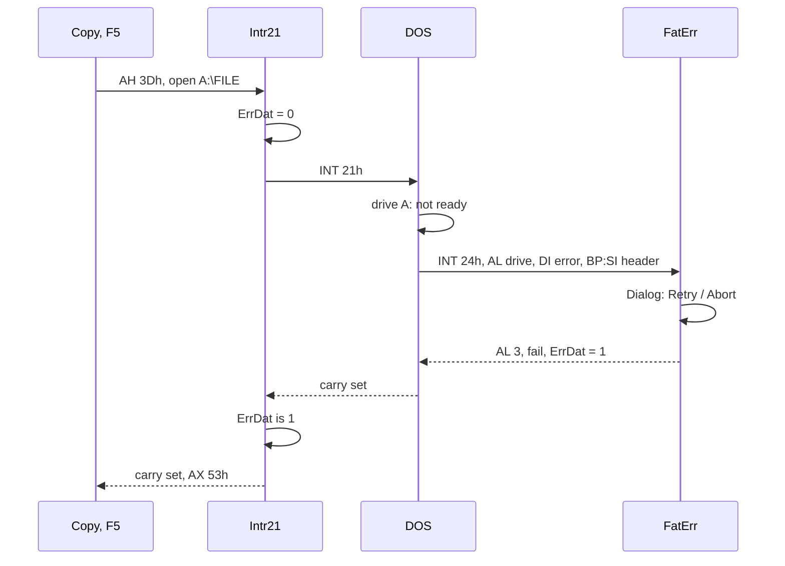
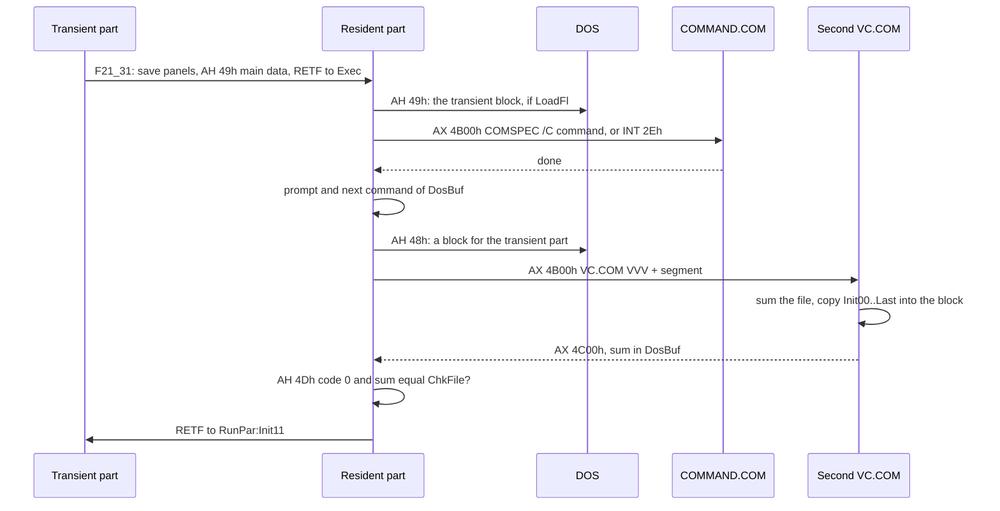
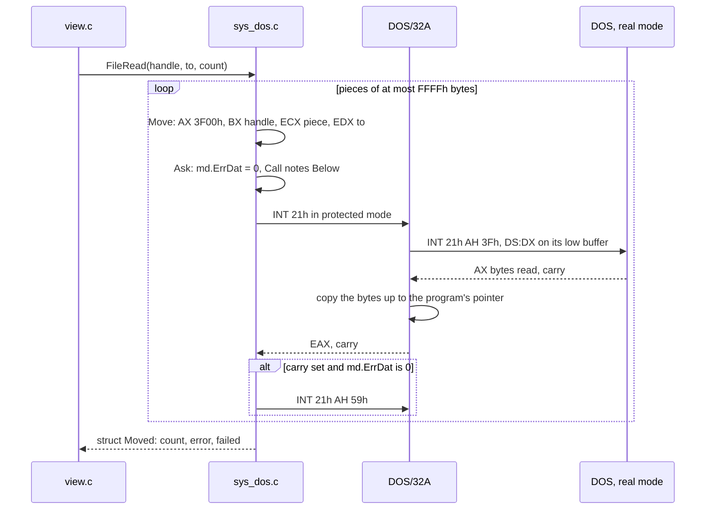
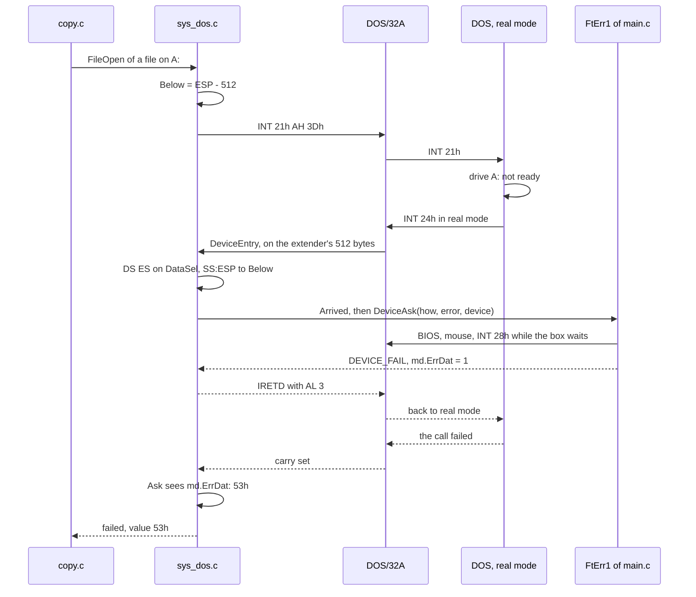
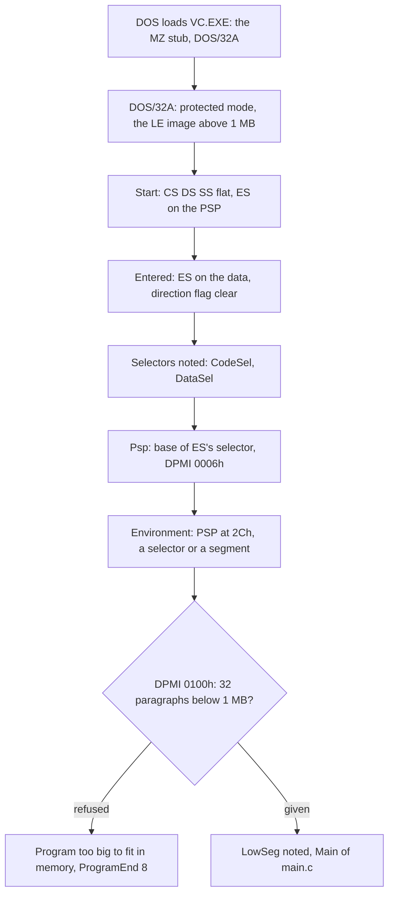

# 3. Talking to DOS and the PC: the system

Volkov Commander 4.05 is a 65,090-byte `.COM` file. In that space it
has two panels, a tree, a viewer with a hex mode, an editor, a file
search, menus, dialogs, a screen blanker, mouse support and a help
system. It also gets out of the way when you run a command. The panels
vanish, DOS's prompt comes back, and of the commander only 12,690
bytes stay in memory, about 12 KB, while your program has the rest of
the 640 KB.

All of that rests on a few hundred conversations with the machine. The
assembly in `src/asm/` calls DOS directly 102 times and through its one
error-handling wrapper 166 times. It calls the video BIOS 59 times, the
keyboard BIOS 21 times and the mouse driver 8 times. It writes to the
display's memory at `B800:0000` itself. And it takes three interrupts:
the critical error, Ctrl-Break and Ctrl-C.

This chapter covers that layer in three parts:

1. How the original talked to DOS and the PC: the error wrapper, the
   critical error box, the screen, the keyboard and the mouse, and the
   resident part that stays in memory while a command runs.
2. `sys.h`, where the portable C writes that conversation down as a
   contract of 99 functions, in DOS's terms.
3. `sys_dos.c`, which keeps the contract from 32-bit protected mode
   under the DOS/32A extender.

The assembly is quoted as Volkov wrote it, decoded from CP866 and
shortened where `...` stands. Where the C translation (`src/c/`) helps
explain how the 16-bit program works, it is quoted as well. The counts
and offsets come from the source and from the listing of the
original's build, `build/shareware-layout/VC.LST`.

## A PC of 1991 in one page

These are the parts of DOS and the PC that the rest of this chapter
relies on.

**Real mode and segments.** The 8086 addresses 1 MB with 16-bit
registers. An address is a *segment* and an *offset*, `B800:0010`, and
the machine adds them as `segment * 16 + offset`. A *paragraph* is 16
bytes, the unit of segments. DOS hands out memory in paragraphs and
names each block by its segment. A program in the *tiny* model, which
is what a `.COM` file is, has CS, DS, ES and SS all on one segment and
lives in 64 KB.

**Interrupts are the API.** The first 1 KB of memory holds 256 far
pointers, the interrupt vector table. `INT 21h` calls DOS, with the
function number in AH: 3Dh opens a file and 3Fh reads one. `INT 10h` is
the video BIOS, `INT 16h` the keyboard BIOS and `INT 33h` the mouse
driver. DOS reports failure in the carry flag, with an error number in
AX. A program may point a vector at its own code, and DOS has calls for
that, AH 25h to set a vector and 35h to read one.

**The PSP.** DOS puts 256 bytes in front of every program it loads,
the Program Segment Prefix. It holds the command tail at 80h, the
segment of the environment at 2Ch, and at 0Ah the address where DOS
goes on when the program ends. A `.COM` program is loaded right behind
its PSP, at offset 100h, and it gets all the free memory as one block.

**Memory control blocks.** DOS keeps a 16-byte header, the MCB, in the
paragraph just before every block. Byte 0 is `'M'`, or `'Z'` for the
last block. The word at 1 is the owner's PSP and the word at 3 is the
size in paragraphs. DOS walks this chain when it allocates. Nothing
stops a program from writing the headers itself, and Volkov Commander
does.

**TSRs and the shell.** A program can end and leave part of itself in
memory: Terminate and Stay Resident, AH 31h or `INT 27h`. COMMAND.COM,
the shell, stays resident while other programs run, and it has an
undocumented back door, `INT 2Eh`, which runs a command line in the
resident shell without loading a second copy.

**The display.** In text mode 3 the screen is 80 by 25 cells at
`B800:0000`, two bytes a cell: the character, then its colour. A
monochrome card has the same layout at `B000:0000`. Writing those bytes
is how anything fast drew on the screen.

## How the original asked

### `Intr21`: 62 bytes for every error

Most DOS calls in the program go through one routine of `VCSUB1.INC`,
`Intr21`. It is 3Eh bytes, and each of its 166 callers spends three
bytes on `CALL Intr21`. It does two things that every file operation
needs:

```asm
;--------------- Int 21h with fatal error --------------
Intr21  PROC    NEAR
        PUSH    DS
        MOV     DS,CS:SecDat            ; the main data, wherever DS is
        MOV     BYTE PTR DS:[ErrDat],0  ; no critical error yet
        POP     DS
        INT     21h
        PUSHF
        PUSH    DS
        MOV     DS,CS:SecDat
        CMP     BYTE PTR DS:[ErrDat],0  ; did the user give up in the box?
        POP     DS
        JNE     I21_02
        POPF
        JNC     I21_01                  ; no error: return as DOS left it
        PUSH    DS                      ; an error: keep everything...
        ...
        XOR     BX,BX
        MOV     AH,59h                  ; ...and ask DOS which, exactly
        INT     21h
        POP     BX
        ...
        POP     DS
        STC
I21_01: RET
I21_02: POPF
        MOV     AX,53h                  ; "the user cancelled"
        STC
        RET
Intr21  ENDP
```

- **The critical error.** When a drive is not ready, DOS does not
  return an error. It calls `INT 24h` in the middle of the call (next
  section). If the user answers Cancel in the box, the box sets
  `ErrDat`, and `Intr21` makes the call fail with 53h whatever DOS
  returned.
- **The extended error.** DOS 3 and later keep a more exact reason for
  the last failure, which function 59h returns. `Intr21` asks for it
  after every failed call and keeps every register but AX as the first
  call left it, so callers see one error number, the precise one.

`SecDat` is a word in the code segment that holds the segment of the
main data. Code anywhere in the program can find the data through CS
this way, whatever DS points at. The trick comes back in the critical
error.

### The critical error: `FatErr`

At start-up `HookVct` of `VC.ASM` notes the old `INT 24h` and `INT 1Bh`
vectors (AH 35h, saved in `ErrVct` and `BrkVct` of the main data) and
points them at the program (AH 25h):

```asm
HookVct PROC    NEAR
        PUSH    DS
        MOV     AX,3524h                ; who has the critical error?
        INT     21h
        MOV     DS:ErrVct.Offs,BX
        MOV     DS:ErrVct.Segm,ES
        MOV     AX,351Bh                ; and Ctrl-Break?
        INT     21h
        MOV     DS:BrkVct.Offs,BX
        MOV     DS:BrkVct.Segm,ES
        PUSH    CS
        POP     DS
        MOV     DX,OFFSET FatErr
        MOV     AX,2524h                ; the critical error is ours
        INT     21h
        PUSH    SS
        POP     DS
        MOV     DX,OFFSET CtrlC
        MOV     AX,251Bh                ; Ctrl-Break goes to an IRET
        INT     21h
        POP     ES
        RET
HookVct ENDP
```

DOS enters `FatErr` with AH holding flags (bit 4 set means Retry is
allowed, bit 7 set means the error is not on a disk), AL holding the
drive, DI holding the error code, and BP:SI pointing at the device
driver's header. Bit 7 of byte 5 of that header says whether the device
is a character device, and its 8-character name is at offset 10. From
these the routine builds the box's text: "Error on drive A" or "Error
on device PRN:", then one of 22 messages ("Drive or device not
ready.") or "File allocation table bad.". It calls `Dialog`, the same
routine that every other box of the program uses, and returns to DOS
with AL 1 for Retry or 3 for Fail:

```asm
FatErr: PUSH    DS
        ...                             ; eight registers kept
        CLD
        MOV     DS,CS:SecDat            ; the main data, through CS again
        PUSH    DS
        POP     ES
        MOV     BL,DS:ErrDat
        OR      BL,DS:BlocEr            ; given up already, or no box wanted?
        JZ      FtErr1
        MOV     AL,3                    ;   then fail, at once
        JMP     FtErr9
FtErr1: ...
        MOV     DS,BP                   ; the device header at BP:SI
        MOV     BX,SI
        TEST    BYTE PTR DS:[BX+5],80h  ; a character device?
        ...
FtErr5: ...
        XOR     BX,BX
        XCHG    BL,DS:Clock             ; no clock and no blanker
        XCHG    BH,DS:BlDelay           ;   while the box is up
        ...
        MOV     BP,OFFSET FtEr1_B       ; Retry / Abort
        TEST    CH,10h
        JNZ     FtErr6
        MOV     BP,OFFSET FtEr2_B       ; Ok only: DOS cannot retry
FtErr6: MOV     DX,DI
        CALL    Dialog
        ...
        CMP     AL,1
        JE      FtErr9
        MOV     DS:ErrDat,1             ; tell Intr21: the user gave up
FtErr9: CBW
        POP     BX
        ...
        IRET
```



Two flags keep the box from piling up. `ErrDat` stays set after a
Cancel, so the rest of an operation (the next file of a copy, the next
read) fails at once instead of asking again, until the next call
through `Intr21` clears it. `BlocEr` is for calls where the program
has an answer of its own and wants no box, such as deleting the tree's
file or closing up after a copy that was stopped.


*DOS's critical error, reported through `FatErr`: here for the device COM2, which a copy was asked to write to. The box is drawn over whatever was on the screen, a box of the copy included.*

### Ctrl-Break and Ctrl-C: one `IRET`

The handler for both keys is a single byte in `VC.ASM`:

```asm
CtrlC:  IRET
```

`INT 1Bh` is the BIOS's Ctrl-Break, raised from the keyboard
interrupt. `INT 23h` is DOS's Ctrl-C, raised when DOS notices the key
during a call. A file manager that died on Ctrl-C would lose its
panels, so both go to `CtrlC`. `SetBrk` also notes whether DOS's BREAK
was on (AX 3300h), switches it off (3301h with DL 0) so that DOS checks
for Ctrl-C only at console calls, and takes `INT 23h` (2523h):

```asm
SetBrk  PROC    NEAR
        ...
        MOV     AX,3300h
        INT     21h
        MOV     DS:ComnIni.BreakFl,DL   ; BREAK as the user had it
        MOV     DL,0
        MOV     AX,3301h
        INT     21h
        MOV     DX,OFFSET CtrlC
        MOV     AX,2523h
        INT     21h
        ...
        RETF
SetBrk  ENDP
```

This runs at start and again after every command, because the command
may have changed both. Every way out of the program puts BREAK back as
it was found (`Exit01`, below).

### The screen: a shadow buffer and `REP MOVSW`

The program never draws on the screen while it composes. Every box,
panel and menu is written into `ScrBuf` of the main data, a copy of the
screen with room for 50 rows of 80 cells (8,000 bytes). `Window` then
copies a rectangle of it to the display's memory:

```asm
;--------------------- Output window -------------------
;                       BH,BL - begin
;                       DH,DL - size
Window  PROC    NEAR
        ...
        MOV     AL,0
        CALL    CurMous                 ; hide the mouse pointer
        PUSH    ES
        POP     DS
        MOV     ES,DS:Screen.Segm       ; B800h, or B000h for mode 7
        CALL    BasAdr                  ; DI on the cell in ScrBuf
        MOV     SI,DI
        SUB     DI,OFFSET ScrBuf
        ADD     DI,DS:Screen.Offs       ; the same cell on the display
        MOV     AL,DS:Snow
        CMP     DH,1
        JE      Wind1                   ; one row: cell by cell
        ...
        CALL    MovScr                  ; more rows: whole rows
        ...
Wind7:  MOV     AL,1
        CALL    CurMous                 ; the pointer back
        ...
        RET
Window  ENDP
```

`MovScr` copies seven rows at a time with `REP MOVSW`. On a CGA, which
shows "snow" when its memory is written while it draws, it first waits
on port 3DAh for the retrace, with interrupts off:

```asm
MovSc2: MOV     AX,80
        MUL     DL                      ; up to 7 rows of 80 cells
        PUSH    AX
        OR      BL,BL
        JNZ     MovSc6                  ; no snow: just copy
        PUSH    DX
        MOV     DX,03DAh                ; CGA status port
MovSc3: IN      AL,DX
        TEST    AL,1
        JNZ     MovSc3
MovSc4: STI
        MOV     CX,10
        CLI
MovSc5: IN      AL,DX
        TEST    AL,1                    ; wait for a long enough retrace
        JZ      MovSc4
        LOOP    MovSc5
        POP     DX
MovSc6: POP     CX
        REP     MOVSW
        STI
        ...
```

The BIOS (`INT 10h`) is used only for what memory writes cannot do:
asking the mode and the page (0Fh), setting the cursor's place and
shape (02h, 01h), scrolling and typing DOS's own lines (06h, 0Eh),
asking whether the display is an EGA (12h) and how tall its font is
(1130h). `Screen` in the main data is a far pointer, segment above
offset. The start-up fills it from the mode (B000h for mode 7, B800h
otherwise) and from the BIOS's word at `0040:004Eh`, where the shown
page begins. TopView and DESQview could hand the program a buffer of
their own through `INT 10h` AH 0FEh, which ended up in the same
pointer.

### The keyboard: `INT 16h` and a busy loop that idles

`Input0` of `VCSUB2.INC` is the one place that waits for a key. It
polls (AH 1) rather than blocking (AH 0), because between keys it
drives the clock in the corner, the screen blanker, the mouse and the
auto-change of directory:

```asm
Input0  PROC    NEAR C USES DS SI DI DX CX BX
        ...
        MOV     AH,1
        INT     16h                     ; a key waiting?
        JZ      Inpt02
        MOV     AH,0
        INT     16h                     ; take it
Inpt01: JMP     Inpt41
Inpt02: XOR     AX,AX
        CALL    GetMous                 ; a button?
        MOV     AH,0FCh                 ;   then the pseudo-key FCxxh
        JNZ     Inpt01
        ...
        MOV     AH,2
        INT     16h                     ; Shift, Ctrl, Alt held
        MOV     KbdFlgs,AL
        ...
Inpt10: MOV     AL,IKeyBar
        CALL    PutKey                  ; the key bar for what is held
        CALL    LeaveTm                 ; INT 28h: DOS, we are idle
        ...
```

A key comes back as the BIOS gives it: scan code in AH, character in
AL. The program uses two pseudo-keys of its own: FC00h for "the mouse
did something" and FD00h for "Alt was pressed and released alone".
That second one is made by watching `INT 16h` AH 2 for the Alt bit
going on and then off within three timer ticks (`Timer` reads the
BIOS's count at `0040:006Ch` with interrupts off), with nothing else
pressed between. It is what lets a tap of Alt open the menu bar.

`LeaveTm` calls `INT 28h` at every round. That is DOS's "idle"
interrupt, which background programs such as PRINT hook to get time.
The original also gave its time slice to Windows (`INT 2Fh` AX 1680h)
and to DESQview (`INT 15h`).

### The mouse: eight calls of `INT 33h`

```asm
IniMous PROC    NEAR
        MOV     AX,21h                  ; software reset: keeps the setup
        INT     33h
        CMP     AX,WORD PTR 21h         ; an old driver without 21h?
        JNE     IniMo1
        XOR     AX,AX                   ;   then a full reset
        INT     33h
IniMo1: CMP     AX,WORD PTR 0FFFFh      ; FFFFh: a mouse is there
        ...
```

```asm
TypMous PROC    NEAR
        ...
        MOV     CX,0FFFFh               ; keep every bit of the cell...
        MOV     DX,7700h                ; ...and flip the colours
        ...
TypMo1: XOR     BX,BX                   ; software text cursor
        MOV     AX,0Ah
        INT     33h
```

```asm
CurMous PROC    NEAR                    ; AL 0 hide, 1 show
        CMP     ES:Mouse,0
        JE      CurMo1
        PUSH    AX
        CMP     AL,1                    ; carry if AL is 0
        MOV     AX,1
        ADC     AL,0                    ; AX 2 to hide, 1 to show
        INT     33h
```

The pointer is the driver's *software text cursor*. The driver keeps
the cell under it and writes `(cell AND FFFFh) XOR 7700h` there, which
swaps the foreground and background colours. That is why `Window`
hides it around every copy: otherwise the driver would put back a stale
cell over freshly drawn ones. `GetMous` reads the position in pixels
(AX 3) and divides by 8 for a cell, `SHR AX,CL` with CL 3, and swaps
the left and right buttons for a left-handed mouse.

### The resident part: 12 KB that stay

The program is two parts in one file:

- **The resident part.** About 1.5 KB of code, the PSP and room for
  what has to survive a command: 12,690 bytes, which DOS holds as 794
  paragraphs.
- **The transient part.** Everything else, 63,323 bytes from `Init00`
  to the end of the file: the panels, the editor, the viewer, the
  menus and all their constants.

It also uses a third block, the main data with both panels and the
viewer's buffer, which it asks DOS for when it starts.

When the user presses Enter on a command, the transient part saves what
it needs into the resident part. It gives the main data back to DOS
and, with Memory allocation switched on as the program is distributed,
gives itself back too. Then the resident part runs the command. After
the command it loads the transient part from `VC.COM` again and jumps
into it.

The resident part, as `VC.LST` has it, counted from the PSP:

```
PSP:0000  +---------------------------------------+
          | PSP (DOS's)                           |   256
    0100  +---------------------------------------+
          | JMP Alloc0, RunPar, ChkFile,          |
          | "COMMAND.COM", OvlPrm, messages,      | 1,511 bytes of code
          | Exec, Exit00..Exit05, NotFind,        |   and constants
          | OutStr, SetBrk, GetStat, CtrlC,       |
          | New21, New27, ExeProg, AddProg,       |
          | FreeBlk, Release                      |
    06E7  +--------------- LastRes ---------------+
          | IntTab   256 vectors (TSR manager)    | 1,024
    0AE7  | SavePtr, Vect21, Vect22, Vect27       |    16
    0AF7  | Counter, PrgList[18], NameBuf         |    50
    0B29  | WCB1sav  left panel: 94-byte header   | 3,422
          |          + 256 file names x 13        |
    1887  | WCB2sav  right panel, the same        | 3,422
    25E5  | ComnIni  the main data up to DosLin:  | 2,733
          |          setup, history, command line |
    3092  | DataSav  the stack, LenStk            |   256
    3192  +--------------- VcStack ---------------+
                                                    total 12,690
```

Everything from `LastRes` on is uninitialised data, `DUP(?)`. In the
file, those bytes hold the start-up code, `Alloc0` (256 bytes, run once
and then written over), and the beginning of the transient part. The
start-up's first job is to move them out of the way.

#### Splitting the block: `Alloc0`

DOS loads the `.COM` file into one block that has all the memory.
`Alloc0`:

1. Adds up every byte of the file from 100h to `Last`, a 16-bit sum
   kept in `ChkFile`. This is how the program will know its own file
   again.
2. Checks that DOS is 3.20 or later (AH 30h).
3. Shrinks its block (AH 4Ah) to the resident part plus the transient
   image, then **moves the transient part up**, 63 KB backwards with
   `STD` and `REP MOVSB`, to the first paragraph behind `VcStack`. It
   moves the stack to `VcStack` in the same breath, interrupts off.
4. **Writes a memory control block by hand** between the two parts.
   The resident block's MCB gets `'M'` and the resident size in
   paragraphs. The new MCB gets the old signature, the owner (this PSP)
   and the rest of the size:

```asm
;-------- Split into resident and transit parts --------
        MOV     AX,ES
        DEC     AX
        PUSH    AX                      ; the new block's MCB
        MOV     AX,CS
        DEC     AX
        MOV     DS,AX                   ; this block's MCB
        MOV     AL,'M'
        XCHG    AL,DS:[0]               ; not the last any more
        XCHG    BX,DS:[3]               ; the resident size
        SUB     BX,DS:[3]
        DEC     BX
        POP     DS
        MOV     DS:[0],AL               ; 'M' or 'Z', as it was
        MOV     DS:[1],CS               ; owned by us
        MOV     DS:[3],BX               ; the rest
        STI
        PUSH    CS
        POP     DS
Alloc7: MOV     AX,ES
        SUB     AX,WORD PTR ((Init00-Zero) SHR 4)
        MOV     DS:RunPar,AX
        PUSH    AX
        CALL    SetStat
        MOV     AX,OFFSET Init00
        PUSH    AX
        RETF                            ; far jump into the moved part
```

`RunPar` is the trick that makes the move free. It is the new block's
segment less `Init00`'s offset in paragraphs. With CS set to `RunPar`,
every offset in the transient part is the same as it was in the `.COM`
file, so nothing in 63 KB of code needs relocating. The resident part
enters the transient part by a far return to `RunPar:Init00`, or to
`RunPar:Init11` after a command. The transient part finds the resident
part through SS, which stays there, since that is where the stack is.

#### Going: `F21_31`

When a command is to run, `F21_31` of `VCFUNC.INC` copies the common
data into `ComnIni`, and each panel's header and the names of its first
256 files into `WCB1sav` and `WCB2sav`. Those names are how a panel
finds its cursor and its selection again after the command. Then it
restores the screen as DOS had it, frees the main data (AH 49h), and
jumps far into the resident part's `Exec`:

```asm
F21_31: CALL    RestVct                 ; INT 24h and 1Bh back as they were
        ...
        MOV     DI,OFFSET ComnIni
        MOV     CX,CmnSave
        REP     MOVSB                   ; the main data's head, kept
        ...
        MOV     DI,OFFSET WCB1sav
        CALL    F21_40                  ; left panel, kept
        ...
        MOV     AH,49h                  ; the main data given back
        INT     21h
        ...
        MOV     AX,OFFSET Exec
        PUSH    DS                      ; DS is SS: the resident part
        PUSH    AX
        RETF
```

Shift held with Enter flips Memory allocation for that one command
(`INT 16h` AH 2, then `InvVar` on `LoadFl`).

#### Running: `Exec`, `INT 2Eh` and `4B00h`

```asm
Exec:   TEST    DS:ComnIni.LoadFl,7Fh   ; Memory allocation on?
        JZ      Exec01
        CALL    GetStat
        MOV     AH,49h                  ; the transient part given back
        INT     21h
        CALL    SetStat
Exec01: ...
Exec02: CLD
        MOV     DL,DS:ComnIni.BreakFl
        MOV     AX,3301h                ; BREAK as the user had it
        INT     21h
        ...                             ; next command of DosBuf, CR at its end
        CMP     AL,DS:ComnIni.ExecTyp   ; Quick execute?
        JE      Exec04
        ...
Exec03: INT     2Eh                     ; COMMAND.COM, run this
        CLI
        MOV     SP,CS                   ; INT 2Eh keeps nothing:
        MOV     SS,SP                   ;   the stack is set anew
        MOV     SP,OFFSET VcStack
        STI
        CALL    SetBrk0
        JMP     Exec07
Exec04: SUB     CX,SI
        MOV     CH,'/'                  ; the tail: count, "/C ", command
        MOV     DS:[SI],CX
        MOV     WORD PTR DS:[SI+2],' C'
        MOV     BX,OFFSET ComnIni.EPB
        MOV     DS:[BX].CmdLine.Offs,SI
        MOV     DS:[BX].CmdLine.Segm,DS
Exec05: ...
        MOV     DX,DS:ComnIni.ComSpec   ; the name from COMSPEC=
        ...
        MOV     DS,DS:[2Ch]             ;   in the environment
        MOV     AX,4B00h                ; load and run COMMAND.COM /C ...
        INT     21h
        CALL    SetBrk0
```

`DosBuf` (1,000 bytes) holds a list of commands separated by zero
bytes: one typed command, or the lines of a user menu item or of an
extension (`VC.EXT`). `Exec` runs them in turn. Between two commands it
prints DOS's prompt itself, `C:\DIR>` built from AH 19h and 47h and the
command behind it, with `INT 10h` AH 0Eh. A line beginning with `@` is
run without being shown.

It runs a command one of two ways:

- **EXEC**, as the program is distributed. Function 4B00h runs
  `COMSPEC` with the tail `/C command`. The Execute Program Block,
  `EPB`, names the tail and leaves the environment 0, which tells DOS
  to give the child a copy of this program's environment.
- **Quick execute**, a setting. `INT 2Eh` hands the line to the
  COMMAND.COM that is already in memory, the one that started the
  commander. That saves loading a second shell for every command, and
  what a command sets stays set in the shell. But the interrupt returns
  with every register lost, SS:SP included, so the code puts its stack
  back from CS at once. If the current drive has changed, it first
  passes a two-byte command (`DosChg`, `X:` and a CR) to switch drives,
  since the shell keeps its own idea of the drive.


*Ctrl-O after a user menu item of two commands: the resident `Exec` wrote each prompt, `C:\WORK>`, and each command between their outputs.*

#### Coming back: running `VC.COM` as its own loader

After the last command, `Exec10` gets the transient part back. The
original does not open its file and read it. It asks DOS for a block
(AH 48h) and then *runs `VC.COM` again* with 4B00h and a special
command tail:

```asm
OvlPrm  DB      10, 'VVV', 0, 0, 0, 0, 0, 0, 0, 0Dh
```

The resident part writes its own segment into the tail, behind `VVV`.
The second copy starts at `Alloc0` like any other. It adds up its file
as the first copy did, sees the `VVV` tail, and copies its `Init00` to
`Last` into the first copy's `RunPar` block. Then it leaves its sum in
the first copy's `DosBuf` and ends, with code 0, or 1 if its file
length is not the one the first copy expected:

```asm
Alloc0: CLD
        MOV     SI,100h
        MOV     CX,OFFSET Last-100h
        ...
Alloc1: LODSB
        ADD     BX,AX                   ; the check sum of the file
        LOOP    Alloc1
        MOV     SI,80h                  ; the command tail
        MOV     DI,OFFSET OvlPrm
        MOV     CL,DS:[DI]
        DEC     CX
        REPE    CMPSB                   ; "VVV"?
        JNE     Alloc3                  ;   no: a normal start
        LODSW                           ; the first copy's segment
        ...
        MOV     ES,AX
        XCHG    BX,ES:ComnIni.LoadSiz   ; leave the sum, take the length
        MOV     ES,ES:RunPar
        MOV     SI,OFFSET Init00
        MOV     DI,SI
        MOV     CX,BX
        SUB     CX,SI
        REP     MOVSB                   ; the transient part, delivered
        MOV     AX,4C00h
        SUB     BX,OFFSET Last
        JE      Alloc2
        INC     AX                      ; exit code 1: not my file
Alloc2: INT     21h
```

The first copy checks the child's exit code (AH 4Dh) and the sum. If
either is wrong, because the user changed disks or deleted `VC.COM`
meanwhile, it prints "Bad or missing" with the path and waits for
Enter to try again or Esc to give up. Then it far-jumps to `Init11`,
which asks DOS for the main data again and reads the panels anew.

DOS's own loader does the file I/O, finding the file by the path in
the environment (`OvlPth`). The program needs no code for the file
in the part that stays.



#### `Exit01` and the hooks on `INT 21h` and `INT 27h`

At start, `Init00` puts `Exit01` into the PSP at 0Ah and keeps the old
address in `Vect22`. If DOS ends the program by another's hand, it
still goes through `Exit01`, which puts BREAK back, frees any programs
the TSR manager has noted, gives back `INT 21h` and `INT 27h`, and goes
on at `Vect22`.

With the TSR manager on (`ChkTSR`), the resident part also takes
`INT 21h`. It writes the vector straight into the table with
interrupts off rather than asking DOS:

```asm
        MOV     AX,3521h
        INT     21h
        MOV     DS:Vect21.Offs,BX
        MOV     DS:Vect21.Segm,ES
        XOR     AX,AX
        MOV     ES,AX
        CLI
        MOV     ES:[4*21h].Offs,OFFSET New21
        MOV     ES:[4*21h].Segm,DS
        STI
```

`New21` is 50h bytes, and almost every call passes it in five
comparisons:

```asm
New21   PROC    FAR                     ; INT 21h
        CMP     AH,4Bh                  ; a program run: snapshot vectors
        JE      Fnc4B
        CMP     AH,31h                  ; one that stays: note it
        JE      Fnc31
        CMP     AH,49h                  ; a block freed: forget its owner
        JE      Fnc49
        CMP     AH,2Bh                  ; set date... or the VC API
        JE      VCapi
Old21:  JMP     CS:Vect21
        ...
VCapi:  CMP     CX,'VC'
        JNE     Old21
        CMP     DX,'OM'
        JNE     Old21
        ...                             ; ES:BX on WCB1sav, WCB2sav or
        MOV     AX,VcApiVr*100h         ;   ComnIni, by AL
        CLC
        RET     2
New21   ENDP
```

`ExeProg` copies all 256 vectors into `IntTab` when a program is run,
1 KB. `AddProg` records up to 18 programs that stay resident
(`PrgList`). `Release`, from the Memory map, frees one and puts back
the vectors it had taken. AH 2Bh with `'VC'` and `'OM'` is the
program's own API: the separate `VCSETUP.COM` used it to find the
running commander's setup in memory.

### The same in the C translation

The C translation (`src/c/`) keeps this layout byte for byte where it
can. It is the readable form of the 16-bit program:

- `src/c/resident.c` is the resident part, compiled into `RTEXT` with
  `-nd=R -g=R_GROUP`, so its code and data are one group that begins
  at the PSP. What it keeps is one structure, so that the compiler
  cannot reorder it:

  ```c
  struct Stays {
      u32 IntTab[256];
      u32 SavePtr;
      u32 Vect22;
      u32 Vect27;
      u32 TrnAdr;
      u16 Counter;
      u16 PrgList[MaxProg];
      u8  NameBuf[12];
      u8  WCB1sav[STAYS_WCB];
      u8  WCB2sav[STAYS_WCB];
      u8  ComnIni[STAYS_CMN];
  };
  ```

  The stack, `DataSav[LenStk]`, is the one object without a value, so
  Open Watcom puts it last, in `R_BSS`, at the end of the group.
- `src/c/transit_t.c` is 32 zero bytes, `TrnBeg`, which the linker
  places right behind the stack. Its first whole paragraph is the room
  for the MCB that `Alloc0` writes, and the transient part begins behind
  it.
- `tools/mkexe.c` turns the linker's `VC.EXE` into one that loads like
  a `.COM`: entered at `PSP:100h` with CS on the PSP (a header code
  segment of -10h), the stack at the end of the resident part, and the
  file laid out as the program lies in memory. It finds seven words of
  `resident.c` by name in the linker's map and fills them in: `ImgEnd`,
  `TrnPrW`, `ResPrW`, `DatPrW`, `RelTab`, `RelCnt` and `ResCnt`.
- The translation is too large for one 64 KB segment: its compiled code
  is in two, `CTEXT` and `CTEXT2`. So the transient part needs real
  relocation, and DOS cannot do it, because the program loads that part
  itself. `mkexe.c` appends the linker's relocation table to the file,
  and `Reloc` applies it to every copy that is loaded:

  ```c
  static void Reloc(void)
  {
      const u16 __far *entry = (const u16 __far *)AT(RunPar + RelTab, 0);
      u16 count;

      for (count = RelCnt; count; count--) {
          u16 offset = *entry++;
          u16 segment = *entry++;

          *(u16 __far *)AT(RunPar + segment, offset) += RunPar;
      }
  }
  ```

- The transient part is entered as a far function. `Stay` calls
  `TrnMain` of `main.c` through a pointer kept in `Stays.TrnAdr`, and
  `TrnMain` returns what the resident part is to do: run the commands
  of `DosBuf` (`TO_EXEC`), report no memory (`TO_ALLOC`), or end with a
  code:

  ```c
  static void Go(u32 back)
  {
      u16 what = (u16)back;

      if (what == TO_EXEC)
          Exec();
      else if (what == TO_ALLOC)
          AlocEr((u16)(back >> 16));
      else
          Exit00(what);
  }

  static void Stay11(void)
  {
      for (;;) {
          TrnAdr = (Transit *)AT(RunPar + TRN_SEG(TrnMain_s),
                                 OFFSET(TrnMain_s));
          Go(TrnAdr(0));
      }
  }
  ```

- The two hooks that C cannot write are naked functions of `_asm`.
  `New21` is the original's five comparisons and a `jmp dword ptr
  cs:Vect21`, so that the calls it does not want pass on with no
  register and no byte of the caller's stack changed. Only the four it
  handles reach the `__interrupt` function `Int21`. `Int2E` is nine
  instructions. `int 2Eh` returns with no stack, so it sets SS:SP and
  DS from CS and jumps to `Exec2E`, which continues the list of
  commands.

Linked, the translation's resident group, `R_GROUP` in
`build/c/VC.MAP`, is 4D04h bytes (19,716). Of that, 4,738 are `RTEXT`,
the PSP's room and the code, 4,096 the stack and the rest `Stays`. The
original's 12,690 bytes had a 256-byte stack and code written by hand.

The portable C has no resident part. It stays in memory whole while a
command runs, and the panels keep all their files.

## The contract: `sys.h`

The portable C still talks to DOS and the PC, but only in one file.
`src/portable_c/sys.h` (670 lines) declares every request as a C
function named for what is asked, in DOS's terms. It names no register,
no service number and no interrupt. Its top comment states the rule:

```c
 * What is asked for is still shaped as DOS and the BIOS of a PC have it,
 * since the rest of the program has those shapes in hundreds of places
 * and the screens show them: a drive is a letter or its number, a path
 * has backslashes and at most 67 characters, a name 12 with its dot;
 * attributes, dates and times are DOS's bits; an error is DOS's number
 * for it; a key is a character with the scan code of the key above it; a
 * cell of the screen is a character with its colour above it; a tick is
 * the 18.2th part of a second. Another system has to answer in these.
```

Two more rules shape it:

- **One function, one request.** Where the original asks several
  things in a row, the row stays in the calling code, in the original's
  order, because "what DOS is asked and in which order is behaviour". `OpenFil` of `system.c` opens a file and,
  on a sharing violation (20h), tries again without the sharing bits:
  that is two calls of `FileOpen`, not one cleverer function.
- **Asked or bare.** A function "asked with the program's errors" is
  `Intr21`: the critical error box may appear, Cancel makes the call
  fail with 53h, and other failures come back as DOS's extended error.
  A *bare* one is the original's direct `INT 21h`. Where the original
  calls a service both ways, there are two functions, such as
  `FileOpen` and `FileOpenBare`.

Every answer that can fail begins with `struct Answer`:

```c
struct Answer {
    u16 value;      /* what was asked for, a handle or a number of bytes,
                       or the error: AX as DOS left it */
    bool failed;    /* if that is the error */
};
```

`value` is AX as DOS left it, *even on success*, because some callers
of the original go on with whatever AX held. Larger answers have their
own structures: `struct Moved` for a read or write, `struct FilePlace`,
`struct FileAttr`, `struct FileStamp`, `struct Space`, `struct Block`,
`struct Keys` and `struct Screen`.

The 99 functions, by group, with what the original asked and why:

| Group | n | Functions (some) | The original | What for |
|---|---:|---|---|---|
| Files | 18 | `FileOpen`, `FileRead`, `FileWrite`, `FileSeek`, `FileAttributes`, `FileTime`, `FileDevice`, `FileTrueName` | INT 21h 3Ch–43h, 4400h, 56h, 57h, 60h, through `Intr21` | copy, move, view, edit, the setup and history files |
| By an FCB | 2 | `FcbParse`, `FcbDelete` | 29h, 13h | delete a whole mask at once; volume labels |
| Directories | 8 | `FindFirst`, `FindNext`, `FindRecord`, `DirChange`, `DirCurrent` | 4Eh, 4Fh, 1Ah, 39h–3Bh, 47h | reading a panel, the tree, the file search |
| Drives | 8 | `DriveSpace`, `DriveSelect`, `DriveLetter`, `DriveRemote`, `DriveCd` | 36h, 0Eh, 19h, 4408h, 4409h, 440Eh, 440Fh, INT 2Fh 150Bh | the drive menu, free space, the A:/B: prompt, MSCDEX |
| Memory | 6 | `MemTake`, `MemGive`, `MemResize`, `MemOwn`, `MemSetSearch` | 48h–4Ah, 58h | the main data and panels; making room for a command |
| Time, country, system | 8 | `TimeOfDay`, `CountryInfo`, `CaseMap`, `SystemVersion`, `BreakCheck`, `Idle` | 2Ch, 38h, its far routine, 30h, 3306h, 33h, INT 28h | the clock, dates and sizes as the country writes them, capitals |
| Programs, the end | 8 | `ProgramRun`, `ProgramEnd`, `ProgramTail`, `ProgramEnvironment`, `ProgramOfFile` | 4B00h, 4Ch, the PSP | running commands, `COMSPEC`, its own path |
| What the system asks | 11 | `DeviceErrorTake`, `CtrlBreakTake`, `CtrlCTake`, `ProgramEndedTake`, `IntOn` | INT 24h, 1Bh, 23h, PSP:0Ah | not dying on a missing disk or a Ctrl-C |
| Console | 2 | `ConsoleChar`, `ConsoleText` | 06h, 09h | the banner, messages before the screen is set up |
| Keyboard | 4 | `KeyWaiting`, `KeyRead`, `KeysHeld`, `KeyForgetIns` | INT 16h 01h, 00h, 02h; `0040:0018h` | every key, Alt alone, the key bar |
| Screen | 15 | `ScreenState`, `CursorTo`, `ScreenScroll`, `ScreenType`, `ScreenFont`, `ScreenPut`, `ScreenGet` | INT 10h; memory at B800h | the mode, the cursor, DOS's lines; the panels |
| Mouse | 8 | `MouseFind`, `MouseShow`, `MouseWhere`, `MousePointer` | INT 33h 21h, 00h, 01h, 02h, 03h, 04h, 08h, 0Ah | the pointer and the clicks |
| Timer | 1 | `Ticks` | `0040:006Ch` | the blanker, double clicks, Alt alone |

The group "what the system asks the program" works the other way: DOS
or the BIOS comes to the program, in the middle of something else. Each
of those follows a Note / Take / Give pattern, the original's AH 35h,
25h, and 25h again with the noted vector:

```c
typedef u16 DeviceErrorFn(u16 how, u16 error, const u8 *device);
#define DEVICE_RETRY 1
#define DEVICE_FAIL  3

void DeviceErrorNote(void);
void DeviceErrorTake(DeviceErrorFn *ask);
void DeviceErrorGive(void);
```

`HookVct` of `main.c` is now four lines, in the original's order:

```c
void HookVct(void)
{
    DeviceErrorNote();
    CtrlBreakNote();
    DeviceErrorTake(FtErr1);
    CtrlBreakTake();
}
```

`FtErr1` is `FatErr` without its registers. It gets DOS's AX (`how`)
and DI (`error`), and the device's name or 0 for a drive. It builds the
same text and calls the same `Dialog`, and it returns `DEVICE_RETRY` or
`DEVICE_FAIL`. Where the interrupt arrives, with DOS's registers and an
`IRET`, is the system file's business.

## `sys_dos.c`: the same contract from 32-bit protected mode

The portable C for DOS is a 32-bit program. Open Watcom's `wcc386`
compiles it in the flat model, so one code and one data segment, both
based at 0, and a pointer is a linear address. It is linked as an LE
executable with DOS/32A as its stub. DOS loads the stub, the stub
switches to protected mode, loads the program above the megabyte and
enters `Start` of `sys_dos.c`. `sys_dos.c` (2,073 lines) is the only
file that knows any of this.

DOS, the BIOS and the mouse driver are still real-mode code. The
program calls them by the same software interrupts. The extender
catches each `INT`, switches to real mode, makes the call and switches
back. What it does to the registers on the way decides how each
function has to be written, and trials of each kind of call found
four:

| Kind | Example | What the extender does | So `sys_dos.c` |
|---|---|---|---|
| No address | AH 19h, 2Ch, 36h; every INT 10h, 16h, 33h | passes the registers there and back | calls `INT` directly |
| An address the extender knows | 3Dh, 3Fh, 40h, 41h, 56h | copies the buffer through a buffer of its own below 1 MB | hands its own 32-bit pointer |
| An address it does not know | 13h, 29h, 38h, 60h, 4B00h | passes the register as it is, meaningless to DOS | calls DOS in real mode with DPMI 0300h, data in its own low block |
| Known, but AX comes back wrong | 4Eh, 4Fh, 47h, 4301h | returns the AX it was called with, not DOS's | real mode too, since `sys.h` promises DOS's AX |

Thirteen functions end up being made in real mode: `FindRecord`,
`FindFirst`, `FindNext`, `FileSetAttributes`, `DirCurrent`,
`DirCurrentBare`, `FileTrueName`, `FcbParse`, `FcbDelete`,
`CountryInfo`, `CaseMap`, `ProgramRun` and `ProgramRunBare`.

### Seven interrupts, each written once

Every interrupt is inline assembly in one `#pragma aux`: `Dos` (INT
21h), `Dpmi` (INT 31h, the extender's services), `Video` (10h),
`Keyboard` (16h), `Multiplex` (2Fh), `DosIdle` (28h), and `MouseDriver`
and `MouseState` (33h). `Dos` loads six 32-bit registers from a
`struct DosRegs`, makes the call, writes four back, and turns the
carry flag into a return value with `sbb eax,eax`:

```c
static u32 Dos(struct DosRegs *regs);
#pragma aux Dos = \
    "push ebp" "push ebx" \
    "mov eax,[ebx]" "mov ecx,[ebx+8]" "mov edx,[ebx+12]" \
    "mov esi,[ebx+16]" "mov edi,[ebx+20]" "mov ebx,[ebx+4]" \
    "int 21h" \
    "xchg ebx,[esp]" \
    "mov [ebx],eax" "mov [ebx+8],ecx" "mov [ebx+12],edx" \
    "pop eax" "mov [ebx+4],eax" "pop ebp" \
    "sbb eax,eax" \
    parm [ebx] value [eax] modify exact [eax ebx ecx edx esi edi]
```

Every register goes in with all 32 bits, because the extender reads all
of them where it translates. Of what comes back, only the low words
count. `Set` fills a `DosRegs` with 0 in every register a call does not
read, where the original left whatever it happened to hold.

### `Ask` is `Intr21`

```c
static struct Answer Ask(struct DosRegs *regs, bool flagged)
{
    u32 ebx, ecx, edx;

    md.ErrDat = 0;
    if (Call(regs))
        flagged = true;
    if (md.ErrDat != 0) {
        regs->eax = ERR_NOT_READY;              /* 53h */
        return Answered(regs, true);
    }
    if (!flagged)
        return Answered(regs, false);
    ebx = regs->ebx;
    ecx = regs->ecx;
    edx = regs->edx;
    regs->eax = regs->eax & 0xFF | 0x5900;      /* the extended error */
    regs->ebx = 0;
    Call(regs);
    regs->ebx = ebx;
    regs->ecx = ecx;
    regs->edx = edx;
    return Answered(regs, true);
}
```

It follows the 62 bytes of the original line for line. The one extra
part is `flagged`. Two calls, 13h and 36h, leave the carry flag as they
find it, and the original enters them with the flag set at some calls. A flag
the program sets does not survive a round trip through the extender, so
`Ask` takes it as an argument instead. `Tell` is the bare form:
`Answered(regs, Call(regs))`.

### One call through all of it: `FileRead`

`sys.h` takes an `i32` count, and DOS takes 16 bits. `Move` reads in
pieces of `FFFFh` bytes for as long as each comes back whole:

```c
do {
    piece = count - moved.count;
    if (piece > PIECE_MOST)
        piece = PIECE_MOST;
    Set(&regs, ax, handle, (u32)piece, ADDRESS(at + moved.count));
    answer = asked ? Ask(&regs, false) : Tell(&regs);
    if (answer.failed) { ... break; }
    moved.count += answer.value;
} while (answer.value == piece && moved.count < count);
```



A read is a call the extender translates, so `sys_dos.c` does nothing
about the buffer. A search is not, and its functions copy the 43-byte
search record down to the low block before each call and back up after
it. DOS keeps the search's state in that record, and the program may
have several searches open at once:

```c
struct Answer FindNext(void)
{
    struct DosRegs regs;

    if (Record != 0)
        Bytes(LOW(LOW_RECORD), (const u8 *)Record, RECORD_SIZE);
    SetLow(&regs, 0x4F00, 0, 0, 0);
    return Searched(&regs);           /* Ask, then the record copied up */
}
```

### The block below the megabyte

`Start` asks DPMI 0100h for 32 paragraphs of DOS's own memory and keeps
the real-mode segment in `LowSeg`. Every call made in real mode keeps
what DOS reads or writes there, each thing at a fixed place:

```
LowSeg:0000  +-------------------------------+
             | LOW_NAME     name or path     |  128 bytes
     0080h   +-------------------------------+
             | LOW_RECORD   search record    |   43 bytes (64 room)
     00C0h   +-------------------------------+
             | LOW_SECOND   path that 60h    |  128 bytes
             |   writes, or 4B00h's tail     |
     0140h   +-------------------------------+
             | LOW_FCB      extended FCB     |   44 bytes (48 room)
     0170h   +-------------------------------+
             | LOW_COUNTRY  38h's record     |   34 bytes (48 room)
     01A0h   +-------------------------------+
             | LOW_RUN      4B00h's EPB      |   14 bytes (16 room)
     01B0h   | LOW_FCB1     first FCB        |   16 bytes
     01C0h   | LOW_FCB2     second FCB       |   16 bytes
     01D0h   +-------------------------------+
             | LOW_ENDED    Ended_T, real-   |   28 bytes (32 room)
             |   mode code for the end       |
     01F0h   | LOW_WAS      old PSP:0Ah      |    4 bytes
     01F4h   | LOW_PSP      PSP segment      |    2 bytes
     01F6h   | LOW_BREAK    BREAK to set     |    1 byte
     0200h   +-------------------------------+  LOW_SIZE = 512
```

`LOW(place)` is `(u8 *)(((u32)LowSeg << 4) + place)`. The program's
segments are based at 0, so the machine's first megabyte is just the
addresses 0 to FFFFFh. The same arithmetic reaches the BIOS's data
(`Ticks` reads `*(u32 *)0x46C`, the original's `0040:006Ch`) and the
display. If the block is refused, the program prints the original's
"Program too big to fit in memory" and ends with error 8.

`Real` makes a call in real mode. It fills a DPMI `struct RealRegs`
with DS and ES on `LowSeg`, and SS:SP 0, so that the extender lends a
stack of its own. Then it asks DPMI 0300h for an interrupt, or 0301h
for a far call. `CaseMap` is the far call: `CountryInfo` takes the
address of DOS's routine for capitals from offset 18 of the country
record, and each letter is handed to it in AL.

### DPMI memory

`MemTake` does not ask DOS. The memory for the panels and the editor's
text comes from DPMI 0500h (how much is free), 0501h (take), 0502h
(give back) and 0503h (resize), above the megabyte, as much as the
machine has. The extender names a block by a 32-bit handle in SI:DI.
`sys.h` names it by its address, so `sys_dos.c` keeps a table:

```c
struct Held {
    u8 *block;      /* where it begins */
    i32 bytes;      /* how many it has */
    u32 name;       /* the extender's name for it: SI above DI */
};
static struct Held Blocks[BLOCKS_MOST];     /* 8; the program has three */
```

The program asks for memory as the original asked DOS (`Init11`, `MOV
BX,0FFFFh` and then AH 48h). First it asks for more than there can be,
`BYTES_MOST` (7FFFFFFFh), which is refused with the size of the largest
block. Then it asks for that. `MemTake` answers the first request from
0500h without calling 0501h.

Two things matter here. DOS/32A keeps 16 bytes of its own in
front of each block and ends the program at the next memory call if a
write has touched them. And a refused 0503h does not say how large the
block could have been, where DOS's 4Ah does. `MemOwn`, the original's
4Ah that shrank its own block to make room for commands, has nothing
to do: the extender gave the program what its file says and no more.

### The critical error, from real mode into C

DOS still calls `INT 24h` in real mode, in the middle of a call. The
program takes it with DPMI 0205h. The extender then catches the
real-mode interrupt, switches to protected mode and enters
`DeviceEntry`, *on a stack of its own of 512 bytes*, with DS and ES
anywhere. 512 bytes are not enough for `FtErr1`, which draws a box and
waits for a key through the BIOS, the mouse and `INT 28h`. And no
compiled instruction can run before DS is on the data. This is the
same problem the original solved with `MOV DS,CS:SecDat`, and the
answer is the same, a variable read through CS:

```c
__declspec(naked) static void DeviceEntry(void)
{
    _asm {
        push ds
        ...                             ; keep the registers
        mov bx,word ptr cs:DataSel      ; the data selector, through CS
        mov ds,bx
        mov es,bx
        cld
        mov ecx,esp
        mov edx,ss
        mov ss,bx                       ; SS and ESP change together:
        mov esp,Below                   ;   no interrupt between them
        push edx
        push ecx
        mov edx,ebp
        call Arrived                    ; C, registers by #pragma aux
        pop ecx
        pop edx
        mov ss,dx
        mov esp,ecx
        ...
        iretd
    }
}
```

`Below` is where on the program's own stack it is safe to continue. It
is not the current stack pointer: the extender was entered on the
program's stack when the program called DOS, and it keeps its state
there. Every call notes `Below = StackNow() - STACK_KEPT` first. The
toys saw the extender use 190 bytes below the stack pointer for a
translated call, 130 for a call through 0300h and 74 for any other, and
`STACK_KEPT` is 512, that and as much again.

`Arrived` makes a flat pointer of BP:SI, looks at bit 7 of byte 5 of
the device header as `FatErr` did, and calls the program's function
with a pointer to the name at offset 10, or 0:

```c
static u32 Arrived(u32 how, u32 error, u32 base, u32 offset)
{
    const u8 *device = (const u8 *)(((base & 0xFFFF) << 4)
                                    + (offset & 0xFFFF));
    u32 below = Below;
    u16 answer;

    if (device[HEADER_KIND] & 0x80)
        device += HEADER_NAME;
    else
        device = 0;
    answer = DeviceAsk((u16)how, (u16)error, device);
    Below = below;
    return answer;
}
```



DOS enters the critical error with interrupts off, and the box needs
the timer and the keyboard. The original has an `STI` behind every
`MovScr` and `Window`. The portable C has `IntOn()` there, a function
of `sys.h` that is one `sti` in `sys_dos.c`.

### Ctrl-Break and Ctrl-C

Both go to `NothingEntry`, the 32-bit form of the original's `CtrlC:
IRET`:

```c
__declspec(naked) static void NothingEntry(void)
{
    _asm {
        iretd
    }
}
```

`Note`, `Go` and `Give` ask the extender (DPMI 0204h and 0205h) where
the original asked DOS (35h and 25h). The old vectors are 48-bit
protected-mode addresses, so they are kept in `sys_dos.c` and not in
the 4-byte `ErrVct` and `BrkVct` of the main data. When a 16-bit
program ends, DOS puts `INT 23h` and `INT 24h` back from the PSP by
itself. What was taken through the extender only the program can give
back, and the extender prints a warning on the last screen for every
real-mode vector it finds changed. So a bit each in `Taken` records
what is still held, and `ProgramEnd` gives all three back (`GiveAll`)
before AH 4Ch.

### The program's end: `Ended_T`

The original's `Exit01` in PSP:0Ah runs when DOS ends the program by
another's hand. Under DOS/32A that cannot be the program's code. The
extender owns real-mode `INT 21h` while the program runs, sees the
termination, and removes itself, with the program's memory above the
megabyte, before DOS goes on.

The low block is DOS memory. DOS has freed it by then, but its bytes
are still there. So `ProgramEndedTake` copies eight instructions of
real mode into it, written as bytes because the compiler writes 32-bit
code, and points PSP:0Ah at them:

```c
static const u8 Ended_T[] = {
    0x50,                                       /* push ax */
    0xB8, 0x01, 0x33,                           /* mov ax,3301h */
    0x2E, 0x8A, 0x16, LO(LOW_BREAK), HI(LOW_BREAK),
                                                /* mov dl,cs:[LOW_BREAK] */
    0xCD, 0x21,                                 /* int 21h */
    0x58,                                       /* pop ax */
    0x2E, 0x8E, 0x06, LO(LOW_PSP), HI(LOW_PSP), /* mov es,cs:[LOW_PSP] */
    0x2E, 0x83, 0x3E, LO(LOW_WAS + 2), HI(LOW_WAS + 2), 0,
                                                /* cmp word ptr cs:[LOW_WAS+2],0 */
    0x2E, 0xFF, 0x2E, LO(LOW_WAS), HI(LOW_WAS)  /* jmp dword ptr cs:[LOW_WAS] */
};
```

Put next to the original, it is the same routine with the TSR manager
taken out:

```asm
Exit01: PUSH    AX
        PUSH    CS
        POP     ES
        MOV     DL,ES:ComnIni.BreakFl
        MOV     AX,3301h                ; BREAK as it was
        INT     21h
        ...                             ; release noted TSRs, give back
        ...                             ;   INT 21h and 27h
Exit04: POP     AX
        CMP     ES:Vect22.Segm,0
        JNE     Exit05
        MOV     AH,4Ch
        INT     21h
Exit05: JMP     ES:Vect22               ; on where the PSP said before
```

The routine reads three values from behind itself in the same block,
through CS: where the PSP pointed before (`LOW_WAS`), the PSP's segment
(`LOW_PSP`) and BREAK as it was (`LOW_BREAK`). The program cannot run
at that moment, so it states its last wish ahead of time: `SetBrk`
calls `ProgramEndedBreakCheck(md.BreakFl)` every time it notes BREAK
anew, and that writes the byte.

### Running a program: 4B00h and the shell

The extender does not know 4B00h's parameter block, which is made of
real-mode far pointers, so `Run` builds the block in `LOW_RUN` and
`ProgramRun` makes the call in real mode:

```c
static void Run(struct DosRegs *regs, const u8 *name, const u8 *tail)
{
    u16 *block = (u16 *)LOW(LOW_RUN);

    NameLow(name);
    Bytes(LOW(LOW_SECOND), tail, TAIL_SIZE);       /* DOS copies 128 */
    Bytes(LOW(LOW_FCB1), (const u8 *)&md + 0x5C, FCB_UNOPENED);
    Bytes(LOW(LOW_FCB2), (const u8 *)&md + 0x6C, FCB_UNOPENED);
    block[0] = (u16)((u32)Environment >> 4);       /* named, see below */
    block[1] = LOW_SECOND;
    block[2] = LowSeg;
    block[3] = LOW_FCB1;
    block[4] = LowSeg;
    block[5] = LOW_FCB2;
    block[6] = LowSeg;
    SetLow(regs, 0x4B00, LOW_RUN, 0, LOW_NAME);
}
```

This differs from the original in two ways:

- **The environment is named.** The original leaves `EnvSeg` 0, so DOS
  copies the parent's environment, which it finds through the parent's
  PSP at 2Ch. The extender has put a selector there instead of a
  segment, and DOS would copy whatever lies at that number. So `Run`
  names the environment's real segment, which `Start` found by asking
  DPMI 0006h for the selector's base.
- **INT 22h is put back.** DOS points `INT 22h` at the caller when it
  runs a program and leaves it so. A 16-bit program gets it put back
  from its PSP when it ends, but the extender ends first and would warn
  that the vector "has been modified". `ProgramRun` notes it with DPMI
  0200h and puts it back with 0201h around every call.

The commands themselves go as in the original with Quick execute off.
`Exec02` of `exec.c` writes `/C ` over the four bytes in front of each
command of `DosBuf`, prints the prompt between commands as the original
did, and runs `COMSPEC` by `ProgramRunBare`. Quick execute, the way
through `INT 2Eh`, is not there: not every COMMAND.COM serves that
interrupt, FreeDOS's among them. Nothing of the program is given back
for a command either, so the resident part, `Exec10` and the second
copy of `VC.COM` have no counterpart. The program stays whole, and DOS
has the memory below the megabyte, less the 512-byte low block, for
the command.

### The screen and the BIOS

`ScreenPut` and `ScreenGet` are the original's `REP MOVSW`, written as
C loops over a flat pointer to the display's memory:

```c
void ScreenMemory(u16 mode, u16 start)
{
    md.Screen = (u32)(mode == 7 ? 0xB000 : 0xB800) << 16 | start;
}

#define CELLS ((u16 *)((md.Screen >> 16 << 4) + (u16)md.Screen))

void ScreenPut(i32 cell, const u16 *from, i32 count)
{
    u16 *to = CELLS + cell;

    for (; count > 0; count--)
        *to++ = *from++;
}
```

`Screen` of the main data stays a real-mode segment above an offset, as
the original keeps it. `CELLS` turns it into the linear address B8000h
plus the page's start. `Window` of `window.c` is unchanged in what it
does: it hides the mouse, copies one row cell by cell or several rows
whole, calls `IntOn`, and shows the mouse. Only the wait for a CGA's
retrace is gone, since no display of a 32-bit machine shows snow.

The BIOS calls go through `Video`, which passes four registers and
writes back the four that came out. `ScreenState` is 0Fh, `CursorTo`
02h, `ScreenFill` 09h, `ScreenType` 0Eh, `ScreenEga` 12h with BL 10h
(the answer is "EGA or better" if BX changed) and `ScreenFont` 1130h.
`ScreenPageStart` reads the BIOS's word at 44Eh directly.

### The mouse

Each function is one `INT 33h`, with the service number that the
original used:

```c
u16 MouseFind(void)          { return Mouse(0x21, 0, 0, 0); }
u16 MouseReset(void)         { return Mouse(0, 0, 0, 0); }
void MouseShow(void)         { Mouse(1, 0, 0, 0); }
void MouseHide(void)         { Mouse(2, 0, 0, 0); }
void MouseTo(u16 x, u16 y)   { Mouse(4, 0, x, y); }
void MouseRows(u16 first, u16 last) { Mouse(8, 0, first, last); }
void MousePointer(u16 keep, u16 turn) { Mouse(0x0A, 0, keep, turn); }
```

(`sys_dos.c` writes each over four lines.) `MouseWhere` is
`MouseState(3, &at)`: the buttons, X and Y come back in BX, CX and DX,
and the `#pragma aux` writes them into `struct MouseAt`. Dividing by 8,
the left-handed swap and the pseudo-key FC00h stay in the common code,
`GetMous` of `mouse.c` and `Input0` of `input.c`, as the original had
them. The pointer is still the driver's: `MousePointer(0xFFFF, 0x7700)`.

### The keyboard

```c
struct Keys KeyWaiting(void)
{
    u32 pair = Keys(0x100);           /* AH 1, with the flags above AX */
    struct Keys keys;

    keys.key = (u16)pair;
    keys.none = ((u16)(pair >> 16) & FLAG_ZERO) != 0;
    return keys;
}

u16 KeyRead(void)  { return (u16)Keys(0); }
u16 KeysHeld(void) { return (u16)Keys(0x200) & 0xFF; }
void KeyForgetIns(void) { *(u8 *)0x418 &= 0x7F; }
```

`INT 16h` AH 1 answers in the zero flag, which no C expression can
see, so `Keyboard` pushes the flags and returns them above AX.
`KeyForgetIns` writes the BIOS's byte at `0040:0018h` directly, as the
original did, so that holding Ins keeps selecting files. `Idle` is
`INT 28h`. The pause for Windows and DESQview is gone.

### Start



`Start` is all the start-up the program has. There is no C library on
DOS, so nothing else needs initialising. Compare the original's
`Alloc0`, which summed its file, moved 63 KB, wrote an MCB and
far-jumped into the moved code. Under an extender, memory below the
megabyte is no longer scarce enough to need any of that.

## Other systems

The same 99 functions have other implementations: `machine_posix.c`
and its siblings for Linux and for the web page. Each emulates DOS
behind the contract, as DOSBox does but at the level of DOS's services,
not of the processor. A drive letter is a directory, a long name gets
an 8.3 alias, keys become BIOS words, and the screen is a grid of cells
drawn in a terminal or a `<pre>`. The common code cannot tell which
system it runs on.

## Where to read next

- `src/asm/VC.ASM`: `Alloc0` to `Alloc9` for the split, `Exec` to
  `Exec15` for commands and the reload, `Exit00` to `Exit05`, `New21`,
  `HookVct`, `FatErr`.
- `src/asm/VCSUB1.INC`: `Intr21`, `Window`, `MovScr`, `IniMous`,
  `GetMous`. `src/asm/VCSUB2.INC`: `Input0`, `LeaveTm`.
- `src/c/resident.c`: the resident part in C, from `struct Stays` to
  `Alloc0`; `tools/mkexe.c` for how its file is laid out.
- `src/portable_c/sys.h`: the contract, each function with what it
  answers when it fails.
- `src/portable_c/sys_dos.c`: its top comment for what the extender
  does with each kind of call; `Ask`, `Move` and `Real` for the shape
  of every function; `DeviceEntry` and `Ended_T` for the two pieces of
  machine code; `Start`.
- [Chapter 1](01-the-program.md) for how the transient part uses what
  this chapter provides: the main data, the loop, the screen buffer;
  [chapter 2](02-the-features.md) for the features that make most of
  the calls of DOS.
