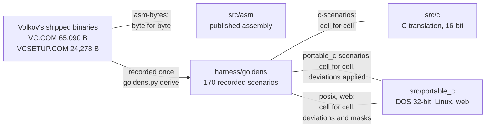
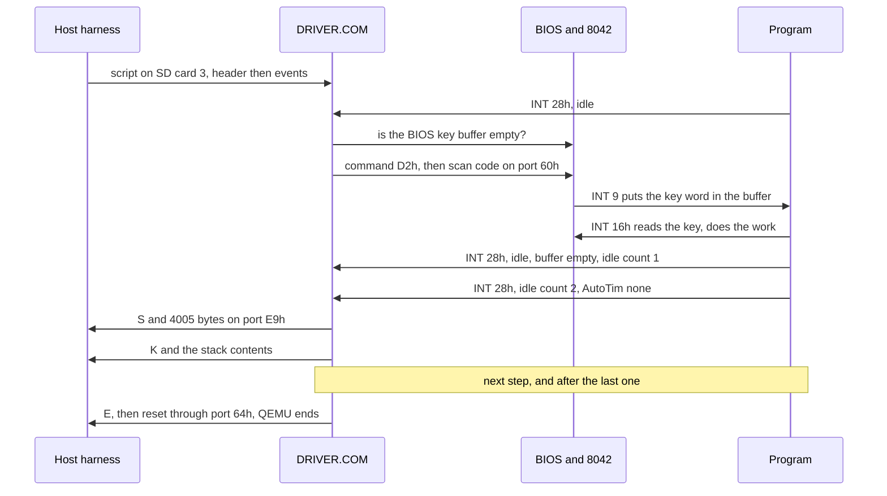
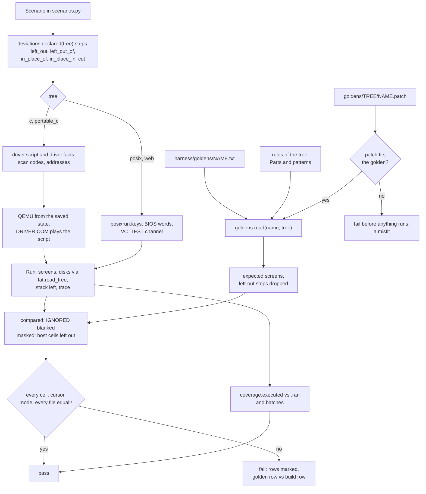
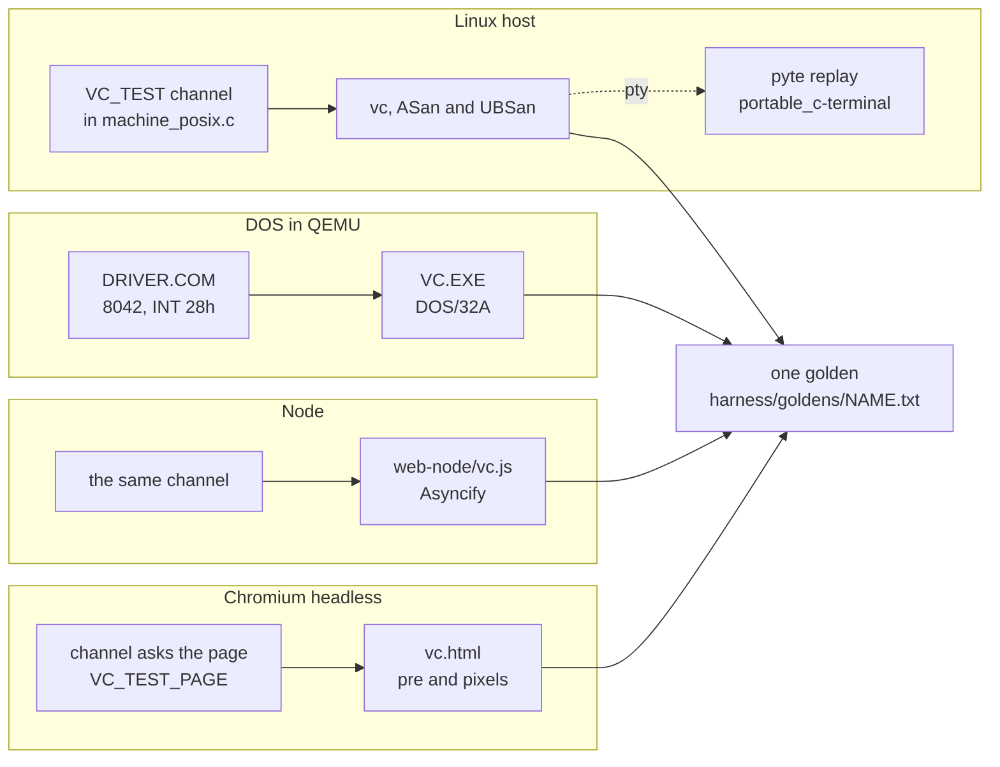

# How it is proven: the bench, the goldens and the deviations

Vibe Commander has no specification. Volkov Commander 4.05 never had one
either: it was a 65,090-byte `.COM` file and the assembly that produced
it. So the project took the only specification there is, the original
program's behaviour, and made it executable. The original was run, once,
through 172 scripted sessions on an emulated PC; what it drew after every
key and what it left on its disks was written down as text. Every build of
every tree is then run through the same sessions on the same emulated PC
and must draw the same cells and leave the same files. Where the portable
C is *meant* to differ, the difference is written down too, as data, and
applied to the original's record before the comparison, never into it.

Everything in this chapter serves that one comparison. The emulator is
pinned down until it is deterministic to the instruction; the keys are
injected below the BIOS so that nothing in the program can tell a test
from a user; the screen is captured from inside the machine at the one
moment the program has finished reacting; and the program for Linux, the
program for the web under Node and the web page in a browser are each
fitted with a way to be held to the very same golden files that were
recorded from a 16-bit DOS program in an emulator.

`harness/` holds all of it: some 31,000 lines of Python, one resident
DOS program in assembly (`harness/DRIVER.ASM`, 1,031 lines), and 17 MB of
goldens.

## Three trees, and what "the same" means for each

The source is three trees, and each is judged differently because each
makes a different promise.



**The assembly** is held to Volkov's binaries byte for byte, by
`asm-bytes` (`harness/bytecheck.py`). The binaries he shipped are a
shareware edition: they contain a registration check, registration lines
in the banner and an edition name that the published freeware source does
not. That material is proprietary and is never reproduced. Instead, the
source assembled with `SHAREWARE_LAYOUT` defined reserves exactly the room
it takes, with the `ShwCode` and `ShwData` macros of `src/asm/VCLAYOUT.INC`,
which emit `NOP`s for code and zeros for data. The test then knows five
regions per file:

```python
REGIONS = {
    "VC.COM": [
        (0x078B, 35, NOP, "check of the registration data at start-up"),
        (0x07BB, 4, NOP, "skipping the edition name when registered"),
        (0x07CB, 22, NOP, "printing the registration lines of the banner"),
        (0xE386, 9, ZERO, "the name of the edition in the banner"),
        (0xE3BD, 39, ZERO, "the registration lines of the banner"),
    ],
    "VCSETUP.COM": [ ... five regions, 691 bytes ... ],
}
```

The build must be exactly as long as the original, hold only filler inside
these regions, and be identical everywhere else: 64,981 of 65,090 bytes of
`VC.COM` and 23,587 of 24,278 of `VCSETUP.COM`. Everything else in the
project rests on this: because the layout build *is* the original at
every address that matters, its assembler listing,
`build/shareware-layout/VC.LST`, is a map of the shipped binary. The
harness reads that listing to find the original's variables in memory and
to turn QEMU's log of executed code into source lines.

**The C translation** (`src/c/`, frozen) is held to the goldens with
nothing declared: every screen and every file the same, the original's
bugs included. **The portable C** is held to the same goldens with its
declared differences applied. The rest of this chapter is mostly about
how those two comparisons work.

## The bench

### A PC that runs the same every time

A golden is only worth having if running the original again would give the
same golden. Emulators are not deterministic by default: the guest's clock
follows the host's, disks answer when the host gets round to it, and a
program that shows the time of day, blanks the screen after a minute or
waits five timer ticks before drawing a box will do different things on a
busy host. `harness/dos.py` builds the machine so that none of the host's
time leaks in:

```python
command = [
    "qemu-system-i386", "-machine", "pc", "-cpu", "486",
    "-m", str(memory),                       # 16 MB unless a scenario asks
    "-nodefaults", "-vga", "std", "-display", "none", "-no-reboot",
    "-rtc", f"base={clock},clock=vm", "-boot", "a",
    "-icount", f"shift={CLOCK_SHIFT},sleep=off",      # CLOCK_SHIFT = 8
    "-device", f"pvpanic,ioport={STOP_PORT:#x}",       # 0x505
    "-action", "panic=pause",
    "-device", f"isa-debugcon,iobase={DRIVER_PORT:#x},chardev=written",
    "-drive", f"if=floppy,index=0,format=raw,readonly=on,file={floppy}",
]
for slot, disk in zip(self._slots, hard_disks):
    command += ["-device", f"sdhci-pci,id=sd{slot},addr={slot:#x}", ...]
```

Each line is there for a reason that took time to find:

- **`-icount shift=8`**: the guest's clock is counted in instructions,
  2^8 = 256 ns each, 3.9 million instructions to a second of the
  machine. The timer's ticks, the BIOS's time of day and every wait of
  the program come when the machine has executed so much, not when the
  host has taken so long.
- **`sleep=off`**: while the guest is halted (the BIOS halts while it
  waits for a key) it executes nothing; the clock jumps straight to the
  next timer tick instead of following the host.
- **SD cards, not IDE**: QEMU reads an SD sector synchronously, inside
  the instruction that asks, like a diskette. An IDE sector arrives in
  the background while the BIOS polls in a loop, and every round of that
  loop is instructions, so time: one BIOS disk call took up to 40 ms of
  the machine longer in one run than another. The hard disks are 32 MB
  cards, FAT16, each on its own `sdhci-pci` controller from PCI slot 3.
- **`pvpanic`**: the machine's state is saved when the guest itself
  writes to port 505h, at an instruction of the guest's, not at a moment
  of the host's. QEMU does not keep all of an SD controller in a saved
  state, so the harness notes three PCI configuration registers per card
  (`SD_SETTINGS`) and writes them back through ports CF8h/CFCh after a
  restore.
- **`isa-debugcon` at E9h**: the port that the driver writes screens to,
  which QEMU appends to a file on the host.

DOS is FreeDOS, booted from a floppy that `dos.py` builds on the fly. It
is booted once per country, United States and Russia, and the machine is
saved just before the program would start. Every scenario then restores
that state into a machine of its own, a tenth of a second, so every
scenario begins at the same instruction and the same time of day, noon of
16 June 2000 (`setups.CLOCK`), the day 4.05 was released.

<!-- SCREENSHOT: the original's first screen on the bench, harness/goldens/start.txt step 0, C:\WORK on the left and C:\ on the right -->

### What is in the machine

```
  QEMU i386 "pc", 486, 16 MB, -icount shift=8,sleep=off
 +---------------------------------------------------------------+
 | floppy A:   FreeDOS boot diskette (read-only), FDAUTO.BAT:    |
 |             CTMOUSE /3, DRIVER.COM, PAUSE, then the program   |
 | SD card C:  WORK\ (DOCS SRC data.bin ... run.bat)             |
 |             STAMPS\ (files of every size and date, up to      |
 |             4,294,967,295 bytes, sparse)  [FILES\ if asked]   |
 | SD card D:  VC\ the program under test, VC.HLP, VC.INI,       |
 |             VC.EXT, VCVIEW.EXT, VCEDIT.EXT, *.MNU             |
 | SD card 3:  no file system: A5 5A + the scenario's script     |
 +---------------------------------------------------------------+
 | ports:  60h/64h keyboard controller   <- driver feeds keys    |
 |         E9h debugcon                  -> screens to the host  |
 |         505h pvpanic                  -> state saved / paused |
 | QMP socket: pause, pmemsave, query instruction count          |
 +---------------------------------------------------------------+
```

The program lives on `D:` and is started in `C:\WORK`, so that its own
file size can never appear on screen as free space on the drive it shows.
The PS/2 mouse is driven by CuteMouse, loaded with `/3` so that it knows
the third button. The Russian machine adds FreeDOS's keyboard driver with
its Russian layout (`KEYBRD2.SYS`, code page 866); the American one has
only the BIOS's keyboard support.

Where DOS loads the program is chosen too. QEMU checks every write to a
page that holds code it has translated, so a push onto a stack that sits
in front of code is many times slower. The original has its 256-byte
stack right in front of its code. `DRIVER.COM` therefore keeps a few
paragraphs more memory than it needs (`Pad`, patched into its fourth
byte; `PLACE = {"us": 176, "ru": 159}` of `setups.py`) so that the
original's stack ends on a 4 KB page boundary. A golden derived without
that would be the same, only a third slower in scenarios with dialogs.

### The setup file is the original's own

No configuration file is prepared by hand. When the harness sets up its
benches it starts the original once, has it switch the clock off, turn
the right panel from Info into a file list and sort both panels by name,
through its own menus (`CLOCK_KEYS = "F9 o l"`, `RIGHT_PANEL_KEYS = "F9 r b"`,
`BY_NAME_KEYS`), and save its setup with `Shift+F9 Enter`. The
`VC.INI` it writes is what every scenario of every tree starts from. Each
of the three changes removes something that would otherwise be on nearly
every screen and differ for reasons unrelated to the program under test:
the time of day, the machine's memory, an unsorted directory's disk order.

## The driver of the tests

The hardest problem in recording a TUI is knowing *when* to look. A key
may start a directory read, a dialog that waits five ticks before it
appears, or a tree that refreshes 0.6 s after the cursor stops. Looking
too early records a half-drawn screen; sleeping "long enough" makes the
golden depend on the host. And a key must arrive when the program is
ready for it, or it lands in the middle of work and a program that peeks
for keys while working (as the original's search does) behaves
differently.

Neither can be decided from outside the machine, so a small resident
program decides it from inside: `harness/DRIVER.ASM`, a 2,048-byte `.COM`
assembled with JWasm, loaded by `FDAUTO.BAT` before the program.

### It feeds, it does not answer

The driver stands in for nothing. A key is the scan code a keyboard would
send, handed to the 8042 keyboard controller with the command that makes
the controller deliver a byte as if it came from the keyboard:

```asm
; comments added here; the file has them at the top
Feed	proc	near
	jcxz	Feed4
Feed1:	in	al,64h			; wait for the input buffer
	test	al,2
	jnz	Feed1
	mov	al,ah
	out	64h,al			; D2h: next byte is from the keyboard
Feed2:	in	al,64h			; (D3h: from the auxiliary port)
	test	al,2
	jnz	Feed2
	push	ax
	call	Next			; the next byte of the script
	out	60h,al
	pop	ax
Feed3:	in	al,64h			; until the BIOS has taken it
	test	al,1
	jnz	Feed3
	loop	Feed1
Feed4:	ret
Feed	endp
```

So the BIOS's own INT 9 handler, and on the Russian machine DOS's keyboard
driver, make of each byte exactly what they would make of a real key: a
word in the BIOS buffer at 40:1Eh, Shift/Ctrl/Alt in the flags at 40:17h,
Cyrillic letters after Alt+RightShift. The mouse is the same through
command D3h: three-byte PS/2 packets on the auxiliary port, which the
BIOS hands to CuteMouse. A mouse does not report where it is, so a
`Click@3,5` first drives the pointer into the top left corner and then to
its cell, in steps of 4 small enough that the driver does not accelerate
them (`STRIDE` of `driver.py`).

The driver hooks three interrupts, and passes every call on to the
previous owner:

| Interrupt | Why the driver watches it |
|---|---|
| INT 28h | DOS's "I am idle" call. The program makes it every time its key loop goes round (`LeaveTm` in `blank.c` calls `Idle()` of `sys.h`). |
| INT 16h | A program that blocks inside the BIOS waiting for a key is idle too. |
| INT 33h, function 3 | A program that waits for a mouse button to come up polls this and nothing else; event `05` lets a button stay down for so many polls. |

DOS also calls INT 28h, so the driver tells the program's call from
others by where it comes from: the memory block that DOS has as the
current program, whose header carries the 8-character name the script
gives.

### When a step is over

On each idle call the driver looks at the BIOS's buffer. If keys are
still waiting, the program has not taken the last one yet. If it is
empty, the next event of the script is due. When the script says the
step ends (`03`), the driver waits until the program has gone round idle
twice more with nothing taken (`Rounds EQU 2`) *and* the program has
nothing scheduled: `AutoTim` in the program's main data, the time at
which a tree that has been moved through will read the directory under
the cursor. The driver trusts a time it finds there for 37 ticks (`Soon`),
two seconds, because before the main loop first runs, that field holds
whatever the memory held. Then it writes the screen.



The script lives on a disk without a file system, read with INT 13h
function 42h. Its format is small enough to show whole:

```
offset  bytes   meaning
 0       2      A5 5A: this disk is a script
 2       2      where AutoTim is in the program's main data, or FFFFh
 4       2      where Clock is (to capture what blinks), or FFFFh
 6       2,2    where the stack begins, and how long it is, or 0
10       8      the program's name as DOS has it in its memory block
18      ...     events:
                 01 n bytes      n scan-code bytes for the keyboard
                 02 word bytes   mouse packets, three bytes each
                 03              the step ends
                 04 word         let so many timer ticks pass
                 05 n            let the program poll the mouse n times
                 06 n dwords     a flat program: AutoTim, Clock, stack
                                 as linear addresses, for n copies
                 other           the script ends
```

and what it writes on port E9h:

```
'S' 4005 bytes   2000 cells (char, attribute), cursor column and row,
                 cursor shape start and end, video mode
'K' w w bytes    the stack: its length, its segment, its contents
'B' 4005 bytes   with the clock on: the other state of what blinks
'F' / 'C'        the BIOS refused a block move / an unknown copy idled
'E'              the script has ended; the machine is reset
```

The stack record is how the harness measures stack use: the program's
stack is zeros when it is loaded, and the deepest zero byte still left at
any step is the high-water mark. `harness/ported.py` fails a scenario in
which less than half the stack was untouched (`STACK_LEFT = 2`).

### Time inside a step

Two step forms deal with time explicitly. `Wait*18` lets 18 ticks, one
second of the machine, pass with nothing pressed (event `04`): the
program does meanwhile what it does by itself, which is how the blanker
scenarios get their stars. A key written with the one that starts some
work, `Enter+Home`, goes into the buffer in the same round, for a scenario
that needs the program to find a key waiting while it works.

Since the clock is the count of instructions, a scenario reaches every
step at the same hundredth of a second on every run. It is not the same
hundredth for every *tree*: the C trees execute a tenth to a third more
instructions than the original to reach the same step, twice as many in
a text search. A scenario that shows the time of day must therefore be
done showing it within the machine's first minute in the slowest tree,
which the first screen reaches at about five seconds past noon.

No wait is unbounded. A step that writes nothing for 300 seconds fails
(`STEP_TIME`), but the 300 seconds are of both clocks: when the host's
are up, the harness asks QEMU over QMP how many instructions the guest
executed since the driver last wrote, and gives up only if that is also
300 s of the machine's time. A machine that a loaded host starved is
waited for; a program that loops is not.

### A program of 32 bits under the same driver

The portable C is a flat 32-bit program under DOS/32A, and two things
change. Its idle call reaches INT 28h from the extender's real-mode code,
which lies in the program's DOS memory block, so the driver recognises it
unchanged. But its data is above the megabyte, where a real-mode driver
cannot address it. So `driver.py` computes three linear addresses, of
`AutoTim`, `Clock` and the stack, from the program's file, the linker's
map and where DOS/32A loads the first object on the bench
(`le.BENCH = 0x00100010`), and passes them in event `06`. The driver reads
them with INT 15h function 87h, the BIOS's extended memory block move.

That event does something unusual: the driver patches jumps into its own
code over the three places where it reads the program. The alternative,
a test "is this program flat?" at each place, would be two instructions
more for the *original* at every idle round, and since the machine's
time is counted in instructions, every golden could move by it. With
self-modification, a 16-bit program runs through exactly the
instructions it ran before. Every golden was derived again to check, and
none changed.

A scenario may start the program again from its own command line. The
extender loads the copy right behind the first, the script carries
addresses for up to three copies (`Copies EQU 3`), and the driver tells
which one is idle by counting how many memory blocks with the program's
name lie in front of it in DOS's chain.

## Scenarios

A scenario is a description and a tuple of steps, in
`harness/scenarios.py` (7,809 lines, most of them scenarios and the notes
that explain what the keys do):

```python
"blank": Scenario(
    "The screen blanker, brought up by the mouse in the top right "
    "corner and ended by a key, which is lost, by the mouse leaving "
    "the corner, by Shift, and by a button of the mouse after the "
    "mouse has moved about in the corner for a while",
    steps=(
        "Move@79,0 x",                # the sky, and a key: the panels
        "x",                          # that one is typed
        "Esc",
        "Move@40,12",
        "Move@78,0 Move@40,12",       # the sky, and the mouse away
        "Move@79,0 Shift",            # the sky, and Shift
        "Move@40,12",
        # The sky for some twenty turns of it: stars come out.
        "Move@79,0 " + "Move@76,1 Move@79,0 " * 20 + "Click@77,0",
        "x",                          # the panels take keys again
    )),
```

A step is key names separated by spaces, `Alt+F1` for chords, text in
double quotes, `Click@col,row`, `RightClick`, `MiddleClick`, `Move@`,
`Click@3,5>3,2` to drag, `Click@3,5*4` to hold for four polls, and
`Wait*N`. The `Scenario` dataclass adds `country` (`"us"` or `"ru"`),
`setup` for a scenario of the original's setup program, `memory` for one
that needs a machine with less than 16 MB, and `files` for one that wants
the extra files of `C:\FILES`.

There are 172. Eight are Russian; 33 are of the setup program, which the
original has as a separate `VCSETUP.COM` started from the main program's
command line, and the portable C as an item of its Options menu (the
step `'"d:\\vc\\vcsetup>nul" Enter'` is replaced by `"F9 o m"` for that
tree). The scenarios were written batch by batch while the assembly was
translated: each batch of routines came with scenarios that executed
every instruction of those routines in the original, and the test of
coverage below holds them to it to this day.

## Goldens

`python3 harness/goldens.py derive` takes the *original* through every
scenario, four machines side by side, in about a minute and a half, and
writes `harness/goldens/NAME.txt`. A golden is text, made to be read in a
diff:

```
Volkov Commander 4.05 in the scenario start: what the original shows and
leaves on its disks. Derived by harness/goldens.py; not to be edited.
code page 437

== 0: the start
cursor 8 23 lines 6 7 mode 3
|╔════════════╤═ C:\WORK ══╤════════════╗╔════════════╤═══ C:\ ════╤═══...| 1Bx15 30x9 1Bx56
|║    Name    │    Name    │    Name    ║║    Name    │    Name    │   ...| 1Bx5 1Ex8 1Bx1 ...
|║..          │            │            ║║STAMPS      │            │   ...| 1Bx1 30x12 1Bx67
 ...
|C:\WORK>                                                         ...| 07x80
|1Help   2Menu   3View   4Edit   5Copy   6RenMov 7Mkdir  8Delete ...| 07x1 30x6 07x2 ...

== disks
C:\WORK\HELLO.TXT  A   2000-06-16 12:00:00  15 bytes  66b01763ad803167
D:\VC\<program>  the program under test
D:\VC\VC.INI  A   2000-06-16 04:05:00  511 bytes  d09acbec75a63963
```

Each screen is 25 rows of 80 characters between bars, translated from
the code page into Unicode so that box-drawing reads as boxes, followed
by the attributes as runs (`1Bx15`: fifteen cells of white on blue).
Below the screens, every file on every hard disk with attributes, time
stamp, size and the first 16 hex digits of its SHA-256. The program's
own file is `<program>`, since it is another file in every tree.

Goldens are derived and never edited. Three differences that hold for
*every* build are made at derive time by the `DEVIATIONS` rules of
`harness/deviations.py`: the banner names the published freeware edition
(the shipped binaries name a shareware edition of up to nine letters); a
C tree's file is `VC.EXE`, not `VC.COM`, where the program names itself;
and a setup scenario's command line, which only the original types, is
blank. A few figures are compared on no screen at all, `IGNORED`: what
`mem` reports and the sizes in the memory map, which follow the size of
the program. Those cells are written as `#` in both the golden and the
build's screen.

A useful property falls out: after any change to the harness, deriving
all goldens again and finding `git status harness/goldens/` clean proves
the change left the judging alone. When a test fails where the change at
hand cannot explain it, deriving again is the first thing to do: if the
goldens move, it is QEMU or FreeDOS that changed.

### What ran: `.ran` and coverage

A golden says what the screen showed. It does not say whether a branch
of a routine ever ran, and a translated branch that no scenario reaches
is untested however many scenarios pass. So the goldens are recorded
with QEMU's `-d in_asm`, which logs each translation block, its address
and its bytes, as QEMU first translates it. `harness/coverage.py` locates
the program in memory by its bytes: a block of at least 8 bytes
(`MIN_BLOCK`) that occurs exactly once in the program file votes for a
load address, and four agreeing votes place it (`MIN_VOTES`). What ran is
written next to the golden as ranges of file offsets:

```
harness/goldens/start.ran
0000-0003 0346-0367 038D-03AB 03AC-03C5 03D8-03DE 05E7-0606 062F-0642 ...
```

Two complications are handled there. The C translation's `.EXE`
relocates itself, so code that holds a segment word is not in memory as
in the file; such blocks are matched against the file with the words as
the program will have patched them. The portable C is a linear
executable behind DOS/32A's stub, with every address set by the extender
at load; `harness/le.py` builds the image the extender makes of it at
`BENCH`, and the log is matched against that. QEMU is told to log only
blocks above the megabyte for it (`-dfilter`), because the extender
rewrites an `INT n` in its own real-mode code at every interrupt and QEMU
retranslates the block each time.

Two programs of the original share 68 routines of identical bytes, so a
scenario of the setup program would make blocks of `VCSETUP.COM` vote
for places in `VC.COM`. A program is therefore placed only by blocks
that no other program's file also contains (`others`).

### Batches and what is out of reach

`harness/ported.py` lists the translation as 50 batches of the main
program and 5 of the setup program. A batch names its C file, the
assembly routines it replaces, the C functions that must have run, and
the instructions that no scenario can reach, each with its reason:

```python
Batch(
    title="Numbers, sizes, dates and times as text",
    source="format.c",
    routines=("Number", "Numb10", "Numb20", "SzDtTm", "PutSize",
              "PutDat0", "PutDate", "BufDate", "PutTim0", "PutTime",
              "BufTime", "HexDec"),
    functions=("SzDtTm_c",),
    unreached={
        **dict.fromkeys((0xA420, 0xA422, 0xA424, 0xA427, 0xA429, 0xA42B,
                         0xA42C, 0xA42D),
            "Number, for a country without a thousands separator: the "
            "harness knows of none to configure DOS for"),
        **dict.fromkeys((0xAE02, 0xAE18),
            "PutDate and BufDate, for a country that writes the year "
            "first: the scenarios cover the United States and Russia"),
    },
),
```

The scenarios' test then requires, for every batch, that every
instruction of its routines appears in some golden's `.ran`, or in
`unreached` (376 instructions of the main program are), and that every
listed C function ran in the tree under test, found by its name in the
linker's map (`RENAMED` for the few that changed names, `GONE` for those
the portable C removed with a feature). A stale `unreached` entry fails
too: if a new scenario happens to reach it, the list must shrink.
`harness/reach.py ROUTINE` shows what is left of a routine before a
scenario is written.

Last, the comparison is tested against itself (`check_comparison`): one
character of a passing run's first screen is flipped, then one file is
dropped from its `C:`, and the comparison must report both.

## From a scenario to a pass or a fail



`goldens.read(name, tree)` builds the expectation in a fixed order: the
tree's rules are applied to every screen, then the scenario's patch (if
one exists, falling back through `deviations.BASE` from `web` to `posix`
to `portable_c`), then the screens of steps the tree is not taken
through are dropped. The build's screens and the expected ones are then
both blanked of `IGNORED` figures and, for a hosted tree, masked; what
remains must be equal cell for cell, character and attribute, with the
same cursor position, cursor shape and video mode, and the disks equal
entry for entry.

## Deviations

The portable C does not always behave as the original: it calls itself
Vibe Commander, has no memory map, no EGA lines, no Quick execute, has
the setup program built in, and fixes a handful of the original's bugs
on the user's word. None of that can be recorded from the original. The
design answer is that **a deviation is data applied to the original's
golden**, never a second golden recorded from the build. A golden
recorded from the build would only prove that the build does what the
build does.

### Declared in prose, then in three machine-readable forms

Every deviation is an entry of `src/portable_c/DEVIATIONS.md`: 29 for the
program, L1 to L14 for Linux, W1 to W11 for the web page. Each says what
the original does, what the portable C does, why, and which scenarios
show it. The harness then holds it in three forms:

| Form | For | Where |
|---|---|---|
| Steps left out or replaced | keys that reach what the tree no longer has, or reach the same thing by other keys | `TREES` of `harness/deviations.py`: `left_out`, `left_out_of`, `in_place_of`, `in_place_in`, `cut`, `not_run` |
| A rule | a difference on many screens, such as the program's name | `rules` of `TREES` |
| A patch | the rows one scenario shows otherwise | `harness/goldens/TREE/NAME.patch` |

`Declared` is the dataclass behind each tree's entry. Of the 172
scenarios, the portable C is taken through 159; 13 are not run (Quick
execute, Memory allocation, the memory map, the tall screen, and so on),
33 have steps replaced one for one (mostly "Down" five times to reach *Clear
keyboard buffer* becomes four, since a box above it is gone), and 60 have
a patch. The test fails for a scenario that is not run and that no
`DEVIATIONS.md` entry names, and for a patch whose header names an entry
that does not name its scenario: the prose and the data cannot drift
apart.

### A patch

A patch is not a unified diff. A unified diff knows a place by line
numbers and context, so it would carry the hundreds of lines of left-out
screens, break when an unrelated row moves, and `patch` would apply a
hunk that nearly fits. This format knows a row by its screen and number:

```
Deviation: 10 of src/portable_c/DEVIATIONS.md
Why: the box of F10 names the program in its title and in its question, by a
name that is two letters shorter: the box is two cells narrower, a cell on
either side, and its shadow ends a cell further left

== 1: F10
rows 5-11
-|║empty    dat│   ╔═══════════ The Volkov Commander ══════════╗    │      ║| 1Bx14 70x51 03x2 1Bx13
-|║hello    txt│   ║ Do you want to quit the Volkov Commander? ║    │      ║| 1Bx14 70x51 03x2 1Bx13
+|║empty    dat│    ╔═══════════ The Vibe Commander ══════════╗     │      ║| 1Bx15 70x49 03x2 1Bx14
+|║hello    txt│    ║ Do you want to quit the Vibe Commander? ║     │      ║| 1Bx15 70x49 03x2 1Bx14
```

(rows abridged here). A patch is exact: every `-` line must be what the
golden has, character for character, or nothing runs and the test reports
a misfit, with both rows and the cells marked. That happens when the
original's golden was derived again and came out otherwise, or a
scenario's steps changed, and it is a failure to look at, never to make
go away by regenerating. `goldens.py patch --tree portable_c NAME`
writes the rows a build shows otherwise under an empty header; it
becomes a patch only when someone has read every row against the entry
and filled in `Deviation:` and `Why:`. An unfilled header fails.

<!-- SCREENSHOT: the F10 quit box, the original (harness/goldens/quit.txt, step 1) and the portable C beside it, the box two cells narrower -->

### Rules, and the `Part`

The program's name appears on hundreds of screens: the banner DOS keeps
behind the panels, the Info panel's title, the help window's title, often
partly covered by a menu, a box or a panel. A regular-expression rule
cannot do it, because "Vibe Commander 0.1" is shorter than "The Volkov
Commander, Version 4.05" and whatever stands behind the shorter text
shows. So a rule of the second kind, `Part`, describes a rectangle of
the screen as the original draws it uncovered and as the tree draws it,
cell by cell with colours:

```python
Part("the top of the Info panel",
     was=("║  " + _TITLE + "  ║",
          "╟" + "─" * 38 + "╢",
          "║" + "653,296 Bytes Memory".center(38) + "║",
          ...),
     now=(...), colour=..., now_colour=..., frame=..., shaded=True)
```

Wherever at least twelve cells of the original's part show in their
places, each cell that matches the original's part exactly is expected
as the tree's part has it; every other cell is whatever covers it and is
expected as the golden has it. Nothing is left out of the comparison, so
the rule can be wrong in two ways, and both fail loudly: a covering
space in the part's colour makes the rule expect the tree's text that
does not show, and a part cell under the mouse pointer (colours
exchanged) is taken for a cover. The threshold was eight letters until a
line of text in the editor happened to match nine cells of the Info
title. The rule for the Info panel also recognises its cells inside a
menu's shadow (`shaded`, where the shadow makes `(colour & 8Fh) ^ 8`) and
with the panel's first rows scrolled off the top by the BIOS's beep.

<!-- SCREENSHOT: the top of the Info panel, the original's (title, line, two lines on memory) and the portable C's (name, "based on Volkov Commander 4.05", line, empty row) side by side, from a scenario that switches the Info panel on -->

### Where the original cannot go

Two scenarios are held to an expectation of the portable C's own,
recorded from its build and read row by row, because the original cannot
get there: `editor-huge`, a file larger than the original's editor has
room for, and `menu-none`, from which the original never returns. They
are `OWN` of `deviations.py`, and `goldens.py record` writes them with
`Read: TO BE WRITTEN` in the header, which fails until a person has
written what was read against what.

## Linux and the web, judged by the same goldens

The program for Linux runs in a terminal and the web build in Node or a
browser. There is no BIOS, no QEMU and no driver. Yet both are held to
the goldens that the 16-bit original produced in an emulated PC, which
means the harness needs, on each platform, the same three abilities the
driver gives on DOS: deliver keys only when the program is idle, know
when a step has ended, and capture the cell grid.

### The test channel

The program for Linux carries the driver inside itself. With `VC_TEST`
naming a directory, `machine_posix.c` reads its keys from `keys` there
and writes its screens to `screens`, and applies the same rule as
`DRIVER.ASM`: one event per idle round with no key waiting, the step
over after two idle rounds with nothing to take and `AutoTim` not due.
`keys` is a line per step:

```
XXXX     a key: the BIOS's word, scan code above character, in hex
XXXX+    the same, with the next key in the same round (a chord)
held=XX  what KeysHeld answers from now on (40:17h's bits)
wait=N   nothing until N more timer ticks
mouse=C,R,B   the mouse to cell C,R with buttons B
asks=N   nothing until the program has polled the mouse N times
```

`harness/posixrun.py` translates scenario steps into those words with a
table of the IBM PC BIOS's key words, for example `"F1"` is `3B00`, with
Shift `5400`, Ctrl `5E00`, Alt `6800`. `screens` is a 4,016-byte record
per screen: four letters (`step` or `end `), a 32-bit number, the 2,000
cells as character and attribute, and the cursor and mode bytes as the
BIOS keeps them. That is the same content the driver writes on port E9h,
so `goldens.py` and `compare.py` take a Linux run as they take a DOS
run.

Time is reproduced too. With `VC_TEST_CLOCK=2000-06-16T12:00:05` the
program's clock starts at the bench's and advances only while the test
waits, by `wait=` and by the ticks the program waits for itself, as the
machine's clock advances only by what the machine executes. A user never
has this clock. Files the program writes are stamped with it.



### The bench rebuilt on the host

`posixrun.py` lays out a bench of its own in `/tmp` for each run: `home`
as `HOME`, which is the drive `H:`, holding the bench's `WORK` and
`STAMPS` with the same files and times (the gigabyte files sparse), and
`vc` as `XDG_CONFIG_HOME/vc` with the program's support files. The
environment has `TZ=UTC` and a stub `xdg-open` in front of `PATH`, so
that Enter on a text file opens nothing on the desktop. The bench lives
in `/tmp` and not under `build/` so that the path of `vc` fits DOS's 63
characters on `R:`, whatever the checkout's path.

The setup file follows the same principle as on DOS, one level removed.
The Linux program starts from the bench's `VC.INI` (made on a DOS
machine, kept in `build/posix-bench/`), finds no `C:`, and is driven by
its own menus (`Tab`, `Ctrl+\`, `Tab`, `Shift+F9 Enter`) to put the
panels on `H:\WORK` and `H:\` and save. That saved `vc.ini` is what every
Linux scenario starts from. When a scenario's golden holds the setup
file, `on_the_bench()` maps `H:` back to `C:` and fixes the checksum at
1FDh.

### Masks: what only the host decides

Some cells on Linux are the host's and nothing can expect them: the
drive letter `H:` where the golden has `C:`, the label `HOME` where it
has `WORK`, the free space of the host's file system, the time of a
directory the run wrote into (the host moves it; DOS does not). For
these, and only these, the comparison leaves cells out: a *mask*, a rule
with `None` for its text, found on the golden by a pattern, never written
as coordinates:

```python
LINUX_LETTER_MASKS = (
    # The drive's letter: the bench's C:, which is H: on Linux, the
    # home directory, in a title, on the prompt, in a dialog's line and
    # in the Info panel.
    (re.compile(r"(?<![A-Za-z0-9])([Cc]):(?=\\|[ >]|$)"), None, None),
    ...
)
```

Five masks need the run as well as the golden and are classes:
`WrittenTimes` (the dates of directories the run wrote into, found by the
panel's title above the line), `InfoUnder` (the Info panel's host figures
where a box covers them), `DosPrompt`, `DosShown` (what DOS had shown
behind the panels, once a command has run on the host's shell) and
`OwnPath`. A masked cell is set to `00 00` on both screens, a character
and colour the program never draws together. Where a mask can be held
whole in a scenario about that element, it is: the drive letter and label
have scenarios of their own on Linux.

Beyond masks, Linux declares 38 scenarios not run (Russian, the floppy,
DOS's own commands and devices) and 21 cut at a step (`LINUX_CUT`: run as
far as step 14 of `editor-save`, where the text is saved to `NUL`, which
is an ordinary name on Linux), plus 17 patches of its own in
`harness/goldens/posix/`. Of 172 scenarios, 119 run there. A scenario
that rests on what only DOS has is not run there, and each says why.

### The terminal, through pyte

The test channel proves the grid is right; it does not prove the
terminal shows it. `portable_c-terminal` (`harness/terminal.py`) runs the
program seven times: once through the channel to get the grids, then in a
pseudo-terminal with the same steps typed as xterm would send them, mouse
in SGR form, with and without `COLORTERM=truecolor`, with the kitty
keyboard protocol offered and not, and stopped and continued by
`SIGTSTP`/`SIGCONT`. What the program wrote is replayed through pyte
0.8.2, a terminal emulator in Python, pinned by SHA-256 in
`harness/deps.py`, and pyte's screen is held to the grid cell by cell:
the character as the VGA font shows the byte, the colours as the VGA's
16 in 24 bits (or ANSI's 16 without `COLORTERM`), blink for bit 7, the
cursor. pyte wants `wcwidth`, which is not fetched; a stand-in on Python's
`unicodedata` gives every code page 437 glyph width 1.

<!-- SCREENSHOT: the program for Linux in a terminal beside the original's golden for the same step (harness/goldens/start.txt step 0), H:\WORK in place of C:\WORK -->

### The web, twice

The web build has the same machine and channel behind `sys.h`, so
`portable_c-web-scenarios` runs `web-node/vc.js` (built with Asyncify and
the address and undefined-behaviour sanitizers) under Node through
`compare.py`, with `C:` the bench's home directory and `D:\VC` the
program's own files, as on the bench. It shares Linux's declarations but
not the drive-letter masks, since the web's drives have the bench's
letters.

`portable_c-web-page-scenarios` (`harness/webpagerun.py`) goes one layer
further out: the actual page, `vc.html`, served as a static site in the
machine's own headless Chromium, keys as browser key events and the
mouse as pointer events, passed to the program by the page's own
`keys.js` and `mouse.js` as a user's are. The channel, with
`VC_TEST_PAGE` set, asks the page for each event and waits until the
browser has delivered it. Each screen is then read twice: from the
`<pre>`, its characters and span classes, and from a screenshot, each
8 by 16 cell held to the glyph of the page's font in the cell's two VGA
colours. Both readings are held to the goldens. On a phone viewport no
glyph lands on whole pixels, so there the check is that every pixel of a
cell is one of its two colours or a blend of them. Four `STAMPS` files of
a gigabyte or more cannot fit the page's memory; they are served empty
and given their sizes in the page's file system, read as zeros. Scenarios
pressing a key the browser keeps (Ctrl-PgUp, Ctrl-W, Alt-F4 and the like)
are not played.

<!-- SCREENSHOT: the web page in Chromium at one device pixel per CSS pixel, the grid of a scenario's step beside the original's golden for it -->

## The record tests

Scenarios judge behaviour. A second family judges the source, and runs
no machine. Each keeps a record file in `harness/`, and each fails when
the tree differs from the record *in either direction*: a count that
went down fails as surely as one that went up. That is deliberate. The
tests do not forbid change; they make every change show in the commit
that made it, as lines of the record's diff, written anew with
`--record`.

| Test | Reads with | What it holds | Record |
|---|---|---|---|
| `portable_c-host` | gcc, strict C99, 64-bit | what a 64-bit compiler refuses (a pointer cast to a 16- or 32-bit number, a number made a pointer, a structure of DOS's size) and what only Open Watcom reads (`_asm`, `#pragma aux`, interrupt functions), per file by kind. Every file is `clean` today but `sys_dos.c` | `hostcheck.txt` |
| `portable_c-int16` | clang | every place where the result of 16-bit arithmetic is used before it is back in 16 bits (compared, divided, shifted, widened, added to a pointer), since the code was judged with a 16-bit `int` and is compiled with a 32-bit one; 84 places, each with a reason | `int16.txt` |
| `portable_c-width` | clang | every unsigned number of 8, 16 or 32 bits, each with a one-word reason (`character`, `cell`, `key`, `size`, ...) or a sentence; sorted files held to `-Wconversion`, `-Wsign-compare` | `width.txt` |
| `portable_c-words` | text | how often each file writes each address word of `vc.h` (`MD_AT`, `ENTRY`, `MD_PLACE`, ...), the remains of segments | `words.txt` |
| `portable_c-cut` | clang and `wcc386` | the form `(u16)(signed char)c`, which Open Watcom extends with its sign to 32 bits; and the compiler's instructions for `harness/cutcheck.c`, so a fixed compiler is noticed | |
| `portable_c-tidy` | clang, clang-tidy | the Linux build's warnings and `.clang-tidy`'s checks, anything said fails | |
| `portable_c-data` | the file and the map | every text, box, dialog and table against the original's bytes by name, pointers by relocation, with `DECLARED` differences | |
| `portable_c-layout` | the file and the map | stack where the driver looks, data in the file, nothing written shares a 4 KB page with code, stub is DOS/32A's | |

Each finder that rests on a compiler's diagnostics is first checked
against a C file of known answers, `int16check.c`, `widthcheck.c`,
`cutcheck.c`, with the expected kinds written by hand beside each
function. A record line of `int16.txt` shows what a reason looks like:

```
cmdline.c, F77_10: widen
    | end = ((struct DIRTREE *)md.TreeBuf)->TreeLen << 4;
    The length of the tree's list in bytes: ReadTre refuses a tree of
    4,096 entries or more, so it stays below 64K.
```

`portable_c-data` deserves a word. In the portable C a table word that
names something is a four-byte pointer, so a box is longer than the
original's. `harness/datacheck.py` reads which fields are pointers from
the declaration (`BOX`, `BOX1`, `BOX2`, `DIALOG` of `tables.h`) and
compares field by field: a pointer where the original has a name must be
an address the extender relocates, to the object of that name at the
same distance; a pointer where the original has a number must be no
relocation, the number in its low half. Bytes are read from the file
where the map puts each object, lengths from the object file, since the
compiler rounds a segment up to four bytes. And no object may be shorter
than what the code reads of it: `harness/reads.py` finds every read of a
constant, 13 bytes of a name, 68 of a path, 80 of a title, and holds the
object to that length, with the original's bytes behind the text.

## The data image

When a change moves code and data about without meaning to change what
the program does, as the work of widening segments into pointers did,
two builds no longer share bytes, and the screens can pass while a write
lands in the wrong place. The net under that is `harness/dataimage.py`.

At the end of every scenario the driver resets the machine; the harness
has told QEMU to pause instead (`Machine.linger`), at the same
instruction on every run, and reads the program's data with `pmemsave`.
The scenarios' test writes these images into `build/portable_c/images`
every run, 760 KB each unpacked. `dataimage.py compare BEFORE AFTER`
holds two builds' images against each other, by meaning rather than
address:

- the main data `md` by the field of the original's `MainDat` (from the
  listing) that each byte is in, and of `ViewDat`, `EdData` and the
  structures laid over buffers;
- each memory block by its number, each panel by `WCBdef` field and file
  entry, what lies behind the panels by name;
- every variable of the map by file and name;
- the constants against the program's own file as the extender loads it,
  so a write into a table shows with no second build at all.

A word that holds an address is compared by what it names, block and
distance. What follows the machine's time is in `UNSTEADY` with its
reason: the two random numbers, the blanker's stars, the mouse's last
timer count, the clock separator, and the time stamp of the file DOS
last found. `save --early` checks a new candidate for that list: it makes
the driver write less, so the program reaches each step a little
earlier, and whatever then differs from the build's own image follows
time.

## How several agents shaped the tests

Most of this harness was written while several agents worked at once in
separate checkouts, landing through one queue. That shaped it in a few
concrete ways:

- **Nothing takes turns.** Recordings and tests run side by side in as
  many checkouts as there are, and a test that comes out different under
  load is a bug of the harness. That is why time is counted in
  instructions and the step limit is checked against both clocks: the
  limit was first host time alone, and a long step was given up on a
  host with a load of 25 to 40.
- **Each run's disks live in its checkout's `build/tmp`**
  (`dos.workdir`), not `/tmp`, after six checkouts filled the RAM-backed
  `/tmp` at once and every suite failed in the same minute. The path is
  checked against the 107-character limit of QEMU's socket.
- **Records fail both ways** so that a rebase cannot silently merge two
  agents' counts: after a rebase a record is written anew, not merged.
- **Prose and data are held together**: a scenario not run must be named
  by a `DEVIATIONS.md` entry, a patch must name one, a `GONE` function
  must be gone, an `unreached` instruction must still be unreached. An
  agent knows only what the repository tells it, and these cross-checks
  are what keep the repository telling the truth.
- **`harness/notice.py FILE OLD NEW`** makes one change to a copy of a C
  tree, builds it and reports which scenario notices. An instruction that
  ran does not mean a screen shows its effect; this finds out.

## Where to read next

- `harness/DRIVER.ASM`: the top 110 lines are the whole protocol;
  `Pump` is the step logic, "A flat program" the 32-bit path.
- `harness/dos.py`, `CLOCK_SHIFT` and `SD_SLOT`: why the machine is
  deterministic.
- `harness/scenarios.py`, its top: what the keys do, learned the hard
  way; `run()` at the bottom.
- `harness/goldens.py`, its top: the golden and patch formats; `read()`
  for the order in which an expectation is built.
- `harness/deviations.py`: `Part`, `Declared`, `TREES`, `LINUX_MASKS`.
- `harness/ported.py`: `Batch`, `BATCHES`, `check_comparison`.
- `src/portable_c/machine_posix.c`, "The test channel", and
  `harness/posixrun.py` for its host side.
- `src/portable_c/DEVIATIONS.md` for every declared difference.
- `docs/testing.md` for the commands that run all of the above.
