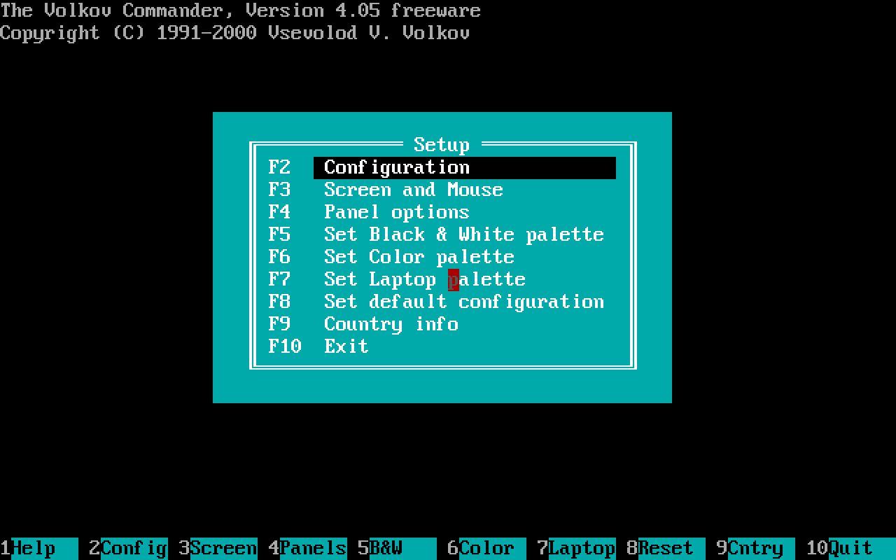
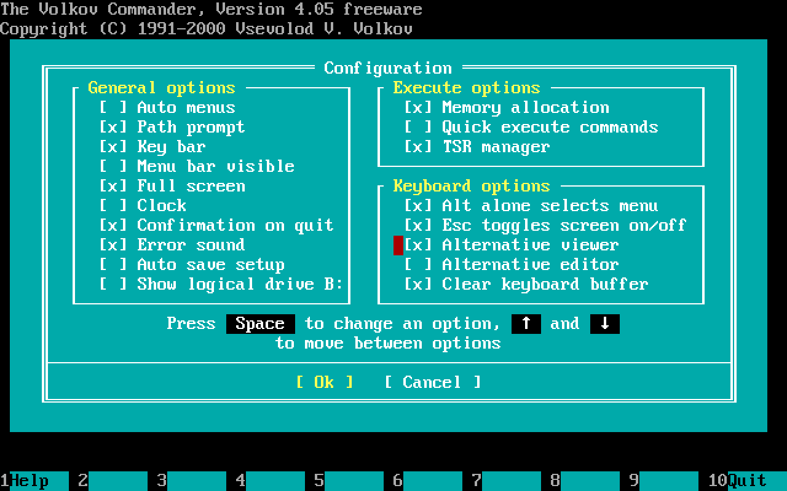
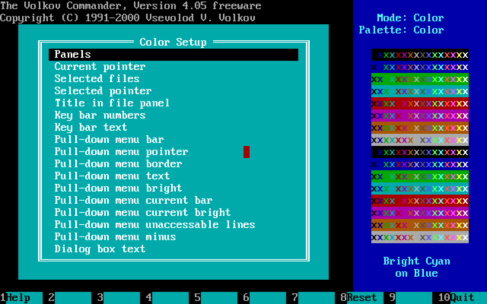
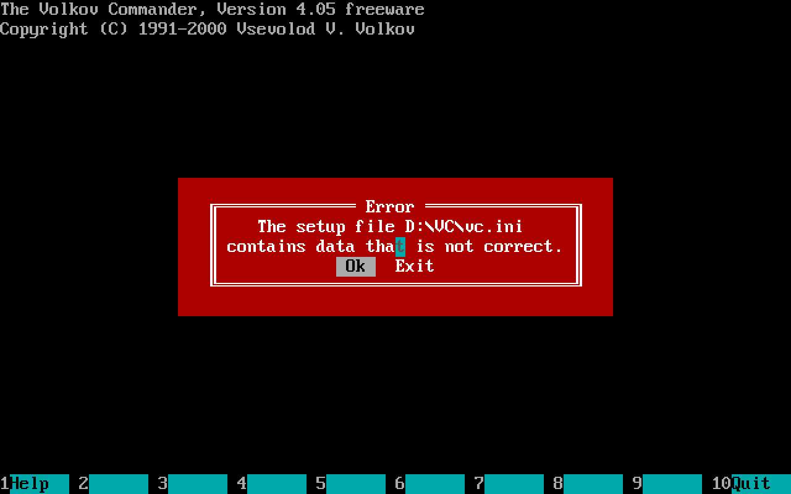
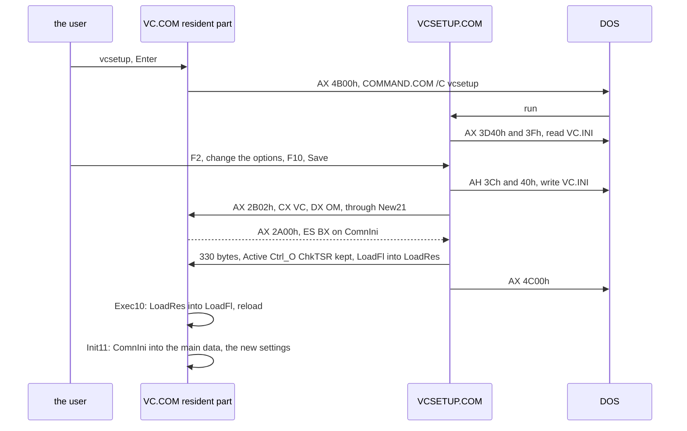
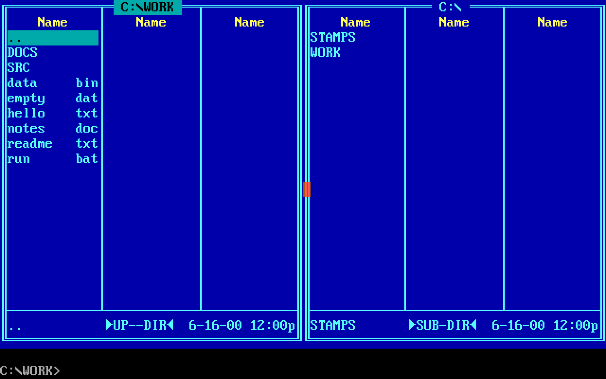
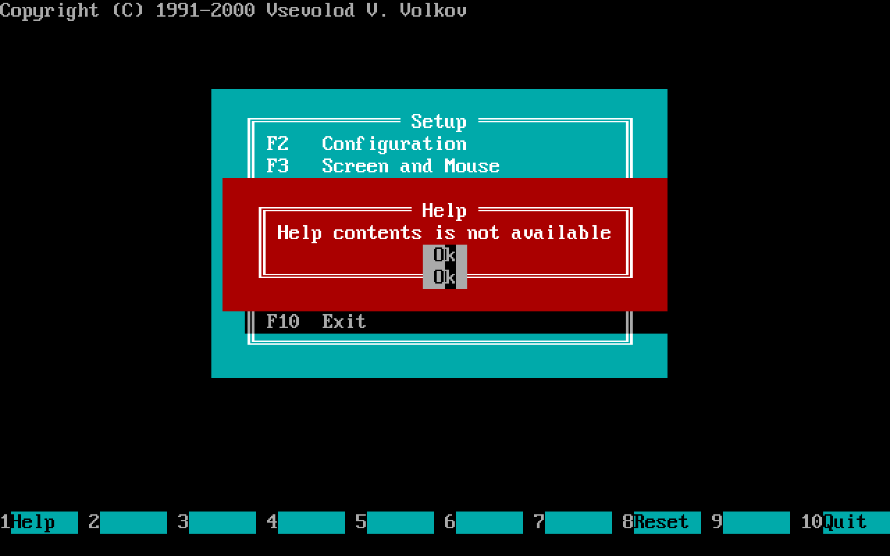

# 4. The setup program: `VCSETUP.COM`



*`VCSETUP.COM` run from the commander's command line: its menu of nine
items over what DOS shows, and its own key bar.*

Volkov Commander 4.05 ships as two programs. `VC.COM`, 65,090 bytes,
is the commander. `VCSETUP.COM`, 24,278 bytes, is its setup: a menu of
nine items, four dialogs of options, an editor for three palettes of
40 colours each, and a page that shows how DOS's country settings
look. The commander can change most of its settings itself, from the
Options menu, but the palettes, the screen saver's characters, the
delay of the tree's change of directory and the country page are the
setup program's alone.

Its source is three files of `src/asm/`: `VCSETUP.ASM`, 2,820 lines,
with the menu, the dialogs and the file; `VCSTSUB.INC`, 3,309 lines,
the routines that it shares with the commander; and `VCSTHLP.INC`, 517
lines, its help. This chapter is about four things that make it more
than a dialog box with a file behind it: the file, `VC.INI`, which is
a dump of the commander's memory; the private call by which the setup
program hands its settings to a commander that is running; how much of
the commander it is made of, by copy; and how it fits its help into
what is left of its 64 KB.

## What the program is

### The segment

`VCSETUP.COM` is a `.COM` file like the commander, one segment for
code, data and stack, but with no resident part and nothing loaded
later. From its listing, `VCSETUP.LST`:

```
CS=DS=ES=SS
    0100  +-----------------------------------------+
          | _TEXT   code                            | 10,698
    2ACA  | _DATA   tables, boxes, dialogs, palettes|  3,028
    369E  | CONST   texts                           | 10,552
    5FD6  +------------- end of the file -----------+
          | _BSS    IniData: the image of VC.INI    |    511
    61D5  |         a byte, IniStat, MnItem, CurType|      5
    61DA  |         SrcIni: VC.INI as it was read   |    330
    6324  |         screen state, Country, LowTab,  |
          |         TmpBuf, TmpErr, the stars       |
    66C3  |         ScrBuf, UserScr  2 x 8,000      | 16,000
    A543  |         WinBuf, BoxBuf   2 x 7,392      | 14,784
    DF03  | HelpBuf seven pages of VC.HLP, at most  |  8,157
    FEE0  +-----------------------------------------+
          | the stack                               |    286
    FFFE  +-----------------------------------------+
```

The first thing that it does, after checking for DOS 3.20 as the
commander does, is to give DOS back everything beyond its 64 KB and to
put its stack at the top of the segment:

```asm
        .CODE
        .STARTUP

        CLD
        MOV     AX,3000h                ; Check DOS version
        INT     21h
        XCHG    AL,AH
        CMP     AX,314h                 ; 3.20 ?
        MOV     DX,OFFSET Vers_S
        MOV     AL,2
        JB      Init01
        PUSH    AX                      ; Allocate segments
        MOV     BX,1000h                ;; 64 KB, in paragraphs
        MOV     AH,4Ah
        INT     21h
        ...
Init03: MOV     SP,0FFFEh
```

The order of the segments matters, and the file says so in its first
lines, `.CONST` and `.DATA?` named before anything is in them:

```asm
        .MODEL  Tiny
        .CONST                          ; Fix the segment order: uninitialized
        .DATA?                          ; data must come last, after constants
```

Uninitialised data that came in front of the constants would have to
be in the file as zeros. Behind them, it costs nothing: the 32,557
bytes of `_BSS` are not in the file, and DOS hands them over with
the segment.

### Its conversation with DOS and the PC

The setup program calls `INT 21h` 37 times, `INT 10h` 34 times, `INT
16h` 13 times and `INT 33h` 6 times, every one of them directly. It has
no `Intr21` and no handler for the critical error: a drive that is not
ready while it reads or writes its two files gets DOS's own "Abort,
Retry, Fail?". It does take Ctrl-Break and Ctrl-C, with BREAK switched
off, the same way the commander does, and the same one-byte handler:

```asm
CtrlC:  IRET
```

Everything else that it knows of the machine it finds at start as the
commander does, most of it with the same instructions: the mode and the page (`INT 10h`
AH 0Fh), the shape of the cursor, whether there is an EGA (by a test of its own, which calls the BIOS
twice with complemented registers and holds the two answers against
each other), the number
of rows from the font (1130h), the display's segment, TopView's buffer
(AH 0FEh), DESQview (`INT 21h` 2B01h with `'DE'` and `'SQ'`), and
whether there is snow (`SetSnow`, the commander's test of port 3DAh).
[Chapter 3](03-the-system.md) has each of those.

### The menus

The main menu is a box of nine lines drawn by `DialBox`, the
commander's routine, with a table of keys for `Case`, the commander's
dispatcher:

```asm
Main_T  DW      4800h, Main10           ;; Up
        DW      5000h, Main11           ;; Down
        DW      4700h, Main12           ;; Home
        DW      4F00h, Main13           ;; End
        DW      4900h, Main12           ;; PgUp
        DW      5100h, Main13           ;; PgDn
        DW      000Dh, Main32           ;; Enter
        DW      001Bh, Main31           ;; Esc
        DW      4400h, Main31           ;; F10
        DW      3C00h, Main20           ;; F2 ... F9
        ...
        DW      4300h, Main27
        DW      0
Menu_T  DW      1, F02_00
        DW      2, F03_00
        ...
        DW      8, F09_00
        DW      0
```

`Main_T` is four bytes for each key, the key's word and the label to
jump to; `Case` compares the word and jumps. The item that a key or
Enter chooses is a number in CH, and `Menu_T` is the same kind of
table again, by number. The same `Case` serves both.

| Key | Item | What it opens | Routine |
|---|---|---|---|
| F2 | Configuration | 18 boxes to tick in three groups: general, execute and keyboard options | `F02_00`, `Conf_B` |
| F3 | Screen and Mouse | colours, the blanker's delay, screen output (snow), zooming, the screen saver's characters, a left-handed mouse | `F03_00`, `Scrn_B` |
| F4 | Panel options | seven boxes, and the tree's delay before it changes directory, typed as seconds | `F04_00`, `PanOp_B` |
| F5, F6, F7 | Set Black & White, Color, Laptop palette | an editor of the 40 colours of one palette, with a grid of 16 by 16 colours to pick from | `F05_00` to `F07_00` |
| F8 | Set default configuration | "Do you wish to reset all options to default value?" | `F08_00` |
| F9 | Country info | the formats of time, date and numbers, and DOS's table of capitals for the code page | `F09_00` |
| F10 | Exit | "Do you wish to save the current setup?", if anything has changed | `Exit` |



*F2: the Configuration dialog, `Conf_B` below, its fields on the bytes
of the image of `VC.INI`, Memory allocation and TSR manager among
them. Behind it, the banner that the setup program printed through
DOS.*



*F6: the editor of the Color palette. On the left the 40 things that
the program colours, of which the first 17 show; on the right the grid
of 16 by 16 colours, and the colour of the line under the cursor named
in words.*

Each of the dialogs is a table that the commander's `Dialog` reads, a
`BOXHD` header and a `BOXMN` line for each field: its kind, its four
neighbours for the arrow keys, its place, and the byte of the settings
that it shows. The Configuration dialog's fields name the settings
directly:

```asm
Conf_B  BOXHD   < Conf_P, 228h, 0, 1, 4, 1, 0 >
        BOXMN   <3,18, 1, 0,10,  30Ah, TmpBuf+ 0, AutoMnu> ; Auto menus
        BOXMN   <3, 0, 2, 1,11,  40Ah, TmpBuf+ 1, Prompt > ; Path prompt
        BOXMN   <3, 1, 3, 2,12,  50Ah, TmpBuf+ 2, KeyBar > ; Key bar
        ...
        BOXMN   <3, 9,11, 0,10,  329h, TmpBuf+10, LoadFl > ; Memory allocation
        BOXMN   <3,10,12, 1,11,  429h, TmpBuf+11, ExecTyp> ; Quick execute
        BOXMN   <3,11,13, 2,12,  529h, TmpBuf+12, ChkTSR > ; TSR manager
        ...
        BOXMN   <4,17, 0,17,18, 111Eh, TmpBuf+18, OkCn_D > ; Ok / Cancel
        DB      0
```

`AutoMnu`, `LoadFl`, `ChkTSR` are offsets into the setup program's
image of `VC.INI`, the next section. The fourth number of the header,
the help page, is 1 to 7, a page among those that the program has read
from `VC.HLP` (below).

A setting of the Screen and Mouse dialog that is a choice of values,
the blanker's delay, is shown as the index of a radio button and kept
as minutes, by a table of six bytes:

```asm
Delay_T DB      40, 20, 5, 3, 1, 0
```

and the Panel options' delay of the tree is typed as text, `0.60`
seconds with the country's decimal separator, and checked by a routine
that the dialog's header names, `F04_10`, before Ok is taken; a text
it cannot read is "Illegal format of auto change dir time delay.".

## `VC.INI`: a dump of the main data

### Why a dump

The commander's settings are the first 330 bytes of its main data,
`MainDat` of `VC.ASM`, up to the label `CmnIni`:

```asm
MainDat STRUC
ColTab  DB      6*LenColr DUP(?)        ; Color table (6 pallets)
FulScr  DB      ?                       ; Full screen
MenuVs  DB      ?                       ; Menu always visible
KeyBar  DB      ?                       ; Key bar
...
DriveB  DB      ?                       ; Show logic drive B: in 1 floppy system
DelayTm DB      ?, ?                    ; Auto change dir delay time
StarTab DB      5  DUP (?)              ; Star table
ResIni  DB      51 DUP (?)              ; Reserved
CmnIni  =       $                       ; End of main data' part saved in VC.INI

LoadRes DB      ?                       ; Original LoadFl
...
```

and each panel's are the first 88 bytes of its control block, `WCBdef`,
up to `WCBini`: its mode, its sort order, its filter and its path. The
file is those three pieces back to back, between a signature and a
check sum. No field is converted, named or parsed. Reading the file
is one call of DOS into the right place, and writing it is one call
from a buffer that a few `REP MOVSB` have filled.

### The format, byte by byte

```
VC.INI, 511 bytes
offset
0000  'VVV'                      signature
0003  WCB 1, 88 bytes            the left panel
        +00 WinTyp    the panel's kind
        +01 BrfFul    brief or full
        +02 Visible
        +03 Hidden
        +04 MasTyp
        +05 SortTyp   the order of the files
        +06 Ctrl_L
        +07 DskMas    13 bytes, the panel's mask of files
        +14 WinPath   68 bytes, the path, ended by a zero
005B  WCB 2, 88 bytes            the right panel, the same
00B3  ColTab, 240 bytes          40 colours x 6 columns
01A3  32 flags                   FulScr ... DriveB, a byte each
01C3  DelayTm, 2 bytes           hundredths and seconds
01C5  StarTab, 5 bytes           the screen saver's characters
01CA  ResIni, 51 bytes           reserved, zeros
01FD  check sum, a word          the 16-bit sum of bytes 0 to 1FCh
01FF  end
```

The colour table is 40 rows, one for each thing that the program
colours, of six bytes, one for each pair of a palette and a kind of
display. `ColAddr` of `VCSUB1.INC` finds a colour's byte:

```asm
ColAddr PROC    NEAR
        PUSH    AX
        MOV     AL,6
        MUL     AH                      ;; the colour's row
        MOV     DI,AX
        MOV     AL,ES:ColTyp            ;; 0 B&W, 1 Color, 2 Laptop
        CMP     AL,3
        JB      ColAd1
        MOV     AL,1
ColAd1: CBW
        ADD     AX,AX
        CMP     ES:ScrMod,7
        JNE     ColAd2
        INC     AX                      ;; the monochrome column
ColAd2: ADD     DI,AX
        ADD     DI,ColTab
        POP     AX
        RET
ColAddr ENDP
```

So the user picks one of three palettes and gets a second variant of
it free on a monochrome card, and the 240 bytes need no header of
their own. The `VC.INI` that the distribution ships is such a file:
its check sum, 348Fh, is the sum of its first 509 bytes.

### Reading it: the commander

`Init00` of `VC.ASM` reads the file in one call of its helper
`ReadOne`, and the target is the trick. It is not a buffer but the
resident copy of the main data, `ComnIni`, less the 179 bytes of the
signature and the two panels, so that the 330 bytes of settings land
exactly where they are to be:

```asm
Init00: MOV     ES,DS:[2Ch]
        MOV     DI,OFFSET WCB1sav + WCBsave
        MOV     DX,DI
        CALL    MainPth                 ;; the path: VC= or our own
        PUSH    DI
        PUSH    DX
        MOV     SI,OFFSET Init_F        ;; 'VC.INI'
        MOV     BP,OFFSET ComnIni - (3 + 2*WCBini)
        MOV     CX, 3 + 2*WCBini + CmnIni + 2 + 1
        CALL    ReadOne                 ;; one byte more than the file
        MOV     BX,0
        JC      Init03                  ;; no file: the defaults
        DEC     CX
        SUB     AX,CX
        JNE     Init02                  ;; not 511 bytes: bad
        DEC     CX
        DEC     CX
        MOV     SI,BP
        XOR     DX,DX
Init01: LODSB
        ADD     DX,AX
        LOOP    Init01
        LODSW
        CMP     AX,DX
        JNE     Init02                  ;; the sum: bad
        MOV     DI,BP
        MOV     AL,'V'
        MOV     CL,3
        REPE    SCASB
        JNE     Init02                  ;; no 'VVV': bad
        MOV     SI,DI
        MOV     DI,OFFSET WCB1sav       ;; the panels to their places
        MOV     CL,WCBini
        PUSH    CX
        REP     MOVSB
        POP     CX
        MOV     DI,OFFSET WCB2sav
        REP     MOVSB
        JMP     Init04
Init02: MOV     BL,1                    ;; "VC.INI is not correct."
```

Asking for 512 bytes where the file has 511 is the test of length: a
longer file reads 512, a shorter one fewer, and only the right one
reads one less than was asked. The 179 bytes in front of `ComnIni`
are the end of `WCB2sav`, which is still empty at that moment; the
two panels' 88 bytes each are then copied from there to the heads of
`WCB1sav` and `WCB2sav`.

The directory is that of the environment variable `VC=`, if it is set,
or else the commander's own, from the path that DOS puts behind the
environment. Both programs look in the same place.

### Reading it: the setup program

The setup program's data begins with the same 511 bytes, declared
field by field under the same names as the commander's, so that the
file is read into it by one call and the program then works on the
fields as they are:

```asm
        .DATA?
IniData DB      3 DUP(?)                ; 'VVV' header
WCB1    DB      WCBini DUP(?)           ; Left window control block
WCB2    DB      WCBini DUP(?)           ; Right window control block
ColTab  DB      6*LenColr DUP(?)        ; Color table (6 pallets)
FulScr  DB      ?                       ; Full screen
...
StarTab DB      5 DUP (?)               ; Star table
        DB      51 DUP (?)              ; Reserved
CmnIni  =       $ - ColTab              ; Sise of main data' part of VC.INI
LoadRes LABEL   BYTE                    ; Original LoadFl
        DW      ?                       ; Check sum
IniLen  =       $ - IniData             ; Length of VC.INI
        DB      ?
```

`LoadRes` is a label on the check sum. The setup program has no
`LoadRes` of its own; the label is there so that its offset from
`ColTab` is the offset that `LoadRes` has from `ColTab` in the
commander's main data, 330, which the private call below depends on.
The extra byte behind the sum is the room for the 512th byte of the
test of length.

The read is the commander's checks in another order: length, `VVV`,
sum. The file is opened with AX 3D40h, read-only and sharing
everything, so a commander that has it open is no obstacle:

```asm
        MOV     AX,3D40h                ; Open VC.INI
        INT     21h
        JC      Init18
        MOV     BX,AX
        MOV     DX,OFFSET IniData
        MOV     CX,IniLen+1
        MOV     AH,3Fh
        INT     21h
        ...
        INC     DS:IniStat              ;; 1: found
        DEC     CX                      ; Check VC.INI length
        CMP     AX,CX
        JNE     Init17
        ...
Init17: INC     DS:IniStat              ; Bad data in VC.INI
Init18: CALL    Default
```

`IniStat` ends as 0 for no file, 1 for a good one and 2 for a bad
one, and for the last two of those cases the program says so in a box,
"The setup file `C:\VC\VC.INI` not found." or "contains data that is
not correct.", with the buttons Ok, to go on from the defaults, and
Exit. Behind a good read it copies the 330 bytes of settings into
`SrcIni`, so that it knows at the end whether anything has changed.



*The setup program started on a `VC.INI` whose sum does not hold:
`IniStat` is 2, and Ok goes on from the defaults.*

### The defaults, and 64 bytes that are not

Both programs have a table of defaults to fill the image with when
there is no file, and the setup program's ends in a way that shows in
the file it writes. Its table has the 330 bytes of settings and 24
bytes of a panel, the seven bytes of the fields, 13 zeros for the mask
and `'A:\',0` for the path:

```asm
DefWCB  DB      0                       ; WinTyp
        DB      0                       ; BrfFul
        DB      1                       ; Visible
        DB      1                       ; Hidden
        DB      0                       ; MasTyp
        DB      8                       ; SortTyp
        DB      0                       ; Ctrl_L
        DB      13 DUP(0)               ; DskMas
        DB      'A:\',0                 ; WinPath
```

`Default` copies 88 bytes from it into each panel and adds the
current drive to the `'A'`:

```asm
Default PROC    NEAR
        MOV     SI,OFFSET Palets
        MOV     DI,OFFSET ColTab
        MOV     CX,CmnIni
        REP     MOVSB                   ;; 330 bytes of settings
        MOV     SI,OFFSET DefWCB
        MOV     DI,OFFSET WCB1
        MOV     CX,WCBini               ;; 88, from a table of 24
        PUSH    DI
        PUSH    CX
        REP     MOVSB
        MOV     AH,19h
        INT     21h
        ADD     DS:WCB1.WinPath[0],AL   ;; 'A' + the current drive
        ...
```

The 64 bytes behind the path's zero are whatever the setup program's
data has behind `DefWCB`, which is the next table of its `.DATA`, the
box of the error about the file, and they go into `VC.INI` when the
defaults are saved. Nothing reads them, since the path ends at its
zero; but in the shipped binary 17 of those 64 bytes fall in the
material that the shareware edition added, so a `VC.INI` made from the
defaults by the shipped setup program cannot be made again from the
published source.

The commander's own defaults have the same shape, eight bytes of a
panel and then its table of keys
([chapter 1](01-the-program.md#init00-the-setup-file-read-in-place)),
and its file is clean all the same:
`MkIni1`, by which it writes a panel into the file, clears what lies
behind the zero of the mask and of the path first.

```asm
MkIni1  PROC    NEAR
        MOV     SI,OFFSET DskMas
        MOV     CX,13
        CALL    FilZero                 ;; zeros behind the mask's end
        MOV     SI,OFFSET WinPath
        MOV     CX,LenPath
        CALL    FilZero                 ;; and behind the path's
        XOR     SI,SI
        MOV     CX,WCBini
        REP     MOVSB
        RET
MkIni1  ENDP
```

### Writing it

The commander saves its setup by Shift-F9, and at its end when Auto
save setup is ticked: `MakeIni` builds the 511 bytes in `MenuBuf` of
the main data, `VVV`, the two panels by `MkIni1`, the 330 bytes from
offset 0 of the main data and the sum, and `SaveSet` writes them. The
setup program writes its own image, which is already in that shape:
it puts the signature in front and the sum behind, and writes 511
bytes from `IniData`:

```asm
Exit2:  MOV     SI,OFFSET IniData       ; Save VC.INI
        MOV     DI,SI
        MOV     CX,3
        MOV     AL,'V'
        REP     STOSB
        XOR     BX,BX
        MOV     CX,IniLen-2
        MOV     AH,0
Exit3:  LODSB
        ADD     BX,AX
        LOOP    Exit3
        MOV     DS:[SI],BX              ;; the sum, behind
        MOV     DX,OFFSET NcPath        ; Open VC.INI
        MOV     AX,4300h                ;; its attributes
        INT     21h
        JNC     Exit4
        CMP     AX,WORD PTR 2
        JNE     Exit5
        XOR     AX,AX                   ;; no file: none
Exit4:  OR      CL,20h                  ;; and the archive bit
        MOV     AH,3Ch
        INT     21h
        ...
        MOV     CX,IniLen
        MOV     DX,OFFSET IniData
        MOV     AH,40h
        INT     21h
```

Both programs create the file with the attributes that it had, plus
archive, so a hidden `VC.INI` stays hidden; a read-only one cannot be
created, and the setup program says "There was an error while saving
the setup file" through DOS (AH 9) and goes on.

The setup program asks whether to save only when there is something
to save. At F10 it holds the 330 bytes against `SrcIni`, the copy that
it took when it read the file: if they are the same, it leaves without
a question and without writing. Behind the box about a missing or
broken file, the code means to fill `SrcIni` with FFh, so that the
question would always come then; but CX does not hold the count at
that point, and in the shipped program a setup made from the defaults
and left as it is is not offered for saving.

## The private call: `INT 21h` AH 2Bh, `'VC'`, `'OM'`

### The problem

The setup program is run from the commander's command line like any
program. The commander that ran it has its settings in its resident
part, in `ComnIni`, and will copy them into its new main data when the
command is done ([chapter 3](03-the-system.md#the-resident-part-12690-bytes-that-stay)).
If the setup program only wrote
`VC.INI`, a commander that has already read it would go on with the
old settings until it is started again.

So the setup program hands its settings to that commander, through its
memory. The two programs share no address, and the commander that ran
it may be anywhere in memory. What they share is DOS: while a command
runs, with TSR manager on, every call of `INT 21h` passes the
commander's `New21` first.

### The call

DOS's function 2Bh sets the date, with the year in CX and the month
and day in DX. Called with nonsense, it answers AL FFh, "invalid
date", and changes nothing. That makes it a classic install check of
the time, a call that every DOS survives and that a resident program
can recognise by its registers: DESQview's is AX 2B01h with `'DE'` in
CX and `'SQ'` in DX, and the commander tests for DESQview with exactly
that ([chapter 3](03-the-system.md#giving-time-away)). Its own is `'VC'` in CX and `'OM'` in DX, the year
22,083 and a month of 79:

```asm
VCapi:  CMP     CX,'VC'
        JNE     Old21                   ;; a real "set date"
        CMP     DX,'OM'
        JNE     Old21
        PUSH    CS
        POP     ES                      ;; ES: the resident part
        CMP     AL,1
        MOV     BX,OFFSET WCB1sav       ;; AL 0: the left panel
        JB      VCapi1
        MOV     BX,OFFSET WCB2sav       ;; AL 1: the right panel
        JE      VCapi1
        MOV     BX,OFFSET ComnIni       ;; AL 2 and up: the settings
VCapi1: MOV     AX,VcApiVr*100h         ;; AH 42, the API's version
        CLC
        RET     2                       ;; a far return, flags dropped
New21   ENDP
```

That is 36 bytes of the resident part: the call returns AX 2A00h,
`VcApiVr` being 42, and ES:BX on one of three places of the resident
part. It does not go through `IRET`, which would put the caller's flags
back; `RET 2` returns far and drops the flags that the interrupt
pushed, so the caller sees the carry that `CLC` cleared.

### What the setup program does with it

The setup program asks only for the settings, AL 2, and only after it
has written the file:

```asm
Exit6:  MOV     CX,'VC'                 ; Save in resident VC
        MOV     DX,'OM'
        MOV     AX,2B02h
        INT     21h
        CMP     AX,VcApiVr*100h
        JNE     Exit7                   ;; no commander: done
        MOV     DI,BX
        SUB     BX,OFFSET ColTab        ;; ES:Field[BX] is its field
        MOV     AL,ES:Active[BX]
        MOV     DS:Active,AL            ;; keep its active panel
        MOV     AL,ES:Ctrl_O[BX]
        MOV     DS:Ctrl_O,AL            ;; and whether the panels show
        MOV     AL,ES:ChkTSR[BX]
        MOV     DS:ChkTSR,AL            ;; and its TSR manager
        MOV     AL,ES:LoadFl[BX]
        XCHG    AL,DS:LoadFl
        MOV     ES:LoadRes[BX],AL       ;; the new Memory allocation
        MOV     SI,OFFSET ColTab
        MOV     CX,CmnIni
        REP     MOVSB                   ;; 330 bytes into the commander
Exit7:  MOV     AX,4C00h                ; Exit
        INT     21h
```

`SUB BX,OFFSET ColTab` is the whole of the address translation. `ColTab`
is at offset 0 of the commander's main data and at 5FD6h + 179 of the
setup program's segment; every setting lies at the same distance from
`ColTab` in both, so `ES:Field[BX]`, with the setup program's offset
of `Field`, is the commander's copy of the same field. The two
programs agree on a layout by declaring it twice under the same
names.

Four settings are not simply copied:

- **`Active`** and **`Ctrl_O`**, which panel is active and whether the
  panels are shown, are the state of the commander's session rather
  than settings, so the commander's values are taken into the setup
  program's image before the copy and survive it.
- **`ChkTSR`**, TSR manager, is kept as the commander has it. `New21`
  was installed or not when the commander started, and a commander
  whose setting said otherwise would, at its end, give back an INT
  21h that it never took.
- **`LoadFl`**, Memory allocation, goes into `LoadRes`, which the main
  data's declaration has as "Original LoadFl". When the command is done, `Exec10` swaps
  the two, `LoadRes` into `LoadFl`, and decides by the old `LoadFl`
  whether to load the transient part again. The old value is the mode
  in which this command ran, possibly flipped by Shift-Enter, and is
  the right one to decide by; the setting from the setup program takes
  effect from the next command. The setup program takes the
  commander's current `LoadFl` into its own image by the `XCHG`, so
  that the copy that follows writes it back unchanged.



When the call finds no commander, because the setup program was run
from DOS's prompt or with TSR manager off, DOS answers it as a "set
date" with an impossible year, AL FFh, AX is not 2A00h, and the setup
program ends with the file written and nothing else done. The settings
then take effect the next time the commander starts and reads the
file.

If writing the file has failed, the program still makes the call: the
running commander gets the settings, and only the file is as it was.



*Back in the commander after the setup program has switched the key
bar off and saved: the commander's screen has no key bar at once,
without being started again.*

The API offers more than its one client uses. AL 0 and 1 hand out the
saved control blocks of the two panels, `WCB1sav` and `WCB2sav`,
which the setup program never asks for.

## What it shares with `VC.COM`, by copy

The two programs are assembled apart, and share no code at run time.
What they share is source text: `VCSTSUB.INC` is, for the most part,
the commander's `VCSUB1.INC` and `VCSUB2.INC` copied, and `VCSTHLP.INC`
is the commander's `VCHELP.INC` cut down. Held procedure by procedure
against the commander's files, `VCSTSUB.INC` and `VCSTHLP.INC` have:

| Kind | Routines | Instructions | About |
|---|---:|---:|---:|
| the commander's, word for word | 68 | 1,745 | 3,326 bytes |
| the commander's by name, with another text | 10 | 1,300 | 2,961 bytes |
| the setup program's alone, as procedures | 15 | 454 | 990 bytes |
| the setup program's alone, between procedures | | 1,362 | 3,144 bytes |

The routines that are word for word the commander's are the whole of
its user interface below the dialogs: `Timer`, `Case`, the cursor,
`Beep`, the mouse (`TypMous`, `CurMous`, `GetMous`, `DoublMo`,
`InWind`), the screen (`BasAdr`, `SavWin`, `ResWin`, `Window`,
`SavScr`, `MovScr`), the boxes (`MinBox`, `ShadBox`, `DialBox`), the
lines with markup (`LnStr`, `NgLine`), the input line (`InpStr`,
`EdLin`), the menus of the dialogs (`MinMnu`, `MnMn10`), and the text
routines (`UpCase`, `LowCase`, `CutPath`, `ShrtLin`, `HexDec`,
`TxtNum`). They work unchanged in the other program for the same
reason that the private call works: they name the settings and the
buffers by name, `ES:Mouse`, `ES:Lines`, `OFFSET ScrBuf`, and the
setup program declares a field of each name that they use. Its data
has its own layout, but the same names, and a routine that reads
`ES:Snow` reads the setup program's `Snow` once assembled there.

Of the ten routines with another text, most differ by a few lines
where the commander does something that the setup program has not:

- `Input0` has three lines more, a `TEST AL,7` behind three of its
  calls of `GetMous`, which ends in `AND AX,WORD PTR 7` and has set the
  flag already; `LeaveTm` lacks the turn given to Windows.
- `Dialog`, 394 lines in the setup program, differs from the
  commander's in 61: the commander has flags for boxes that the setup
  program never shows, and keeps a typed line in another place.
- `Help` differs most, by 483 lines, because the setup program has its
  help in memory and the commander reads a page from the file at every
  F1 (next section).
- `SetSnow` is the commander's test of port 3DAh from `Init30`, made a
  procedure, since the setup program calls it again after Screen and
  Mouse has changed `SnowMod`.

What the setup program has alone is its menu, its dialogs, the palette
editor (`F07_00` to `Col55`), the country page (`F09_00`), the file,
and the private call.

Two copies of 3 KB of the same code cost 3 KB of disk, once, in a
program that is run rarely and alone; sharing them would have cost a
loader, or an overlay, or the setup program's living inside the
commander's 64 KB, which had no room for it. The price of the copies
is the one that copies always charge: they drift apart. The setup program's copy of the key bar's routine, `PutKey0`,
has two instructions moved, and writes one cell further than the
commander's: the 81st cell of the bottom row. On a screen of 50 rows
that cell is the first of the next buffer, `UserScr`, the screen that
DOS showed, and it comes back as a space in the top left corner when
that screen is put back.

## Its help: pages 55 to 61 of `VC.HLP`

### One file for two programs

There is one help file, `VC.HLP`, 68,836 bytes, 62 pages. The
commander uses pages 1 to 54; the last of those, "VCSETUP program",
says what the setup program is for. Pages 55 to 61 are the setup
program's:

| Page | Title | Bytes | Help of |
|---:|---|---:|---|
| 55 | Configuration | 2,965 | F2, and its dialog |
| 56 | Screen and Mouse | 1,603 | F3 |
| 57 | Panel options | 2,199 | F4 |
| 58 | Set Black and White / Color / Laptop palette | 860 | F5, F6, F7 |
| 59 | Set default configuration | 271 | F8 |
| 60 | Country info | 543 | F9 |
| 61 | Exit | 187 | F10 |

and page 62 is about the variable `VC=`. In the setup program the
pages are numbered from 1, page 1 being page 55 of the file, and the
help page of each item of the menu is a table of nine bytes,

```asm
MainHlp DB      1, 2, 3, 4, 4, 4, 5, 6, 7
```

the three palettes sharing page 4, and every dialog's header carries
its page in the same numbering.

### The file

The file is lightly encoded: every byte of the index and of the pages
is XORed with 1Ah, the end-of-file character of DOS, so that `TYPE
VC.HLP` shows nothing readable. Its header is in clear, `VC 4.05 Help`
at offset 8, and at offset 194h it has, encoded, the place of the
index: a header of 26 bytes, `HlpData`, with the number of pages in
`HlpLins`, and six bytes for each page, of which the last four are the
page's place in the file. The decoder is shared, word for word:

```asm
DeCode  PROC    NEAR
        PUSH    SI
        PUSH    CX
        MOV     SI,DX
DeCod1: XOR     BYTE PTR DS:[SI],1Ah
        INC     SI
        LOOP    DeCod1
        POP     CX
        POP     SI
        RET
DeCode  ENDP
```

### Read once, at start

The commander keeps one page in a 3,000-byte buffer of its main data
and reads it from the file at every F1. The setup program cannot: it
runs from DOS's prompt with its help file wherever `VC=` says, and it
should not touch the disk for every F1 in a program that otherwise
reads one file. So `RdHelp` of `VCSTHLP.INC` reads all seven of its
pages at start, before `VC.INI`, in one read, from where page 55
begins to where page 62 begins:

```asm
        MOV     DI,DS:HelpBuf.HlpLins   ; Read pages information
        SUB     DI,BegHlp-1             ;; pages from 55 on
        JBE     RdHlp1
        MOV     SI,6*(BegHlp-1)
        MOV     DX,DS:[SI].HelpBuf.HlpInfo[2].Lo  ;; where page 55 begins
        MOV     CX,DS:[SI].HelpBuf.HlpInfo[2].Hi
        CALL    SeekDsk
        JC      RdHlp1
        MOV     DX,OFFSET HelpBuf+2
        MOV     CX,0FEE0h               ;; as much as there is room for
        SUB     CX,DX
        CMP     DI,NumHlp
        JBE     RdHlp4
        MOV     SI,6*(BegHlp-1+NumHlp)
        MOV     AX,DS:[SI].HelpBuf.HlpInfo[2].Lo  ;; where page 62 begins
        ...
        CMP     CX,AX
        JBE     RdHlp4
        MOV     CX,AX                   ;; or the seven pages, if fewer
RdHlp4: MOV     AH,3Fh
        INT     21h
        JC      RdHlp1
        MOV     WORD PTR DS:HelpBuf[0],AX       ;; how much was read
        CALL    DeCode
```

`HelpBuf` is the last thing in the segment, a label at DF03h with no
length of its own, and the read takes what lies between there and
FEE0h, which leaves the stack its 286 bytes. The room is 8,155 bytes
behind the word of the length. The seven pages are 8,628 bytes. The
read stops at the room's end, and `Help` checks that a page lies
wholly within what was read before showing it:

```asm
Help01: MOV     SI,AX
        ADD     AX,WORD PTR (OFFSET HlpInfo)
        JC      Help02
        CMP     AX,DX                   ;; DX: the end of what was read
        JA      Help02
        ADD     AX,DS:[SI].HlpSize
        JC      Help02
        CMP     AX,DX
        JA      Help02                  ;; the page runs past it
        LOOP    Help01
        ...
Help02: MOV     BP,OFFSET HlpEr_B
        CALL    Dialog                  ;; "Help contents is not available"
```

With the shipped `VC.HLP` and the shipped binary, pages 55 to 59 fit,
7,898 bytes, and page 60 runs past the room: F1 on Country info and on
Exit gets "Help contents is not available" instead of a page. The
shareware edition's added code and texts, 691 bytes in all, push
`HelpBuf` that much higher than the published source alone would put
it. Without them the room would be 8,846 bytes, and all seven pages
would fit.



*F1 on Country info in the shipped setup program: the page does not
fit in what is left of the segment.*

## What it adds up to

| Economy | Where | What it saves |
|---|---|---|
| The setup file is a dump of memory | `VC.INI` | a format, a parser and a writer: one read and one write |
| The file is read into its place | `Init00`, `ReadOne` | a buffer, and a copy of the settings |
| A test of length by reading one byte more | both programs | a call for the file's size |
| A palette's monochrome variant as a column | `ColAddr` | a second table, or a conversion |
| An install check through "set date" | `New21`, `Exit6` | a vector, a signature in memory, a search for it |
| The same layout declared twice, by name | `SUB BX,OFFSET ColTab` | any translation of addresses between two programs |
| A label on the check sum | `LoadRes LABEL BYTE` | a field of the commander's state in the setup program |
| The commander's routines copied | `VCSTSUB.INC` | writing a user interface twice |
| The help read once into the end of the segment | `RdHelp` | a disk access at every F1 |

## Where to read next

- `src/asm/VCSETUP.ASM`: the start up to `Init35`, the menu from
  `Main00`, the dialogs `F02_00` to `F09_00`, `Exit` to `Exit7`, and
  `Default`.
- `src/asm/VCSTHLP.INC`: `RdHelp` and `Help`; `src/asm/VCSTSUB.INC`
  against `src/asm/VCSUB1.INC` and `VCSUB2.INC`.
- `src/asm/VC.ASM`: `MainDat` and `WCBdef` for the layout of
  `VC.INI`, `Init00` for its reading, `New21` for the private call;
  `VCSUB3.INC`: `SaveSet`, `MakeIni` and `MkIni1` for its writing.
- [Chapter 1](01-the-program.md) for the main data and the dialogs
  that the setup program borrows, and [chapter 3](03-the-system.md) for
  the resident part, `New21` and the way back from a command.
