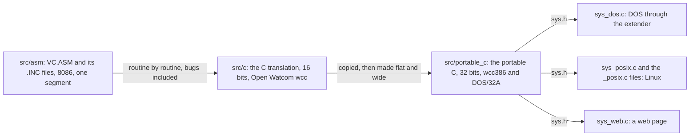
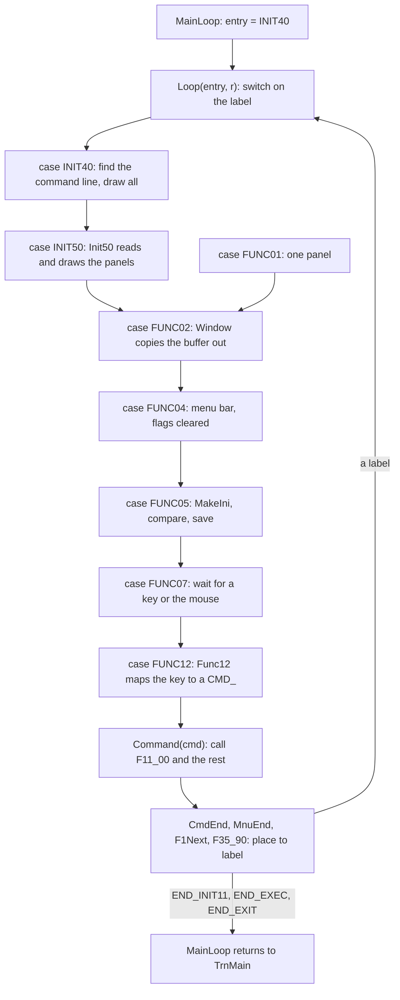
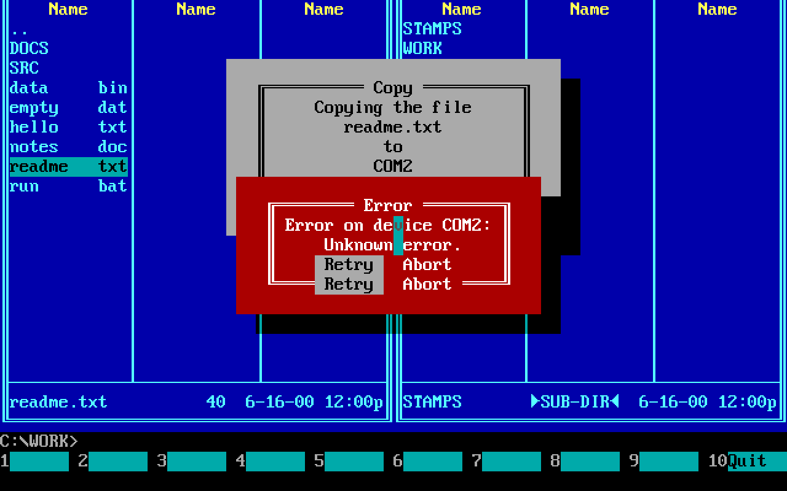
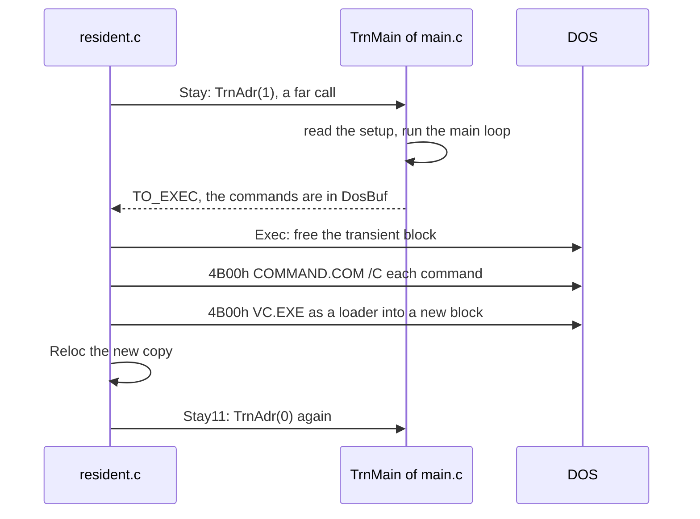
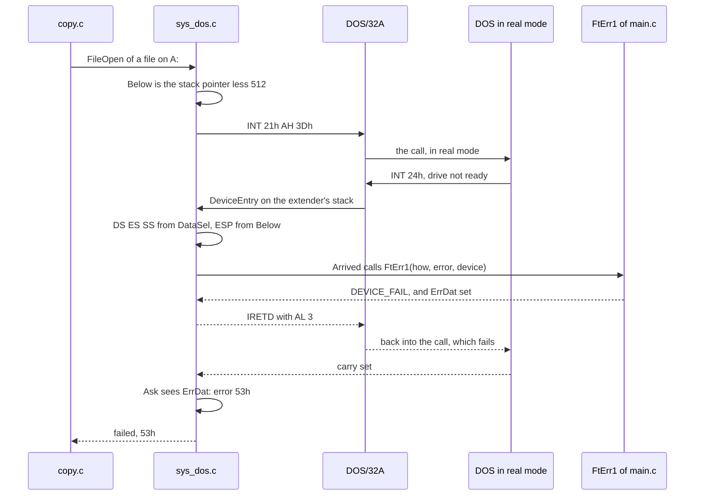

# 5. From assembly to C

Every chapter so far has been about Volkov's assembly. This one is about
what became of it. The project holds the program in three trees, and
each is made from the one before:



The C translation, `src/c/`, is the original in C and nothing more: the
same routines under the same names, the same data at the same offsets,
the same part that stays in memory while a command runs, and the same
behaviour, bugs included. It is finished and frozen. The portable C,
`src/portable_c/`, began as a copy of it and is where the work goes on:
a program of 32 bits with one flat memory, its numbers widened where
16 bits were a limit and not a choice, and everything that it asks of
the system behind one header.

Both are judged the same way. A scenario is a list of keystrokes and
mouse events played into a machine that runs FreeDOS under QEMU; the
original is run through it once and every screen it draws is recorded
as a golden. A tree passes when it draws the same screens and leaves
the same files. For the C translation that is the whole definition of
right. For the portable C it is the same, except where a difference is
declared, one by one, in `src/portable_c/DEVIATIONS.md`.

The price of all this, in bytes:

| | File | Of which | Stays during a command | Stack |
|---|---:|---|---:|---:|
| `VC.COM`, the original | 65,090 | everything | 12,690 | 256 |
| `VC.EXE`, the C translation | 133,056 | two code segments, 54,056 and 46,898 bytes | 19,716 | 4,096 |
| `VC.EXE`, the portable C | 294,339 | 27,536 of them the DOS/32A stub | all of it | 16,384 |

Twice the original's size for a faithful C translation, and four and a
half times for a 32-bit program with an extender in front. The rest of
the chapter is how each step was made, and where the original's
tricks ended up.

## The C translation: `src/c/`

### A routine keeps its name and its registers

Take `TstBrk` of `VCSUB1.INC`, the routine that copy, delete, the
viewer and the file search call between two pieces of work to see
whether the user wants to stop. Here it is in the listing, with its
addresses in `VC.COM`:

```asm
;---------------------- Break test ---------------------
;       Return :        CY=1 - break
9313 53         TstBrk  PROC    NEAR
9313 53                 PUSH    BX
9314 50                 PUSH    AX
9315 B301               MOV     BL,1            ; nothing taken yet
9317 B401       TstBr1: MOV     AH,1            ; BIOS: is a key waiting?
9319 CD16               INT     16h
931B 741B               JZ      TstBr3          ; ZF: no key
931D 0BC0               OR      AX,AX           ; 0: Ctrl-Break
931F 740F               JE      TstBr2
9321 3D032E             CMP     AX,2E03h        ; Ctrl-C
9324 740A               JE      TstBr2
9326 3D1B01             CMP     AX,011Bh        ; Esc
9329 7405               JE      TstBr2
932B 3D0044             CMP     AX,4400h        ; F10
932E 7508               JNE     TstBr3          ; another key: leave it
9330 B400       TstBr2: MOV     AH,0            ; take the key
9332 CD16               INT     16h
9334 B300               MOV     BL,0
9336 EBDF               JMP     TstBr1
9338 80FB01     TstBr3: CMP     BL,1            ; CF = (BL < 1)
933B 58                 POP     AX
933C 5B                 POP     BX
933D C3                 RET
```

Forty-three bytes, and the last trick is typical: the answer is a flag,
and `CMP BL,1` makes it, since the carry is set exactly when BL is 0.
Every caller follows the call with `JC`.

The C translation has it in `src/c/system.c`:

```c
u16 TstBrk(void)
{
    u16 pressed = 0;
    u32 pair;
    u16 key;

    for (;;) {
        pair = Int16(0x100);
        if ((u16)(pair >> 16) != 0)     /* the zero flag: no key */
            break;
        key = (u16)pair;
        if (key != 0 && key != KEY_CTRL_C && key != KEY_ESC
            && key != KEY_F10)
            break;
        Int16(0);
        pressed = 1;
    }
    return pressed;
}
```

and declares it in `src/c/vc.h` with the registers that the assembly
called it with:

```c
u16 TstBrk(void);
#pragma aux TstBrk  "*_c" __far value [ax] modify exact [ax]
```

Three things happened, and they happened to every routine of the
program:

- **The name stays.** `TstBrk` is `TstBrk`; its labels `TstBr1` to
  `TstBr3` became the loop and its `break`s. Where a label disappears
  into structured code, a comment keeps its name (`/* Func03 */`,
  `/* PutMnu3 */`), so that the C can be read against the assembly
  line by line.
- **The flag became a return value.** C has no carry flag. A routine
  that answered in CF or ZF returns a number: 1 for a flag that is
  set, or the flag in the high word of a `u32` where the routine also
  hands back a register. The callers' `JC` became `if (TstBrk())`.
- **The registers became a `#pragma aux`.** While the program was half
  assembly and half C, assembly called C through stubs and C called
  assembly, and each side had to find its arguments where the other
  put them. Open Watcom's `#pragma aux` says, per function, which
  registers carry the arguments (`parm [ax] [es bx]`), where the
  result comes back (`value [dx ax]`) and which registers the function
  may change (`modify exact [ax dx]`). The suffix `"*_c"` gives the C
  function a linker name of its own beside the assembly's. Over four
  hundred such lines are in the tree.

Even `INT 16h` is a function, `Int16` of `src/c/dos.c`, around one
piece of inline assembly that pushes the flags into DX:

```c
static u32 Keyboard(u16 ax);
#pragma aux Keyboard = \
    "int 16h" \
    "pushf" \
    "pop dx" \
    parm [ax] value [dx ax] modify exact [ax dx]

u32 Int16(u16 ax)
{
    u32 pair = Keyboard(ax);
    u16 flags = (u16)(pair >> 16);

    return (u32)(flags >> 6 & 1) << 16 | (u16)pair;     /* ZF is bit 6 */
}
```

`dos.c` is where every interrupt of the C translation is: DOS (`Dos`,
behind `Intr21` and `Int21d`), the BIOS's screen (`Video`), the
keyboard, the multiplex interrupt, `INT 28h` and the mouse, each a
`#pragma aux` with the `INT` and as little else as will do. Everything
else is C that fills a `struct DosRegs` or `struct BiosRegs`, 348
calls in 25 files, each of which still knows DOS's service numbers.

The translation's `TstBrk` is 52 bytes against the original's 43.
That ratio, a fifth to a half more for a small routine, is the usual
one; the doubling of the whole file comes mostly from elsewhere, as
the rest of this section shows.

### What Open Watcom's 16-bit compiler would not do

`#pragma aux` is powerful and has holes, and the batches that
translated the program met them one by one. A few that shaped the code:

| What one writes | What the compiler does | So the C |
|---|---|---|
| A byte register in `parm`, `[al]` | ignores it without a warning, passes on the stack | passes bytes in 16-bit registers and masks them |
| `parm [ds si]` | refuses DS as an argument | takes the segment in another register |
| A 32-bit argument in a pair, `[dx ax]` | does not put the halves in the order written | passes two 16-bit arguments |
| `?:` between two constants in the code segment | makes a pointer into the main data, silently | uses `if` and two assignments |
| A 2-D constant array in the code segment | reads a row through DS, silently | flattens it to one dimension |
| A `u8` divided | divides signed | uses `u16` for anything counted |
| A far pointer with the constant segment 0 | compiles it as a near pointer | takes the segment from a `volatile` |

There is no C library. The two helpers that the compiler calls for
32-bit multiplication and division, `__U4M` and `__U4D`, are written
in C in `src/c/arith.c` and held against Python's arithmetic by the
test `c-arith`, which runs their bytes on a model of the processor.

### Jumps become returns: the commands

A command of the original is not a procedure. The main loop jumps to
it, and it jumps back to whichever label of the loop fits: redraw
everything, redraw one panel, just wait for the next key. Ctrl-O, in
`VCFUNC.INC`, 86 bytes from `16DFh`:

```asm
F11_00: CMP     DS:Visible,0            ; ^O  (DS: the current panel)
        PUSH    DS
        MOV     DS,ES:WCBsec            ; DS: the other panel
        JZ      F11_01
        MOV     AL,DS:Visible           ; Panels Off
        MOV     ES:Ctrl_O,AL            ; remember if the other was on
        MOV     DS:Visible,0
        POP     DS
        MOV     DS:Visible,0
        CALL    BegBX
        CALL    SizDX
        MOV     BL,0
        MOV     DL,80
        CALL    ResUser                 ; what DOS had shown comes back
        JMP     Func03                  ; into the loop: copy it out
F11_01: MOV     AL,ES:Ctrl_O            ; Panels On
        MOV     DS:Visible,AL
        MOV     AH,DS:ChgFlg
        POP     DS
        MOV     DS:Visible,1
        ...
F11_03: JMP     Init50                  ; into the loop: read and draw
```

DS is a panel, ES the main data, and the command ends in a jump to one
of two labels. C has no jump into the middle of another function, so
each command is a function that **returns where to go on**. In the C
translation, `src/c/keys.c`:

```c
u32 F11_00(u16 panel)
{
    struct WCBdef __far *wcb = PANEL(panel);
    struct WCBdef __far *second = PANEL(md.WCBsec);
    u16 begin, size, was, changed;

    if (wcb->Visible != 0) {
        md.Ctrl_O = second->Visible;
        second->Visible = 0;
        wcb->Visible = 0;
        begin = BegBX(panel) & 0xFF00;
        size = SizDX() & 0xFF00 | 80;
        ResUser(begin, size);
        Window(begin, size);            /* Func03 */
        return GO(NEXT_FUNC04);
    }
    was = md.Ctrl_O;
    second->Visible = (u8)was;
    changed = second->ChgFlg;
    wcb->Visible = 1;
    if (wcb->ChgFlg != 0 || was != 0 && changed != 0)
        PutMnu(3);                      /* PutMnu3 */
    return GO(NEXT_INIT50);
}
#pragma aux F11_00 "*_c" __far parm [ax] value [dx ax] modify exact [ax dx]
```

DS became the argument `panel`, a segment as a number, which `PANEL`
of `vc.h` turns into a far pointer (`segment << 16`); ES became `md`.
`JMP Func03` became the one call that `Func03` makes and a return to
`FUNC04`, the label behind it. The answer is a `u32` in DX:AX, because
some places take more than a place:

```
 31            16 15       8 7        0
+----------------+----------+----------+
|  panel segment |   byte   |  NEXT_   |      GO_PANEL(where, panel, byte)
+----------------+----------+----------+
   for M01_00..     for M03_00   which label
   M06_00           and M06_00   of the loop
```

`M06_00`, the menu routine that switches a panel on or off, is entered
by Ctrl-P, Ctrl-F1 and Ctrl-F2 with a panel in DS and a byte in CL:
`F14_00` is `MOV DS,ES:WCB2seg`, `MOV CL,5`, `JMP M06_00` in the
assembly and `return GO_PANEL(NEXT_M06_00, md.WCB2seg, 5);` in C.

Commands live in four files of the assembly, and each file's commands
jump to their own set of places. The C keeps the four families: the
keys of the panels return a `NEXT_`, the menu commands an `MNU_`, the
commands that go through files a `TO_`, copy and rename a `GO_`, and
`main.c` has one function for each family, `CmdEnd`, `MnuEnd`,
`F1Next` and `F35_90`, that turns a place into a label of the loop.

### The loop is a `switch` that falls through

The main loop of the original is the code from `Init40` to `Func12`,
which the start-up falls into and every command jumps back into. The C
makes it two functions and a driver:



`Loop` is a `switch` on the entry label whose cases fall into one
another in the order of the original's labels, so that entering at
`FUNC04` runs `Func04`, `Func05` and `Func07` as the jump to `Func04`
did. A jump from the middle of one case into another, which a `switch`
cannot do, stays a `goto`: `Loop` has three. Over the whole C
translation 910 `goto`s remain where the assembly's jumps did not make
loops with one way in.

Registers that go round the loop from one command to the next are a
structure, `struct Regs`, which `Loop` and `Command` pass along. Most
commands read nothing of it. A few do, and finding them was work:
Rename reads BX and DX as the command before it left them, and the
cursor keys return to `Func07`, behind the place where the loop loads
BX again, so they have to leave there what the original leaves.

### A table of keys becomes a `switch`

The original finds a command by a table of words in `VC.ASM`, a key
and an address:

```asm
FncTab  DW      4800h, F00_00           ; Up
        DW      5000h, F01_00           ; Down
        ...
        DW      0F09h, F20_00           ; Tab     - change active panel
        DW      1C0Dh, F21_00           ; Enter   - run / change directory
        DW      000Ah, F27_00           ; ^Enter  - history command
        DW      011Bh, F74_00           ; Esc     - clear command line
        DW      000Fh, F11_00           ; ^O      - on/off panels
```

and one routine, `Case` of `VCSUB1.INC`, walks it:

```asm
Case    PROC    NEAR                    ; CS:SI the table, AX the key
        PUSH    SI
        PUSH    CX
        OR      AH,AH                   ; no scan code: a typed character
        JE      Case3
Case1:  MOV     CX,CS:[SI]              ; an entry's key
        ADD     SI,4
        JCXZ    Case3                   ; 0 ends the table
        CMP     AL,CL                   ; the character must match
        JNE     Case1
        OR      CH,CH                   ; scan code 0 in the table:
        JE      Case2                   ;   any scan code will do
        CMP     AH,CH
        JNE     Case1
Case2:  POP     CX
        ADD     SP,4                    ; drop SI and our return address
        JMP     WORD PTR CS:[SI-2]      ; and go: the caller never returns
Case3:  POP     CX
        POP     SI
        RET                             ; not found: back to the caller
Case    ENDP
```

Thirty-seven bytes, `933Eh` to `9363h`, serve every key table of the program, and the
`ADD SP,4` is the trick: a found key turns the call into a jump. An
entry with a zero scan code, `000Fh` for Ctrl-O, matches its
character with any scan code, so one entry covers the key however the
keyboard reports it.

The C translation writes each table as two `switch`es, `Func12` of
`src/c/main.c`: the first on the whole BIOS word, for the entries that
have a scan code, the second on the character alone, for those that do
not.

```c
static u16 Func12(u16 key)
{
    if (key >> 8 == 0)
        return CMD_F73_00;              /* to the command line */
    switch (key) {
    case 0x4800: return CMD_F00_00;  /* Up */
    ...
    case 0x0F09: return CMD_F20_00;  /* Tab: change active panel */
    ...
    }
    switch (key & 0xFF) {
    case 0x0A: return CMD_F27_00;  /* ^Enter: history command */
    case 0x0F: return CMD_F11_00;  /* ^O: on/off panels */
    ...
    }
    return CMD_F73_00;
}
```

The order matters and is kept: the table has Tab, `0F09h`, before any
entry that could take its character 09h with any scan code, so the
first `switch` has it too. The command is a number, a `CMD_` of
`vc.h`, and `Command` calls its function. The same was done to the
tables of the menus, the editor's keys, the viewer's and the help's.

### A label is an entry: the critical error

DOS calls `INT 24h` when a disk is not ready, in the middle of a call
of the program's, with the program's own registers in an unknown
state. The original's handler finds its data through a word kept in
the code segment:

```asm
SecDat  DW      0                       ; the main data's segment

FatErr: PUSH    DS
        PUSH    ES
        ...
        CLD
        MOV     DS,CS:SecDat            ; the only way to the data
        PUSH    DS
        POP     ES
        MOV     BL,DS:ErrDat            ; already in an error?
        OR      BL,DS:BlocEr
        JZ      FtErr1
        MOV     AL,3                    ; then just fail the call
        JMP     FtErr9
FtErr1: PUSH    AX
        ...
```

In C the handler is an `__interrupt` function, which saves every
register and loads DS with the compiler's group, the constants. The
main data is somewhere DOS gave the program at run time, so one
instruction of inline assembly, the only one in `main.c`, moves DS:

```c
static void DataSeg(u16 segment);
#pragma aux DataSeg = "mov ds,ax" parm [ax] modify exact []

void __interrupt __far FatErr(struct Saved r)
{
    DataSeg(SecDat);
    r.ax = FtErr1(r.ax, r.di, AT(r.bp, r.si));
}
```

`FtErr1`, a label in the assembly, is a function in C: what follows the
label takes DOS's AX and DI and the device's header at BP:SI, and
returns AL. `struct Saved` is the registers that the compiler's entry
has pushed, and writing `r.ax` changes the AX that `IRET` gives back to
DOS. That is the general rule for code between labels: where every
jump into a stretch arrives with known registers, the stretch is a
function and those registers are its arguments.



### The data, a file at a time

The boxes, dialogs, texts and buttons of the original are `DB` and `DW`
lines in the `.INC` files, beside the code that shows them. A box,
`DelFl_P` of `VCF1.INC`, "Deleting the file":

```asm
DelFl_P DB      Box_C, 0, 0, 0          ; four colours
        DB      3, 1                    ; three lines, one text put in
        DW      WinBuf                  ; where what it covers is kept
        DW      TmpBuf                  ; the text: a name in TmpBuf,
        DB      7, 64                   ;   written so, at most 64
        DW      Del_S                   ; the title, " Delete "
        DW      DelFl_S                 ; "Deleting the file^I"
        DW      Var_S                   ; the line the text goes into
```

Twenty bytes: words that name other objects by their offsets in the
one segment, and words that name fields of the main data. The C
translation moved all of them into files that hold nothing but
constants, one for each file of the assembly, named for the code that
uses them (`dirfunc_t.c` has `VCF1.INC`'s), and wrote them with
macros of `src/c/tables.h`:

```c
const BOX1(3) DelFl_P = {
    { Box_C, 0, 0, 0 },
    3, 1,
    MD_AT(WinBuf),
    { { MD_AT(TmpBuf), 7, 64 } },
    { Del_S, DelFl_S, Var_S }
};
```

`BOX1(3)` is an anonymous structure of the box's header, one text and
three lines; `MD_AT(WinBuf)` is the offset of a field of `struct
MainDat`, `offsetof` written out. The lines are near pointers, two
bytes, so the C object is the same 20 bytes as the assembly's. The
constants are in a group of their own, `DGROUP`, where a word that
names one is its offset, as in the original.

That the bytes really are the same is not left to reading. The test
`c-data` holds every constant of the C against the label of the same
name in the original's listing, byte for byte, and for a word that
names something it follows the original's relocations to see that the
C names the same thing. A table that no screen shows could be wrong in
every scenario and still pass them all; this is what catches it. The
moving itself went file by file, `VCHELP.INC` first: each object taken
out of the assembly as bytes, written into C, built, held against the
original, until the assembly file held only comments and was removed.

### The part that stays: `resident.c`

The original's trick of giving back all but 12,690 bytes for a command
had to survive translation, because a command's free memory is
something the user sees (`mem` shows it). The C translation keeps two
parts, and lays them out with a tool of its own. The resident part is
`src/c/resident.c`, compiled with `-nd=R -g=R_GROUP` so that its code
and its data are one group beginning at the PSP, as the original's
`.COM` is. In the linker's map, `build/c/VC.MAP`:

```
offset from the PSP
0000h  +--------------------------------------+  R_GROUP
       | RTEXT   the PSP's room, then the      |  CS = DS = SS = PSP
       |         code of resident.c            |
       |         (Alloc0, the entry, at 0F49h) |  4,738 bytes
1282h  +--------------------------------------+
       | RCONST2 its constants                 |  183
133Ah  +--------------------------------------+
       | R_DATA  the words mkexe.c fills in,   |
       |         then Stays at 1358h           |  10,697
3D04h  +--------------------------------------+
       | R_BSS   DataSav, the stack            |  4,096
4D04h  +--------------------------------------+  end: 19,716 bytes
       | TrnBeg  32 bytes: room for the MCB    |  DGROUP begins
       |         that splits the block         |
       | CONST2  the tables of the _t.c files  |  8,943
6FF4h  +--------------------------------------+
       | CTEXT   compiled code                 |  54,056
       | CTEXT2  compiled code                 |  46,898
       +--------------------------------------+
```

Everything the resident part keeps is one structure, so that the
compiler cannot reorder it:

```c
struct Stays {
    u32 IntTab[256];                    /* the vectors, as they were */
    u32 SavePtr;
    u32 Vect22;                         /* where DOS went on before */
    u32 Vect27;
    u32 TrnAdr;                         /* where to call the rest */
    u16 Counter;
    u16 PrgList[MaxProg];               /* TSRs noted, 18 */
    u8  NameBuf[12];
    u8  WCB1sav[STAYS_WCB];             /* the left panel, cut down */
    u8  WCB2sav[STAYS_WCB];             /* the right panel */
    u8  ComnIni[STAYS_CMN];             /* the main data before DosLin */
};
```

It is defined with a value of zeros, and the stack, `DataSav`, is the
only object of the file without one, because Open Watcom lays out what
has no value in an order of its own and what has one in the order it
is written. That puts the stack last, in `R_BSS`, and gives it the
segment to itself.

The linker cannot write a file that loads like this. `tools/mkexe.c`
takes its `VC.EXE` apart and writes another: entered at `PSP:100h`
with CS on the PSP (a header code segment of -10h), on the resident
stack from the first instruction, with the file laid out exactly as
the program lies in memory. It finds seven words of `resident.c` by
name in the map and fills them in (`ImgEnd`, `TrnPrW`, `ResPrW`,
`DatPrW`, `RelTab`, `RelCnt`, `ResCnt`), and it refuses to finish when
the map shows something the program cannot live with: code within a
page of the stack, an object file with both code and data, a segment
past F000h.

The original's transient part is one segment and needs no relocation.
The translation's is three, and so `mkexe.c` appends the linker's
relocation table to the file, and `Reloc` applies it to every copy the
program loads of itself:

```c
static void Reloc(void)
{
    const u16 __far *entry = (const u16 __far *)AT(RunPar + RelTab, 0);
    u16 count;

    for (count = RelCnt; count; count--) {
        u16 offset = *entry++;
        u16 segment = *entry++;

        *(u16 __far *)AT(RunPar + segment, offset) += RunPar;
    }
}
```

The two parts call each other differently than the original's. There
the resident part enters the transient one with `PUSH RunPar`, `PUSH
OFFSET Init11`, `RETF`, and the transient one comes back to run a
command with `PUSH DS`, `PUSH OFFSET Exec`, `RETF`: two far jumps, no
stack kept between them. In C both sides are functions, so the
resident part calls and the transient part returns:



What C cannot write at all is `_asm` in a naked function. `New21`, the
hook on `INT 21h` that watches DOS while a command runs, has to pass
every call it does not want on to DOS with no register and no byte of
the caller's stack changed. The original:

```asm
New21   PROC    FAR                     ; INT 21h
        CMP     AH,4Bh                  ; exec: note the program
        JE      Fnc4B
        CMP     AH,31h                  ; stay resident: note it
        JE      Fnc31
        CMP     AH,49h                  ; free memory
        JE      Fnc49
        CMP     AH,2Bh                  ; set date... or VC's own call
        JE      VCapi
Old21:  JMP     CS:Vect21
```

and the C translation, the same comparisons, then a jump into an
`__interrupt` function only for the calls it handles:

```c
__declspec(naked) void __far New21(void)
{
    _asm {
        cmp ah,4Bh
        je deal
        cmp ah,31h
        je deal
        cmp ah,49h
        je deal
        cmp ah,2Bh
        jne old
        cmp cx,5643h                    ; 'VC'
        jne old
        cmp dx,4F4Dh                    ; 'OM'
        je deal
    old:
        jmp dword ptr cs:Vect21
    deal:
        pushf
        push ax                         ; room for a second return
        push ax                         ;   address
        jmp Int21
    }
}
```

The resident part ends up 19,716 bytes, 19,728 in whole paragraphs,
which is 7,024 more than the original's 12,690 in whole paragraphs,
12,704: 3,840 for
the larger stack, the rest because compiled code is longer than
Volkov's and the start-up code stays in memory, where the original
lays data over it.

## The portable C: `src/portable_c/`

### 32 bits under DOS/32A

The portable C is compiled by Open Watcom's `wcc386` in the flat
model: one code segment and one data segment, both based at address 0,
so a pointer is a 32-bit linear address and every function is near.
The linker writes a linear executable (LE) with DOS/32A in front of
it. DOS loads the stub, a real-mode program; the stub switches the
processor to protected mode, loads the LE image above the first
megabyte, applies its 4,647 relocations and enters `Start` of
`sys_dos.c`.

```
VC.EXE on disk                 the machine while it runs
+------------------+           00000h +-----------------------------+
| MZ header        |                  | DOS, drivers, COMMAND.COM   |
| DOS/32A stub     |  27,536          | the stub, its DOS block     |
|                  |                  | LowSeg: 512 bytes of        |
+------------------+                  |   sys_dos.c's (see below)   |
| LE header,       |                  | free for a command          |
| relocations      |           A0000h +-----------------------------+
+------------------+                  | display memory, BIOS        |
| code             |  124,812  100000h+-----------------------------+
+------------------+                  | code                        |
| data: stack,     |                  | stack, constants, tables    |
| constants, md    |  104,499         | md, the main data           |
| (as zeros)       |                  | what has no value           |
+------------------+                  +-----------------------------+
                                      | DPMI blocks: two panels and |
                                      |   the room, as much as the  |
                                      |   machine has               |
                                      +-----------------------------+
```

Because the segments are based at 0, the first megabyte is simply the
addresses 0 to FFFFFh. The BIOS's tick count, `0040:006Ch` in the
original, is `*(u32 *)0x46C`; the colour display is at B8000h.

### Pointers where there were segments and offsets

In the 16-bit trees a panel is a segment, a number in DS or in a
variable, and a place in it is a 16-bit offset. In the portable C a
panel is a pointer, `struct WCBdef *`, and the four that the main data
names by segment (`WCBcrn`, `WCBsec`, `WCB1seg`, `WCB2seg`) are four
variables of `main.c`, `CurrentPanel`, `OtherPanel`, `LeftPanel` and
`RightPanel`. Ctrl-O again:

```c
struct Onward F11_00(struct WCBdef *panel)
{
    struct WCBdef *second = OtherPanel;
    u16 begin, size;
    u8 was;
    bool changed;

    if (panel->Visible != 0) {
        md.Ctrl_O = second->Visible;
        second->Visible = 0;
        panel->Visible = 0;
        begin = BegBX(panel) & 0xFF00;
        size = (SizDX() & 0xFF00) | 80;
        ResUser(begin, size);
        Window(begin, size);            /* Func03 */
        return To(NEXT_FUNC04);
    }
    was = md.Ctrl_O;
    second->Visible = was;
    changed = second->ChgFlg;
    panel->Visible = 1;
    if (panel->ChgFlg != 0 || (was != 0 && changed != 0))
        PutMnu(3);                      /* PutMnu3 */
    return To(NEXT_INIT50);
}
```

Line for line it is the C translation's. What changed is around it:
`PANEL(panel)` is gone because the panel is a pointer already, there
is no `#pragma aux`, and the packed `u32` is a structure that cannot
be taken apart by a shift by mistake:

```c
struct Onward {
    u8  place;                          /* a NEXT_ */
    u8  item;                           /* for M03_00 and M06_00 */
    struct WCBdef *panel;               /* for a routine of the menu */
};
```

`To(place)` and `ToMenu(place, panel, item)` make one; `CmdEnd` takes
one. Changing the type of what a function returns made every call
that was not changed fail to compile, which is how 114 such functions
were retyped without missing a caller.

The main data, which the 16-bit trees reach through DS at offset 0,
is a plain variable, `struct MainDat md;` of `main.c`, still laid out
byte for byte as the original's (`LAID_OUT(MainDat, 0xF48B)` holds its
size). Where the original leaves a place of the main data in a
register for something to read as a number, the portable C keeps the
number, `MD_PLACE(pointer)`, and makes a pointer of it again with
`MD_POINTER(place)`.

A word of a table that names something is a pointer in C anyway. In
the portable C it is four bytes, set by the extender at load time, so
`DelFi_P`, the box that asks before a file is deleted, is 28 bytes
where the original's and the C translation's are 20. There are 640
such words in the tables, and `portable_c-data` holds them field by
field against the original: the bytes where the original has bytes,
and for a pointer, that it points at what the original's word names.

### Widened numbers and booleans

Sixteen bits were the original's whole world, and some of its limits
are only that. A panel's places are the clearest case. The original
keeps them in the panel, `CurAdr`, `First`, `EndBuf`, `EndFul`, 16-bit
offsets in a 64K segment. The portable C keeps those words in the
structure, where the setup file and the layout need them, but reads
and writes none of them; the real places are in front of the panel in
its block, in 32 bits:

```c
struct Places {
    i32 Bytes;              /* how long the block is */
    i32 Unused[3];
    i32 CurAdr;             /* the entry under the cursor */
    i32 First;              /* the first one shown */
    i32 EndBuf;             /* the end of the list as shown */
    i32 EndFul;             /* the end of all that was read */
};
#define PLACES(wcb) ((struct Places *)(wcb) - 1)
```

So a panel grows with its directory, past the original's 2,703 entries,
up to 65,536, the most a DOS directory can hold and the most an
entry's 16-bit number can count. Each such lifted limit is a deviation,
asked of the user and declared; so are the bugs of the original that a
wider number fixes, such as the editor's count of lines.

The rule for every number is written down and held by a test,
`portable_c-width`: a size, a count, an index is an `i32`; a number
that is only ever 0 or 1 is a `bool`, as `TstBrk` now returns
(`changed` above is one too); a character, a colour, a cell of the
screen, a bit mask, and a width that DOS or a file has stay as wide as
they were, each with its reason recorded. Where the program counts on
16 bits wrapping, the cast is written and says so:

```c
            /* It wraps: a count of 0 less one is 0FFFFh, of which the
               low byte and the highest bit are read. */
            more = (u16)((second << 8 | (second & 0x7F)) - 1);
```

Words read from a buffer of bytes, which the original does at odd
addresses as a matter of course, are made of their bytes by `GET16`
and `PUT16` of `vc.h`, `p[0] | p[1] << 8`, so that nothing rests on
the processor's byte order or alignment.

### The program kept whole

The resident part is gone. The portable C stays in memory whole while
a command runs: the panels keep all their files, nothing is reloaded,
there is no second copy of `VC.EXE` acting as a loader, no relocation
table to apply, no `mkexe.c`. `resident.c` became `exec.c`, a file like
any other, named for what it still does: `Exec02` writes `/C ` in front
of each command of `DosBuf`, prints the prompt between commands as the
original did, and runs `COMSPEC` for each. The cost is memory below the
megabyte, and under an extender there is plenty: the program itself is
above it, and DOS has all of its 640 KB but the stub and 512 bytes for
a command.

What went with the resident part went as declared removals of things
that only made sense on DOS: Memory allocation in the Options menu,
the TSR manager and the map of memory with the watch on `INT 21h` it
rested on, Quick execute through COMMAND.COM's `INT 2Eh`, which not
every shell serves. The setup program, `VCSETUP.COM` in the original,
which asked a running copy for its data through that `INT 21h` hook,
is now part of the one program, an item of the Options menu.

### `sys.h`: DOS as the abstraction layer

The C translation has its interrupts in one file, but every caller
still fills registers with DOS's numbers. The portable C has none of
that outside one file per platform. `src/portable_c/sys.h` declares 99
functions, named for what is asked, with no register, no service
number and no interrupt in them, and the rest of the program asks
nothing of the system any other way.

The layer is DOS itself. A drive is a letter, a path has backslashes
and at most 67 characters, a name is 8.3, attributes, dates and times
are DOS's bits, an error is DOS's number for it, a key is the BIOS's
word of scan code and character, a cell of the screen is a character
with its colour above it. Another system has to answer in those terms.
This was chosen over a design of its own because the program has those
shapes in hundreds of places and its screens show them: an
abstraction that hid them would have had to be undone at every screen.

Two rules make it faithful:

- **What is asked, and in what order, is behaviour.** A function is one
  request. Where the original asks DOS several things in a row, the row
  stays in the common code in the original's order. `OpenFil` opens a
  file and, on a sharing violation, opens it again without the sharing
  bits: two calls of `FileOpen` in `system.c`, not a cleverer function.
- **Asked or bare.** The original calls DOS two ways: through
  `Intr21`, 62 bytes of `VCSUB1.INC` that clear `ErrDat`, make the
  call, turn a Cancel in the critical error box into a failure and a
  failure into DOS's extended error; or with a bare `INT 21h`. A
  service called both ways has two functions, `FileOpen` and
  `FileOpenBare`.

An answer that can fail is at least a `struct Answer`, AX as DOS left
it and whether the call failed. AX is kept even on success, because
some callers of the original go on with what AX held. `TstBrk` of the
portable C shows the whole change from the C translation, `Int16(0x100)`
and a flag in the high word becoming a question with a name:

```c
bool TstBrk(void)
{
    bool pressed = false;
    struct Keys keys;
    u16 key;

    for (;;) {
        keys = KeyWaiting();            /* INT 16h AH 1, in sys_dos.c */
        if (keys.none)
            break;
        key = keys.key;
        if (key != 0 && key != KEY_CTRL_C && key != KEY_ESC
            && key != KEY_F10)
            break;
        KeyRead();                      /* INT 16h AH 0 */
        pressed = true;
    }
    return pressed;
}
```

The functions by what they cover:

| Group | | The original asked |
|---|---:|---|
| Files | 18 | INT 21h 3Ch to 43h, 4400h, 56h, 57h, 60h |
| Files by an FCB | 2 | 13h, 29h |
| Directories | 8 | 1Ah, 39h to 3Bh, 47h, 4Eh, 4Fh |
| Drives | 8 | 0Eh, 19h, 36h, 4408h to 440Fh, INT 2Fh 150Bh |
| Memory | 6 | 48h to 4Ah, 58h |
| Time, country, version, idling | 8 | 2Ch, 30h, 33h, 38h, DOS's routine for capitals, INT 28h |
| Programs | 8 | 4B00h, 4Ch, what the PSP holds |
| What the system asks of the program | 11 | INT 24h, 1Bh, 23h, PSP:0Ah |
| Console | 2 | 06h, 09h |
| Keyboard | 4 | INT 16h, the BIOS's byte at 0040:0018h |
| Screen | 15 | INT 10h, the display memory |
| Mouse | 8 | INT 33h |
| Timer | 1 | 0040:006Ch |

The group that runs the other way, DOS coming to the program, follows
the original's AH 35h, 25h, 25h again: a function that notes who has
the interrupt, one that takes it, one that gives it back. What the
program does about a critical error is a function of its own, of a
type that `sys.h` names, handed over when the interrupt is taken:

```c
typedef u16 DeviceErrorFn(u16 how, u16 error, const u8 *device);

void HookVct(void)                      /* main.c, the original's order */
{
    DeviceErrorNote();
    CtrlBreakNote();
    DeviceErrorTake(FtErr1);
    CtrlBreakTake();
}
```

### `sys_dos.c`: DOS from protected mode

DOS, the BIOS and the mouse driver are real-mode code, and the
program is not. It still calls them by `INT`; the extender catches the
interrupt, switches to real mode, calls, and switches back. What it
does with the registers on the way was found by toy programs on the
bench, and splits DOS's services into kinds, which decide how each
function of `sys_dos.c` (2,073 lines) is written:

| A call that | Such as | DOS/32A | So `sys_dos.c` |
|---|---|---|---|
| takes no address | 19h, 2Ch, 36h, all of INT 10h, 16h, 33h | carries the registers over and back | makes the `INT` |
| takes a buffer it knows | 3Dh, 3Fh, 40h, 41h, 56h | copies the buffer through one of its own below 1 MB | hands it the 32-bit pointer |
| takes a buffer it does not know | 13h, 29h, 38h, 60h, 4B00h | passes the register, which means nothing in real mode | calls in real mode itself |
| it knows, but returns the AX it was given | 4Eh, 4Fh, 47h, 4301h | breaks the promise of `struct Answer` | calls in real mode itself |

Thirteen functions end up in real mode, through DPMI 0300h (an
interrupt in real mode) or 0301h (a far call, for DOS's routine for
capitals, whose address the country record gives).

Each interrupt is written once, as a `#pragma aux` of inline assembly.
`Dos` loads six 32-bit registers from a `struct DosRegs`, makes the
call, stores what came back, and turns the carry into a value:

```c
static u32 Dos(struct DosRegs *regs);
#pragma aux Dos = \
    "push ebp" "push ebx" \
    "mov eax,[ebx]" "mov ecx,[ebx+8]" "mov edx,[ebx+12]" \
    "mov esi,[ebx+16]" "mov edi,[ebx+20]" "mov ebx,[ebx+4]" \
    "int 21h" \
    "xchg ebx,[esp]" \
    "mov [ebx],eax" "mov [ebx+8],ecx" "mov [ebx+12],edx" \
    "pop eax" "mov [ebx+4],eax" "pop ebp" \
    "sbb eax,eax" \
    parm [ebx] value [eax] modify exact [eax ebx ecx edx esi edi]
```

On top of it, `Ask` is the original's `Intr21`, step for step:

```asm
Intr21  PROC    NEAR                    ; A5E2h, 62 bytes
        PUSH    DS
        MOV     DS,CS:SecDat
        MOV     BYTE PTR DS:[ErrDat],0  ; no critical error yet
        POP     DS
        INT     21h
        PUSHF
        PUSH    DS
        MOV     DS,CS:SecDat
        CMP     BYTE PTR DS:[ErrDat],0  ; Cancel in the box?
        POP     DS
        JNE     I21_02                  ;   then error 53h
        POPF
        JNC     I21_01
        PUSH    DS                      ; failed: save everything
        ...
        XOR     BX,BX
        MOV     AH,59h                  ; and ask for the extended error
        INT     21h
        ...
        STC
I21_01: RET
```

```c
static struct Answer Ask(struct DosRegs *regs, bool flagged)
{
    u32 ebx, ecx, edx;

    md.ErrDat = 0;
    if (Call(regs))
        flagged = true;
    if (md.ErrDat != 0) {
        regs->eax = ERR_NOT_READY;              /* 53h */
        return Answered(regs, true);
    }
    if (!flagged)
        return Answered(regs, false);
    ebx = regs->ebx;
    ecx = regs->ecx;
    edx = regs->edx;
    regs->eax = regs->eax & 0xFF | 0x5900;
    regs->ebx = 0;
    Call(regs);
    regs->ebx = ebx;
    regs->ecx = ecx;
    regs->edx = edx;
    return Answered(regs, true);
}
```

`flagged` is the one addition. Two services, 13h and 36h, leave the
carry as they find it, and the original reaches them with the flag
already set at some calls; a flag set in protected mode does not
survive the trip, so it travels as an argument.

#### The block below the megabyte

For the calls it makes in real mode, `Start` asks DPMI 0100h for 32
paragraphs of DOS's memory and keeps their segment in `LowSeg`. Each
thing that real-mode DOS reads or writes has a fixed place there,
copied down before a call and up after it:

```
LowSeg:  000h  LOW_NAME      a name or a path            128
         080h  LOW_RECORD    a search's DTA record        43
         0C0h  LOW_SECOND    60h's path, 4B00h's tail    128
         140h  LOW_FCB       an extended FCB              44
         170h  LOW_COUNTRY   38h's answer                 34
         1A0h  LOW_RUN       4B00h's parameter block      14
         1B0h  LOW_FCB1      the two FCBs it names        16
         1C0h  LOW_FCB2                                   16
         1D0h  LOW_ENDED     Ended_T, real-mode code      28
         1F0h  LOW_WAS       where PSP:0Ah went before     4
         1F4h  LOW_PSP       the PSP's segment             2
         1F6h  LOW_BREAK     BREAK to put back             1
         200h  LOW_SIZE = 512
```

`LOW(place)` is `(u8 *)(((u32)LowSeg << 4) + place)`, the
segment-times-16 of real mode written once.

#### The memory from DPMI

The original takes one block of DOS memory and cuts it into the main
data, two panel segments and a room for the viewer, the editor and
copy. The portable C asks the extender instead, DPMI 0500h (how much),
0501h (take), 0502h (give back) and 0503h (resize): a block per panel,
which grows with its directory, and one block for the room, all the
machine has behind them. It still asks the way the original asked DOS,
`MOV BX,0FFFFh` then AH 48h: for more than there can be, which is
refused with the size of the largest block, and then for that. The
extender names a block by a handle, `sys.h` names it by its address,
so `sys_dos.c` keeps a table of eight, `struct Held`, address, length
and handle. DOS/32A keeps 16 bytes of its own in front of every block
and ends the program at the next memory call if they have been
overwritten; the tests check them after every scenario, so a write one
byte past a block fails.

#### The critical error, from real mode into C

DOS still calls `INT 24h` in real mode, in the middle of a call. The
program takes it through the extender with DPMI 0205h. The extender
then enters `DeviceEntry` in protected mode, with DS and ES anywhere,
on a stack of its own of 512 bytes, too small for a dialog that draws
a box and waits for keys. The answer is the original's, a word read
through CS, `DataSel`, the data selector:



`Below` is not the stack pointer at the moment of the error but a
place well under it. The extender was entered on the program's stack
when the program made its call, and keeps its own state there until
the call returns; the toys saw it use 190 bytes under the pointer for
a call it translates, 130 for one made through 0300h, 74 for others.
So every call notes `Below = StackNow() - 512` first, and the error
continues below that. `DeviceEntry` switches SS and ESP in two
consecutive instructions, `mov ss,bx` and `mov esp,Below`, since the
processor holds off interrupts for one instruction after SS is loaded.

`Arrived` makes a flat pointer of BP:SI, tests bit 7 of byte 5 of the
device header as the original's `FatErr` does with `TEST BYTE PTR
DS:[BX+5],80h`, and hands the program the name at offset 10 or 0 for
a drive. Ctrl-Break and Ctrl-C go to `NothingEntry`, which is one
`iretd`: the 32-bit form of the original's `CtrlC: IRET`.

DOS enters the critical error with interrupts off. The original has
an `STI` after each `MovScr` and `Window`, so that its box gets the
timer and the keys; the portable C has `IntOn()` there, a function of
`sys.h` that is `_enable()`, an `sti`, in `sys_dos.c`.

#### The end by another's hand: `Ended_T`

When DOS ends the program itself, after a Ctrl-C at a prompt of DOS's
say, it goes on at the address in PSP:0Ah. The original puts `Exit01`
there, which puts BREAK back as it was and goes on where the PSP
pointed before:

```asm
Exit01: PUSH    AX
        PUSH    CS
        POP     ES
        MOV     DL,ES:ComnIni.BreakFl   ; BREAK as the user had it
        MOV     AX,3301h
        INT     21h
        ...                             ; the TSR manager's work
Exit04: POP     AX
        CMP     ES:Vect22.Segm,0        ; nobody before us?
        JNE     Exit05
        MOV     AH,4Ch
        INT     21h
Exit05: JMP     ES:Vect22               ; go on where DOS would have
```

Under DOS/32A no code of the program can run at that moment: the
extender owns real-mode `INT 21h` while the program runs, sees the
end, and removes itself and the program's memory before DOS goes on.
The low block is DOS's memory, freed but not yet overwritten, so
`ProgramEndedTake` copies eight real-mode instructions into it and
points PSP:0Ah at them. The compiler writes only 32-bit code, so the
routine is bytes, with the instruction beside each:

```c
static const u8 Ended_T[] = {
    0x50,                                       /* push ax */
    0xB8, 0x01, 0x33,                           /* mov ax,3301h */
    0x2E, 0x8A, 0x16, LO(LOW_BREAK), HI(LOW_BREAK),
                                                /* mov dl,cs:[LOW_BREAK] */
    0xCD, 0x21,                                 /* int 21h */
    0x58,                                       /* pop ax */
    0x2E, 0x8E, 0x06, LO(LOW_PSP), HI(LOW_PSP), /* mov es,cs:[LOW_PSP] */
    0x2E, 0x83, 0x3E, LO(LOW_WAS + 2), HI(LOW_WAS + 2), 0,
                                                /* cmp word ptr
                                                   cs:[LOW_WAS+2],0 */
    0x2E, 0xFF, 0x2E, LO(LOW_WAS), HI(LOW_WAS)  /* jmp dword ptr
                                                   cs:[LOW_WAS] */
};
```

It is `Exit01` without the TSR manager, reading its three values from
behind itself through CS. Since the program cannot be asked anything
then, it states its wish beforehand: every time `SetBrk` notes BREAK
anew it calls `ProgramEndedBreakCheck`, which writes the byte at
`LOW_BREAK`.

#### Running a program

The extender does not know 4B00h's parameter block, which is made of
real-mode far pointers, so `Run` builds it in `LOW_RUN` and
`ProgramRun` calls in real mode. Two things differ from the original.
The original leaves the environment's segment 0, so that DOS copies
the parent's, found at PSP:2Ch; the extender has put a selector there,
and DOS would copy whatever lies at that number, so `Run` names the
real segment, which `Start` asked of DPMI 0006h. And DOS points `INT
22h` at the caller when it runs a program; a 16-bit program gets it
back from its PSP when it ends, but the extender ends first and would
warn that the vector was changed, so `ProgramRun` notes it with DPMI
0200h and puts it back with 0201h around each call.

### Linux and the web

Every other platform implements the same 99 functions by emulating
DOS behind them, as DOSBox does, but at the level of DOS's services
rather than the processor's instructions. On Linux (`sys_posix.c`, with
`machine_posix.c` and the other `_posix.c` files) a drive letter is a
directory, R: the root and H: the home directory; a long name gets a
stable `LONGNA~1` alias; names cross between UTF-8 and code page 437;
a key from the terminal becomes a BIOS word, by the kitty keyboard
protocol where the terminal has it; the screen is the 80 by 25 grid of
cells drawn with escape sequences; a command runs through `$SHELL -c`.
The web page (`sys_web.c`) shares that machine, built to WebAssembly by
Emscripten, its key loop made to wait by Asyncify, the cells drawn as
the lines of a `<pre>`. The common code cannot tell which of the three
it runs on.

## The mapping, in one table

| In the assembly | In the C translation | In the portable C |
|---|---|---|
| A procedure, `TstBrk PROC NEAR` | a function of the same name, its registers in `#pragma aux` | a function of the same name, the compiler's convention |
| A label inside a procedure, `TstBr1:` | a loop, `break`, `continue`, or a `goto`; the name in a comment | the same, with fewer `goto`s (341 against 910) |
| A label that several jumps enter with known registers, `FtErr1:` | a function taking those registers | the same |
| A flag as the answer, `CMP BL,1` / `JC` | a `u16` that is 0 or 1, or the flag in the high word | a `bool`, or a structure with a named member |
| Two registers as the answer, DX:AX | a `u32`, `value [dx ax]` | a structure returned by value |
| A command, code between labels ending in `JMP Init50` | a function returning a `NEXT_` in a `u32` | a function returning `struct Onward` |
| The main loop, `Init40` to `Func12`, fallen and jumped into | `Loop`, a `switch` whose cases fall through, and `Command` | the same |
| Registers that go round the loop | `struct Regs` | `struct Regs`, with `i32` places and a panel pointer |
| A key table and `Case`, `FncTab` | two `switch`es, on the word and on the character | the same |
| A panel in DS, `MOV DS,ES:WCBsec` | a segment `u16`, `PANEL(seg)` a far pointer | `struct WCBdef *`, `OtherPanel` |
| The main data, ES or DS at offset 0 | `md`, linked as the object at offset 0 of the PSP | `struct MainDat md;`, a variable of `main.c` |
| A field's offset, `DW TmpBuf` | `MD_AT(TmpBuf)` | `MD_AT(TmpBuf)`, and `MD_PLACE` / `MD_POINTER` in code |
| A 16-bit offset into a segment | a far pointer, segment and offset | a flat pointer; an `i32` place |
| `DB`/`DW` tables beside the code | constants in `_t.c` files, the same bytes, in `DGROUP` | the same files, words that name things 4 bytes |
| `DB 'text',0` | `const u8 Name_S[] = "text";` | the same |
| `INT 21h` through `Intr21` | `Intr21(&regs)`, a `struct DosRegs` | `FileOpen(name, mode)` of `sys.h` |
| A bare `INT 21h`, `INT 10h`, `INT 16h` | `Int21d`, `Int10`, `Int16` of `dos.c` | a function of `sys.h`, made in `sys_dos.c` |
| The handler of an interrupt, `FatErr:` | an `__interrupt __far` function | a naked `_asm` entry in `sys_dos.c` and a C function of the program's |
| `MOV DS,CS:SecDat` | `DataSeg(SecDat)`, one `mov ds,ax` | `mov bx,word ptr cs:DataSel` |
| `CtrlC: IRET` | an empty `__interrupt` function | `NothingEntry`, one `iretd` |
| A hook that passes calls on, `New21` | a naked function of `_asm` | gone, with the watch on DOS |
| `PSP:0Ah`, `Exit01` | `Exit01`, naked, then `__interrupt Exit05` | `Ended_T`, bytes of real-mode code in the low block |
| The resident part, about 12 KB from the PSP | `resident.c`, `R_GROUP`, `struct Stays`, laid out by `mkexe.c` | none: the program stays whole, `exec.c` |
| `PUSH seg`, `PUSH OFFSET Init11`, `RETF` | a far call through `Stays.TrnAdr` | a call |
| One 64K segment, no relocations | three segments, relocations applied by `Reloc` | one flat image, relocated by the extender |
| A 256-byte stack | 4,096 bytes | 16,384 bytes |
| `MOV BX,0FFFFh` / AH 48h for memory | the same through `Int21d` | `MemTake`, DPMI 0500h and 0501h |
| A limit of 16 bits, 2,703 files in a panel | the same | widened and declared, up to 65,536 |

## Where to read next

- `src/c/vc.h` and `src/c/tables.h` for how the C translation is
  written; `src/c/main.c` for `Loop`, `Func12` and `Command`;
  `src/c/resident.c` and `tools/mkexe.c` for the part that stays;
  `src/c/dos.c` for every interrupt of the 16-bit program.
- `docs/translation.md` for how the translation was built and what it
  rests on in Open Watcom.
- `src/portable_c/sys.h`, the contract, each function with what it
  answers when it fails; `src/portable_c/sys_dos.c`, its top comment
  for the kinds of call, then `Ask`, `Real`, `DeviceEntry`, `Ended_T`
  and `Start`.
- `docs/portable-c.md` for the layout and the figures,
  `src/portable_c/DEVIATIONS.md` for every place where the portable C
  does otherwise than the original, and `docs/linux.md` and
  `docs/web.md` for the other two implementations of `sys.h`.
