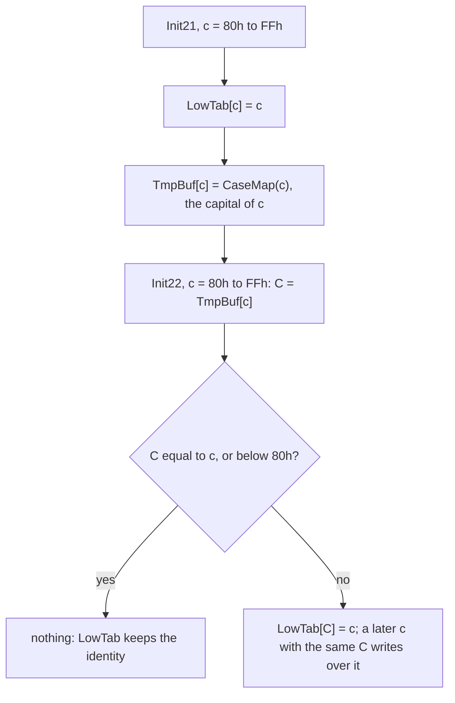
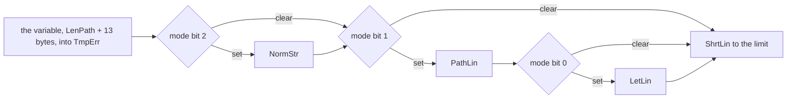

# 5. Numbers without DIV, names without strings: the program's arithmetic and text

Every screen of Volkov Commander is full of numbers and names. A panel
in full mode shows, for each file, a size of up to ten digits, a date
and a time in the order that the country of the machine wants; the
foot of the panel adds up what is selected, with commas; the viewer
says which column it is in and how far into the file; the Info panel
counts bytes and clusters. And every name that the program touches is
compared with a mask, cut to fit a box, put in capitals or in small
letters, or taken apart into a directory and a file.

None of that comes from a library. There is no `printf`, no `strcmp`,
no `toupper`, no `itoa`: the 8086 and DOS 3 give the program an
instruction that divides, a call that says where the country's
capitals are, and nothing else. This chapter is the small set of
routines that the program writes for itself instead, about 2,000 bytes
in all, most of them in `VCSUB1.INC` and `VCSUB2.INC`, and the habits
behind them: a 32-bit number is turned into digits by subtraction and
never by `DIV`; a percentage is a multiplication by adding and a
division by subtracting; a date is a 16-bit integer that is compared
as one; a file name is an eleven-byte record, not a string; and the
small letters of whatever code page the machine has are worked out from
DOS's capitals once, when the program starts.

The excerpts follow the book's convention: a comment with `;;` is the
book's, one with a single `;` is Volkov's. Cycle counts are the 8086's,
from Intel's tables, for instructions already in the queue; an 8088 at
4.77 MHz, which fetches a byte at a time, is slower, but in the same
proportions. The structures named here, `MainDat`, the panel's
`WCBdef` and the 24-byte `FILENT` of each file, are in
[chapter 1](01-the-program.md#the-main-data) and
[chapter 3](03-the-features.md#a-panel-wcbdef).

## The trouble with `DIV`

The 8086 has two divisions. `DIV r8` divides AX by a byte and leaves
the quotient in AL and the remainder in AH; `DIV r16` divides the
32 bits of DX:AX by a word and leaves the quotient in AX and the
remainder in DX. Both are slow, and both have a trap:

| Instruction | Cycles | What it does |
|---|---:|---|
| `DIV r8` | 80 to 90 | AX / r8: AL quotient, AH remainder |
| `DIV r16` | 144 to 162 | DX:AX / r16: AX quotient, DX remainder |
| `MUL r16` | 118 to 133 | AX * r16: DX:AX |
| `ADD`, `SUB`, `ADC`, `SBB` of two registers | 3 | |
| the same with a constant | 4 | |
| `INC r16` | 2 | |
| `Jcc`, taken / not taken | 16 / 4 | |
| `LOOP`, taken / not taken | 17 / 5 | |

**If the quotient does not fit its register, the processor raises
interrupt 0**, the "divide error", as for a division by zero. DOS's
handler of it prints `Divide overflow` and ends the program on the
spot: the panels, the data, the user's selection, gone. A file of
four gigabytes less one byte divided by ten is 429,496,729, which is
nine digits and 29 bits; `DIV r16` can give at most 65,535. So a
32-bit number cannot be turned into decimal by dividing it by ten with
one `DIV`.

There is a safe way, and Volkov knew it: divide the high word first,
with DX cleared, and then the remainder and the low word, so that each
quotient is a word. The Info panel does exactly that when it rounds a
file's size up to whole clusters (see
[below](#sums-that-do-not-overflow-and-the-cluster-multiply)). But a
decimal conversion done so costs two `DIV`s for every digit, some 330
cycles a digit, and gives the digits from the last one up, which then
have to be written backwards. For the numbers on the screen the
program does something else.

What it does follow is a rule that holds for all 24 `DIV`s of
`VC.COM`: **a `DIV` is used only where its quotient cannot overflow by
the size of what goes in.** Most of them divide an offset within a
segment, with DX cleared, by the size of an entry, to make an index of
a place in a list. `HexDec` divides a number below 100 by 10;
`PutTime` divides hours, below 32, by 12; `PutDate` divides a year
below 208 by 100; the editor and find file divide sizes of memory,
below a megabyte; the Info panel divides the high word by a cluster
size. Everywhere else, and above all where the number is any 32 bits,
it subtracts.

## `Number`: ten subtractions in a row

`Number` (127 bytes, with its two helpers `Numb10`, 21 bytes, and
`Numb20`, 22) writes the 32-bit number BX:CX in decimal at ES:DI.
It is called from 18 places: the panels, the Info panel, the viewer,
the editor, find file and the map of the memory. AL says how:

```asm
;-------------- Output number into buffer --------------
;			ES:DI - address of buffer
;			BX CX - number
;			   AL - mode: b0-coma, b1-spaces
```

Bit 0 asks for the thousands separator of the country, bit 1 for a
field of fixed width, with a space in the place of each leading zero
and of each separator that falls among them. The routine is a straight
line of ten powers of ten, high word in SI and low word in BP, with a
call between them that writes the separator:

```asm
Numb01:	MOV	DL,0			;; no digit written yet
	MOV	BP,0CA00h	; 1.000.000.000
	MOV	SI,3B9Ah		;; 3B9A CA00h
	CALL	Numb10			;; one digit
	CALL	Numb20			;; one separator
	MOV	BP,0E100h	;   100.000.000
	MOV	SI,5F5h
	CALL	Numb10
	...
	MOV	BP,86A0h	;       100.000
	MOV	SI,1
	CALL	Numb10
	MOV	BP,10000	;        10.000
	XOR	SI,SI			;; the high word is 0 from here on,
	CALL	Numb10			;; and stays: only BP changes
	MOV	BP,1000		;         1.000
	CALL	Numb10
	CALL	Numb20
	MOV	BP,100		;           100
	CALL	Numb10
	MOV	BP,10		;            10
	CALL	Numb10
	MOV	AL,'0'		;             1
	ADD	AL,CL			;; what is left is the last digit
	MOV	AH,0
	STOSW				;; the digit and the string's 0 at once
	DEC	DI			;; DI left on the 0, for the caller
```

`Numb10` is the whole of the arithmetic: it subtracts the power until
the number goes below zero, counting in AL, and adds it back once.

```asm
Numb10	PROC	NEAR
	MOV	AL,'0'-1		;; the digit, already in ASCII
Numb11:	INC	AX			;; one byte, where INC AL is two
	SUB	CX,BP			;; BX:CX -= SI:BP
	SBB	BX,SI
	JNC	Numb11			;; until it borrows
	ADD	CX,BP			;; one too many: add it back
	ADC	BX,SI
	CMP	AL,'0'
	JE	Numb21			;; a 0: into Numb20, below
	MOV	DL,1			;; a digit other than 0 has been seen
	STOSB
	RET
Numb10	ENDP

Numb20	PROC	NEAR
	TEST	DH,1			;; separators asked for?
	JZ	Numb23
	MOV	AL,ES:Country.Sep1000
Numb21:	OR	DL,DL			;; a 0 or a separator: before the
	JNZ	Numb22			;; first digit it is nothing, or a
	TEST	DH,2			;; space in a field of fixed width
	JZ	Numb23
	MOV	AL,' '
Numb22:	STOSB
Numb23:	RET
Numb20	ENDP
```

A leading zero and a leading separator are the same problem, a
character that must not appear before the first digit, and `Numb10`
jumps into the middle of `Numb20` to have it solved by the same six
instructions. DL says whether a digit has been written; DH is the mode.

Here is 1,234,567 in mode 3, commas and a fixed width, with the
country's separator a comma:

```
 power          SI:BP        passes  AL    DL  written   left in BX:CX
 1,000,000,000  3B9A:CA00h     1     '0'   0   ' '       1,234,567
   separator                               0   ' '
   100,000,000  05F5:E100h     1     '0'   0   ' '       1,234,567
    10,000,000  0098:9680h     1     '0'   0   ' '       1,234,567
     1,000,000  000F:4240h     2     '1'   1   '1'         234,567
   separator                               1   ','
       100,000  0001:86A0h     3     '2'   1   '2'          34,567
        10,000  0000:2710h     4     '3'   1   '3'           4,567
         1,000  0000:03E8h     5     '4'   1   '4'             567
   separator                               1   ','
           100  0000:0064h     6     '5'   1   '5'              67
            10  0000:000Ah     7     '6'   1   '6'               7
             1  (CL)                   '7'       '7', 0

 result: "    1,234,567"   13 characters, DI on the 0 behind them
```

A pass is one `SUB`/`SBB`; the last pass of each power is the one that
borrows and is undone. The same number in the four modes:

| Mode | 7 | 1,234,567 | 4,294,967,295 |
|---|---|---|---|
| 0, as it is | `7` | `1234567` | `4294967295` |
| 1, separators | `7` | `1,234,567` | `4,294,967,295` |
| 2, fixed width | `         7` | `   1234567` | `4294967295` |
| 3, both | `            7` | `    1,234,567` | `4,294,967,295` |

Mode 2 is always ten characters and mode 3 always thirteen, and the
first lines of `Number` keep it so when the country has no separator,
a 0 in `Sep1000`. Then bit 0 is cleared, and if the field is still of
fixed width, three spaces go first, for the three separators that will
not be written:

```asm
	MOV	DH,AL			;; DH: the mode, for Numb20
	CMP	ES:Country.Sep1000,0
	JNE	Numb01
	TEST	AL,1
	JZ	Numb01
	AND	DH,0FEh			;; no separator to write,
	JZ	Numb01
	MOV	AL,' '			;; but the field keeps its 13
	STOSB
	STOSB
	STOSB
```

That is what lets a caller pick digits out of the field by their
place, whatever the country: the viewer's percentage, below, takes the
last three characters at `TmpBuf+10`.

**The cost.** A digit d costs d + 1 passes of 8 cycles, with d taken
jumps of 16 and one not taken of 4, which is 24d + 12 cycles, and about
85 more for the call, the two loads of SI and BP, the addition back,
the test and the store. An average digit, 4.5, is some 190 cycles; a
digit 9, some 300. The largest number, 4,294,967,295, takes about
2,400 cycles with its separators and the pushes, half a millisecond at
4.77 MHz, and a size of a few kilobytes, mostly leading zeros, much
less. Two `DIV`s a digit would cost 330 cycles for every one of ten
digits, 9 included, and give them in the wrong order. Subtraction is
the cheaper way here, and the safe one.

### `TxtNum`: and back

The way back from text to a number needs no care about overflow of
`DIV`, only of the number, and `TxtNum` (49 bytes) multiplies by ten
with `MUL`, which cannot fault. It reads decimal digits at ES:SI into
a 16-bit number, and a number that grows past 65,535 sticks at it:

```asm
	PUSH	AX			;; the digit
	MOV	AX,10
	MUL	BX			;; DX:AX = 10 * the number so far
	MOV	BX,AX
	POP	AX
	OR	DX,DX			;; over 16 bits?
	JNE	TxtNm2
	CBW
	ADD	BX,AX			;; plus the digit
	JNC	TxtNm1			;; next digit, if no carry
TxtNm2:	MOV	BX,0FFFFh		;; too large: 65,535, and on
	JMP	TxtNm1
```

At the end it compares where it stopped with where it began, and the
carry flag says that no digit was found. 65,535 is no valid day, hour
or year, so the caller's range check refuses it as it refuses any
other wrong number: saturating is cheaper than reporting.

## `PutSize`: nine columns

In the full mode of a panel the size column is nine cells wide.
`PutSize` (85 bytes) fills it for one `FILENT`:

```asm
	TEST	BYTE PTR DS:[SI+13],10h	;; a directory?
	JZ	PutSz2
	MOV	DX,OFFSET UpDir		;; 10h,'UP--DIR',11h  "►UP--DIR◄"
	CMP	BYTE PTR DS:[SI],'.'	;; the entry ".."
	JE	PutSz1
	CMP	BYTE PTR DS:SizDir,0	;; sizes of directories counted?
	JNZ	PutSz2			;; then shown like a file's
	MOV	DX,OFFSET SubDir	;; 10h,'SUB-DIR',11h
PutSz1:	...				;; nine cells of it
PutSz2:	PUSH	DI
	MOV	CX,DS:[SI+18]		;; SizeF, low word
	MOV	BX,DS:[SI+20]		;; and high
	MOV	SI,OFFSET TmpBuf
	MOV	DI,SI
	MOV	AL,2			;; fixed width, no separators
	CALL	Number			;; ten characters
	MOV	DI,SI
	CMP	BYTE PTR ES:[SI],' '	;; a tenth digit?
	JE	PutSz3
	MOV	CX,10			;; then nine 9s, and a tenth that
	MOV	AL,'9'			;; is not shown
	REP	STOSB
PutSz3:	POP	DI
	INC	SI			;; the last nine of the ten
	MOV	CX,9
	CALL	MvsBwe			;; into the cells, in colour AH
```

The two texts are seven letters between `10h` and `11h`, characters
that the PC's font draws as triangles. `Number` is asked for ten
characters and the first is dropped; if it is not a space, the file
has a billion bytes or more and does not fit, and the column says
`999999999`. Such a file was possible on the largest disks of DOS,
and rare in 2000; it is the one place where the program shows a
number that is not the number.

`SzDtTm`, the 22 bytes that call `PutSize`, `PutDat0` and `PutTim0`
one after another, writes only the colour of the cell between two
columns, `INC DI` past the character and `STOSB` of AH, since the
column's line is already there.

## The selected files: a "K" by cutting text

The foot of a panel says how much is selected, as
`1,234,567 bytes in 3 selected files`. The sum is two `ADD`/`ADC`s per
file, and the line is built in `TmpBuf` from `Number` and one text,
`BytIn_S`, `' bytes in  selected files'`:

```asm
PtFs11:	MOV	DI,OFFSET TmpBuf
	PUSH	DI
	MOV	AL,1			;; separators, no fixed width
	CALL	Number			;; the bytes, BX:CX
	PUSH	CS
	POP	DS
	MOV	SI,OFFSET BytIn_S
	CMP	CX,1			;; exactly one byte?
	MOV	CX,6
	REP	MOVSB			;; " bytes"
	JNE	PtFs12			;; flags of the CMP: REP MOVSB keeps them
	OR	BX,BX
	JNE	PtFs12
	DEC	DI			;; " byte": the plural taken back
PtFs12:	MOV	CX,4
	REP	MOVSB			;; " in "
	...				;; the count of files, by Number,
					;; " selected files" and its "s" alike
```

The plural is one `DEC DI`: the "s" is written and then written over.
And when the line is longer than 36 characters, too long for the
panel, the program divides the bytes by a thousand without dividing:

```asm
	MOV	DI,SI			;; the start of the line
	MOV	CX,25
	MOV	AL,CS:BytIn_S[1]	;; 'b', of "bytes"
	REPNE	SCASB			;; find it
	DEC	DI
	DEC	DI			;; DI on the space in front of it
	PUSH	SI
	MOV	SI,DI			;; the rest of the line goes from here
	CMP	DS:Country.Sep1000,1	;; a separator? then no carry
	CMC				;; ... and now a carry
	SBB	DI,3			;; back 4 with a separator, 3 without
	MOV	AL,'K'
	STOSB				;; "1,234,567" becomes "1,234K"
	MOV	CX,40
	REP	MOVSB			;; and " bytes in 3 selected files" behind
```

The last three digits and their separator are cut off and a `K`
written over them: `1,234K bytes`. The `CMP`, `CMC`, `SBB` chooses
between 3 and 4 without a jump. It is a division by 1,000, rounded
down, done on the text, which is already in decimal; the K is a
thousand, not 1,024.

## Dates and times: two packed words

DOS keeps the time and the date of a file as two words, in the
directory entry and in the search record from which the program
copies them into each `FILENT`:

```
 the date, DateF at +16 of a FILENT

  bit  15 14 13 12 11 10  9 |  8  7  6  5 |  4  3  2  1  0
      +---------------------+-------------+----------------+
      |  year - 1980, 0-127 | month, 1-12 |   day, 1-31    |
      +---------------------+-------------+----------------+

 the time, TimeF at +14

  bit  15 14 13 12 11 | 10  9  8  7  6  5 |  4  3  2  1  0
      +---------------+-------------------+----------------+
      |  hour, 0-23   |   minute, 0-59    | second / 2     |
      +---------------+-------------------+----------------+

 16 October 2026  = 0101110 1010 10000   = 5D50h
 14:35:42         = 01110 100011 10101   = 7475h
```

Each field is a shift and a mask away, and each but the year is below
100, so `HexDec` (12 bytes) can make two digits of it with the small
`DIV`, whose quotient, a single digit, cannot overflow:

```asm
HexDec	PROC	NEAR
	PUSH	CX
	MOV	AH,0
	MOV	CL,10
	DIV	CL			;; AL = tens, AH = units
	ADD	AX,'00'			;; both in ASCII at once
	POP	CX
	RET				;; AX = two characters, in the order
HexDec	ENDP				;; that STOSW writes them
```

`ADD AX,'00'` makes both digits characters with one instruction, and
AX is then a word that `STOSW` writes in the order of reading: the
tens in AL go first.

### `PutDate`: three fields in the country's order

`PutDate` (72 bytes) takes the packed date in AX and hands back four
pairs of digits in four registers: the day, the month, the two digits
of the year, and the century.

```asm
PutDate	PROC	NEAR
	PUSH	AX
	AND	AX,WORD PTR 1Fh		;; the day
	CALL	HexDec
	MOV	DX,AX			;; DX = "dd"
	POP	AX
	MOV	CL,5
	SHR	AX,CL
	PUSH	AX
	AND	AX,WORD PTR 0Fh		;; the month
	CALL	HexDec
	MOV	BX,AX			;; BX = "mm"
	POP	AX
	MOV	CL,4
	SHR	AX,CL
	AND	AX,WORD PTR 7Fh		;; years since 1980
	ADD	AL,80			;; since 1900
	MOV	CL,100
	DIV	CL			;; AL = 0, 1 or 2; AH = the year in it
	MOV	CL,AH
	ADD	AL,19			;; the century: 19, 20 or 21
	CALL	HexDec
	XCHG	CX,AX			;; CX = "cc", AL = the year
	CALL	HexDec			;; AX = "yy"
```

The year is 1980 plus seven bits, 1980 to 2107. Adding 80 counts it
from 1900; dividing by 100 splits it into a century and two digits,
both small. 2026 is 46 + 80 = 126, 1 and 26: `"20"` and `"26"`.

Now the four registers have to be put in the order of the country,
which DOS's country record gives as a word, `DateFmt`: 0 for month,
day, year as in the United States, 1 for day, month, year as in
Europe, 2 for year, month, day as in Japan. The routine does it with
one comparison and at most three exchanges, and reads the flags of
that one comparison twice:

```asm
	CMP	ES:Country.DateFmt,1	;; 0, 1 or 2 against 1
	JE	PutDt1			;; Europe
	JB	PutDt2			;; USA
	XCHG	DX,AX			;; Japan only
PutDt1:	XCHG	DX,BX			;; Japan and Europe
PutDt2:	XCHG	CX,AX			;; all three
	JA	PutDt3			;; the flags of the CMP, still:
	CMP	BL,'0'			;; XCHG changes none. Not Japan:
	JNE	PutDt3			;; a 0 that begins the date
	MOV	BL,' '			;; becomes a space
PutDt3:	RET
PutDate	ENDP
```

The three entries fall into one another, each doing its part and the
next one's. What is where after each step:

```
                       BX       DX       CX       AX
 before the CMP        month    day      century  year
                                                         USA (0)     JB
 XCHG CX,AX            month    day      year     century  -> 10-16-26

                                                         Europe (1)  JE
 XCHG DX,BX            day      month    century  year
 XCHG CX,AX            day      month    year     century  -> 16-10-26

                                                         Japan (2)
 XCHG DX,AX            month    year     century  day
 XCHG DX,BX            year     month    century  day
 XCHG CX,AX            year     month    day      century  -> 26-10-16

 always:               first    second   third    the century
```

`XCHG` and `MOV` leave the flags alone, so the `JA` four instructions
after the `CMP` still knows whether the format was Japan's, and only
then is the first digit of the date, the tens of a month or a day,
blanked: June 16 is ` 6-16-00`, where a year's leading 0 stays.

`PutDat0` (43 bytes) writes BX, the country's separator, DX, the
separator and CX into the panel's cells, eight characters. `BufDate`
(31 bytes) writes the date with the year in four digits, for the
attributes dialog and find file, and it too goes by the flags of a
`CMP` that it makes once, through three stores, a `PUSH` and a `POP`:

```asm
BufDate	PROC	NEAR
	CMP	ES:Country.DateFmt,1
	JBE	BufDt1
	STOSW				;; Japan: the century first, "20"
BufDt1:	XCHG	AX,BX			;; the first field; BX = the century
	STOSW
	MOV	AL,ES:Country.DateSep
	STOSB
	PUSH	AX			;; the separator, for later
	MOV	AX,DX
	STOSW				;; the second field
	POP	AX
	STOSB
	JA	BufDt2			;; Japan: the century is out already
	MOV	AX,BX
	STOSW				;; the others: "20" before the year
BufDt2:	MOV	AX,CX
	STOSW				;; the third field
	RET
BufDate	ENDP
```

`10-16-2026`, `16-10-2026`, `2026-10-16`: the century goes in front of
whichever field is the year, by where `STOSW` is when it is written.

### `PutTime`: twelve hours by one `DIV`

`PutTime` (74 bytes) does the same for the time, and hands back the
hours in BX, the minutes in DX, the seconds, doubled back from DOS's
count of two, in AX, and in CH the letter that follows the time.

```asm
	AND	AX,WORD PTR 1Fh		;; the hour
	MOV	CH,' '			;; 24 hours: no letter
	CMP	ES:Country.TimeFmt,0	;; bit 0 of TimeFmt: 1 for 24 hours
	JNE	PutTm6
	MOV	CL,12
	DIV	CL			;; AL = 0 before noon, 1 after;
	OR	AH,AH			;; AH = the hour on the dial
	JNE	PutTm5
	MOV	AH,12			;; 0 o'clock is 12
PutTm5:	CMP	AL,0
	MOV	AL,AH			;; MOV keeps the flags of the CMP
	MOV	CH,'a'
	JE	PutTm6
	MOV	CH,'p'
PutTm6:	CALL	HexDec
	CMP	AL,'0'			;; a leading 0 of the hour
	JNE	PutTm7
	MOV	AL,' '			;; is a space
PutTm7:	XCHG	BX,AX			;; BX = hours, AX = seconds
	RET
```

14:35 is 14 / 12 = 1 and 2: ` 2:35p`. Noon is 1 and 0, so `12:00p`,
and midnight `12:00a`. `PutTim0` (50 bytes) writes the hours, the
country's `TimeSep`, the minutes and the letter; with no letter it
writes the space first, so that the column is six cells either way and
the minutes stand in the same place: `12:00p` or ` 14:35`. The panel
shows no seconds: the field holds only even ones anyway.

### The way back: the attributes dialog

Ctrl-A, the attributes dialog, lets the user type a new date and time
for a file, and `M30_60` (360 bytes) packs them. It reads three
numbers with `TxtNum`, each followed by the country's separator, puts
them in the order month, day, year with the same kind of exchange
chain the other way round, and checks them:

```asm
M30_63:	SUB	BX,1980			;; a year of four digits?
	JAE	M30_64
	ADD	BX,1980			;; no: two digits, 0 to 99
	CMP	BX,100
	JAE	M30_67			;; neither: wrong
	SUB	BL,80			;; 80 to 99 are 1980 to 1999
	JAE	M30_64
	ADD	BL,100			;; 0 to 79 are 2000 to 2079
M30_64:	CMP	BX,128			;; 1980 + 127 at the most
	JAE	M30_67
	CMP	CX,12			;; the month
	JA	M30_67
	CMP	CL,1
	JB	M30_67
	MOV	AX,CX			;; the days of the month:
	CMP	AL,7			;; 31 for an odd month up to July,
	JBE	M30_65			;; and for an even one from August
	INC	AX
M30_65:	AND	AL,1
	ADD	AL,30			;; 30 + 1 or 30 + 0
	CMP	CL,2			;; February:
	JNE	M30_66
	MOV	AL,28			;; 28,
	TEST	BL,3			;; 29 when the year since 1980
	JNZ	M30_66			;; divides by four
	INC	AX
M30_66:	CMP	DX,AX			;; the day, from 1 to that
	JA	M30_67
	OR	DX,DX
	JE	M30_67
	MOV	AL,CL			;; pack: month << 5,
	MOV	AH,0
	MOV	CL,5
	SHL	AX,CL
	SHL	BL,1			;; year << 9, which is << 1 of AH,
	ADD	AL,DL			;; + day
	ADD	AH,BL
	MOV	DS:AttrDat,AX
```

The days of a month are not a table: an odd month up to July has 31,
an even one from August on has 31, which is "the low bit of the month,
plus one from August, plus 30". And 1980 being a leap year, a year is
one when its seven bits end in two zeros. That makes 2100 a leap year,
which it is not; the field reaches it, and the dialog would take
29 February 2100.

The time is packed the same way, with an `a` or a `p` behind it taken
as twelve hours, 12 as 0, and a 24 in the 24-hour form as 0.

## Comparing directories: a date is an integer

The order of the fields in the packed date, year above month above
day, is the order of significance, so **two packed dates compare as
unsigned integers in the order of the calendar**, and so do two
times. Compare directories, in the Commands menu, needs nothing more.
`M49_10` (76 bytes) marks every file of a panel that the other panel
lacks or has older, and the menu's command calls it once for each
panel, exchanging them with `InvWCB` between:

```asm
M49_10	PROC	NEAR
	MOV	SI,OFFSET DskBuf	;; each FILENT of this panel
M49_11:	CMP	SI,DS:EndBuf
	JAE	M49_14
	TEST	BYTE PTR DS:[SI+13],10h	;; directories are left alone
	JNZ	M49_13
	...				;; the name into TmpBuf, InvWCB,
	CALL	FnFile			;; and look for it in the other panel
	MOV	AL,DS:[SI+13]		;; its attributes,
	MOV	BX,DS:[SI+14]		;; its time
	MOV	DX,DS:[SI+16]		;; and its date
	POP	SI
	POP	DS			;; back in this panel
	JNC	M49_12			;; not there: mark ours
	TEST	AL,10h			;; a directory of that name there:
	JNZ	M49_12			;; mark ours
	CMP	DX,DS:[SI+16]		;; the dates, as numbers
	JB	M49_12			;; theirs older: mark ours
	JA	M49_13			;; theirs newer: leave it
	CMP	BX,DS:[SI+14]		;; the same day: the times
	JAE	M49_13
M49_12:	OR	BYTE PTR DS:[SI+13],40h	;; selected
	MOV	CL,1			;; something differs
M49_13:	ADD	SI,SIZE FilEnt
	JMP	M49_11
M49_14:	RET
M49_10	ENDP
```

The date and the time together are a 32-bit number, date above time,
and the comparison is that of two 32-bit numbers, high word first,
the low word only when the high words are equal. The size is not
looked at: two files of the same name and time are the same file. When
neither call has marked anything, CL is still 0 and a box says so.

## Hex: `HexByt` and `HexCod`

The viewer's hex mode, the editor's and the map of the memory show
bytes in hex, written straight into the cells of `ScrBuf`, the
program's copy of the screen, where a character is followed by its
colour. `HexByt` (15 bytes) and `HexCod` (13) do it:

```asm
HexByt	PROC	NEAR
	PUSH	CX
	PUSH	AX
	MOV	CL,4
	SHR	AL,CL			;; the high nibble
	CALL	HexCod
	POP	AX			;; the low one
	CALL	HexCod
	POP	CX
	RET
HexByt	ENDP

HexCod	PROC	NEAR
	AND	AL,0Fh
	ADD	AL,'0'
	CMP	AL,'9'
	JBE	HexCd1
	ADD	AL,7			;; 'A' - '9' - 1: past :;<=>?@
HexCd1:	STOSB				;; the character,
	INC	DI			;; and over the colour, which stays
	RET
HexCod	ENDP
```

`INC DI` after `STOSB` steps over the colour byte of the cell, so the
digits go into the screen buffer with the colours already laid there,
and the caller needs no second pass. The viewer's offset at the left
of a hex line is a 32-bit number in CX:BX, and it is written as four
bytes, `CH`, `CL`, `BH`, `BL`, by four calls of `HexByt`: eight digits
without a loop.

## Percentages: a 32-bit divisor

A percentage divides by something that is 32 bits wide: the size of a
file. `DIV` cannot divide by more than 16 bits at all, so the program
does not try, and both percentages that it shows multiply by adding
and divide by subtracting.

### The copy's bar: `PerCent`

The copy box fills a bar in proportion to what has been read and
written against twice the size of the file. `PerCent` (125 bytes) is
shown in [chapter
2](03-the-features.md#the-bar-48-bit-arithmetic-without-mul): it adds
the 33-bit sum of read and written into 48 bits as many times as the
bar has cells, then subtracts twice the size until it borrows,
counting the cells to fill.

```
 read + written                 in DX:BX:AX, 33 bits
 x width:  ADD SI,AX / ADC DI,BX / ADC BP,DX / LOOP        26 cycles a cell
 / 2 x size: INC CX / SUB / SBB / SBB / JAE                27 cycles a cell
                                                           filled, + 1
```

The bar is as wide as the box's longest line, between 24 and 64 cells:
`DialBox` makes a box 12 cells wider than its longest line, and
`C20_00` makes the bar 12 cells narrower than the box. So `PerCent`
costs between some 1,300 and 3,500 cycles for the arithmetic, under a
millisecond at 4.77 MHz, after every piece of up to 32K that is read
or written, each of which takes the disk far longer.

### The viewer: `V25_00`

The viewer's status line shows the column and how far into the file
the top line is, in percent. `V25_00` (157 bytes) does both. The
column is a `Number` in mode 1; the percentage is the place of the
top line times 100 over the length of the file:

```asm
	XOR	DX,DX			; %
	XOR	SI,SI
	XOR	DI,DI
	MOV	AX,DS:ViOffset.Lo	;; where the window is in the file,
	MOV	BX,DS:ViOffset.Hi
	ADD	AX,DS:ViFirst		;; + where the top line is in it
	ADC	BX,SI
	MOV	CX,100
V25_02:	ADD	DX,AX			;; DI:SI:DX += BX:AX,
	ADC	SI,BX			;; a hundred times
	ADC	DI,0
	LOOP	V25_02
	MOV	AX,DS:ViLen.Lo		;; the length of the file
	MOV	BX,DS:ViLen.Hi
	MOV	CX,AX
	OR	CX,BX			;; an empty file: 0 %
	JE	V25_04
	MOV	CX,0FFFFh
V25_03:	INC	CX			;; count how many times it goes
	SUB	DX,AX
	SBB	SI,BX
	SBB	DI,0
	JNB	V25_03
V25_04:	XOR	BX,BX
	MOV	DI,OFFSET TmpBuf[0]
	MOV	AL,3			;; 13 characters, whatever the country
	CALL	Number
	MOV	SI,OFFSET TmpBuf[10]	;; the last three: "  7", " 42"
	MOV	BX,75
	CALL	MovDz			;; at column 75 of the status line
```

The multiplication is 100 rounds of 27 cycles, 2,700; the division is
at most 101 rounds of 28, 2,828. With the two `Number`s, the
percentage costs some 8,000 cycles, under two milliseconds, every time
the viewer's window moves. Mode 3 is chosen for its width: with or
without a country's separator, `Number` writes 13 characters, so the
hundreds, tens and units are always at 10, 11 and 12.

The percentage of the *top* line never reaches 100 while the end of
the file is on the screen below it. `V40_00` (76 bytes) mends that: when
what is loaded reaches the end of the file, it sets `Vi100pc` and pokes
three characters into the status line in `ScrBuf`, no arithmetic at
all:

```asm
V40_01:	MOV	DS:Vi100pc,1		;; the end is on the screen
	CMP	DS:ViStatus,0
	JZ	V40_02
	MOV	BYTE PTR DS:ScrBuf[2*75],'1'
	MOV	BYTE PTR DS:ScrBuf[2*76],'0'
	MOV	BYTE PTR DS:ScrBuf[2*77],'0'
	MOV	BX,75
	MOV	DX,103h			;; one row of three cells
	CALL	Window			;; to the screen
```

`Vi100pc` is also what Down, PgDn and End test before they move: at
100 percent there is nothing below.

## Sums that do not overflow, and the cluster multiply

### `DiSi10`: a sum that sticks at the top

The size of a directory, which the panel shows in place of `►SUB-DIR◄`
once it has been counted, is the sum of every file in it and below it.
`DiSi10` (60 bytes) is the routine that `DirFunc` calls for each file,
and it adds the file's size from the DTA into a 32-bit sum at
`TmpBuf+90`. A sum past four gigabytes would wrap round and show a
small number, so it sticks at the largest instead:

```asm
DiSi11:	MOV	AX,ES:DTA.FilSize.Lo
	MOV	BX,ES:DTA.FilSize.Hi
	ADD	AX,WORD PTR ES:[TmpBuf+90]
	ADC	BX,WORD PTR ES:[TmpBuf+92]
	JNC	DiSi12			;; no carry out of 32 bits
	MOV	AX,0FFFFh		;; or 4,294,967,295
	MOV	BX,0FFFFh
DiSi12:	MOV	WORD PTR ES:[TmpBuf+90],AX
	MOV	WORD PTR ES:[TmpBuf+92],BX
```

A saturating add is the carry and two moves. The sum of the selected
files at the foot of the panel has no such care, and wraps.

### `RdInfo` and the Info panel: bytes per cluster

DOS's call 36h, "free disk space", answers in four registers: sectors
per cluster in AX, free clusters in BX, bytes per sector in CX and all
clusters in DX. `RdInfo` keeps the clusters as they are, and the size
of a cluster as one 16-bit product:

```asm
	MOV	AH,36h
	CALL	Intr21
	...
	MOV	DS:Total,DX		;; clusters on the disk
	MOV	DS:FreeDsk,BX		;; free clusters
	MUL	CX			;; sectors x bytes: DX:AX
	MOV	DS:ClstSiz,AX		;; DX dropped
```

A cluster under DOS is at most 32K, so the low word holds it and DX is
0; a cluster of 64K, which DOS does not make, would read as 0. The Info
panel then shows the room of the disk as one `MUL` of a cluster count
by `ClstSiz`, 16 by 16 bits to 32, which cannot overflow, in `PtIn21`:

```asm
PtIn21:	PUSH	BX
	PUSH	DX
	MUL	ES:ClstSiz		;; clusters x bytes = DX:AX bytes
	MOV	BX,DX
	...
	MOV	CX,AX
	MOV	DI,OFFSET TmpErr+1
	MOV	AL,1
	CALL	Number			;; "1,234,567"
```

The Info panel's other figure, how much the files of the directory
take on the disk, rounds each file's size up to whole clusters, and
that is the one place where the program divides a 32-bit number that
nothing bounds, by the two-step division of the first section:

```asm
	MOV	CX,ES:ClstSiz
	CMP	CX,1
	JBE	PtIn04			;; no cluster size: the bytes as they are
	PUSH	AX			;; DX:AX = the size of the file
	MOV	AX,DX
	XOR	DX,DX
	DIV	CX			;; the high word / cluster: cannot overflow
	PUSH	DX			;; its remainder
	MUL	CX
	ADD	BX,AX			;; the high word of the total, rounded down
	POP	DX
	POP	AX			;; remainder : low word,
	DIV	CX			;; which is below the cluster x 65,536
	OR	DX,DX
	JE	PtIn03
	INC	AX			;; a part of a cluster is a cluster
PtIn03:	MUL	CX			;; back to bytes
PtIn04:	...				;; and added into the total
```

Every quotient fits a word by construction: the first because DX is
0, the second because what is divided is less than the divisor times
65,536.

When a copy finds the target disk full, `C20_50` asks 36h again and
multiplies the same three numbers in the other order, `MUL CX` and
then `MUL BX`, to learn how many bytes are free. If the answer is less
than the piece it was writing, it writes that many, so that the disk is
filled to the last cluster before the user is asked for another one.
With 64K or more free, DX is not 0, and with as much as the piece,
there is nothing to fill and nothing more is written.

## Names: the eleven-character form

DOS keeps a file's name in a directory as eleven bytes, eight of name
and three of extension, padded with spaces, in capitals, with no dot.
The FCB calls of DOS 1 took names in the same form. The program
borrows it for everything that matches names with wildcards: in that
form a name has a fixed length, every character has a fixed place,
and `*` is no longer a special case, because it can be spelled out as
the `?`s it stands for.

```
 byte of the form    0 1 2 3 4 5 6 7   8 9 10
                    +-----------------+--------+
 readme.txt         |R E A D M E      |T X T   |
 a*b.txt            |A ? ? ? ? ? ? ?  |T X T   |
 *.*                |? ? ? ? ? ? ? ?  |? ? ?   |
 makefile           |M A K E F I L E  |        |
                    +-----------------+--------+
                      the name, 8       the extension, 3
```

### `Convert` and `Conv10`

`Convert` (36 bytes) and `Conv10` (30) make the form, from the name at
DS:SI into eleven bytes at ES:DI:

```asm
Convert	PROC	NEAR
	...
	MOV	CX,8
	MOV	AH,'.'			;; the name ends at a dot or a 0
	CALL	Conv10
Conv01:	LODSB				;; skip what is left of the name,
	CMP	AL,'.'			;; past the dot
	JE	Conv02
	CMP	AL,0
	JNE	Conv01
	DEC	SI			;; or stop on the 0
Conv02:	MOV	CX,3
	MOV	AH,0			;; the extension ends at a 0 only
	CALL	Conv10
	...
Convert	ENDP

Conv10	PROC	NEAR
	LODSB
	CMP	AL,0
	JE	Conv11			;; the end: spaces for the rest
	CMP	AL,AH
	JE	Conv11
	CMP	AL,'*'
	JE	Conv12			;; a star: '?' for the rest
	CALL	UpCase
	STOSB
	LOOP	Conv10
	RET
Conv11:	MOV	AL,' '
	JMP	Conv13
Conv12:	MOV	AL,'?'
Conv13:	REP	STOSB			;; CX of them
	DEC	SI			;; and give back what ended it
	RET
Conv10	ENDP
```

One routine does both parts, with the count in CX and what ends the
part in AH. A `*` fills the rest of its part with `?` and ends it, and
`Conv01` then skips whatever follows up to the dot, so `a*b.txt` is
`a*.txt`, as it is to DOS. A name longer than eight letters is cut at
eight, an extension at three; a second dot is a character of the
extension.

| As written | Converted | Back by `UnConv` |
|---|---|---|
| `readme.txt` | `README  TXT` | `README.TXT` |
| `makefile` | `MAKEFILE   ` | `MAKEFILE` |
| `x.c` | `X       C  ` | `X.C` |
| `*.txt` | `????????TXT` | |
| `a*b.txt` | `A???????TXT` | |
| `*.*` | `???????????` | |
| `*` or `*.` | `????????   ` | |
| `longfilename.text` | `LONGFILETEX` | `LONGFILE.TEX` |
| `a.b.c` | `A       B.C` | `A.B.C` |
| `.` and `..` | eleven spaces | |

The last line is why every loop that converts the names of a panel
skips the entries that begin with a dot first.

### `UnConv` and `UnCnv1`: the dot that is not there

`UnConv` (28 bytes) and `UnCnv1` (13) turn eleven bytes back into a
name with a dot and a 0. The spaces must go, those inside a name too,
and the dot too when there is no extension; the routine does all three
with one register, BX, that remembers the place behind the last
character that was not a space:

```asm
UnConv	PROC	NEAR
	...
	MOV	BX,DI			;; nothing written yet
	MOV	CX,8
	CALL	UnCnv1			;; the name; DI = BX behind it
	MOV	AL,'.'
	STOSB				;; a dot, always,
	MOV	CX,3
	CALL	UnCnv1			;; the extension
	MOV	BYTE PTR ES:[DI],0	;; and the 0, where DI is left
	...
UnConv	ENDP

UnCnv1	PROC	NEAR
	LODSB
	STOSB				;; copy every byte, spaces too
	CMP	AL,' '
	JE	UnCnv2
	MOV	BX,DI			;; behind the last non-space
UnCnv2:	LOOP	UnCnv1
	MOV	DI,BX			;; back there: the spaces go
	RET
UnCnv1	ENDP
```

Every byte is copied, and at the end DI goes back to BX. After the
name that drops its trailing spaces. After the extension, if the
extension is all spaces, BX has not moved since the name, so DI goes
back to *before the dot*, and the 0 is written over it: the dot
vanishes without being tested for.

```
 README  BAK  ->  R E A D M E . B A K 0       BX behind K
 MAKEFILE     ->  M A K E F I L E . 0         BX behind E, the dot
                                    ^            under the 0
```

The same trick, a register on the last non-space and a jump back to
it, is in `NormStr`, below, and in `GetVol`, which joins a volume
label, that DOS returns as a name with a dot in the middle, `SYSTEM
D.ISK`, back into its eleven characters with `Convert` and drops its
trailing spaces.

### `TstMas`: eleven comparisons

`TstMas` (38 bytes) says whether a name matches a mask that has been
converted already. It converts the name into `TmpBuf+20` and compares
the two eleven bytes:

```asm
	MOV	DI,OFFSET TmpBuf+20
	PUSH	DI
	CALL	Convert			;; the name, DS:SI
	POP	DI
	POP	SI			;; the mask, converted by the caller
	MOV	CX,11
TstMs1:	LODS	ES:Byt
	CMP	AL,'?'
	JNE	TstMs2
	INC	DI			;; '?' takes any byte: skip it
	JMP	TstMs3
TstMs2:	SCASB				;; anything else must be the same
	CLC
	JNE	TstMs4			;; no
TstMs3:	LOOP	TstMs1
	STC				;; yes
```

A `?` matches a space too, so `A?.TXT` matches `A.TXT` and `AB.TXT`,
as in DOS. The filter of a panel, `SetMask` in
[chapter 3](03-the-features.md#the-filter-setmask), and Grey + and
Grey -, which select by a mask, convert the mask once and call
`TstMas` for every file. Each call converts the name again, with an
`UpCase` for each of its characters, which is a far call into DOS (see
below): a panel of a thousand files costs some ten thousand of them.

### Copying `*.txt` to `*.bak`

A target with wildcards is the same machinery once more, in `C00_00`
of the copy. The mask that the user typed and the name of the file
being copied are both converted, and each `?` of the mask takes the
character of the name at the same place:

```asm
	MOV	CX,11
C00_16:	CMP	BYTE PTR DS:[SI],'?'	;; SI: the mask, at TmpErr
	JNE	C00_17
	MOV	AL,DS:[DI]		;; DI: the source's name, TmpErr+20
	MOV	DS:[SI],AL
C00_17:	INC	SI
	INC	DI
	LOOP	C00_16
	POP	SI
	MOV	DI,BX
	CALL	UnConv			;; and back into a name
```

```
 the mask        *.bak     ->  ? ? ? ? ? ? ? ? | B A K
 the source   readme.txt   ->  R E A D M E     | T X T
                               -------------------------
 the target                    R E A D M E     | B A K   ->  README.BAK

 the mask       ??x*.*     ->  ? ? X ? ? ? ? ? | ? ? ?
 the source  letter1.txt   ->  L E T T E R 1   | T X T
 the target                    L E X T E R 1   | T X T   ->  LEXTER1.TXT

 the mask          *.      ->  ? ? ? ? ? ? ? ? |
 the source     data.txt   ->  D A T A         | T X T
 the target                    D A T A         |         ->  DATA
```

Eleven byte comparisons rename a file by a mask, with DOS's own
rules, since they are the rules of the form. Make directory uses the
pair the other way: the name typed is converted and converted back,
`Convert` then `UnConv`, so that `longdirname` becomes `LONGDIRN`
before DOS is asked, and the program goes on with the name that DOS
will have, not the one typed.

## Upper and lower case

### `UpCase`: DOS's routine, for every byte

A letter above 7Fh has a capital that depends on the code page. DOS
knows it: its country record, which call 3800h copies into
`Country` in the main data at the start, holds at offset 12h the far
address of a routine, the *case map*, that takes a character in AL and
returns its capital, for 80h to FFh. `UpCase` (16 bytes) does the
ASCII letters itself and hands every byte to DOS:

```asm
UpCase	PROC	NEAR
	CMP	AL,'a'
	JB	UpCas1
	CMP	AL,'z'
	JA	UpCas1
	SUB	AL,20h			;; a to z
UpCas1:	CALL	ES:Country.CaseMap	;; and everything to DOS, which
	RET				;; changes only 80h and above
UpCase	ENDP
```

The far call is made for every byte, an ASCII letter too, which saves
a comparison in the routine and costs a far call and return, some 60
cycles and DOS's own few instructions, each time. It is called from 27
places: the search of the viewer, the letters of the markup that
`NgLine` and `LnStr` take in either case, the comparison of names, the
command line's completion from the history, and each character of
`Convert`. That is what makes the viewer's search find Russian text in
either case on a Russian DOS ([the viewer and the
editor](04-the-viewer-and-editor.md#comparing-v82_00)), with no Russian in
the program.

### `LowCase` and `LowTab`: inverted once

DOS has no routine for small letters. `LowCase` (27 bytes) does the
ASCII ones by adding 20h, and the others from a table of 128 bytes in
the main data, `LowTab`, at 0C29h:

```asm
LowCase	PROC	NEAR
	CMP	AL,'A'
	JB	LoCas2
	CMP	AL,'Z'
	JA	LoCas1
	ADD	AL,20h			;; A to Z
	RET
LoCas1:	CMP	AL,80h
	JB	LoCas2			;; other ASCII: as it is
	PUSH	BX
	MOV	BL,AL
	MOV	BH,0
	MOV	AL,ES:LowTab[BX-128]	;; 80h to FFh: the table
	POP	BX
LoCas2:	RET
LowCase	ENDP
```

The table is made at the start, in `VC.ASM`, by inverting DOS's case
map, in two loops of 128:

```asm
	MOV	DX,OFFSET Country	; Country
	MOV	AX,3800h		;; the country record, with CaseMap
	INT	21h
	MOV	DI,OFFSET TmpBuf	; Lower case table
	MOV	SI,OFFSET LowTab
	MOV	CX,80h
	PUSH	DI
	PUSH	CX
Init21:	MOV	AL,CL			;; CL counts 80h, 7Fh, ... 1,
	NEG	AL			;; and -CL is 80h, 81h, ... FFh
	MOV	DS:[SI],AL		;; LowTab[c] = c, for a start
	INC	SI
	CALL	DS:Country.CaseMap	;; and TmpBuf[c] = its capital
	STOSB
	LOOP	Init21
	POP	CX
	POP	SI			;; SI on TmpBuf
	MOV	BH,0
	MOV	AH,80h			;; c, from 80h up
Init22:	LODSB				;; AL = the capital of c
	CMP	AL,AH
	JE	Init23			;; c is its own capital: nothing
	CMP	AL,80h
	JB	Init23			;; a capital in ASCII: nothing
	MOV	BL,AL
	MOV	DS:LowTab[BX-128],AH	;; the small letter of that capital
Init23:	INC	AH			;; is c
	LOOP	Init22
```

Both tables are indexed from 80h. `NEG AL` makes the loop's count,
falling from 80h to 1, into the character, rising from 80h to FFh, so
one register serves for both and the table is filled upwards with the
identity. The second loop then
turns every pair "c has the capital C" into "C has the small letter
c". Where two small letters above 80h have the same capital, the
higher one wins, being written last; a small letter whose capital is
in ASCII, as `â` whose capital in DOS's table for code page 437 is
`A`, leaves nothing, since `LowCase` of `A` is `a` by the first lines
of the routine.



On a Russian DOS, with code page 866, the case map takes the small
letters `а` to `п` at A0h to AFh to 80h to 8Fh, `р` to `я` at E0h to
EFh to 90h to 9Fh, and on a DOS whose table has it `ё`, F1h, to `Ё`,
F0h. The table comes out so:

```
 LowTab index   the byte      Init21 put   Init22 puts      LowCase gives
 00h-0Fh        80h-8Fh  А-П   80h-8Fh      A0h-AFh          а-п
 10h-1Fh        90h-9Fh  Р-Я   90h-9Fh      E0h-EFh          р-я
 20h-2Fh        A0h-AFh  а-п   A0h-AFh      -                а-п
 30h-5Fh        B0h-DFh  ─│┌…  B0h-DFh      -                the same
 60h-6Fh        E0h-EFh  р-я   E0h-EFh      -                р-я
 70h            F0h      Ё     F0h          F1h              ё
 71h-7Fh        F1h-FFh        F1h-FFh      -                the same
```

On an American DOS with code page 437 the same 256 calls give `ü` for
`Ü`, `ä` for `Ä`, `é` for `É`, `ñ` for `Ñ` and so on, and nothing for
the box-drawing characters, which DOS leaves alone. The table costs
128 bytes of the main data and a few milliseconds once, 128 far calls
into DOS; `LowCase` then costs a load.

### Where the case is used

The panels show the names of files in small letters and those of
directories in capitals: `ReDir` makes them so as it reads, once, with
`LowCase` for each of the 13 bytes of a name whose attributes have no
directory bit, so that drawing a panel is a plain copy. The masks and
the comparisons put them back into capitals with `UpCase`. The
extension file's patterns are compared with `LowCase` of each of their
characters, since the names they are compared with are small already.

## Paths on the screen

A path in DOS is up to 67 characters and a name up to 12; a box has
the room it has. Six short routines of `VCSUB1.INC`, 186 bytes in all,
cut and shape them.

| Routine | Bytes | What it does to the string |
|---|---:|---|
| `CutPath` | 22 | SI to the file's name: behind the last `:` or `\` |
| `NormStr` | 34 | spaces at the front and at the end taken off, in place |
| `PathLin` | 18 | every character by `UpCase`, in place |
| `LetLin` | 28 | `PathLin`, then the name's part by `LowCase` |
| `ShrtLin` | 61 | cut to AX characters, with `...` in the middle |
| `MainFil` | 23 | the program's own directory and a file name |

`CutPath` is a loop that resets a register at every separator:

```asm
CutPath	PROC	NEAR
	PUSH	BX
	PUSH	AX
CutPt1:	MOV	BX,SI			;; a name may start here
CutPt2:	LODSB
	CMP	AL,':'
	JE	CutPt1
	CMP	AL,'\'
	JE	CutPt1
	CMP	AL,0
	JNE	CutPt2
	MOV	SI,BX			;; the last place that one could
	POP	AX
	POP	BX
	RET
CutPath	ENDP
```

It is called from 39 places, most of them to put a file's name behind
a directory, or to show it alone. `NormStr` keeps the place behind the
last non-space in BX as `UnCnv1` does; `LetLin` is `PathLin` and then
`CutPath` and `LowCase` on what follows, which makes
`C:\WORK\README.TXT` into `C:\WORK\readme.txt`, the form in which the
copy box names a file.

`ShrtLin` makes a long path fit by taking out its middle and keeping
its drive, its first backslash and as much of the end as fits:

```asm
	MOV	DI,SI
	MOV	CX,256
	MOV	AL,0
	REPNE	SCASB			;; find the 0
	DEC	DI
	SUB	DI,SI			;; the length
	POP	CX			;; the limit
	SUB	DI,CX			;; how much too long
	JBE	ShtLn3			;; it fits: nothing to do
	PUSH	ES
	POP	DS
	XCHG	SI,DI			;; DI the start, SI the excess
	CMP	BYTE PTR DS:[DI+1],':'	;; keep "C:"
	JNE	ShtLn1
	INC	DI
	INC	DI
	DEC	CX
	DEC	CX
ShtLn1:	CMP	BYTE PTR DS:[DI],'\'	;; and the "\" of the root
	JNE	ShtLn2
	INC	DI
	DEC	CX
ShtLn2:	MOV	AL,'.'
	STOSB
	STOSB
	STOSB				;; "..."
	DEC	CX
	DEC	CX			;; limit - kept - 3, + 1 for the 0
	ADD	SI,DI			;; from the excess on behind the dots
	REP	MOVSB			;; the end, with its 0, moved down
```

The string is shortened where it is. The source of the move is the
destination plus the excess, so the end of the path slides left by
exactly what is too much, and the count, one more than the characters
that are left, takes the 0 along:

```
 limit 20      C:\DOCS\PROJECTS\REPORTS\JUNE.TXT        33 characters
               \_/\______________/\____________/
               kept  16 taken out    14 kept: 20 - 3 - 3
 result        C:\...PORTS\JUNE.TXT                     20 characters
                  \_/
                  3 dots in place of 16: the excess, 13, and 3
```

These routines meet in `DiBx30`, which puts a variable into a box for
`DialBox` ([chapter
1](02-the-screen.md#a-box-is-a-table-dialbox-and-ngline)). The
box's table has, for each of its two variables, a byte of mode and a
byte of limit, `DB 7, 64` in the copy box, and the mode's bits choose
the routines:

```asm
DiBx30	PROC	NEAR			; Convert variable
	MOV	SI,CS:[BP]		;; the variable's address
	MOV	CX,LenPath+13
	PUSH	CX
	PUSH	DI
	REP	MOVSB			;; copied into TmpErr
	POP	SI
	POP	CX
	MOV	AL,CS:[BP+2]		;; the mode
	TEST	AL,4
	JZ	DiBx31
	CALL	NormStr			;; 4: no outer spaces
DiBx31:	TEST	AL,2
	JZ	DiBx32
	CALL	PathLin			;; 2: capitals
	TEST	AL,1
	JZ	DiBx32
	CALL	LetLin			;; 2 + 1: and the name in small letters
DiBx32:	MOV	AL,CS:[BP+3]		;; the limit
	CBW
	CALL	ShrtLin			;; always
	RET
DiBx30	ENDP
```



So a box says in two bytes how its text is to look, and no routine
that opens a box shapes the text itself.

`MainFil` builds the path of one of the program's own files, `VC.HLP`,
`VC.MNU`, `VC.EXT` or `VC.INI`, from `NcPath`, the directory that
`VC.COM` was started from, which the start finds in its environment.
It copies the directory with `MvzLine` and then 13 bytes of the name,
whatever the name's length: a shorter name takes the bytes that
follow it in the file along, behind its 0, where they do no harm.

## Word separators

Ctrl-Left and Ctrl-Right go by words in the command line, the input
lines of the boxes and the editor, Ctrl-Backspace and Ctrl-T delete a
word, and Ctrl-Enter on the command line puts in the name of the file
under the cursor when the character in front of the cursor ends a
word or the line is empty, and otherwise completes what is typed from
the history. What ends a word is one table of ten bytes and one
search:

```asm
CtEn_T	DB	' +:.,><|\',9		;; space + : . , > < | \ and a tab

CmpSym	PROC	NEAR
	PUSH	ES
	PUSH	DI
	PUSH	CX
	PUSH	CS
	POP	ES
	MOV	DI,OFFSET CtEn_T
	MOV	CX,10
	REPNE	SCASB			;; ZF set: AL is a separator
	POP	CX
	POP	DI
	POP	ES
	RET
CmpSym	ENDP
```

`CmpSym` (17 bytes) answers in the zero flag, which `REPNE SCASB`
leaves set when it has found the byte and clear when the ten bytes
ran out on a byte that differed. The separators are those of a DOS
command line and its paths: the dot and the backslash, so that a word
is a part of a name, and the redirections. A movement by words is then
two loops, one over separators and one over the rest:

```asm
EdSub2	PROC	NEAR			;; Ctrl-Right in an input line
	ADD	DI,DX
	MOV	SI,DI
ES2_01:	CMP	BYTE PTR ES:[SI],0
	JE	ES2_03
	INC	SI
	INC	DX
	MOV	AL,ES:[SI]
	CALL	CmpSym
	JE	ES2_01			;; past the separators,
ES2_02:	CMP	BYTE PTR ES:[SI],0
	JE	ES2_03
	INC	SI
	INC	DX
	MOV	AL,ES:[SI]
	CALL	CmpSym
	JNE	ES2_02			;; then past the word
ES2_03:	CMP	SI,DI
	RET
EdSub2	ENDP
```

`EdSub1` is the same backwards, and the editor's `T55_00` the same
with its own end of line. The setup program has its own copy of
`CmpSym` and its table, as it has of `UpCase`, `LowCase`, the path
routines and `HexDec`
([chapter 7](07-the-setup.md#what-it-shares-with-vccom-by-copy)).

## One binary for CP437 and CP866

The same `VC.COM` runs on an American DOS with code page 437 and on a
Russian one with code page 866, and shows the right frames and the
right letters on both. Nothing in it asks which code page there is.
It works because of where the two code pages agree, and because what
they disagree on is asked of DOS.

```
        0-7Fh      80h-AFh      B0h-DFh        E0h-EFh     F0h-FFh
 437    ASCII      accented     frames,        Greek,      ≡ ± ≥ ≤ ⌠ ⌡ ÷ ≈
                   Latin        shades,        maths        ° ∙ · √ ⁿ ² ■
                                blocks
 866    ASCII      А-Я а-п      frames,        р-я         Ё ё Є є Ї ї Ў ў
                                shades,                     ° ∙ · √ № ¤ ■
                                blocks
                                (the same)                  F8h-FBh, FEh
                                                            the same
```

The code page 866 of Russian DOS put the Cyrillic letters at 80h to
AFh and E0h to F1h and kept code page 437's frames, shades and blocks
at B0h to DFh in their places, so that programs written for American
DOS would draw their boxes. Volkov's program takes every character
that it draws from those places. Read out of the texts and tables of
the source, the bytes above 7Fh that it puts on the screen are the
frames, shades and blocks of B0h to DFh, which
[chapter 2](02-the-screen.md#the-characters) lists with what each is
used for, and four more: F9h `∙` and FAh `·`, the blanker's stars, FBh
`√`, the tick of a menu's item and the mouse's pointer, and FEh `■`,
the pointer on the corner that switches the panels. Those four are
among F8h to FBh and FEh, where the two code pages are the same too.
Below 20h, the pictures that the PC's font has for the control codes,
`►` and `◄` around `UP--DIR` among them, are alike in both. Every text
of the program is in English, in ASCII.

What differs, DOS answers: the capitals of 80h to FFh through the case
map, the small letters from it through `LowTab`, and the separators,
the order of the date and the 12- or 24-hour clock from the same
country record, all read once at the start. The masks and the search
of the viewer go through `UpCase` and so are right in either. A user
who types Russian into a box puts in bytes that the program copies and
shows without looking at them.

## What it adds up to

| Routine | Bytes | Instead of |
|---|---:|---|
| `Number`, `Numb10`, `Numb20` | 170 | a division per digit, that would fault on a 32-bit number |
| `PutSize`, `SzDtTm` | 107 | |
| `PutDate`, `BufDate`, `PutDat0` | 146 | a table of formats |
| `PutTime`, `BufTime`, `PutTim0` | 144 | |
| `M30_60`, the date and time typed | 360 | a table of the days of the months |
| `HexDec` | 12 | |
| `PtFs11` to `PtFs14`, the selected files | 101 | a second text for one, and a division by 1,000 |
| `TxtNum` | 49 | an error path for a number too large |
| `HexByt`, `HexCod` | 28 | a second pass for the colours |
| `M49_10` | 76 | unpacking dates to compare them |
| `V25_00` | 157 | a 48-by-32-bit division |
| `V40_00` | 76 | |
| `PerCent` | 125 | `MUL` and `DIV` of 48 bits |
| `DiSi10` | 60 | |
| `Convert`, `Conv10` | 66 | a pattern matcher |
| `UnConv`, `UnCnv1` | 41 | a test for an empty extension |
| `TstMas` | 38 | |
| `UpCase`, `LowCase` | 43 | tables of the code page in the program |
| `Init21`, `Init22` | 50 | 128 bytes of `LowTab` in the file, for one code page |
| `CutPath`, `NormStr`, `PathLin`, `LetLin`, `ShrtLin`, `MainFil` | 186 | |
| `CmpSym`, `CtEn_T` | 27 | |

About 2,060 bytes, 3 percent of `VC.COM`, for every number, date,
name and path that it shows or compares. The pattern of the program is
here too: what DOS knows, the case of a letter, the format of a date,
the separator of thousands, DOS is asked; and a form that DOS already
uses, the packed date and the eleven-byte name, is used as it is,
because in that form the hard part has already been done.

## Where to read next

- `src/asm/VCSUB1.INC`: `UpCase` to `TstMas`, one block from `StrLen`
  on, `Number` in the middle of it.
- `src/asm/VCSUB2.INC`: `SzDtTm` to `HexDec` for the columns of a
  panel, `CmpSym` with `EdSub1` and `EdSub2`, and `SetMask` for the
  filter.
- `src/asm/VC.ASM`: `Init21` and `Init22`, after the cursor is set at
  the start, and the `CNTRY` structure near the top.
- `src/asm/VCSUB3.INC`: `PutFls` for the selected files, `RdInfo` and
  `PtIn20` for the Info panel, `DiSi10` and `GetVol`.
- `src/asm/VCVIEW.INC`: `V25_00`, `V40_00`; `src/asm/VCMENU.INC`:
  `M49_00`; `src/asm/VCF1.INC`: `M30_50` and `M30_60`;
  `src/asm/VCCOPY.INC`: `C00_13` to `C00_19`, `C20_50` and `PerCent`.
- [Chapter 1](01-the-program.md) for the main data, `ScrBuf` and
  `DialBox`; [chapter 3](03-the-features.md) for the panels, the
  filter, the copy and the viewer that use these routines;
  [chapter 6](06-the-system.md) for `Intr21` and the rest of what is
  asked of DOS; and [chapter 7](07-the-setup.md) for the setup
  program's copies of them.
