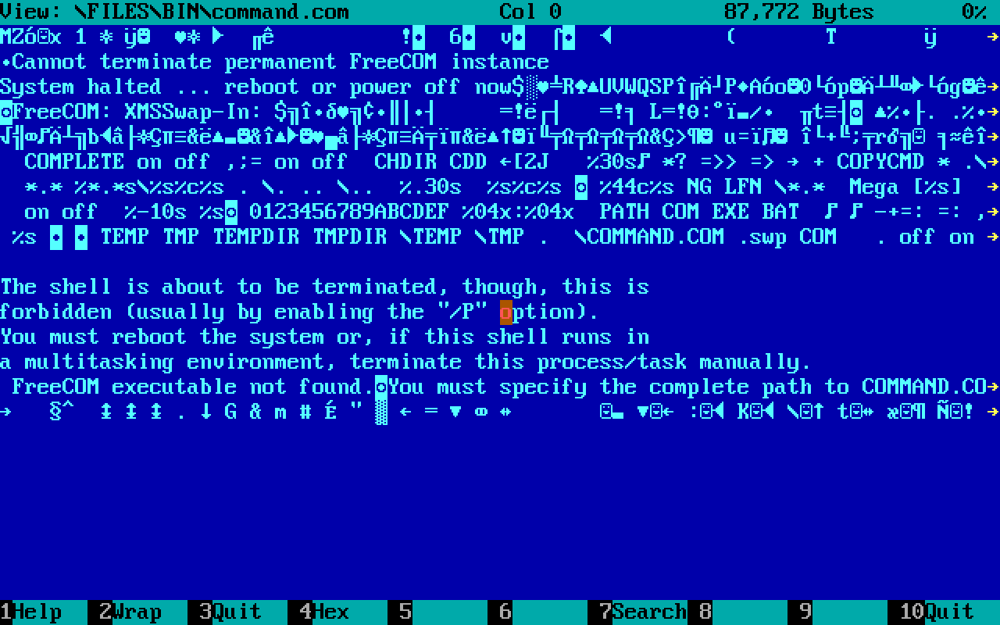
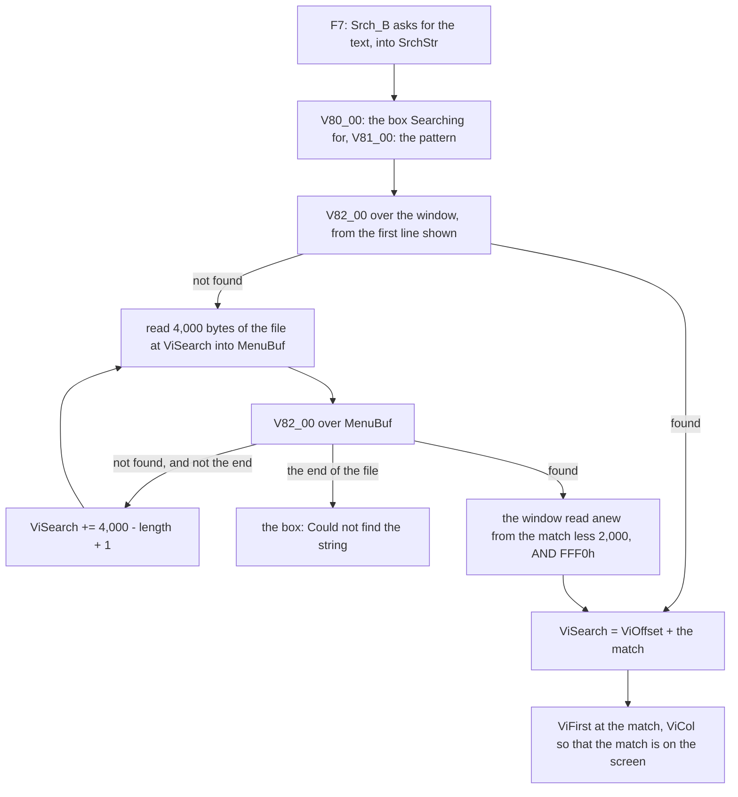
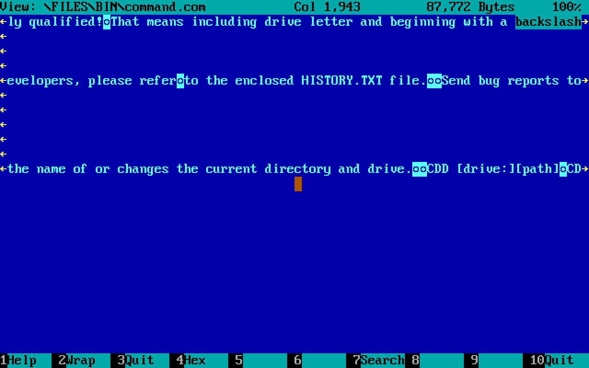
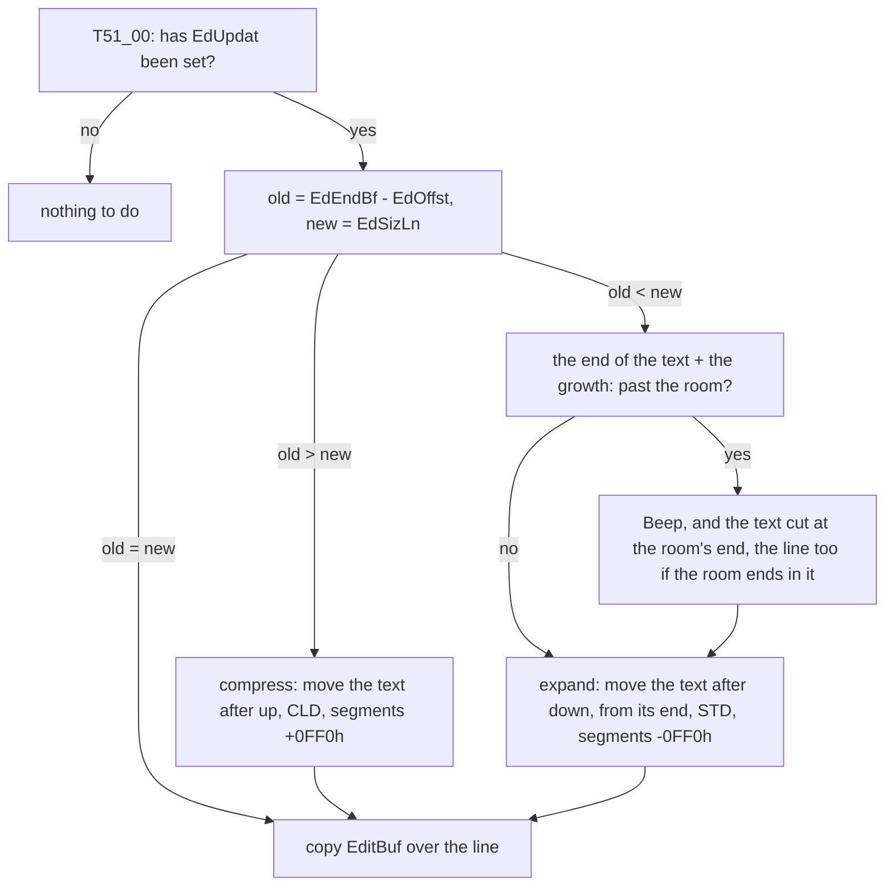

# The viewer and the editor

F3 shows a file and F4 changes it. The viewer looks at a file of any
size, a gigabyte as easily as a kilobyte, through a window of at most
64K, as text or in hex, wrapped or not, with a search; the editor reads
the whole file into memory, edits one line of it at a time in a buffer
of its own, and undoes the last deletion. Together they are 10,915
bytes of code: 4,853 in `VCVIEW.INC` and 6,062 in `VCEDIT.INC`, with
1,751 bytes of their tables and texts. Neither has a variable of its
own in the main data. Both lay their state over `TmpBuf`, the 256
bytes of scratch that every command borrows, and work in the *room*,
the segment `ViewSeg` and everything behind it that DOS has left
([chapter 3](03-the-features.md#the-room)).

The two are built as one feature with two halves. They open a file by
the same code, keep the same window on the screen in the same two
words, draw a line of hex in the same columns, scroll the screen by
the same routine and search with the same two routines; the editor's
structure is laid over the viewer's so that what the opening has
already set is where the editor reads it. This chapter takes the
shared state first, then the viewer, the search, and the editor.

[Chapter 1](01-the-program.md) has the main data and the loop that
calls these commands, [chapter 2](02-the-screen.md) the shadow screen
`ScrBuf`, the boxes and `Window`, which copies a rectangle of it to
the display. As there, a comment that starts with `;;` is the book's
and one with a single `;` is Volkov's. In the excerpts, **ES is the
main data** and **DS is the segment of the text**, `ViewSeg` or a
paragraph of the room beyond it. Sizes are those of the listing of the
shipped `VC.COM`.

## The state: two structures over `TmpBuf`

### `ViewDat`: a structure whose names are addresses

The viewer's state is declared as a structure, and the way it is
declared is a trick of its own: the first member of the `STRUC` is
padding as long as the offset of `TmpBuf+200` in the main data, so that
every field's name *is* its address in the main data and needs no base
register:

```asm
ViewDat	STRUC
	 DB	TmpBuf+200 DUP(?)	;; nothing: the fields start at TmpBuf+200
ViSpace	 DW	?			; Edit buffer size in paragraphs
ViewEdit DB	?			; View / Edit
ViStatus DB	?			; Output status line
ViLoaded DW	?			; Bytes loaded in buffer
ViLen	 DD	?			; Size of file
ViOffset DD	?			; Offset of first loaded byte in buffer
ViKeyBar DW	?			; Saved KeyBar & Clock
ViTxHex	 DB	?			; Text / Hex mode
ViWrap	 DB	?			; Wrap / Unwrap
ViFirst	 DW	?			; Offset of first line of screen
ViHandle DW	?			; File handle
ViCol	 DW	?			; First column displayed on the screen
ViPoint	 DW	?			; Point to address of first line
ViEndTab DW	?			; Point to end of line table
ViBase	 DW	?			; View window base
ViSize	 DW	?			; View window size
...
ViSearch DD	?			; Saerch offset
Vi100pc	 DB	?			; 100% was displayed
ViewDat	ENDS
```

With `OPTION OLDSTRUCTS` at the head of `VC.ASM` the field names are
global, so `MOV ES:ViFirst,AX` writes `TmpBuf+218` of the main data,
0D7Bh. The 43 bytes run from `TmpBuf+200` to `TmpBuf+242`. No
instance of `ViewDat` is ever declared: the structure is only a list
of names. (`ViSpace` holds bytes, not paragraphs as its comment says:
the comment is older than the code.)

### `EdData`: holes where the viewer's fields must survive

The editor's structure, `EdData`, is declared the same way from
`TmpBuf+100` to `TmpBuf+237`. It is laid out with holes, so that the
fields which the opening has set, and which the editor needs, are the
same bytes under both names:

```
 TmpBuf+  ViewDat (the viewer)      EdData (the editor)
 100..121                            EdOffst, EdEndBf, EdSizLn, EdUpdat,
                                     EdWhole, EdCursr, EdCol1, EdUpDwn,
                                     EdHex1, EdScrn, EdCurLn, EdUndo
 122..198                            77 bytes of nothing
 199                                 EdWrite
 200      ViSpace          =         EdSpace     the room
 202      ViewEdit                   (a byte of nothing: F3 or F4)
 203      ViStatus         =         EdStat      a status line or none
 204      ViLoaded                   EdHexAs, EdHxCur
 206      ViLen            =         EdLen       the file's size
 210      ViOffset                   EdCol, EdLine
 214      ViKeyBar                   (a word of nothing: kept for the exit)
 216      ViTxHex          =         EdTxHex     text or hex
 217      ViWrap                     EdChng
 218      ViFirst, ViHandle          (a double word of nothing)
 222      ViCol            =         EdCol0      the first column shown
 224      ViPoint                    EdLin0
 226      ViEndTab                   (a word of nothing)
 228      ViBase           =         EdBase      the window's corner
 230      ViSize           =         EdSize      the window's size
 232      ViSrPan .. ViTmp2          EdFirst, EdShape
 238      ViSearch, Vi100pc          (not the editor's)
```

Seven words and bytes are one under both names, and one hole keeps a
field of the viewer's. `EdSpace` is the room and `EdLen` the size that
the opening took with a seek to the end; `EdBase` and `EdSize` are the
window that the opening was given, the whole screen but two rows for
F4 or a box inside the Info panel for its `dirinfo` file; `EdCol0` is
the first column shown, as `ViCol` is; the hole at 214 is `ViKeyBar`,
the clock and the key bar that the exit puts back, whichever of the
two exits. And `EdTxHex` is `ViTxHex`, which is why the viewer's
search knows, when the editor calls it, whether the editor is in hex:
`V81_00` reads `ViTxHex`. The 77 bytes of padding are there to make
the shared fields land. The 100 bytes below the editor's are free
while the viewer runs, and its PgDn keeps a list of line starts there
(`MOV DI,OFFSET TmpBuf-2`, then a word for each line it passes), up to
46 words for a screen of 50 rows.

The routines that draw read the window by the editor's names: `T70_00`
clears a row of `EdSize.X` cells at `EdBase`, and the viewer calls it
for its own window. One routine serves both because the two names are
one word.

## Opening a file

F3 and F4 are one routine, `V00_00`, with DL 0 or 1. It shows a box,
"Reading the file", in `WinBuf`, opens the file with `OpenFil`, seeks to
its end with 4202h to learn its length, and back with 4200h. For F4
there are two more outcomes: a file that does not exist becomes a new
file, with the handle FFFFh and the length 0, and the editor asks
"New-file / Cancel"; and every other error is a box. Then:

```asm
	CMP	DS:ViewEdit,0
	JZ	V00_10			;; F3: the viewer, at V00_10
	JMP	T00_00			;; F4: the editor, with the file open
```

Opened from the Info panel, F4 edits the panel's `dirinfo` file
(`F34_10`): it sets `ViBase` and `ViSize` to the inside of the panel,
writes " Edit " into the panel's frame and jumps into `V00_02`, past the line that would have given the whole screen.
Every routine that follows goes by those two words, so the editor works
in a box of the panel with no code of its own for it; F4, the hex mode,
is refused there, by `CMP DS:EdSize.X,80`.

## The viewer

### A window of 64K

After the opening, the viewer takes as much of the room as it can
address with one segment, never more:

```asm
V00_10:	MOV	AX,ES
	ADD	AX,DS:FreMem2
	SUB	AX,DS:ViewSeg		;; the room in paragraphs
	CMP	AX,0FFEh
	JBE	V00_11
	MOV	AX,0FFEh		;; at most 65,504 bytes
V00_11:	MOV	CL,4
	SHL	AX,CL
	MOV	DS:ViSpace,AX
	MOV	CX,AX
	MOV	DS,DS:ViewSeg
	XOR	DX,DX
	CALL	V55_00			;; read that much from offset 0
```

`V55_00` (20 bytes) clears the buffer with `REP STOSB` before it reads,
so a short read leaves zeros. The segment holds the text from its
bottom and a table of the lines from its top, growing down:

```
 ViewSeg while the viewer runs                                 ViSpace
 0                                                        (<= 65,504)
 +----------------------------------+-----------+------------------+
 | the text: ViLoaded bytes of the  |   free    | the line table:  |
 | file, from file offset ViOffset  |           | one word a line, |
 |                                  |           | its offset in the|
 |                                  |           | text, growing    |
 |                                  |           | down             |
 +----------------------------------+-----------+------------------+
 ^ ViFirst: first line on screen    ^ ViLoaded  ^ ViEndTab  ViSpace-2:
                                                           line 0
```

Every place the viewer keeps is a 16-bit offset into this segment, and
the file is known through one 32-bit number, `ViOffset`, the place in
the file of the segment's byte 0. The table costs two bytes for every
line in the window, but it makes going up as cheap as going down, and
the alternative, finding the start of the line above by scanning
backwards for a line end, is what the editor has to do and costs it
181 bytes of code (see [lines](#lines-t53_00-forward-t54_00-backward)).

### The line table: `V60_00`

`V60_00` (93 bytes) builds the table from a place on. Where the table
grows down into the text, the text ends there: `ViLoaded` is cut to the
table, so a file of short lines keeps less text in memory than one of
long lines, and the two always share the segment exactly.

```asm
V60_01:	XOR	BX,BX			;; a new line: column 0
	CMP	SI,DI
	JAE	V60_02
	DEC	DI
	DEC	DI
	MOV	DS:[DI],SI		;; the table: where it begins
	CMP	DI,DX
	JAE	V60_03
V60_02:	MOV	DX,DI			;; the table has reached the text
V60_03:	CMP	SI,DX
	JAE	V60_06
	LODSW				;; two bytes at once,
	CMP	SI,DX
	JA	V60_04
	CALL	IsCrLf			;; CR LF or LF CR?
	JE	V60_01
V60_04:	DEC	SI			;; else one character
	CMP	AL,9
	JNE	V60_05
	OR	BL,7			;; a tab: to the next column of 8
V60_05:	INC	BX
	CMP	BX,80
	JB	V60_03
	JA	V60_01			;; past 80: a new line
	MOV	AX,DS:[SI]		;; at 80: a line end right behind
	CALL	IsCrLf			;; stays on this line
	JE	V60_03
	CMP	SI,DX
	JB	V60_01
```

`IsCrLf` is two instructions, `CMP AX,0D0Ah` and `CMP AX,0A0Dh`:
having read a word, the test for a line end in either order is a
comparison of a register. A line end is always a pair. A lone LF, the
line end of a file from Unix, is a character like any other, and the
PC's font draws it as `◙`; such a file is shown as one long line
broken every 80 columns. A tab is `OR BL,7` and the `INC` behind it:
the column goes to the next multiple of eight, with no division.

So the table never holds a line longer than 80 columns: a long line of
the file is several entries, each a piece of 80 columns. That is what
the wrapped view shows. How the same table serves the unwrapped view is
[below](#wrap-and-unwrap-one-table-two-readings).

### Sliding the window: `V50_00` and `V51_00`

The window holds at most 65,504 bytes of the file. When the screen
runs past what is loaded, the window slides by half its size, and the
table slides with it.

Going down, the main loop calls `V50_00` (194 bytes) when the last line
on the screen is the last that is loaded and the first line shown,
`ViFirst`, is in the second half of the window. Let H be half of
`ViSpace`, 32,752 for a window of 65,504 bytes:

```
 BEFORE V50_00                                              ViOffset = F
 0                    H                        ViLoaded    ViEndTab  ViSpace
 |                    |                        |           |         |
 +--------------------+------------------------+-----------+---------+
 | first half: no     | second half: the lines |   free    |   the   |
 | longer wanted      | on the screen          |           |  table  |
 +--------------------+------------------------+-----------+---------+
                         ^ ViFirst >= H

 AFTER V50_00                                               ViOffset = F + H
 0                       ViLoaded-H              ViLoaded  ViEndTab  ViSpace
 |                       |                       |         |         |
 +-----------------------+-----------------------+---------+----+----+
 | the old second half,  | read on from the file |  free   |new |old |
 | moved down by H       | at F + ViLoaded       |         |    | -H |
 +-----------------------+-----------------------+---------+----+----+
   ^ ViFirst - H
```

It does it in five steps, and only the second is subtle. `ViOffset`
goes on by H and `ViFirst` back by H. Then the table is rebased in
place, read from its top and written from its top, in one pass:

```asm
	MOV	SI,ES:ViSpace
	DEC	SI
	DEC	SI			;; SI: the old table, from its top
	MOV	DI,SI			;; DI: the new table, from its top
	MOV	WORD PTR DS:[DI],0	;; the new line 0 starts at 0
V50_01:	CMP	SI,ES:ViEndTab
	JB	V50_02			;; every old entry read
	MOV	AX,DS:[SI]
	DEC	SI
	DEC	SI
	SUB	AX,DX			;; DX = H: the entry, rebased
	JBE	V50_01			;; in the first half: dropped
	DEC	DI
	DEC	DI
	MOV	DS:[DI],AX		;; else kept, H lower
	JMP	V50_01
V50_02:	MOV	ES:ViEndTab,DI
```

With a window of 65,504 bytes, H is 32,752, and a table whose lines
begin every 80 bytes or so becomes, read from its top:

| Entry | Before: the line starts at | After |
|---|---:|---|
| `ViSpace-2` | 0 | 0, written first: the line that the cut runs through |
| `ViSpace-4` | 80 | dropped, as is every entry up to H |
| ... | ... | |
| | 32,700 | dropped |
| | 32,780 | 28, in `ViSpace-4` now |
| | 32,860 | 108 |
| ... | ... | ... |
| `ViEndTab` | 65,020 | 32,268, from which `V60_00` goes on |

The writing pointer never passes the reading one, since every entry
written was read first, so no second table is needed. An entry is a
16-bit offset in the segment, and a subtraction is all that a slide
costs it. The entry that is written first, 0, stands for the line that
the cut at H runs through, which begins in the half that is dropped;
it can be a line's middle, and is never on the screen, since `ViFirst`
was at H or past it.

Then the text from H to `ViLoaded` moves down to 0, one `REP MOVSB` of
at most 32K, about 0.12 seconds on a PC/XT at 17 cycles a byte; the
file is read on behind it as far as the table, from the place in the
file that the moved text ends at; and `V60_00` builds the table on from
the last entry that was kept, which also cuts `ViLoaded` where the new
entries meet the new text. The table is entries for the lines the
screen shows and those after them; the lines of the first half are
gone, and going back to them is `V51_00`'s.

Going up, `V51_00` (189 bytes) does the reverse, without a rebase:

```
 BEFORE V51_00                                              ViOffset = F
 0                                         ViLoaded          ViSpace
 |                                         |                 |
 +-----------------------------------------+-------+---------+
 | the text                                |  free |   the   |
 |                                         |       |  table  |
 +-----------------------------------------+-------+---------+

 AFTER V51_00                         D = min(H, F), ViOffset = F - D
 0           D                                   ViLoaded    ViSpace
 |           |                                   |           |
 +-----------+-----------------------------------+-----+-----+
 | read from | the old text, moved up by D, as   | free| new |
 | F-D to F  | much of it as the new table leaves|     |table|
 +-----------+-----------------------------------+-----+-----+
```

It moves the whole segment up by D with `STD` and `REP MOVSB`, the
table with the text, since the table is built again anyway; reads D
bytes of the file into the bottom; and builds the table from 0. One
thing has to be kept from before: where the old window's second line
began, plus D. The new table, built from a new start, may break a long
line at other columns than the old one did, and the lines the user was
looking at would then jump sideways. So `V51_00` looks for that place
among the new entries, and if no entry is exactly there, it builds the
table again from it:

```asm
V51_04:	XOR	SI,SI
	MOV	DI,ES:ViSpace
	CALL	V60_00			;; the table, from the window's start
	POP	SI			;; the old line 1, plus D
V51_05:	CMP	DI,ES:ViEndTab
	JBE	V51_06			;; not found
	DEC	DI
	DEC	DI
	CMP	SI,DS:[DI]
	JE	V51_06			;; an entry is there: the same lines
	JA	V51_05
	INC	DI			;; passed it: the entry before,
	INC	DI
	CALL	V60_00			;; and the table again from SI
```

Line 1, not line 0, because line 0 of a window that `V50_00` slid may
be the middle of a line. So any file can be paged through, in a window
of 64K, by line offsets of 16 bits, and each slide costs one move of
half the window and one read of half the window.

Home and End go straight to an end. Home reads from 0. End reads the
last half-window of the file, its start a multiple of 16 by `AND
DX,0Fh` of the length, so that the hex lines still fall on whole
paragraphs of the file, and steps back from the last line with
`PrevLin`.

### Moving through the lines: `V20_00`, `NextLin`, `PrevLin`

Three routines turn the table into lines on the screen, and every key
goes through them:

| Routine | Bytes | Given | Gives |
|---|---:|---|---|
| `V20_00` | 88 | `ViFirst`, an offset | its entry in the table, `ViPoint`, and the start of the line it is in |
| `NextLin` | 100 | SI, a line's start, and BX, its entry | the next line's start and entry, or the carry if it is not loaded |
| `PrevLin` | 115 | the same | the line before, or the carry |

Each takes the entry as a hint and checks it: if SI is below the
offset the hint names, it starts again from the top of the table,
`ViSpace`. In hex mode none of them looks at the table: a line is 16
bytes, `AND SI,0FFF0h` and `ADD SI,10h`. The carry tells the caller to
slide the window: Down calls `NextLin`, and on the carry `V50_00` and
then the first line of the new window.

The keys are `View_T`, a `Case` table of 30 entries of four bytes,
122 bytes in all: the arrows and the WordStar keys (^E, ^X, ^S, ^D,
^R, ^C, ^A, ^F) to the same routines, Home and End and their Ctrl
forms, F2, F4 and Enter for hex, F7, Shift-F7, and Esc, F10 and F3 to
leave. Up and Down
move the screen by one line without drawing it again: they scroll the
window in `ScrBuf` and on the display by one row with `T71_00`, the
editor's routine ([below](#the-screen-t71_00-t72_00-and-t73_10)), clear
the row that comes free and draw the one line that is new.

### Wrap and unwrap: one table, two readings

F2 switches between the wrapped view and the unwrapped one, and costs
nothing: `V12_00` turns `ViWrap` over and draws the screen again. The
table is the same. It always has an entry for every 80 columns; in the
unwrapped view the routines that walk it skip the entries that are not
at the start of a line of the file, which they tell by the two bytes in
front of the entry:

```asm
NxLin3:	MOV	SI,DS:[BX]		;; the next entry
	CALL	IsCrLf0			;; a line end just in front?
	JE	NxLin5			;; yes: a line of the file starts here
	DEC	BX
	DEC	BX			;; no: a piece of a long line, skipped
	CMP	BX,ES:ViEndTab
	JAE	NxLin3
```

`IsCrLf0` is two `DEC SI`s that fall into `IsCrLfS`, a `LODSW`, which
falls into `IsCrLf`: three entry points into 12 bytes. In the unwrapped view a line on the
screen is drawn from its start to the next entry that counts, so a
line of the file of 3,000 columns is one row, and the arrow keys move
the columns.



*F3 on FreeDOS's `COMMAND.COM`, then F2: unwrapped, each row is one
line of the file, and `→` in the last column says that it goes on. The
LFs without a CR, `◙`, are characters, not line ends.*

### Drawing a line: `V32_00`

`V32_00` (371 bytes) draws the line from SI to BP into row AL of the
window, in text or in hex. In text, after a line end at BP has been
taken off so that it is not drawn, it is a loop over the bytes with a
column in DX:

```asm
V32_03:	CMP	SI,BP
	JAE	V32_06			;; the end of the line
	LODSB
	MOV	CX,SI
	MOV	BX,DX			;; BX: this byte's column
	INC	DX
	CMP	AL,9
	JNE	V32_04
	MOV	AL,' '			;; a tab is spaces:
	TEST	DL,7
	JZ	V32_04
	DEC	SI			;; read it again until column 8n
V32_04:	SUB	BX,ES:ViCol		;; the column on the screen
	JB	V32_03			;; left of the window: not drawn
	CMP	BL,ES:ViSize.X
	JAE	V32_05			;; right of it: an arrow, and stop
	ADD	BX,BX
	MOV	ES:[DI+BX],AL		;; the character; its colour is the row's
```

A tab is drawn by reading it again, `DEC SI`, as a space each time,
until the column is a multiple of eight. Scrolling sideways is the
`SUB BX,ES:ViCol`: Left and Right change `ViCol` by 1, Ctrl-Left and
Ctrl-Right by 40, up to 65,455, and the screen is drawn again; a byte
to the left of `ViCol` costs its comparisons and nothing else. Past the
right edge the loop writes `→` (1Ah) in the last column in the colour
of the arrows and stops; with `ViCol` above 0, `←` (1Bh) goes into the
first column of every line drawn, empty lines too.

Behind the store, four comparisons light up a text that a search has
found: the bytes from `ViTmp1` to `ViTmp2` are drawn again in the
colour of the cursor, `Cursr_C`. The two are worked out once a line
from `ViSearch`, the place in the file of the last match, as offsets in
the window.

### The hex view

In hex there is no table: a line is 16 bytes, and `V32_00` writes its
place in the file and the bytes in three columns:

```
 column  0         11                                                  63              79
         |          |                                                   |               |
          00000010  77 6F 0D 0A  4C 69 6E 65  20 74 68 72  65 65 0D 0A  wo♪◙Line three♪◙
          \______/  \________________________________________________/  \______________/
          ViOffset   16 bytes, 3 columns each and one more after every     the same bytes
          + SI, in   fourth: byte i at column 11 + 3i + i/4                as characters,
          8 digits                                                         0 drawn as '.'
```

The place is `ViOffset` plus SI, eight hex digits by four calls of
`HexByt`. The bytes and the characters are written in one loop with
two pointers, DI for the digits and BX, 52 cells to the right, for the
characters; the gap after every four bytes is `AND AL,3` of the count
going down, a test of two bits. `HexCod`, which writes a digit, ends
with `INC DI` behind its `STOSB`: it steps over the colour byte of the
cell, so that the digits go into a row of `ScrBuf` without changing its
colours.


*F3, then F4: the viewer in hex, 16 bytes a line.*

### The status line: `V25_00` and `V40_00`

When the window is 80 columns wide, the top row is the status line:
"View:", the name of the file cut to 33 characters, "Col" and the
first column shown, the size of the file in bytes, and a percentage.
The fixed parts are written once, when the viewer starts; `V25_00` (157
bytes) writes the two figures that change, and `V40_00` (76 bytes) the
100.

The percentage is how far into the file the first line on the screen
is: (`ViOffset` + `ViFirst`) times 100, divided by `ViLen`. Both numbers
are 32 bits, and the 8086's `DIV` divides 32 bits by 16 only, with a
fault, INT 0, where the quotient does not fit 16 bits. So `V25_00`
neither multiplies nor divides:

```asm
	MOV	AX,DS:ViOffset.Lo
	MOV	BX,DS:ViOffset.Hi
	ADD	AX,DS:ViFirst		;; BX:AX, the place of the first line
	ADC	BX,SI
	MOV	CX,100
V25_02:	ADD	DX,AX			;; DI:SI:DX += BX:AX,
	ADC	SI,BX			;; a hundred times:
	ADC	DI,0			;; the place times 100, in 48 bits
	LOOP	V25_02
	MOV	AX,DS:ViLen.Lo
	MOV	BX,DS:ViLen.Hi
	...
	MOV	CX,0FFFFh
V25_03:	INC	CX			;; count the subtractions
	SUB	DX,AX			;; of the length
	SBB	SI,BX
	SBB	DI,0
	JNB	V25_03			;; CX: the percentage, 0 to 100
```

At most 101 subtractions, since the place is below the length: about
5,500 cycles in all, a little more than a millisecond on a PC/XT, for
a figure that changes with every key. `V40_00` says when it is 100:
when the window reaches the end of the file and the last line is on
the screen, it writes "100" straight into `ScrBuf` and sets `Vi100pc`,
by which Down, PgDn and End then do nothing.

### The mouse

The viewer's window has no buttons drawn. A click is placed against
thirds of its height and quarters of its width, worked out with one
`DIV BL` by 3 and two `SHR`s: in the top third it is Up, in the bottom
third Down, in the left quarter Left, in the right quarter Right
(`V00_31` to `V00_35`).

## The search, shared

F7 asks for a text into `SrchStr`, 64 characters, and Shift-F7 looks
for it again. The viewer, the editor and find file's "Containing" all
search with the same two routines: `V81_00` (105 bytes) prepares the
pattern, `V82_00` (90 bytes) looks for it in a run of bytes. Each
caller feeds them the bytes in its own way.

### The pattern in `HelpBuf`: `V81_00`

The pattern is prepared in `HelpBuf`, the 3,000 bytes into which the
help reads a page, which are free while no help is up:

```
 HelpBuf
 +0     the text, in capitals, with its zero    up to 65 bytes
 +90    word: its length                         WORD PTR HelpBuf[90]
 +100   the bytes that the text spells in hex    hex mode only
 +190   word: their count                        HexLen
```

The two patterns have the same shape, each with its length 90 bytes
behind it, so that the comparison loads either with the same two
instructions, `MOV DI,OFFSET HelpBuf` or `MOV DI,OFFSET HelpBuf[100]`,
then `MOV CX,ES:[DI+90]`. Since F1 may fill `HelpBuf` with a help page
at any key, `V81_00` is run again before every search, never trusted to
have survived; it is called by `V80_00`, which also shows the box
"Searching for", so the pattern is prepared when the box is drawn.

In hex mode, the viewer's or the editor's, `V81_00` reads the text a
second time as hex digits:

```asm
V81_01:	LODSB
	CMP	AL,' '
	JE	V81_01			;; spaces between: skipped
	CMP	AL,0
	JE	V81_05			;; the end
	CALL	TstHex
	JC	V81_04			;; not a hex digit: no hex pattern at all
	MOV	DS:[DI],AL		;; a first digit,
	INC	DS:HexLen
	LODSB
	...
	CALL	TstHex			;; and a second, if there is one:
	JC	V81_02
	MOV	AH,DS:[DI]
	MOV	CL,4
	SHL	AH,CL
	ADD	AL,AH			;; the byte
	MOV	DS:[DI],AL
```

Digits go in pairs, a byte each, with spaces or a comma between the
bytes or nothing: `4D5A`, `4D 5A` and `4d,5a` are all the two bytes
4Dh 5Ah, and `4 D` is 04h 0Dh. One character that is not a hex digit,
other than a space or a comma, makes `HexLen` 0. So the user never
says which is meant: "4D5A" is looked for as the text "4D5A", without
regard to case, and as the two bytes, wherever either comes first,
while "MZ" is looked for as text alone.

### Comparing: `V82_00`

`V82_00` takes SI and CX, a run of bytes in DS, and tries every place
of it:

```asm
V82_02:	PUSH	CX
	MOV	BX,SI			;; this place
	MOV	DI,OFFSET HelpBuf
	MOV	CX,ES:[DI+90]		;; the text's length
V82_03:	LODSB
	CALL	UpCase			;; the file's byte in capitals
	SCASB
	LOOPE	V82_03
	MOV	AL,1
	JE	V82_05			;; the text matched
	MOV	SI,BX
V82_04:	MOV	DI,OFFSET HelpBuf[100]
	MOV	CX,ES:[DI+90]		;; HexLen
	JCXZ	V82_05			;; no hex pattern: no match
	REPE	CMPSB			;; the bytes?
	MOV	AL,0
V82_05:	POP	CX
	JE	V82_07			;; found: AL says which
	LEA	SI,[BX+1]		;; the next place
	LOOP	V82_02
V82_06:	SUB	DX,1			;; then the places where only
	JC	V82_07			;; the hex pattern still fits
	INC	CX
	PUSH	CX
	MOV	BX,SI
	JMP	V82_04
```

It answers with the carry clear and SI behind the match, and with AL
saying which matched: 1 for the text, which the viewer then lights up
in the characters, 0 for the bytes, lit in the hex digits. The text
is tried at `count - length + 1` places; DX, worked out at the entry
as the text's length less `HexLen`, adds the places near the end where
the text no longer fits but the shorter hex pattern does, and those
are tried with the bytes alone, by jumping into the middle of the loop
at `V82_04`.

`UpCase` is what makes a search of Russian text work: for a byte of
`a` to `z` it subtracts 20h, and every byte then goes through
`Country.CaseMap`, the far routine for capitals above 80h whose
address DOS gives in its country record (3800h). It is called for
every byte compared, and that is the price of the search: at a place
whose first byte does not match, which is nearly every place, the loop
spends about 340 cycles on an 8088 by Intel's tables, a third of them
in the far call to DOS's routine and back, counting that routine at
its shortest, a test and a return for a byte below 80h. That is
about 14,000 bytes a second on a PC/XT: a 64K window in under five
seconds, a megabyte in a minute and a quarter. Its opposite,
`LowCase`, which the panels use to show names, cannot be asked of DOS,
so `Init21` of `VC.ASM` builds a table of 128 bytes, `LowTab`, at the
start, by asking `CaseMap` for every byte from 80h up and inverting the
answers.

### The viewer's search: `V15_00`

The viewer first looks in what is loaded, from the first line on the
screen, or from the line after it if the last search found something
there; then in the file itself:



Past the window, `V15_04` reads the file 4,000 bytes at a time into
`MenuBuf`, which no menu needs while the viewer runs, and not into the
room, which holds the window that must stay as it is if nothing is
found. Each read starts `length - 1` bytes before the last one ended,
so that a match across the seam is found whole:

```
 the file    ViSearch
             |<----------- read n: 4,000 bytes ------------>|
                                                  |<--- read n+1: 4,000 ...
                                                  ^ ViSearch + 4,000 - length + 1
                                                  |<-- length-1 -->|  read twice
```

```asm
V15_06:	SUB	CX,WORD PTR ES:HelpBuf[90]	;; the bytes read less the length
	JB	V15_07				;; fewer than the text: the end
	INC	CX
	ADD	ES:ViSearch.Lo,CX		;; on by that, plus one
	ADC	ES:ViSearch.Hi,0
	JMP	V15_04				;; and the next read
```

With a text of at most 64 characters, at most 63 bytes of each 4,000
are read twice. Each round also calls `TstBrk`, so Esc stops a search
through a large file. When it finds the text, the viewer reads the
window anew from 2,000 bytes before the match, rounded down to 16
(`AND AX,0FFF0h`), so that the match is in the middle of what is
loaded with room above it for Up; builds the table; and counts the
columns from the start of the match's line to the match, tabs as
`V32_00` counts them, to set `ViCol` so that the whole match is on the
screen, at its right edge if it lies beyond the first 80 columns.



*F7, "backslash", in the unwrapped view of `COMMAND.COM`: the match is
the last word on the screen, in the cursor's colour, `ViCol` is 1,943,
and every row has `←`.*

## The editor

### All of the file, or nothing

Unlike the viewer, the editor wants all of the file in the room:

```asm
T00_00:	MOV	BP,BX
	MOV	DI,AX
	MOV	AX,ES
	ADD	AX,DS:FreMem2
	SUB	AX,DS:ViewSeg
	MOV	DS:EdSpace,AX		;; the room in paragraphs
	MOV	BL,AH
	MOV	BH,0
	XCHG	BX,DI
	MOV	CL,4
	SHL	AX,CL
	SHR	DI,CL			;; DI:AX: the room in bytes
	CMP	DI,DS:EdLen.Hi
	JB	T00_01
	JA	T00_03
	CMP	AX,DS:EdLen.Lo
	JA	T00_03
T00_01:	PUSH	BP			; File too large
	MOV	BP,OFFSET BigFi_B	;; "... is too large for Edit. View / Cancel"
```

The room is whatever DOS left after the main data and the panels, at
least 8,000 bytes and on a machine of 640K some 400K, so "too large
for Edit" was a box that users met with files of a few hundred
kilobytes. View then opens the viewer on it in place, by jumping into
`V00_10` with the file still open.

The file is read in pieces of `0FF00h` bytes, the largest count below
64K that is a whole number of paragraphs, so that each next piece
starts at offset 0 of the segment 0FF0h paragraphs on. The handle is
closed once it is read: the editor keeps nothing of the file but its
name. The text is then one run of bytes across several segments.

### A place is 20 bits: `T61_00` and `T60_00`

A place in the text is a 32-bit offset from `ViewSeg`, `EdOffst`, the
start of the line under the cursor, `EdEndBf`, `EdFirst`, the first
line on the screen, `EdLen`. Two routines of a few bytes turn one into
a pointer and back. `T61_00` (29 bytes) makes a segment and an offset
below 16 of a place in DX:BX:

```asm
T61_00:	PUSH	DX			; DX BX -> DS:SI
	PUSH	CX
	PUSH	AX
	MOV	SI,BX
	AND	SI,0Fh			;; the offset: the low four bits
	MOV	AX,BX
	MOV	CL,4
	SHR	AX,CL			;; the paragraph: bits 4 to 15,
	SHL	DL,CL
	OR	AH,DL			;; with bits 16 to 19 from DX
	ADD	AX,ES:ViewSeg
	MOV	DS,AX			;; DS:SI = the place, SI < 16
```

```
 the place, DX:BX
     DX                        BX
 .... .... .... hhhh   pppp pppp pppp oooo
                \___________________/ \__/
                  the paragraph         the offset
                  hhhh pppp pppp pppp   oooo

 DS = ViewSeg + paragraph        SI = oooo, 0 to 15
```

Only 20 bits of the place count: the high twelve bits of DX are
shifted out of DL, so the text can be up to a megabyte, all the 8086
can address. With SI always below 16, the next 65,520 bytes can be
read through DS:SI without crossing the segment's end, which is all
that a line, or a search's piece of 32K, needs. `T60_00` (25 bytes) is
the reverse, `(DS - ViewSeg) * 16 + SI` in 32 bits, by shifts.

The pair gives the hex mode its lines for nothing. In hex a line is
16 bytes, so the line of a place is its paragraph and its column is
its offset: switching to hex, F4 sets the line to `DS - ViewSeg` and
the cursor to SI, straight from `T61_00`.

### The line apart: `T50_00` and `T51_00`

```
 the room while the editor runs                         ViewSeg+EdSpace
 0                EdOffst     EdEndBf                   EdLen     |
 +----------------+-----------+-------------------------+---------+
 | text before    | the line  | text after              |  free   |
 +----------------+-----------+-------------------------+---------+
                       |   T50_00: copied out, at most 3,900 bytes
                       v   T51_00: put back, moving "text after"
 EditBuf = MenuBuf (4,000 bytes): the line being edited, EdSizLn, EdCursr
 UndoBuf = ErrBuf  (7,392 bytes): the last text deleted, for Ctrl-U
```

Moving the whole rest of a large text for every key would be slow,
so the editor does not. The line under the cursor is copied out into a
buffer of its own, `EditBuf`, which is `MenuBuf`, by `EQU`: no menu is
open while the editor runs. `T50_00` (121 bytes) copies 3,900 bytes
from the line's start whatever the line's length, and then finds its
end and keeps that, without its CR LF, as `EdSizLn`; `EdEndBf` is where
the copy ends in the text. Keys change only the buffer and set
`EdUpdat`. When the cursor leaves the line, `T51_00` (374 bytes) puts
the buffer back in one move: if the line got shorter, the rest of the
text moves up, if longer, down.



The move is the same loop both ways, with the direction flag and the
step of the segments, `BX`, set before it. It divides the count of
bytes to move, which may be up to a megabyte, into pieces of 0FF00h:

```asm
T51_30:	MOV	CX,0FF00h		; Move
	DIV	CX			;; DX:AX bytes: AX pieces, DX left over
	PUSH	ES
	MOV	ES,BP
	MOV	CX,AX
	JCXZ	T51_32
T51_31:	PUSH	SI
	PUSH	DI
	PUSH	CX
	MOV	CX,0FF00h
	REP	MOVSB			;; one piece
	POP	CX
	POP	DI
	POP	SI
	MOV	AX,DS
	ADD	AX,BX			;; both segments on by +-0FF0h:
	MOV	DS,AX			;; SI and DI stay as they are
	ADD	BP,BX
	MOV	ES,BP
	LOOP	T51_31
T51_32:	MOV	CX,DX
	JCXZ	T51_33
	REP	MOVSB			;; and the rest
```

This is one of the few `DIV`s of 32 bits by 16 in the program, and it
is safe: the quotient is at most 16. Stepping the segments by 0FF0h
paragraphs, 65,280 bytes, after a piece of 65,280 bytes leaves the
offsets where they were, so the loop has no arithmetic on SI and DI at
all. `REP MOVSB` costs 17 cycles a byte on the 8088, so leaving a
changed line near the start of a text of 500K moves half a megabyte
and takes about two seconds on a PC/XT; leaving a line that was not
changed costs nothing, and typing on one line costs nothing but the
buffer's own move of the characters behind the cursor, at most 4,000
bytes. In hex mode there is no line buffer: keys edit the text in
place, and typing at the end makes the file a byte longer.

The comment beside the `EQU`s states the one rule that the buffers
rest on: `; The length of undo buffer must be greate then edit buffer`.
`EditBuf` is `LenMenu`, 4,000 bytes, `UndoBuf` 7,392.

### Lines: `T53_00` forward, `T54_00` backward

The editor has no table of lines. A line of the text is found when it
is needed, by scanning for its CR LF, and the line's number,
`EdLine`, is counted as the cursor moves.

`T53_10` (106 bytes) scans forward from DS:SI for the next line end,
over at most 0FFFEh bytes of the segment, `LODSW` and `IsCrLf` as the
viewer's table does, and answers with the place behind the line end,
the end of the text, or the carry if it ran out of the segment first.
`T53_00` (104 bytes) makes a whole step of it: on the carry it makes a
new pointer of the place with `T60_00` and `T61_00`, so that SI is
below 16 again, scans again, and if a line is longer than 64K, steps
DS on by 0FF0h and goes on; and it counts the line in DI:

```asm
T53_00	PROC	NEAR			; Find next line
	PUSH	DX
	PUSH	BX
	PUSH	AX
	PUSH	DS
	PUSH	SI
	INC	DI			;; the line's number, one on
	JE	T53_07			;; from FFFFh: no next line
	CALL	T63_00			;; at the end of the text?
	JC	T53_07
```

Line numbers are 16 bits, and the `INC DI` that would make FFFFh 0 is
taken for the end: the cursor cannot go below the 65,536th line of a
text, whatever follows it. On the status line that line shows as "Line
0", since `T75_00` adds 1 to the number with `INC CX` and no carry.

Going back is the hard direction, and `T54_00` (181 bytes) does it in
two stages. First it scans backwards from the line's start, past the
line end in front of it, for the line end before that, a byte at a
time, stepping DS back by 800h paragraphs, 32K, whenever SI comes near
0 and adding 8000h to SI:

```asm
T54_03:	CMP	AX,800h			;; AX: paragraphs left before ViewSeg
	JBE	T54_04
	MOV	AX,800h			;; at most 32K back at a time
T54_04:	MOV	CX,DS
	SUB	CX,AX
	MOV	DS,CX			;; DS back,
	MOV	CL,4
	SHL	AX,CL
	ADD	SI,AX			;; and SI up by as much: the same place
T54_05:	MOV	AX,DS:[SI-2]
	...				;; a line end?
```

A backwards scan for pairs is ambiguous where line ends run together:
in `CR LF CR LF`, the middle `LF CR` is a pair too. So the scan only
finds a place at or before the previous line's start, and the second
stage settles it the way forward does: from that place, `T54_11` calls
`T53_00` until the next step would reach the line the cursor was on.
What is a line is always decided by the forward scan, and the two
directions cannot disagree. Ctrl-PgDn and Ctrl-End walk every line to
the end of the text by `T53_00` to know the last line's number; going
from hex back to text walks from the start of the text to the cursor
by `T56_00`, which does the same, so that `EdLine` is right.

### Columns and tabs: `T57_00` and `T56_00`

The cursor is an offset in the buffer, `EdCursr`; the column on the
screen is worked out from it every time the screen is drawn, by
`T57_00` (55 bytes), which walks the buffer from its start:

```asm
T57_02:	MOV	AX,ES:EdCursr
	...
	MOV	CX,AX			;; count EdCursr bytes,
	MOV	DX,0FFFFh		;; with no column to stop at
T57_03:	XOR	BX,BX
	JCXZ	T57_06
	MOV	SI,OFFSET EditBuf
T57_04:	LODS	ES:Byt
	CMP	AL,9
	MOV	AX,BX			;; AX: this byte's column
	JNE	T57_05
	OR	BX,7			;; a tab: to the next column of 8
T57_05:	INC	BX
	CMP	BX,DX
	JAE	T57_07			;; at the column asked for: stop
	LOOP	T57_04
```

Entered at `T57_00` or `T57_01` it does the opposite: given a column in
DX, it counts until it gets there and leaves in CX the bytes it did not
reach, so the cursor for that column is `EdSizLn - CX`. Up and Down use
that to keep the column: the first of them stores the column in
`EdCol1` and sets `EdUpDwn`, and while the keys are Up and Down the
cursor goes to that column on each line, or to the line's end, as in
any editor since; a key of another kind clears `EdUpDwn`. `T56_00` (75
bytes) puts the cursor on a place of the text, walking the lines with
`T53_00` to the one that holds it: the search and the switch from hex
end in it.

### Words: `T55_00`

Ctrl-Left and Ctrl-Right go by words, and Ctrl-T and Ctrl-BackSpace
delete one. A word ends at one of ten characters, `CtEn_T`:

```asm
CtEn_T	DB	' +:.,><|\',9
```

and `CmpSym` (17 bytes) is `REPNE SCASB` over them. `T55_00` (37 bytes)
skips the separators to the right of the cursor and then the
characters that are not; `EdSub1`, the same thing to the left, is not
the editor's at all: it is the routine of `EdLin`, the input line of
the dialogs and the command line, which works in the same way on a
buffer of characters, and the editor calls it on `EditBuf`. When the
search to the right reaches the end of a buffer that does not hold the
whole line, `T55_10` puts the buffer back and reads it again.

### The screen: `T71_00`, `T72_00` and `T73_10`

After every key the main part of the editor, `T00_20`, works out where
the window must be for the cursor to be in it: the first column
`EdCol0` moves so that the cursor's column is inside, one column in
from the edge, and the first line `EdLin0` so that the cursor's line
is. Then it draws as little as it can:

| What moved | What is drawn |
|---|---|
| nothing, or only the cursor within the line | the cursor's line, from the buffer, `T73_00` |
| the first line, by one, and the first column not | one row scrolled, `T71_00`, and the cursor's line |
| the first column, or the first line by more than one | the whole window, `T72_00` for each line |

The status line is drawn into `ScrBuf` every time and copied to the
display only if it differs from what was there: its 80 cells are saved
in `TmpErr` first and compared after with `REPE CMPSW`.

`T71_00` (67 bytes) scrolls part of the window by one row, up or down
by the sign of DX, from row AL on:

```asm
T71_00	PROC	NEAR			; Scroll screen up / down
	CALL	BasAdr			;; DI: the first row that moves, in ScrBuf
	MOV	SI,DI
	ADD	SI,DX			;; SI: the row next to it, DX = +-160
	MOV	CL,DS:EdSize.Y
	SUB	CL,AL
	MOV	CH,0
	DEC	CX			;; the rows that move
	JCXZ	T71_02
	PUSH	AX
T71_01:	PUSH	DI
	PUSH	SI
	PUSH	CX
	MOV	CL,DS:EdSize.X
	REP	MOVSW			;; one row of ScrBuf over the next
	POP	CX
	POP	SI
	POP	DI
	ADD	SI,DX
	ADD	DI,DX
	LOOP	T71_01
	...
	MOV	AL,1
	CALL	Int10m			;; and the display: INT 10h, AH 6 or 7
```

The copy in memory is moved row by row, and the display is not copied
to at all: the BIOS's scroll of a window, AH 6 up or 7 down by AL
rows, moves the cells on the screen itself, and `Int10m` hides the
mouse's pointer around it. A scroll then costs one row drawn instead of
a whole window copied out with `Window`. AL says where the moving part
starts, so the same routine opens a row below the cursor for Enter and
closes one when Del joins two lines; and the viewer calls it for Up and
Down with AL 0.

`T72_00` (193 bytes) draws one line from SI to BP, as the viewer's
`V32_00` does, with `EdCol0` for `ViCol` and the same arrows. A tab is
`OR DL,7` and a single space: the row was cleared by `T70_00` first, so
the columns it skips are blank already. Its hex half is the viewer's
layout, with the place from `T60_00`. `T73_10` (123 bytes) draws the
cursor's line from `EditBuf` rather than from the text, since the text
is not up to date while the line is being edited; and when the cursor
is within a screen's width of the end of a buffer that does not hold
the whole line, it puts the buffer back and reads it again first, so
that the part to be shown is in it.

### Deleting, and Ctrl-U

Every deletion keeps what it deleted in `UndoBuf`, with its length in
`EdUndo`, and only the last one is kept:

| Key | Deletes | `UndoBuf` holds |
|---|---|---|
| Del, BackSpace | a character | the character |
| Ctrl-T, Ctrl-BackSpace, Ctrl-W | a word to the right, to the left | the word |
| Ctrl-K | to the end of the line | the rest of the line |
| Ctrl-Y | the line | the line and a CR LF |
| Del at the end of a line, BackSpace at its start | the line end: the two lines joined | CR LF |

Ctrl-U, `T26_00` (181 bytes), puts it back at the cursor:

```asm
T26_00:	CMP	DS:EdTxHex,0		; ^U
	JNZ	T26_03			;; not in hex
	MOV	CX,DS:EdUndo
	JCXZ	T26_03			;; nothing deleted yet
	CMP	CX,2
	JB	T26_01
	MOV	BX,CX
	MOV	AX,WORD PTR DS:UndoBuf[BX-2]
	CALL	IsCrLf			;; ends in a line end?
	JE	T26_04			;; then into the text
T26_01:	MOV	AX,LenEdit+1
	SUB	AX,CX
	CMP	DS:EdSizLn,AX
	MOV	AL,0
	JAE	T26_04			;; too long for the buffer: into the text
	ADD	DS:EdSizLn,CX		;; else into the buffer, at the cursor
```

What ends in a line end, a line that Ctrl-Y took or a line end that
Del took, cannot go into `EditBuf`, which holds one line. So `T26_04`
puts the buffer back, then points `EdOffst` and `EdEndBf` both at the
cursor, as if the line being edited were empty and stood there, copies
the deleted text into the buffer as that line, and calls `T51_00`,
which makes room for it in the text by the expanding move it already
has. The undo of a line needed no code to insert into the text.

Nothing clears `EdUndo` when Ctrl-U has used it, so Ctrl-U puts the
same text in again each time it is pressed: it is the editor's paste,
and Ctrl-Y with Ctrl-U is how a line is copied. A line of 16
characters becomes one of 4,096 so: deleted with Ctrl-Y, put back
twice with Ctrl-U Ctrl-U, the two copies joined with Del, eight times
over.

`UndoBuf` is `ErrBuf`, where most error boxes save what they cover
([chapter 2](02-the-screen.md#three-buffers-and-who-uses-which)). The
boxes that can open while the editor runs keep out of it: "Could not
find the string" and the error of a save in `WinBuf+2000`, the read-only
question in `WinBuf+2000` too, the help and the critical error in
`ErrBuf1`. The two that do use `ErrBuf`, "too large for Edit" and
"New-file", come before `EdUndo` is set to 0.

### A line longer than 3,900 bytes

`EditBuf` is 4,000 bytes and `T50_00` copies 3,900: `LenEdit-100`. A
line that is longer is edited in its first 3,900 bytes, and the rest of
it stays in the text behind `EdEndBf`, where `T51_00` moves it, when it
moves anything, as it moves the lines that follow. `EdWhole` says whether
the buffer has the whole line. The 100 bytes beyond 3,900 are slack
for typing: a character typed into a full buffer of 4,000 puts it back
and reads it again, 3,900 bytes. The cursor stops at column 3,900,
`CMP AX,LenEdit-100-1` in `T06_11`, and End goes no further; the part
beyond is shown when the line is drawn from the text, which is when the
cursor is on another line, and in hex. On the line of 4,096
characters made above, End stops at "Col 3900".

### The search in the editor

F7 is the viewer's dialog and Shift-F7 the viewer's two routines. Since
the whole text is in memory, the editor feeds `V82_00` straight from the
room, in pieces of 32K from the cursor, each through `T61_00` so that
SI is below 16 and the piece cannot pass the segment's end:

```asm
T32_01:	CALL	TstBrk
	JC	T32_04			;; Esc
	MOV	AX,ES:EdLen.Lo		;; what is left of the text
	MOV	CX,ES:EdLen.Hi
	SUB	AX,BX
	SBB	CX,DX
	MOV	CX,8000h		;; at most 32K at a time
	...
T32_02:	CALL	T61_00			;; DS:SI = the place
	CALL	V82_00
	JNC	T32_05			;; found
	SUB	CX,WORD PTR ES:HelpBuf[90]
	JB	T32_03
	INC	CX
	ADD	BX,CX			;; on by the piece less the length, plus one:
	ADC	DX,0			;; the viewer's overlap
	JMP	T32_01
```

In text mode the cursor goes to the match through `T56_00`, which
counts the lines to it. In hex mode the match's paragraph is the line
and its offset the column, and AL from `V82_00` puts the cursor in the
characters or in the digits, by which of the two patterns matched.

### The help for the program's own files

Opening `VC.MNU`, `VC.EXT`, `VCVIEW.EXT` or `VCEDIT.EXT` takes ten
rows off the window for a pane of help on the file's macros: `T00_03`
compares the name with the four by `T64_00`, and `AX = 0A01h` gives
both the kind of help and the ten rows in one load. Since every routine
goes by `EdSize`, the rest of the editor never knows that the window
is shorter.

### Save

`T80_00` (432 bytes) puts the line back, asks for the attributes, asks
`Prot_B` if the file is read-only, creates the file with 3Ch and the
old attributes and archive, writes the text in pieces of `0FF00h`, and
gives the attributes back. A short write is a full disk: the file is
deleted rather than left cut short. Then it does something that no
user sees and every user relies on: if the file saved is the program's
own `VC.EXT`, in the directory of `NcPath`, its first 511 bytes are
copied into `ExtMain` with a 1Ah behind them, so the change takes
effect at the next Enter without starting the program again.

## What it adds up to

| Economy | Where | What it saves |
|---|---|---|
| State as a padded `STRUC` over `TmpBuf`, field names that are addresses | `ViewDat`, `EdData` | every variable of both, 143 bytes, out of the main data; no base register |
| The editor's fields laid over the viewer's | `EdData` | the opening's results taken over with no copy, and one search for both |
| A window of half-slides, with the line table rebased in place | `V50_00`, `V51_00` | any file's size viewed in 64K, with 16-bit offsets |
| One table for wrapped and unwrapped | `NextLin`, `PrevLin`, `V20_00` | F2 costs a flag and a redraw |
| A percentage by 100 additions and 101 subtractions | `V25_00` | no 32-bit `MUL` or `DIV`, and no fault |
| Two patterns of the same shape, 100 bytes apart in a borrowed buffer | `V81_00`, `V82_00`, `HelpBuf` | one comparison for text and hex, 195 bytes for three features |
| Overlapping reads | `V15_04`, `T32_01` | a match across a seam is found with no second buffer |
| A place as 20 bits, a pointer as a segment and an offset below 16 | `T61_00`, `T60_00` | a text of up to a megabyte with 16-bit string instructions; hex lines for nothing |
| One line apart, put back by one move | `T50_00`, `T51_00`, `EditBuf` | the text moved once per line changed, not per key |
| Lines found, not stored | `T53_00`, `T54_00` | no table for a text of up to a megabyte |
| Ctrl-U as an insertion through the line's own put-back | `T26_04` | undo of a deleted line without its own move |
| A scroll by the BIOS | `T71_00` | one row drawn instead of a window copied |

## Where to read next

- `src/asm/VCVIEW.INC`: `ViewDat`, `View_T`, `V00_00` to `V00_42` for
  the opening and the loop, `V50_00`, `V51_00`, `V60_00`, `NextLin`,
  `PrevLin`, `V20_00`, `V32_00`, `V25_00`, `V15_00` to `V15_24` for
  the search, `V81_00` and `V82_00`.
- `src/asm/VCEDIT.INC`: `EdData`, `Edit_T`, `T00_00` to `T00_83`, `T50_00`,
  `T51_00`, `T53_00`, `T54_00`, `T57_00`, `T61_00`, `T71_00`, `T26_00`,
  `T32_00` and `T80_00`.
- `src/asm/VCSUB1.INC`: `IsCrLf0`, `UpCase`, `TstHex`, `HexByt`,
  `Int10m`; `VCSUB2.INC`: `EdSub1` and `CmpSym`.
- [Chapter 1](01-the-program.md) for the main data and `Input`;
  [chapter 2](02-the-screen.md) for `ScrBuf`, `Window` and the buffers
  that boxes save into; [chapter 3](03-the-features.md) for the room
  and for find file, the third user of the search;
  [chapter 4](04-the-system.md) for `Intr21` and the critical error.
